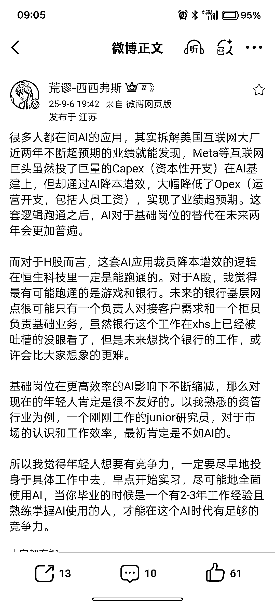

# 懂 AI 自动化的年轻人，正在重新定义“值钱”

> 原文：[`www.yuque.com/for_lazy/zhoubao/bo8zddr2383c2n8b`](https://www.yuque.com/for_lazy/zhoubao/bo8zddr2383c8n2b)

在生财有术参与过数轮 AI 专题实战、并持续产出可见成果的大学生，如今放到就业市场上，其竞争力很有可能不输给头顶 985 光环的同龄人。

以我招人的视角来说，假若在简历上瞥见这类描述：熟练组合多种 AI 工具完成视频制作；依托多维表格，借助 n8n 或 Coze 打造内容自动化流水线；用一套 AI 流程快速完成整场会议录音的归纳提炼——我很难不立刻提起精神。

这些能力单独拎出来并不花哨，但在当下的大批求职者中，已然是凤毛麟角般的存在。

可惜的是，绝大多数简历依旧停留在堆砌空泛词汇的阶段，对 AI 的全部了解不过是和某些国产大模型有过几次浅层对话。

* * *

看看评论区里的声音，也很有意思：

乐轩麟：学界玩 AI 早已司空见惯，当下更稀缺的，是把 AI 扎进真实业务场景里的人

夙愿学长：硅谷最近新出现了一个挺火的职位叫 AI 工作流优化师，核心任务就是帮企业用 AI、Agent 等工具把重复枯燥的活儿压缩提效

夙愿学长：我六月刚毕业，翻了翻近期的招聘，亦仁哥这话一点不虚

岳晓磊：没毛病

亦仁：不过在生财里面已经把这些 AI 玩得转的人，多半也不打算去打工了

徐富贵：别讲大学生了，如今不少在职场上待着的人依然守着老路子，有些人连 AI 聊天的基本操作都没怎么碰过😂

b70（allin 版*：我来证实一下老大的说法，双非普通本科，靠着 YouTube 航海的经历，已经在🐻厂做运营实习生

跑通小闭环✅：恭喜恭喜🎉🎉🎉

看到这条评论，我顺手去问了问豆包，它表示“🐻厂”常被拿来指代百度。原因是百度的品牌标识里有熊掌图案，于是网友们就用“熊厂”这么叫，后来加上萌感十足的 emoji🐻，便有了“🐻厂”这种叫法～

这么一说，是不是忽然领会到互联网大厂“动物外号”的趣味了？像阿里被喊“猫厂”，京东被喊“狗厂”，通通是从品牌 LOGO 或企业元素演变来的，这么一记，还挺好玩的。往后撞见类似叫法，多数情况下也能看个明白了～