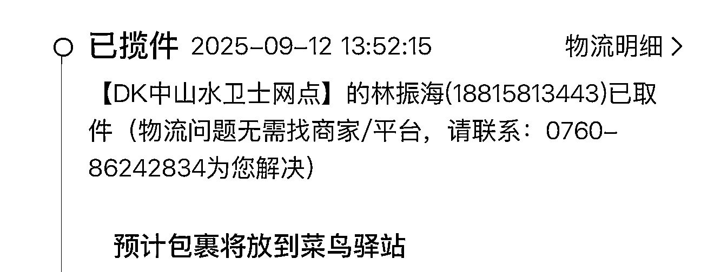
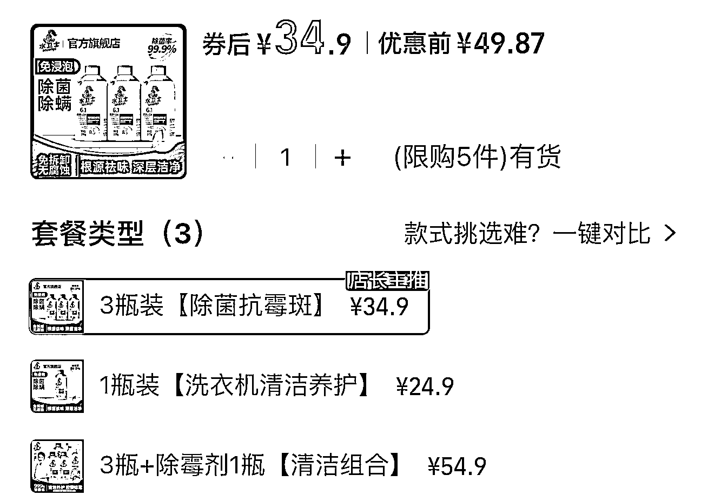
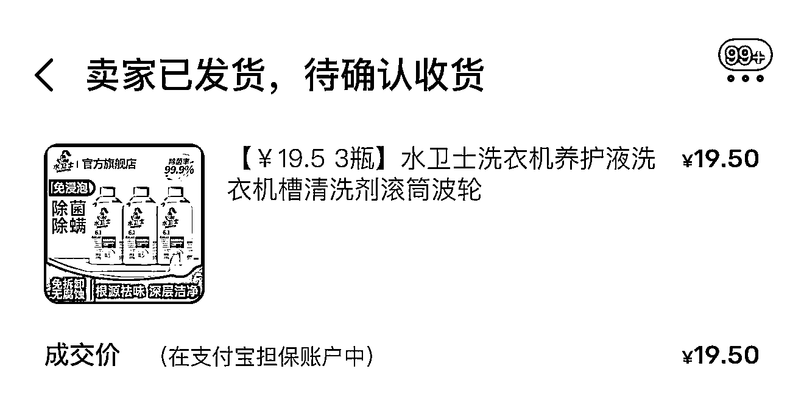

# 闲鱼上那些“代下单”链接，到底是怎么赚钱的？
作者：龙哥

很多人刷短视频看到心动的商品，第一反应就是去闲鱼搜一下。搜出来后经常能看到“代下单”“帮拍”“官方直发”的挂单，价格比直播间低不少，发货还是官方旗舰店，质量看起来不用担心。但这中间的套路，很多人根本没看懂。

其实这就是典型的流量入口做引流，渠道差价做盈利。

* * *

为什么有人愿意做这个？因为各大电商平台和品牌为了冲销量、完成任务，会给到一批有真实推广能力的渠道商非常优厚的条件。渠道商拿到的就是低价、补贴、返利甚至专属优惠券。下单是有门槛和要求的，不是随便卖。

把这些商品放到闲鱼上，就是把公域的视频种草流量，截留到自己的私域或闲鱼店铺里。卖家并不自己囤货，而是接单后从自己的渠道价里拍下，再转给买家。赚的就是渠道拿到的内部价和用户实际支付价之间的信息差。有的走的是平台官方的低价活动，有的走的是薅羊毛返利机制，有的纯粹是品牌放量的清库存。

有做的人表示根本不放在闲鱼公开卖，而是直接做私域沉淀，一手渠道转一手客户，利润更高也更稳定。至于售后问题，实物类基本都是靠网供店或代发商家来完成接单和发货，链条走通了，体验和官方购买基本一致。

简单说：你看到的便宜，是信息差的游戏，不是白给的。