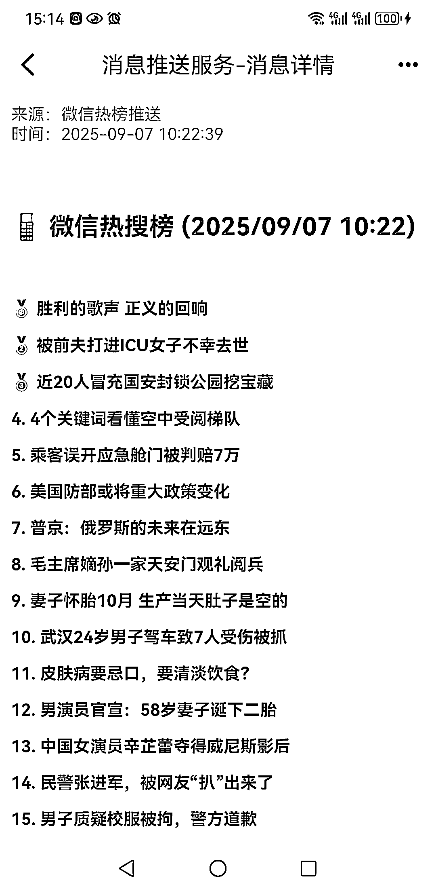

# 花半小时搭好一套🛰️热榜早报，之后每天自动送到手上

大家好，我是 龙哥。

最近航海参加👸号的群里热闹得很，聊到做号痛点，大家的吐槽几乎一模一样，我自己也在其中：

第一，根本不知道选题从哪里来。
第二，为了找选题耗掉大半天，怕漏掉大新闻，又舍不得花钱买热榜订阅。
第三，看到别人发热门话题跟着写，结果自己的稿子出来时，热度早就凉了。

说白了，就是一边焦虑热点，一边被热点追着跑。我就想，有没有一种办法，能给我免费当个热榜秘书？

还真有，而且完全不花钱。

我把三样现成的工具串起来就搞定了。

第一块负责把消息送到🛰️，是 WxPusher。
第二块提供热榜数据来源，用的是天聚数行 API。
第三块负责每日自动运行，不用一直开着电脑，就是 GitHub Actions 做定时任务。

三者一拼，每天早上 10 点，我的🛰️就会准时收到一份热榜推送。以前那种“别人都在冲热点，我还在到处翻素材”的那种窒息感，现在彻底消失了。

整个搭建过程也就半小时左右，搭完一次就能一直用。

* * *

评论区：

清木宁 : 谢谢分享，明天来试一试。

xq : 这个做成小工具，是不是也能弄个订阅模式呢[呲牙]

nancy : 肯定可以啊