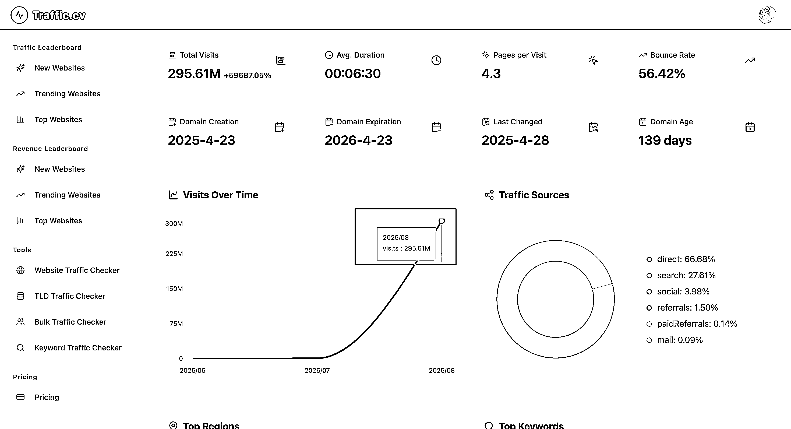
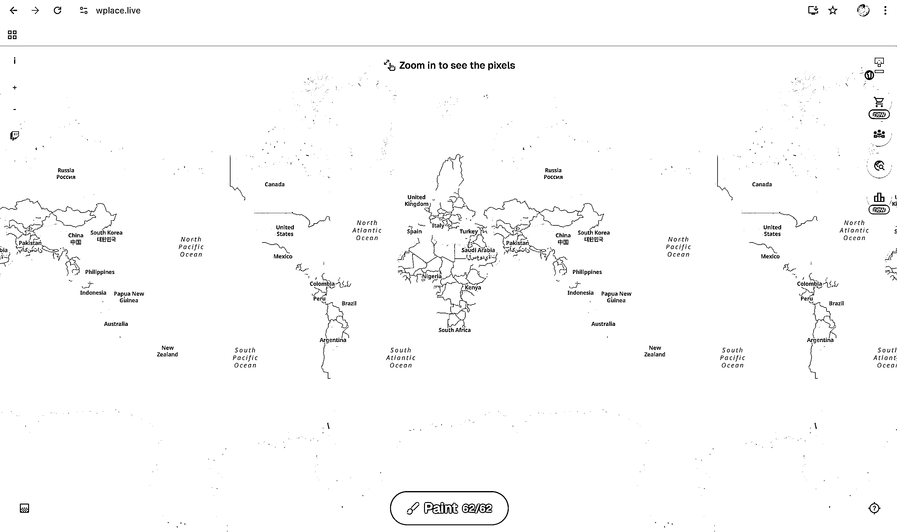
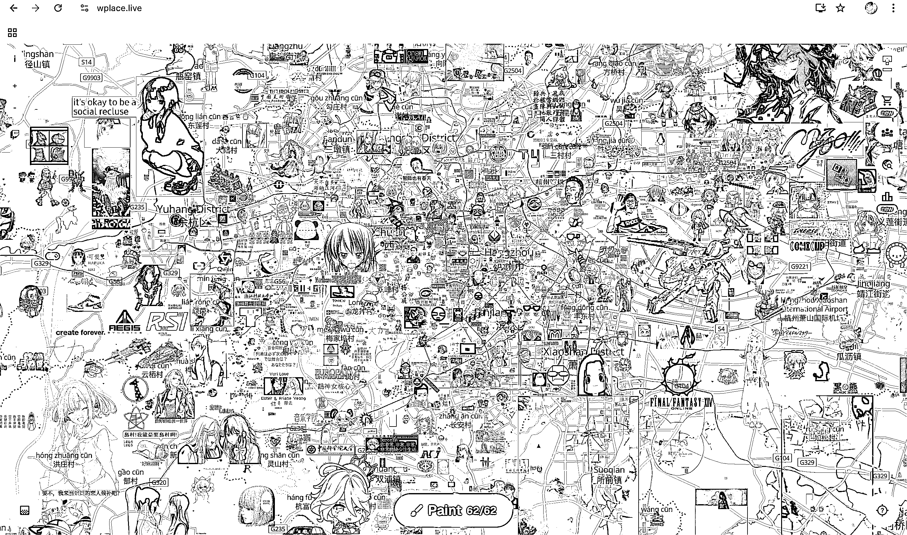
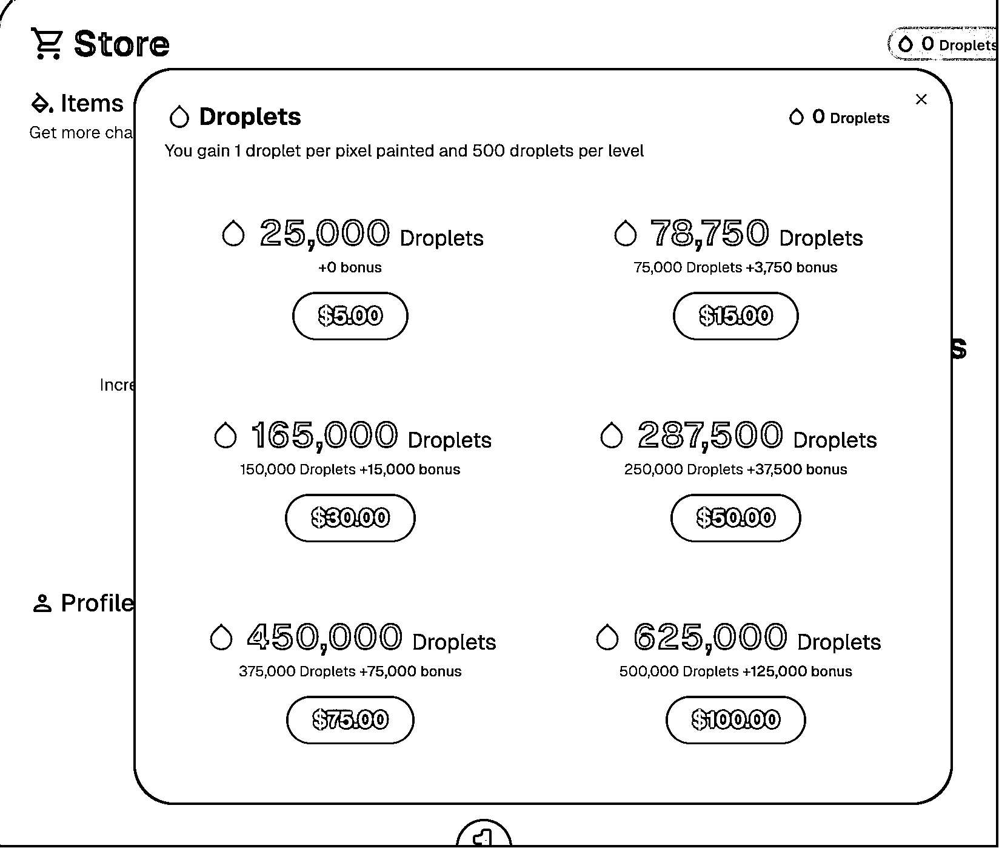

# 一个像素涂鸦地图，把月度访问从 49 万拉到 2.95 亿，这波怎么爆的？

最近在 Traffic.cv 上刷数据时撞见一个离谱的流量曲线。

七月份，这个站还在 49.4 万左右的体量里默默无闻。一个月后，八月份直接冲到 2.95 亿，几乎是 600 倍的跃升。这种级别的爆发，在产品/流量板块里基本就是异常值。

站点本身的概念很简单：一个供全网共同创作的开放地球画布。把世界地图摊开到像素粒度，任何人都能在自己想到的经纬度上落笔涂鸦。风格是复古像素风，画满了之后放眼望去像一张会呼吸的数字地毯。

更有趣的是它的社交属性。地图不是私人的画板，而是公共的展览馆。你把视角拖到杭州，会发现整个区域被二次元角色、迷你场景和各种迷因占据；拖到别的城市，又是另一种亚文化景观。大家既是创作者也是观光客。

商业化也走得很直接。平台售卖名为 droplets 的道具货币，买了就能解锁更多画笔、特效和编辑权限。卖工具、卖皮肤的经典变现逻辑，做得干净利落。

数据端能捕捉到这种爆发，正好也顺手安利一下我常用的情报工具 Traffic.cv。它可以免费查任意站点的访问趋势，用来盯对手、找 SEO 空隙都很方便。

* * *

评论区：

龙哥 : 感谢分享，已中标