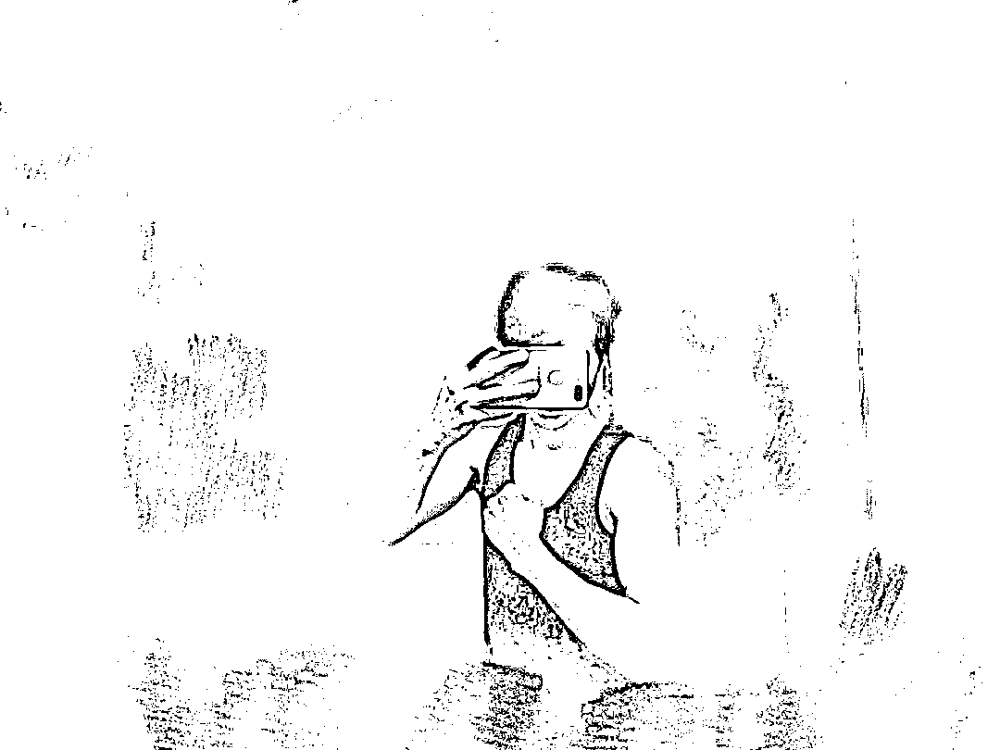
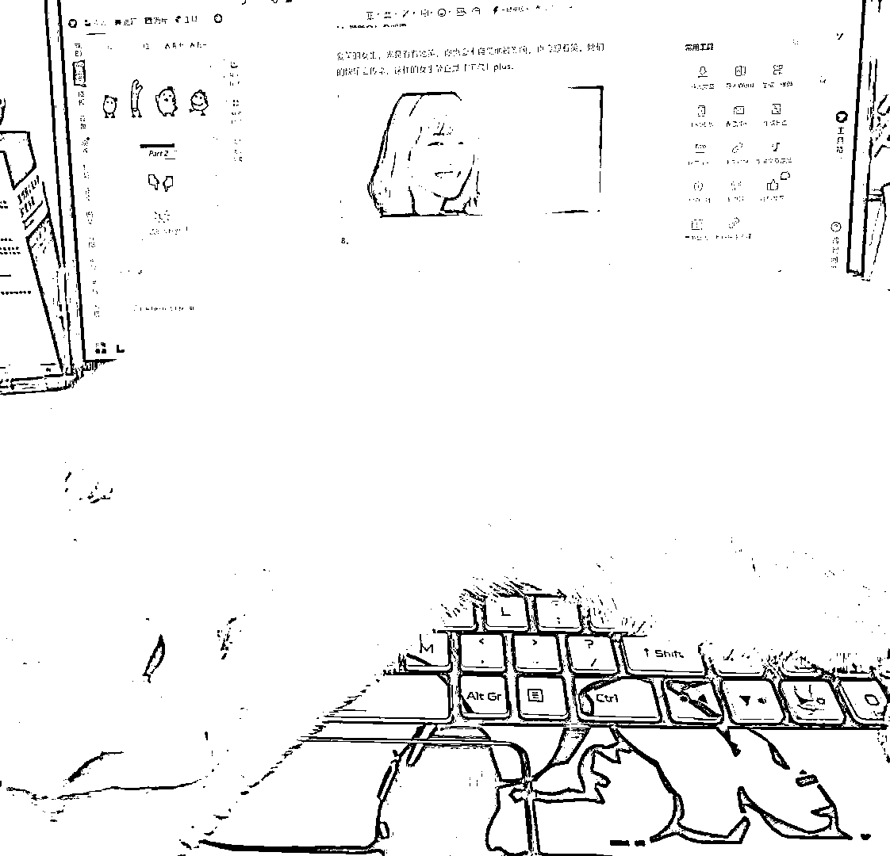
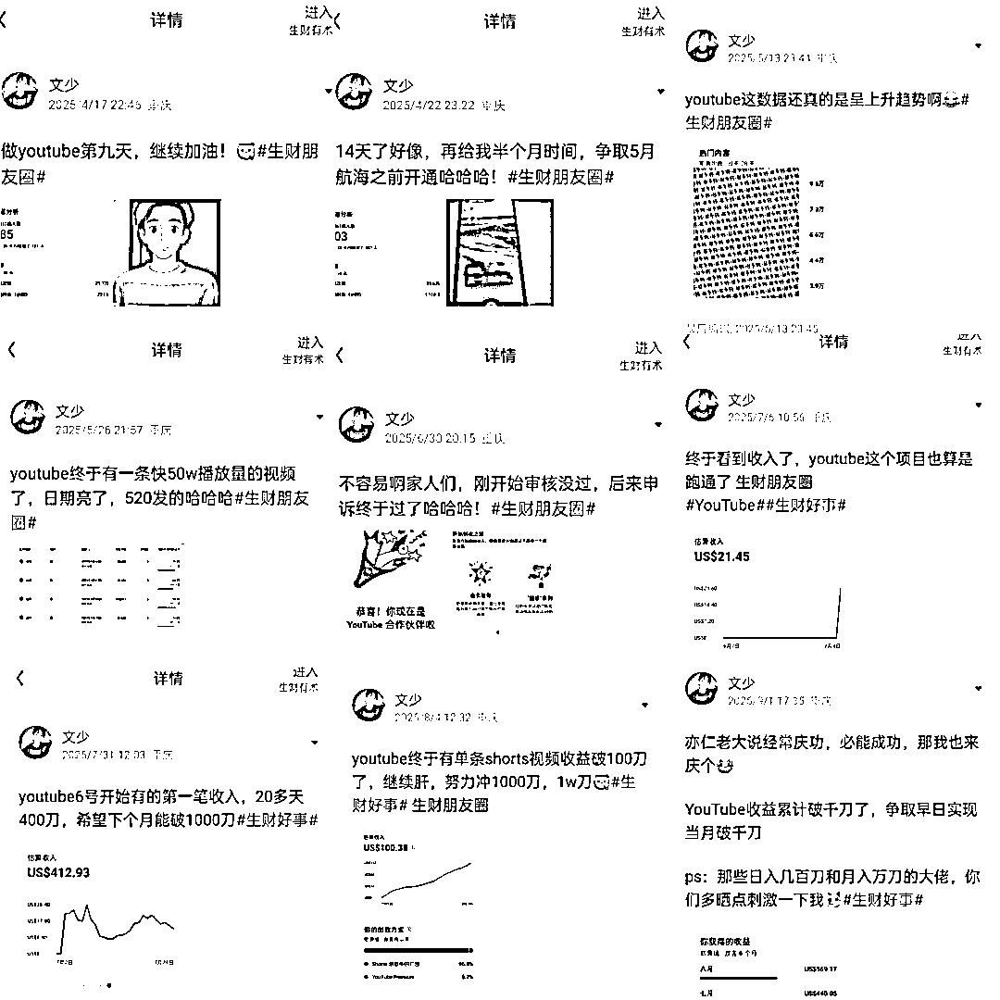
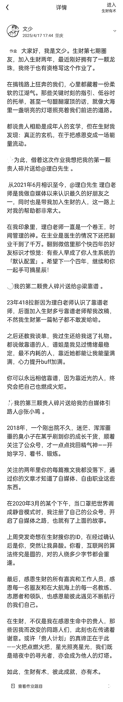

# (精华帖)(145 赞)从理发店学徒到 YouTube 赚美金，我的两年破圈之路

你很难相信，一个在理发店里打工的学徒，两年后居然靠 YouTube 赚到了美金。可这件事真的发生了，而故事的主角就是我。

大家好，我是文少。一个不算聪明，但始终不甘心停在原地的人。目前我是赚钱传术师，也是第七期圈友，主要精力都扑在了 YouTube 上。今年5月跟着航海跑完一程后，我顺利进入了 YouTube 深海圈。手里一共运营着4个频道，其中一个已经拿下高级 YPP，另外3个也正在 YPP 的申请路上。

回望加入赚钱的这两年，可以说是我人生中蹿得最快的一段时光。我不仅拿下了两篇精华帖，还先后体验了志愿者、领队和教练这几个角色。每一步都在刷新我的边界。

今天突然想写点东西，是因为看到了曹教练和枨惘教练的真诚分享，那种掏心窝子的复盘触动了我。作为 YouTube 深海圈的一员，我也想借这个机会，认真梳理一下自己的来路。

这篇文字不是项目拆解，也不会教你怎么三天暴富。它更像是一份个人成长病理报告：我会尽量回到当时的视角，聊聊我踩过的坑、做过的错误选择、以及如何一步步从迷茫里找到自己的节奏。如果你也常在深夜怀疑自己——书读得不多，底子比别人薄，拼了半天却看不到光——那我想告诉你：我的起点比你低得多，现在不也走出来了？

文章部分内容可能有点像流水账，但字字都是真心话。具体的细节和过程，我整理在飞书文档里了，有需要的朋友自取就好：

https://xpjursanoo.feishu.cn/wiki/EBjsw1RZ7iU91ckMGsccQijdn4g?from=from_copylink

路不是想出来的，而是一步步蹚出来的。如果我的故事能给你一点“他行，我也行”的底气，那我就没白写。

我是文少，咱们在更高处碰面。