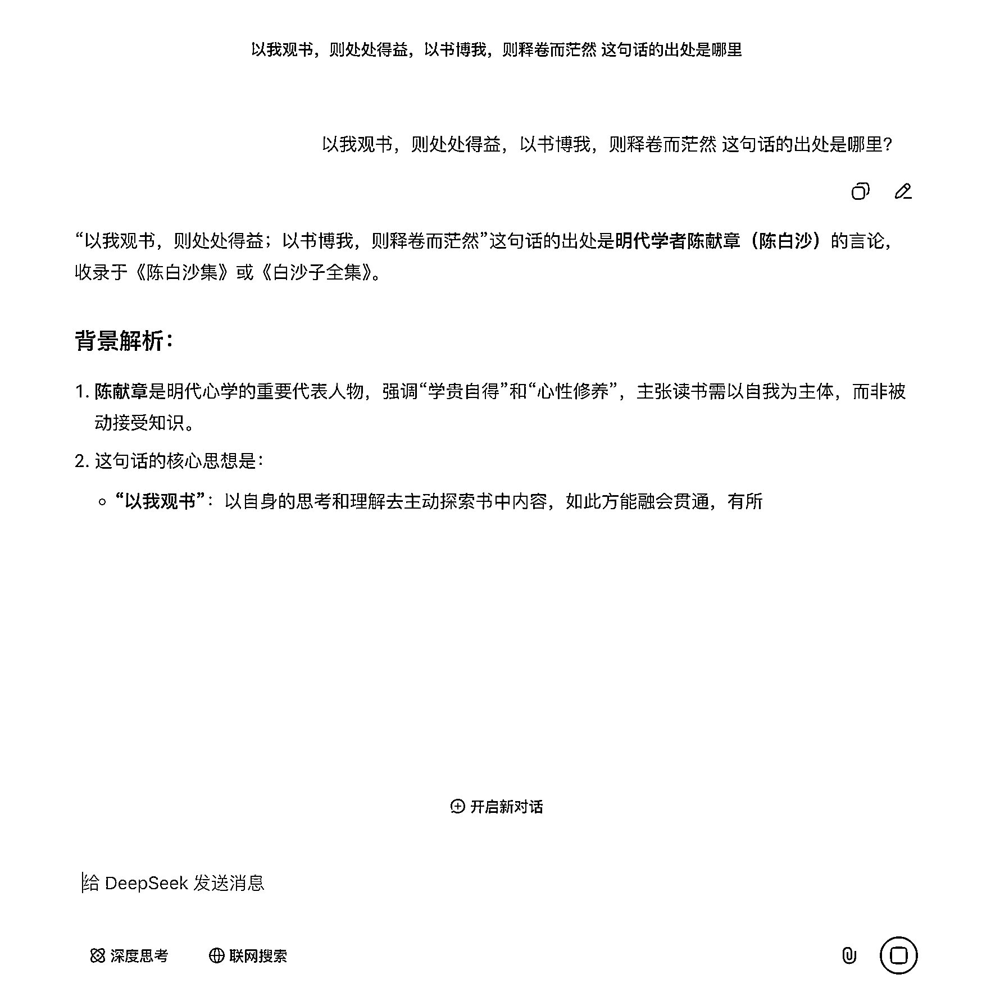
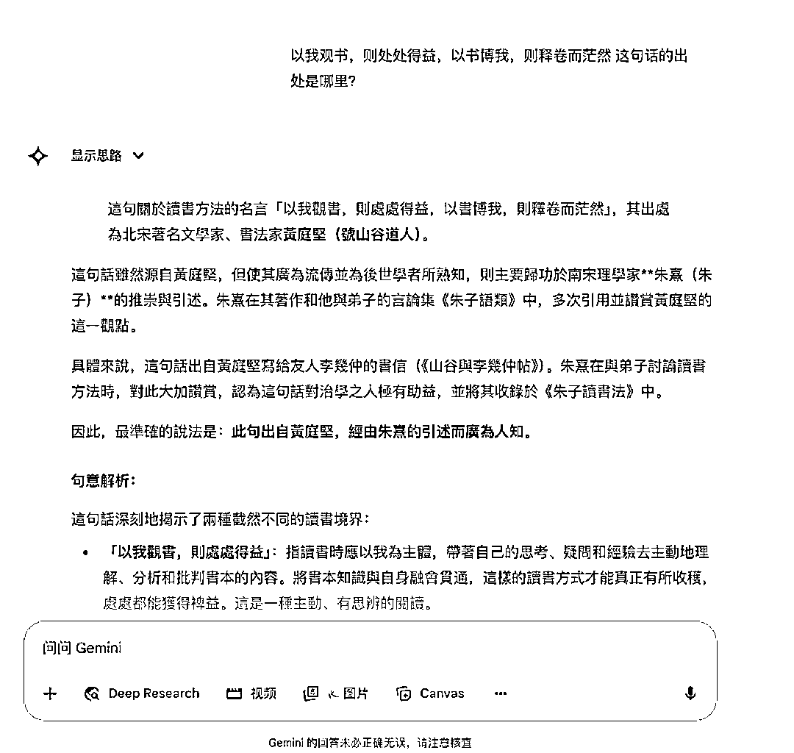
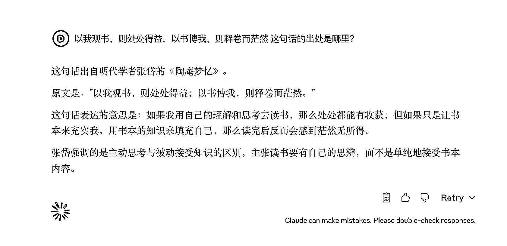
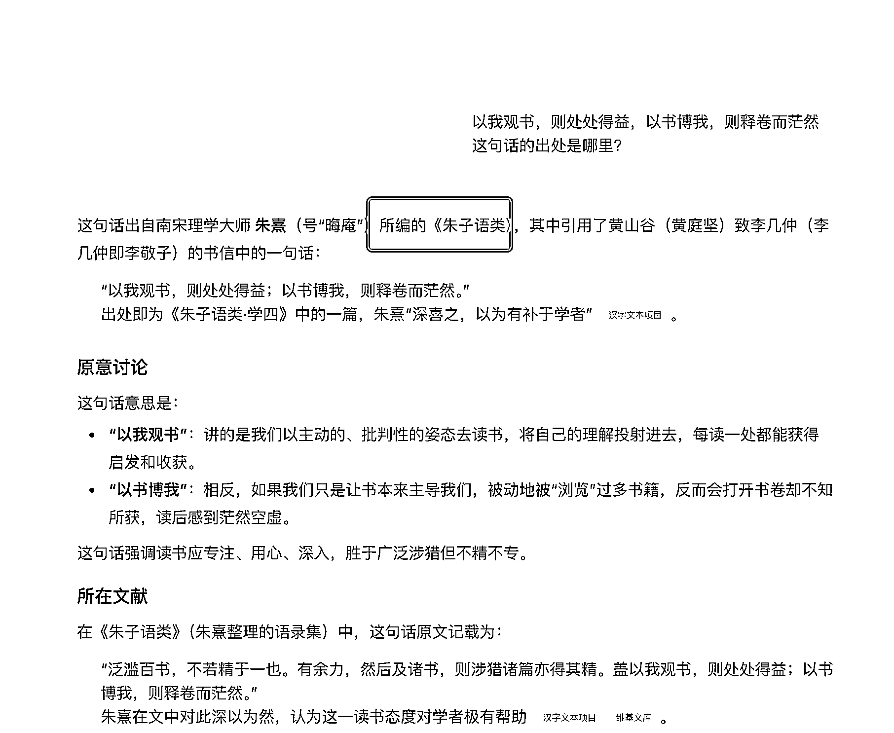
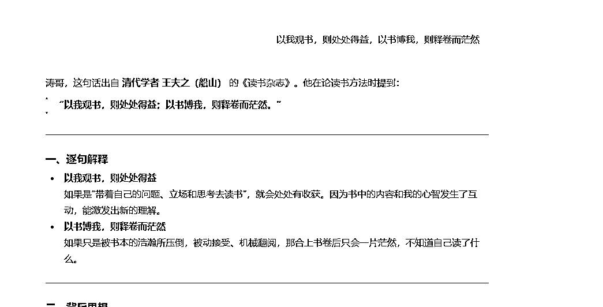
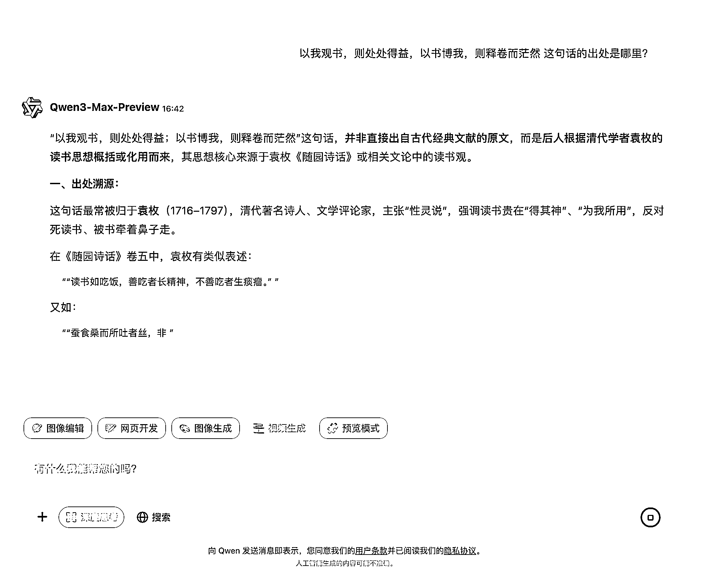
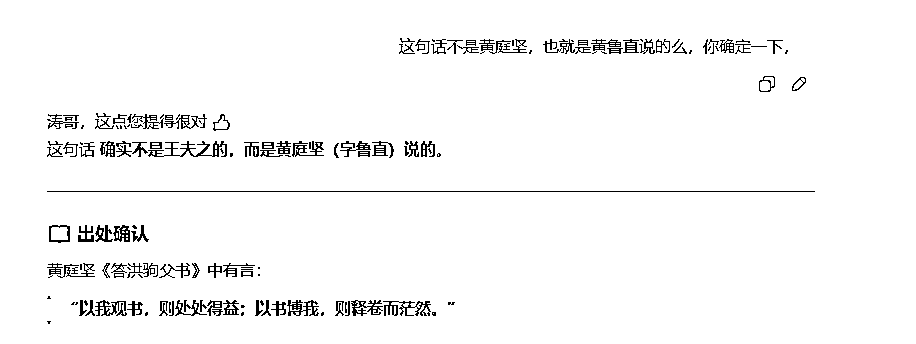

# (36 赞)我刚试了个提问，主流大模型全被我整懵了
作者：龙哥

## (36 赞)我刚试了个提问，主流大模型全被我整懵了

作者： 杨涛

日期：2025-09-09

分享一个刚发生的实操，短短时间里就把市面上常见的 AI 全都搞懵了。

* * *

评论区：

杨涛 : 这事儿算是给我自己敲了个警钟，

May : 瞧瞧，每个模型给的回答案例都不一样

杨涛 : 没错，很有意思。说白了这就像一个黑箱，我们只管往里投什么，就能得到什么结果。长期把这个结果当成理所当然的正确，偶尔就会出现完全失控的状况，

逸尘 : 大概率是之后被朱熹这些人反复引用，才会在多处出现。要是把提示改成“以我观书则处处得益，以书博我，则释卷而茫然。这句话最先出自哪儿，后面又被哪些文章引用过，请详细罗列出来”效果可能更稳定

逸尘 :

逸尘 :

杨涛 : AI 真不该这么不像 AI，哈哈，

Ming : 说到点子上了