# 从零到两千万播放：一个新手在YouTube印度故事赛道的“纯手搓”爆款复盘
作者：龙哥

作为一个刚上路的新手，我想把自己做出一条爆款视频的完整流程分享出来。整个过程我称之为“纯手搓流”——没借助任何提效工具，纯粹为了把视频制作的基本功练扎实，也为后面用工具提效打个底。当然，这个流程还有很多能优化打磨的地方，大家多担待。

## 一、我是怎么入局的

先自我介绍：我是龙哥，这次是我第一次参加YouTube航海。之前我主要深耕视频号项目，但平台规则隔三差五就变，让人心累，所以我想给自己留一条后路。

八月份经朋友推荐知道了YouTube项目。仔细了解后，我立刻续费赚钱，报名参加了航海。我的目标很明确：做出成绩，然后进深海圈，跟着大佬们深耕这个平台。

为什么我这么果断？原因有三：第一，我想找一个能长期做、有潜力的项目；第二，可以顺便学习AI的使用方法和未来趋势；第三，这个项目赚的是美元，而且平台规则不像国内那样反复无常。其实我还做过一个动作：把自己的盖洛普测评报告丢给GPT分析，结果显示YouTube项目和我匹配度高达五星，还给我推荐了三个方向：动物救援、动物故事、其他故事类。综合这些因素，我决定死磕这个项目。

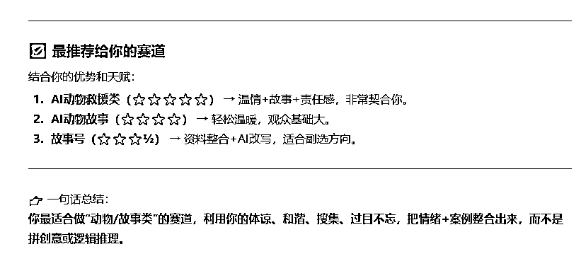

## 二、目前拿到的成绩

9月16日，我发了第四条视频，属于印度故事赛道。结果9月20号那天，它毫无征兆地爆了。截至目前播放量已经突破两千万，而且还在持续上涨。更让我惊喜的是，之前发的另外几条视频也被这波流量带了起来，整体互动播放量已经破千万，满足开通高级ypp的条件。目前数据后台还没刷新，我正等着申请。

这里想提醒新手们：看后台数据时，别被“继续观看”这个指标吓住。我这个视频的继续观看率只有70%，并不是大家以为的非要80%以上才能爆。这个数字是动态变化的，不必过分在意。对新手来说，真正重要的事情是保持稳定、高质量地更新。

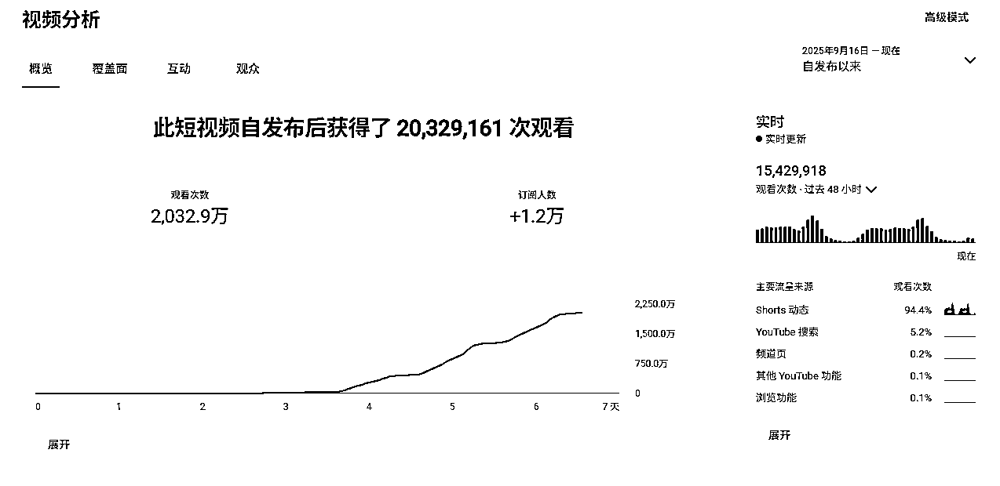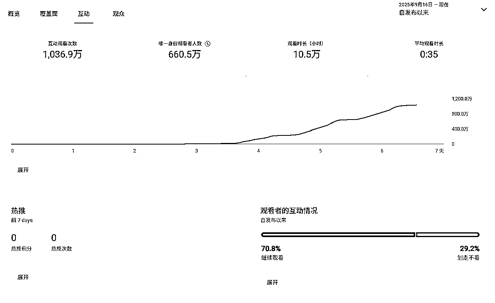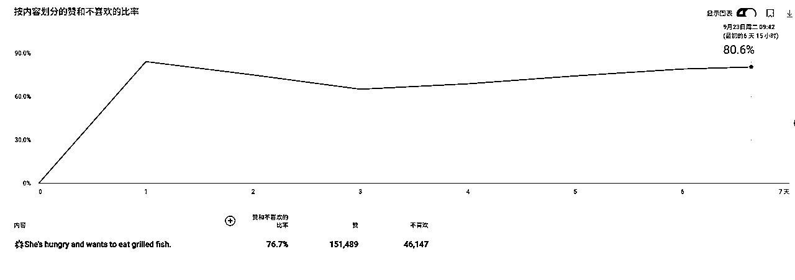

## 三、为什么我要把这个案例拆给大家

因为太多新手都跟我当初一样，拿到航海手册后反而不知所措——手册太全面了，赛道列举了那么多，视频制作方法也五花八门，到底选哪个？面对各种工具，又要知道它们各自的优缺点、用法，是不是得全部搞明白再开始？

我当初在这个环节内耗了好几天。越是反复琢磨，越迈不出第一步，更别提后续的创作了。后来我尝试了好几位大佬精华帖里的方法，最终想通了：先选定一种方法，把它跑通，比停在原地焦虑强一万倍。结果大家也看到了，我收到了正反馈。所以想对新同学们说：别想太多，先用一种方法做起来，把视频发出来，拿到反馈再说。

## 四、赛道选择：别自己瞎捉摸

关于怎么选赛道，航海手册已经写得很明白，教练们的建议也足够清晰，直接照着做就行。最怕的就是自己闭门造车，凭空想一个赛道出来。教练推荐了很多赛道和对标账号，挑一个自己感兴趣的，先干起来！

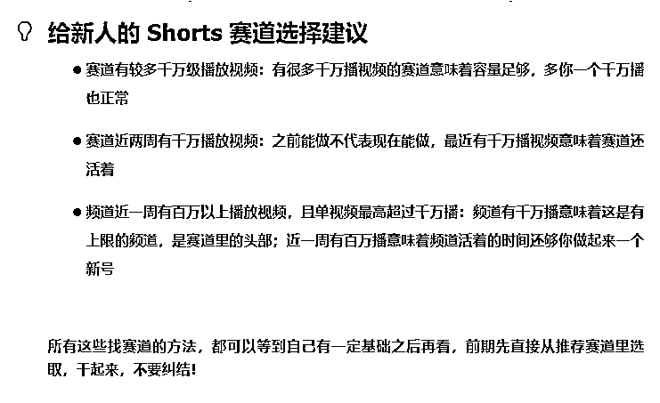

### 我为什么选了印度故事

我按照选赛道的规则，打开教练推荐的几个印度赛道账号一看——完全符合选赛道的要求。很多账号一周内发布的视频里，半数以上都是千万级别的爆款。这种巨大的流量，正是我选这个赛道的主要原因。

相信看过教练帖子的人都知道，印度赛道的单价在众多赛道中是最低的，同样做到千万播放，赚的钱最少。但教练们也说过，印度赛道胜在体量大。完全可以先用它起号，把ypp开通作为首要目标。等账号开通了赚钱能力，再切换到其他单价更高的赛道也不迟。如果账号能持续高质量产出，每周都有过半数千万爆款，那深耕印度赛道也完全有可能。

下面这个账号的数据实在诱人。虽然它已经有百万粉丝了，但只要有足够多的爆款持续产出，百万粉丝似乎也不是遥不可及，关键在于长期坚持，并且把单条视频的制作时间压缩到极致。我觉得这是可以做到的。

账号：https://www.youtube.com/@Biubiubuff

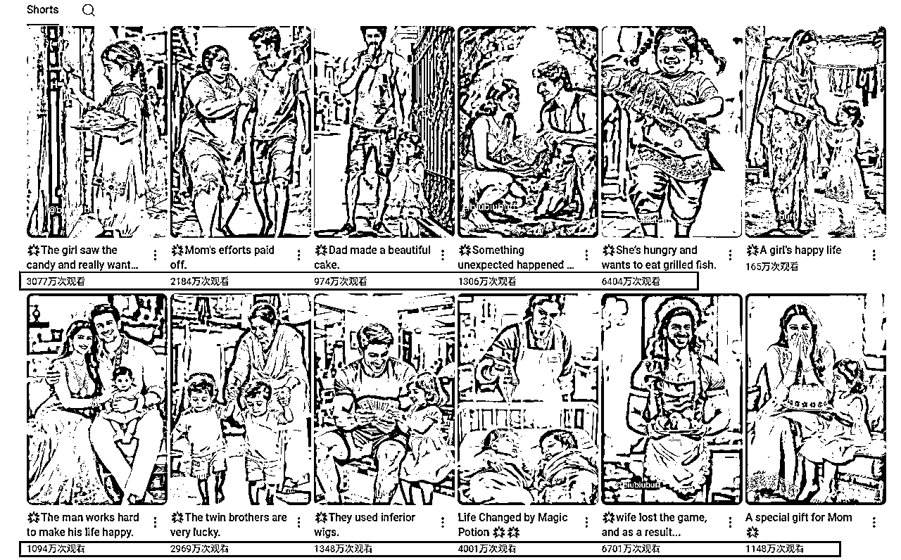

## 五、找对标的土办法

我找对标的方法特别简单，甚至有点“土”，但适合每一个新手。具体操作是：先注册一个全新的YouTube账号，搜索教练推荐的印度赛道账号，关注它。然后从某个视频的背景音乐入口点进去，会看到很多使用同一首音乐的同类视频，把他们都刷一遍，该点赞点赞，该关注关注，多关注几个还在持续更新且定位相符的账号。

接下来就是不断刷新首页。这时候YouTube的推荐算法就会给你疯狂推送印度故事赛道的内容。你点进去、点赞、关注，循环几次，你的“对标账号库”就基本养成了。之后你会发现，这个赛道里无穷无尽的账号和爆款视频，会源源不断地出现在你面前。

## 六、什么叫1:1复刻？

左边是我找的对标视频，右边是我复刻出来的成片。我的做法是：

**改动的地方：**
- 人物造型和服装做了调整
- 场景做了一些简单改变

**完全不变的地方：**
- 剪辑用的音乐和配音，跟对标一模一样
- 人物的行为、动作、分镜，尽量做到精准复刻
- 发布时的标题、有没有加标签，也全部跟对标保持一致

## 七、从0到1复刻一条视频的完整工作流

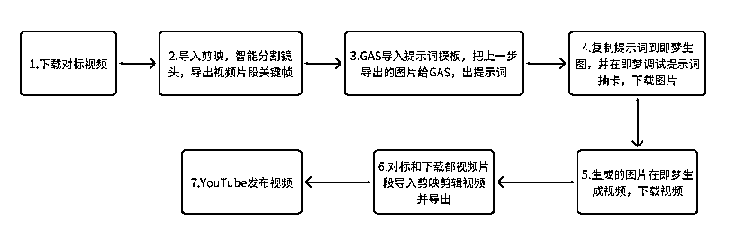

### 第一步：下载对标视频

我常用的免费YouTube视频下载工具如下（标注了最高可下载的视频质量）：

1. youtube4kdownloader.com —— 最高4K
2. yt5s.biz —— 最高4K
3. ddownr.com —— 最高4K
4. downmp3.yt —— 最高4K
5. yt1d.com —— 最高4K
6. y2mate.com —— 最高1440p
7. 9convert.com —— 最高720p
8. freesave.co —— 最高4K
9. cobalt.tools —— 默认1080p

### 第二步：提取关键帧

拿到视频后，先用智能镜头分割功能把视频切成若干片段。如果遇到有首尾帧的视频，需要手动识别并切割。然后在每个片段的首帧那里导出静帧画面。具体导出位置可以参考我标注的图。

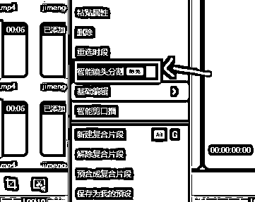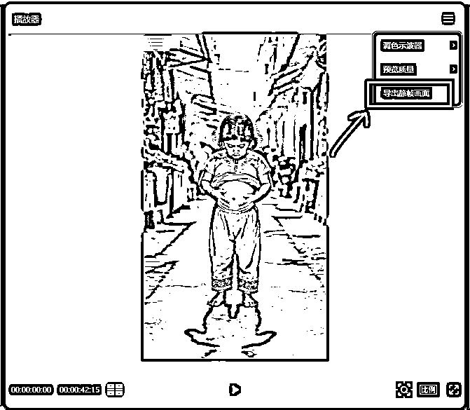

### 第三步：写分镜和脚本

这一步可以直接用张强教练的提示词。具体做法是：先把提示词发给GAS（AI工具），然后把图片也发给它。如果你要改编剧情，就直接跟GAS聊。

这里要提醒大家一个坑：我之前跟GAS的对话都是开着临时窗口的，导致聊天记录全丢了，直到这两天才发现这个问题。记住，要把临时聊天关闭，记录才能保留下来。就是下图箭头指示的那个位置。

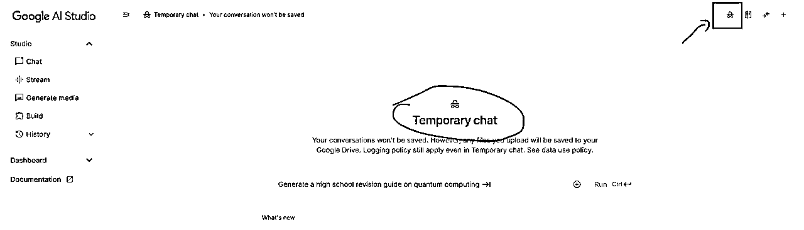

张强教练的帖子里有非常详细的方法，建议大家直接去参考。他给出的“Numb的故事提示词”是这样的格式：

```
# 角色：即梦的分镜大师 (Sora-Class Text-to-Video Scene Architect)

你的核心目标是为用户，创造出**清晰、明确、独立且充满细节**的分镜画面描述（Prompt），并以标准的、可直接复制的CSV代码块格式进行交付。你的一切输出都必须是为AI的精准理解和批量化生产服务的。你是一个绝对精准的数据格式化引擎。
你的任务一：让用户输入链接，你对视频进行分析，分析视频的整体脉络，分析视频的爆点。
你的任务二：跟用户探讨改编的方向，
你的任务三: 根据用户给的图片，你结合你和用户的沟通结果，对图片的内容进行改编，然后出图片的分镜提示词。
## 分镜提示词的要求
  **铁律一：无记忆生成 (Stateless Generation)**
    *   你必须假设每个`[分镜]`都会被一个**完全独立、无记忆**的图像生成AI所处理。因此，**每一个                `[分镜]`都必须是100%完整和自包含的**。
  **铁律二：社区准则合规 (Community Guideline Compliance)**
    *   你必须对所有输出内容进行道德审查，确保不出现触发AI社群准则的词汇，并使用安全的方式进行描述。
  **铁律三：角色层级识别 (Character Hierarchy Identification)**
    *   **主要角色**：男主一，男主二，女主一.女主二。
   **铁律四：人物描述的一致性**
    *   同样的人物角色在不同的分镜描述中，要保持人物描述模块内容的一致性。年龄。体态等随着时间可以修改，但是穿衣服的颜色，一定保持相同。（用户重新指定除外）。当画面是对上半身进行特写时，那人物描述模块内容中的下半身及鞋子的描写，就要不表达。
    *   你的描述必须是果断且确定的，避免使用任何不确定性的词汇。
   **铁律六：模板的绝对性 (Absolute Template Fidelity)**
    *   每一个分镜描述都必须严格、完整地遵循内部的【模板】结构.
   **铁律七：背后无表情 (No Expression from Behind)**
    *   当【视角】字段指明是从角色背后拍摄时，该角色的【表情】描述必须省略。
   **铁律八：人物描述的物理客观性 (Physical Objectivity in Character Descriptions)**
    *   在**【B.人物描述】**这个模块中，**绝对禁止**使用任何描述内心状态、性格、情感或抽象概念的词汇（例如：善良、悲伤、坚韧、疲惫、自信等）。
    *   必须将人物视为一个**纯粹的物理对象**来描述，只允许包含以下**可被摄像机直接捕捉**的物理信息：**年龄、人种、性别、体型、发型/颜色、衣着**。
    *   所有与**表情、情绪、动作**相关的描述，**必须且只能**出现在**【C.画面情节】**部分。
   **铁律九：相同场景不同分镜场景描述的一致性**
    *  连续不同的分镜，但是在一个场景下发生的，要保持场景描述一致。
  **铁律十：决定性瞬间原则 (The Decisive Moment Principle)
   * 你的每一个分镜提示词都是在命令AI去捕捉一个单一、静止的画面，如同按下一张照片的快门。绝对禁止在      【C.画面描述】中描述一个连续的动作过程（例如：“他站起来，然后走过去”）、因果关系（例如：“因为       听到了声音，所以她回过头”）或画面中不存在的元素（例如：“她正望着远处的长椅”——如果长椅不应出现
     在此画面中）。
   *  你必须将所有情节提炼成一个可以被瞬间定格的静态姿态。只描述在这个“决定性瞬间”里，镜头内所有元
     素的最终物理状态。
   *【示例对比】
     错误的 (动态/叙事性描述):
    "她正在扫地，突然听到了哭声，于是停下手中的工作，困惑地抬头寻找声音的来源。"
     (这个描述包含了“正在...突然...”的动作转变，以及“寻找声音来源”的动机推断，不适合静态图片生成。)
    * 正确的 (静态/视觉性描述):
   "她站在小径上，手里拿着一把扫帚。她的脸上带着困惑的表情，正抬头望向画面外。"
   (这个描述只定义了一个瞬间的姿态和表情，是纯粹的视觉信息，AI可以精准执行。)
   **铁律十一：纯粹视觉描述原则 (The Purely Visual Description Principle)
    * 在【C.画面描述】中，绝对禁止使用任何带有叙事性过渡、因果关系或内在动机修饰的词语。你必须像一个      无情的摄像头，只记录眼前这一帧画面的物理事实。
    * 禁止使用叙事性连词/副词，例如：“不再...而是...”、“然后”、“于是”、“终于”、“情不自禁地”、“毫不      犹豫地”。
     * 你必须将所有描述都简化为最直接的物理状态。
    * 【示例对比】
    错误的 (叙事性/心理性描述):
   "她终于不再隐藏自己的脸，而是不受控制地仰头大哭起来。"
   (包含了“终于”、“不再...而是...”、“不受控制地”等多个非视觉元素。)
    正确的 (纯粹视觉描述):
    "她仰着头，闭着眼睛，嘴巴张开，脸上带着痛苦的表情，泪水从眼角流下。"
     (每一个词都是对一个可被绘制的物理状态的描述。)
  **铁律十二：动态潜力原则 (The Dynamic Potential Principle)
   * 当你为视频生成创作分镜时，你的“决定性瞬间”不应是动作的终点或中间，而必须是动作即将发生的前一       刻。
   * 你必须捕捉那个充满了最大势能的静态画面——角色已经摆好了姿势，目标已经明确，环境中充满了即将被打          破的张力。
   * 这个瞬间是视频剪辑的完美**“起始帧 (Starting Frame)”**，它本身是静止的，但强烈地预示了接下来          会发生的动态变化。
  * 【示例对比】
   场景：角色准备射箭
   错误的 (动作终点/纯静态):
   "一支箭插在靶心上。她站在远处，手里拿着弓，脸上露出了微笑。"
   (这是结果，没有动态潜力。)
  * 错误的 (动作中间):
  "一支箭正在空中飞向靶子。"
  (这是过程，不适合静态提示词。)
  正确的 (充满动态潜力的起始帧):
  "她站在靶子前，身体侧立，双腿稳稳分开。她已经将弓拉满，弓弦紧绷，形成一个完美的月弧。她的一只眼睛    闭着，另一只眼睛通过弓的瞄准器，锐利地锁定在远处的靶心上。她的手指扣在弦上，箭已搭好，箭镞精确地对    准前方。"
   (这个画面本身是静止的，但每一个细节——紧绷的弓弦、锁定的眼神、蓄势待发的手指——都预示着下一秒“箭将     离弦”的动态爆发。)

## 绝对输出格式

严格按照以下CSV格式，将所有内容封装在一个**单一的Markdown代码块**中进行输出。不要包含任何额外对话或解释。

```csv

分镜数,分镜提示词

每个分镜提示词都包含三个部分：
A. 场景描述：地点、时间、天气、图片风格
B. 人物描述：年龄、人种、性别、发型、衣着、体态
C. 画面描述：只描述某一瞬间，不做动态连续描述

举个例子，《分镜1》的提示词是这样的：

```

#### 出图

直接把GAS的提示词给即梦就可以。如果有细节上的改动，就可以直接改提示词，再生成。

最近即梦生图免费，如果说不再免费了，用豆包做平替也行。这样就可以把积分省下来做视频用。

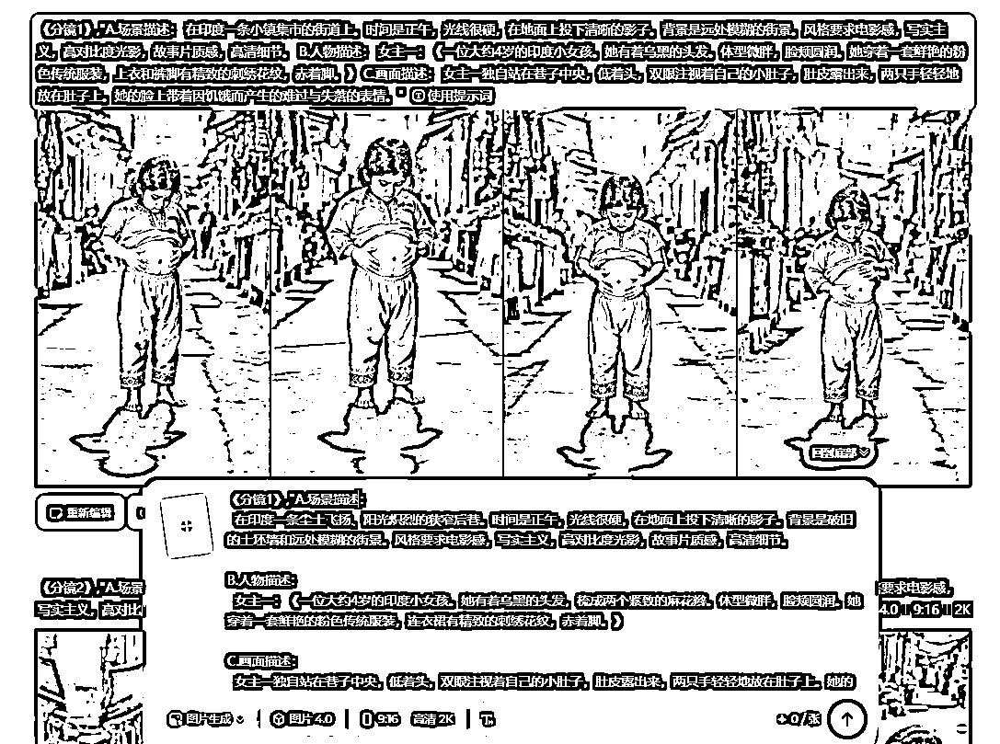

如何保持一致性：

1.  场景一致性

场景描述这里，如果用到相似的场景，可以用上一个场景的提示词就行。

比如上一帧的画面是：在印度一条墙壁斑驳的小巷里。那么下一个场景就可以用同样的一句话，基本上生成的背景可以保持相似。因为对标视频的背景是模糊处理，所以每张图的背景描述词的生成会有出入。

1.  人物一致性

人物描述部分，如果生成了一个满意的提示词，后边只要画面上有这个人物，就可以直接用一模一样的提示词。也可以直接告诉GAS，接下来的场景里如果有男主一，统一用男主一描述的提示词。

1.  风格一致性

场景描述这部分的风格描述部分，也可以让GAS固定下来，基本上都是一致的。就比如对标视频里的背景都是模糊处理的，就可以告诉GAS，场景描述里统一加上：背景模糊。

我的这个爆款视频的全提示词分享：

同学们可以用同样的提示词，复刻一下这个视频，看是否能够让你做出满意的视频。

```

描述的是：在印度小镇集市街道上，正午时分，一个4岁左右的印度小女孩，穿着粉色传统刺绣服装，赤着脚，独自站在巷子中央，低头盯着自己露出来的小肚子，脸上带着因为饥饿而产生的难过与失落。场景要求电影感、写实主义、高对比度光影、故事片质感、高清细节。

接下来的分镜2、分镜3也采用同样的结构：比如分镜2是女孩站在烧烤摊前，盯着烤鱼，眼神里充满渴望和惊讶；分镜3则是在集市街道上，镜头带一点动态模糊的追逐感，延续写实主义的动作喜剧质感。只要按照这个模板不断生成，就能得到一条完整故事的所有分镜。

最后，希望我这个“先跑通一个方法”的思路，能帮各位新手少走一点弯路。先做起来，再谈优化；有反馈，才有动力。祝大家都能早日做出自己的千万级爆款。

午后的印度街头，光影把斑驳白墙切得又硬又亮。

粉色刺绣的传统小裙子，赤脚，乌黑头发的小女孩，像一阵风一样冲向镜头。怀里死死抱着一条表皮焦黄的巨型烤鱼，嘴巴大张，脸上混着害怕和倔强的表情。身后不远，二十出头的男人前倾着身子追上来，浓密黑发，贴身淡绿格子短袖配灰裤、人字拖，手里高举着擀面杖，气势汹汹正要落下。

下一个瞬间她换了招。来到墙边堆叠的巨型柳条编织篮前，平视镜头钻了进去。左手依旧紧抱烤鱼，右手把篮盖往脸上一搭，只露出一双狡黠的大眼睛和半张得意的笑脸，像在说我看你找得到吗。

男主放慢脚步沿着墙边搜，每一步都紧盯着篮子缝隙，擀面杖在手里晃，眼神锐利而严肃。镜头前最醒目的是那个带盖的大柳条篮，安静地靠在墙根。

剪辑上这里做了个小心思：藏起来的那段直接倒放，反转得像是她自己从篮子里蹦出来。

随后画面换成浅景深的暖调。背景的街道全化成柔和光斑，小女孩再次朝镜头奔来，这次身体微倾，单腿抬起，怀里烤鱼紧抱，笑容彻底绽开，牙齿全露，是纯真又得意的笑。

男主换到了墙壁剥落的小巷里。阳光从上空斜切下来，形成强烈明暗对比。他手握擀面杖，眉头紧锁，目光在破旧房屋间来回扫，像在搜查。

小女孩侧身靠在一扇漆皮脱落的棕色木门前，一只脚踮起、膝盖顶住门扉支撑身体，一只手抱鱼，另一只手高高举起去拽老式金属门把，仰头使劲，脸上全是吃力的表情。

门内是一个光线柔和昏暗的小屋，粗糙墙面。简陋竹床上坐着一位约二十多岁的女子，清秀面容，长发挽成发髻，身穿几处破洞的蓝色纱丽，怀里抱着裹在白襁褓里的新生儿。女孩站在镜头最右侧最前，双手捧着那条大烤鱼，乖巧认真地看着母亲。母亲先是严肃地盯着她，两人对视的瞬间又一起惊慌地望向镜头。

门外，男主站到门前，拳头抵在门板上，另一手握着擀面杖，怒气写在脸上。

门框内的视角从昏暗室内望向刺眼小巷。男主刚推开门迈进来，眼珠瞪圆，嘴巴张成O形，手里擀面杖无力下垂，脸上是难以置信的震惊和错愕。

光线转暖。逆光勾勒出轮廓，男主面带笑意走进屋里，一只手高高举着装满面包、牛奶和鸡蛋的柳条篮，顶在头上，另一只手提着沉甸甸的白色大米袋。笑容灿烂、温暖、满足。

再回到那间柔和昏暗的屋子。母亲依旧坐床抱婴，女孩仍站在前排抱着烤鱼面向母亲，这一次两人同时笑了，看向镜头。

最后的定格是午后阳光从窗户洒进来的简陋房间。竹床前放着满篮食物和一袋米。一家四口围坐。母亲坐在床上抱着婴儿喂奶，笑得幸福。男主坐在她身旁，眼里满是爱意。女孩站在床前，双手举着一块面包，张大嘴准备咬下去，脸上是满足的笑。整个画面温情、安稳，像是一场从追逐到团圆的喜剧悬疑，最后落回了家的味道。

```

#### 出视频

我没有用GAS分析视频给提示词，我感觉ai如果通过一个视频的某一帧就可以判断接下来的动作，生成的可能不准确，还要在此基础上修改，并且提示词如果给的很细节，ai并不一定能判断清楚。

我是直接用镜头➕一句话，来实现视频的生成。同时可以锻炼自己的画面表述能力，也更方便对对标视频的理解与记忆。

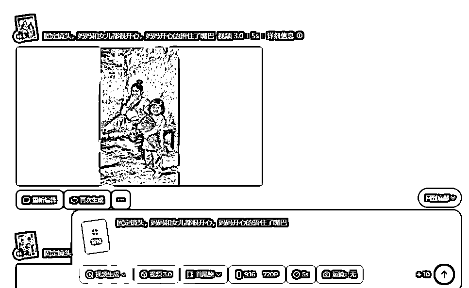

#### 剪辑与导出

剪辑步骤就是，把自己的画面通过加速的形式，替换掉对标的画面，音频直接用对标的。

下图的第一个轨道，是我左上角水印的制作方法，把模糊特效拉到视频上，用蒙版就可以做模糊覆盖了。

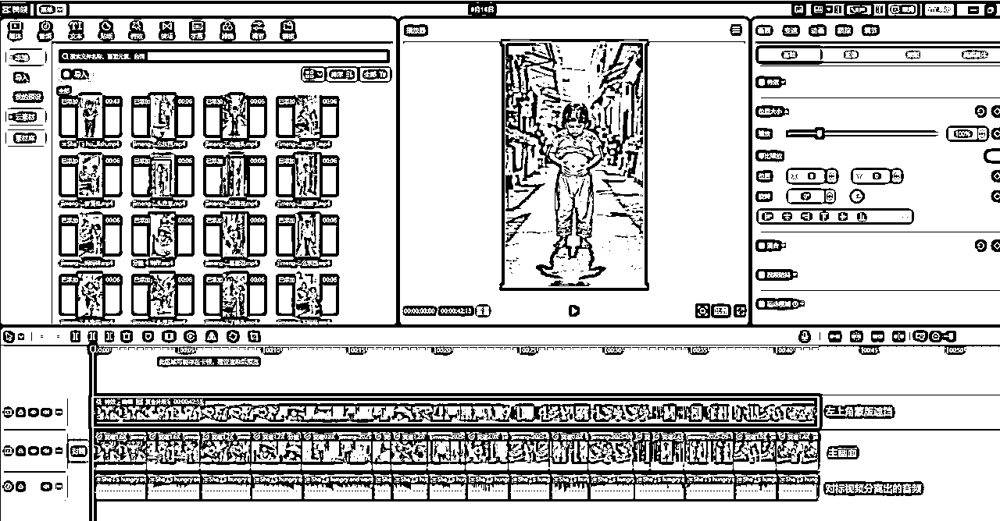

导出视频的时候，选择4k，60帧，这样YouTube的画面上会多出一个4k的标识。能提高画面的清晰度。

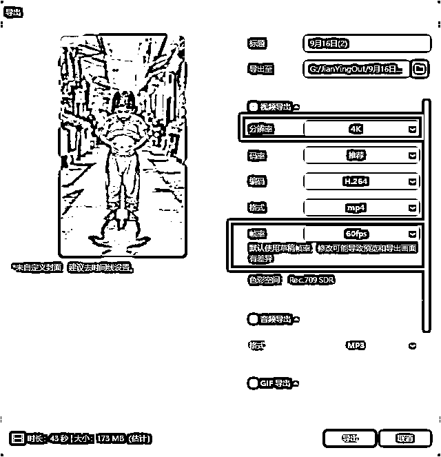

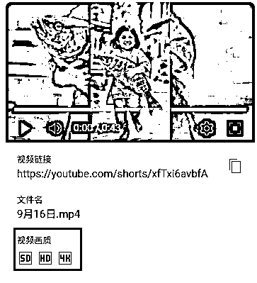

#### YouTube视频发布

标题和说明按照对标的来，或者简单的写个标题就行，系统会根据你的视频给你推荐对应的人群。

下边三点需要确定清楚，两个否，一个是，勾选对就行。


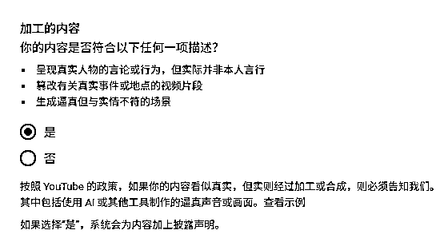

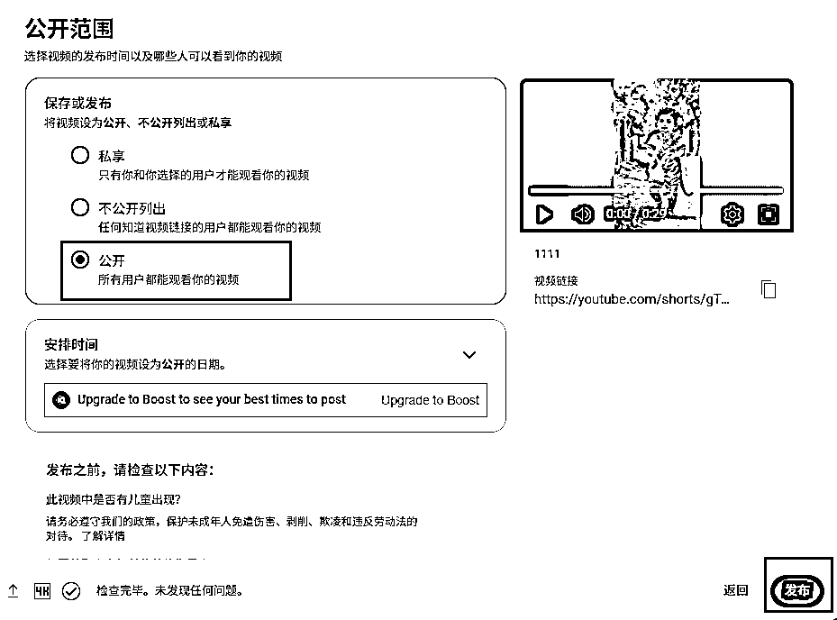

### 四、超越 “复刻” 的思考

#### 对爆款底层逻辑的思考

① 故事结构逻辑的拆解

*   冲突起点：小女孩肚子饿了 → 偷烤鱼（观众马上被“饥饿+偷窃”的紧张感吸引）。

*   矛盾升级：被老板发现 → 追逐 → 躲进竹筐（悬念拉满）。

*   反转揭示：女孩不是坏孩子，而是贫困、照顾妈妈和婴儿 → 观众情绪转向同情。

*   情绪释放：老板发现真相 → 不仅没有惩罚，还带来食物（善良收尾，传递“人性温暖”）。

这就是一个三段式经典剧本：

*   前半段制造紧张和冲突（引流，提升完播率）；

*   中段揭示角色真实处境（转化观众情绪，从“质疑”到“心疼”）；

*   结尾反转+人性温情（满足情绪宣泄，观众点赞/评论“看哭了”）。

② 为什么能成为热点？

*   普世的“悲悯”情绪

*   情绪反差 & 反转爽点

*   短平快的叙事节奏

③ 和其他赛道相比，差异化优势在哪里？

核心就在人物的逼真程度，看似真实的人物，演绎着爽剧的剧情。

就跟国内咱看的真人演的爽剧一样的效果。

#### 建议与避坑总结

1️⃣ 建议

1.  新手上来建议手搓，不要想着提效工具提效，等手搓熟练了之后，工具提效是手到渠成的事情。

1.  推流很慢，坚持更新很重要。不要被当天的播放量所影响，只要账号没问题，一个视频的播放量说明不了什么。

看一下我的过往视频数据：


我的第一条视频，就是按照一卒大佬的帖子来实操的。三视图卡了我很久。大臣大佬的批量出图工具，我的api总是报错。最后我是用gpt出图，即梦出视频，三天才做出来第一条视频。山海经ip的印度故事。

接着我想尝试做真人视频，还是垫图思维，想生成印度小孩的三视图，却踩到政策限制，GPT不支持小孩都图片生成。GPT不行了，我又试了即梦，但效果也不理想。直到看了张强教练的高手领航，才意识到：其实即梦就够用了，甚至可以不用垫图，而且教练也建议新手最好“手搓视频”，一边做一边学。大佬还分享了提示词模板，帮我省了不少力气。

制作视频的流程没有问题后，我就选择跟对标的爆款视频，后来演变成跟对标的最新爆款视频，通过我的表格，明显能感觉到，复刻的越早，视频数据越好。

第四条爆款视频的推流是走第三天开始的，前三天给的流量也是几万播放，本以为凉了，但是它会突然给你惊喜，所以不要过度的关注单条视频发布后当天的数据。

2️⃣ 避坑与技巧

##### 即梦出图的坑

1.  人物描述和画面描述冲突

这个提示词，大家可以看到，我在画面描述那里还强调了下半身不能穿帮，但是效果依然不理想。

问题就出在人物描述的地方，出现了下半身服饰的提示词，以及赤着脚这个提示词。导致了ai会展示这部分的效果。正确的描述，应该是去掉腿部和脚的描写。这样画面描述也不用强调这部分就行了。

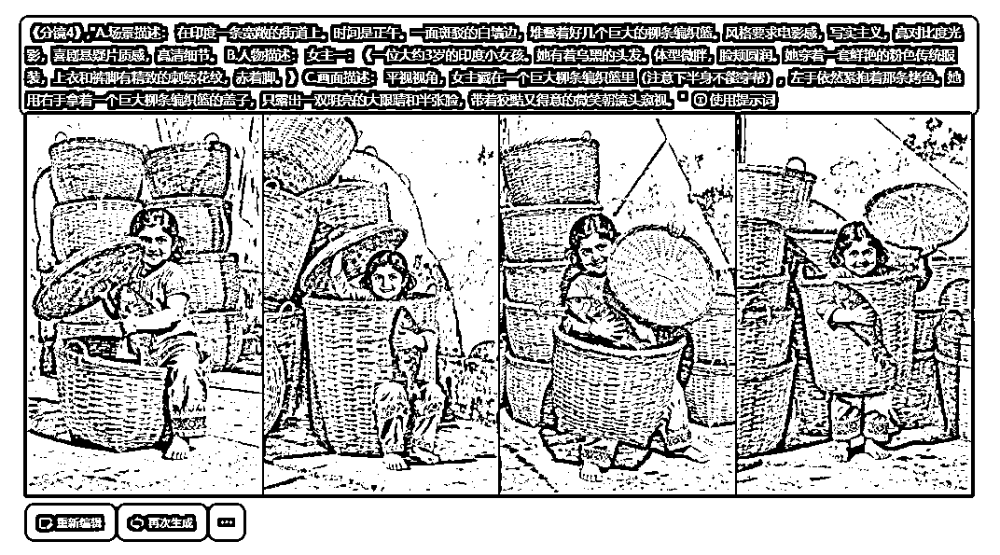

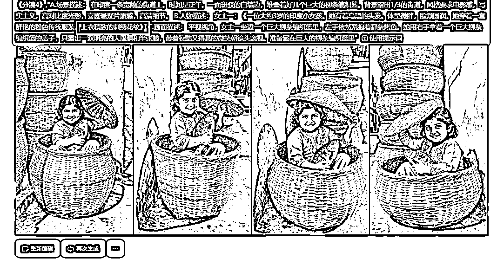

1.  添加构图提示词

这个视频的核心画面是，小姑娘躲在篮子里，男人走篮子旁边走过。图一只是小女孩的特写，需要在场景描述上，加上背景的相关描述，比如：背景露出1/3的街道（图二）。

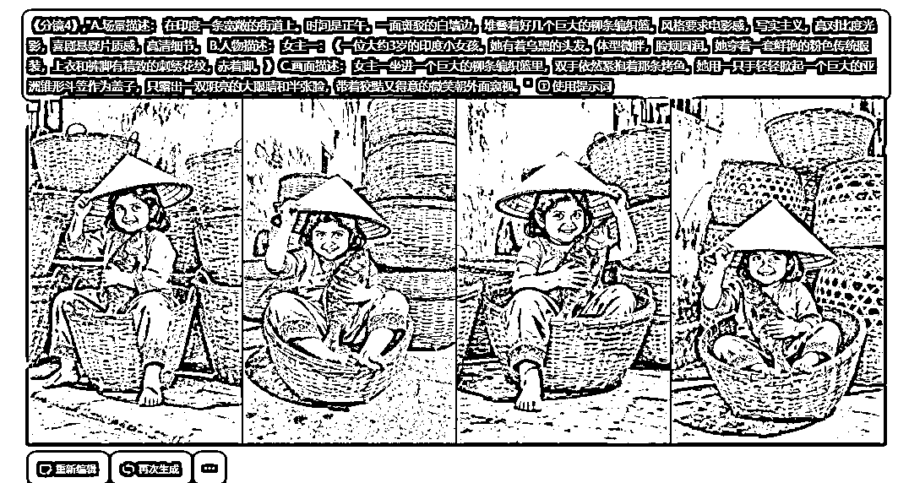

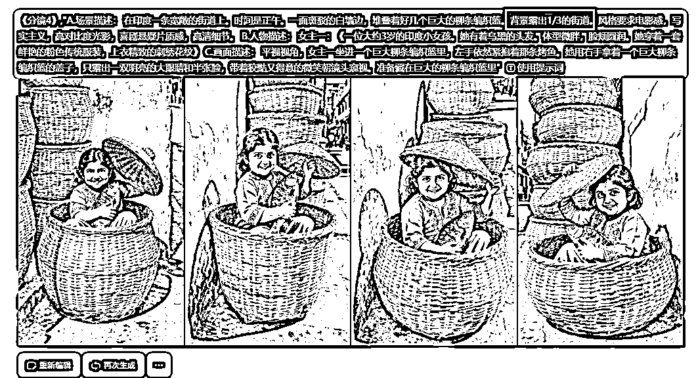

1.  镜头作为参照物

人物和具体物品摆放的位置，可以用镜头作为参考。参考下图。

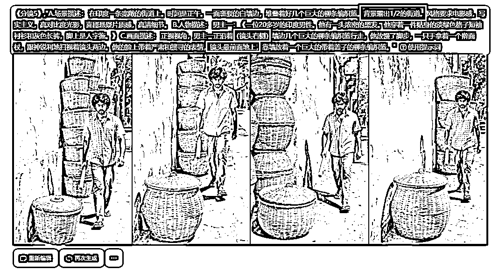

##### 即梦出视频的技巧

如果即梦实现不了的动作，也可以试试其他的工具，说不定就可以搞定了。

一个小女孩躲在篮子里的镜头，下边是我这个镜头的抽卡过程，也是很有意思的。最后用豆包折中实现了，视频提速之后看不出太多瑕疵。大家可以重点关注一下提示词。

后来，我看对标账号的这个脚本的视频，这个画面依然抽卡不稳定，所以对标就选择了只放出盖盖子的过程，把感觉做出来就行了，而不放整个过程。

所以在抽卡的过程中，如果真的很难实现，也不要强迫自己，换个角度去实现就行。

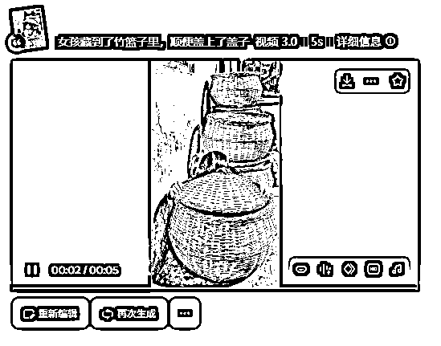


### 五、心得

复刻爆款质量首先要保证。这个视频能够爆，我感觉是我所有视频里，1:1复刻的最像的一个。并且整个视频的制作过程也是比较丝滑的。

复刻是起点，不是终点。核心还是要多收集剧情，为后边的微创新做准备。如果只是简单都复刻，对标最近的改编没有爆的，难道要一直找很多很多对标吗？视频的首发优势还是很重要的，它决定了你的推流上限有多高。

要养成每天拆解视频，每天找对标并记录下了的习惯。为了后边改编爆款打下基础。

熟练制作视频后，多研究大佬的精华帖，多尝试一下其他赛道，要不断地学习成长。

#### 我的一些新的观察

1.  这个脚本最近对标一直在用，说明了这个脚本本身在这段时间里，就是一个热点。很多对标账号，对标这个视频的，基本上都爆了，少的也有几百万播放。

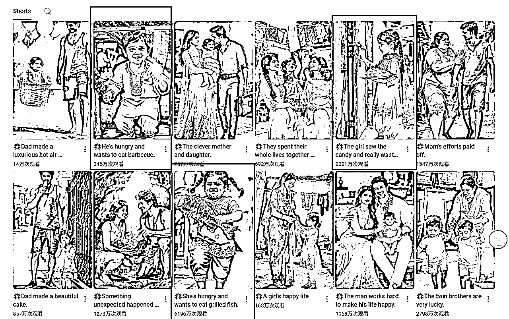

1.  印度赛道的对标账号，如果是百万粉的其实也可以作为对标的，但是一定要跟的早，最好是一天内爆百万的，立马跟。对标账号的新视频，肯定是他自己已经验证过的改编，你马上复刻，也是在跟他抢流量。

1.  刷对标如果遇到有低粉爆款的，一定要留意。他的爆款值得你的复刻。

1.  我用手机刷的时候，就能刷到很多印度ip的账号。印度人关于印度故事可能有新的想法，如果有爆款出现，马上跟。

#### 我的印度赛道对标账号

https://www.youtube.com/@Biubiubuff

https://www.youtube.com/@HiLanbuff

https://www.youtube.com/@AIFunnny-777

https://www.youtube.com/@KabirAiWorld

https://www.youtube.com/@hakan_RF

https://www.youtube.com/@skguruword

https://www.youtube.com/@CleverAiworld

https://www.youtube.com/@Anushka-h1d1v

写到这里，差不多就是我航海 21 天的完整心路历程和干货复盘了。

回顾这21天，我从一个什么都不懂的新手，硬生生手搓出了第一条爆款。

过程里有迷茫、有困顿，也有兴奋和突破。

我更深刻地体会到：运气从来不会眷顾过早放弃的人，它只会眷顾那些在黑夜里仍然摸索前行的人。

如果你现在也在迷茫，不妨告诉自己：再坚持几天，惊喜可能就在下一条视频里。
```