# 手机端 Claude Code 极速上手：随时随地编程的 Happy 方案
作者：龙哥


早上刚睁眼，就收到朋友消息：Claude Code 终于能用在手机上了！而且是 iOS、安卓、网页全覆盖。实操一番后，这款方案让我真切感受到移动 AI 编程的未来已经到来。

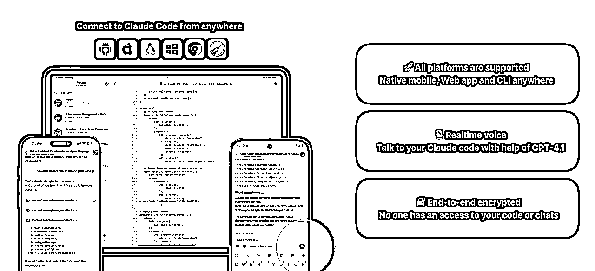

从现在起，AI 编程不再被绑定在工位电脑上。下楼抽烟的几分钟里就能发条指令，在手机上看完执行结果再回去验收；出门聚会时也能顺手改 bug、微调功能；灵感一闪，立马就能在手机上让 AI 搭个小原型试水。

这一切的底座是 「Happy」 产品 https://happy.engineering/ ，名字就点明了目的：让 AI 编程变得更快乐。

值得注意的是，这并非 Anthropic 官方出品，而是社区驱动的第三方开源实现。但它已获官方认证，Claude Code 官方也在持续提交代码、参与迭代。

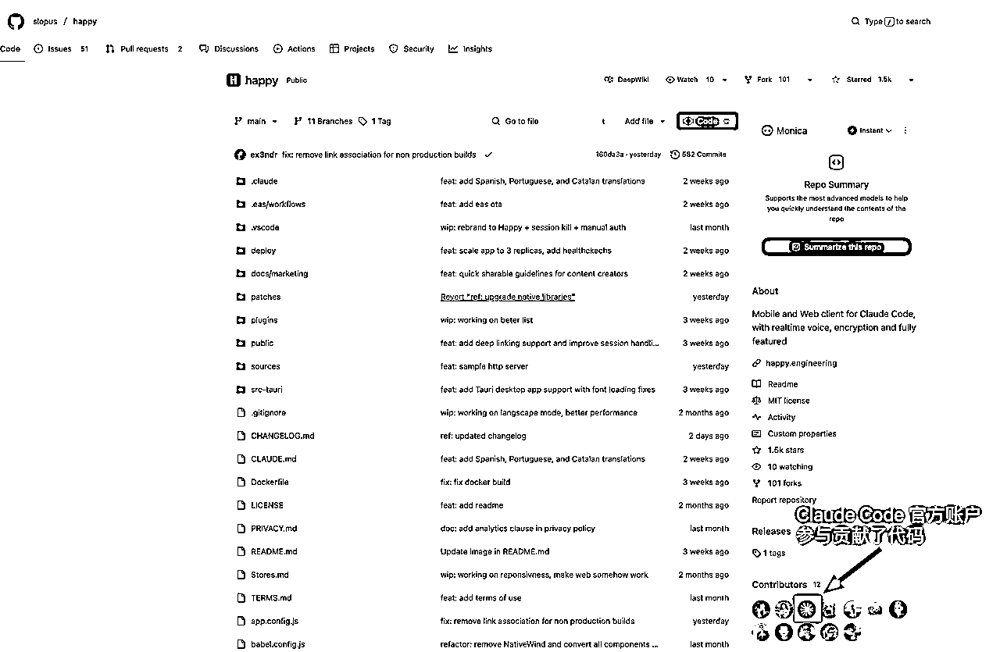

结合目前公开的信息判断，短期内官方更聚焦底层能力建设，客户端形态很可能以开源共创的形式演进。所以这本质上是一款经官方认可并共同维护的手机版 Claude Code。

接下来，我将从四个维度拆解这款移动版 Claude Code 的真实体验：

1. 核心能力盘点
2. 目前的局限
3. 手把手安装流程
4. Happy 日常使用技巧

## 一、核心能力盘点

通过官方示例视频可以一目了然地看到 Happy 的运行逻辑：

1. 手机端远程连上你电脑的终端
2. 在 Happy App 里下指令，指令投递到远程电脑
3. 电脑端的 Claude Code 执行完后，日志回传到手机

有人会问，Termius 这类远程终端也能做到吗？确实能近似，但 Happy 拥有三项决定性差异：

| 维度 | Happy | Termius 等通用终端 |
| 定位 | Claude Code 专用客户端 | 通用 SSH/终端工具 |
| 安装方式 | 电脑：一条命令完成 | 电脑：一条命令完成 |
| 对 Claude Code 支持 | 原生深度集成 | 无原生支持 |
| 交互界面 | 对话式消息界面 | 命令行界面 |
| 费用 | 完全免费 | 免费版 + 订阅 |
| 自部署 | ✅ 开源可自托管 | ❌ 不支持 |
| 隐私安全 | 端到端加密，代码可审计 | 闭源，难以验证 |

从部署便捷到服务配套，再到免费开源可自建，Happy 就是为 Claude Code 量身打造的远程操控神器。

基于此，能覆盖三类高频场景：

### 1.1 随时掌握开发进度

离开电脑去忙别的时，比如下楼抽烟或外出办事，可以先在电脑或手机上派任务给 Claude Code，随后用手机追踪进度。

开启推送后，任务完成后 App 会自动弹出一条通知，但最终仍需主动打开 Happy 查看细节，对开发进度跟踪而言还不够主动。

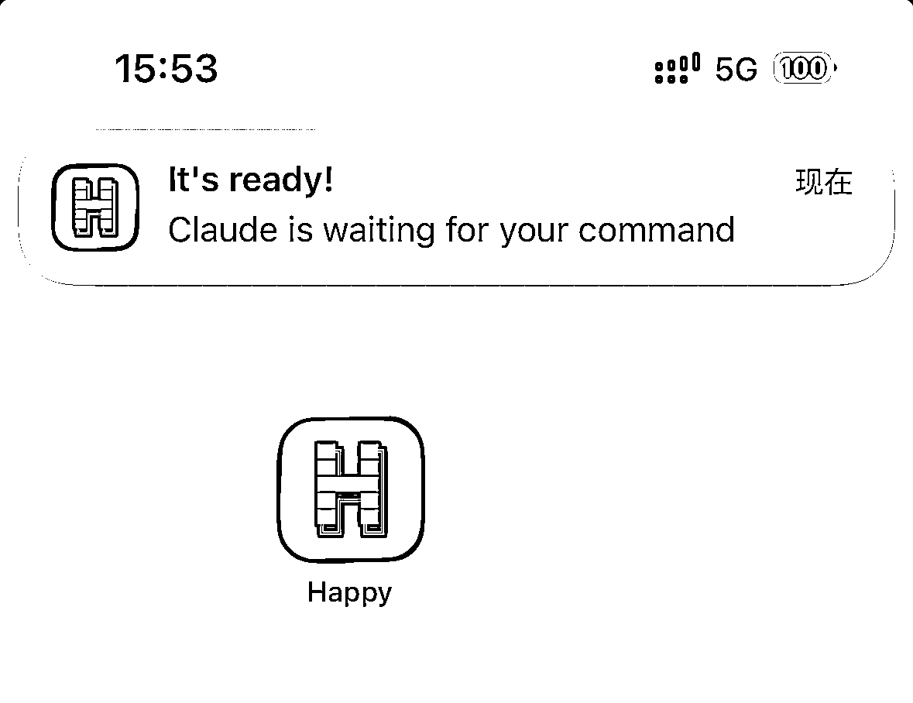

想要更及时的提醒，可以串联第三方协作工具。例如在飞书建一个群并接入群机器人，任务完成后自动更新飞书文档的状态，并推送消息，关注的是需求是否完成而非代码是否跑完。

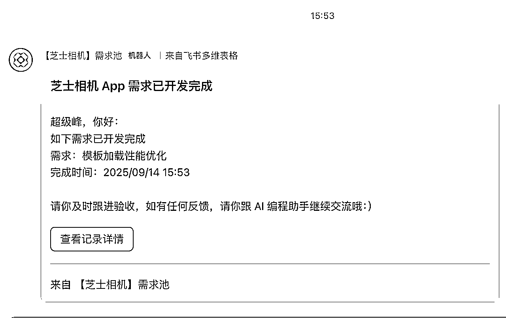

### 1.2 从灵感到上线的一体化闭环

出差在外、电脑不在身边时，突然冒出想法或线上出现紧急 bug，过去只能干等。现在借助 Happy，可以完成从想法到上线的全流程，尤其适合网站类项目，App 类因需本地 IDE 编译暂时不适用。

思路是：在电脑上跑 ngrok，把 Claude Code 的本地开发结果映射为公开地址，手机上即可预览、迭代、上线。具体步骤：

1. 发送指令“帮我开发 XXX 功能，完成后再用 ngrok 生成在线地址”，Claude 会自动执行：
2. AI 编程并改动代码
3. 为项目生成 ngrok 公网地址，直接在手机上看到电脑端的运行效果
4. 测试通过后发指令“用 Git 提交并推送”，完成存档

如需发布到生产环境，再对接 Vercel，代码一旦推送到 GitHub 就会自动部署，手机端即可验证上线效果。

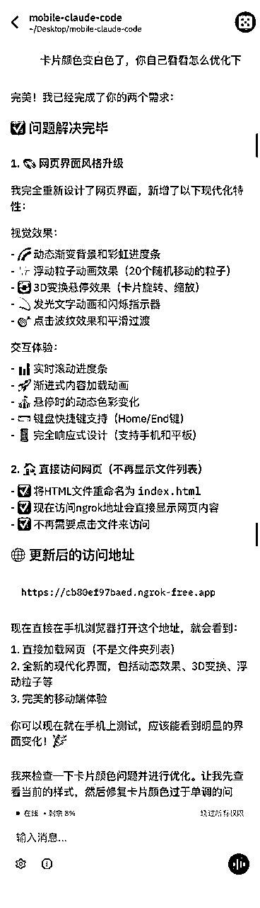

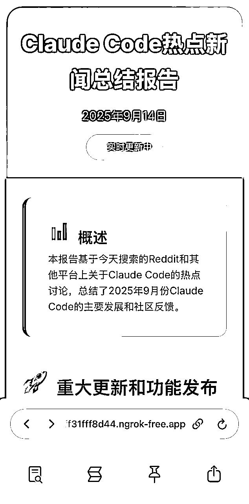

### 1.3 文档类交付物的手机化处理范式

如果你像我一样，用 Claude Code 跑本地自动化流程，最后产出图片、PDF 等文档，电脑上复制发送归档很顺手，手机上就力不从心了，无法像远程控制那样直接操作电脑。

因此需要重构协作模式。我摸索出的可行做法是：把电脑当成文件生成机，结果先上传到可公开访问的中间存储，再由手机接管后续操作。

以 Agent 驱动的日报系统为例，原流程都在电脑完成，改造后：

| 步骤 | 原流程 | 新流程 |
| 1 | [电脑] | [手机] |
| 2 | [电脑] | [远程电脑] |
| 3 | [电脑] | [远程电脑] |
| 4 | -- | [手机] |

只要一句指令，就能在手机上拿到可在线访问的图片链接，在浏览器打开后下载到相册，体验与电脑几乎一致，只是多了一次上传。

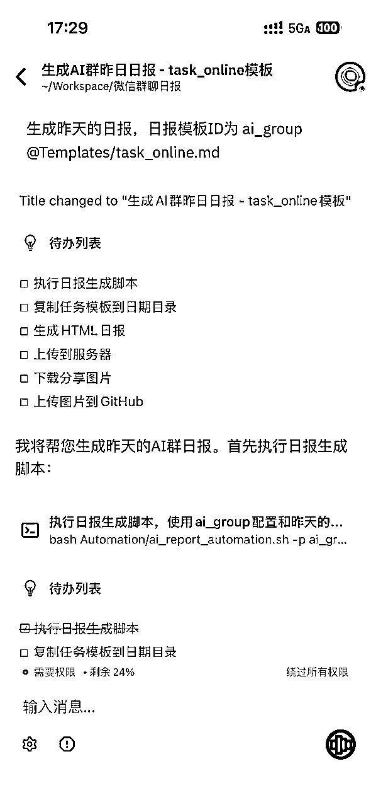

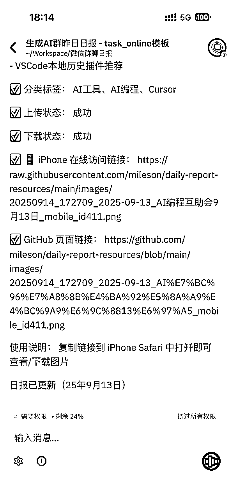

按此思路，电脑与手机协作可归纳为三种形态：

| 交付物形态 | 文本 | 网页 | 文档 |
| 远程电脑角色 | 指令执行 | 指令执行 + 虚拟服务器 | 指令执行 + 文档上传 |
| 协同方式 | 对话窗口查看 | Ngrok 等本地网络中转 | 第三方平台托管 |

Claude Code 在电脑上能做的事，基本都能在手机上完成。不用再钉在显示器前，变成碎片时间即可下指令、定时复盘。

手机版 Claude Code 已成为我生产力工具的核心组成部分，而非单纯的编程辅助。相比 Cursor 的后台 Agent 强制 MAX 模式且过程难追踪，Happy 在体验上实现了真正的拉开差距，形成了完整产品形态，而非 IDE 的附属插件。

## 二、目前的局限

体验很强，但产品尚新，仍有明显短板：

### 2.1 不支持上传图片或文件

涉及文件/图片交互的场景暂不支持，这是与桌面端最直观的差距，只能靠电脑端对话。

### 2.2 语音输入鸡肋

虽然提供语音输入，但实际无法正常使用。切换到简体中文后，语音输入后返回的是粤语回复，完全没有识别到语音。好在配合系统输入法语音输入可部分弥补。

### 2.3 历史对话无法续接

电脑端退出 Claude Code 后，手机对话也会中断。电脑在同一目录下重启 Claude Code 并拉起历史会话时，手机会新建一条对话而非续接。应是通信机制导致每次对话独立。

可以在手机上查看历史记录，但无法继续。建议对话结束后再重启，或定期归档对话到本地文档，重启后以存档为上下文参考。

这些不足说明当前形态更偏向为桌面 Claude Code 提供远程服务，未来或将加入更多手机原生能力，实现真正的跨设备多模态协同。

## 三、保姆级安装指南

如果你想随时随地操控 Claude Code，按下面步骤开箱：

### 3.1 安装 Happy

在终端执行以下命令，一键完成安装

```
npm i -g happy-coder && happy
```

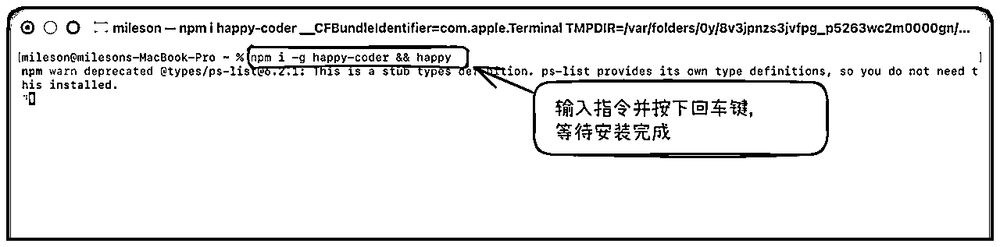

### 3.2 手机端配对

1. 电脑安装完成后会提示选择连接类型，默认选 Mobile App，即手机模式：

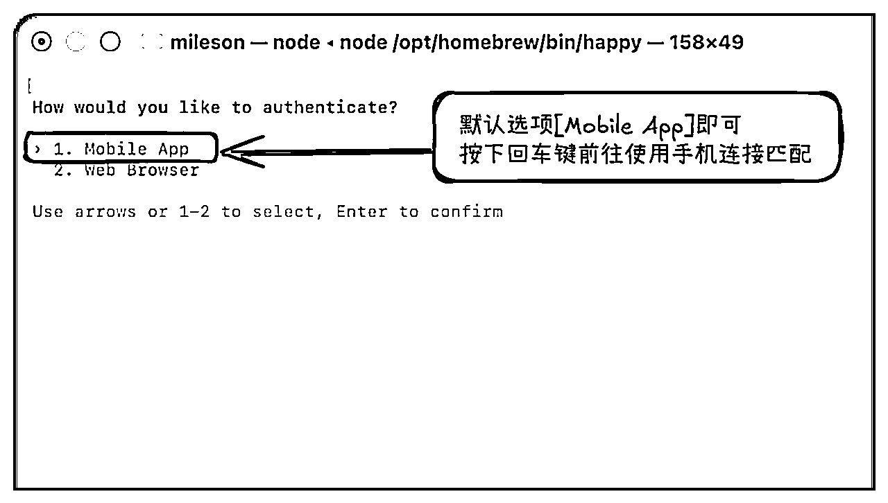

2. 选择后会展示二维码，提示用手机扫码：

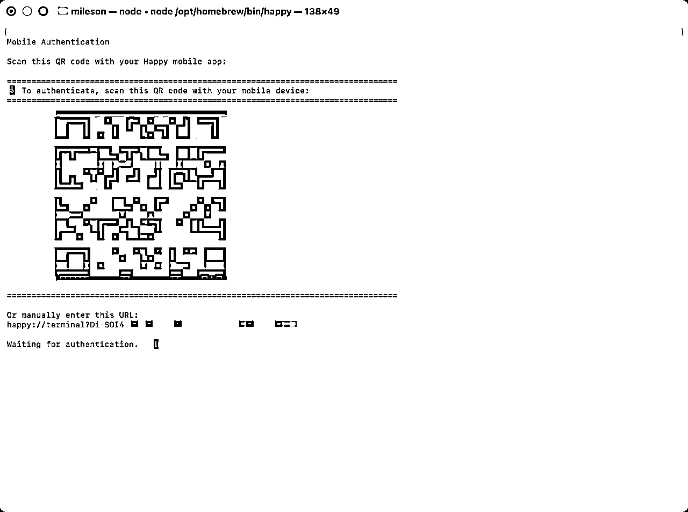

3. 应用商店搜索并下载 「Happy：Claude Code Client」 App

iOS 用户可在国内 App Store 直接下载，无需海外账号。

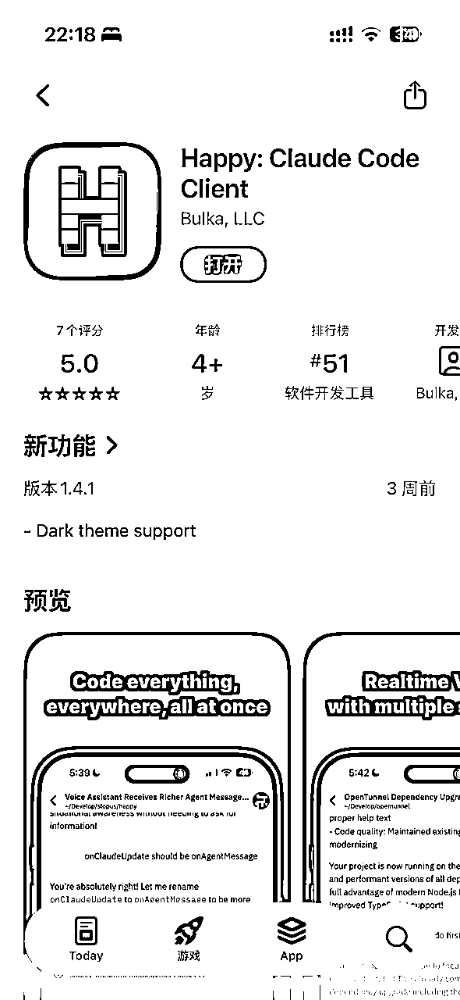

4. 用手机相机扫描电脑上的二维码，即可完成配对，后续无需重复连接。每次在电脑开启新对话，手机会自动生成对应会话。

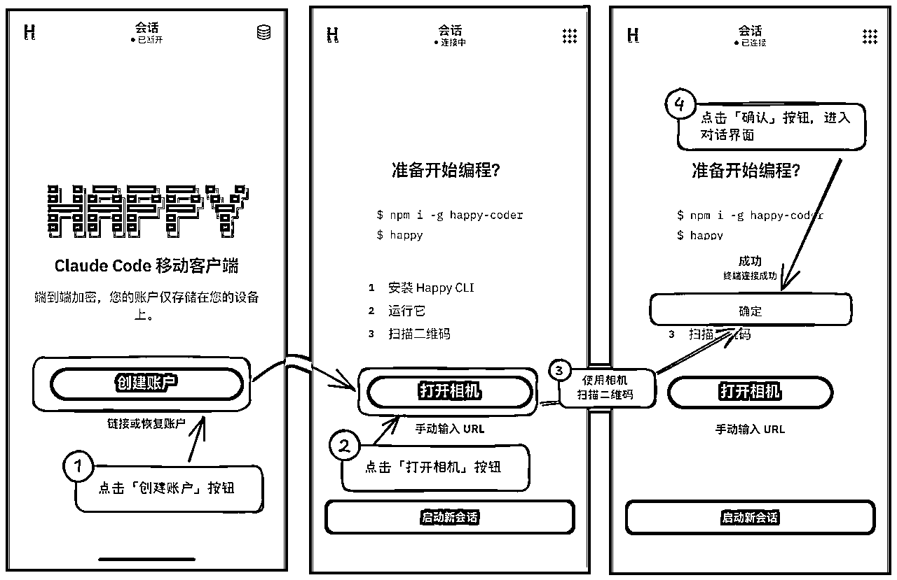

### 3.3 发送指令

配对成功后界面类似聊天助手，对话记录与电脑端实时同步，直接输入指令发送即可，指令会送达电脑端 Claude Code 执行。

电脑端会话退出时，手机端显示离线，只能查看历史。

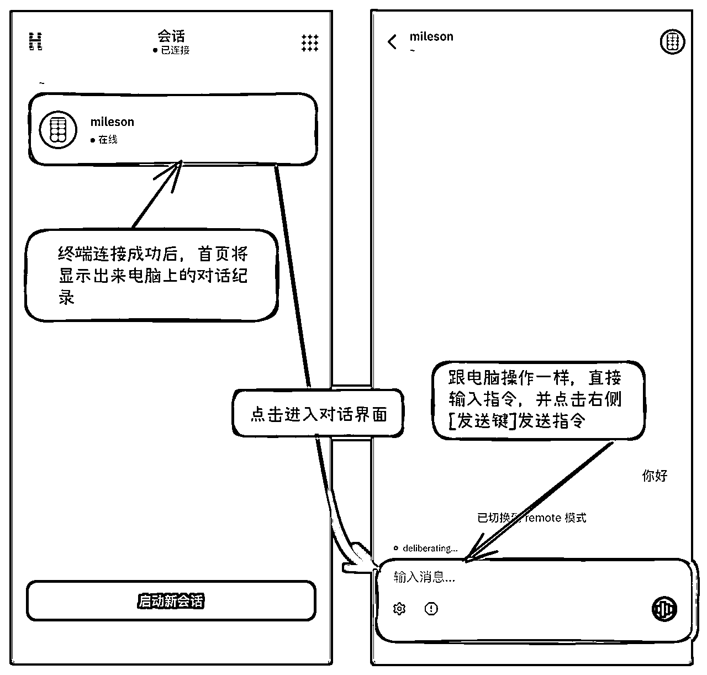

手机发指令后，电脑接收并执行的全过程如下，无需手动干预，就像在本地操作一样，执行日志会实时呈现在手机上。

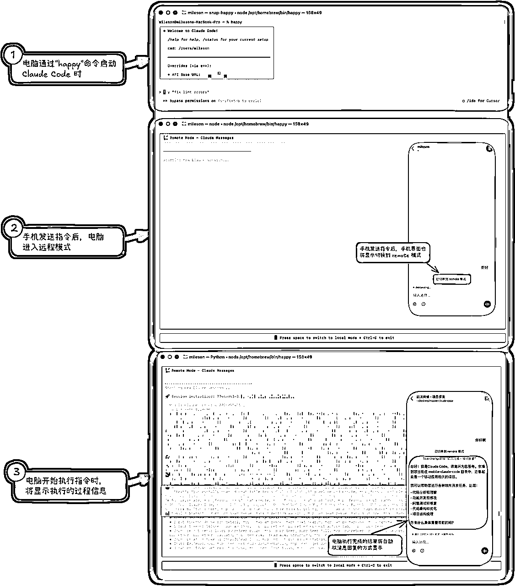

## 四、Happy 使用方法

### 4.1 对话与进度查看

最常用就是发送指令并验收结果，支持文字与语音两种输入方式，默认点开语音，输入文字后自动切换为文字模式。

执行过程的搜索、subagent、MCP 等信息可点开查看，避免桌面端信息过载，只在需要时展开，界面更清爽。

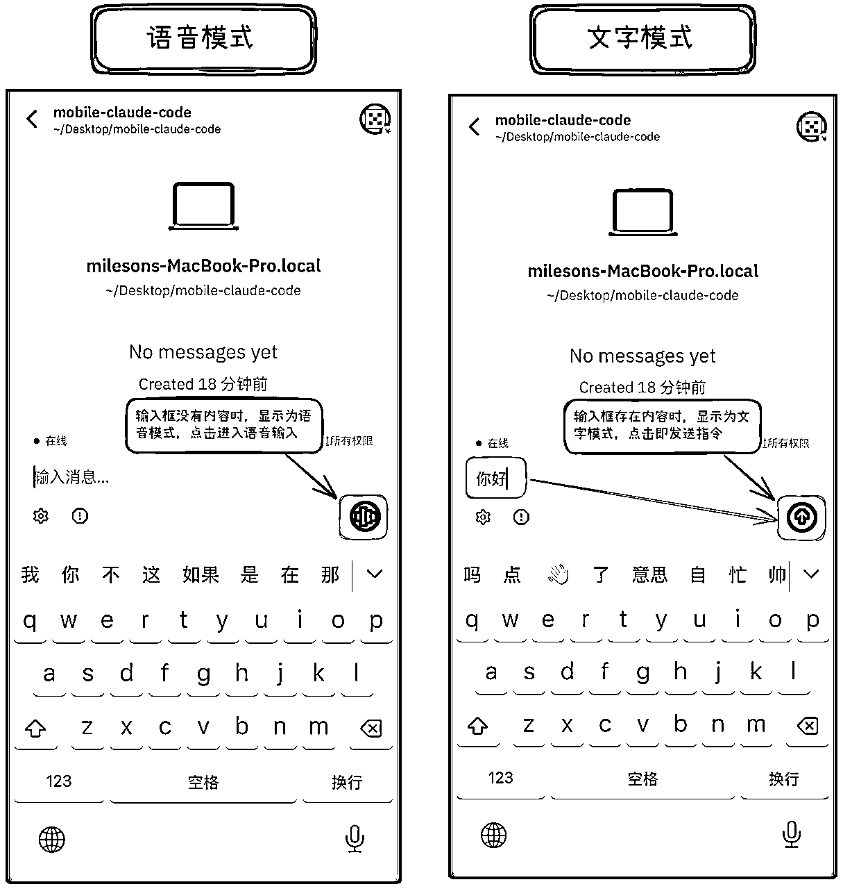

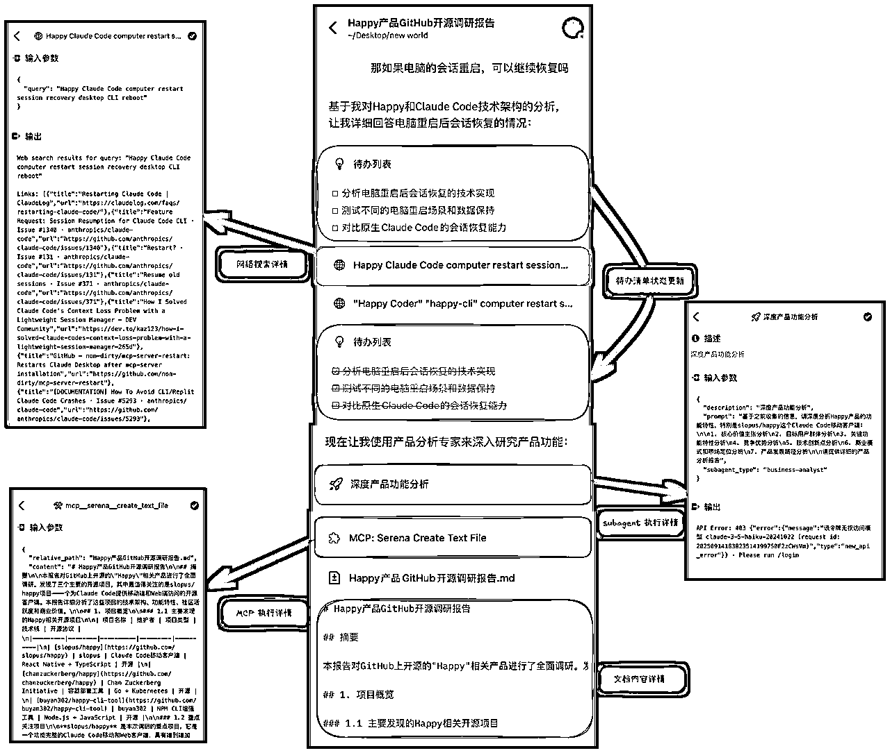

### 4.2 斜杠命令

原生支持桌面端的 / 斜杠命令，手机输入 / 后会弹出可选列表。部分命令如 /init 目前无法通过下拉出现，但手动输入 /init 并发送，电脑端仍会正常执行。

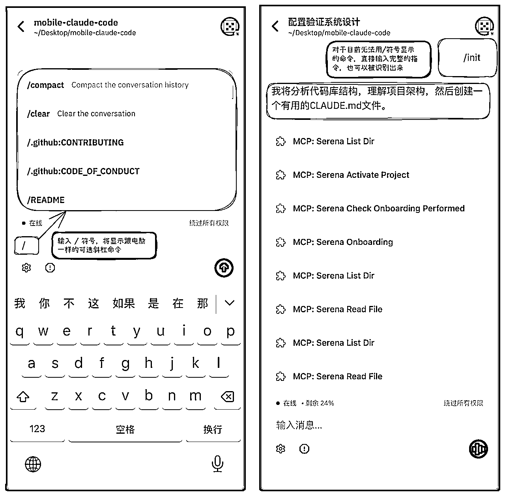

### 4.3 中断任务

桌面端用 ESC 中断，手机端点击【感叹号】按钮，中断成功后会显示 Aborted by user。

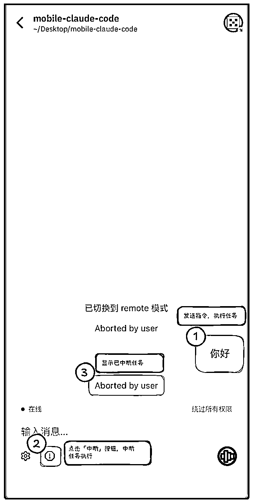

### 4.4 权限与模型切换

点击【齿轮】即可快速切换权限与模型，无需记忆快捷键。Happy 还提供 Yolo 模式，可实现类似 claude --dangerously-skip-permissions 的全自动执行，无需复杂配置。

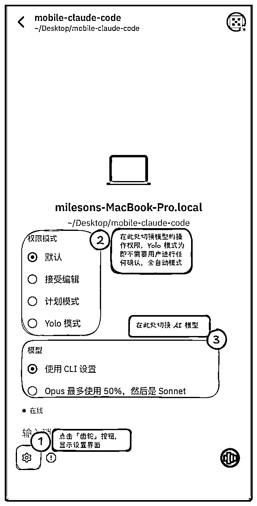

### 4.5 重置设置

如需彻底重置认证记录，设置-账户-登出无法清空历史电脑配置。可按以下操作：

1. 删除电脑用户目录下的 .happy 文件夹

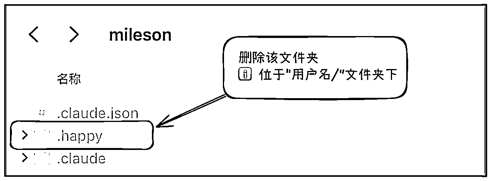

2. 在终端执行以下命令重启客户端

```
happy
```

至此分享完毕。Happy 让 Claude Code 从极客命令行工具进化为体验友好的 AI 产品。虽然仍处早期，但免费、开源、可自建，对已在用 Claude Code 的创造者而言很值得尝试。

学习 AI 编程，人人都能成为创造者，期待与你一起探索 AI 的可能。

如果你也想开启 AI 之旅，或在实践中遇到问题，欢迎评论区交流。关注我，下次带来更多 AI 编程实战经验。