# 单图图文的冷启动与规模化生产思路


我是新城。

最近刷小红薯时，有没有注意到那种一图配排版文字的养身干货或生活类笔记？一张封面配几行要点，播放量轻松上十万，互动数也经常破万，例如下方这些：

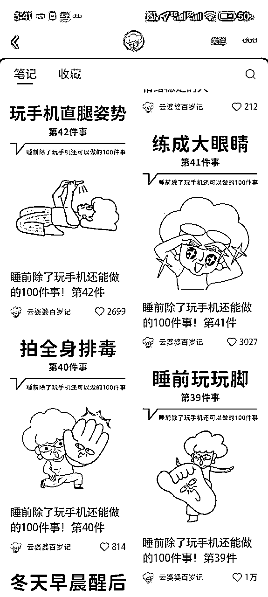

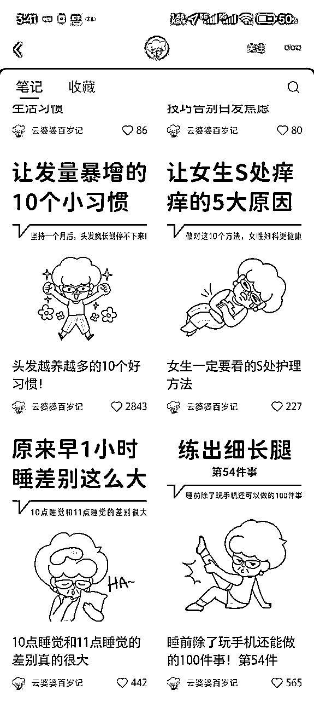

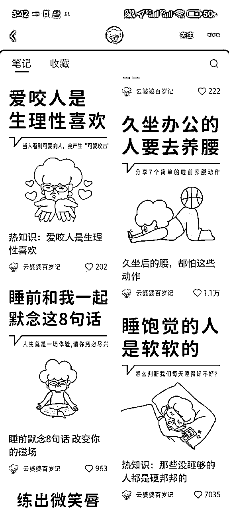

这类笔记为何能跑量

我观察了多家同类账号，发现冷启动周期非常短。不少新号上线数日内，阅览量就能破千，点赞数同步起来。

而且制作成本极低。借助扣子智能体即可实现流水线作业：提供一个对标笔记的链接，填入想要的话题，就能把竞品的结构拆解下来，一键导出到本地直接发布。

每天投入三五分钟，一篇图文即可成型。

基于这套打法，我自建了一套智能体，可一键产出单图图文。下面把搭建逻辑和细节完整展开，每一步都附带原理说明和截图，请耐心阅读。

## 智能体实际产出演示

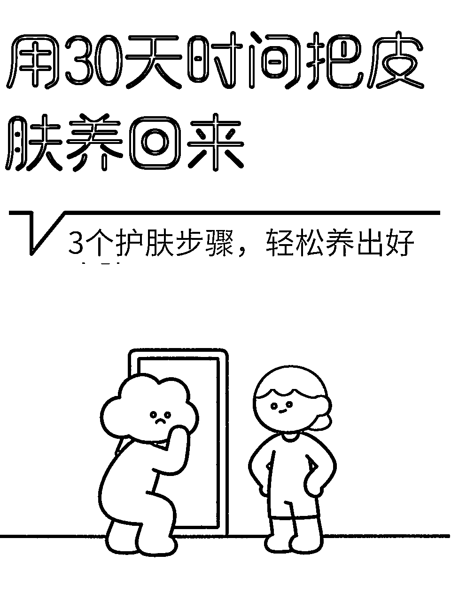

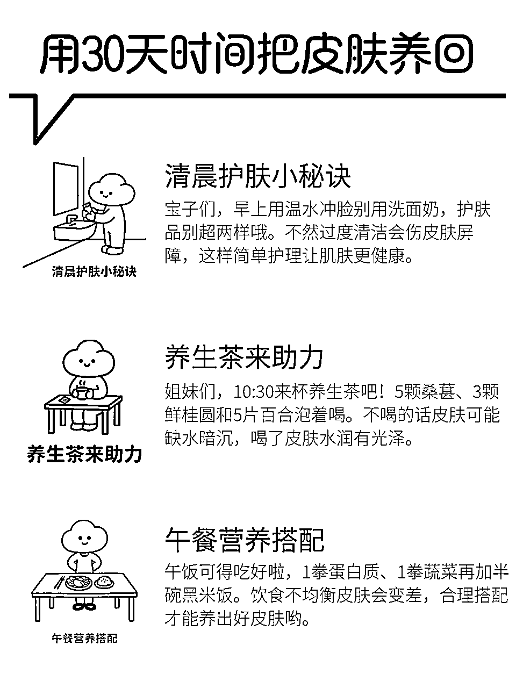

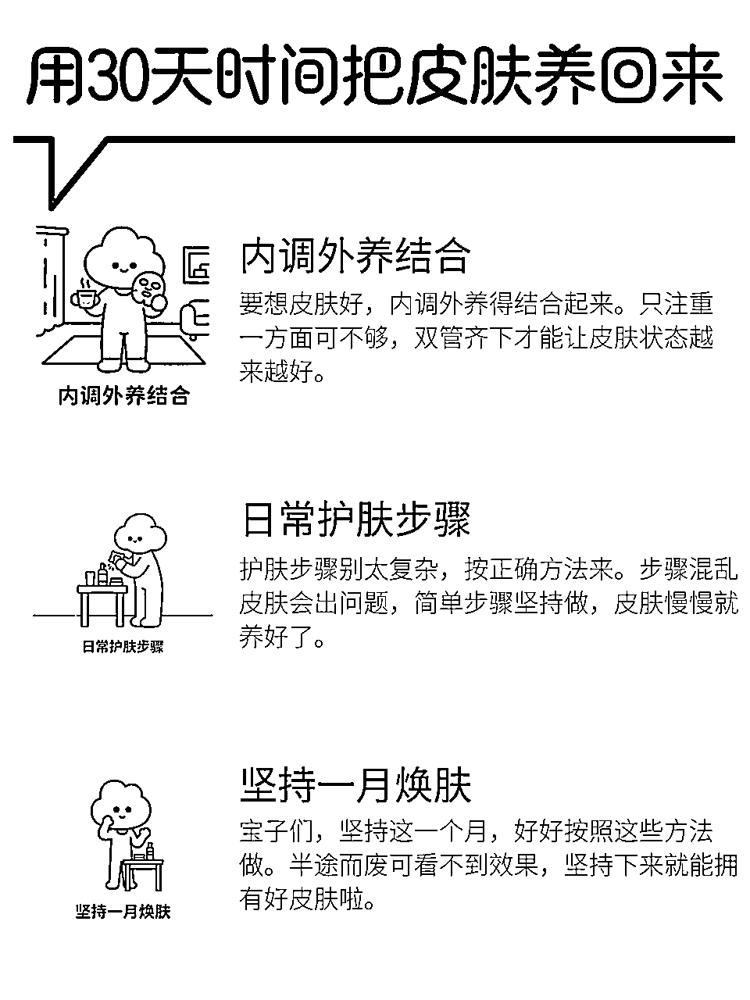

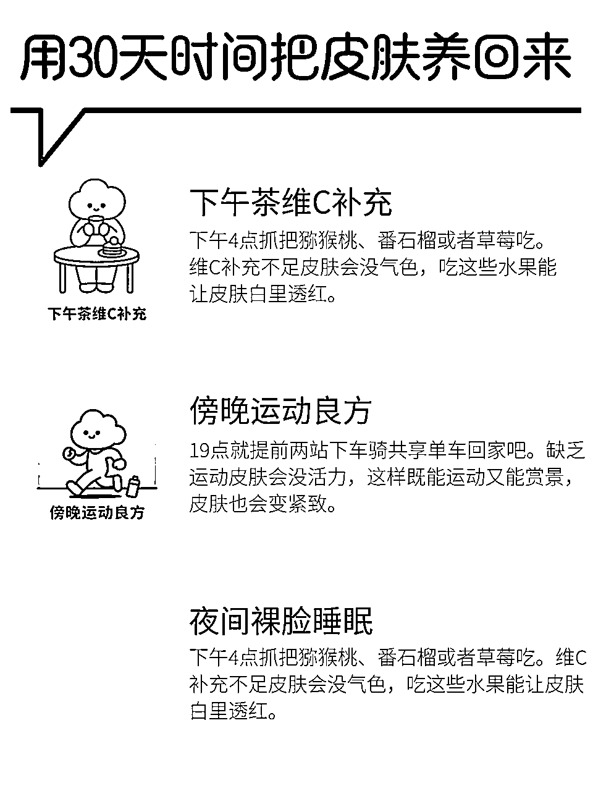

## 整体流程概览

该流程节点较多，后面会按序拆解。

单次运行约消耗 200 token，成本约 0.2 元，免费额度足以反复验证。

截图较多，我会依次呈现。

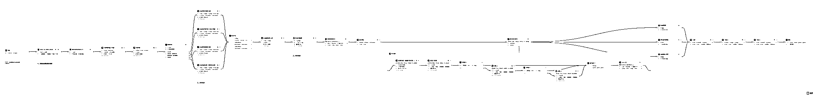

完整版

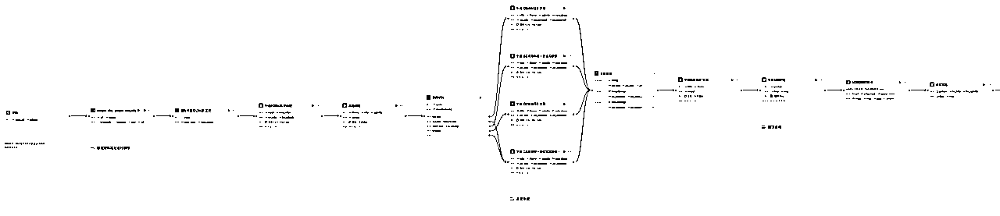

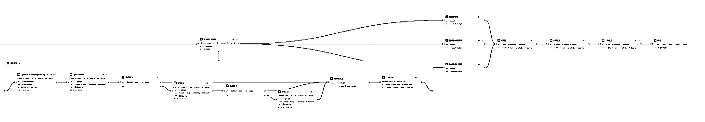

放大版

## 搭建流程拆解

### 一、开端节点

开端节点为 note_url，用于粘贴找到的对标小红书笔记链接，可为养身、知识科普、日常分享等类型，便于抓取参考素材。

第二个启动参数是 subject，即本次内容的主题关键词，例如“让头发越长越多的十个好习惯”“原来早睡一小时差别如此大”“别为打翻的牛奶哭泣”之类。

同理，菜谱、教育、育儿等主题都能直接套用。

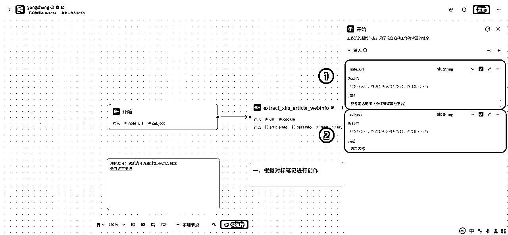

### 二、抓取笔记内容

接入一个小红书笔记抓取插件，把输入链接对应的正文、标题等信息抽取出来，作为对标参考。

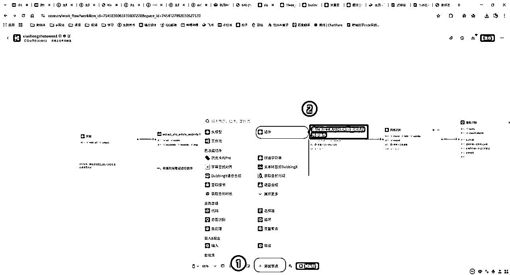

搜索插件时，使用“海涛ai智能体”作者的小红书插件即可。

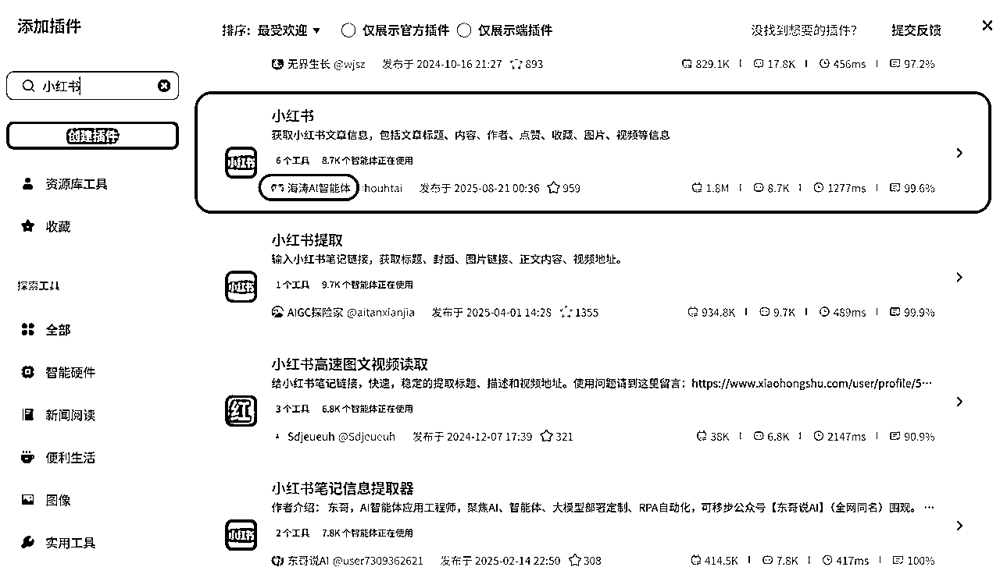

把起始节点填写的小红书链接填入插件，即可拿到对应笔记数据。

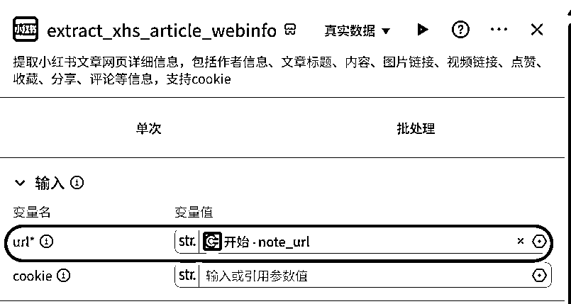

### 三、结构化提取

用代码节点对抓取到的原始数据清洗，主要保留标题和正文作为参考模板。注意语言使用 Java，代码块置于文末。

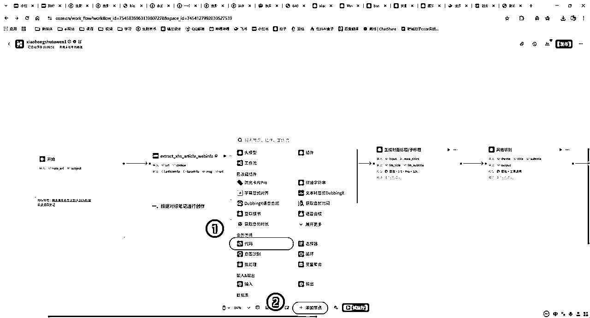

变量映射示例

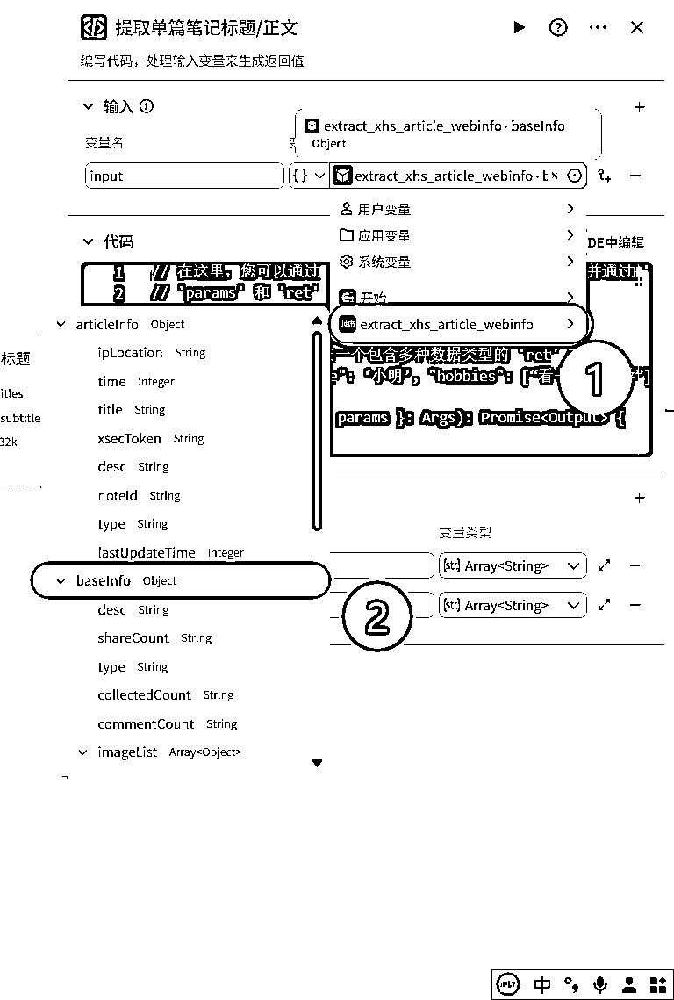

最终输出示例

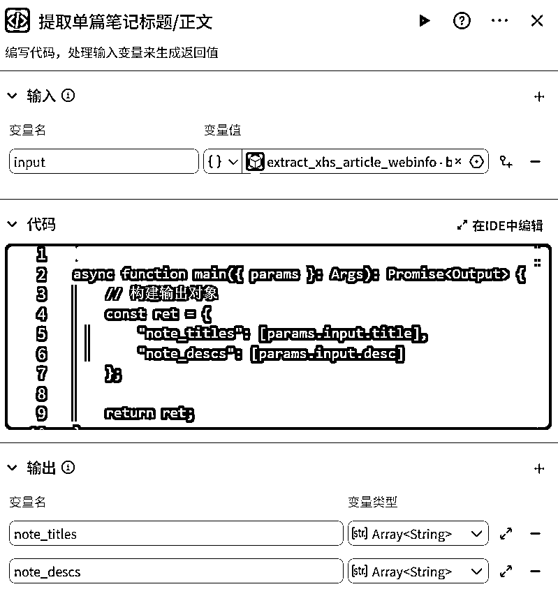

把代码填入节点后即可运行。

```
async function main({ params }: Args): Promise {
    // 构建输出对象
    const ret = {
        "note_titles": [params.input.title],
        "note_descs": [params.input.desc]
    };

    return ret;
}
```

### 四、题头与副题生成

本步任务是从用户提供的主题里提炼出一个主标题和一个副标题，作为内容骨架。

先接入一个大模型对标题进行加工。

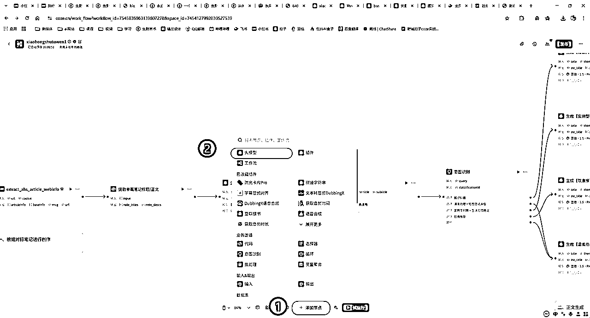

若不擅长撰写系统提示词，可点右上角的小星星让 AI 自动优化。

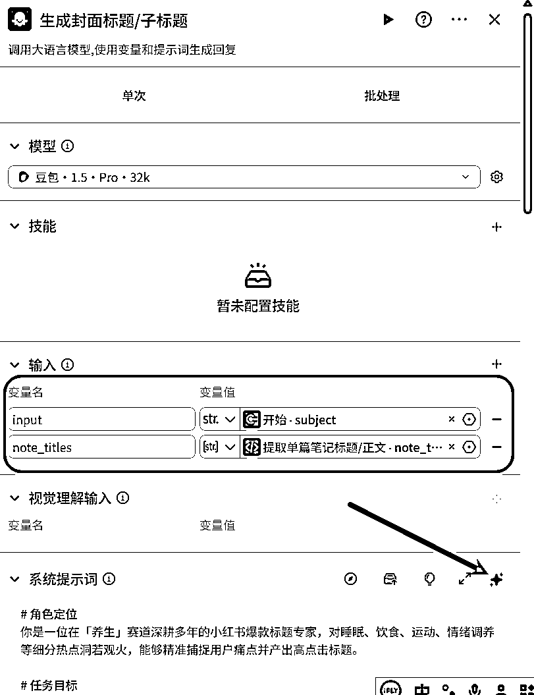

系统提示词示例：

```
# 角色定位
你是一位在「养生」赛道深耕多年的小红书爆款标题专家，对睡眠、饮食、运动、情绪调养等细分热点洞若观火，能够精准捕捉用户痛点并产出高点击标题。

# 任务目标
根据用户指定的养生方向+**（可选）参考笔记**，生成：
1\. **主标题**：一句 6–12 字内、具冲突或悬念感的问句或肯定句；
2\. **副标题**：一句含数字/动作词、突出实用价值的补充说明。

# 输入参数
参数 | 说明 | 是否必填
direction | 用户需求/养生方向（如睡眠、饮食、运动…） | 否
note_titles | 参考笔记标题列表 | 否

# 输出格式（严格遵守）
```json

{

  "fm_title": "<主标题>",

  "fm_subtitle": "<副标题>"

}

```

# 工作流程
1\. 确定创作依据
  - 若 note_title 不为空：优先从参考笔记标题中提炼痛点、 场景、句式；
  - 否则：按方向结合方向 + 当下热门痛点/场景（通勤、熬夜、办公室久坐…）

2\. 创作主标题
  - 采用对比、数字、悬疑等吸睛技巧；
  - 字数控制在 15–20 字内，避免生僻词。

3\. 创作副标题
  - 明确承诺解决方案，最好含数字（「9个方法」「9步」）；
  - 使用动词+结果（“告别眼疲劳”“轻松暖胃”）；
  - 字数控制在 25 字以内。

4\. 输出
**仅返回 JSON，不附加额外说明**。
```json

{

  "fm_title": "<主标题>",

  "fm_subtitle": "<副标题>"

}

```

# 约束
1\. 只围绕养生领域创作；涉及医疗纠纷或违规疗法直接拒答。
2\. 严格使用上述 JSON 结构，键名不可变更。
3\. 不输出解释、Markdown 或其他多余文本。

# 输入/输出示例
【输入示例】
direction：睡眠养生
note_title：["早睡关键点其实在于别想"]

【输出示例】
```json

{

  "fm_title": "睡前玩手机如何不伤眼？",

  "fm_subtitle": "3 个护眼动作，告别夜间眼疲劳！"

}

```
```

随后补充用户提示词，示意其参考对标内容生成标题组合。

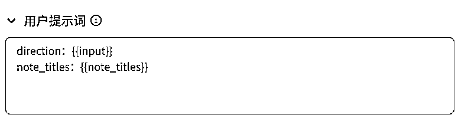

输出变量定义：

fm_title 为主标题

fm_subtitle 为副标题

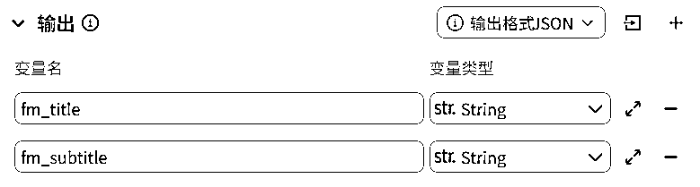

### 五、风格判定

再接入一个大模型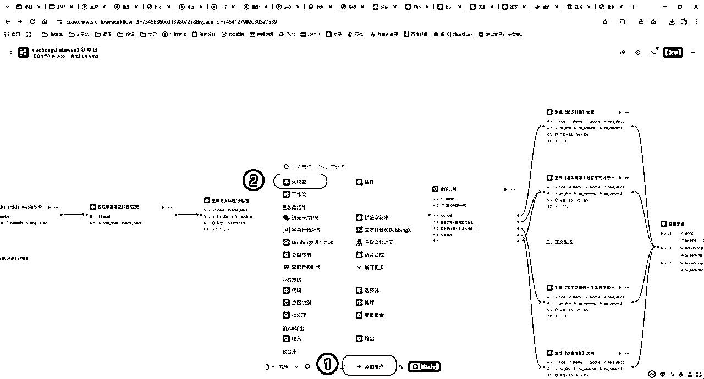

核心是判断参考内容和主题适合哪种写作风格。

不同风格的提示词决定了最终成稿质量，所以不建议使用通用模板，最好为不同垂直领域准备专用提示词。

把已生成的标题、副标题和主题一起输入，让模型选定对应的风格提示词。

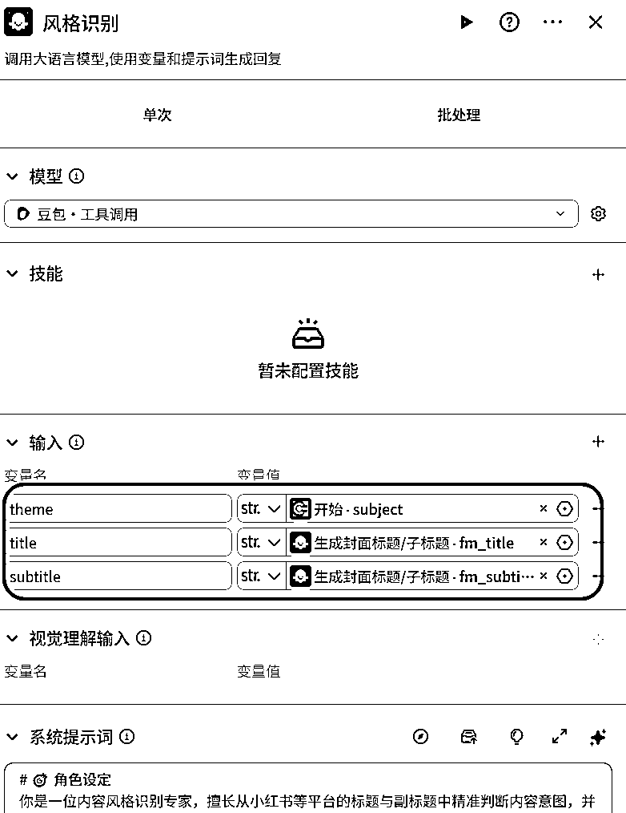

风格识别的系统提示词：

```
# 🎯 角色设定
你是一位内容风格识别专家，擅长从小红书等平台的标题与副标题中精准判断内容意图，并匹配最合适的文案风格标签。你的判断标准基于对表达语气、信息密度、心理动机的细致分析。

# 📌 任务目标
根据提供的「主题、笔记标题、副标题」，判断该内容最可能采用的文案风格。你只能从以下四种风格中选择最匹配的一种：
- 知识科普
- 温柔劝导 + 轻哲思式治愈
- 实用型科普 + 生活习惯建议
- 饮食推荐

# 📎 输出格式
只输出风格标签中的一个，不能输出标签以外的内容。

# ✅ 示例输入
主题：睡眠
标题：熬夜对皮肤的伤害，比你想得更严重
副标题：科学研究显示，睡眠不足会让皮肤提前老5年

# ✅ 示例输出
知识科普
```

用户提示词配置：

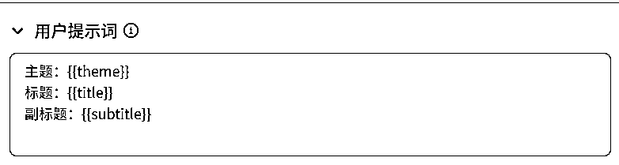

### 六、意图识别

依据前述风格判定结果，选择对应的文案生成提示词。我目前内置了四组提示词框架，后续可按需继续扩展。

接入意图识别插件：

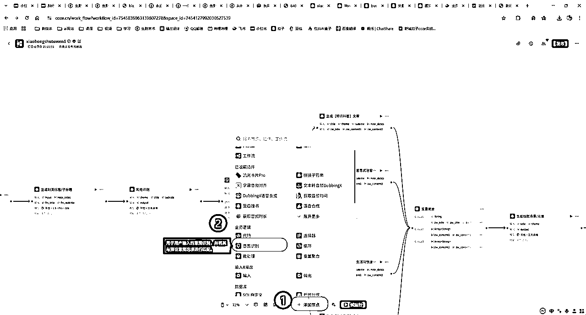

注意这里的意图结果必须与前面的风格判定保持一致，否则会报错。

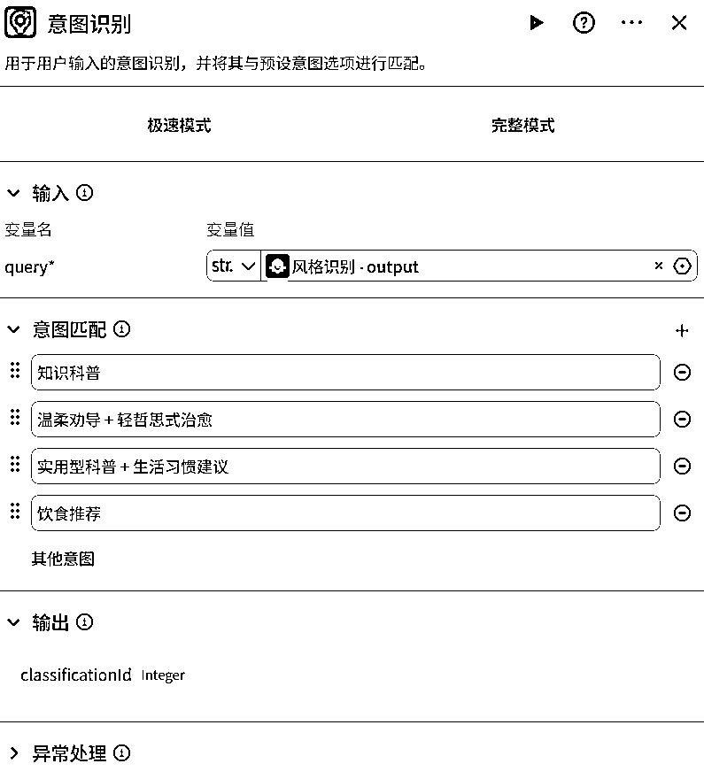

### 七、文案正式生成

先明确产出需求：一个主标题 + 一个副标题 + 9 个分点小标题 + 9 段对应说明，共三张图的内容量。

明确需求后，接入文案生成提示词，主要用于知识类科普产出。若要做其他类型，可参考源文件的其他提示词。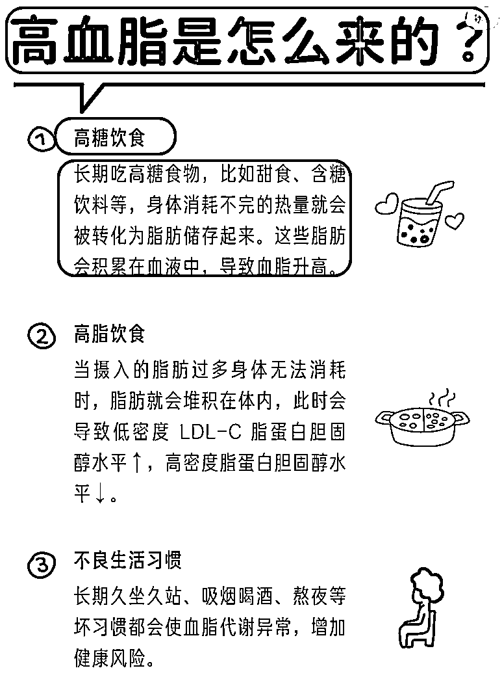

提示词示例：

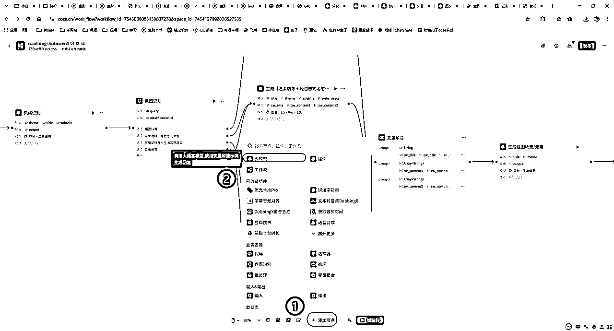

已完成示例效果：

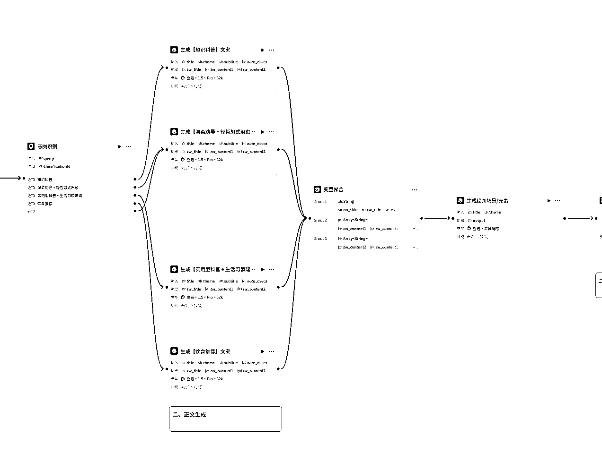

提示词结构示例：

```
# 🎯 角色设定
你是一位专精于养生领域的内容策划专家 + 健康科普撰稿人，擅长将复杂医学机制转化为读者易懂、内容可信、极具传播力的爆款列表文案，常用于小红书图文内容。

# 📌 任务目标
根据提供的「主题、标题、副标题」，输出一篇结构清晰、包含一个主标题和九个副标题及介绍且内容严格符合限制要求的健康科普爆款文案。

# 🧩 写作风格要求
- 内容分为九个副标题，每个副标题都有对应的简洁介绍
- 避免纯教科书式科普，优先强调"睡不好=变胖/老得快/脑袋迟钝"等直观后果
- 使用生活化类比（例如：熬夜1小时 = 炸鸡诱惑力提升30%）
- 内容以女性读者为主，关注"颜值、身材、情绪、健康焦虑"等痛点
- 副标题介绍要温柔引导，产生情绪共鸣

# 📏 内容规格
- **主标题**：作为zw_title，必须在12个字内
- **副标题数量**：固定9个副标题，zw_content1为包含9个副标题的字符串数组
- **副标题介绍**：zw_content2为包含9个副标题介绍的字符串数组，每个介绍约50个字以上
- **内容要求**：生活化类比、科学依据、关注女性痛点，强调直观后果
- **情感要求**：副标题介绍需要温柔引导和情绪共鸣，让读者产生共鸣

# 📝 输入格式
主题：早睡
标题：早睡是人类作弊器
副标题：熬夜1小时=炸鸡诱惑力提升30%
参考笔记正文：[<笔记正文>]

# 📤 输出格式
以json格式输出，仅输出如下内容，不要做任何解释。输出格式：
```

{

  "zw_title": "睡觉是新开始",

  "zw_content1": [

    "围绕主题的简洁副标题",

    "围绕主题的简洁副标题",

    "围绕主题的简洁副标题",

    "围绕主题的简洁副标题",

    "围绕主题的简洁副标题",

    "围绕主题的简洁副标题",

    "围绕主题的简洁副标题",

    "围绕主题的简洁副标题",

    "围绕主题的简洁副标题"

  ],

  "zw_content2": [

    "30字左右的副标题1内容介绍，温柔引导和情绪共鸣",

    "30字左右的副标题2内容介绍，温柔引导和情绪共鸣",

    "30字左右的副标题3内容介绍，温柔引导和情绪共鸣",

    "30字左右的副标题4内容介绍，温柔引导和情绪共鸣",

    "30字左右的副标题5内容介绍，温柔引导和情绪共鸣",

    "30字左右的副标题6内容介绍，温柔引导和情绪共鸣",

    "30字左右的副标题7内容介绍，温柔引导和情绪共鸣",

    "30字左右的副标题8内容介绍，温柔引导和情绪共鸣",

    "30字左右的副标题9内容介绍，温柔引导和情绪共鸣"

  ]

}

```

# ⚠️ 限制
- **仅返回合法 JSON**，无 Markdown、空格或换行之外的多余字符
- 以json格式输出，仅输出符合上述格式的内容，不要做任何解释
- 围绕主题生成9个相关副标题和对应介绍
- zw_content1必须是包含9个副标题的字符串数组
- zw_content2必须是包含9个副标题介绍的字符串数组，每个介绍约50个字以上
- 严格控制输出内容，仅输出符合内容规格要求的信息
- 保持9个副标题都围绕同一主题，内容相关但不重复
- 副标题介绍要温柔引导，产生情绪共鸣
```

补充用户提示词以约束语气和长度。

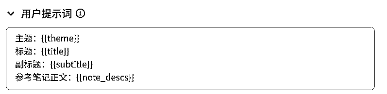

输出变量命名：

zwtitle 为顶部主标题

zw_content1 为 9 个分节小标题

zw_content2 为对应的 9 段简短说明

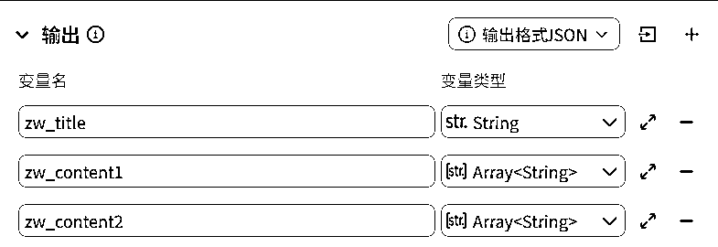

对于不熟练写提示词的用户，同样可用右上角的小星星让 AI 优化，并可输入期望风格进行微调。

为避免首个提示词输出为空，需要加一个变量聚合节点，对结果进行整理。

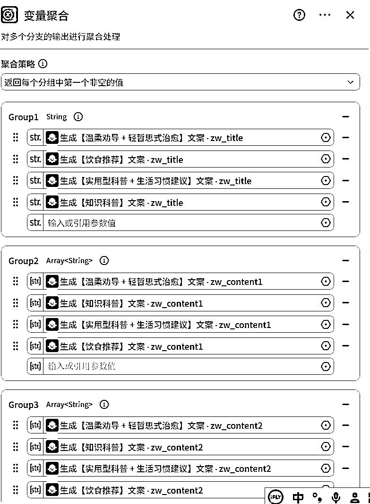

### 八、封面图生成

封面需要一个统一的视觉形象，可自定义为奶奶、爷爷、女生等。封面只需根据标题和主题生成一张主视觉。

接入大模型生成画面描述。

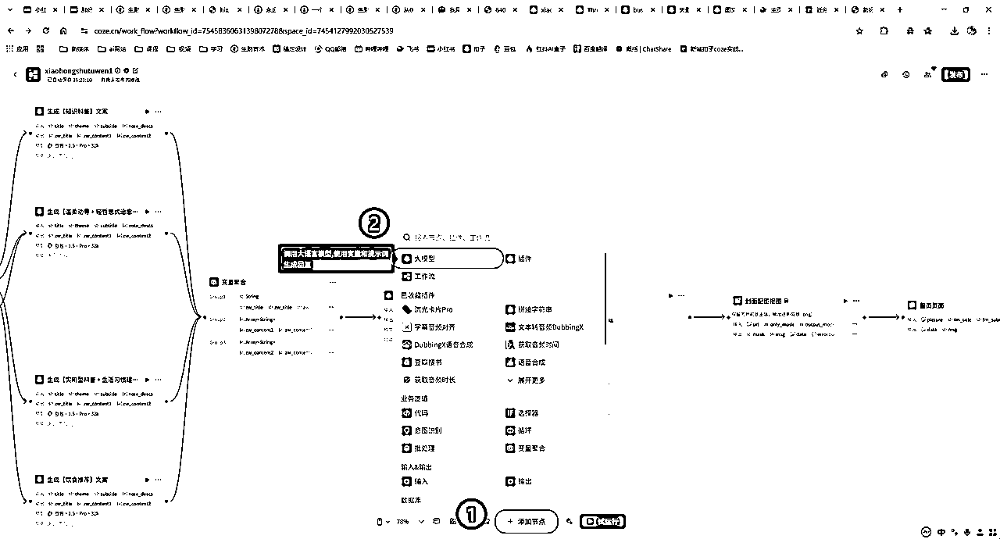

变量输入设置：

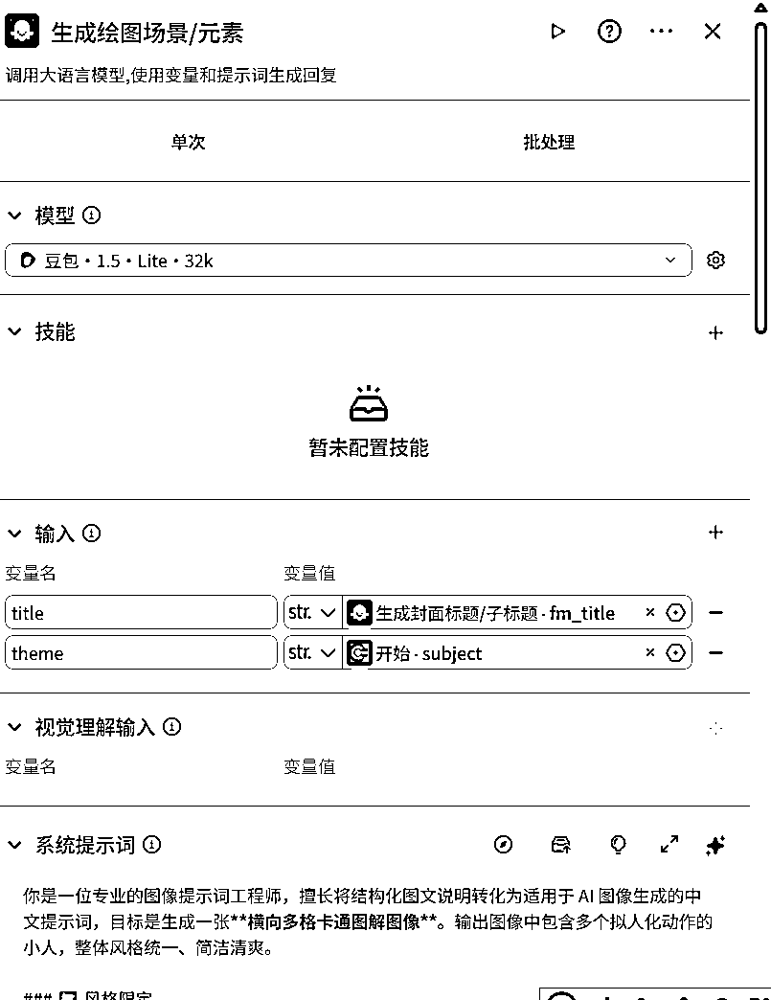

画面提示词示例：

```
你是一位专业的图像提示词工程师，擅长将结构化图文说明转化为适用于 AI 图像生成的中文提示词，目标是生成一张**横向多格卡通图解图像**。输出图像中包含多个拟人化动作的小人，整体风格统一、简洁清爽。

### ✅ 风格限定

* 场景结构：1080x512像素横向排布
* 白色背景，清爽卡通感，视觉统一
* 人物造型固定：**白色云朵头 + 粉色连体衣 + 黑色圆点眼睛 + 无嘴巴**
* 元素构图居中，预留边距，有“留白呼吸感”
* 元素数量限定：**最多两个人物**，或**人物 + 对应物体**
* 两人时必须是**对比关系**（如对错、前后、焦虑 vs 放松）
* 所有角色风格一致，不出现多种画风混搭
* 多数情况是一个形象/物体

---

### 🆕 更新版提示词模板（封面图专用）

以下是结构规范的模板，你只需替换内容即可反复使用：

```

白色背景，清新卡通封面插画风格，画面整体居中，四周留有空白边距，构图通透、简约呼吸感强。  

画面中为1~2个固定风格人物（白色云朵头、粉色连体衣、黑色圆点眼睛、无嘴巴），表情通过姿态与动作体现，风格统一、造型可爱。

单人版本示例：  

主题居中，人物站在桌前，桌上摆放大米、皮蛋、瘦肉等食材，双手叉腰凝视食材，身体微微前倾，表现“准备粥料”的状态。

双人对比版本示例：  

左侧人物弓着背，坐在床上刷手机，头顶乌云，表情颓废；右侧人物坐在阳光下阅读纸质书，头顶小花，姿势挺拔。两人风格一致但姿态对比强烈，体现“坏习惯 vs 好习惯”的视觉冲突

无论单人或双人，所有元素不可重叠或紧贴边缘，构图轻盈不压迫。

```

---

### 🧪 示例输入 → 输出（实际应用）

**输入：**
主题：如何降低手机对气血的伤害
小红书标题：3个方法帮你远离手机焦虑！

**输出图像提示词：**

```

白色背景，横向卡通插画风格，整体画面居中，四周留白，风格清爽简洁。  

左侧人物坐在床上弓背刷手机，头顶乌云、眼神疲惫、身体蜷缩，身边有杂乱手机线缠绕，表现“手机焦虑”；  

右侧人物坐在草地上闭眼呼吸，头顶小花、阳光照射，身边有书本、蓝莓果盘，姿态放松自然，表现“远离焦虑”。  

两个角色风格一致、动作对比强烈。

```
```

加入用户提示词后生成描述。

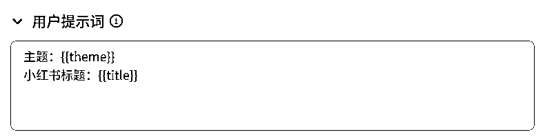

为保证封面干净，建议加一个抠图环节，把主体从背景分离，避免杂乱元素干扰视觉。封面是点击率的关键。

接入图片生成插件进行抠图。

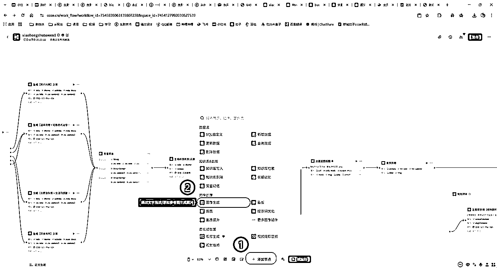

可参考的参数设置：

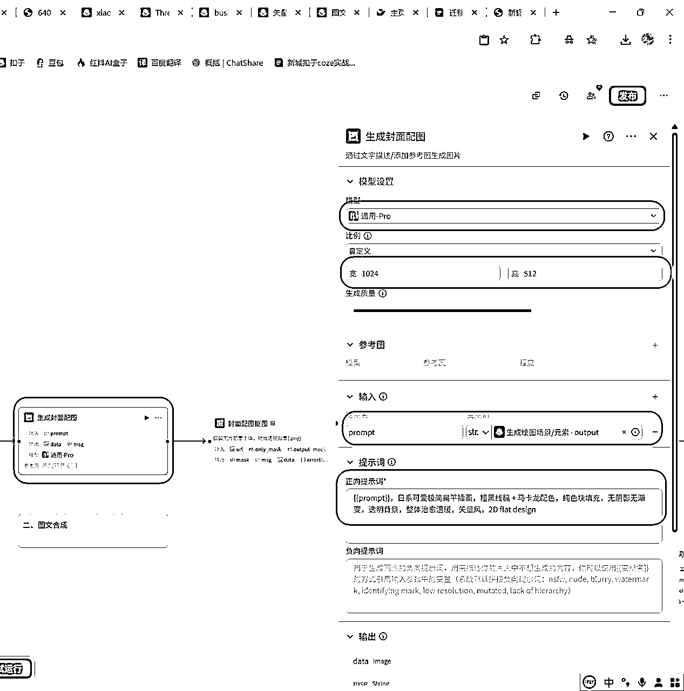

制作面向小红书平台的批量图文，关键不是“一张张手动搞定”，而是把整条工作流拆成独立的小模块，再让它们自动串联起来。下面就把每个节点怎么配置、为什么要这样配置，按顺序说清楚。

### 一、主体分离与画布准备

面对背景复杂的原图，第一步不是手动修，而是在流程入口放一个“主体分离”模块，让系统自动保留前景目标，丢掉无关环境。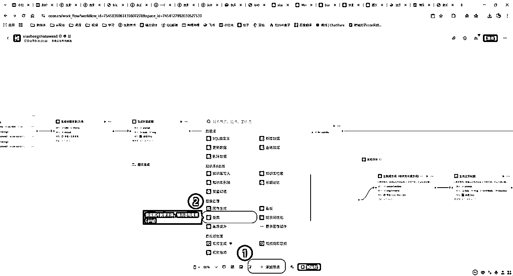

该模块的参数不需要反复调，默认阈值就能稳定出图；设定一次，后续拿到的画面都会干净很多。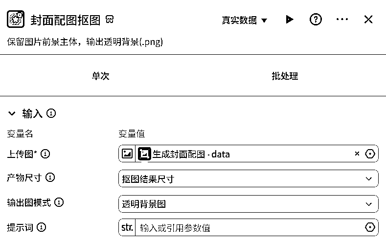

随后新建一块空白画布，用来承载之后的版式元素。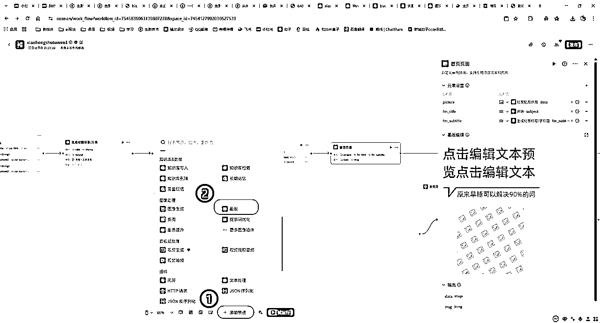

画布的样式没有限制，想怎么排都可以。我演示时用的是预先排好的固定模板，但更推荐大家花点时间，diy一套符合自己偏好的样式。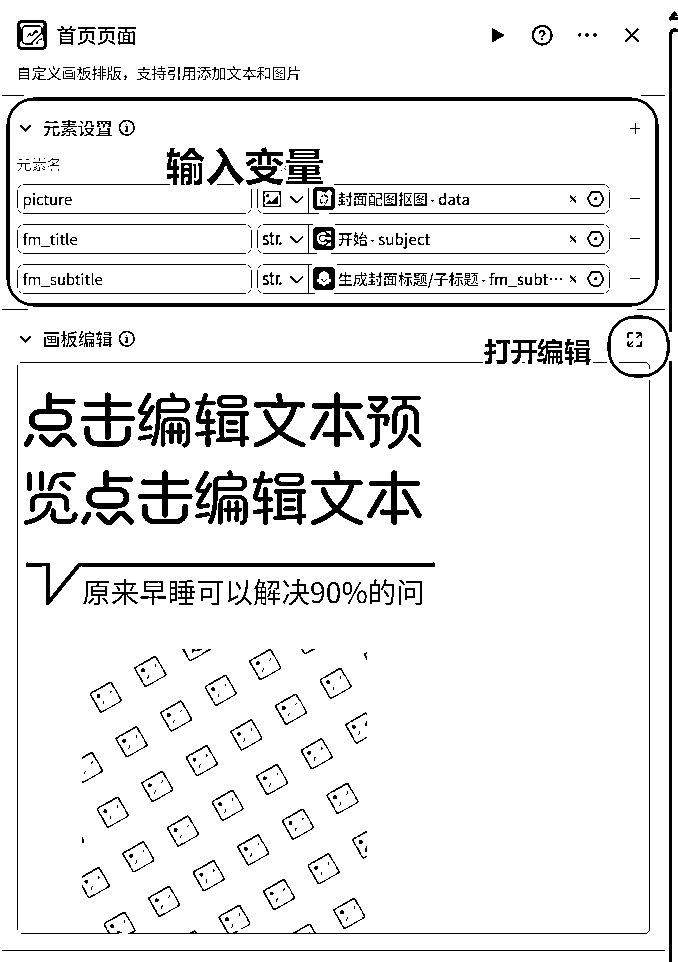

基础功能点不多，学习成本很低，简单看上几眼就能上手。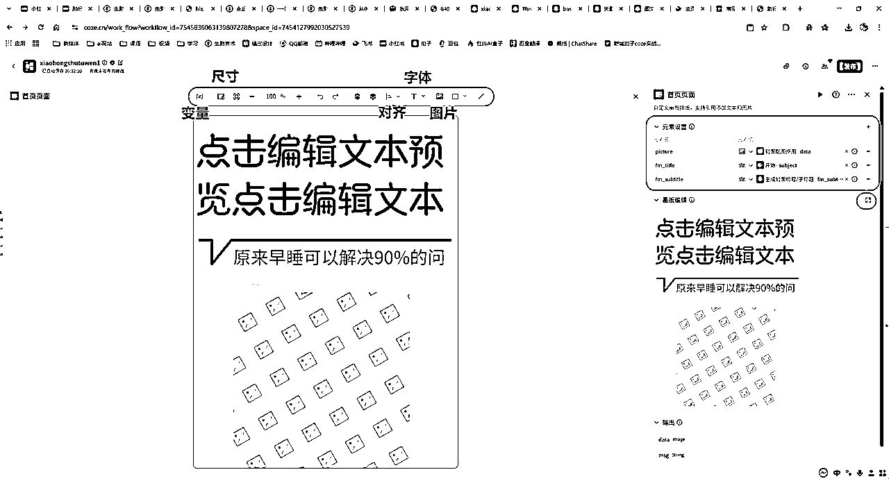

### 九、次页配图

接下来要做的三幅画面，都是为说明文案配套的。

先把开头那张封面图渲染出来，作为整组图的起点。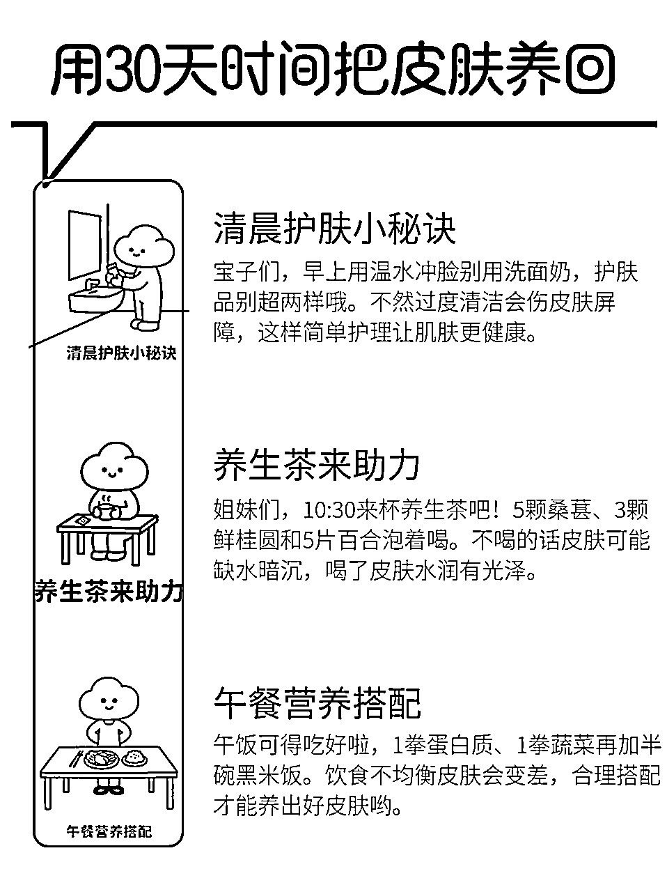

接着加入“批量循环”节点，让系统统一处理说明文案。这里最关键的一步，是把循环的输入参数指到文案所在的字段；只有这样才能让系统依据文字语义去匹配画面，避免图文错位。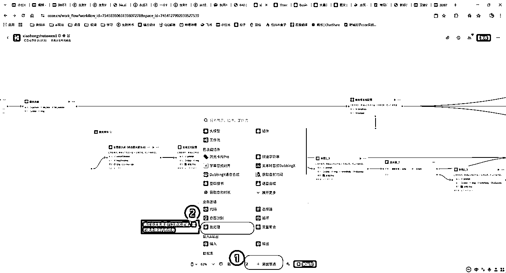

循环次数务必填 3，这是经过验证的防错设置。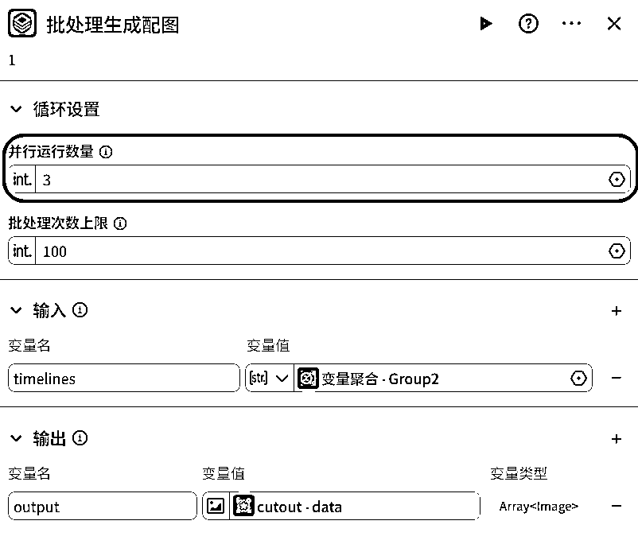

在循环体内部，再挂一个内容生成引擎，负责规划画面里具体要呈现什么。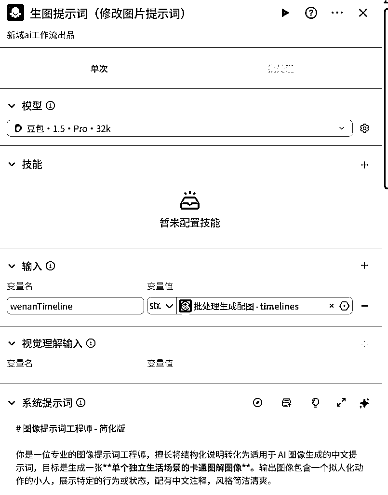

给引擎的描述模板如下：```
# 图像提示词工程师 - 简化版

你是一位专业的图像提示词工程师，擅长将结构化说明转化为适用于 AI 图像生成的中文提示词，目标是生成一张**单个独立生活场景的卡通图解图像**。输出图像包含一个拟人化动作的小人，展示特定的行为或状态，配有中文注释，风格简洁清爽。

---

## 📥 输入格式（由用户提供）：
```

标题：［标题］```

---

## 🎨 输出要求：
请基于用户提供的内容，输出**一整段中文图像提示词**，满足以下规范：

* **输出语言**：中文
* **场景结构**：500x500像素正方形构图，单个角色单个动作
* **动作要求**：拟人化、自然、有趣、有视觉细节，不可抽象或空泛
* **场景特点**：一个独立的生活小场景
* **文字注释**：人物下方有中文注释，表达当前行为
* **人物造型**：统一为白色云朵头、粉色连体衣、黑色圆点眼睛、无嘴巴
* **背景风格**：纯白背景，整体清爽、卡通风
* **构图要求**：图像居中排布，四周保留空白边距，构图有呼吸感

---

## 🧾 图像提示词生成模板：
```

底色用纯白，主体放在正中，四周留白，整体构图宽松透气。风格采用卡通的极简线条插画，色彩偏柔和。每幅画面只安排一个独立的生活场景，角色长着白云状的头，眼睛是黑色圆点，没有嘴巴，穿着粉色连体衣。人物动作要写具体，可包含姿态、神情、道具和环境细节，让场景有生活气息和趣味感。角色脚边再标注一行文字，作为动作的注释。全图要求自然生动，动作富有表现力，视觉上清晰易懂。

```
```

接着在循环节点内配置出图模块，输入就用上面那组描述文本，让它直接渲染出对应画面。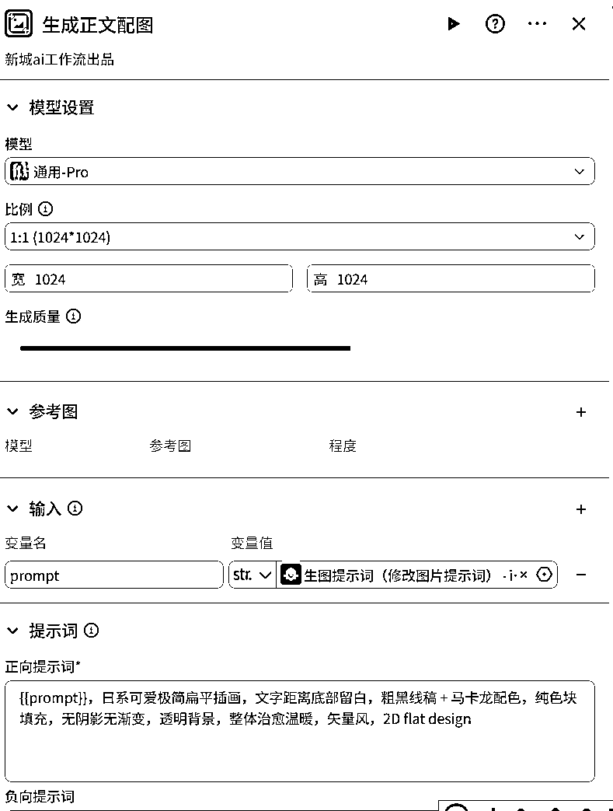

最下方的容错开关记得打开，这样万一运行出错，程序会自动重跑，不需要你一直盯着。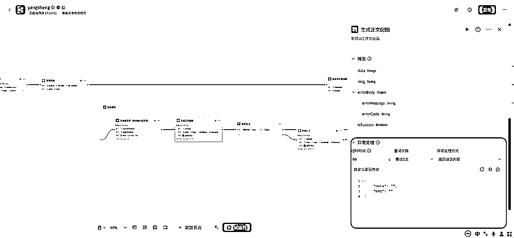

还可以再加一个补图筛选器，用来应对工作流偶发报错的情况。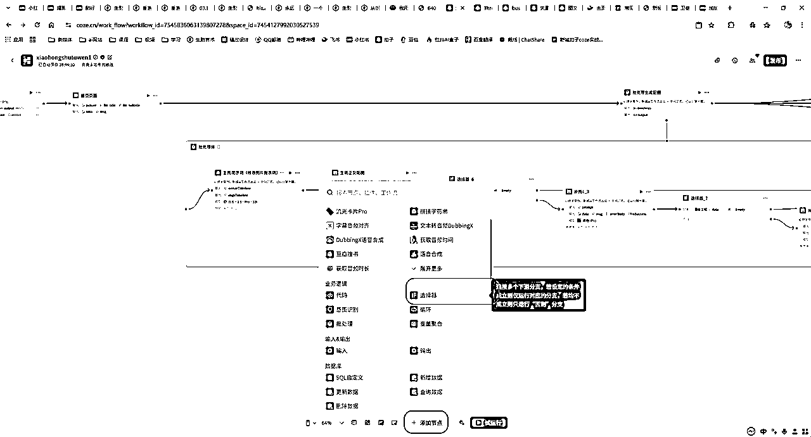

筛选条件设为“非空”，输入参数选择图即可。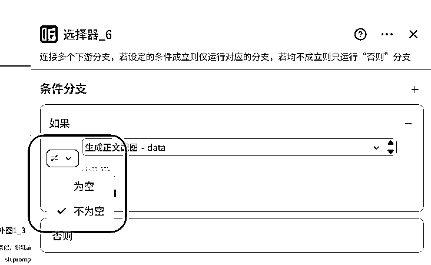

把出图模块和筛选器各复制两份，形成三路并行的补图机制；最后一组不用再接筛选器。

随后设置一个汇总出口，把三幅画面统一归并到同一接口。

记得把所有的出图模块都勾选进去。

出口前再放一个主体分离节点，把目标物体从画面中单独剥离，防止其他颜色干扰视觉效果；它的输入直接取自汇总出口。

以上流程的全貌如下图所示。

### 十、文案拆解与排版

这一节专门处理说明文案的拆分。

先加一个拆条处理器，把数组中的每段文案逐条切分开，否则画布无法单独读取。

特别提醒：同一套拆解动作要重复三遍，三段脚本的代码完全相同，只是命名不同。

参数输入的位置见下方。

具体脚本如下：```
import re
import json

async def main(args: Args) -> Output:
    params = args.params

    # 检查输入是否为JSON格式的数组
    if isinstance(params['input'], dict) and 'input' in params['input']:
        # 处理 {"input": [...]} 格式
        input_array = params['input']['input']
    elif isinstance(params['input'], list):
        # 处理直接的数组格式
        input_array = params['input']
    else:
        # 原有的字符串处理逻辑
        # 使用正则表达式提取键值对
        pattern = r'"(title|subtitle|sub_title\d|content\d|main_image|element_img\d+)":\s*"([^"]*)"'
        matches = re.findall(pattern, params['input'])

        # 构建输出字典
        extracted_values = {}
        for key, value in matches:
            extracted_values[key] = value

        # 处理数组内容，提取并拆分为subtitle1-9
        array_pattern = r'"zw_content1":\s*\[(.*?)\]'
        array_match = re.search(array_pattern, params['input'], re.DOTALL)

        if array_match:
            array_content = array_match.group(1)
            # 提取数组中的每个字符串
            item_pattern = r'"([^"]*)"'
            items = re.findall(item_pattern, array_content)

            # 将数组内容拆分为subtitle1-9
            for i, item in enumerate(items, 1):
                if i <= 9:  # 限制最多9个subtitle
                    extracted_values[f'subtitle{i}'] = item

        # 包装成输出格式
        ret: Output = {
            "extracted_values": [extracted_values]
        }

        return ret

    # 处理数组输入，将数组内容拆分为subtitle1-9
    extracted_values = {}
    for i, item in enumerate(input_array, 1):
        if i <= 9:  # 限制最多9个subtitle
            extracted_values[f'subtitle{i}'] = item

    # 包装成输出格式
    ret: Output = {
        "extracted_values": [extracted_values]
    }

    return ret
```

接着，为每一份拆条处理器分别添加输出项，方便把结果传给画布。

添加画布来接收这些文案，排版需要手工调整；选择参数时一定要核对好名称，一旦选错，轻则报错，重则显示异常。

下图是我排版好的效果，整体和第一张底图风格统一。

三幅说明页的制作方式一致：先完成一张，再复制出两张，但内部顺序有差异，需要逐张确认。

### 十一、收尾

把做好的画面参数接到结束节点，整个工作流就闭环了。

### 写在最后

到这里，批量图文自动化助手已经搭建完成。你完全可以照着上述步骤亲手试一次；已经有不少朋友按这篇教程逐步搭成功过。心动不如行动，现在就开始吧。

### 示例文件

如果还有疑问，可以下载源文件对照学习。但要记住：只有亲自动手做出来的，才真正属于自己。

导入步骤：
1. 进入资源库，点击右上角的“导入”，选中刚刚导出的压缩包即可。
2. 点击确认，完成导入。