# 我从零做B站好物深海圈，2条视频就日入破千，3天回本门票，10天奔着破万去，我到底踩中了什么？
作者：龙哥

# 前言

## 说两句心里话

这是我发的首篇复盘，纯写作就花了12小时，跨度一周，字数过万，阅读大概要20分钟，感谢你能看完。

感谢赚钱，感谢龙哥老师，感谢家蒙老师和助教会，感谢深海圈里无偿分享的各位大佬，以及一起冲项目的圈友打气。

B站好物现在就是窗口期，正反馈来得极快，第一条就成交，第二条就直接起飞了。

一天净赚一千多，3天把3000块门票赚回来，才真切感受到从零起步也能有这么高的天花板。

## 我选的生态位

B站好物的版图很大，我跟随深海圈走的是一个看起来门槛高、实则纸老虎的生态位，在家蒙老师带队下几乎无痛通关。

所以这篇复盘基本不聊好价切片和AI矩阵玩法，只在后面提效部分点了一下。

可参考的百万榜标杆就在下面，我后文的优化思路基本都围绕这种内容展开，这位也是我重点对标的对象之一~

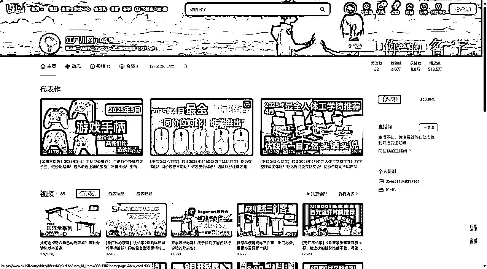

## 文章怎么安排

整篇分4大块，花时间写清楚了决策背后的思考，篇幅比较长，建议直接看左侧目录跳转。

一是收益展示，主要是给你信心
二是做对了什么，讲关键的道和术
三是深海圈的价值
四是提效方法
五是一些杂谈感悟，附带时间记录表和对挫折的看法

* * *

# 第一部分｜真实收益

信息和执行之间隔着一道沟，动力是最重要的一块垫脚石。我先把数据摊开，未知带来的恐惧就会少很多。

方向选对了，一直做正确的事，不下桌子，迟早会赢。

第一次赢才是最重要的，赢一次就有第二次，然后就会滚雪球。

## 收益晒单

先说下我的现实情况：有全职工作，还在读非全日制研究生。工作日上班，周末上课，上课老师很硬核，我必须去听。早上8:30到晚上21:45，一天能挤出两小时做项目。

如果我都能做，你也没理由不行。

一年刨去工作、休息、通勤，大概剩1425小时，再扣掉研一学习和刻意休息，能留给单一项目的只有600小时。用来堆小时数引发质变就靠这600小时。

我一年基本只做一件事。去年是考研，用了537小时上岸，今年的目标是靠互联网把钱挣出来。

### 9月3日 当天利润760元

当天成交额3000，GMV 1.3万，佣金净赚760

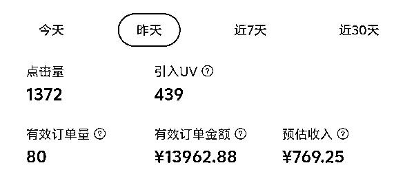

### 9月4日 当天利润1200元

播放爬到7000，GMV 2.7万，佣金净赚1200

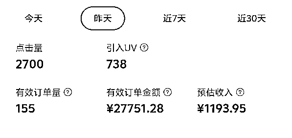

### 9月5日 当天利润1380元，深海圈门票回本

播放到1.2万，GMV 2.8万，佣金净赚1380

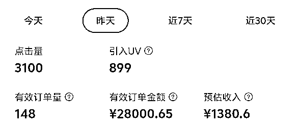

视频挂了15个链接，近半链接被抢空

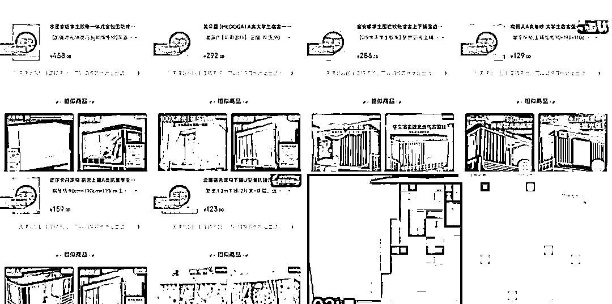

3天回本，后续收益还在持续。

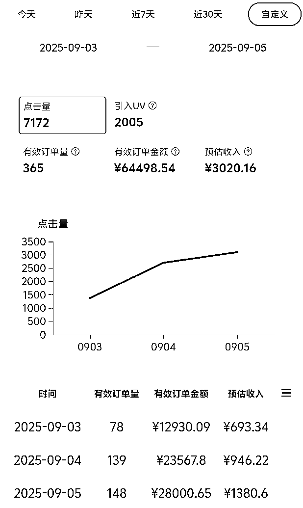

### 9月6日 当天利润1700元

播放到2万，GMV 3.2万，佣金约1700

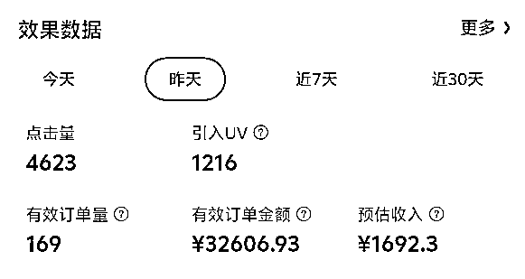

鸡血打完回归现实，继续干。

## 我投了什么进去？

从8月24日开始看家蒙老师录播课到现在，一共投入50小时。

我有记录净时间的习惯，最小单位10分钟，坚持了两年。正是这个习惯让过程数据清晰可参考。

建议你也养起来；能衡量价值的通用物就是时间；价值单位就是元/小时，我目前大概50元/小时，未来应该能涨。

年轻人好，时间还多。

后面会分享我迭代多版的自用时间记录表。

关键节点如下：

### 8月14日 赚钱官宣B站好物深海圈

很心动，但越心动越要冷静。我先做了一轮可行性分析。

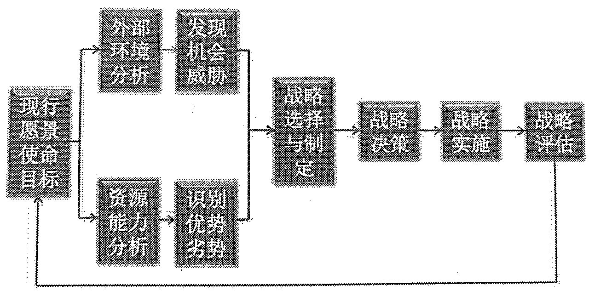

01 外部机会
价格战环境下，用户更信第三方素人测评，不信品牌方单向营销。短视频是品牌口径的延续，长视频才承载测评。B站现在红利期，开放电商跳转，评论区蓝链、视频浮窗直跳淘宝京东，等于允许导流，只要你能卖。

生态多元，有高门槛也有低门槛，策略可调。打不下高位也能退守基础，留住根基。

02 外部威胁
对返佣比例依赖高，易被选品牵着走，差异化难。后来实操发现威胁不大。
赛道拥挤同质化严重，后来发现也威胁不大。
政策平台规则突变风险，暂时有担忧，跑到明年再准备后手。

04 结论
B站好物至少能做3-5年，从零可学，能建护城河，后来者门槛高。

前面失败的项目让我攒了能力，结合自身优势，我有信心做成。

当初设想门票3000，半年做到月入3000-5000，一个月回本。实际结果：第一个月就日入千，3天回本。

### 8月20日 买fs开通好物悬赏

### 8月24日 开始看录播课

看完立刻开干，首选题材定充电宝。

2025年8月15日起充电宝新规落地，这个题材自带流量。

### 8月31日 首条视频上线

非常没底气，一发就买必火投流300块。出单了，但只出了3单，佣金才40块，现实很扎心。

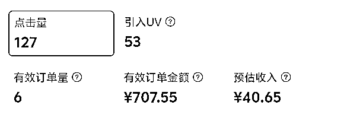

### 9月3日 第二条视频上线

痛定思痛，深度对标后做出第二条，没投流。

早上7点发出去，上午看完阅兵，核导方阵出列说射程覆盖全球时眼眶发热。正义必胜！和平必胜！人民必胜！

回来一看只有80播放，懵了一下稳住心态准备冲下一条，下午就开始爬升，最后小爆。有了这篇文章的底子。

* * *

# 第二部分｜质变发生了什么

从里程碑看，质变在8.31到9.3之间，我只做了一件事——对标。

对标有讲究，下面展开。

视频的提升不能一口吃成胖子，城墙太高会吓退。我的做事方法论第二条就派上用场：工程拆分+聚焦。

我的思维内核就三点：
一、量的积累，水到渠成，正确方向堆小时数终究质变
二、任何事都要拆分+聚焦
三、生命在于记录，时间是战略资源

拆分：再难的问题拆到能上手的小任务，一块块做完，火箭就是这么造的。
聚焦：长城再长都是砖，眼前只有这一块砖。难就拆，拆到能上手，专注把小事做到位。

拆！

见色起意，始于颜值：
标题、封面、置顶评论、视频数据外露、章节、字幕、背景音量、噪音、语速

才华部分：
节奏、剪辑手法

内在部分：
内容核心、评论区运营、人物信任感

大道至简，每个点找对标视频抄+迭代。

## 2.1 见色起意，始于颜值

不是要多美，是要及格。

B站观众容忍度高，但不代表可以持续不及格。

高考阅卷老师10秒一篇文章，先分档再给分。观众也是这样，封面和标题就决定视频大致档位。

这里只要出现讨厌的细节，内容再好也会错过被喜欢的机会。

观众时间宝贵，注意力稀缺。

研究基础是认知心理学。人脑每秒接收1100万比特信息，能处理只有16-50比特，不到百万分之一。

像黑夜里只开一盏探照灯，大脑一直在控灯。

封面感觉对了，观众才把探照灯放到文字上，才开始第一次信息处理。

认知心理学里的鸡尾酒会现象：聚会时远处有人喊你的名字，会立刻竖耳倾听，眼前的对话全丢。这就是意识控制感知的体现。

什么文字容易点开？跟观众相关。

日常看B站时多留意为什么想点，积累用法。

下面是对新手的几个对标要点，有经验的可跳过。核心在内容和评论区。

要求不是精美，是及格线。及格了观众才愿意把探照灯放到内容上。

### 2.1.1 封面

B站封面要做两个，16:9和4:3。

9月4日家蒙老师直播点评，有圈友因比例不对导致文字没显示，信任感直接掉。

小事情就能解决，调一下尺寸排版就行。

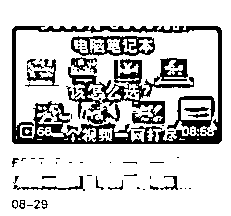

新手不知道怎么上传两个封面，我示范一下

01 先正常上传4:3第一个封面

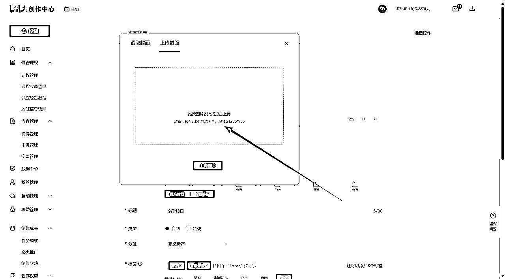

02 点多比例封面设置

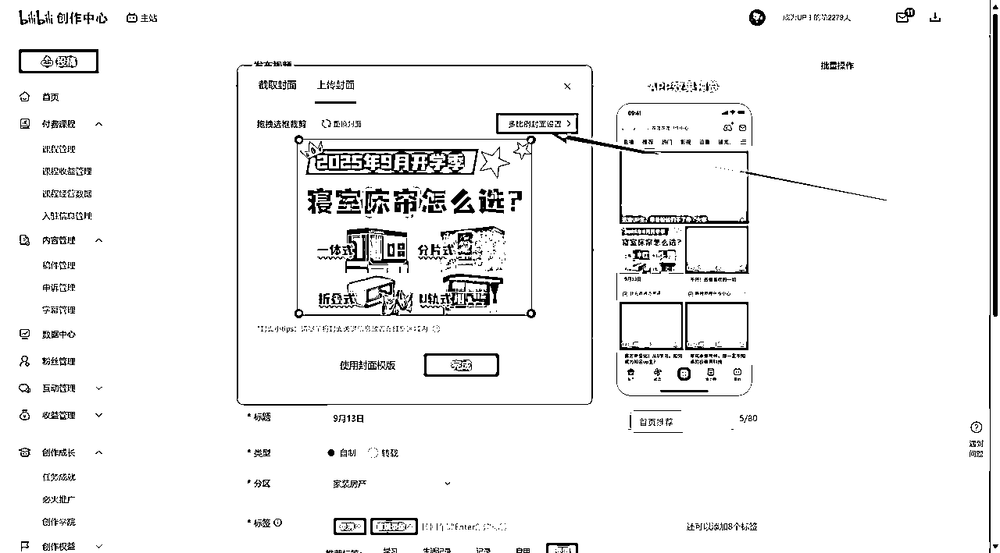

03 换成16:9

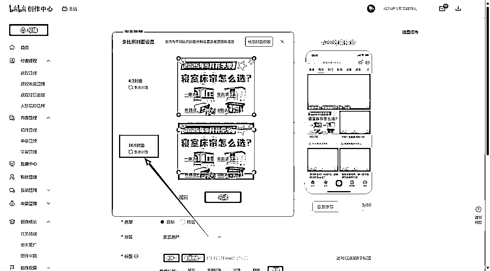

04 不同比例各有特点

### 2.1.2 置顶评论蓝链

下面是我觉得很牛的，学到50%就够，前期快迭代。

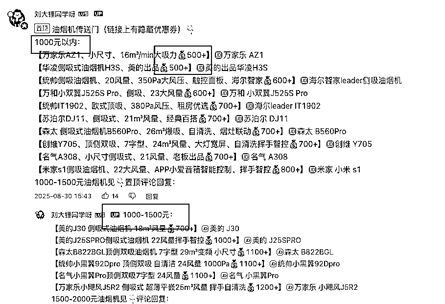

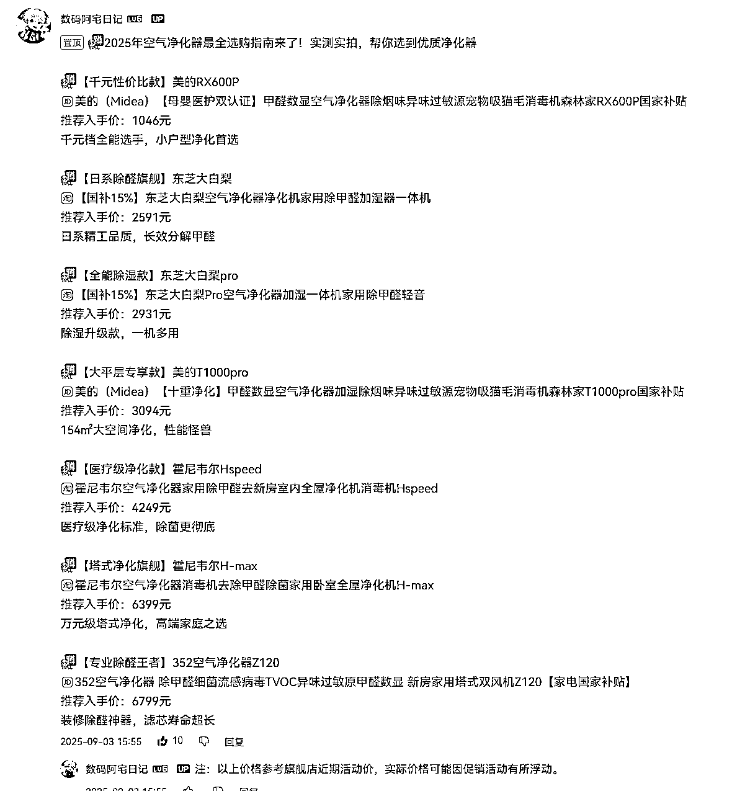

编辑蓝链很累，但观众点蓝链才给你钱。视频都做痛苦了，不差这一小时。

我从发布到京东联盟搞蓝链基本要一小时。

### 2.1.3 视频数据外露

播放和弹幕，带货视频5000以上算好看数据，不用太多。

自然流3天，看1000达标没，没有可稍微运作一下主页观感，运作后不会继续推流，无收益，及格即可。

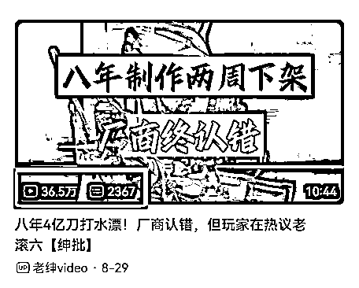

### 2.1.4 视频章节必加

一定要用B站自带的。手机端搜索列表，部分视频会展开章节，有人会被章节吸引。

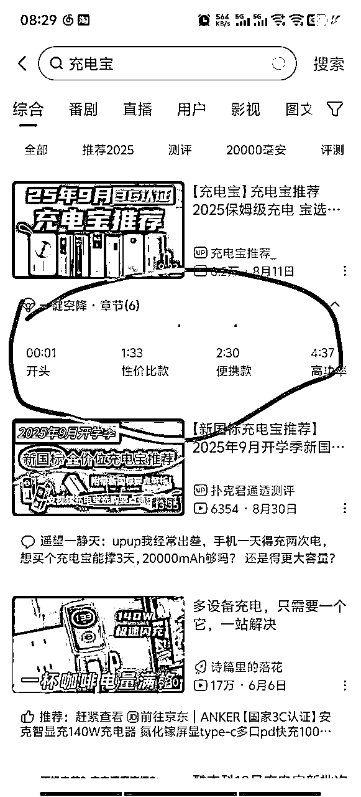

我一开始用剪映，后来改自带。

添加方法：

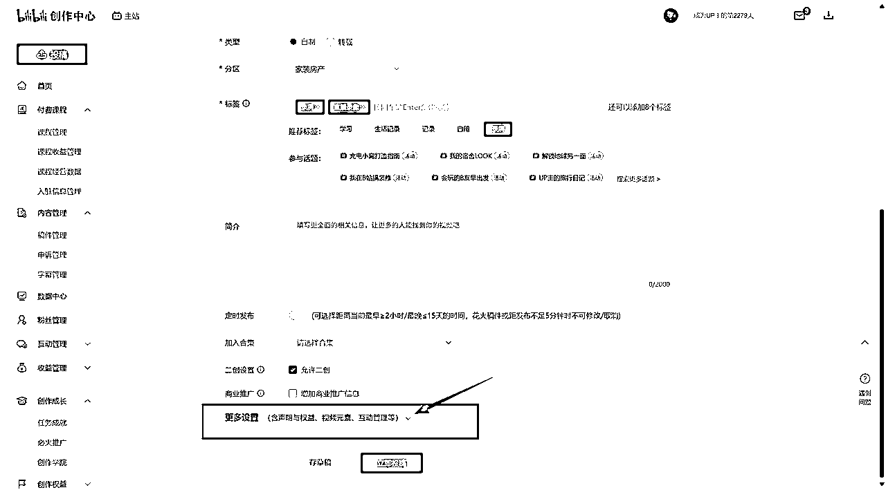

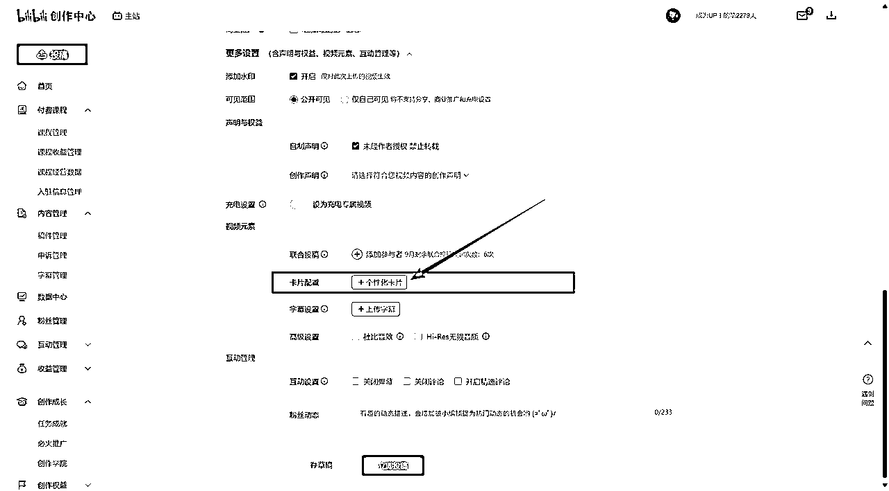

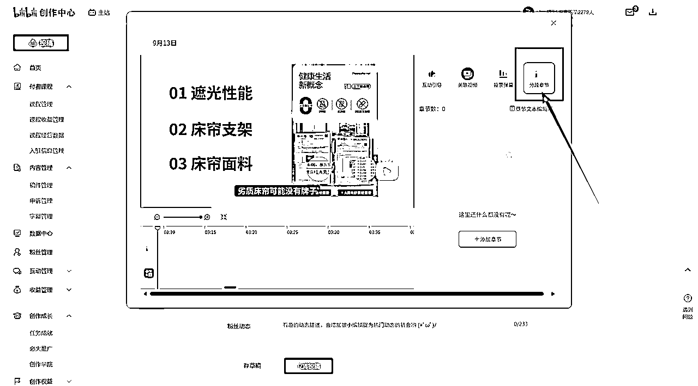

### 2.1.5 字幕

必须加，信息密度高。字幕清晰即可，推荐加底色或描边。

### 2.1.6 背景音乐

一般降15-25分贝。

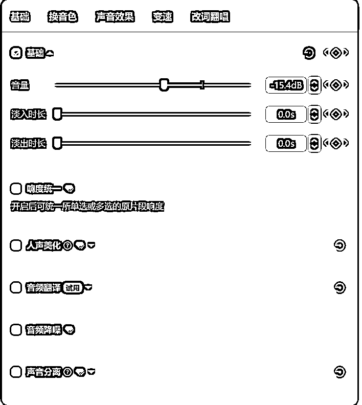

### 2.1.7 无噪音

观众集中注意力已经很辛苦，别再放音爆。

### 2.1.8 语速

多数人偏慢，我调1.1倍速。

## 2.2 才华部分

第一步达标，观众能无痛观看，完成第一次感性判断。

第二步靠节奏和剪辑定义档位。

节奏舒服留存高，画面舒服会觉得权威，但核心仍在内容、评论区、信任感。

### 2.2.1 视频节奏

创作型参考思路，仅作参考。

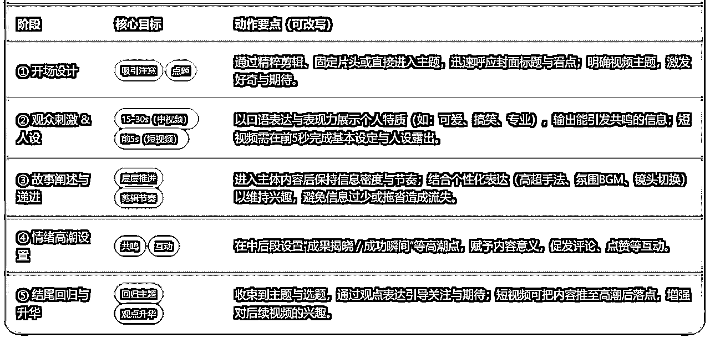

带货要点：不能一直干货，要有节奏。干货、调侃、参数、故事交替，大脑不喜欢一直消耗。

### 2.2.2 剪辑手法

都知道怎么做，但大脑会抗拒。邪修法：找对标视频花2-3小时1比1复刻，我剪1分钟要1小时。

复刻一个后，看别的视频就能拆解。

推荐对标对象：

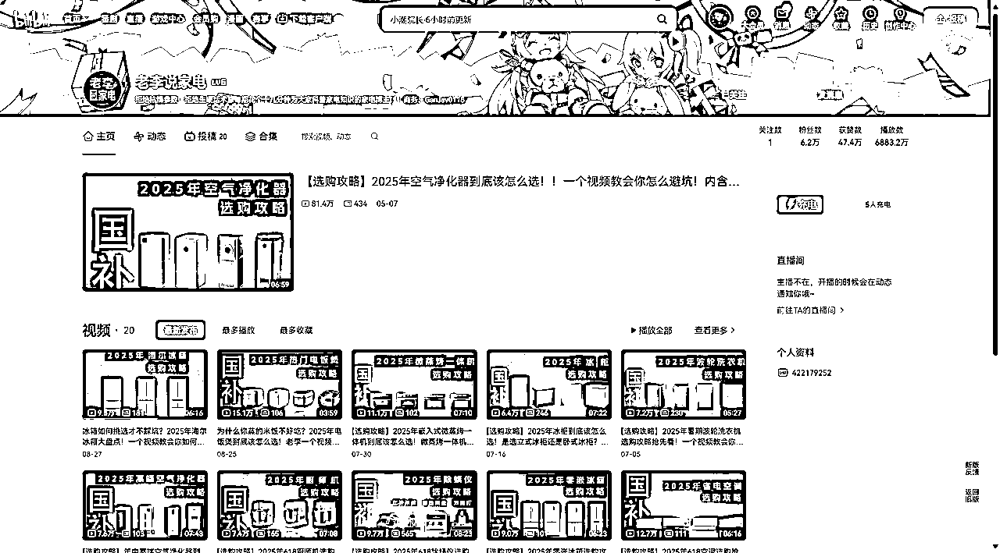

不用每个视频都牛逼，能模仿50%到及格线找到手感即可。

## 2.3 内在

### 2.3.1 内容核心

分铺垫+产品介绍。

为什么百播放也能出单，我的13分钟长视频出单反而没他高？我复盘后明白。

好价生态位月百万GMV上榜，猛猛出单。

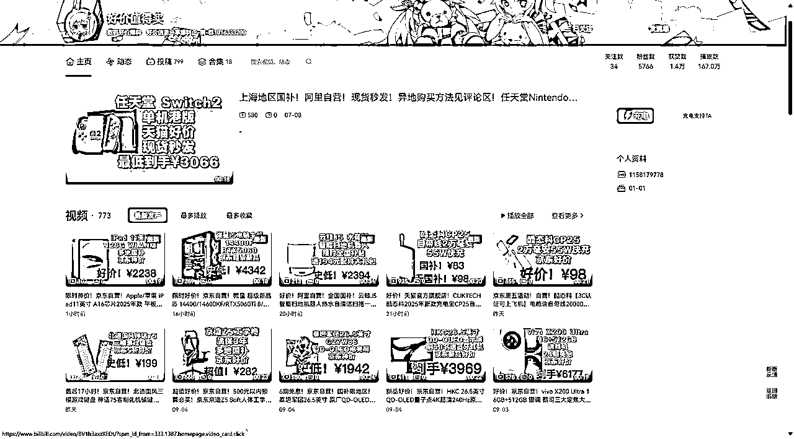

能赚钱必然是提供了价值，B站好价给观众提供了什么价值？这种账号又提供了什么？

家蒙老师第一节课说：

不是我们多厉害，也不是视频多漂亮，更不是解决了多大问题。露骨说，就算没有我们，用户问题大概率也能自行解决。

我们只是恰好站在这个位置，用户消费经过我们一手，就产生了中间服务费。

我是从一个新手的视角来琢磨这个问题的：刚起步粉丝和积累都为零的时候，我到底该去扮演一个高能的网络销售员，给完全没有购买意图的人硬造各种使用场景吗？

我觉得不是。起初我也摸不清怎么去做一个牛逼的销售员，而且我后来发现，可能压根就不需要去卖，我只需要把自己定位成一张便签纸，帮观众记起并提醒他们本就要去买的东西，就足够了。

那怎样才能做成一张真正好用的便签纸？

我把九月榜上带货破百万的博主翻了一遍，其中一位就成了我心里的参照系。

有空可以去看看他的内容，思路会打开很多。

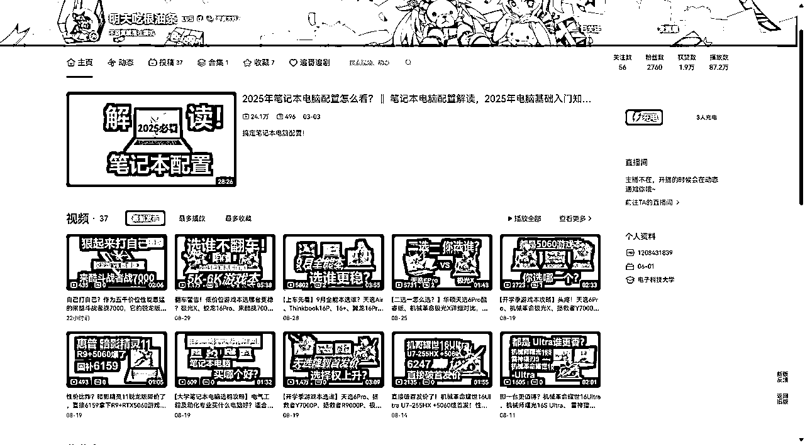

思路就是先锁定那些本来就打算买xxx的人，然后把信息帮他们梳理好，再给出清晰的好与坏的判断。

说到内容怎么搭，其实就是四个字，换位思考。下面是我梳理出来的实操步骤。

#### (1) 开头铺垫这部分该怎么想

##### 【铺垫内容要点 01 】

举个例子，如果我刷牙刷着刷着觉得累，就有点动心想换电动牙刷，但又觉得现在的手动牙刷也能凑合用。

我平时在B站刷视频，刷到一个电动牙刷测评的标题就点进来了。

这时候我最想先得到什么信息？

1. 换电动牙刷到底有没有必要
2. 市场上都有哪些类型，哪些牌子算靠谱
3. 不同价位差出来的钱，到底差在哪

带货类视频，前面的铺垫段落就该写这些。当你讲的内容正好撞到观众的疑问上，他的注意力就会被点亮，探照灯会直接照向你。

##### 【铺垫内容要点 02 】

Tips很多UP主上来就会说，最近我xxx场景用了它，真的很爽。这类口吻做推销没问题，但便签纸的角色在开头并不是重点。我觉得他写的这部分体验感其实很好，只是放的位置不对，应该留到产品具体介绍的时候再说。

视频开头的关键，是用观众能听懂的语言，把想买xxx的人心里所有的疑问一次性讲清楚，先让观众判断这个视频值不值得继续看。

##### 【铺垫内容要点 03 】

为什么要强调用观众听得懂的语言？很重要，我举个小例子。

大家可以自己点开那个视频，快速看一遍就退出。

你会发现这段信息基本被大脑自动屏蔽了，看不见也听不见。

超过3秒看不懂，观众就会往右划，连续划三次，大概率就会去相似推荐里找一个能看懂的视频了。

那你在推电动牙刷的时候，下面这份资料，你敢直接甩给观众看吗？

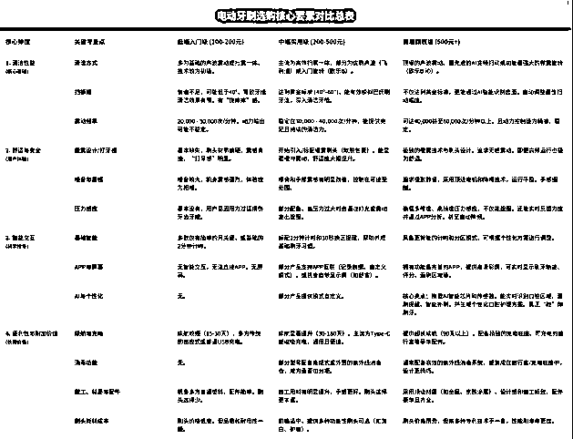

专业词汇可以保留来体现权威，但专业又冗长的句子就没必要了，真要说，也不要把钩子埋在里面，因为观众大概率是听不到的。

作为观众，我只想听最通俗、最能打动我的两三个点。

比如：

1. 比起普通牙刷，是否能更省力就刷干净，背后是哪些参数
2. 打牙感怎么样，会不会难受
3. 续航能力如何

我会优先选扫振幅和打牙感，因为观众进来第一眼能听懂的就是这些。你说工艺，观众顶多有个模糊感受，具体是什么基本等于没听进去。

后面那些硬核参数，可以在产品介绍环节再埋钩子，给每个产品挑一个最亮眼的指标来讲。

* * *

#### (2) 产品介绍环节的核心做法

##### 【产品介绍要点 01 】

介绍产品时一定要做到 事实 + 评价 都有。

事实：扫振幅能到黄金区间40°-60°，能很好模拟巴氏刷牙法，深入清洁牙缝。

评价：这个幅度对于想省心又刷得干净的人来说，基本就够用了。

事实负责建立专业感，评价负责让观众听懂。

加不加评价，效果差很多。

光有事实：扫振幅+？ 扫振幅+哦→然后忘记

事实+评价：扫振幅+好/不好，回想时能想起，我多花钱买它就是冲着这个扫振幅，它表现好，所以不亏。

光念参数没用，得告诉观众这个参数意味着什么，只有好或坏两种结果，直接点出来。

##### 【产品介绍要点 02 】

价格差在哪一定要讲清楚。

如果能讲就讲，有时候一眼就能看懂，比如充电宝就功率和容量。可是两个同价位、参数也接近的产品，你必须做区分，两个都夸等于等于都不夸，白写两份文案了。哪怕只是说，这个配色更适合学生党，比较年轻；那个拿出去见客户更稳妥，也行。

我的第一个视频：
第一个产品100元，把参数白话一遍，特点说一遍
第二个产品200元，把参数白话一遍，特点说一遍

我的第二个视频：
第一个产品100元，把参数白话一遍，特点说一遍
第二个产品200元，把参数白话一遍，特点说一遍，再补充相比100元区间，这款多了xx功能，能做到xxx

##### 【产品介绍要点 03 】

把使用场景点出来

第一个产品100元，把参数白话一遍，这个参数能在xx场景下帮你实现xx，很贴心，也能满足基础需求。

不说清楚和观众有什么关系，注意力就很难被激发。

就像视频里突然冒出一个名字，比如李华，如果真有观众叫李华，他会立刻炸毛，耳朵竖起来，甚至会刷弹幕“怎么叫我”。

### 2.3.2 评论区运营，这个是重中之重

评论区的权重非常高。

我给个数据，如果你能一天在评论区成交100单，回复并甩出链接，大概率会成交，那天GMV破万、佣金过千就是常态。

有人会觉得谁有空一个个回，还要答疑、还要推荐、还要做客观分析加主观评价。

就是我啊。视频脚本4000字，评论区回复2-3万字。

我知道一个人看完视频，大概率什么都记不住，你私下游他，再把视频精华给他复述一遍加深信任，再给他推一个商品，效果会怎样？

看看我的回复，如果你收到这样的回复，会不会直接点蓝链下单？哪怕你知道他能赚钱，你也会开心他能挣到钱，因为他帮你解决问题了。

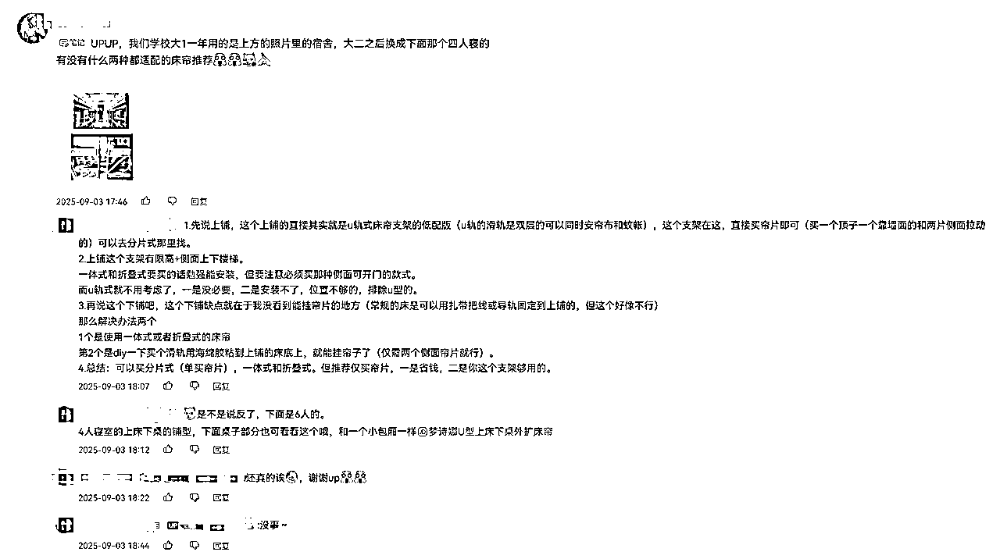

为什么我愿意这样回？

认知心理学上，发图片、提问都得消耗脑力，大脑很排斥耗能，他本可以划走的，能主动问一次就很珍贵，值得我用同等甚至更高的回报去回。

而且当其他人看到这个评论，看到有人获得正反馈，就会降低询问的门槛，因为有了确定性，确定性带来安全感，安全感带来信任。

做对了，后面就交给复利和马太效应，量变引发质变。

最后的结果会是什么样？

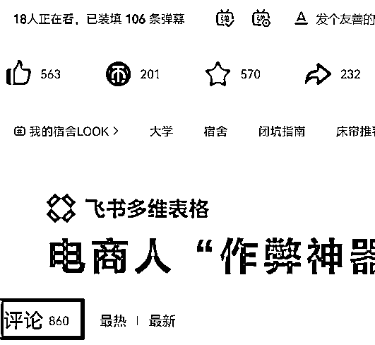

具体回复就不方便放了，800多条评论，氛围已经起来了，你可以想象那种人声鼎沸的场面。

### 2.3.3 信任感

这块我不算专家，有人天生表达真诚，招人喜欢。我看了不少圈友作品，很有B站味，非常好，下面是经圈友授权可以举例的。

家蒙老师直播点评时说很多商家都很喜欢他，愿意给单，我也很欣赏这位老哥。

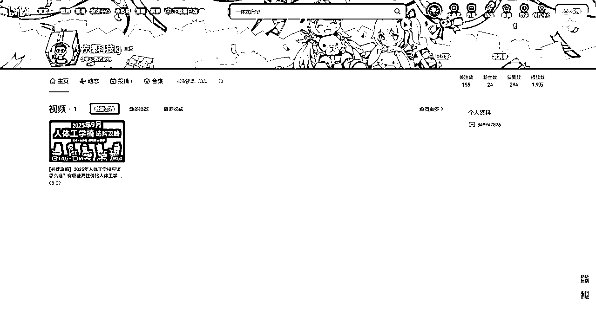

据家蒙老师的经验，找那些做工极精美的博主，开单效率反而比做得糙一点的博主差。

精致有时候不如粗糙。

核心原因是视频做得太完美了，观众会怀疑你是广告，你这么有钱才做得这么精，真实感会下降。

这个分寸要自己把握。

可惜我做不到视频层面让人有很强信任感，只能在评论区建立信任，或者用其他方式去弥补。

* * *

# 第三部分｜深海圈的价值

## 3.1 建立全局认知，选对生态位，直接避坑提速

*   带你看清B站好物的全貌，内容形态有哪些，自己处在哪个位置，心里就有底。

*   有完整且能落地的操作方法论，那种纸老虎的视频，用了方法论就一针见血，无痛速通。

## 3.2 资源与机会：高佣与商单

*   圈内会整合高佣链接资源，有些是专属定向高佣，直接提供使用。

我第二个视频带的货单价200，佣金只有3-5%，如果能拿到8%的高佣，净利润直接翻倍，意义不用多说。

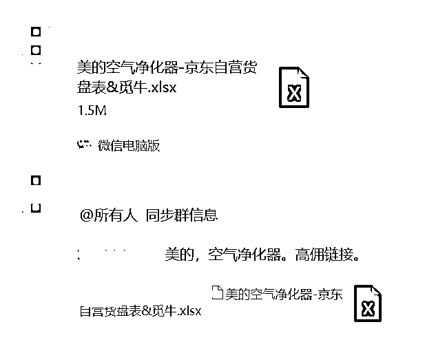

*   商单资源：刚起步就能接商单，而且基本都是大牌。

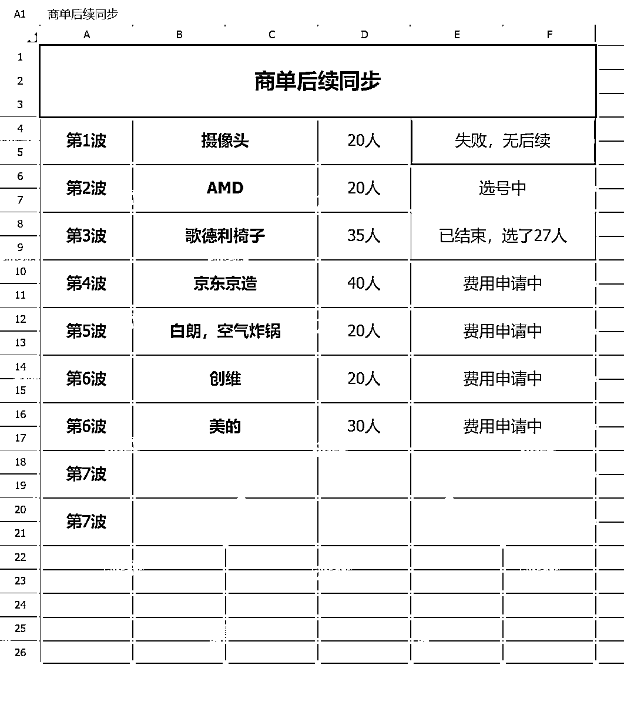

## 3.2 大佬圈友的无私分享，形成复利效应

*   大佬无私分享。

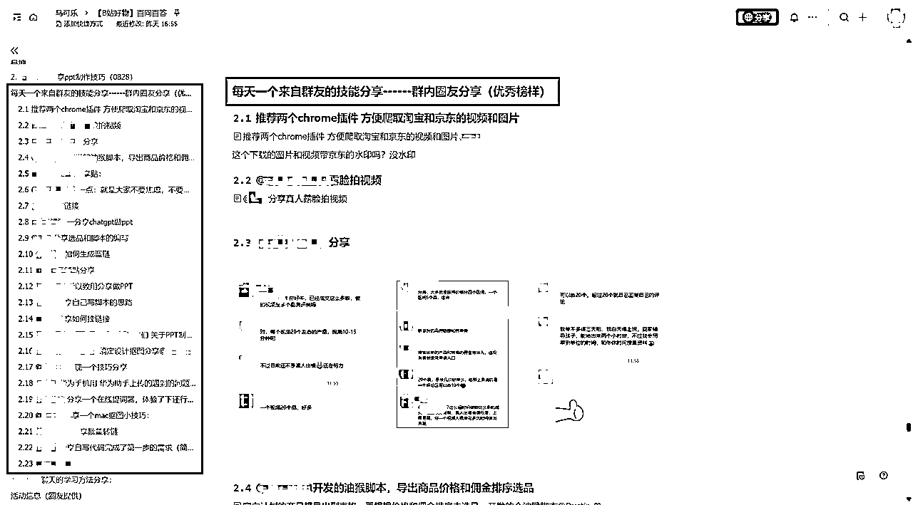

*   圈友互相打气。

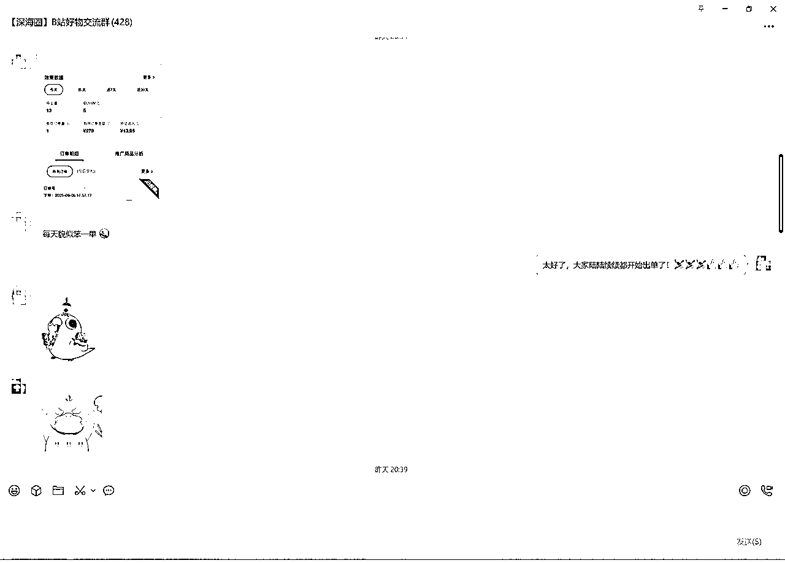

* * *

# 第四部分｜提效技巧

## 4.1 AI提效

我个人懂一点AI编程，会用Coze做工作流，也会做AI视频，主业里也是AI重度使用者。

但在这个项目里用的AI技能不多，一部分是刚跑通没空做，另外一部分是我全年无休，有主业，周一到周五上班，周末还要上非全日制研究生，有时周末8:30上到21:45，实在没时间。

### 4.1.1 这个生态位的AI自动化思路

短期快钱可能有，但我觉得这是个劣势位生态，如果有时间我也会同步尝试，现在没有时间预算，要抓主要矛盾。

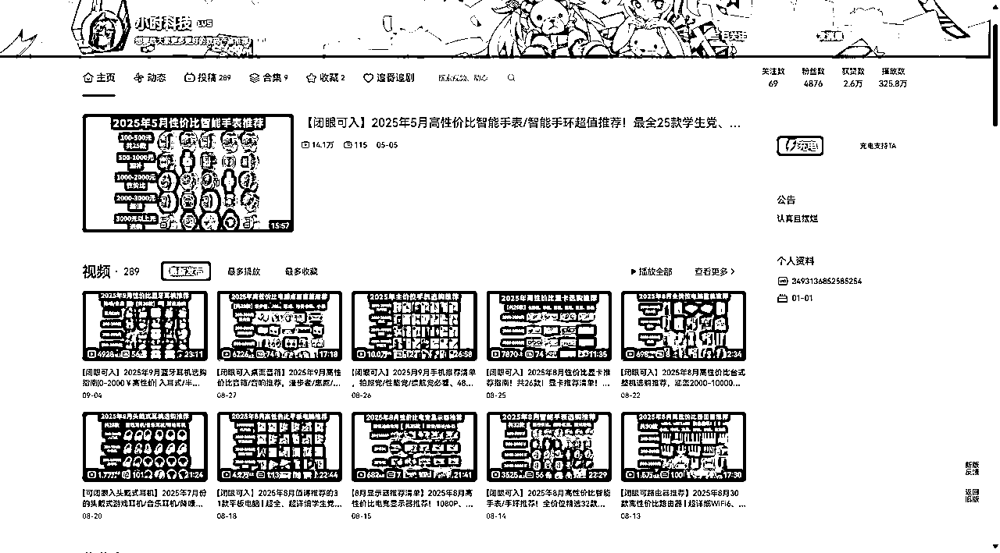

#### (1) 影刀+Python把别人视频下的蓝链转成自己的链

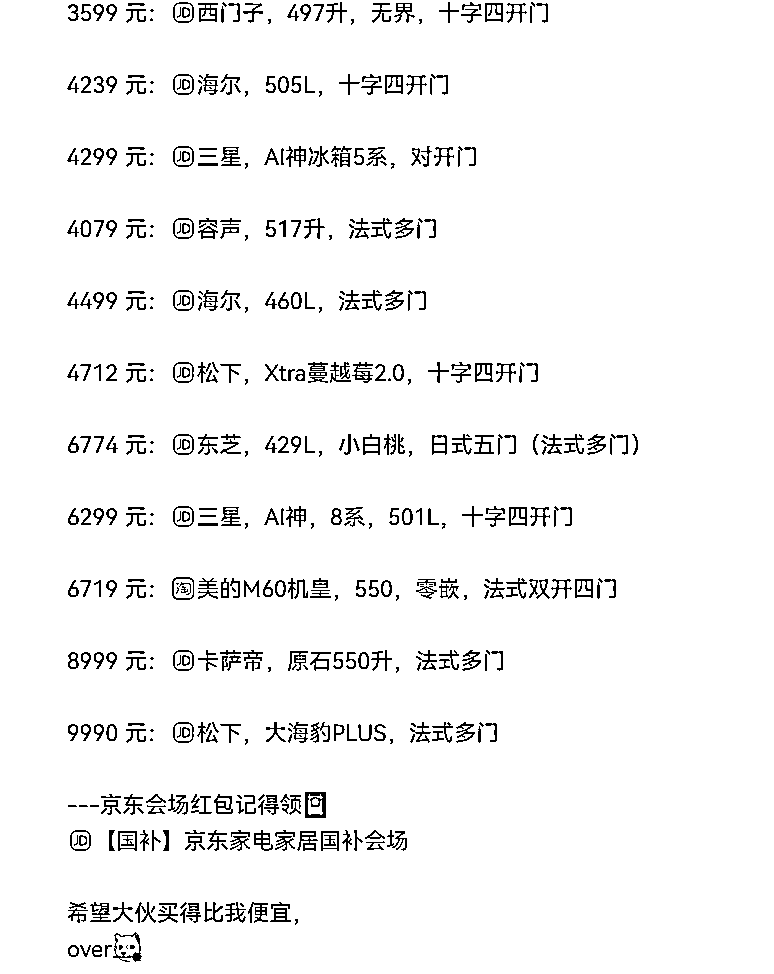

#### (2) Python每5秒截一次别人的视频，删重，让GPT按格式提取信息

#### (3) 用可画做固定模板，填Excel自动套版

#### (4) 文案转写，规定每个产品时长，Coze工作流直接生成视频

### 4.1.2 目前AI最能帮我的其实是做图表

把一段文字丢给GPT，加一句指令，效果如下

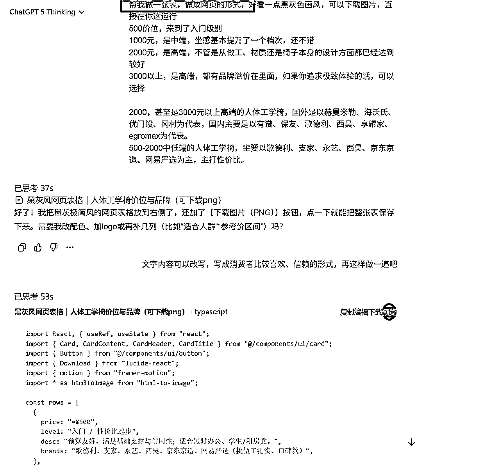

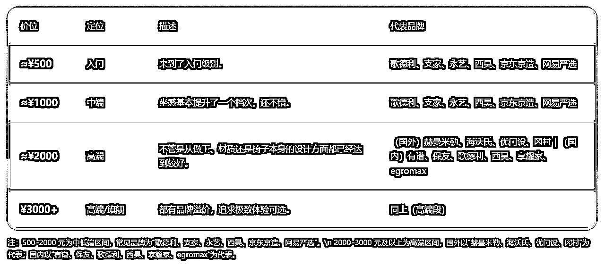

### 4.1.3 待验证的AI想法

一个想法是截取别人视频里的实拍图或商品官图，用AI图生视频，不加动作只加运镜，来补素材，替代没有拍摄设备做的酷炫展示。

### 4.1.4 MiniMax声音克隆

不推荐想长期做的人用，真人出镜说话更有信任感。

## 4.2 剪辑提效

### 4.2.1 我的创作SOP，一个视频大概12小时

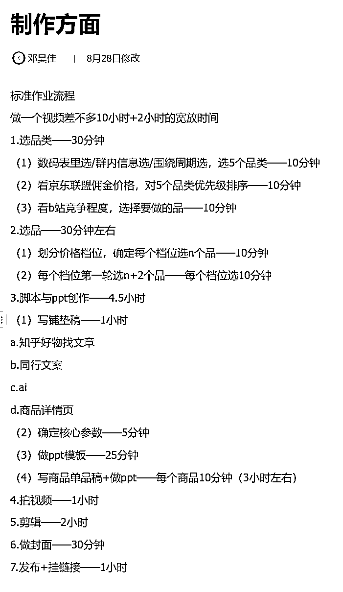

### 4.2.2 剪辑顺序很重要

经验是先定文本，录完再定音轨，音轨定完再铺画面。音轨就像骨架，一口气把一个版块做完才快。

### 4.2.3 快速剪辑的通俗做法就是用稿定设计做素材

原来剪辑开头要4小时，现在基本2小时搞定。

#### (1) 稿定设计抠图

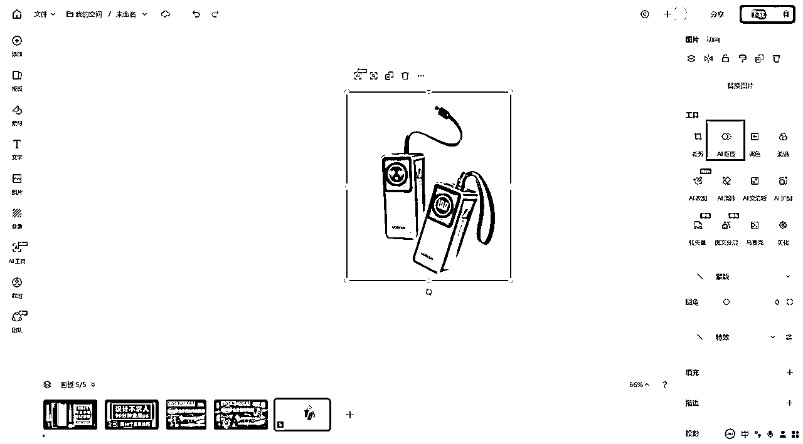

#### (2) 稿定设计背景透明化，直接拿去剪辑

这个方法快不快，只有剪过的人才知道。

* * *

# 第五部分｜杂谈

## 5.1 时间记录表

模板在这里了，从简到繁再到简，迭代了很多次。

做记录不只是提效，你的生命质量和密度都会提升，更多好处只可意会。

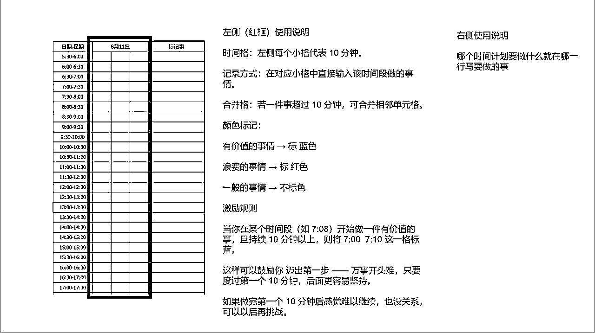

补充说明：10分钟只是一个计数单位，真正做完后再填表，看做了几个十分钟。

为什么是十分钟？因为不想干就先干10分钟，干完还难受就停，反正也就10分钟。一般情况下开头最难，第一个十分钟做完就进入状态。

使用样例如下，这是去年考研期间的记录，感觉还是放使用过的例子好。隐私太多就不放现在的了，至于计划和实际对不上，人之常情，计划是为了摸清一周的时间资源和大概产出，人一旦看清结果就会有动力，都是心理暗示。去年左边计划右边记录，今年已经反过来了。

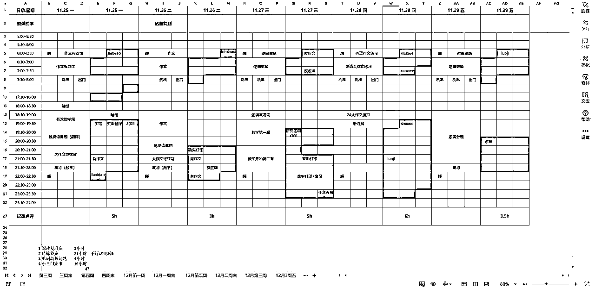

## 5.2 为什么我不怎么生气，心理韧性不错，能控制情绪，做事容易快乐

分享个小插曲，9月7日早上在上课路上，发现佣金收益被砍了一半多，截止目前被砍了3000多，后台说是流量异常，已申诉中。

当时第一步是镇静下来，能感觉到肾上腺素在分泌，但先别被情绪劫持。然后我思考的是这件事对我的影响，抓主要矛盾，今年我的核心目标不是赚够多少钱，而是获得从互联网赚钱的能力，这件事基本不影响核心目标，可以定性为有点肉疼的小事。

我一年基本只做一件事，去年是考在职研究生，537小时上岸，今年就是搞到互联网赚钱的能力。

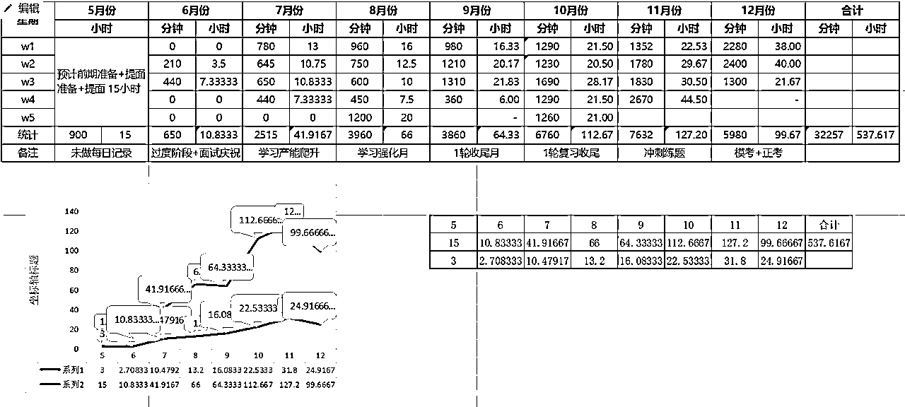

对策就是按官方流程申诉就行，即使失败，损失3000左右不影响生活，也不影响核心目标，这就只是外部环境的小变动，今天的主要目标还是认真上课听课。

判断之后心态就稳了。三年前的我可能情绪崩溃，现在能理性控制。

是什么造就现在的心理韧性？我觉得是挫折。

我经历过不小的挫折，最后也走出来了，用了很久，时间花得有点亏，但也很值。

具体经历就不说了，如果圈友也因为爆单被砍收益，要理性看待，挫折也许是一种馈赠，把人生拉长时间线再看。

即使3000佣金申诉不回来，五年后的我回头看这篇文章，只会觉得这是个趣事。

天生我才必有用，千金散尽还复来~

最后祝福一起奋斗做不同项目的圈友们：

有很多时刻，你惊心动魄，而世界一无所知；你翻山越岭，而大地寂静无声。

所有难过，难是难，但总会过。

纵有千古，横有八荒，前途似海，来日方长！