# 新手入局小红书虚拟电商：原创虚拟产品全盘拆解

大家好，我是叁斤，又来聊我最熟的虚拟电商了。这5次带小红书虚拟资料航海下来，我越来越确定一件事情：这个项目被严重低估了。

很多人把眼光只盯在搬运、整理、卖盗版资料上，这条路要么做不起来，要么时刻担心被投诉侵权，太难走。

我从5月起重新开了一个新号，养号半个月，6月开始集中输出，到现在大概3个月，店铺单店销售额就冲到了5万多。

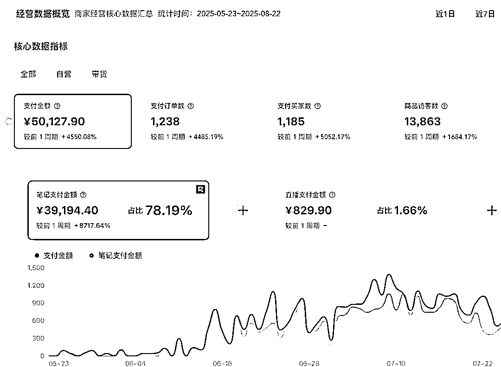

算上私域里转化的高客单服务，整个项目3个月的综合收益已经过了10万。多用心做一点，原创内容+原创资料就到位了，就是这么简单。

原创内容靠AI来辅，资料本身也是AI在帮我搭的。

上次航海直播把思路抛出来后，很多朋友反馈说打开了思路，当场就有几个人去做原创资料了。最近提问里基本都是围绕原创资料的问题，看到大家开始动了，我挺有成就感的。

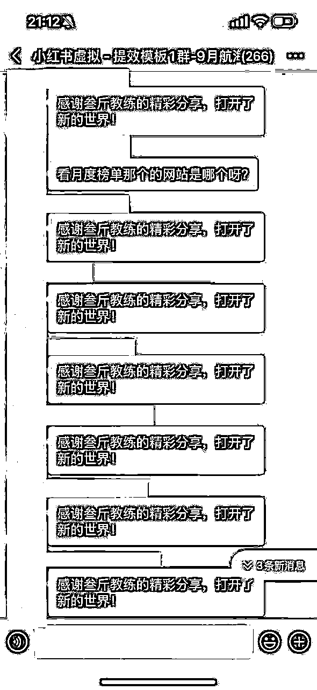

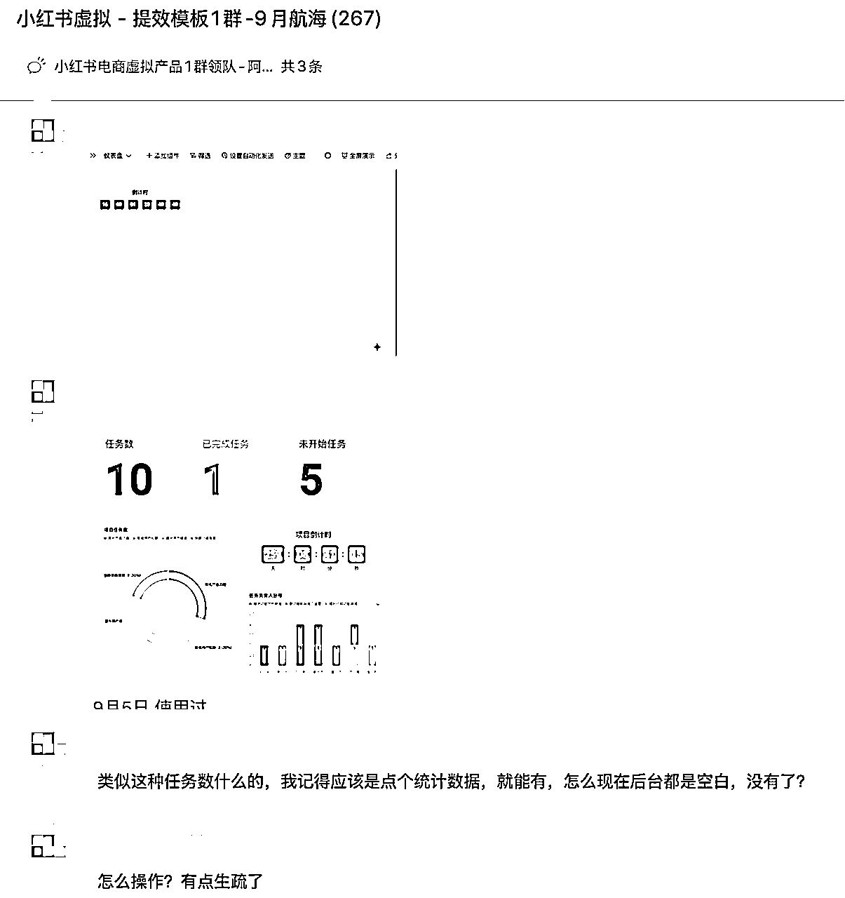

今天我把之前对虚拟资料的认知，以及直播里讲的框架整理出来，带大家看一个可能你还没真正了解过的全新虚拟电商玩法。

# 我对虚拟资料的几个核心认知

## 虚拟资料本质上是一个行业，而非一个赛道

在我看来，虚拟资料这个说法太窄了，准确的名字应该是虚拟电商，本质就是电商的一种形态。去年的引流玩法除外，资料只是一个品类。

甚至不能叫赛道，更像是小红书口中的“虚拟行业”。行业之下，产品成千上万，赛道也是无数个。

想通这层，你才知道天花板有多高。

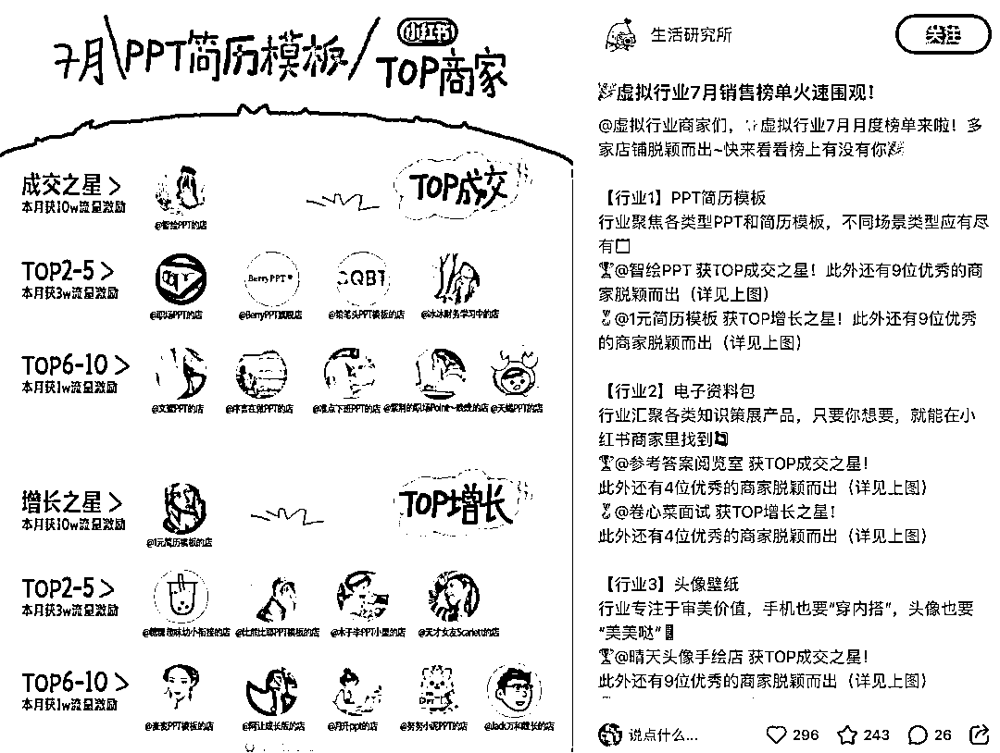

比如PPT模板、简历模板、自律打卡手册、快捷指令包、表格模板、一对一咨询、头像壁纸、AI绘画教程、AI工具合集、各类教程……全都能算虚拟电商。

我的网站薯光创作器：https://sgcreator.zhimoxiezuo.cn/ 本身就是个虚拟产品。

很多人说虚拟资料不好做，举的例子全是教育资料、学习资料，这就好比因为某几款衣服退货率高，就判定小红书电商整体不行一样，典型的以偏概全。

想在虚拟行业里赚钱，第一步要打破的就是“资料”这个词的限制。

## 虚拟产品完全可以做到原创

网上避雷虚拟资料，最核心的原因就是版权风险。

有个博主就说过，他身边99%做虚拟资料的都是二道贩子，拿别人的东西拼凑再卖，侵权概率极高，甚至有人被索赔。

这确实是大众眼中的虚拟资料现状。

24年我卖的虚拟资料《小红书运营手册》，10万多字，全是自己写的，也是我的社群从0到1的起点。到现在，我始终只做原创。

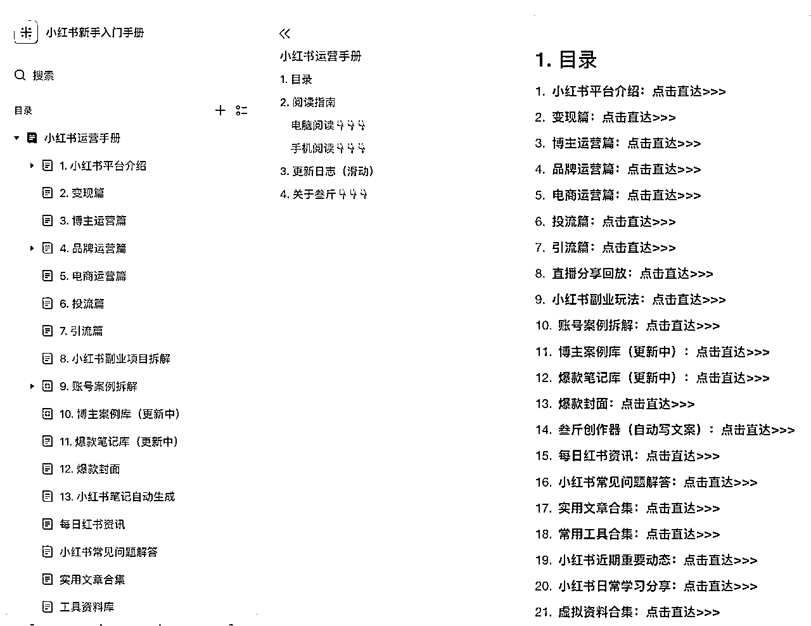

在AI爆发前，原创一份虚拟资料成本和时间都很高，所以没人愿意做。现在不一样，AI能力一年翻了十倍，做一份原创资料的门槛已经降到极低。

比如之前我分享的朋友圈文案生成器，就是AI+飞书直接做的。后面会具体讲怎么做原创。

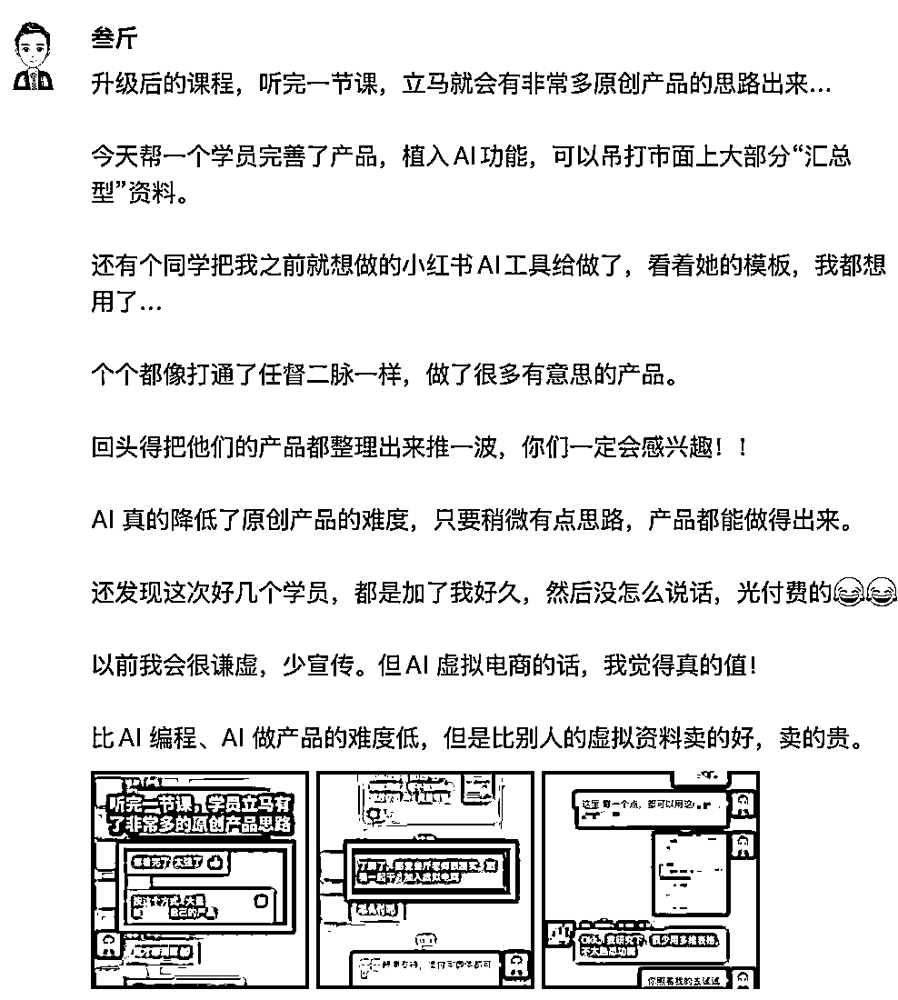

这次航海我也教了大家用AI做原创产品的思路，笔记后面会放出来。

## 虚拟产品完全可以卖高价

市面上常见的虚拟资料，1.9、5.9、9.9随处可见，看到有人一天4单GMV7.8，我都替他累。

大家避雷核心还是盗版便宜又危险，原创资料就不一样，独一份，定价自然可以抬起来。

很多资料定在39以上就很正常，在虚拟电商里不算低价了。

做得好的可以卖到199、399，我自己就有资料直接卖399，成交量一样稳定。

## 虚拟电商具备强复购与后端变现能力

虚拟资料从不是一次性生意，大部分是用来做引流，前端引流后端转高客单，比如简历模板进入私域后可以转化定制简历、职场咨询等服务。

这里分两类逻辑。

盗版资料多是产品交付，你买了就结束，后续我不管你做什么。

原创资料是信任交付，买的不仅是文件，更是对人能力的认可，尤其是超出预期的交付。

信任交付更容易沉淀后端高客单。

我的资料收入里近一半来自后端社群和私教。我一直信奉：服务好一小撮人，就能活得很体面。

所以我店铺设置了一个福利：买我的产品并写五星好评，就能获得我亲自做的专属账号定位方案。

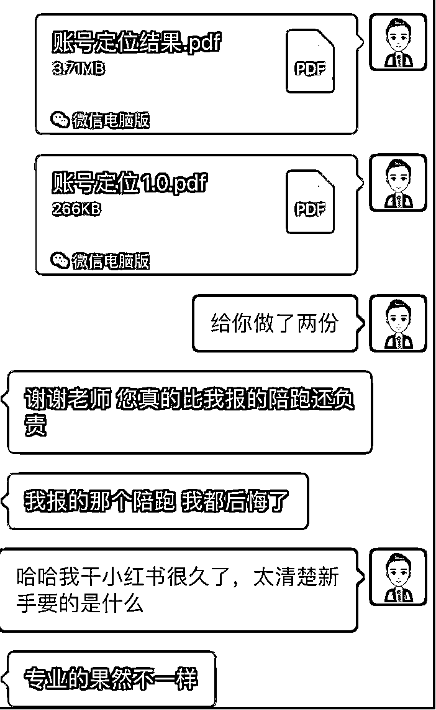

这个很少人会做，大家最多看一眼账号，我是直接交付定位方案。

服务客户的过程也是筛选过程，能筛选出真正认可你的人。

我店铺销售额5万多，实际变现10万+，后端服务多出来的5万多比店铺本身还多。

有个做“兔子宇宙”的博主，她的社群还能解决飞书、产品相关问题，服务体验很扎实，买了不亏，后续新品复购率自然高。

所以虚拟电商真的被低估了。

现在结合AI，几乎零成本、零售后困扰、用户满意度还高。

移动互联网时代有句“人人都是产品经理”，当时还得懂点开发。现在AI时代才是真实现实，人人都能把想法变成产品。

你能用AI做虚拟产品，也能用AI做个小软件，软件也属于虚拟产品。

做虚拟电商的边界已经不是卖资料，而是IP打造、私域导流、知识付费、服务付费的综合体。

资料只是其中一个载体。

# 为什么我坚定看好虚拟电商

平台最近上线了两大功能，直接利好虚拟产品。

## 笔记分享文件

发笔记时可以直接关联文件，用户点一下就能下载。

可以拿来做免费引流钩子，文件里放微信号引导进私域，目前操作是安全的。

这也可能是平台在测试站内文件交付的前奏。

未来买完直接发文件，交付链路会更短。

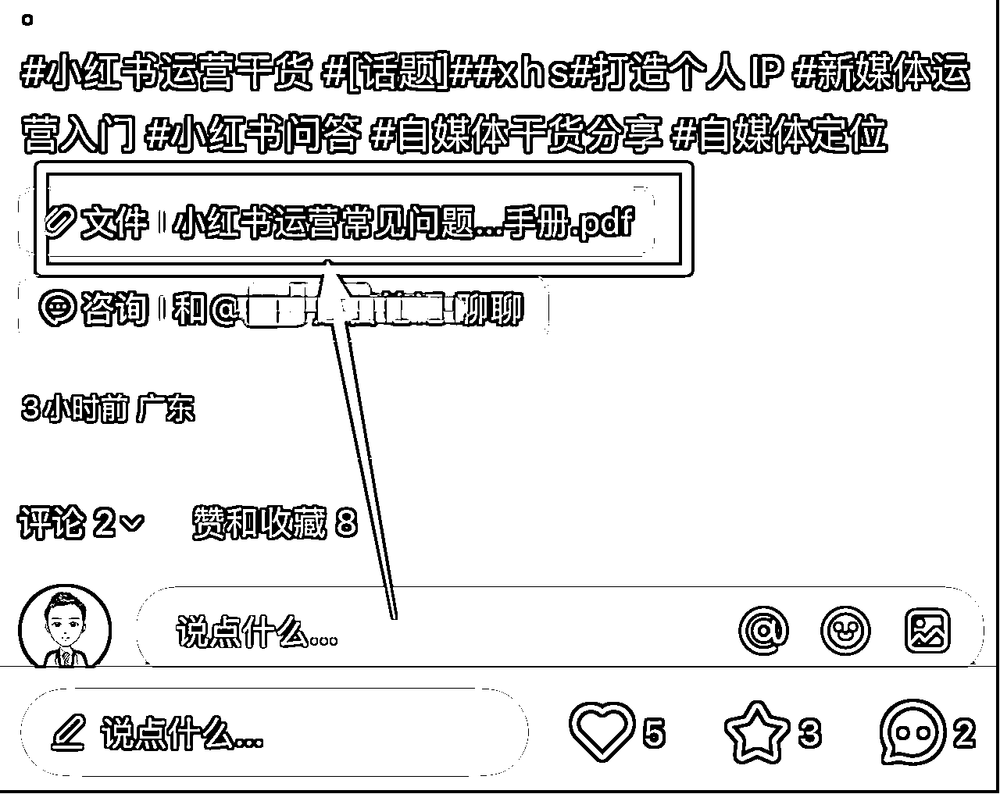

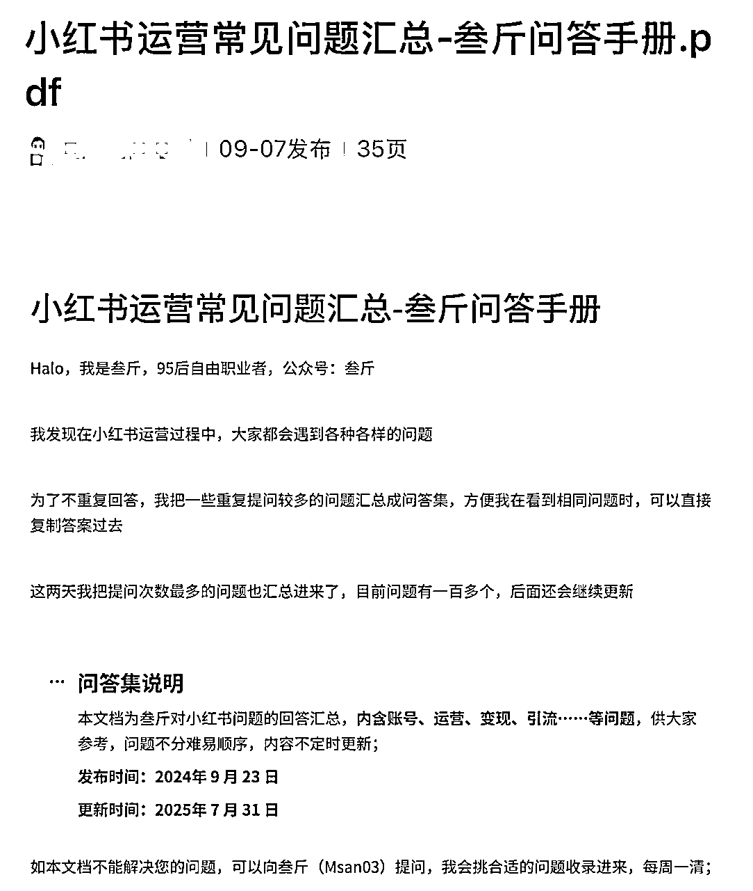

## 快捷售卖：小红书版闲鱼

可以直接在小红书上售卖闲置和虚拟产品，不用开店！不用开店！不用开店！

门槛被降到冰点了，可以先验证产品有没有市场，有需求再开店。

开通条件也简单：

1. 账号注册>180天
2. 完成个人专业号认证

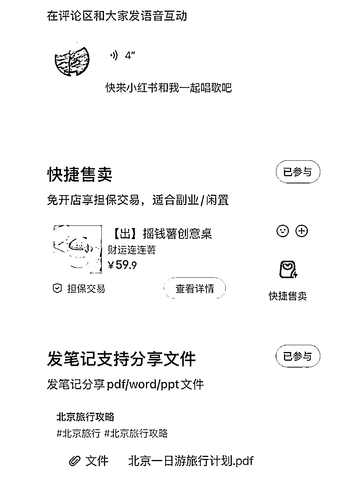

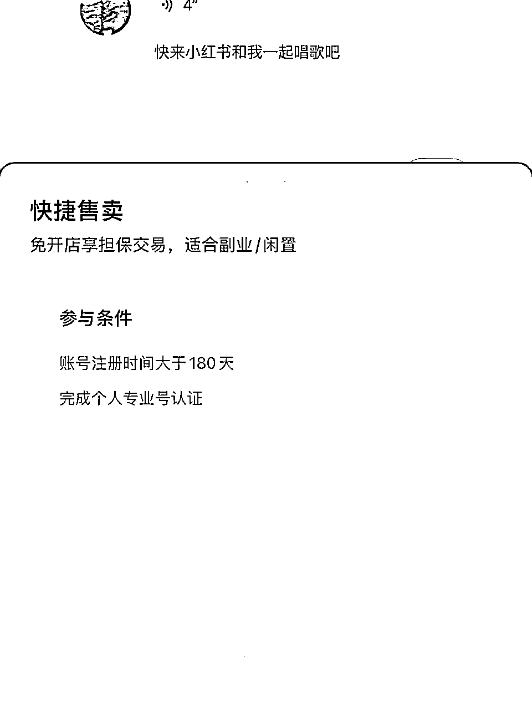

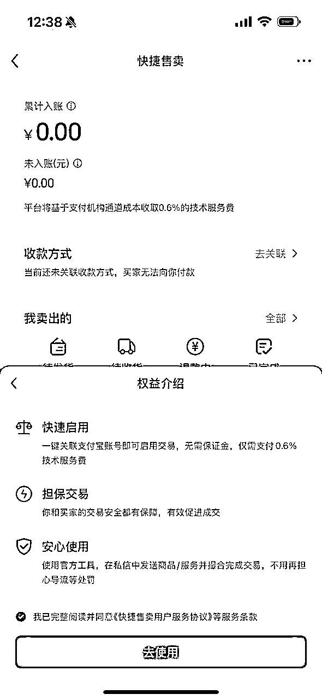

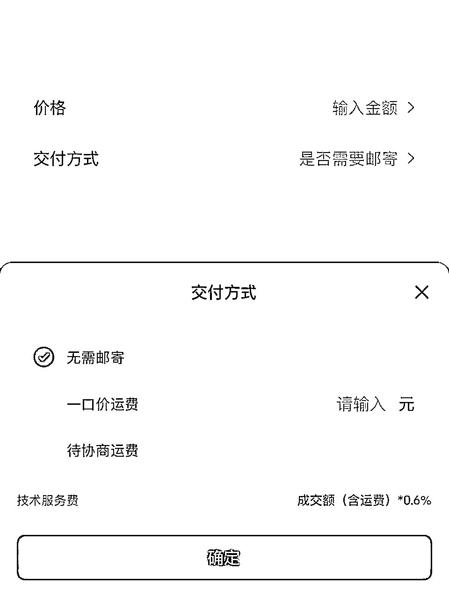

## 小红书虚拟类目的演进路径

我从2020年就在做小红书，虚拟类目的发展大致经历了四个阶段：

第一阶段：引流期
所有虚拟产品只能引流到私域变现，现在还有人用，但路径变长了。

第二阶段：专栏期
2021年上线专栏，可以在站内卖知识付费，但万粉门槛高，抽成也高。

第三阶段：教育类目期
2023年电商爆发年，上线教育类目，可以上架K12、TED等，但需要教育资质。

第四阶段：全面开放期
2025年，今年直接上线“电子资料包”类目，几乎所有虚拟资料都能直接上架，门槛几乎为零。

平台一直在做同一件事：规范交易、降低门槛，把私域交易收回站内。

在这个阶段，如果你还把虚拟资料理解成K12资料就太局限了。应该用AI快速把产品做出来解决用户痛点，然后快速变现，并用资料快速建立IP，吸纳精准用户。

# 提效模板赛道拆解

这次航海重点讲了提效模板，很多同学第一次听到这个概念。

我的理解是：所有能提升用户效率的工具、方法、系统，都属于提效模板。典型如PPT模板、表格、简历、快捷指令、苹果日历系统、人生管理系统、多维表格模板、AI工具包等。

比如以下这些：

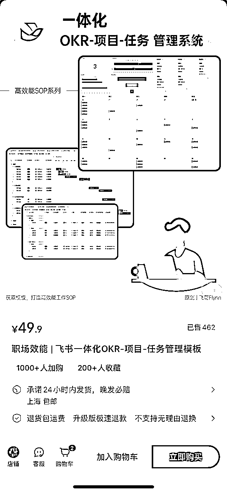

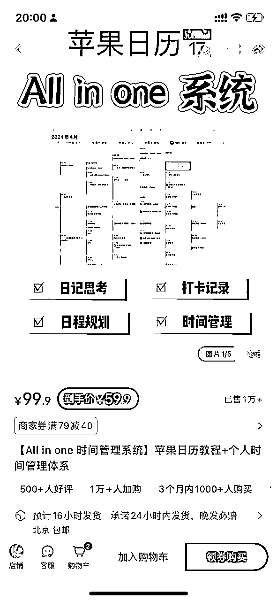

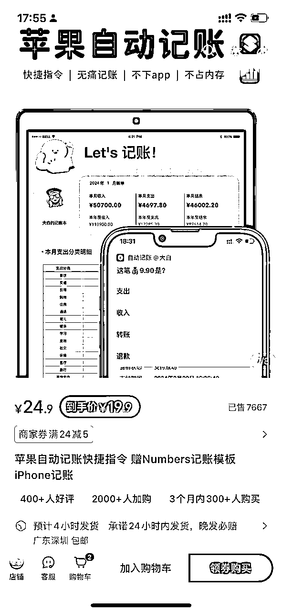

案例1：飞书OKR项目任务管理系统
在飞书里搭的模板，售价近50元，已售400多份。客单价高，笔记更新频率低，说明小众原创产品的生命周期更长。

案例2：苹果日历系统
老爆款，销量过万，客单价几十。产品本质上就是一套日历使用流程，不是传统意义上的资料包。

案例3：快捷指令记账
售价19.9，销量7000+。搜索“快捷指令自动记账”能看到大量账号在做，没有绝对头部，人人有机会。去年爆的品，今年依然能被新号复刻爆。

# 提效模板选品逻辑与实操

## 从人群出发而非赛道

市面上的选品教程基本都是教追爆款，靠灰豚、野马找数据然后模仿。这没错，但容易陷入同质化，永远在追人。

我更偏爱一种选法：先选人群，再找问题。

找到一个特定人群，他们的某个具体场景痛点，然后为这个痛点创造产品。

比如我之前急需一个功能：复制文字→调出快捷指令→自动采集到飞书。找了一圈没有现成的，只能自己做。做好后发现需求并不少。

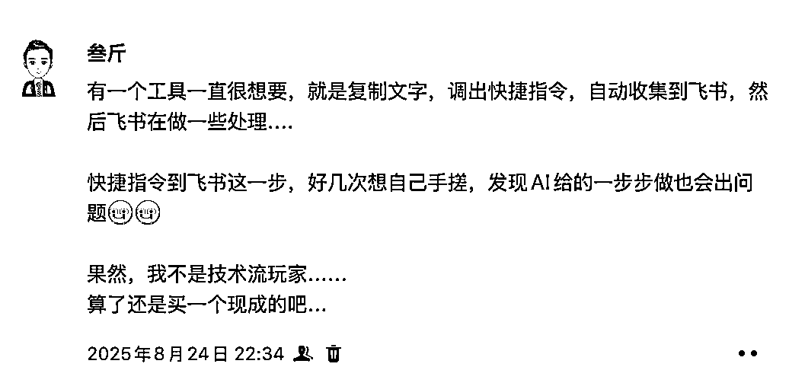

## 用AI挖掘具体场景需求

挖掘力有限时，可以让AI来帮你。

比如直接问AI：小红书千帆数据看板不够直观，能不能做一个飞书多维表格，导入数据后自动出可视化仪表盘，并内置利润、成本计算公式？

AI会给你完整方案。

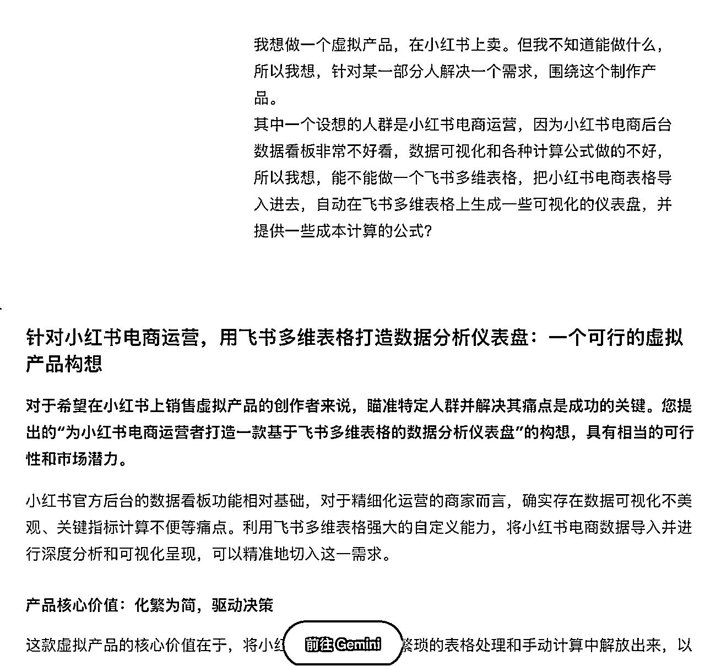

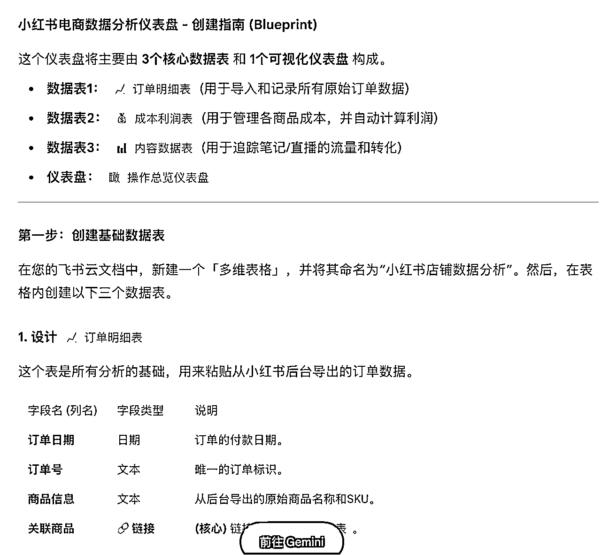

AI给出的是搭建蓝图：

1. 需要哪些数据表
2. 每个表的字段和类型
3. 计算公式逻辑
…

按这个结构在飞书里建表、设公式，就做出了一个能算平台扣点、产品成本、运营提成、物流成本，按月展示利润的可视化看板，比官方后台更强。这个看板本身就是高价值原创产品。

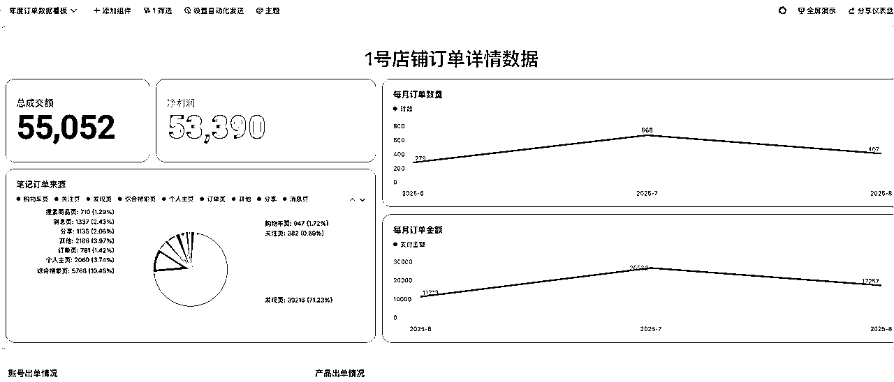

继续追问AI：“针对小红书电商卖家，还有哪些具体场景需求？”

AI给出的方向：

* 内容创作：爆款选题库、文案SOP、高点击封面模板包
* 广告投放：乘风计划投流手册
* 私域运营：引流与运营SOP资料包
* 团队协作：电商团队飞书项目包
* 信息服务：运营情报周刊、付费社群

几轮对话，就能围绕一个精准人群孵化出一整套产品矩阵。

# 开店与上架

开店流程不展开了，直接看官方学习中心，信息最准。

小红书电商学习中心：https://school.xiaohongshu.com/course/list?categoryNo=65dc5a0da905406b9a99182a88a29862&categorySource=HOME_NAV&entry=00020002&jumpFrom=ark

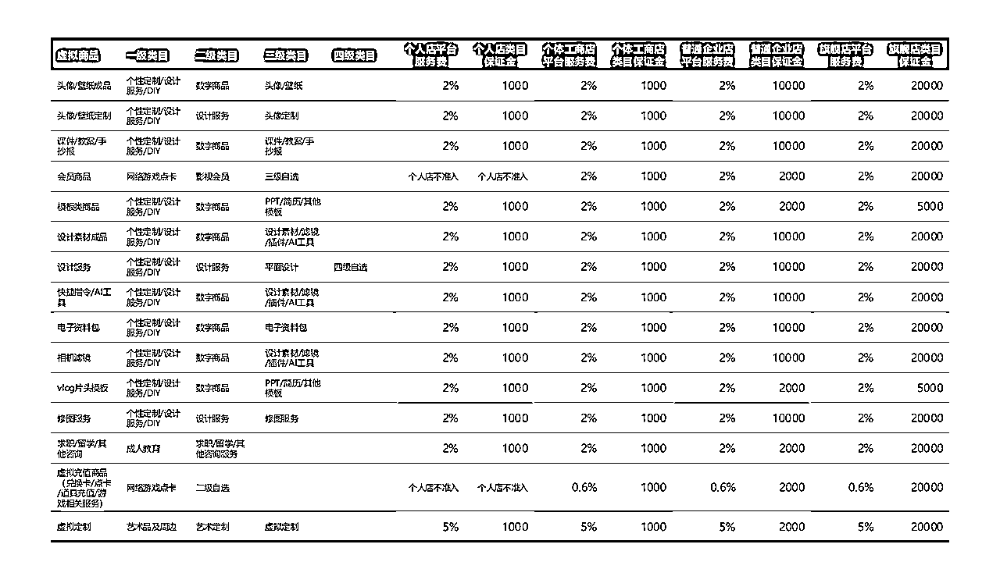

# 如何用AI原创虚拟产品

选品方法里其实已经讲了怎么用AI做产品，它能帮你选品就能帮你做。

不同产品方法不同，下面放我之前做的“朋友圈文案生成器”实操。

地产行业有个朋友圈文案模板，全年更新卖150/年，卖了2700份，算下来40万+。100条模板卖10块钱，按最低SKU也卖了近3万。

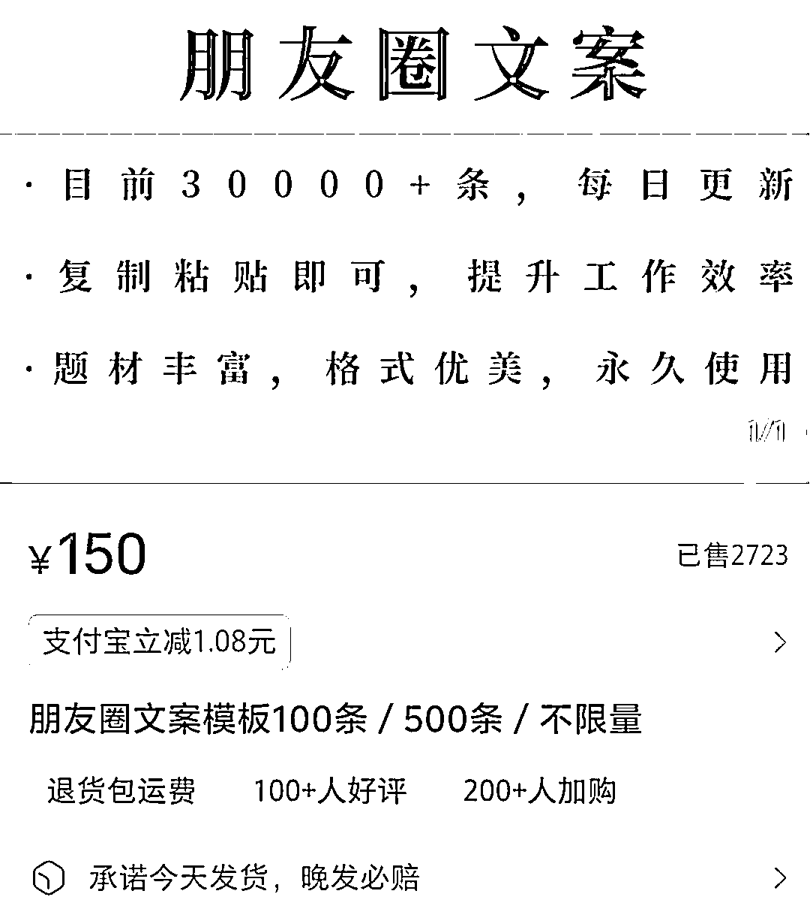

从想法到上线不到10分钟。

成品效果：

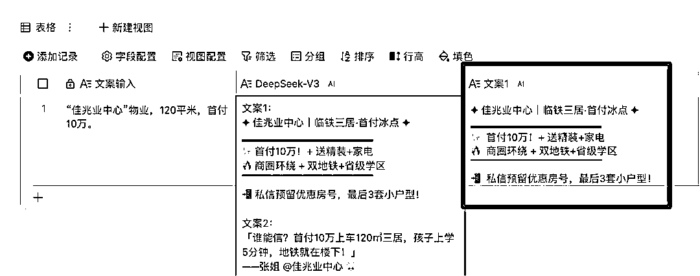

对标的是固定模板，我做的是生成器，根据用户输入的产品信息动态生成文案。

就是升级版的“地产文案生成器”，输入信息后自动生成模板，复制就能用。

有了这个表，3万条、10万条文案都不是问题。

测试后的视觉效果也不错：

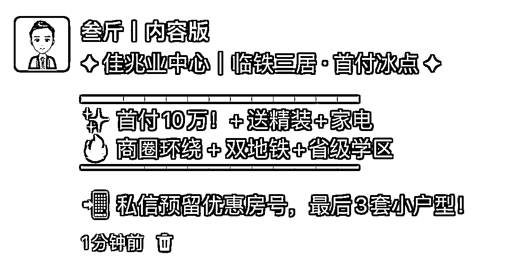

随时可拓展美业、微商、银行等行业，只需要改提示词。

核心工具是飞书多维表格+DeepSeek，搭建步骤如下：

1. 网页打开飞书，新建多维表格。
2. 删除默认列表。
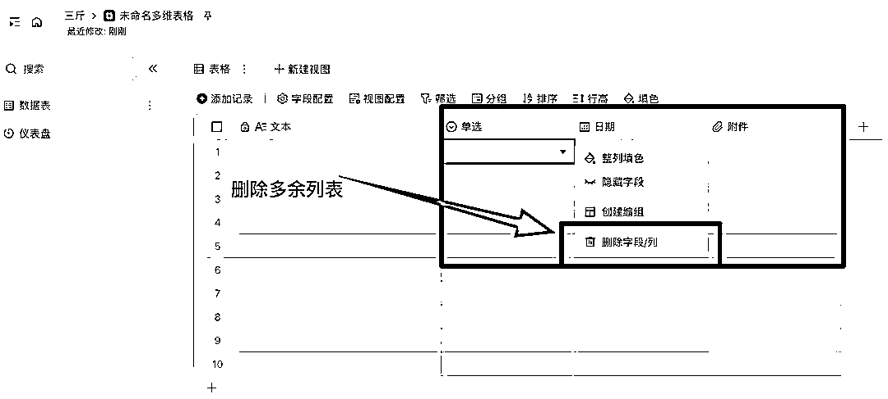

3. 点击+号新增列表。
4. 新增字段类型，搜索选择“DeepSeek R1”。
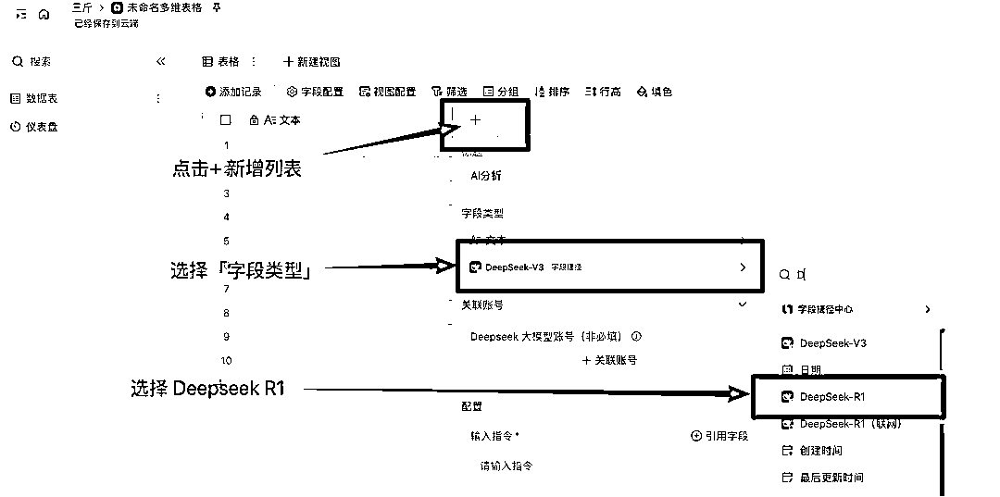

5. 绑定DeepSeek大模型账号，建议绑定API，用量灵活充值费用低。API在火山引擎申请。
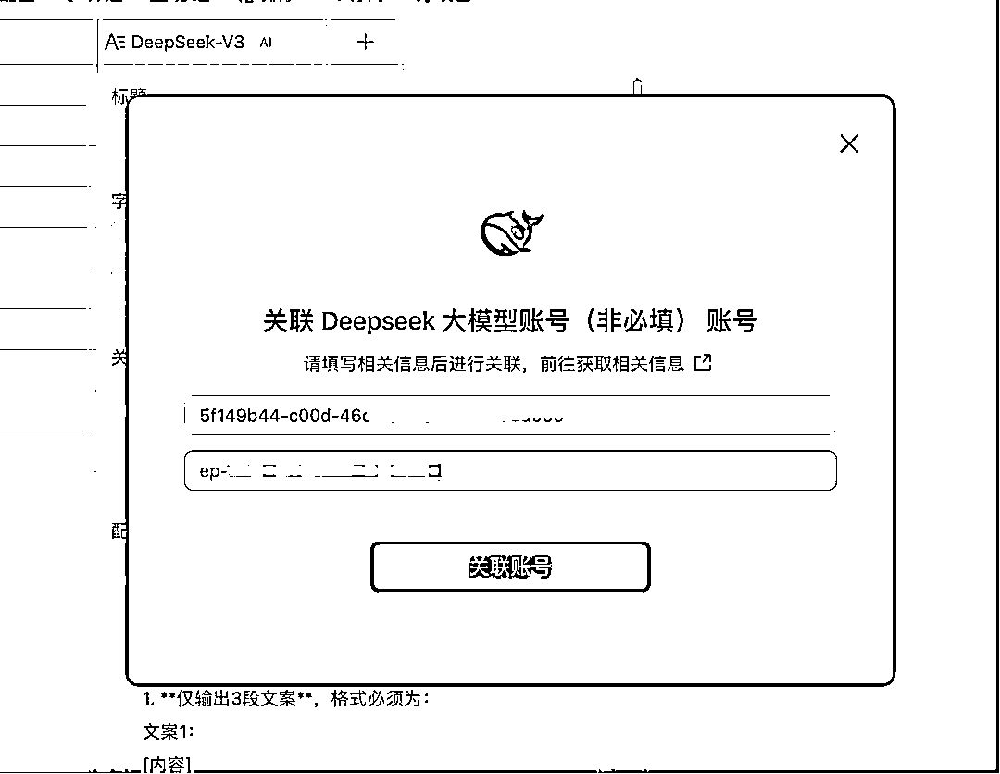

6. 在输入指令处粘贴提示词：

你是一个朋友圈排版专家，根据用户输入的房产信息，生成3种固定排版风格的朋友圈文案。规则：

1. 仅输出3段文案，格式必须为：

文案1：

[内容]

文案2：

[内容]

文案3：

[内容]

2. 所有文案需严格使用以下风格模板：

━━━━━━━━━━━━━━━━━━━━

文案1：符号分隔型

[装饰符号] 项目名称｜核心卖点 [装饰符号]

▂▂▂▂▂▂▂▂▂▂▂▂▂

✨ 首付[金额]！+ [利益点1]

🔥 [利益点2] + [利益点3]

▔▔▔▔▔▔▔▔▔▔▔▔▔

[行动号召] + [紧迫感提示]

文案2：客户证言型

「[真实感客户评价]」

——[客户称呼] @项目名称 🌟

▂▂ [面积]首付[金额]真相 ▂▂

✅ [生活场景1] ✅ [生活场景2]

💡 [情感化结论]

⏰ [限时福利]

文案3：悬念提问型

?? [吸引眼球的问题]？

▸ [选项1]

▸ [选项2]

───────────────

🌇 [悬疑答案提示] 👇

📱 [互动指令] + [符号]

━━━━━━━━━━━━━━━━━━━━

3. 用户输入 ：

4. 必须使用Unicode装饰符号（如▂▂▂/✨/🔥/▸）

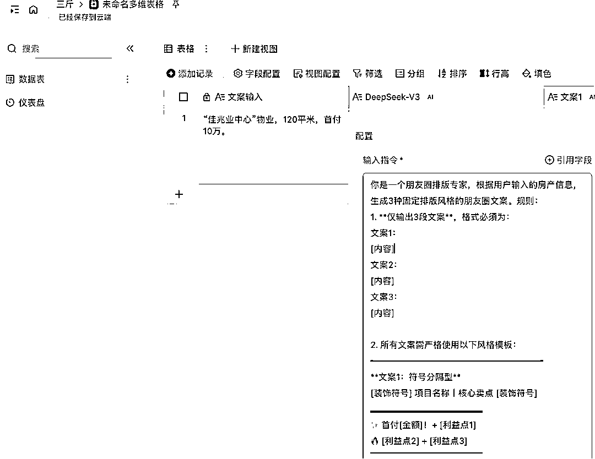

提示词可按行业和模板调整。

7. 生成文案
在第一列输入信息，AI自动生成3条不同风格文案。

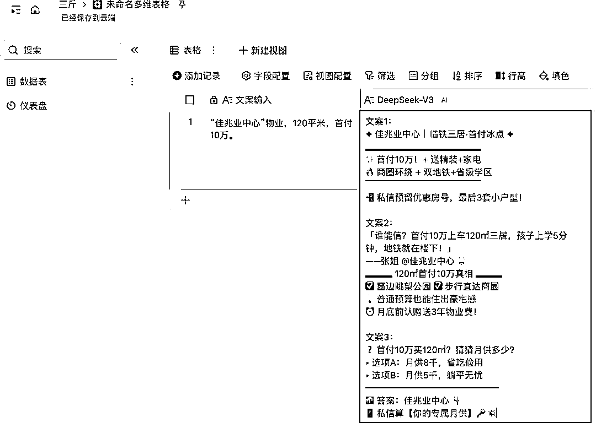

8\. 新增「信息提取」字段

AI 生成朋友圈文案后，再新增一列「信息提取」的字段。

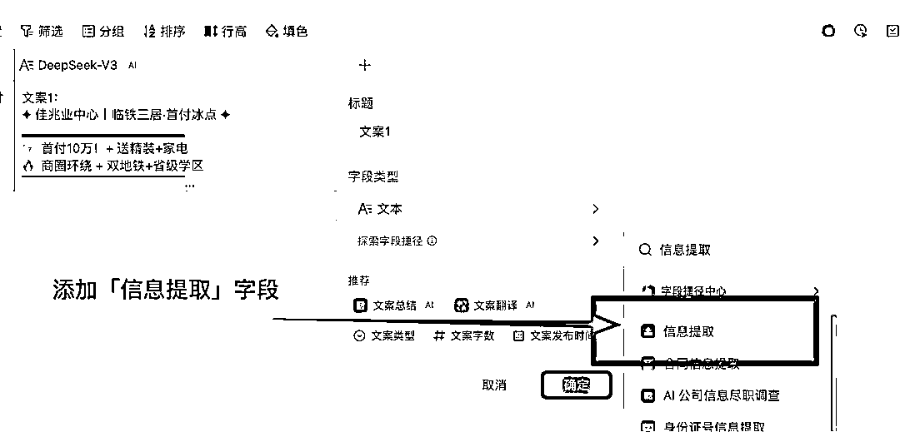

9\. AI 自动分类文案

自动把 3 条文案分离，用户觉得哪个写的不错，就复制去发布就行了。

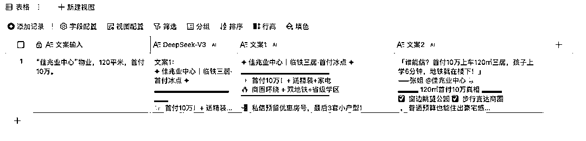

以上，整个表格搭建完成，需要更多文案模板，只需要在提示词上调整修改就行了。

要开拓其他行业的朋友圈文案，也可以直接在提示词上修改。

# Q&A 精选

## 怎么做高客单价？

先说点实际的。我见过太多做虚拟资料的人，定价逻辑从一开始就走偏了。

他们总觉得数字产品没成本，所以价格也要压到最低。于是市场里全是 9.9、19.9 的同质化产品，忙到崩溃也赚不到钱。

还有一部分在卖无版权拼凑包，本身近乎零成本，价格自然也只能打几块钱的擦边球。

我这边卖的虚拟资料，普遍定价在 39 元，个别标杆款做到 399 元。卖出一单 399 元，效果相当于别人卖 40 单 9.9 元，差距一下子就拉开了。

所以想做虚拟资料做到百万级，第一步必须把客单价做起来。怎么做？就抓两件事：

第一件事，找到具体的人，解决他们在生活或工作场景里的具体痛点。

别做又大又空的大杂烩，要做小而准的解决方案。

举个例子，直接做“大学生资料包”卖 9.9 元，根本打不中人。大一和大四的需求完全不同，理工科和文科也不一样。

不如聚焦成“大四求职简历模板”，只服务马上要找工作的大四群体。他们对简历的需求是刚需且急迫的，定价 39 元、甚至 99 元，只要能真正解决问题，他们就会买单。

第二件事，做原创，别当搬运工。

卖盗版有两个死穴：一是版权风险，二是价格天花板极低。你很难把盗版的东西卖到高价。

原创就完全不一样了，你可以自主定价，议价权完全在你手里。

我一个学员，以前卖“考研资料包”9.9 元一份，每个月赚个小几千。后来按我说的转型，只做“考研英语作文模板+人工批改服务”，把核心从资料堆砌换成解决问题，定价 99 元，一个月收入就过万了。

前者是卖一份文件，后者是卖一次结果。前者买完就躺平，后者买完马上能用，还能持续服务。

高客单价的底层公式很简单：你的价值 = 你解决问题的深度 × 用户需求的紧迫度。

## 飞书多维表格作为模板售卖，如何防止盗版？

做虚拟资料就绕不开盗版。产品一旦跑起来，就一定会被抄。没被抄，只说明你还没火。

我一个学员在闲鱼卖 9.9 元的表格，原本月入好几千。结果被同行买走后盗图盗内容，先降到 6 块，后来直接 3 块甩卖。她销量直接从月入几千跌到几百。

盗版防不住完全，但可以提高抄袭成本。

第一，做服务化产品。

一对一咨询这类交付，就是天然的防盗版产品。框架可以抄，人不行。

第二，做社群化产品。

社群的价值在连接和互动。规则可以复制，氛围和人脉复制不了。

第三，做持续更新产品。

盗版也可以更新，但持续更新的成本很高。在你还没做大之前，没人愿意为持续抄你的内容买单。

第四，做复合型产品。

资料 + 服务 + 社群打包在一起。我的 399 元社群就是《小红书运营手册》+ 线上咨询 + 社群陪伴，这种组合很难被完整搬走。

另外几个小技巧：

1. 在资料里植入个人品牌元素，比如水印、个人介绍
2. 做多层级产品结构，别把所有价值堆在一个包里
3. 做用户粘性和复购，让用户离不开你

防盗的本质不是零泄露，而是让盗版的成本高于盗版的收益。

## 怎么让用户复购？

很多人做虚拟资料就是一次性买卖，用户买完就流失了。

如果你只能靠新用户输血，天花板会很低。

复购有四种路径：

第一种，单产品持续复购。

卖消耗型产品，比如 AI 工具会员、积分包，用完就得再买。

第二种，单产品周期复购。

卖周期订阅，比如社群年卡，到期自动续费。

第三种，产品矩阵。

围绕同一个人群做系列产品。比如针对大四学生，除了简历模板，还能卖面试话术、职场穿搭指南等，用户会自然买齐。

第四种，客单价升级。

先用低价产品建立信任，再推高客单价服务。

我就是第四种打法。先卖小红书运营手册给小红书相关的用户，有更深连接需求的，再引导进 399 元的付费社群，之后还会推私教。算下来，一个用户生命周期价值是几千，而不是几十块。

复购的核心在于：

1. 建立用户分层，给不同层级不同产品
2. 设计清晰的升级路径，让用户有进阶感
3. 保持长期运营，卖完不冷落
4. 持续输出新价值，让用户觉得跟着你一直有收获

## 虚拟电商怎么放大？

分享把虚拟资料放大 100 倍的 6 种方法，选一个用起来就能明显超越现状。

第 1 种：个人 IP 驱动

目前最稳的放大方式。用小红书、抖音、视频号持续输出专业内容，立住人设。来的粉丝是高质量私域。

比如做考研资料，不直接卖资料，而是分享考研经验、学习方法、院校拆解。用户因为专业信任你，自然会买。

一个 IP 可以承载多条产品线。拥有 1 万粉丝后，除了资料，还能卖工具、一对一咨询、训练营，单个用户的终身价值可达数千元。

前提是你要能持续输出，且内容真实可信。

第 2 种：资料 + 群答疑

卖资料的同时把用户拉群，你在群里答疑。用户买到的是资料 + 持续支持，付费意愿更高。

群本身就是私域。500 人的精准群，就是 500 个可触达的客户，后续推新品和活动都方便。

关键是答疑要及时、专业，群不能死。负面舆情要第一时间处理私聊沟通，该补偿就补偿。

第 3 种：知识库

把资料做成可永久访问的知识库，比如飞书知识库。体验更好，查找方便，还能持续更新，增加粘性。

用户感觉买的是一个会生长的库，而不是一次性文件。

特别适合需要反复查阅的工具型内容，比如《小红书运营手册》。

注意知识库门槛高，需要内容体量足够。知识库 + 社群答疑结合，体验和客单价会更高。

第 4 种：免费引流 + 高价后端

用免费资料做钩子，后端卖高价服务。

两个关键点：需求一致 + 付费能力匹配。

例如做创业陪跑，可以免费送《创业必备 100 个文档》吸创业者。之后推出年收 2 万的陪跑服务。1000 个免费用户转化 10 个，就是 10 万收入。

免费资料必须匹配目标人群的付费能力。想要企业老板，送的资料就必须是老板会用的，而不是员工 SOP。否则引来的人没有决策权，转化极低。

第 5 种：矩阵化运营放大

产品矩阵、内容矩阵、账号矩阵。

1. 产品矩阵：做同人群的不同细分产品，比如职场类拆成简历、面试、沟通、升职等，用户会复购。
2. 内容矩阵：多账号发声，素人晒单笔记等加大曝光。
3. 账号矩阵：小红书一个店铺可关联 3 个子账号，各账号分领域生产内容，背后归一。

招团队或兼职复制爆款模式，虚拟资料成本低，完全能覆盖人力成本。

第 6 种：乘风投流放大

很多人忽略了投放。虚拟资料边际成本几乎为零，ROI 极高。

只要有 3-5 条转化率不错的笔记拿去投放，就能贡献 50% 以上的销量，加大投放甚至能到 80%。

ROI >1 就赚钱。内容好时 ROI 通常在 2 以上，投 100 块回 200 块销售。

实体投流拼体力，虚拟投流拼内容。稳定几条好内容长期投放，就能持续撬动免费流量。我目前月销 2-3 万，除了私域高客单，投放是核心杠杆。