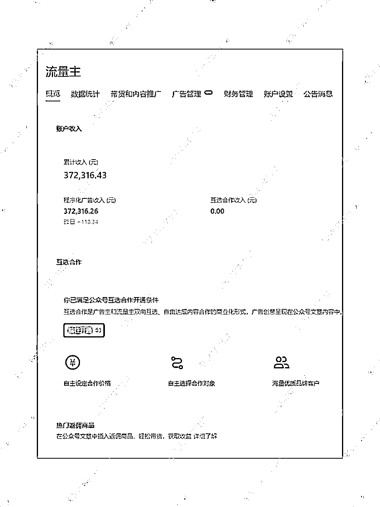
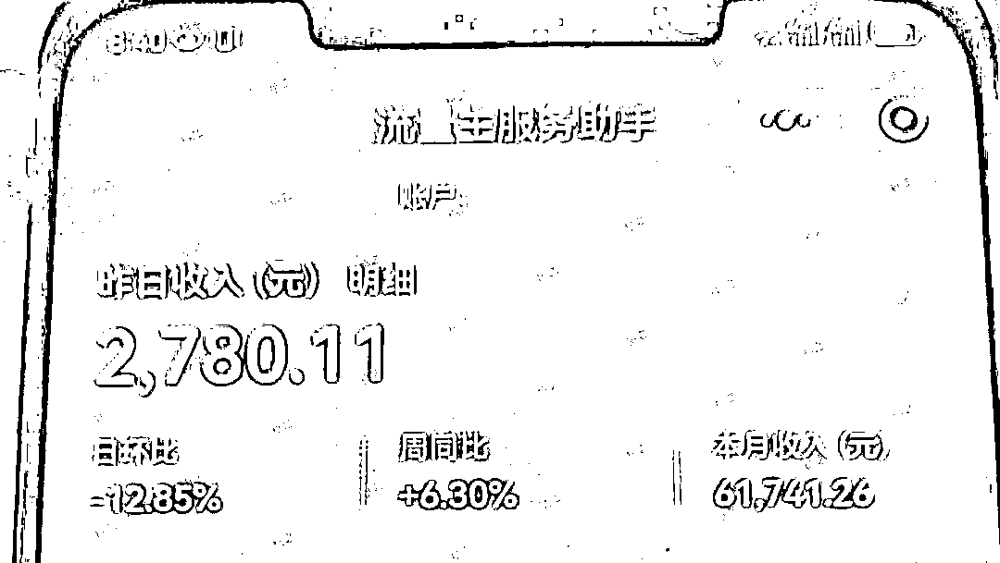
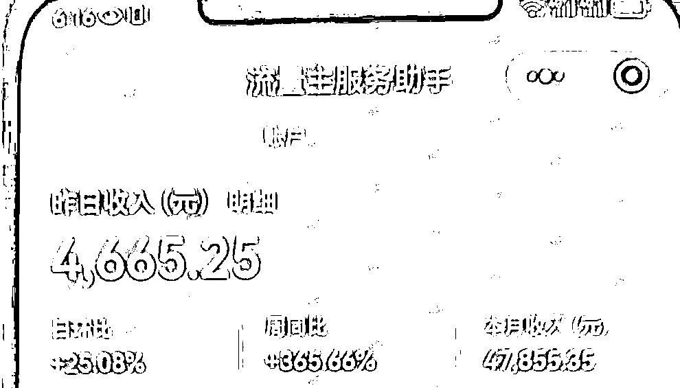
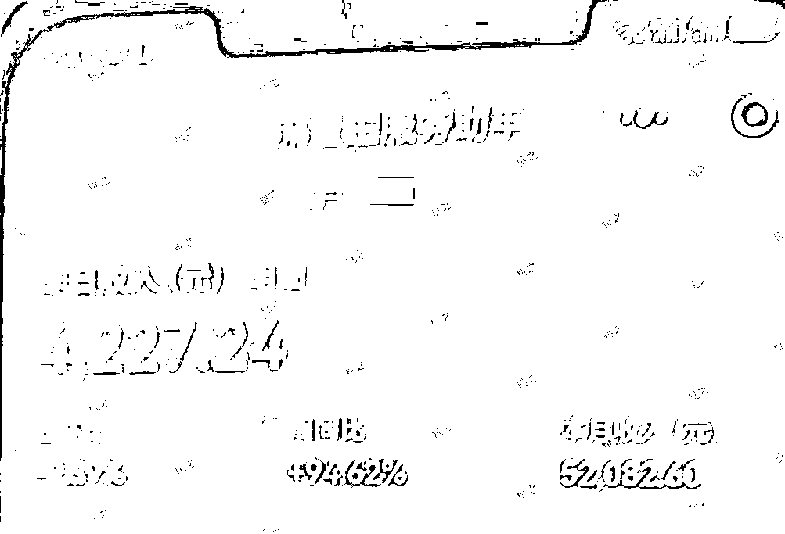
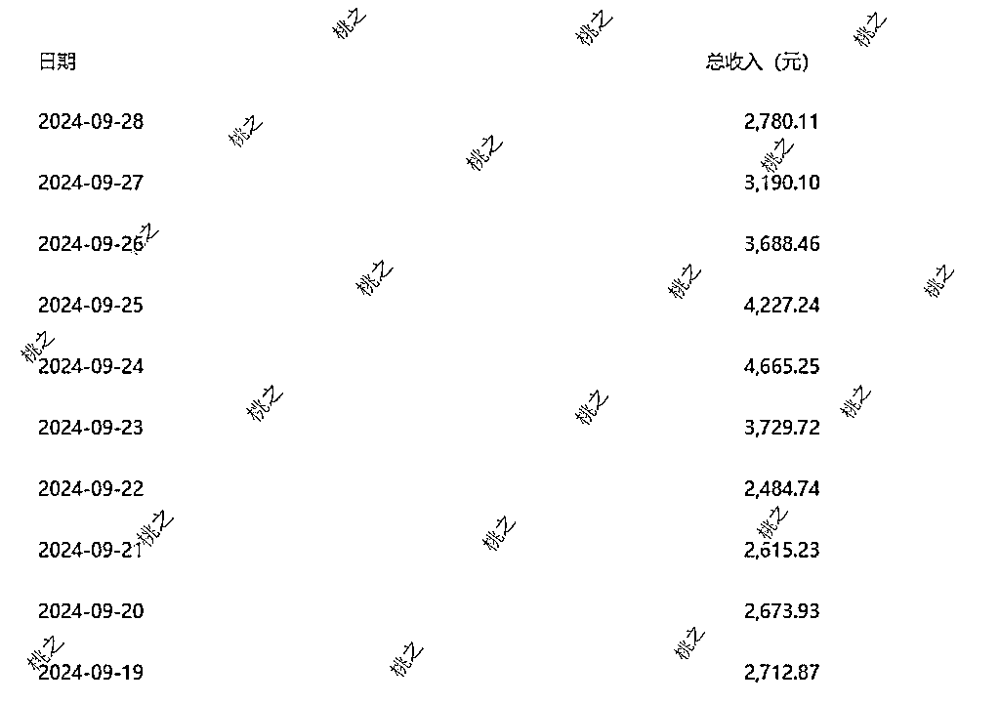

# 公众号流量主实战拆解：一年600多篇原创，10万粉，单号赚37万，这三条路子你必须懂

大家好，我是格子。做自媒体这三年，我一直只看公众号流量主这一个变现方式。

今天要聊的，是一个很多赚钱号主都不会公开说的内幕，值不值看你怎么理解和执行。

案例来自我的一位私教学员。她从去年六七月起步，一直更到现在，一年时间里稳定输出600多篇原创，单号累计收益37万！注：文中所有收益截图均出自她这个号。

即便现在整体流量没有去年高，账号每天依然在产生收益，低的时候百来块，高的时候也能冲一波。这个拥粉10多万的号，已然成了她躺着也能收钱的稳定资产。

我亲眼看着这个号从零起步，到破10万粉，再到实现37万营收，感触很深。

我今天不是来晒成绩的，而是想借着这个真实案例，掏心窝子告诉你：如果你真的想做一个能持续赚钱的公众号，应该从哪几个维度去打。

我把它浓缩成3个底层心法，也是圈子里很多闷声发财的号主不会轻易透露的。

### 心法一：做先行者，别做追赶者

做流量主的常见套路是：哪个赛道热，就一窝蜂扎进去。

军事火了冲军事，养老金火了冲养老金...

这种打法能赚，但赚的是快钱、薄钱。因为大家想法一样，赛道挤爆，平台审核也更严，新号起飞的概率极低。

更致命的是同质化。很多号都是昙花一现，赚个三五千就废号，然后注销重来，循环往复非常消耗人。

我们永远是在追热点，等你挤进去，剩下的只是一点点残羹剩饭。

而这位学员的号，正是选了一个当时极度细分、几乎没人碰的赛道。她是第一批入场的。因为竞争少，账号权重很快起来，后续才有了稳定变现的基础。

仔细观察你会发现，每个赛道里流量最好的号，几乎都是最早一批做内容的。早入场，就是天然优势。

思路要反过来：别问“现在什么火”，要问“我能提前发现什么会火”。

### 心法二：用差异化表达，别只会搬运

找到一个有潜力的新赛道后，怎么做内容？

公众号的载体远比你想象的多：图文长文、纯图、图文小绿书、短视频、GIF动图...形式不止一种。

别把自己锁死在一种写法里。可以试试：这个赛道的爆款文案，能不能换个形态表达？

别人都在发长文，你做短视频；别人都在做视频，你做动态图；别人都在做静态图，你做AI漫画。

比如美食这个赛道，就同时存在了动图党、纯图党、小绿书党和视频党，大家玩得都不一样，流量都很好。有人靠差异化，一年也拿下大几十万。

最近AI漫画非常吃流量，大家都在做明星漫画、职场漫画，那之前那些靠长文吃流量的老赛道，是不是也能用漫画形式重新做一遍？

创新不是每次都成，创新很慢很累，跟风更快。可是没有创新，你很难做成一个长期在流量池里赚钱的大号。

### 心法三：测试别只押一个号，时间要拉长

很多人起号的通病是：开一个号，试七八天，没爆就判定赛道不行，然后放弃。

起号本身就是概率游戏，不是每个号都能成，甚至有天生带衰的“哑号”，也有那种“天选之号”。

正确的做法是：确认方向后，用3-5个号同时去测，每个号用不同的启动策略去跑。周期至少拉到一到三个月。

公众号就是这样，这个号没动静，另一个号可能就爆了。

我认识的一个同学，测一个赛道花了近三个月，同时运作了三五个号。有的起不来，有的起来了。最终养活一个号，一年就赚了大几十万。

她一直沿用这套打法，一年赚几十万不是靠养几十个号，而是靠三五个精品号，靠质量和差异化，而不是靠数量堆死。

### 最后聊点现实的：做号是天时地利人和

* 天时：你进场时，赛道是不是够早。
* 地利：你手里这个号，是不是有点“运气”。
* 人和：你能不能坚持住，能不能比同行更快去试新东西。

这位学员一年赚了37万，但她后来想复制一个一模一样的号就做不出来了。一是时间窗口没了，二是号的资质不一样。

一个赛道能做成一个年入几十万的号，却很难再复制第二个同样牛逼的号，这在圈子里太常见了。

所以别去复制项目，要把方法吃透。这个赛道做不起来，就用同一套逻辑去下一个赛道，依然能成。

我把我认为最值钱的思路都摊开了。想靠公众号流量主赚到大钱，就得想办法成为某个细分赛道的元老。

只要你够早进入，账号权重起来后，后来者再多也撼动不了你。这个号就能持续、稳定地为你印钱。

希望这个真实案例和这三点思考，能给你一点方向。

这篇文章只讲思路，值不值，全看你怎么消化和执行。

静下心来琢磨，然后去干。我相信你一样能靠公众号流量主多赚几万、甚至几十万。

现在虽然流量比去年弱了，但每天依然有进账，低的时候一百多，高的时候能冲更高。这个10多万粉的号，给她带来了真正意义上的睡后收入。