# 热点思维实战攻略：我是如何靠追热点快速变现的

## 一、前言

大家好，我是余一叨，现居广州。

今年七月我才正式办了赚钱的入场券。可说起来，我早就把自己当成圈里的老成员了。2020年先生@张慕笙先行加入，赚钱对我而言一直是家属旁听席，我在旁边潜水学习，也跟着试水过不少东西。

赚钱彻底改写了我的轨迹：从投资失利背负十几万负债，到后来实现人生首个百万元。没有赚钱，就没有现在的我。

过去几年被赚钱滋养，如今补齐门票，也想把一路做项目的体感拿出来跟大家复盘。

2020年之前，我和先生因热爱在云南大理开了家摄影工作室。那会儿竞争不算白热化，仅靠🧣晒片和朋友圈转介绍就能稳定接单，生活也算体面。

2019年上半年大量高客单婚纱照订单涌入，我们误以为行情极好，便盲目扩产：添设备、盘院子、再开民宿……

很快局势逆转。外地机构集体涌入，靠矩阵内容加付费投流抢客。大理摄影从蓝海变红海。而我们仍固守转介绍，没有互联网打法，被迅速降维打击。2019年下半年私域存量耗尽，单量断崖。

本想靠民宿续命，2020年初疫情突来，旅游业瞬间停摆，事业一夜归零。

背着债务，我们撤到南京重启。想着先上班贴补家用，结果一个月内两进医院，最严重的一次上班突发急性肠胃炎，急诊医药费花了两千多，抵得上半个月试用期工资。那刻我明白，上班解决不了结构性问题，还会耗掉健康。

先生心疼地说：“别上了，我们一起做自由职业吧。赚钱的项目那么多，我不信咱做不成。”

就此开启了赚钱做项目的五年。

期间我先后触达过知乎好物带货、抖音表情包、AI修图、📕虚拟资料等赛道，大多能在短时间跑通从零到一，也拿到了人生第一笔百万级收益。

今天要拆解的核心心法，就是在多轮验证中反复有效的热点思维。它能在不同赛道都产生结果，希望对还在摸索的圈友有帮助。

如果你正处在：

* 刚入圈，不知道从何下手
* 已在做项目却迟迟看不到回报

这篇内容或许能给你一些抓手。

## 二、我是如何用热点思维做项目

回顾这几年的实践，无论是选品、选赛道还是做内容，我都离不开热点视角。热点不是盲目跟风，而是基于趋势洞察与用户需求，去捕捉流量洼地。

### 2.1 热点思维在内容带货中的选品

#### 2.1.1 知乎好物：单品佣金破七位数

2020年7月离开工作后，我开始在赚钱内部梳理项目。当时知乎好物正处平台商业化红利期，圈内不少人已验证。我选择下场试水。

首要难题是选品。我连选品是什么都是那时才认识的，相当小白。当时头部玩家扎堆高佣家电，按摩椅、净水器等，竞争极其激烈。作为晚入场的我，跟高手硬碰基本没胜算。

如何突围？我回想起大理旅拍的工作记忆：旅拍有极明显的淡旺季，暑假和节假日客流暴增，需求随之飙升。

由此产生联想：是否存在商品也有明确的季节性，在特定时段需求会集中爆发？

彼时正值七八月暑假，开学季将近，学生和家长为开学做准备，对数码与生活用品的关注度显著抬升。这本身就是一个季节性流量节点，完全可以用作选品切口。

结合自身上大学的经历，我列出一张开学采购清单，按佣金水平、竞争程度、需求强度三条线筛查，最终锁定行李箱。

它符合设定的标准：

* 佣金可观，单笔可赚几十到上百
* 竞争相对宽松，全网相关内容发布者屈指可数
* 热门回答下评论增长很快，用户意图清晰

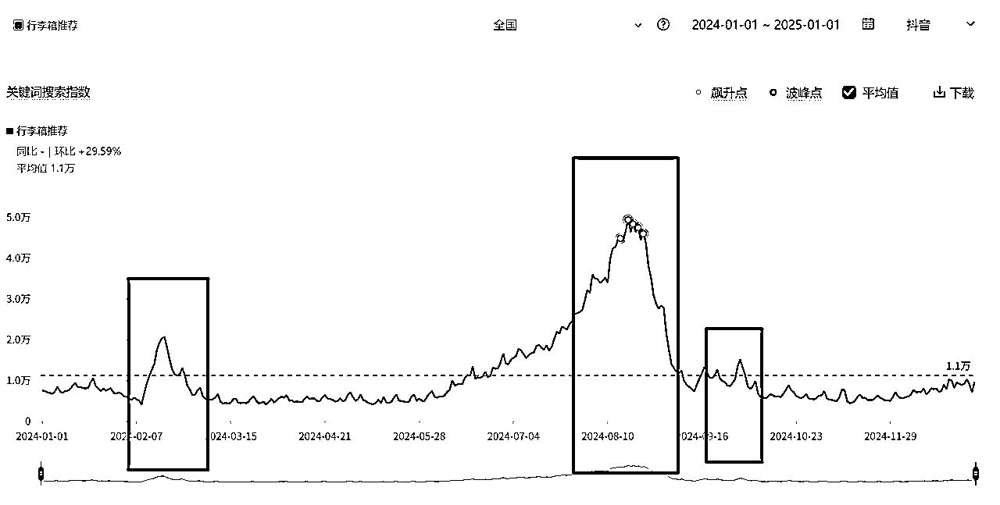

我迅速整理资料，写了一篇行李箱选购干货，并参与相关热门问题的回答。正向反馈来得很快，第二天便产生多笔订单，佣金合计500+，信心被迅速建立。

由于搜索“行李箱”的基础流量很大，再加上内容用心，赞评藏数据持续走高，文章和回答长期占据搜索前位，吃到该词的大部分流量。收入随之攀升，峰值时单日可达5-6k。

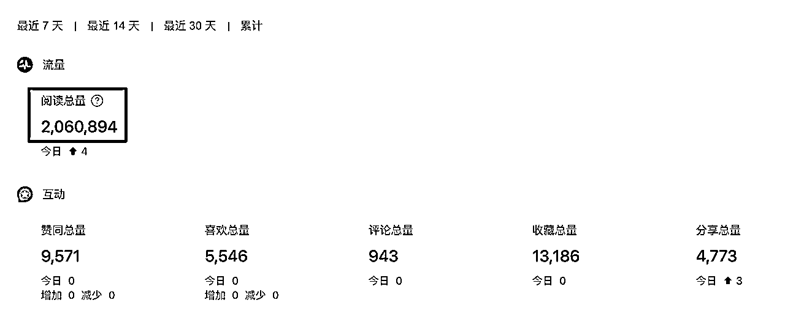

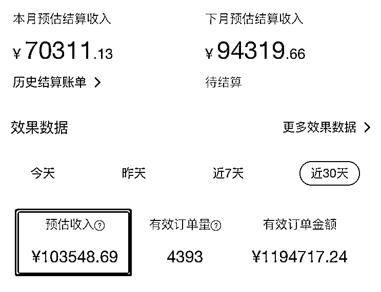

行李箱的需求虽有季节性，但在日常仍存在，轮子易损属于消耗品。即使错过开学和旅游高峰，小长假仍会带来脉冲式销量。累计下来，仅这一件商品就贡献了七位数佣金。

在此之后，我沿用同一套思路，在时间节点上做了防晒衣、羽绒服、旅游旺季酒店、空调、取暖器等内容。它们的需求会在特定窗口集中爆发，而大多数人目光都集中在全年长销品，导致这些节点性品类竞争更小。

我追的是周期性热点，不一定要上热榜，关键在于时间节点+使用场景+刚性需求的叠加，这类机会从不缺。

#### 2.1.2 📕虚拟资料：两篇笔记带来五千+

📕虚拟资料和当年的知乎好物一样，已有不少圈友验证。我分享一个相对不同的打法：热点内容反向选品法，即先在抖音、B站挖掘爆款视频背后的用户提问，再推导出可变现的资料或服务。

抖音的推荐是基于个人兴趣的茧房，自己刷难以看见全局。我会借助工具如巨量创意，对各大类目爆款做批量扫描，边看边问：视频背后藏着怎样的需求？能否变现？

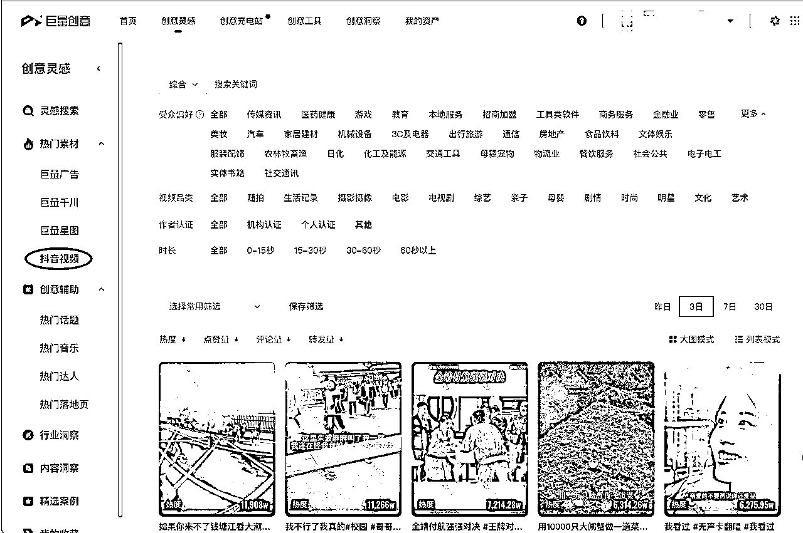

以今年六月做的美漫《血十字》为例。该漫画在抖音的解说类视频大量爆发，评论区高频出现“在哪看”、“求汉化资源”等提问，甚至出现截流的付费求资源留言。B站相关解说的评论区同样充斥求资源声音。

直觉判断需求真实，便用工具验证：巨量算数、📕聚光显示关键词搜索量在攀升；闲鱼、淘宝、📕上已有商家在售卖，销量尚可。

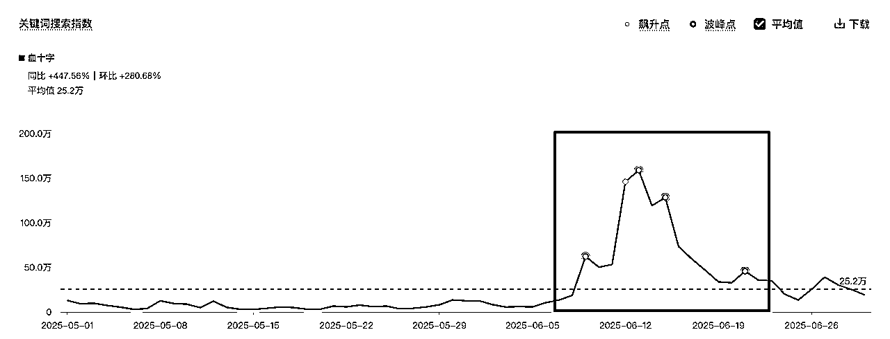

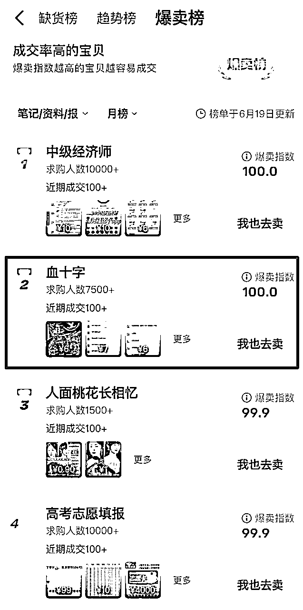

验证通过后我立即上架。随后遇到关键问题：笔记如何做？

我研究了头部同行，发现他们的笔记较为平淡，封面标题多为“血十字漫画”，即便如此仍能成交。但完全照搬会导致同质化，平台和用户不买账。

想要突围，就要比同行多想一步，做差异化。 📕爆款的核心是封面与标题，内容要么有趣要么有用。对商品笔记而言，有用更重要，它能解决痛点建立信任。

我在搜索框下拉词中找灵感，这是用户高频提问的集合。血十字的下拉词里出现“血十字观看顺序”，说明用户对观看顺序存在困惑。进一步检索发现该选题下仅有一篇爆款，需求与竞争的性价比很高。

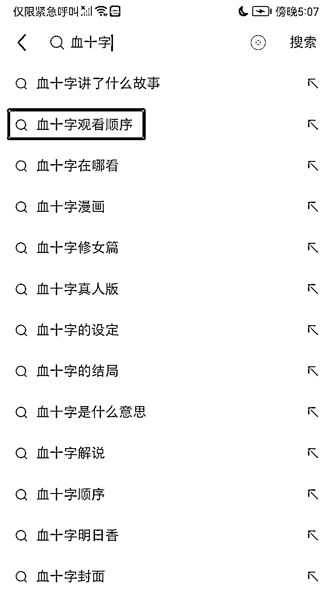

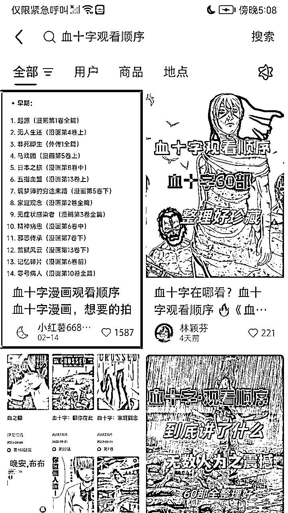

据此制作笔记，两篇内容均获得小幅爆发，约一周时间，定价4.99元售出千份以上，两篇合计收入五千+。

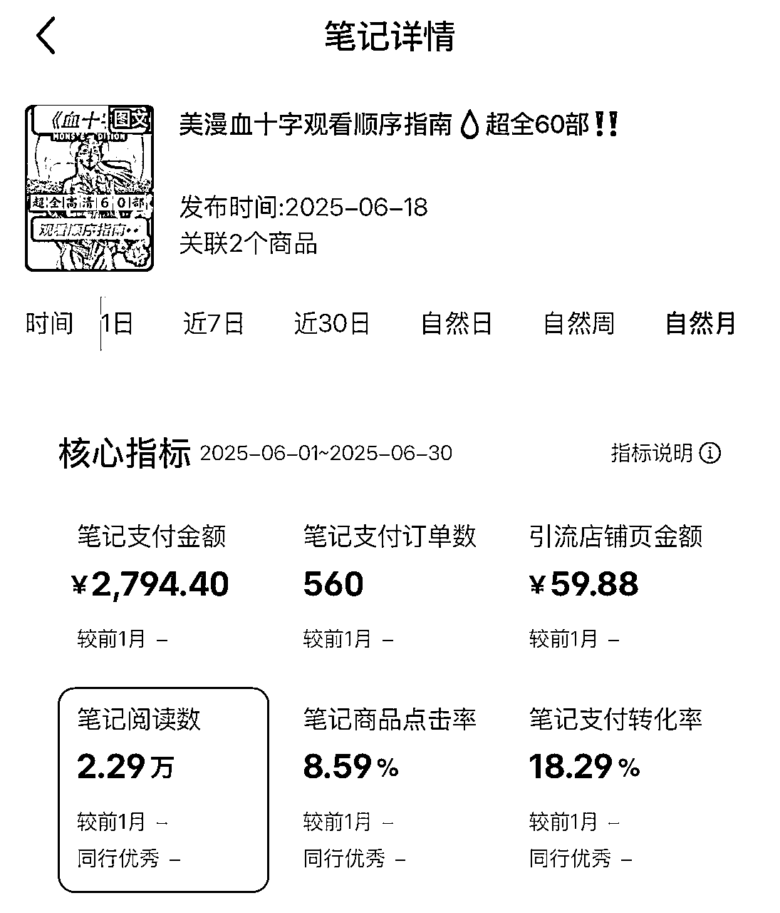

注：该品属弱版权且内容涉及血腥暴力，后被平台下架。选品需规避擦边风险。

从这个案例可见，任何平台的热点内容都值得多追问一步：背后能否变现？能则立刻启动。

### 2.2 热点思维找赛道

**AI修图赛道，三个月十万+**

2024年与先生合作了一个AI龙年孕妇照/宝宝照定制项目。他在赚钱发过精华帖，感兴趣可查阅。

赛道发现也是热点逻辑的结果。2024是龙年，生肖自带“望子成龙”的文化寓意，龙年孕产需求明显抬升，家庭在拍摄孕妇照、宝宝照时更倾向融入龙元素。同期AI绘画技术快速迭代，Comfyui和Flux大幅提升照片质感，可落地性增强。

我们将生肖文化热点与技术热点叠加，在📕推出AI龙年孕妇照/宝宝照修图服务，三个月变现超十万。

可惜我们因搬家等事宜下半年才切入，错过最佳窗口。若更早布局，结果会更大。

找赛道时，关注文化符号与技术革新是有效切口，但必须留意窗口期，时效决定上限。

### 2.3 热点思维做内容创作

**抖音表情包，单账号播放量超两亿**

知乎好物与📕资料是热点选品，AI龙年项目是热点选赛道，抖音表情包则是热点做内容。

2022年我尝试抖音表情包，本质是制作爆款表情包短视频，靠用户的取图需求变现。变现路径包括卖粉、付费会员群、私域淘客、收徒等，我均尝试过，核心收入来自小程序取图的广告分成，路径短回款快。

该账号产出多个原创爆款，累计播放超两亿，单条播放破千万，单条取图收益过万。

做爆款的底层是抄爆款，因为它已被用户验证过。而抖音对热点的放大效应更强，一旦某个文案或BGM火，短时间内会涌现大量跟拍，形成热点效应。

我的打法分三步：

第一步，确定受众。表情包方向很多，我最终聚焦30岁以下女性，她们使用频率高，更愿意互动取图转发。

第二步，做差异化。当时同行多用猫和老鼠、丸子妹、瑶一瑶等素材。新账号若同质化，权重低很难获得流量。于是我选用天线宝宝和熊二作为主素材，既符合目标人群审美，又能与同行区隔。

第三步，借热点创作。每日在巨量创意中筛选近三天符合定位的爆款，提取热门BGM和流行梗，再用自选IP素材进行演绎，既蹭到热点又保持相对原创，降低被判定同质化的风险。

流量后需变现。爆款能否赚钱取决于流量和取图率。我会在视频中植入聊天截图等使用场景，激发取图转发的欲望。

例如一条蹭梗与BGM的视频，剪辑卡点抓人，播放冲到1366万，被搬运后持续获益，取图率很高，单条为我带来一万+收益。另一条蹭七夕孤寡青蛙的节日热点，取图率同样很高。

补充背景：当时用户习惯在抖音下载再导入🛰️使用，取图率高。23年后用户更倾向在抖音直接转发聊天，取图率下降。但壁纸、头像等需求仍在，AI绘画带来更丰富的素材供给，只要抓住热点切中需求，仍可持续产出爆款。

现在流行用AI把热门视频转成动画再发视频号赚分成，本质也是热点+二创吃红利。可以说，凡以爆款获取流量的项目，都可以沿用热点二创的思路迭代。

## 三、方法论总结

复盘上述项目，共性是热点思维对新手破局很有价值。

### 3.1 为何热点思维是新手捷径

新手最大难题是缺乏及时正反馈。我们都是普通人，需要被正向结果推动。对小白而言，建立“我也能赚钱”的信心最关键。

我曾在摄影、民宿行业受挫一度怀疑自己，直到知乎好物带来第一笔正向反馈，我才重拾信心。

常规项目的回报周期往往较长，靠量和时间积累。新手若坚持一个月无收入，最容易崩的是心态。所以先积累小成功，比空谈战略更重要。

热点思维的优势是压缩反馈周期，尽快拿到第一笔收入。本质上热点即注意力集中，注意力在哪里，资金就往哪里流。

热点爆发时流量像洪水，没有人能吃光。老手也需要反应时间，窗口期内新手与老手几乎站在同一起跑线，机会均等。追热点是新手最快跑通流量-转化-收入闭环的方式之一。

### 3.2 新手如何落地

做项目常卡在方向感。新手最难的是选对方向，迟迟无法启动。

热点思维提供一条路径：跟热点定方向。

圈内说法“没有慧根就要会跟”对新手尤为适用。初期可跟随赚钱航海或超级标，做处于流量红利期的热门赛道，如📕电商、👸号垂直小号等。官方航海带实操，头部圈友持续分享打法，跟随大部队列可减少试错。

从选赛道、选品到做内容，热点思维提供从方向到落地的完整闭环。

除了要紧盯AI这类叙事层面的主流趋势外，还值得多留心。像AI这样的赛道现在才刚刚起量，参与者基本都在同一条起跑线上发力，对后来者来说，入场窗口依然很大，做出成绩的概率也相对可观。

### 3.2.2 用热点来找需求，进而锁定品类与选题

大方向已经确定，紧接着要解决的是：到底推什么产品？做哪类内容？

这时候就需要用热点思维来帮你把模糊的需求变得具体，从而挑到合适的商品和选题角度。

如果一时没有灵感，可以先从可预期的周期性热点开始入手。

周期性热点指的是一年里固定时段会反复出现的消费高峰。

季节更替、法定节假日、学生群体里的考试开学等关键节点，都会在特定时间集中释放购买力。比如夏季防晒是标配，情人节送礼是刚需，开学季的开学装备每年都会被热搜。也正因为循环出现，这种需求是可被复用的。

跟突发热点相比，周期性热点的最大好处是可预判性强。我们能借助往年数据去预估爆发点，提前完成选品和内容储备，等节点到来时直接上线卡位，借势吃到流量红利。

除了周期性的大盘机会，还可以重点挖掘各垂直圈层的内部热点。圈层热点受众规模可能不大，但人群更集中、痛点更清晰，转化效率往往比泛全民热点更高，也更容易实现变现。

我当年通过爆款视频提炼出的《血十字》漫画这个案例，就是借的二次元圈层里的一个小范围热点。正是精准触达了这个圈层的偏好，才打开了变现路径。

二次元、宠物、AI爱好者……每一个社群都有自己独特的流行话题。只要能捕捉到圈内热点，并精准回应该群体的需求，就能持续挖掘出具备商业价值的机会。

### 3.2.3 借热点做爆款内容，把流量变成结果

方向和产品都明确后，最关键的就是用内容去拿流量，缺了这一步前面都是空的。

热点思维在这里的价值就是：借助热点制造爆款。

具体落地要分几步走：

第一步：判断是否值得跟

并不是所有热点都值得消耗资源去追。

看到一个热点，先自问两件事：这个热点跟我当前的赛道有关联吗？它能帮我实现变现吗？

如果两个问题有一个是否定的，那就别硬上。无法承接转化的热点，直接放弃。

第二步：找到可复制的对标爆款

确定要跟热点，第一步操作是去找参考样本。

在你打算发力的平台，直接搜索热点关键词，筛出近1天或7天内数据表现突出的内容作为对标。

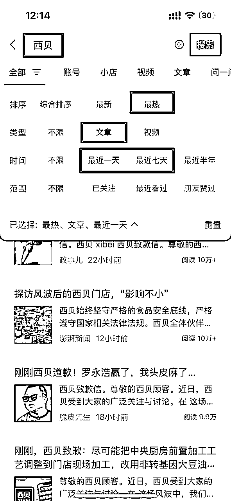

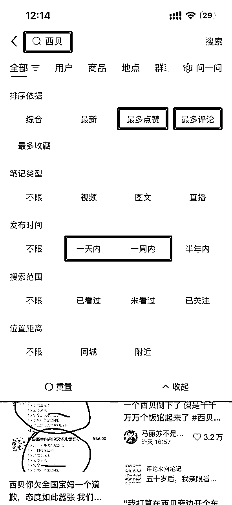

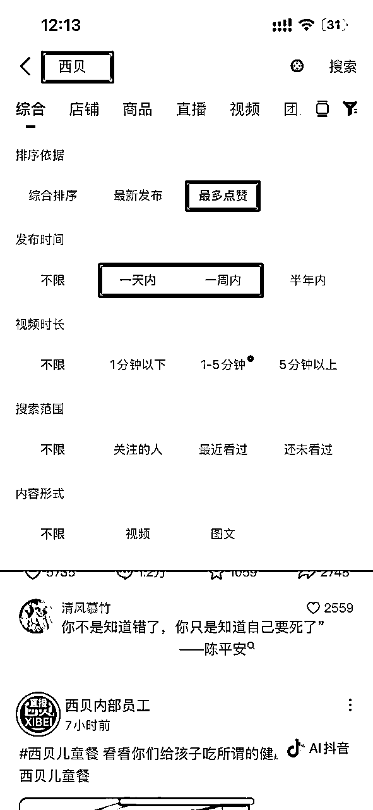

优先挑“低粉高播放”的案例。粉丝基数小也能爆，说明核心是内容机制，普通账号一样能复刻。

第三步：拆解爆款的蹭法

* 标题：热点关键词是怎么植入的？带来了怎样的点击欲望？
* 视角：是解决实际问题，还是制造情绪共鸣？
* 关键词：除主词外，搭配了哪些长尾词、话题标签？
* 视听包装：封面视觉是什么？开头2秒怎么抓人？BGM风格如何？

拆解越细，底层套路就越清晰，“爆款公式”也就越好学。

第四步：80%高还原模仿+20%微创新创作

爆款之所以能火，是因为选题、结构、呈现都已被市场验证，符合平台偏好和用户习惯。

新手最稳妥的做法是先做像素级还原：把标题结构、叙事节奏、封面形式、BGM等核心要素尽量复刻，确保不跑偏。

但完全照抄容易同质化，所以要在保留骨架的基础上做一点差异化：换个案例、微调表达、加入个人使用感受。这样既保证逻辑一致，又有原创辨识度，有利于账号长期运营。

第五步：布局变现闭环

内容爆了只是中场，能否变现才是终局。

内容必须服务于你的最终目标：做私域引流，就要在文案里埋引导；做带货，就要自然植入商品；卖课或服务，就要在结尾设置明确的转化动作。唯有如此，热点带来的注意力才能顺畅转化为收入。

所以新手想快速破局，可以把热点思维当作一条闭环路径：先用热点定赛道，再用热点找需求选品选题，最后用热点做爆款实现流量变现。

# 四、写在最后

热点思维的本质不是无脑跟风，而是抓住注意力集中时的需求窗口，把流量有效地变成结果。它能帮助新手快速拿到第一笔收入建立信心，也能让老手在关键节点放大收益。

但这并不等于要漫无目的地追热点。频繁在不同平台反复从零开始，只会分散精力，难以形成累积势能。

热点思维的核心用法，是把热点当作撬动业务的杠杆，一直服务于你长期深耕的赛道。

先用热点获取流量和正反馈，再把这套方法沉淀为可复用的方法论，迁移到你真正想长期做的事情上。这样在持续借势的过程中，才能慢慢建立起自己的核心竞争力与护城河。

愿你能用好热点思维，找到属于自己的变现路径并走通它。