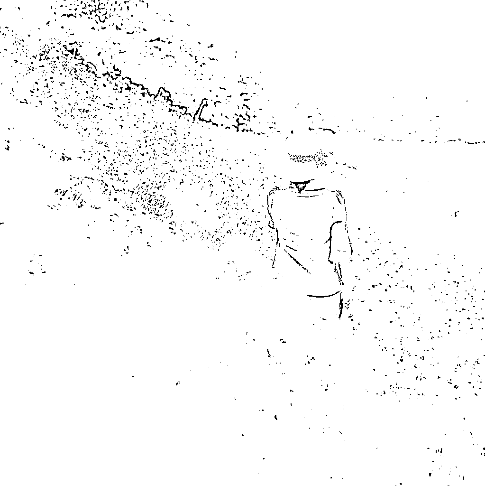
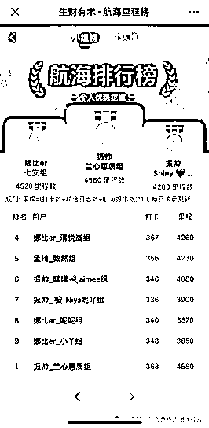
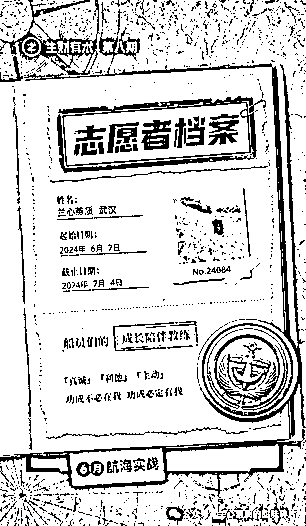
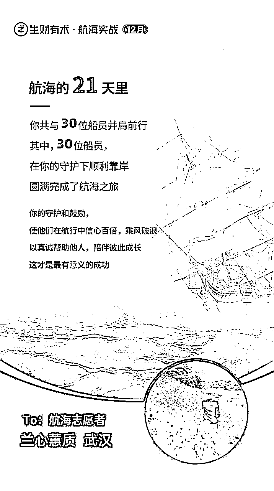
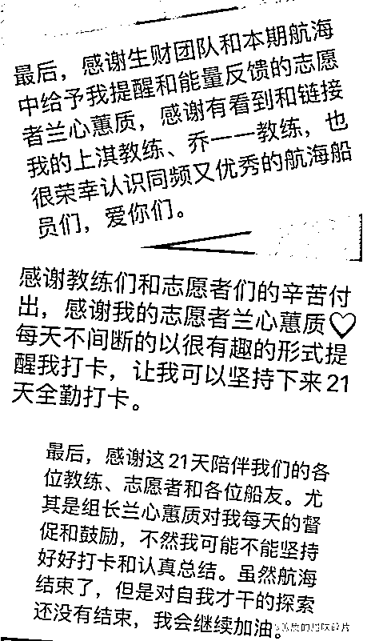
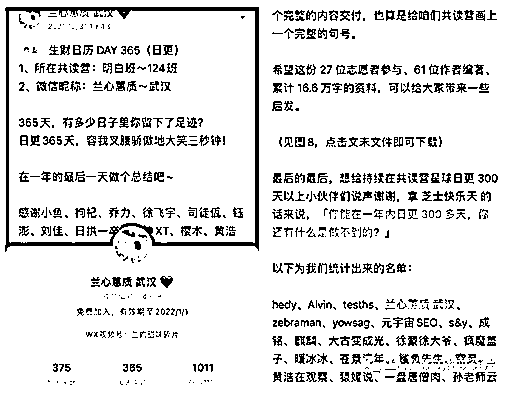
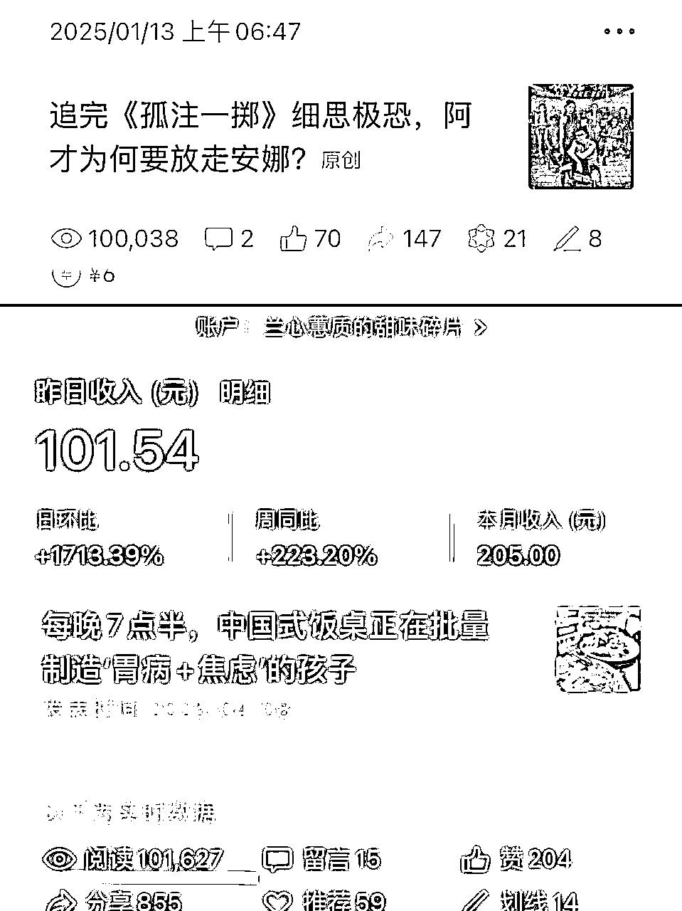
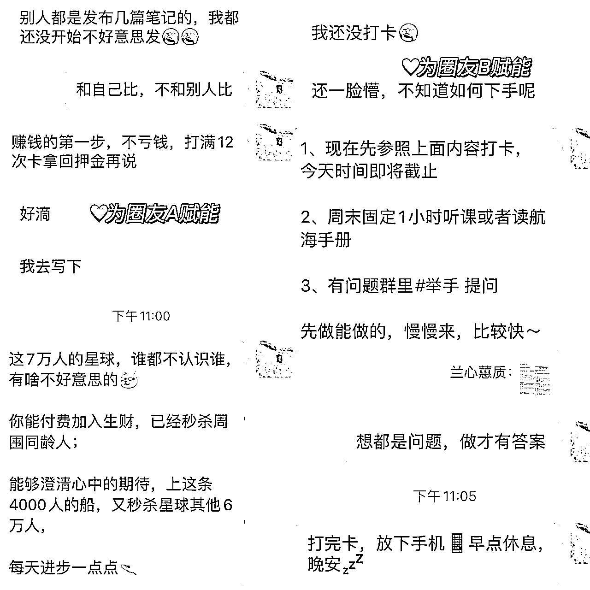
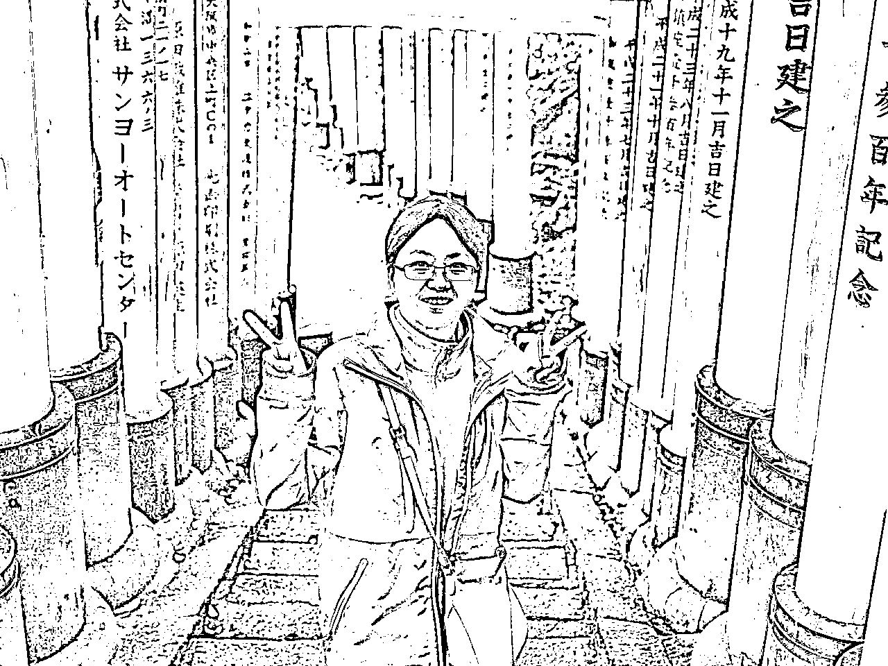

# 两年三次登顶、日更五百天、十万加阅读：一位国企妈妈的“志工”突围记

> 来源：[https://m661tsgjbp.feishu.cn/docx/YVWHdv4AGog817xorN7c28Xhnvd](https://m661tsgjbp.feishu.cn/docx/YVWHdv4AGog817xorN7c28Xhnvd)

# 一、先介绍一下我自己

圈子里有句话：想成事，先露面。靠着智能创作辅助、个人优势探索和社群年度内容策划这几项拿手活，我在近两年的志工服务里三次拿下A+评级，累计六十点术值，还被评上了金牌志工。

大家好，我是兰心蕙质，家在武汉。我的标签不算复杂：

*   一位十五岁男孩的妈妈，白天在国企综合部担任负责人
*   一个用图文和影像记录生活的十万加内容创作者（公号+视频号）
*   在生财有术社区里，我还有另一重身份——志工

我给自己定的人生使命是：持续感受、分享生活中的爱与美好，影响一百万人。

2021年4月18日，我跟着明白老师走进了生财有术；同年7月，我开始以志工身份参与各类专题，比如日历编撰、个人优势探索、智能创作辅助等。

志工身份就像一根杠杆，帮我一点一点撬开了生财有术这座信息宝库。这段旅途让我明白一个朴素的道理：任何事都得脚踏实地、稳扎稳打，才能真正办成。我很珍惜每一次全情投入的时刻，也很喜欢那张海报上的话：“持续行动，走向海航中最为耀眼的远方灯塔。”

这篇文章，是想给第一次接触志工的朋友画一张成长路线图。如果你对这个身份有兴趣但还没行动，也欢迎来看看。想了解更完整的志工晋阶体系，可以翻亦仁的帖子：https://t.zsxq.com/IXfHo

# 二、我为什么会去做志工？

在没有成为志工之前，我的日子几乎是两点一线：单位、家里、孩子。周末偶尔和朋友约个饭，安稳是真安稳，可时间一长，总觉得缺了点滋味。

一边上班一边带娃，每天围着柴米油盐转。但我心里始终有个念头：跳出眼前的小世界，去更开阔的地方看看，认识些不同的人，也让儿子明白，人生的活法远不止一种。所以哪怕已经很忙了，我还是想挤出一点时间，用来做点自己喜欢、也觉得有价值的事。

刚进生财有术那会儿，面对铺天盖地的信息，我整个人有点发懵，不知道从哪里看起，也不清楚自己能做点什么。

后来偶然看到日历团队在招内容编辑，我心里一动：平时我就爱写点东西，也喜欢给人打气，是不是可以试试？虽然犹豫了好一阵，但最终我还是决定向前迈一步，报了名。

正是这次小举动，让我真正从“空想”跨到了“实践”。在志工工作里，我一点点找到了自己的节奏，也认识了不少同路人。我一直相信：光有愿望，改变不了现实；只有行动，才能带来改变。

# 三、做志工的这几年，我收获了什么

从2021年到现在，四年间我以志工身份参与了多个专题，包括日历编撰、个人优势探索、智能创作辅助。回头看看，变化是全方位的。

*   积累了统筹经验，学会给出真实而即时的反馈
*   能更快捕捉自己和他人的长处，心态更正向
*   玩转了智能工具，出稿效率大幅提升
*   行动力变强了，能够保证每日产出
*   连接到了一群段位更高的人

接下来，用三个小片段讲讲这段经历带给我的东西。

### 片段一：带着三十人小组拿第一，我读懂了“细致服务”

2024年6月，我在“个人优势探索”训练营里担任志工，带一个三十人的小队。最终全队百分百达标，小组总积分排第一；我自己也把二十一次练习全部做满，没有一次缺勤。

作为志工，我能更早接触到有潜力的专题，还能进入内部后台参与实战。深入了解“个人优势探索”“智能创作辅助”这些专题后，我发现官方提供的物料很充分，后台也一目了然，照着SOP走流程，就能学到不少真东西：例如怎么设置激励环节，让大家更愿意参与；怎么用轻量互动、快速反馈这类低成本手段把氛围稳住。更重要的是，我理解了运营的内核其实是“基于人性的沟通”，唯有真实、及时地回应，才能真正建立信任。

开营第一周，我因为用眼过度，眼睛充血，医生建议多休息。但既然担了这份责任，我还是选择把队员放在第一位，没有中途退出，而是尽量砍掉其他杂务来协调时间。等到训练营收尾时，我们队顺利拿下积分第一，我的眼睛也慢慢养好了。

那阵子白天本职工作排得很满，我就拆出三个时段专门处理队务：早晨出门前，迅速回复所有队员的留言，哪怕只是发一句“很棒”；中午歇息时，一条条翻看大家的练习，认真写好意见交给队长；晚上十点左右，编写提醒文案，点对点发给需要帮助的人。

为了不遗漏任何人的状态，我做了一张Excel表，把每个人的进度和近况都记下来。谁带病硬撑、谁总熬夜赶任务，我都会主动去问一声，让每个人都感到自己被在乎、被支持。说白了，这就是在对一群同路人做细致服务。

队里有个姑娘，每次交练习都特别慢。一开始我有点急，后来才知道，她不是拖延，而是习惯把问题想深想透。我便顺着她的节奏，请她多承担总结和归纳的活儿。结果她不仅自己顺利通关，还变成了队里的“军师”，常常帮大家出主意。

从那以后，不管是带队还是在家庭里，我都更愿意先去发现每个人的特点，而不是急着下结论。日子反倒轻松了不少，和身边人的关系也更融洽了。

心态稳了，统筹能力也在一次次实操里长了出来，我这才有余力把目光放到自媒体创作上。真正推着我一直写下去的，正是这段志工经历——它给了我素材、能力和底气，也带我看到了一个新世界。

### 片段二：从提笔困难到每日一更，五百天创作路

*   学会了用智能工具，出稿速度快了好几倍
*   行动力上来了，能保持每日产出

2021年，我参加了日历共读活动。从一个练习都憋不出来的新手，到连续打卡三百六十五天，攒下1011个赞、58个V值。更惊喜的是，后来我竟然入选了2022年日历编撰团队，名字被印在了日历封底。

进生财有术以前，写作变现、连续每日更新、十万加阅读，这些我统统不敢想。后来就是闷头写，从一周一两篇，到借助智能工具连续五百多天每日产出，还写出了好几篇十万加。

有人问我：是不是当了志工，才有东西可以持续写？确实如此。志工身份让我系统接触到了各种智能工具。我不仅自己完成打卡，每天还会翻同学们的练习，把精彩内容挑出来举荐给队长。

海量而有价值的输入，决定了输出的水准。在同样是志工的朋友帮助下，我慢慢把这些工具用熟了，创作也就一直没有断过档。

如今，我有一套相当顺手的智能创作流程：以前一篇内容要磨大半天，现在借助工具不到一小时就能出稿。创作还带来了额外收入——一篇十万加内容的流量主收益，大概能带来一周三百到六百元。但比金钱更重要的，是个人品牌和声量的沉淀。

回头看，账号能一直更新并产生收益，靠的并不是一时脑热，而是志工这段经历。它让我浸泡在更高能的环境里，手边永远有素材和真实场景，也倒逼我把每次总结写成文字；在这个过程中，我学会了用智能工具做资料归纳、结构调整、标题测试，把它们拆成一套能反复执行的小流程。有了方法和节奏，更新不再依赖灵感，而是依靠可复制的动作；读者稳步增长，收入也实实在在涨了起来。

除了自身成长和副业回报，更幸运的是，我遇到了一群优秀的同行者。

### 片段三：志工身份帮我打开了社交圈

*   连接到了更出色的人

坦白讲，最初选择做志工，纯粹是出于兴趣和认同，没想过任何回报。可神奇的是，在持续帮人的过程中，我竟然用攒下的术值直接兑换了两年的生财门票。

也因为真心喜欢这里，我前后介绍了四位朋友加入。不但拿到了一些现金奖励，和朋友之间的信任也更牢了。这就像一场温暖的价值循环：你付出时不求回报，收获时反而格外惊喜。

更难得的是，我在这里认识了一群“结果导向的行动派”。她们来自不同行业、不同背景，却都在各自的领域做出了相当亮眼的成绩。

和她们深聊，我原有的认知边界一次次被拓宽。这条共创之路让我从具体到抽象、从广度到深度，系统地打磨了自己的财富能力，也真正体会到：想成为什么样的人，就要走进什么样的圈子。

比如在日历编撰中，我认识了黄小鱼。她临时带着一群刚组起来的队员，在极短时间里完成了高质量的内容提炼和校对。我以前总觉得“快等于糙”，可她偏偏做到了又快又好，关键就在于她极强的流程把控和信息筛选能力。

加入高水平的志工队伍后，从飞书工具的基础操作学起，我才发现：真正能成事的人，会把“目标”拆成“步骤”，再把“步骤”落实成“动作”，干净利落，绝不拖沓。

还有赫连雨彤。她进入这个社群两年多，已经做过十一次志工，其中七次担任队长，被大家称为金牌队长。我亲眼见证了她是怎样从一个小白，慢慢变成注重细节、善于总结的“细节控”，甚至写出了一份SOP级别的志工总结文档，把经验转成可复用的方法。这种成长速度和办事的认真劲，让我印象极深。

另一位是优势转型教练麦几。今年她试了一个很有潜力的项目：微信“问一问”。她很快跑通了整套流程，拿到了持续稳定的收益。到现在，她运营的两个账号合计收入超过五千元，内容曝光量过百万。这份“小而稳”的成绩还带动了队友，队友的月收入也破了一千。一个零基础的自媒体新人，就这样借平台流量和扶持，把内容创作这条路趟了出来。

如果没有志工身份，我大概永远不会认识这群乐于分享、不求回报的姑娘。我们平时各自忙碌，轨迹很难相交，正是因为共同完成一件事，才在过程中自然相遇、携手同进、彼此认可。

这让我更确信：经营关系，重点不在于“认识多少人”，而在于你能不能融入一群正在做事、能拿出结果的人中间，被她们带动，跟着她们一起升级。往有结果的人身边靠近，跟着他学，才是最直接的成长通道。

而这一切的起点，不过是一个主动的选择：去做志工，去靠近更多发光的人。

# 四、参与共创，传递利他之火

我一直很信一句话：善意不会消失，它只会换一种方式回来。帮助别人从来不是单向的付出，而是一场能量的双向流动。身为志工，我始终带着这样的信念：

**安静地听，及时地应，不让任何一条消息石沉大海。**

记得有位群友，很久都没进入状态。他信心不足，方向也不清晰。我跟他聊的时候，先提醒他记得签到，别让押金受损；接着建议他把学习时间固定在周末；最后告诉他，有任何问题都可以随时提。

还有个群友，总习惯跟高手比。我劝他别焦虑，重要的是今天比昨天好。我帮他定了一个容易够到的小目标：先完成十二次签到，把押金拿回来。同时肯定了他已经付出的努力，让他先放宽心，慢慢建立信心。

那场沟通下来，既给了具体可执行的行动建议，也给了情绪上的承接，帮他真的动起来，而不是停在“想想”的层面。

有时候，一段语音、一个点赞、一张图片，这些看似微小的动作，都能让人感到“被看见、被回应”。这种及时的互动，会带来归属感和自信，也让大家更愿意敞开心扉，形成一个越来越好的正向循环。

**成功我会讲，失败我也不藏着，因为“真实”永远比“完美”更有力量。**

遇到那种一出海就想下船、想转成围观的群友，我会毫不避讳地分享自己一路摸索的经历：哪些弯路走过、哪些方法验证过。然后劝他，再给自己一次机会，再翻翻优秀的范例，别急着说“我不行”。

真诚搭配任何一项技能，都是王炸。这份真诚，拉近了彼此的距离，也让对方更愿意信任我们。而那些真正实用、可直接借鉴的经验分享，则是为了帮大家少踩坑、快上手，让每一步都走得更稳一点。

**主动送机会，让有实力的人被看见。**

比如发现某个群友视频剪辑特别厉害，我会主动推荐他去相关专题；看到合适的线下活动或商业资源，也会第一时间帮忙牵线。

一次转发、一句引荐，就可能让对方获得更多曝光和合作机会，甚至由此打开新的收入通道。而这，往往只需要我们轻轻推一把。

还有一点我一直记着：群友不一定总是对的，但和他们争论，永远赢不了。我们要的不是谁说服谁，而是共同成长。就算观点不合，也要用包容的心态去对话，用建设性的沟通代替对立。

生财路上，志工之所以能帮到那么多人，是因为我们聚在一起抱团取暖，把成年人赚钱路上的孤独感一点一点打碎。每次训练营结束，我都会收到许多细腻、温暖、有能量的感谢，有些人还成了生活中的挚友。

在这里，有人引路，有人瞩目；有人陪你聊到黄昏，也有人问你粥可温。这里不聊虚的，只关心你有没有在行动、有没有在变好。而你，从来都不是孤身一人。

# 六、如果你也想当志工，我想说几句

志工，是进入社区共创最友好的一扇门。加入之前，先问问自己：“我真正想要的是什么？”把目标放在前面，再让志工服务成为你靠近目标的路径，愿望就会一步步落地。基于这个想法，我给出四条路径、两句叮嘱。

**四条成长路径**

1）磨行动力，攒经验
从眼前的小任务做起，把“完成”当作最小单位，在一次次的“开始—交付—回顾”里打磨自己。起步不需要多强，但要把每一步都走扎实，你会越来越有底气。

2）用天赋，找位置
把志工服务当做一次低成本试错：多尝试不同的角色和任务，慢慢验证自己真正擅长什么。每个人都自带独特天赋，关键是找到那个让你一出手就比别人快三倍的方向。

3）扩社交，攒口碑
在服务中真诚提问、主动发声、及时回应，让别人看见你的专业和可靠。每一次真心互动，都是在给对方一个记住你的理由；关系会从点连成线，再从线连成面。

4）做长期，建品牌
选择能持续投入的专题，稳定输出、乐于助人，在成就别人的过程中积累信任和个人品牌。希望不是等来的，是坚持之后才有的。你今天存下的每一份努力，都是在为将来的自己积蓄底气。

**坚持住，回报是会迟到的**

很多人以为，付出就会有立竿见影的回报。但真相是：你得先成为一个付出者，才有机会成为收获者。你可能连着几周都在做杂活、写文案、整材料、统计数据、一对一沟通，看起来毫无进展。

但请相信：你现在的每次付出，都是在给未来播种。它不会明天发芽，甚至不会下个月破土。可只要你持续浇水，它一定会在某个时刻，给你一个不小的惊喜。

**去做你真正热爱的事**

两个小问题，可以先想一下：
1）你最有兴趣、坚持得最久的事，是什么？
2）有没有一件事，就算不赚钱甚至倒贴，你也心甘情愿去做？

对我来说，答案是阅读和内容创作。所以我通常会挑跟它们有关的志工专题。做这些事的时候，我会进入心流，会发自内心地感到快乐。我相信时间的复利，会把今天的热情，变成明天的本钱。

最后想讲：生财这条路，不短，也不孤单。只要你目标清晰、愿意先付出、扛得住回报的滞后，我们早晚会在路上碰面，然后一起朝着远方，结伴走到底。

# 七、写在最后

感谢明白老师，带我走进生财有术；感谢亦仁、涛哥、靠谱、黄小鱼的无私分享；感谢志工团队里欢欢和三七的信任；感谢队长振帅、blue、十月、佳佳油；也感谢每一位和我一起拼过的志工伙伴。

最后，如果你也愿意付出时间、拿出真心行动，欢迎加入共创者队伍。在这里，你能获得的也许不只是收入，还有爱、能量，和真正值得深交的同行人。

谢谢你能读到这里。期待我们继续在生财的海洋里，一路同行。

