# 从建筑高管到智能应用站长：我如何在海外市场赚到首笔美元

在建造领域待了整整五年，我从一线一路做到管理层，最终成为公司高管之一。就在大家都以为我会继续往上走时，我选择离开。辞职后，我没有回到老本行，而是钻进了一个几乎完全陌生的领域——海外智能应用。当首笔美元收入悄悄出现在账户里时，我明白，这场冒险赌对了。

先介绍一下自己：我叫井然。这篇长文记录了我从土木专业转向跨境应用开发的完整过程，包括踩过的坑、遇到的人和反复验证过的方法，希望给同样在寻找出口的朋友一些参考。

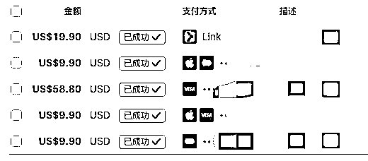

我刚入行时在南方一座城市工作，那几年成长速度很快。入职时还是新人，不到三年便坐上了副总的位子，也进入了公司的核心团队。前公司后来把业务做到了沙特，让我积累了跨时区协作的经验。这段经历带给我的不只是职位，而是分析问题的方式：遇到难题不慌，先拆开再解决。这个习惯后来帮了我很多。

刚进入新领域时，我真的没指望立刻见到收益。心里预期是至少一年后才可能有反馈。毕竟离职前我是龙哥，对互联网世界知之甚少。但真正跑起来之后，一切比我预想的顺利许多。

为什么要离开稳定岗位？答案很简单：长远来看，智能应用的增长空间更大，而且我希望拥有自己的团队，做自己真正感兴趣的事。那段时间我像着了魔，半夜有灵感也会立刻爬起来记录。身体上确实有点吃不消，但那种专注和兴奋让我确信自己选对了路。

最初带我接触这个方向的，是一位同学。他在一个知名的副业社群里待了三年，做过不少项目。三月份，他的一篇自媒体文章爆了，流量很高，三天赚了三万块。我照着他的思路试了一次，结果撞上平台调整，失败了。不过我因此注意到社群里另一个方向——智能应用开发。在那里我读到了不少导师写的高质量分析，其中刘老师的观点让我尤其信服。我默默关注了很久，得知他有一个面向海外市场的课程后，立刻报了名。现在回头看，这是我做下的最正确决定之一。

训练营的氛围比我预期更好。刘老师定期做直播，内容从基础到进阶安排得很清晰：新手如何起步、怎样调用接口、如何设计数据结构和界面，以及如何拆解一个应用的功能结构。嘉宾分享也很密集，而且会持续十个月。我的首笔收入，很大程度上得益于这些来自一线的经验。群内动态非常快，海外智能圈有什么新动向，马上就会有人搬运进来。这种环境待久了，对站点走向的敏感度自然就出来了。

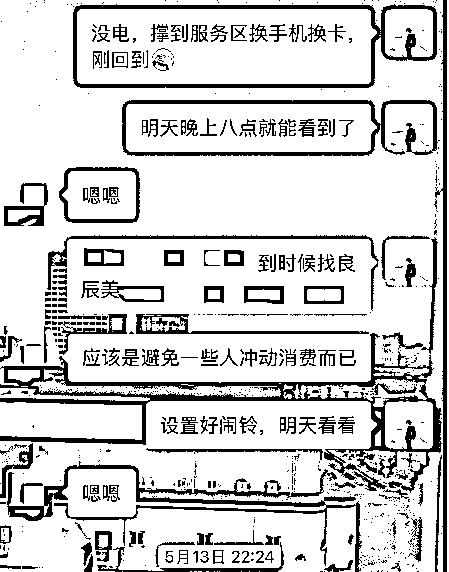
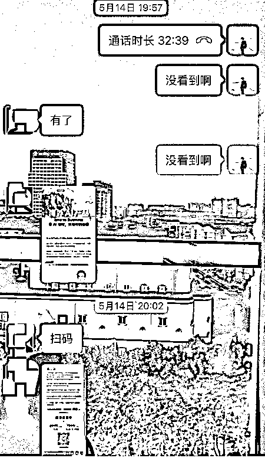

看到身边的人纷纷拿到订单，我心里也憋着一股劲，开始疯狂补课。

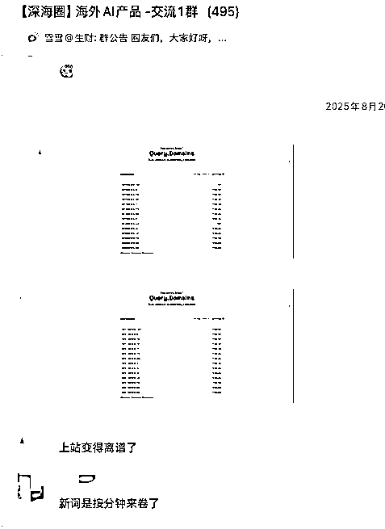
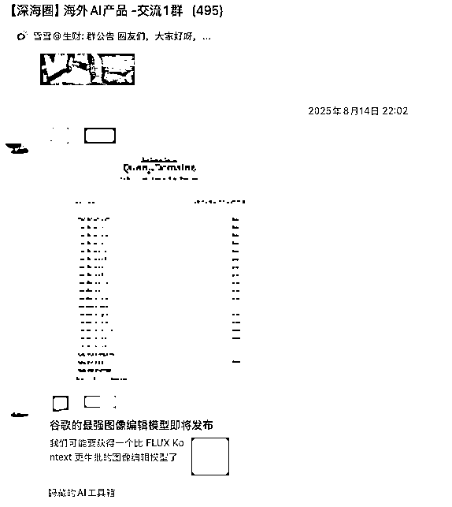
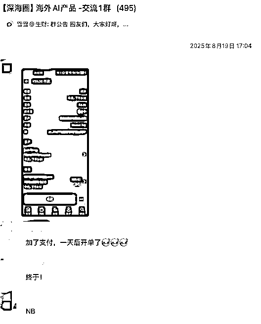
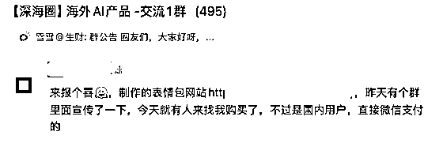
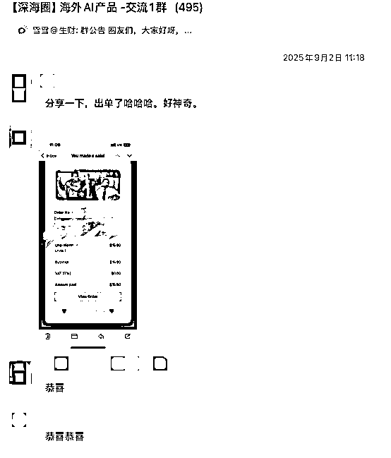
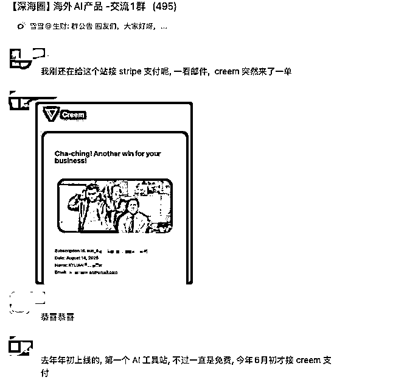

刘老师教过一个特别管用的决策方法：谁会用？在哪种场景下检索？用户愿意付出多少？要解决的核心麻烦是什么？

这四个问题，我一直用到现在。每次面对一个新点子，我都会先拿它们过一遍，再决定要不要投入。除了一套完整的项目规划方法，刘老师还给了我一种能量状态，让我的学习效率提升了很多。

六月下旬，我专程飞到杭州参加他的线下碰面。那时候我还不会接支付，也没有香港账户，连接口都调不明白。当晚的编程马拉松，我熬到天色泛白，虽然没能在截止前交上作品，但那次让我看清了自己的差距——既缺少方法，也缺少实践。回来之后，我按短板逐项学习，随着练习次数增加，速度自然也变快了。

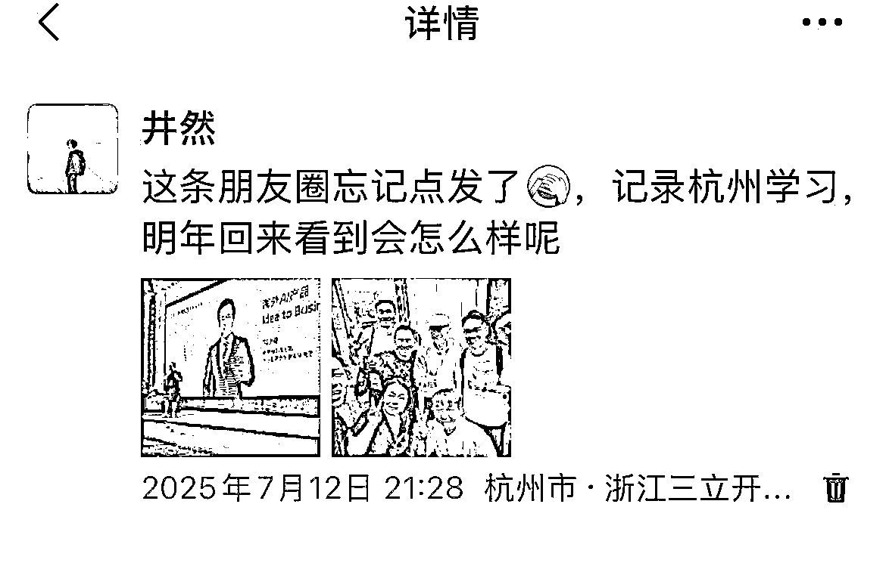

在补课阶段，我把训练营提供的课程资料反复读了很多遍，那里面把从起步到变现的路径讲得很透彻，而且内容还会不断补充。现在我写程序之前，会先把需求写成说明，再让编程助手帮我生成代码，基本可以做到指哪改哪。我还会用飞书笔记记录每天的学习内容，防止忘记。

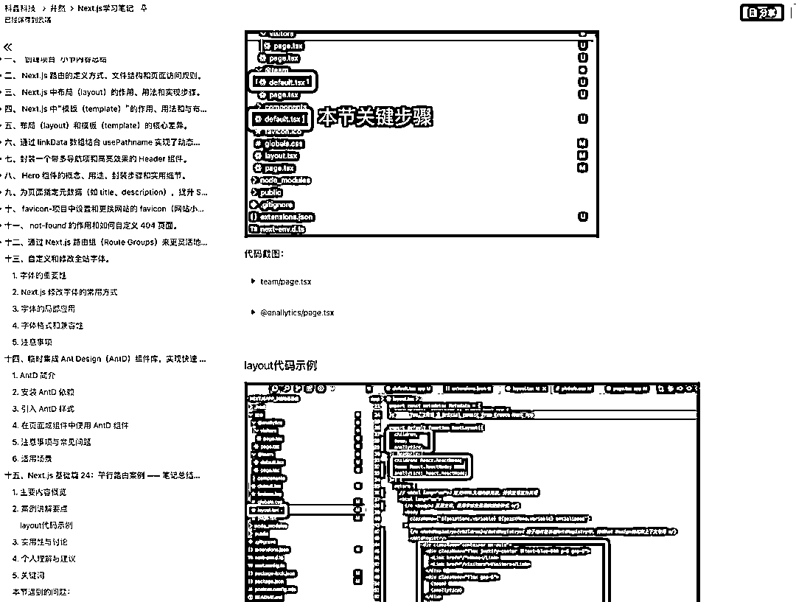

说一段办境外银行账户的教训。目前我手里有汇丰、众安和 BOCHK 三家账户。办理过程并没有那么顺利，尤其 BOCHK。我提前做过功课，原以为落地香港，连上购物中心的免费网络，在移动应用里操作就行。结果我注册到一半，网络断了，没能马上接着登录。回来之后，用户名怎么也想不起来。这家银行的用户名比较特殊，应用又禁止截图，没办法自己查。我打服务热线要电子结单，又跑了两趟柜台，最后在元朗一家分行处理好了。所以不要怕麻烦，多跑几次，总有解决办法。

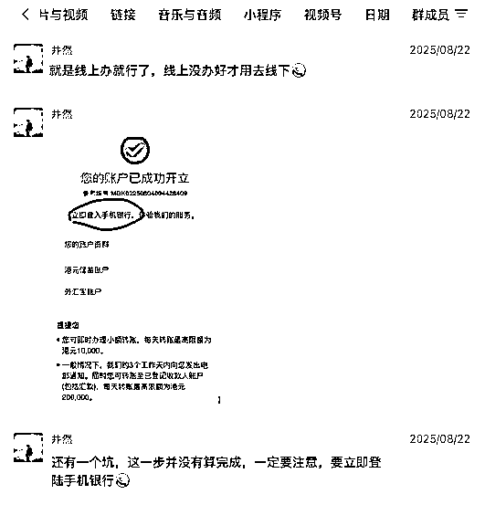

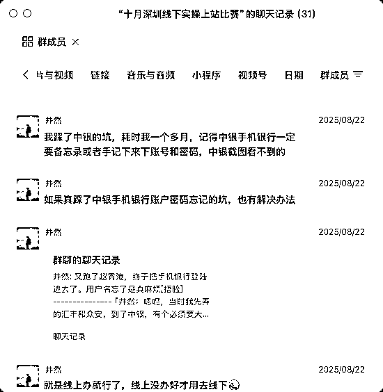
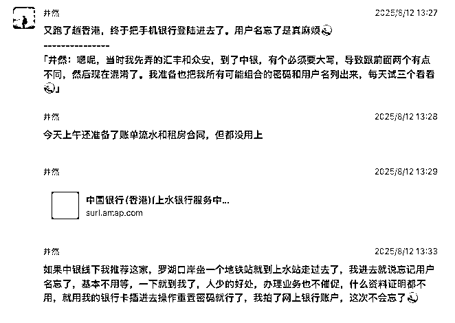

还有一个细节：BOCHK 寄送实体卡默认走普通信件，信封上没有联系电话。如果住处配备了信报箱，最好隔几天看一眼，通常两周内会到；超过时间没人领，邮件可能退回原处。住宅区没配信报箱的话，就要主动联系片区的邮递员。我专门跑到邮局打听，辗转联系上负责这片区域的邮递员，加了🛰️请他帮忙留意。后来卡片到了，他第一时间通知我。

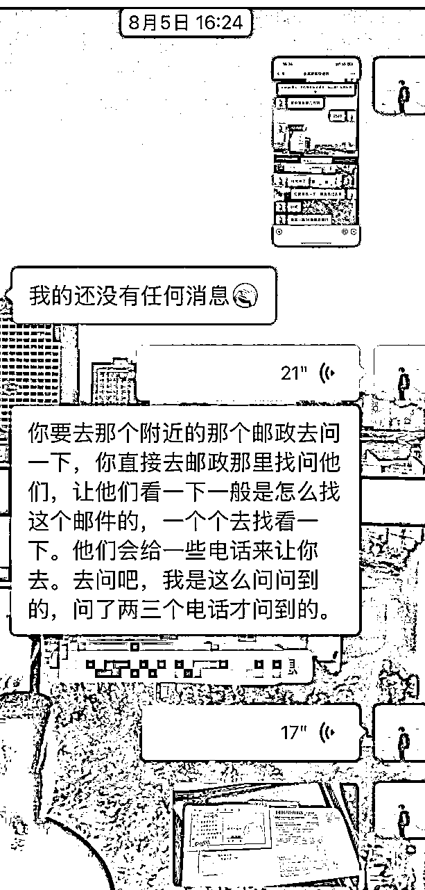
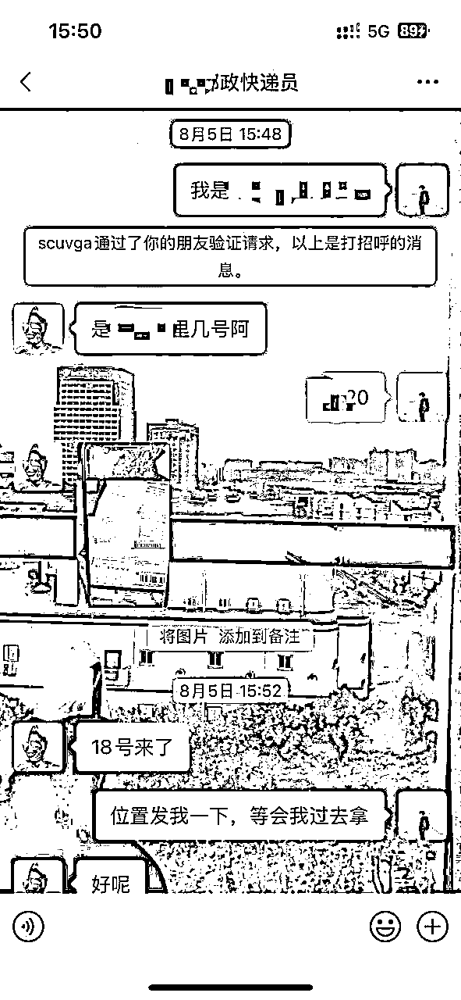
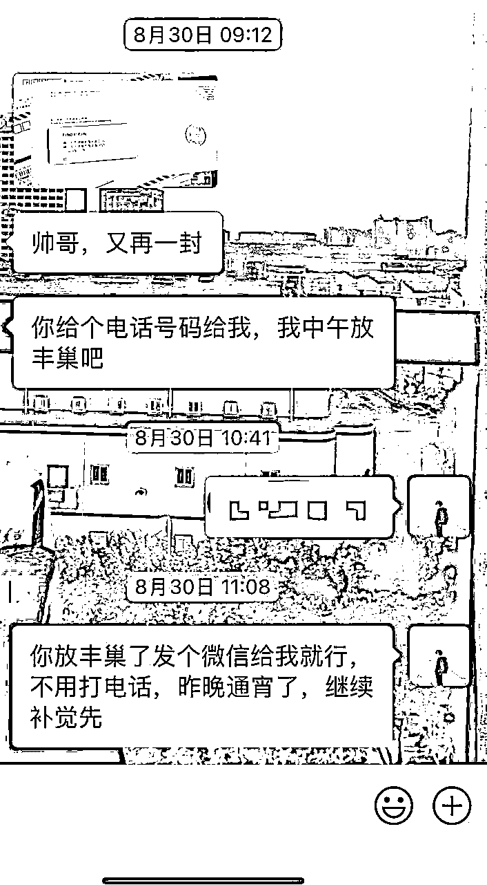

关于日常工作，我逐渐总结出一套节奏：四成时间找需要，两成时间做开发，四成时间做宣传。今天回头看，真正成交的站点大多不是技术取胜，而是找对了需要。

让我赚到钱的第一个站点，在确定方向前，我花了很多时间泡在资讯里，研究搜索词，循着对手的页面跳来跳去，寻找机会。有一天，新出现了一个叫 Flux1krea 的生成工具，出图效果比当时其他工具更还原真实，很多博主都在推荐。我去查了相关 domain，发现对应的名称已经被人抢先注册，查询热度也在攀升，于是立刻拿下了一个接近的网址。整个页面用了不到 48 小时搭建完成，又花了几天提交外部链接。后来热度没有继续上升，对手也没有明显动作，我就先把项目放在一边，继续找新的方向。

做搜索优化这件事，没有捷径。每天都有很多琐事：追新词、看对手、发外部链接、调页面细节、记录排名变化。最初内容太多，我只能慢慢地消化，一遍看不懂就再来一遍。后来我买了十几个 domain，中间也做了不少试水项目：内容导航、对话消息归纳、虚拟试衣、聚合内容……真正完整发布的只有几个，其中两个没什么人来访，还有一个错过了时机。真正让我跑通全流程的，是第三版站点，也就是带来收入的那个。

第三版站点发布后不到一周，陆续有人下单。搭建时间同样不到 48 小时，还能做得更快。我下一步的目标是，在模板成熟后，把单个站点的时间压缩到一天，再把更多精力放到宣传上。我现在常用三种方式：第一，把页面提交到高权重导航目录和允许发布外部链接的博客；第二，拍一段短片发到海外平台，请博主帮忙展示；第三，做一些付费宣传。

为什么这个站点能跑出来？一个关键原因是找到了一个快速增长的新词——Nano Banana，并且获得了不错的 domain。这个词背后对应着明确的需要：
- 谁在用？短视频制作者、电商拍摄团队、企业宣传人员。
- 常见的使用场景包括：社交媒体传播、开发者社区测评，以及工作流里快速打草稿、生成宣传物料。
- 用户愿意付出多少？相当于外聘一位图片后期专员，比自己动手省时省力。
- 它主要帮用户摆脱哪种麻烦？老式图片处理方案流程冗长且费时，而这个应用能很好地保持画面一致性，不再出现以往那种失真情况。

由于这个词是新爆发的，大家起点差不多，拼的是速度和体验。因为前面积累了模板，我在界面上花了些功夫，还录制了一段演示短片。不出五天，收入已经超过两百美元。接通收款服务的第二天就有用户付款，后来陆续有年费套餐（58.8 美元）和月费套餐（29 美元），更常见的则是按次购买的点数包，价格是 9.9 美元或 19.9 美元。之前没有提供按次购买选项，放开之后，订单量明显增加。

这个流程跑通后，我总结出了自己的完整链路：找词→搭站→优化→开放试用→提交收录（必要的时候花钱进高权重目录）→接入收款→看数据调整→提升排名。中途也遭受过一次恶意攻击，我连夜修复安全漏洞并加强了防护，但这段经历反而让我成长更快。

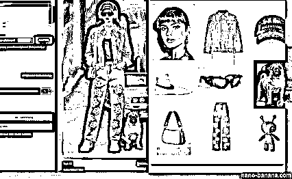

最后，我想真诚感谢这一路帮助过我的人：刘老师、哥飞、熠辉、良辰、MkSaaS 的 fox、牛哥，以及引路人元彻；也谢谢训练营的教练们和所有幕后伙伴。现在说成功还太早，我只是借助别人的积累，看到了更多可能。人工智能还在进化，我也会继续向前走。每个人都有自己的节拍，不用急，踏实把每件事做透，该出现的结果自然会出现。愿还在寻找方向的人，都能早日找到自己的路，一直向前。