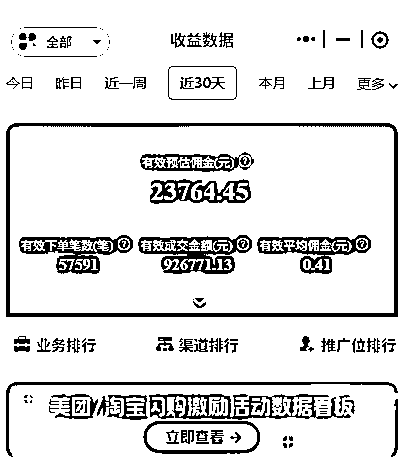
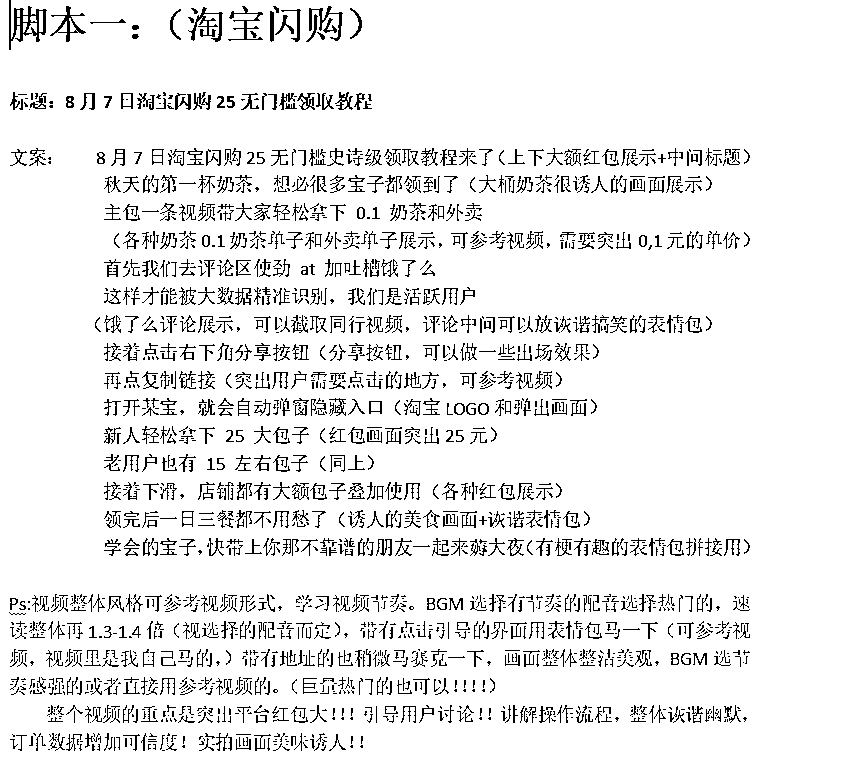
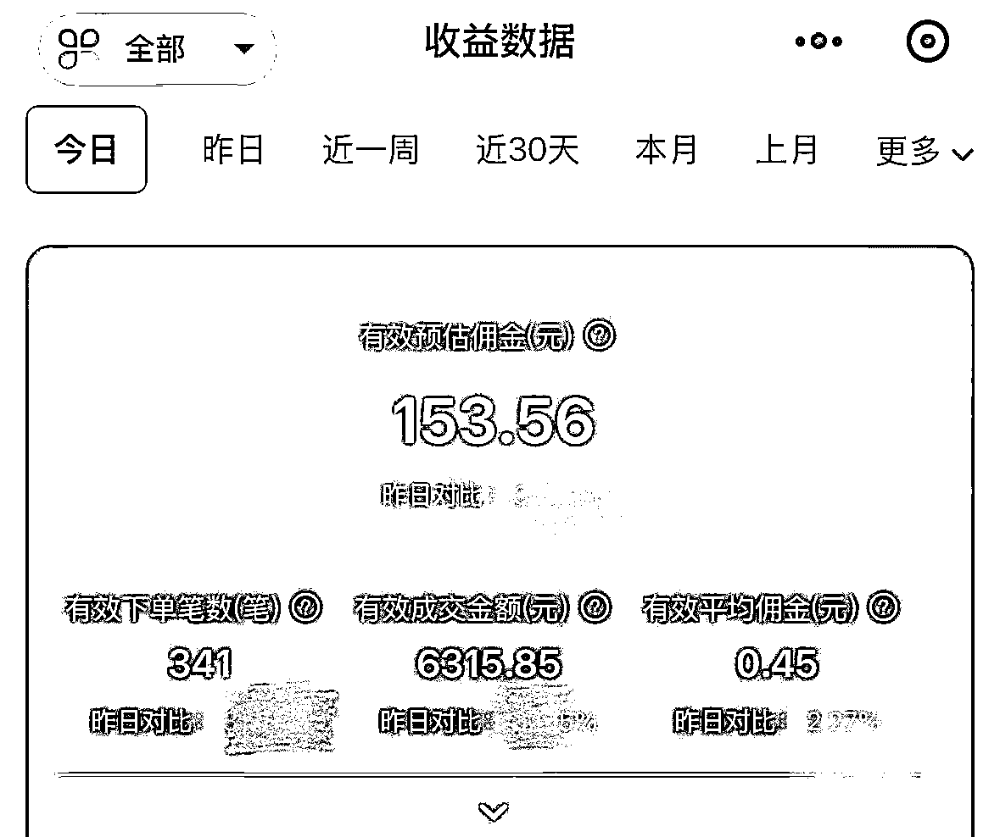
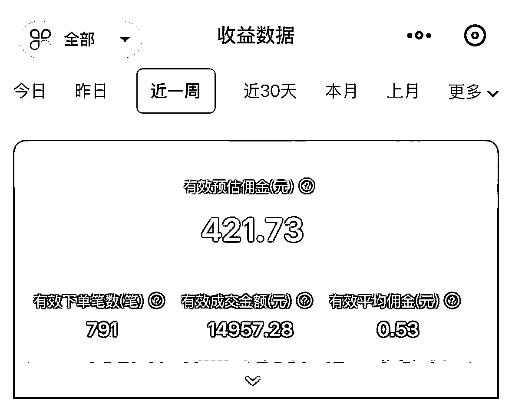
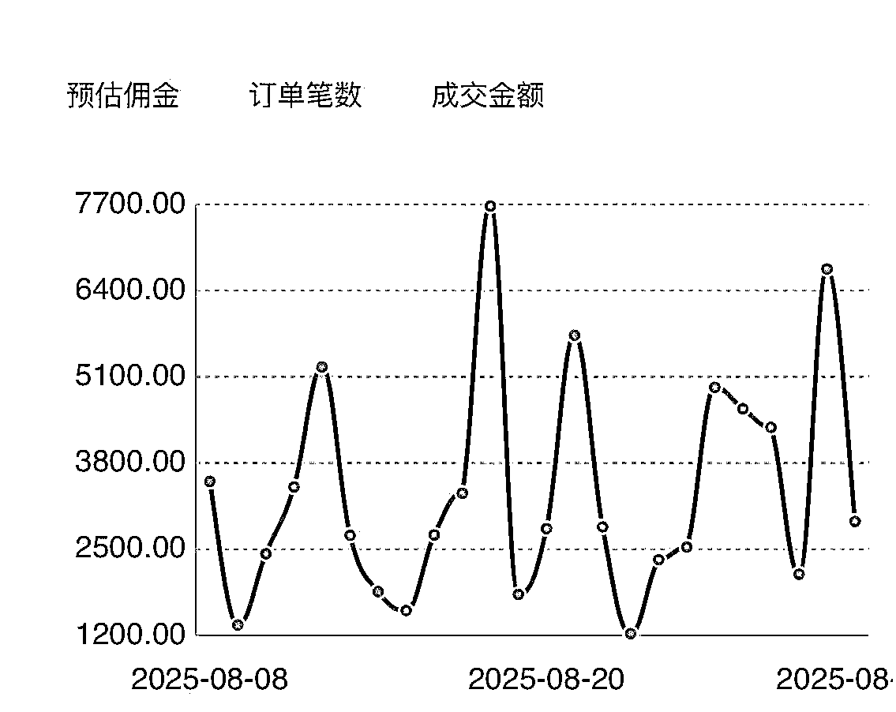
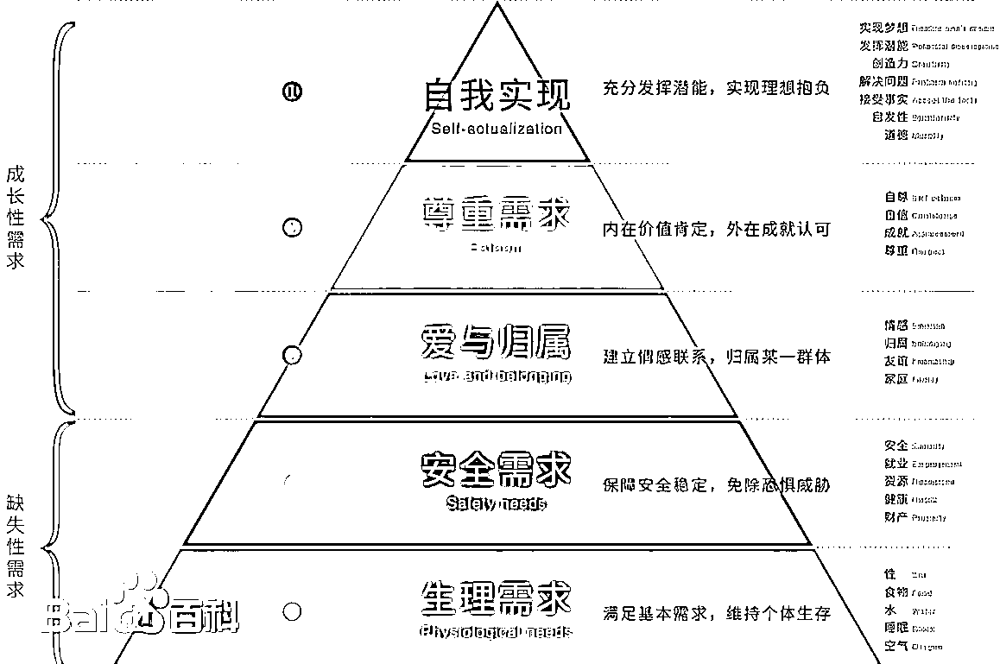
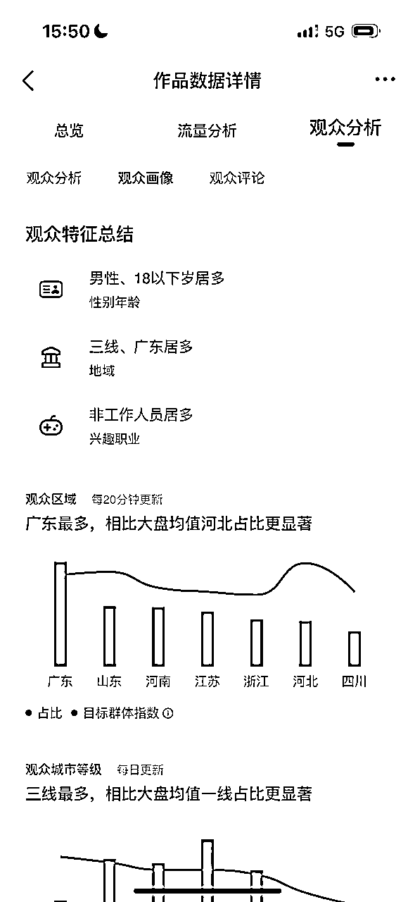

# 辞职5年信息流编导：我如何靠外卖短视频从0做到月销5W单？

> 如果你正迷茫于副业方向，或者想切入外卖CPS赛道，这篇文章值得你耐心读完。

大家好，我是Lesley。今年五六月份才加入赚钱，在此之前，我是个做了整整五年信息流编导的“打工人”。直到某天，我发现自己彻底厌倦了当一个没有感情的脚本输出机器，于是，我裸辞了。

离开职场后，我并没有清晰的规划，只是不想进体制内，也不想再给别人打工。自由职业者那么多，为什么不能多我一个？抱着这样的想法，我加入了赚钱，故事的序幕，也就此拉开。

## 为什么是外卖CPS？

说实话，刚离职那会儿，我整个人是放空的，不知道自己擅长什么，更不知道该选什么方向。正巧这时候，外卖CPS的mini航海启动了，我看中了它的几个特点：受众够广、上手门槛低、变现链路极短，而且可以用短视频引流。想着试试也无妨，就报名了。

结果没想到，这个“试试看”的决定，在第三四天就让我赚到了150块佣金。中间虽然有过一段低迷期，但后来有一天突然爆发——单日订单量突破2W，之后稳定在每天上千单。一个月左右，累计成交量超过了5W单。

接下来，我会把这一个月从0到1的完整操作方法分享出来，希望能给正在做外卖CPS、或者正打算入局的朋友一点参考。

## 冷启动：从一个选择开始

刚开始接触这个项目时，我其实一头雾水。看了航海手册，发现里面更侧重的是直播引流——这对一个超级大i人来说，简直是劝退级别的挑战。但我很快注意到，手册里还提到了其他引流方式，比如抖音、小红书、闲鱼这类公域平台，以及私域运营。

于是我去抖音搜了搜外卖优惠券相关的视频，发现不仅数量多，流量数据也都相当不错。那一刻我就确定了：短视频引流，就是我要走的路。

毕竟，短视频营销算我的老本行。我干脆把这次外卖CPS项目当成一个全新的信息流项目来操盘。第一步，就是找对标。前期刷了大量爆量视频后，我发现大家的风格非常多样，几乎没有同质化的。由于刚入局，我也不清楚目标人群的画像和偏好，索性只要是爆款，就全都模仿一遍。第一天剪了4个视频，4种风格，美团的、淘宝的，全都发在同一个账号上。出单确实很快，但播放量整体并不理想。

一开始，我对发视频的节奏和用户喜好完全没有概念，剪完就发，发了就盯着单量看，这是个很大的误区。后来我开始学会筛选视频、拆解爆款，并寻找它们的共性。我的筛选原则很简单：第一，专挑低粉爆款博主的视频；第二，前5秒必须有能抓住我的钩子。

我总结出了一些规律：那两个爆款视频，几乎都在开头就清晰地标出平台、日期和利益点，用教学式的口吻引导用户操作。内容可复制性非常强，基本不需要换形式，每天改改日期、换换内容素材就行。

后来我又扒了不少爆款脚本，总结出一些视频节奏的规律——靠着这套打法，第三天、第四天赚了150佣金，一周下来有420。

拿到这个成果时还挺开心的，至少完成了航海前立下的“把学费赚回来”的flag。当时看群里大佬日销近1W单、佣金上千，我真的佩服得五体投地。想着自己要是也能那样就好了——结果没想到，转折来得那么快。

## 爆发：一条视频，2W+单

有一天，我的某条视频突然爆了。播放量呈井喷式增长，评论区根本回复不过来。当天单量直接冲到2W+。

我记得很清楚，那段时间正好赶上“秋天第一杯奶茶”的预热期，各大平台优惠力度都不小，流量本来就高。我剪辑了许多诱人的奶茶视频穿插进去，蹭了一波热度，没想到直接引爆了。

有了爆款，剩下的路就好走了。爆款说明这个形式可以跑通。接下来几天，我持续复刻爆款模式，想验证它是运气还是可复制的方法。结果虽然流量高峰过去了，但比新手期好太多，每天能稳定在1000单以上。虽然没有再出现超级大爆款，但每条视频的转发量都能维持在几千。

那个爆款模型，总结下来就是：

带钩子的标题（吸引眼球、话术简单）→ 强调优惠方便好拿 → 引导用户互动 → 展示大额优惠界面 → 引导用户下单

跑通模式后，每天都有大量用户留言。我开始认真分析他们在意的点，并根据这些反馈，持续调整每一支视频的内容。后来我又多开了几个号，同样能够跑出稳定收益。不求一夜暴富，踏踏实实增长就是最好的状态。

用户的反馈大致可以归为三类：
1. 不知道具体怎么操作——这需要在视频里给出非常清晰明确的引导。
2. 觉得外卖贵——那视频里就该反复传递“人人都能白嫖外卖”这样的信息。
3. 想薅大额优惠券的羊毛党——那就从视频第一秒就抛出钩子来吸引他们。

## 底层逻辑：爆款视频背后的四个关键词

如果你问我，视频质量好到底意味着什么？我的答案是：不是画面多精致，也不是剪辑多炫酷，而是你是否打动了用户。

### 1. 信息流广告五要素

这是广告内容的全部构成，以外卖赛道举例：

**谁——传播者**：外卖就是美团、饿了么、京东。传播必须明确广告主，因为这决定了传播的目的和责任。

**说了什么——广告信息**：也就是利益点。这个产品能给用户带来什么好处？越吸引人越夸张越好。

**通过什么渠道——广告媒介**：用户要怎么获得？比如分享链接跳转APP的路径，越简单越好。

**对谁说——目标受众**：羊毛党、学生、宝妈……广告传播总是针对预设的接受者进行的。

**有何效果——反馈**：人人都能0.1元吃外卖、喝奶茶，实现“外卖自由”。反馈是传播、接受、反馈活动的总和。

只要每条视频都尽量贴合这个框架，或者在某个点上做深做透，视频质量就不会差。

### 2. 马斯洛需求层次：穿透用户内心

当你已经拥有成熟的爆量模型后，马斯洛需求层次理论会变成一个非常好用的工具，能大幅提升视频的跑量能力。

它是站在用户角度，从低到高满足需求的序列。我的视频虽然重复度极高，几乎都是从同一个跑量模板里复刻出来的，但每次填充的内容都不同——我会在模板里不断挖掘用户更深层次的需求：占便宜、缺钱但要吃饭、想实现吃饭自由……整体播放量和转发量都保持得不错。

### 3. 用户分析与痛点挖掘

**先看用户画像**：年龄段、性别、地域、职业、教育程度、收入状况……再加上行为特点：兴趣标签、消费心理、消费目的、消费场景。创作时，我们必须清楚视频面向的是谁，他们在什么时间、什么场景下会使用产品——这是提升视频精准度的关键。

**再挖用户痛点**：痛点就是用户未被解决的真实需求，是阻碍目标用户付出行动的最大阻力，比如没钱、肚子饿、想占便宜。在做每个阶段的内容时，都要找到影响用户行为的关键因素：性能（能不能达到效果）、形象（是否符合个人定位）、可靠（有没有风险）、容易（操作是否简单）、价格（花钱多不多）。

**最终做用户分层**：根据用户画像、群体特征和消费心理，把目标人群做分层，再结合场景做对应痛点分析。

我拿自己某个视频的抖音观众数据做过案例拆解：18岁以下偏多（学生党、羊毛党），男性占比较高，二三四线城市为主，收入中等偏下。分层来看：基础属性上，是年龄和地域的区分；消费心理上，图的是便宜、新奇、好玩；消费场景上，可能是刚需饥饿、没钱但嘴馋，或是看到别人0.1元白嫖后的从众心理。

### 4. 从创作者思维到消费者思维

所以，爆款的诞生真的有底层逻辑可循。很多创作者最容易犯的错，就是陷入“自我感动”——辛辛苦苦剪了好几个小时，觉得视频很棒很有心，结果连自己都打动不了，更别说用户了。

正确的姿势是：把自己当消费者。我现在有什么困难（这点需要深度挖掘）？你能给我带来什么？获取方式难不难？我有什么好处？每次创作都过一遍这四个问题，视频质量会显著提升。

当时流量好时，很多同行跑来问我怎么养号、为什么手里的每个号流量都稳定。我说：我不养号。因为我根本不懂。

我只是遵循底层逻辑在做创作。创作精力是有限的，与其同时铺很多号每天狂发视频，不如先把一个爆款模型吃透，再去新号上复刻——这个方法轻松得多，也有效得多。

## 不得不说的现状：红利期已经过去

如果你现在才想入局外卖CPS短视频，你需要知道这几件事：

1. 大环境变差了。外卖大战热度正在退去，平台补贴在收缩，用户的新鲜感和兴趣也在消退。
2. 9月份视频起量明显变难，爆款产出难度显著增高。
3. 同行恶性竞争严重，而且没有好的应对办法。

这一点尤其让人头疼。常见的套路包括：批量多账号恶意举报起量视频导致被下架；恶意搬运个人作品导致难以跑量；恶意刷赞导致账号断流。我还遇到过视频微微起量就被举报侵权下架的困境，申诉基本无效，账号权重还会被越拉越低，现在播放量都掉到几百一两千了。

做短视频引流，本质上就是“搞钱就是搞流量”。但短视频流量天然不稳定，落差极大。8月整体还好，只要发视频，观看量就不会低于一万，转发也是上千的。到了9月，因为平台环境和同行竞争的双重夹击，我开始面对要么没量、要么起量就被黑的尴尬局面。

## 我的心态：每一步都算数

说实话，每个项目都有低谷期。从8月的稳定到9月的断崖式下跌，说没焦虑是假的。但我的心态调整是：保持在场。哪怕现在赛道难做，但它不是不能做。外卖CPS它本身受众广、变现短的优势依然还在。而后续的即时零售也还有很大的市场空间——只有待在牌桌上，才能等到下一波爆发。

回头看整个月的变化，我有一个特别深的感受：**人是永远赚不到认知以外的钱的。**

刚加入赚钱时，我看大佬们的分享，感觉像在读薛定谔理论，看不懂。6月大航海开航时，我随大流报了《赚钱宝典》共读和小红书虚拟资料。结果每天麻木地跟着手册操作打卡，到了结营也没做出成绩。后来反思：小红书虚拟资料确实好，但我根本不常用小红书；而且那个虚拟产品赛道，我既不了解也不感兴趣。前期没有反馈，自然没有动力继续。

而外卖CPS之所以能成，核心原因就在于——它适合我。短视频引流是我之前天天在做的事，每一步我大概知道怎么操作，也知道怎么试错。因为过去的工作积累，我具备筛选优质视频的能力，所以能很快拿到正向反馈。

所以我特别想对还在迷茫中的朋友说：**选赛道，一定要选适合自己的、或者真正感兴趣的。** 正向反馈永远是驱动你做下去的最好动力。如果你现在还没拿到成果，不妨静下心读读《赚钱宝典》——当初的我嗤之以鼻，如今的我如数家珍。

最后，真心感谢赚钱这个平台，它让我看到，个人不依托公司也可以创造价值，一个人同样能撬动很大的杠杆。感谢航海教练、领队、志愿者们的帮助。愿我的这段经历，能给你带来哪怕一点启发——那就很值了。