# 首条笔记即变现，📕小白也能用的 Coze/N8N 仿写自动化教程
作者：龙哥


最近在做👸号二创自动化时忽然想到，文字能做洗稿，那配图能不能也做同款？

恰逢 Nano banana 以及国内豆包 4.0 的图一致性编辑能力得到明显强化，局部改动和整体保持都能做到。于是我把思路落到了📕笔记的仿制流程上：用户只丢一个对标笔记的链接，整条链路就会自动拆解、重写文案、重绘图片并存入飞书表格。

对图文结构的临摹兼容度很高，尤其是电商带货和虚拟资料售卖这两个方向，基本都能直接套用。

如果你也在经营📕，并且目前处于模仿学习阶段，这套工作流可以帮助你加速上手。我亲自验证过：新号的首条带转化笔记发出后获得 3 条询盘并成交 1 单，实际呈现效果如下。

## 效果展示

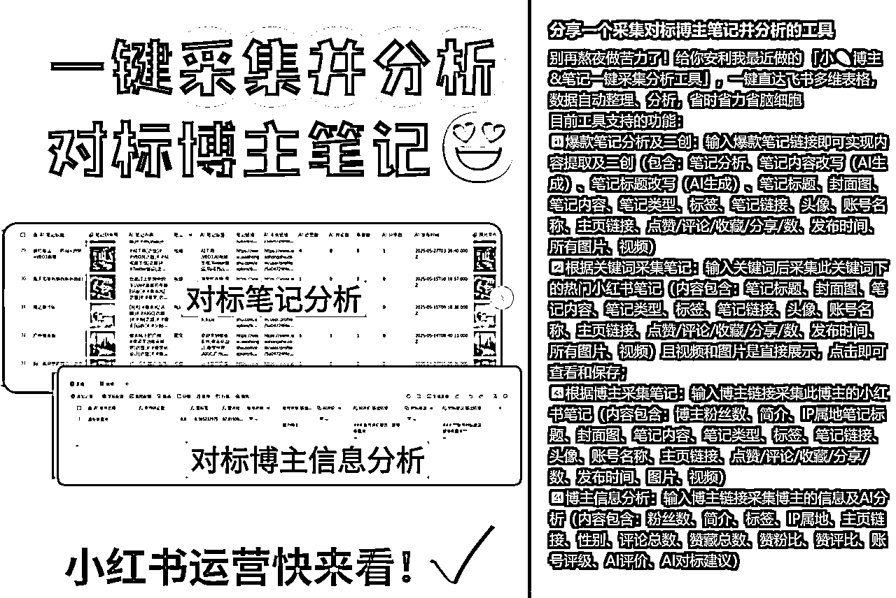

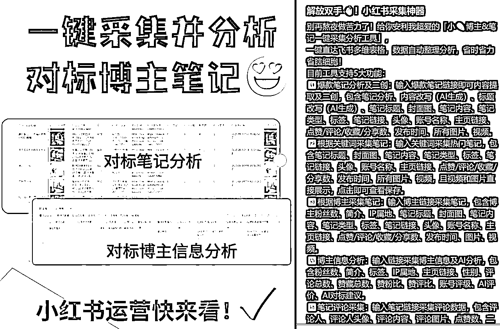

主要调整了画面色调、场景布置、版式细节以及表情符号的使用，而原文传递的核心意思和文字表达基本维持。调参的幅度可以通过提示词来控制。

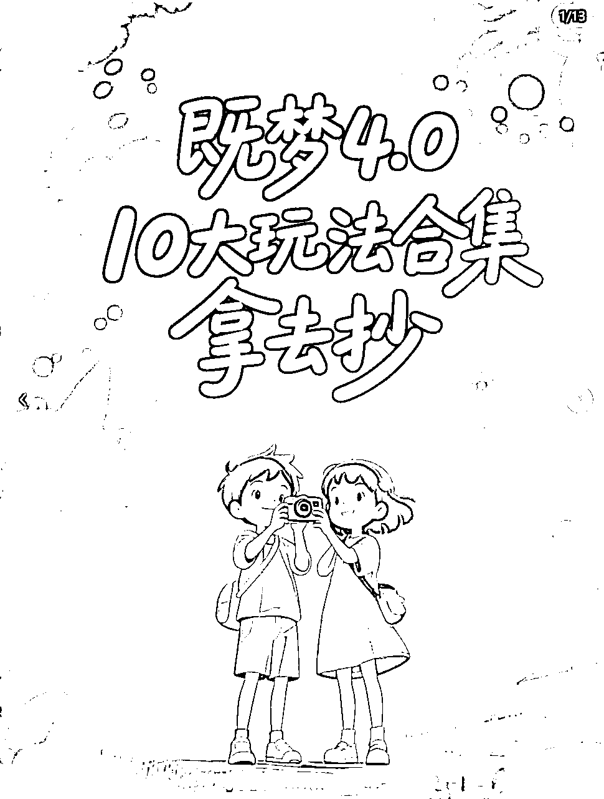


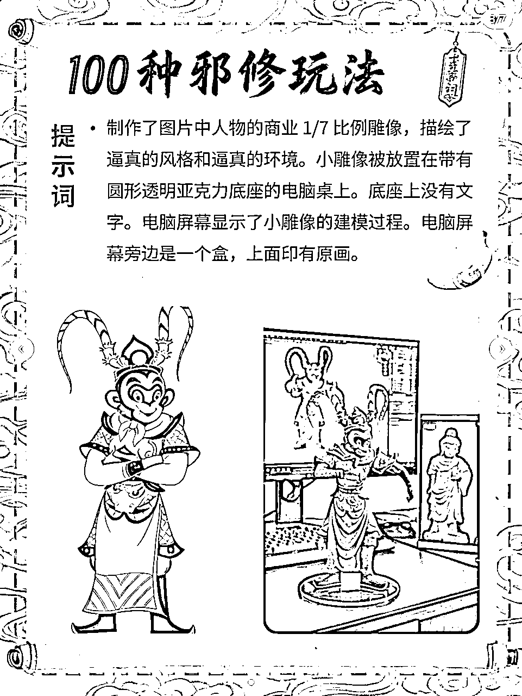

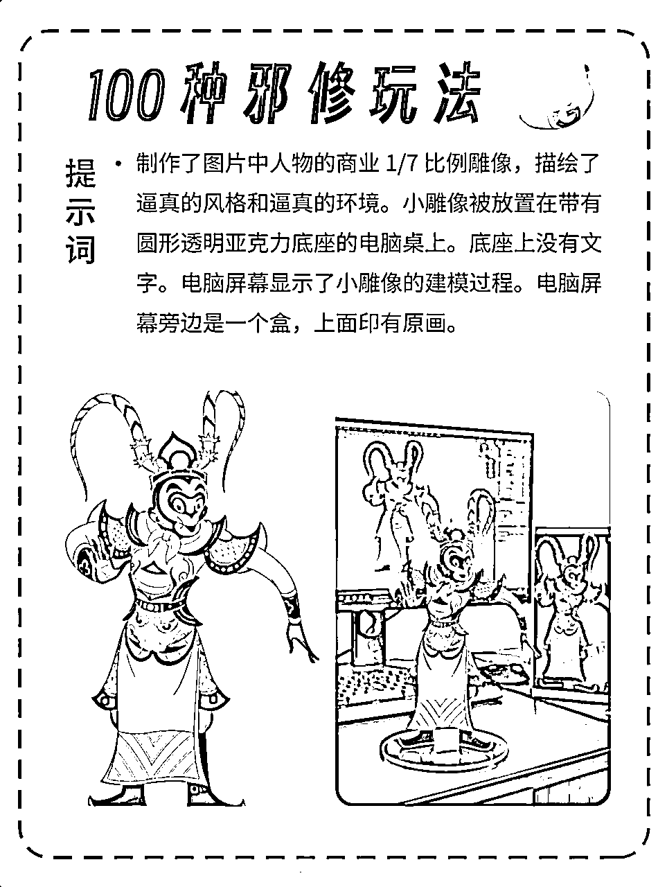

即便画面元素很复杂，仿制后的质感依然稳定。比如下面这张，背景、字体、孙悟空的造型与配色都换了，整体风格却保持统一。

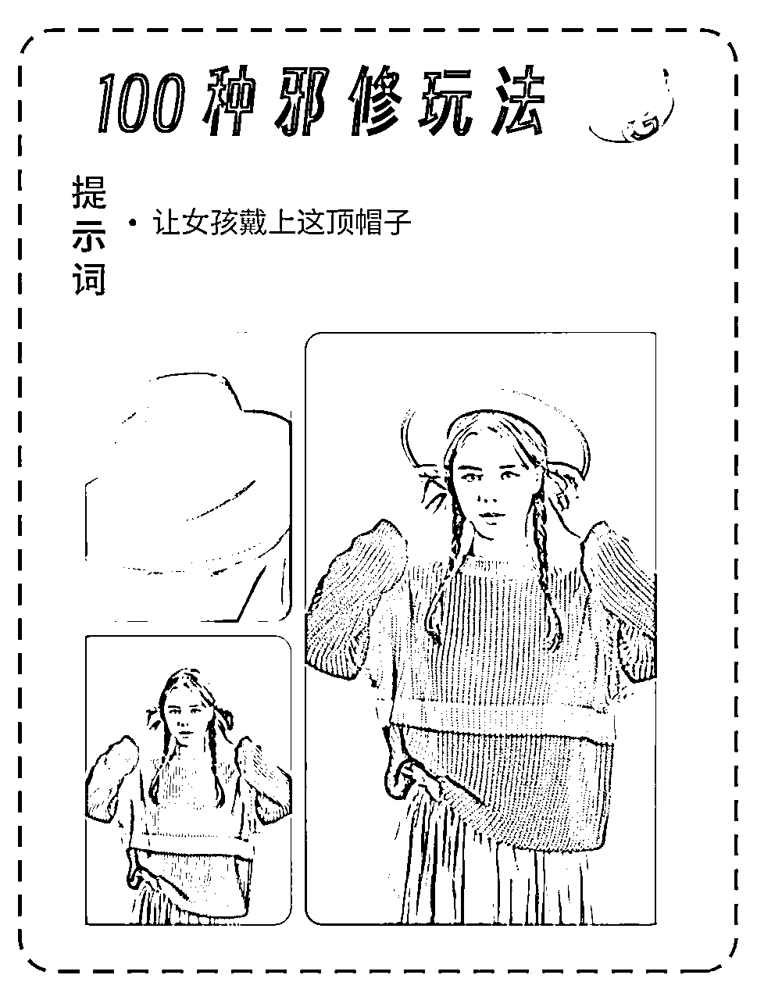

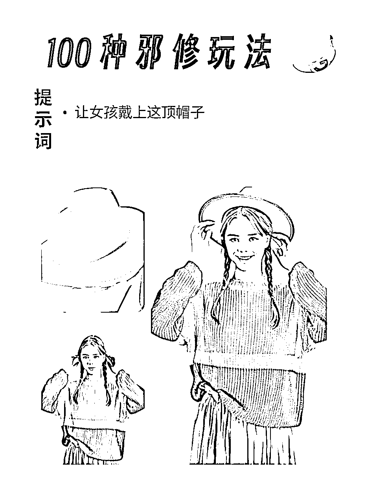

画面里出现人物或动物时，动作和表情也会被同步改写，区分度更强。

## 流程拆解

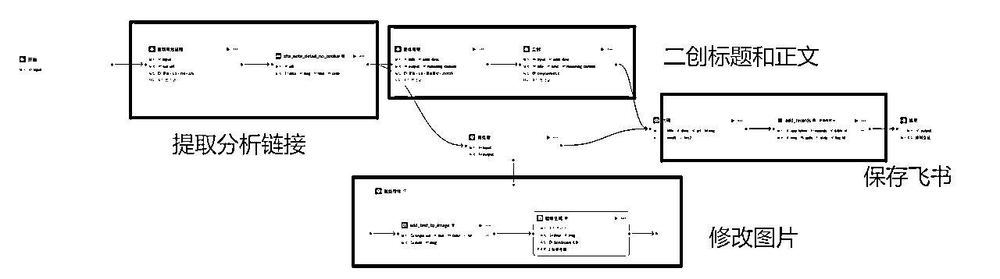

整体思路不复杂，共 4 个环节：链接清洗 → 内容提取 → 大模型重写标题正文 → 图片重绘 → 数据汇总 → 飞书归档。

### 1、链接获取与解析

先对链接做净化，复制过来的📕地址通常带有冗余参数，需要提纯成纯净链接：

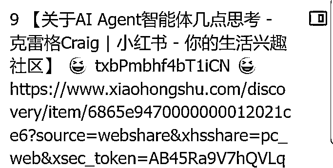

这类简单清洗用 1.5 版本模型就够用了：

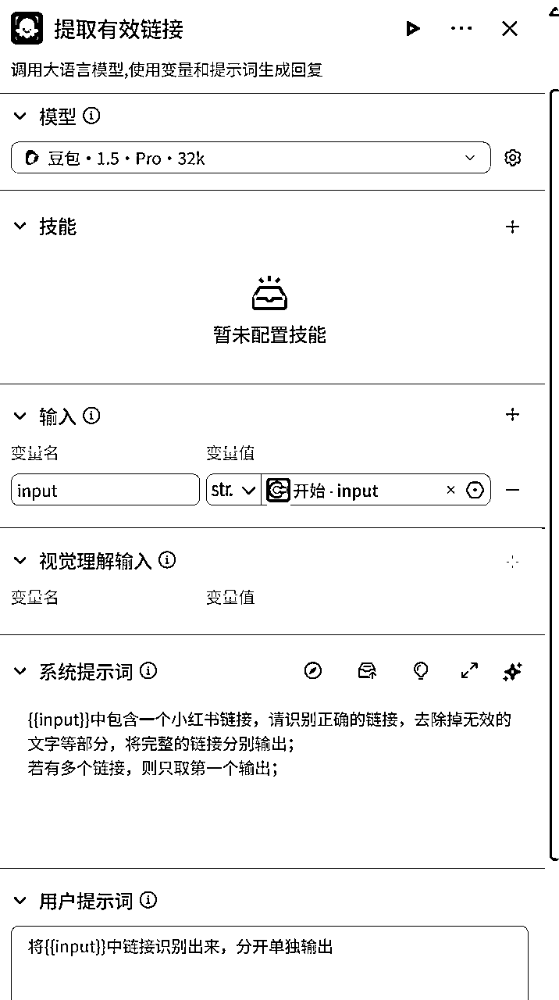

随后调用📕链接解析插件来获取详情。先在插件市场搜索：

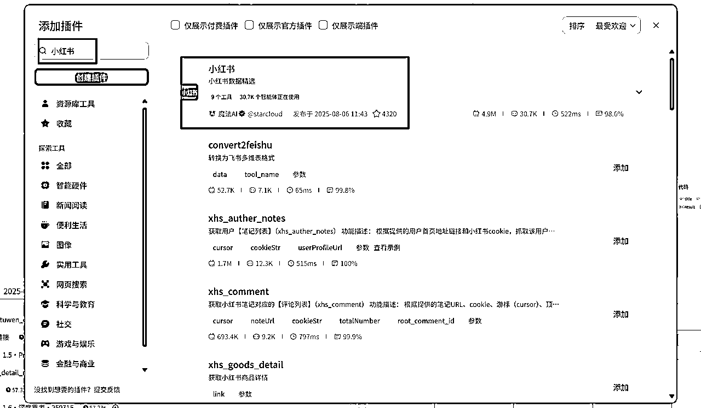

下拉找到对应工具：

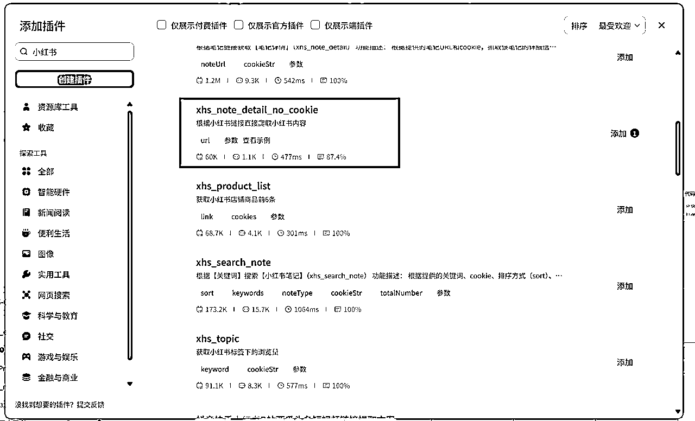

输入链接后即可返回话题标签、笔记文案、标题以及原图地址等信息：

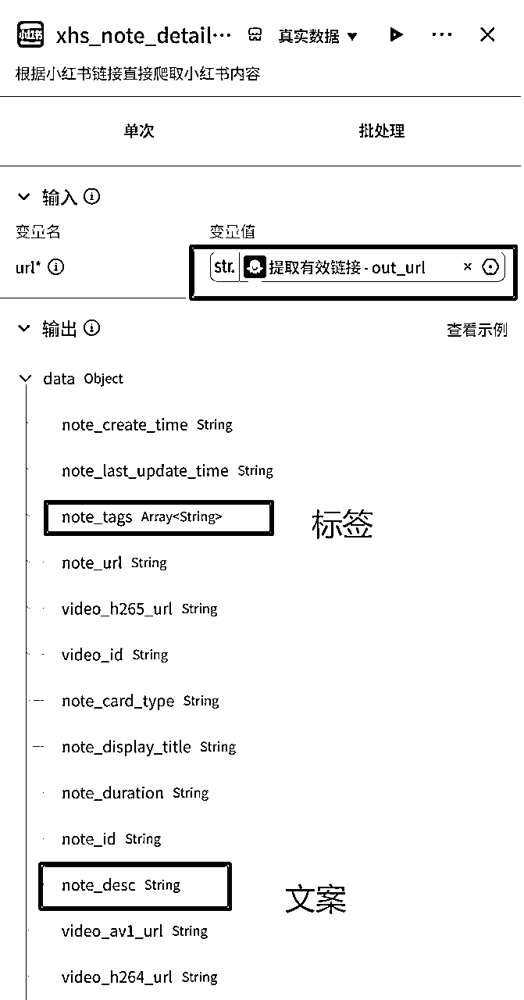

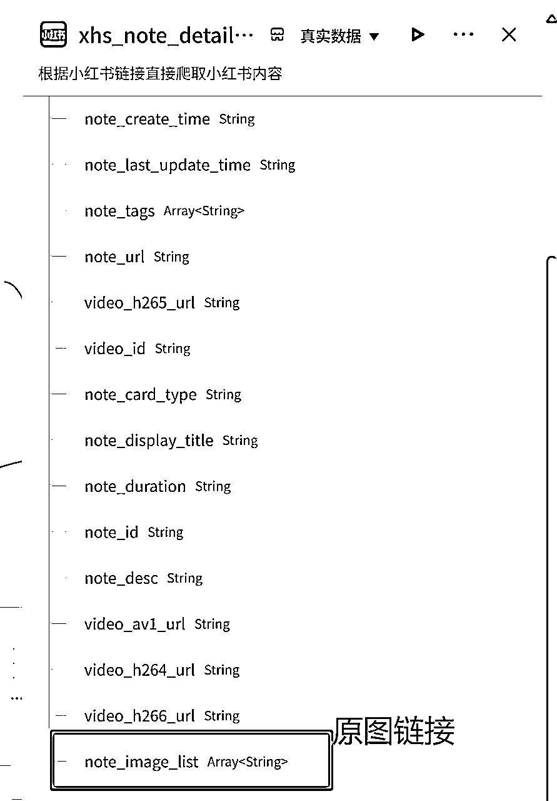

### 2、标题正文再创作

#### 第一步：框架提取

选用 1.6 版本模型，将上一步的 title 和 note_desc 直接作为输入：

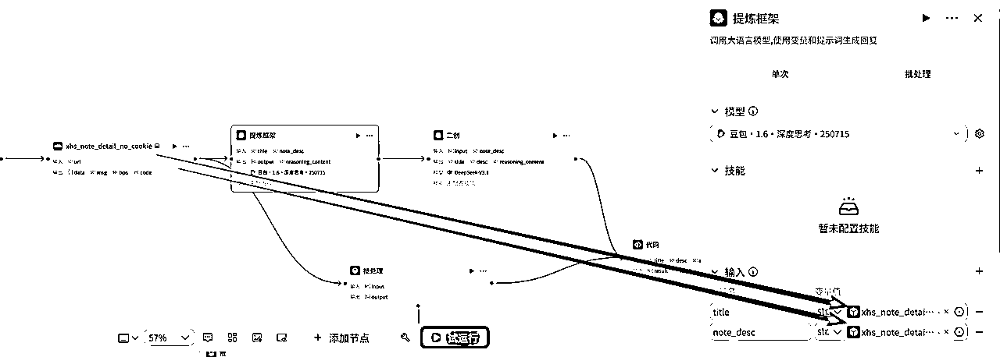

框架抽取的提示词：

# 角色

你是一位专业的📕内容分析师。

# 背景

在输入中包括📕标题{{title}}、正文文案和标签内容{{note_desc}}；(其中带“#”的是标签)

# 核心任务

你的核心任务是：提炼出该笔记的标题写法结构，以及内容的风格和框架；

#特殊情况

分析内容中，如果没有找到标题、正文文案、标签，则跳过处理，对应字段输出为空即可；

# 输出要求

1.  标题结构：提炼标题框架的维度大概从以下几点出发去分析，没有的维度不用删除，主要目的是讲清楚这个标题怎么写，有哪些特点：

人群+痛点+emoji图标+情感词（如：哇！、可怕！等）+符号（|、！、~等）

注意：不用重复输出原标题的内容

1.  正文结构：包括以下维度来分析：

正文主题内容摘要：....；

正文行文框架：....；

正文行文风格：....；（包括文风、语气词、符号运用、图标emoji应用等）

要求尽可能详细，内容部分与原文相似度60%，风格和框架与原文相似度90%；

1.  核心信息提炼：从正文中提炼出内容中的核心信息点，分点输出；

1.  字数：原文案中，不算标签内容，标题+文案的总字数（输出纯数字即可）

1.  标签：识别并输出原文中的标签内容。不要修改直接输出即可；

1.  格式化输出：请严格按照以下格式样例输出，以确保内容清晰：

"这是标题结构",

"这是正文结构",

"1.这是信息点1。2.这是信息点2...",

"这是字数",

"这是标签"

#### 第二步：生成新内容

第二步基于刚才抽取出的框架，结合原文作为风格参考进行二次创作。引用对象为框架与原始文案：

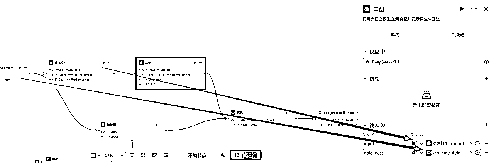

提示词如下：

# 角色

你是一位顶级的📕运营专家，精通📕文案风格和写法；

# 核心任务

你的核心任务是：接收我提供的{{input}}，其中有包括[标题框架]、[正文框架]、[正文信息要点]等，来写一篇📕文案以及标题，文案中需包括【正文内容的核心内容点】中其中的信息点，最后创作一篇标题、正文文案字数不超过原字数；

# 写作风格参考范例

为了让你更精准地理解我想要的写作风格，请仔细学习以下范例：

原文范例：{{note_desc}}

* * *

# 最终输出格式

你的最终输出**必须是**一篇完整的、纯净的 **Markdown 格式**笔记正文和标题，其中正文结尾包括了标签，标题也是一句话不超过20字符；正文多用换行。格式如下：

"这是文案标题"，

"这是正文内容。#...#..."

注意：

标签的格式需要处理，均为“#”加上标签名，再无其他后缀，例如：#标签1 #标签2

### 3、图片重绘

一篇笔记往往包含多张图片，所以需要批量处理，这里直接引用解析节点中的图片链接字段即可，先搭建批量结构：

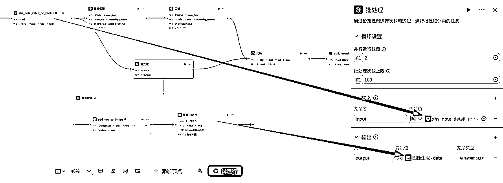

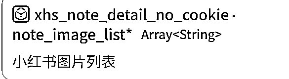

批量内部共两个节点，第二个为图像生成节点。需要注意，图像生成节点要求的输入类型为 image，而原始图片链接为 string，因此先用一个加水印插件做格式转换：

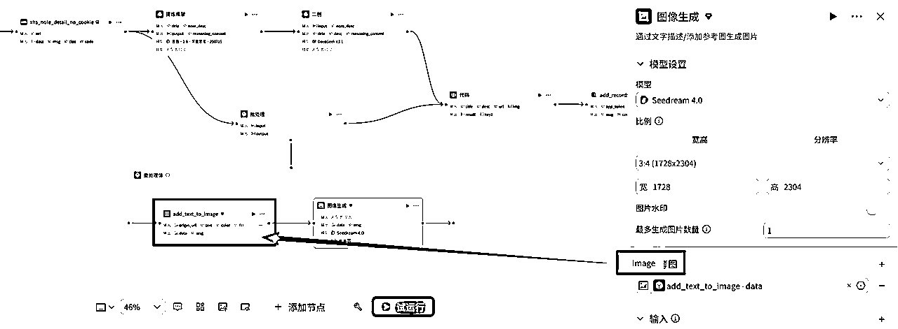

#### 第一步：链接格式转换

在插件市场搜索“添加文字”：

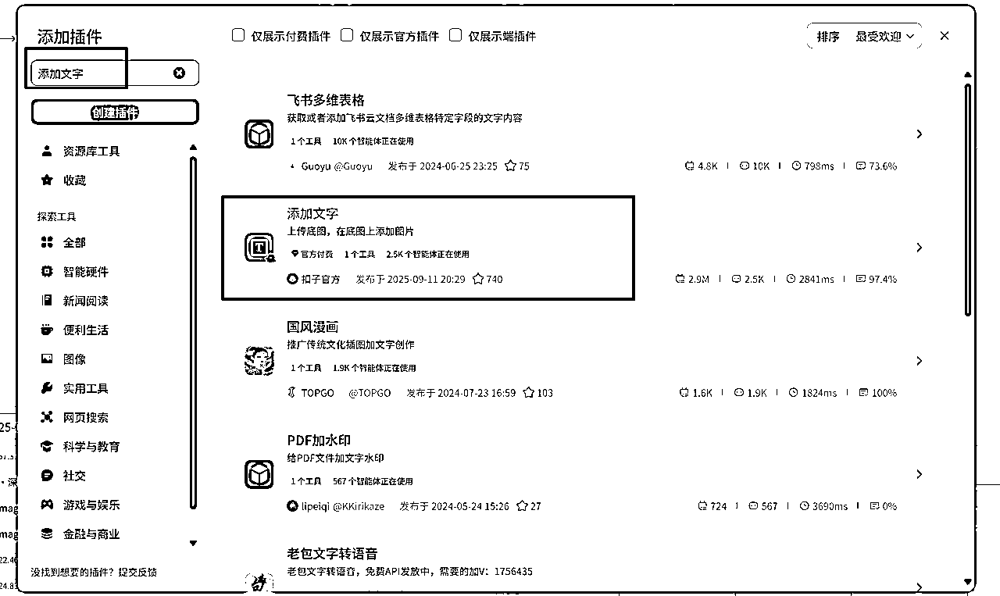

填入解析出的原图链接：

（该插件本意是加水印，此处只输入一个空格作为占位，不影响画面，仅为了把链接转为 Image 类型）

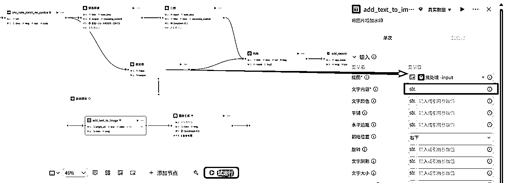

#### 第二步：图生图

图像生成节点使用 seedream4.0，比例设为 3:4，数量 1，参考图引用上一步结果，再输入提示词即可：

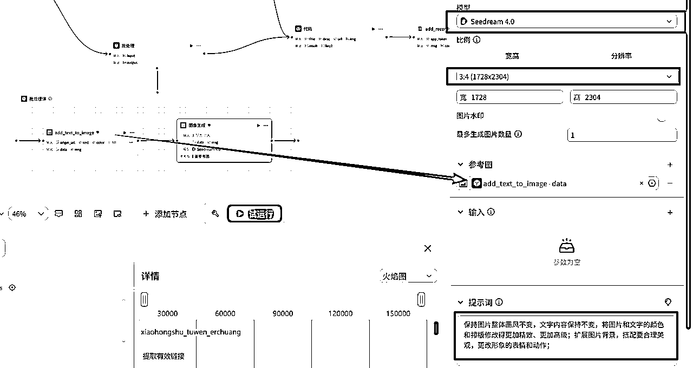

### 4、写入飞书

#### 第一步：数据结构化

代码节点的目的是汇总生成的标题、文案和图片，并生成飞书多维表格 add_records 插件所需的输入格式。

查看飞书写入接口的字段要求，插件接受 object 数组，因此需要用代码节点处理数据。

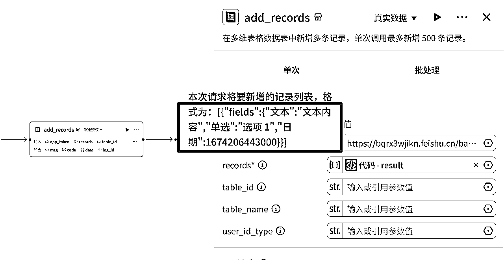

输入引用生成的标题、文案、原链接和图片，输出类型改为 Array：

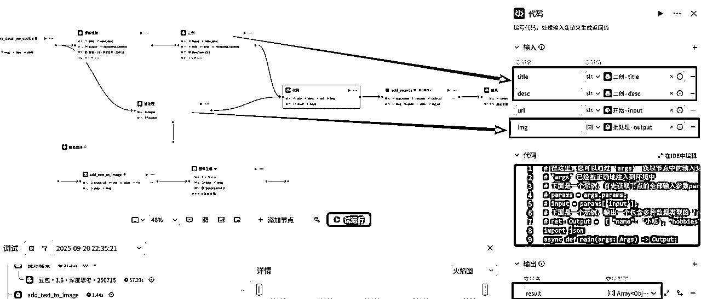

代码可让模型生成，这里提示词也一并分享：

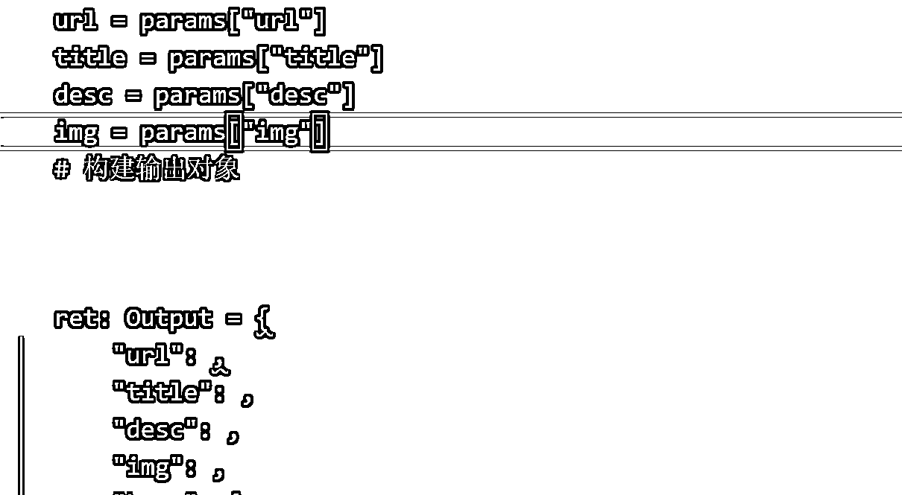

上图代码涉及四个变量，img 为字符串数组，其余为字符串。先将 img 数组拼接成 imgString，换行分隔。然后把四个变量写入 result，格式为 obj 数组：

[{"fields":{"原文链接":url,"标题":title,"正文和标签":desc,"图片链接":imgString}}]

帮我写这个代码

代码：

```
import json
async def main(args: Args) -> Output:
    params = args.params
    url = params["url"]
    title = params["title"]
    desc = params["desc"]
    img = params["img"]
    # 构建输出对象

    # 将 img 数组的所有元素用换行符拼接为一个字符串
    imgString = "\n".join(img)

  # 构建目标格式的结构
    result_list = [
        {
            "fields": {
                "原文链接": url,
                "标题": title,
                "正文和标签": desc,
                "图片链接": imgString
            }
        }
    ]

    ret: Output = {
        "result": result_list, 
        "key2": { 
            "key21": "hi"
        },
    }
    return ret
```

#### 第二步：保存到飞书

最后找到飞书多维表格的 add_records 插件：

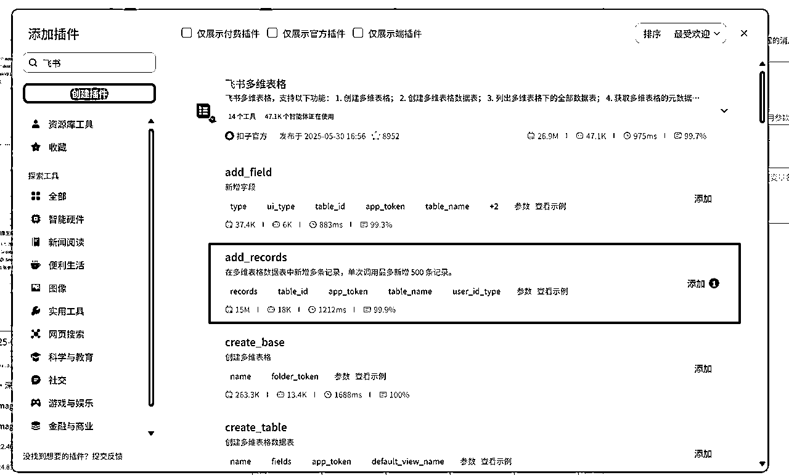

插件需要先授权，绑定你的飞书账号：

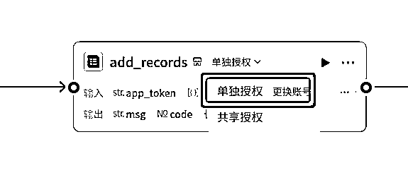

在飞书新建一个多维表格，复制表格地址链接：

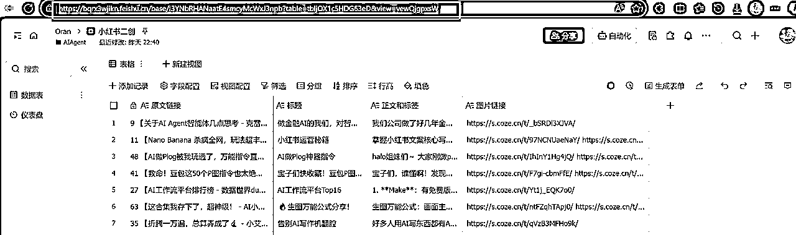

将链接填入 token 字段，records 引用上一步结果：

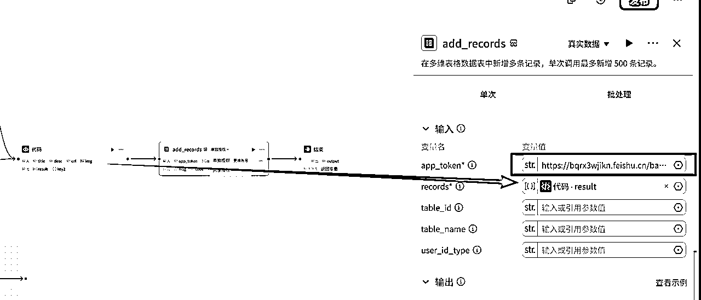

结束节点可选择输出代码节点结果，也可以输出飞书链接，结果主体在飞书表格中查看。

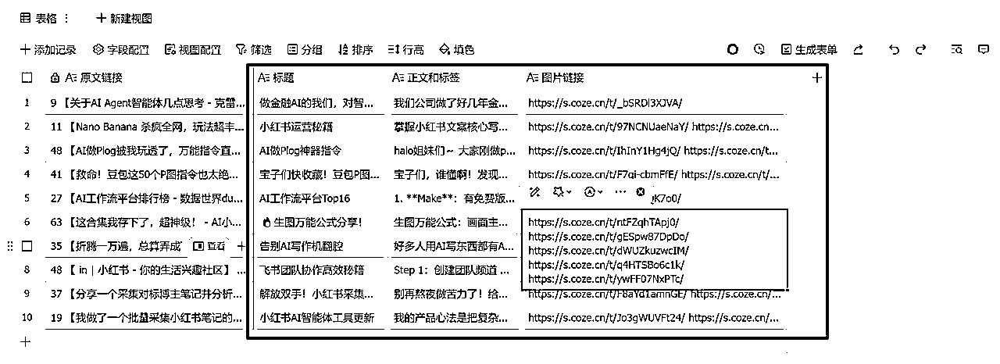

最终生成的标签会直接跟在正文后，方便复制发布。图片批量下载可用工具：https://imagedownloader.online/zh-cn/

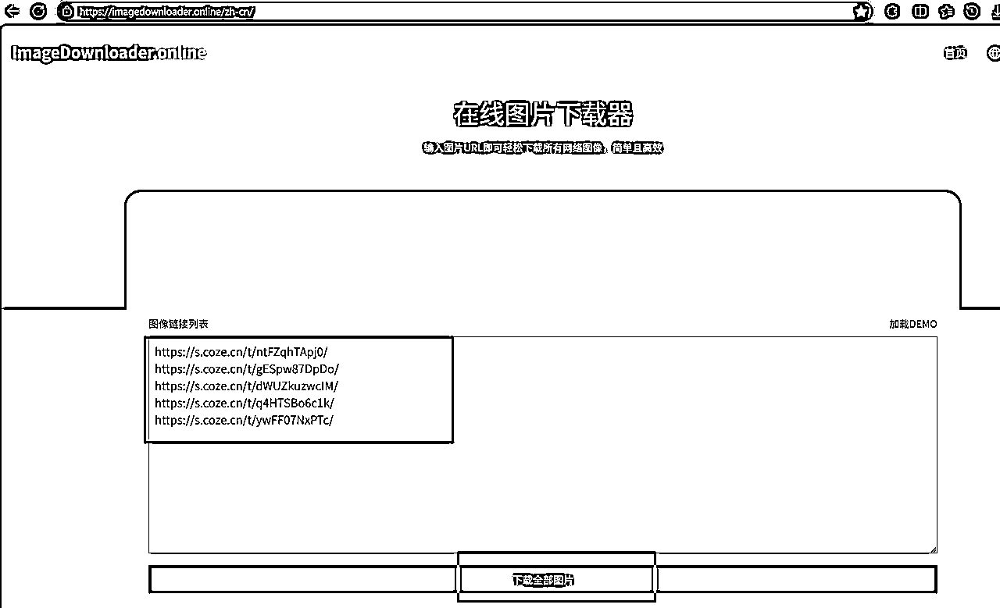

## N8N 版本

若希望实现表格自动触发生成内容，或接入海外大模型，可用 N8N 搭建，整体思路类似，只需多加一条生图分支。可参考航海手册。

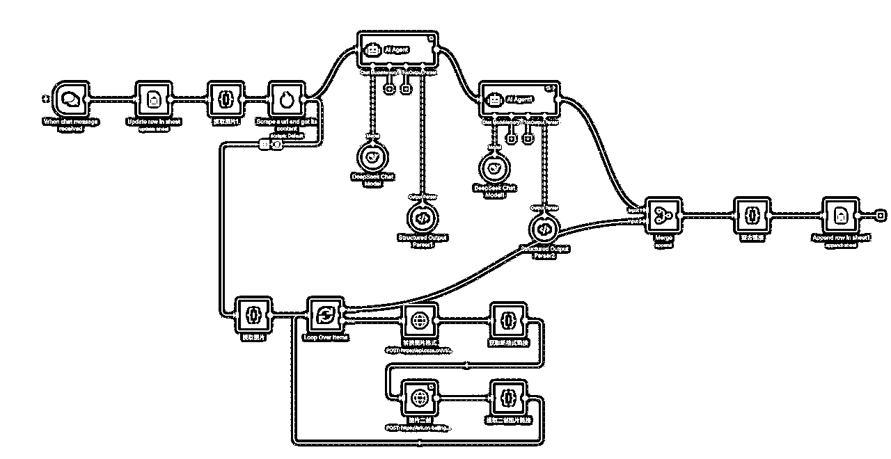

## 结语

### 1、不足

目前图片改写仍不够完善。画面中若包含大量文字，现有生图模型只能修改字体或颜色，无法直接更改文字内容，还需等待模型迭代。

### 2、如何批量做原创？

以上工作流主要面向模仿二创。但即便做原创，也需要测试选题和主图模板。此时可以利用 Nano banana 或豆包 4.0 对原创素材进行模板化改造。

搭建框架与本篇类似，只是参数和提示词不同，有需要可再沟通细化。