# 一年从“普通打工人”到带出200亿播放：YouTube AI出海，到底还有多少机会？
作者：龙哥

在龙哥盟航海家AI大会的舞台上，最后一位分享者Gary上台前紧张了一整天。他开玩笑说，上一次站上这么大的舞台，还是在中国好声音节目里唱歌。而今天他要讲的，不是音乐，而是一个关于YouTube、AI视频和“普通人逆天改命”的真实故事。

他说，今天要讲三件事：第一，帮大家看清YouTube这个平台到底值不值得重仓；第二，把他团队沉淀下来的一套AI视频爆款方法论讲透；第三，聊聊自己的人生转折。前两件事是重点。

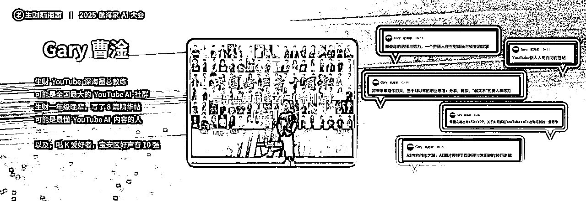

一年前的他，还是那个自称“普通到甚至有点失败的打工人”。加入赚钱刚满一年，是什么让他看起来像是“逆天改命”？他把答案藏在一个比喻里——《凡人修仙传》韩立的那只“小绿瓶”。

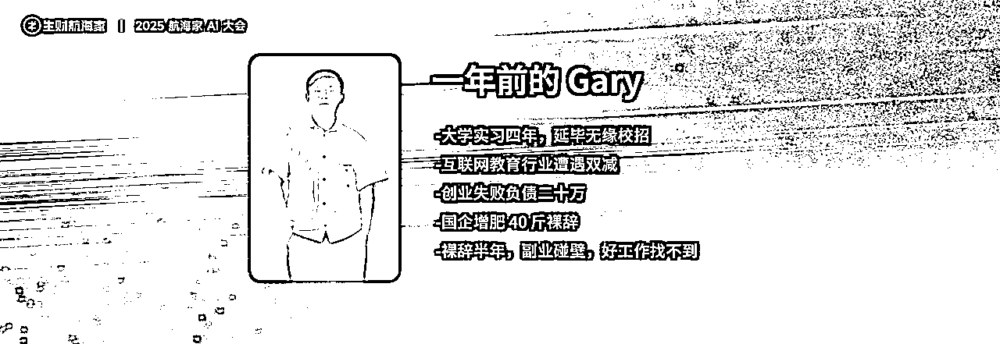
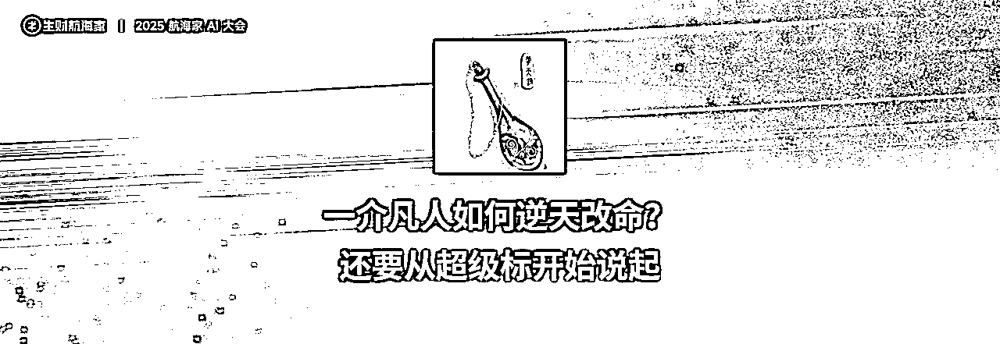

他是在10月25号加入赚钱航海的，巧的是前一天龙哥刚提出“超级个体”这个概念。当时他的真实疑问是：一个既不懂YouTube、也没接触过AI的人，能把这件事做成吗？如今站在台上，他把答案拆成了四个字：体量、收益、门槛、增量——每一项前面，都可以加一个“超”。

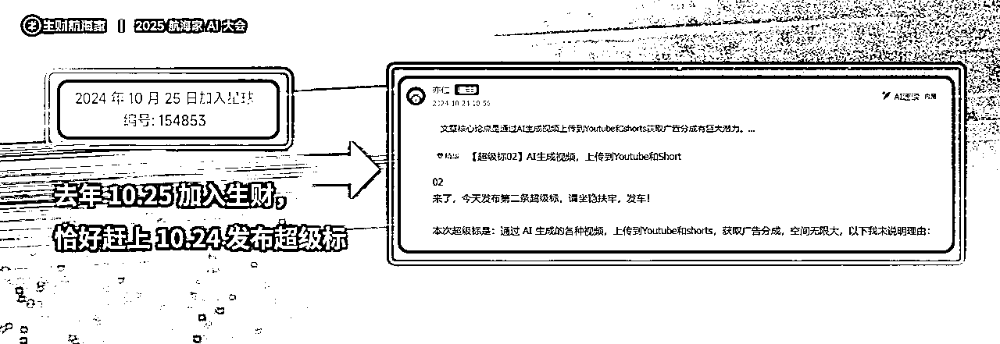
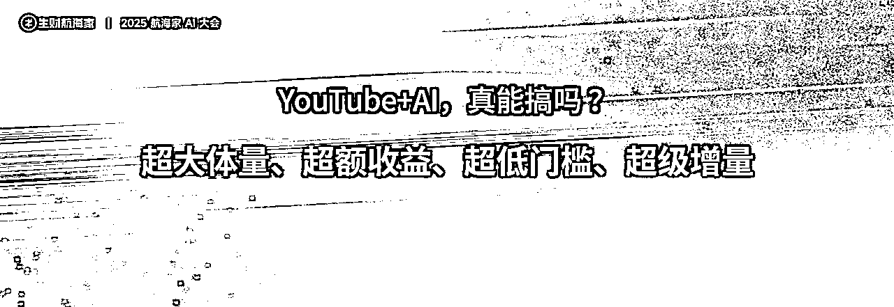

先说超大体量。YouTube以27亿月活排在全球视频平台的第一名，TikTok和抖音加在一起大约20亿，依然差了几个身位。广告收入上，YouTube去年做到了361亿美元，比TikTok高出1.5倍。

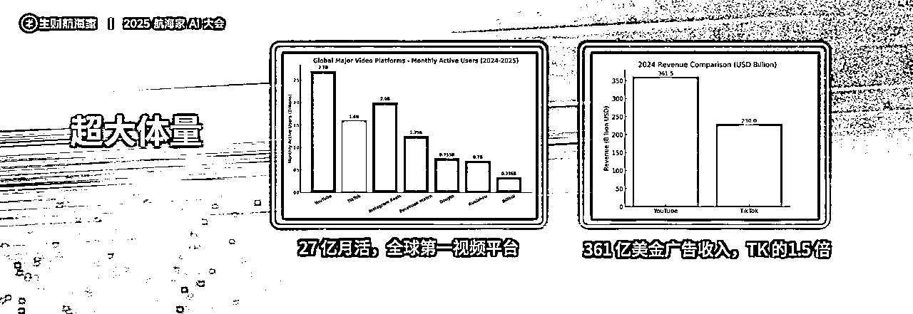

再说超级增量。现在到YouTube搜“猫”或“狗”这类常年霸榜的关键词，按月度播放排序，你会看到前排几乎全是AI生成的视频，真猫真狗反而被挤下去了。AI正在一步一步吃掉视频平台的内容供给，未来AI生成的内容占比可能超过一半，甚至还会继续扩大。但有意思的是，🛰️指数里“油管”的热度只有“TikTok”的十分之一左右，跟“跨境电商”相比更是低到可以忽略。国内没人讨论，平台体量又足够大，这就是典型的渠道级机会。

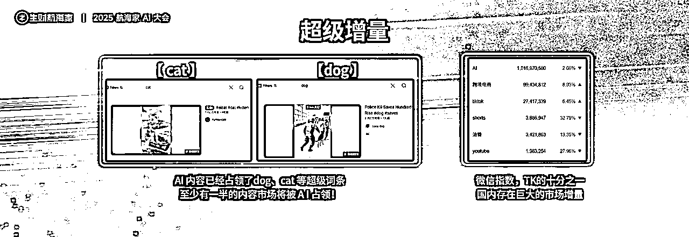
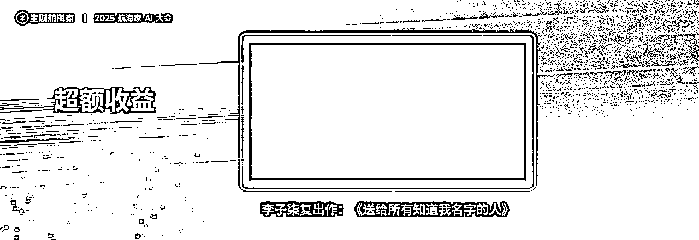

第三个是超额收益。全球主流平台里，只有YouTube把广告分成规则写到了明面上：大约55%的广告收入直接归创作者，而且这个机制已经稳定运行了十几年。用李子柒复出那条视频来对比：B站3200万播放，创作激励大概3.2万元人民币；YouTube上2600万播放，广告分成保守估计5.2万美金。同样一条内容，YouTube的回报大约是B站的11倍。

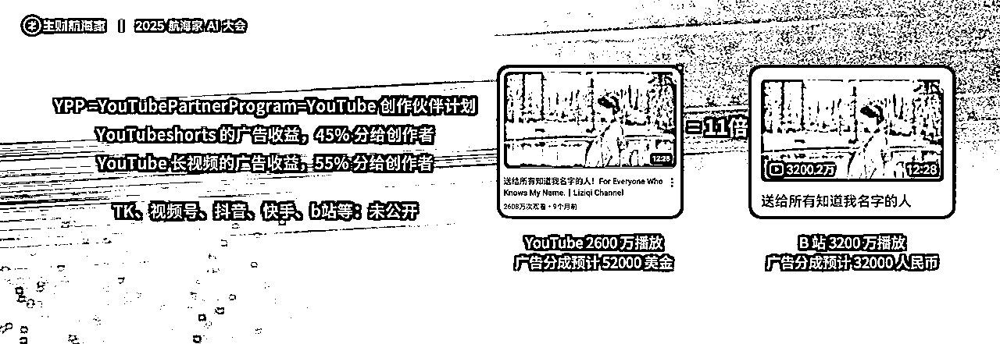

第四个是超低门槛。很多人的印象里，YouTube还是那个以中长视频为主、内容必须精良的“传统平台”，但现实是，大量粗糙的AI视频正在霸榜。今年8月有一条简单到离谱的短视频，拿下YouTube短视频总榜第一，5.6亿播放，制作可能只需要5秒钟，广告分成保守估计超过3000美金。另一条AI MV更夸张，没设计什么剧情，也没有字幕和复杂动作，却能登顶半年榜，1.4亿播放，广告分成14万美金，差不多一百万人民币。

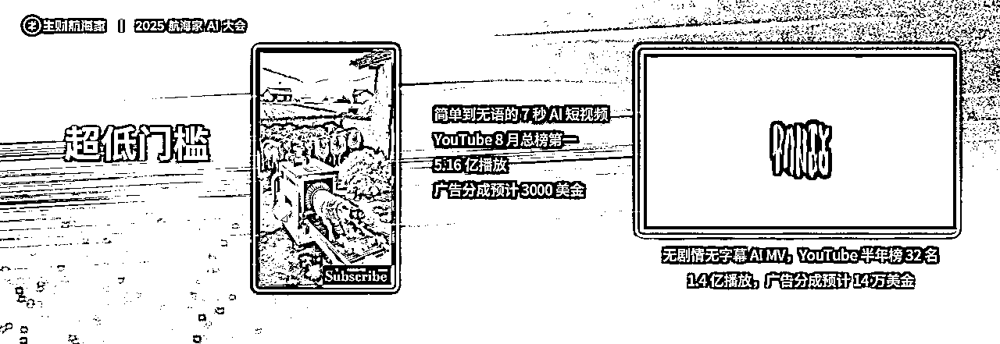

到这你可能会问：普通人真能复制吗？刘小排老师在今年330航海家大会上说过一句流传很广的话：“顶级蓝海，就是满级大佬屠杀新手村。”Gary本人就是活案例：零短视频运营经验，11月8号发出第一条AI视频，11月19号就做出第一条千万播放爆款，换来约1200美金的收益。他当时的第一反应不是狂喜，而是奇怪：这么容易的吗？

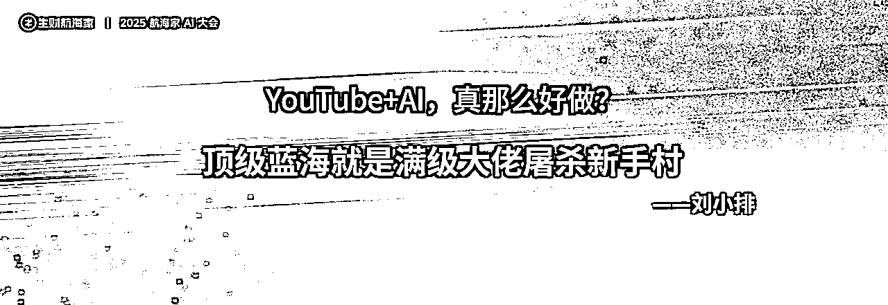
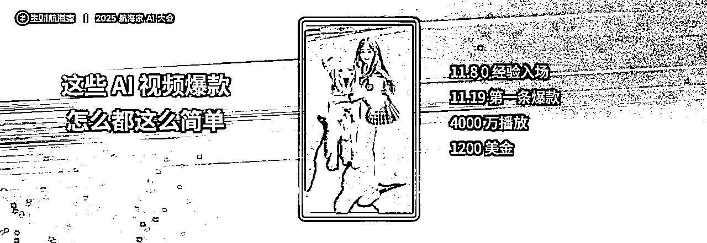

在他看来，从0到1做出一条爆款，这件事简单到不太值得专门开一场分享——航海手册和精华帖里已经有大量教学。真正值得讲的，是怎么从1做到100：也就是做出1000个爆款。如果按一条爆款200美金来算，1000条就是20万美金；他所在的团队此前问卷统计的总收益已经超过40万美金，等于跑通了1000个以上爆款的量产模型，这才叫有资格讲方法论。

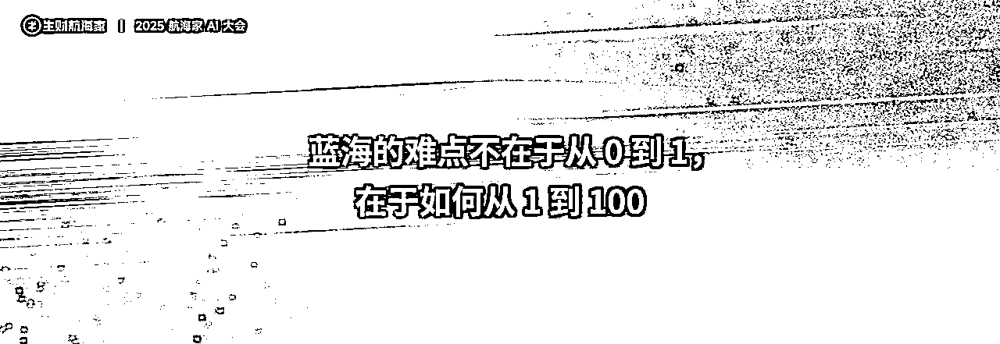
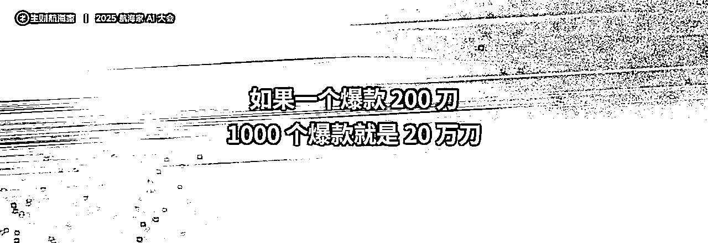

量产爆款的公式并不复杂：爆款=好形式×好脚本。谈恋爱靠的是看得顺眼的外表和聊得来的内在，做视频也一样——形式负责让人点进来，脚本负责让人看完。把40种被验证过的形式，乘以25个优秀脚本，就能得到1000条具备爆款潜质的视频。

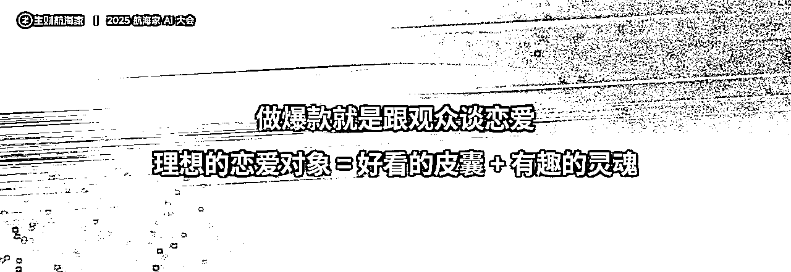
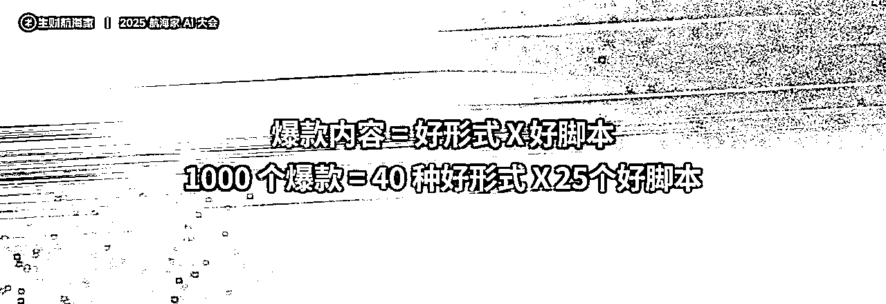

“好形式”去哪里找？核心是抓需求。第一个工具是Google Trends，里面有专门的YouTube搜索趋势。比如“鱿鱼游戏”一上线，热度就能碾压“猫”这类超级大类，说明观众在那段时间里对这个题材的需求极大。第二个工具是YouTube站内搜索：搜一个关键词，筛“本周”、按观看次数排序，如果前几位全是千万级播放，说明这个赛道正当红。

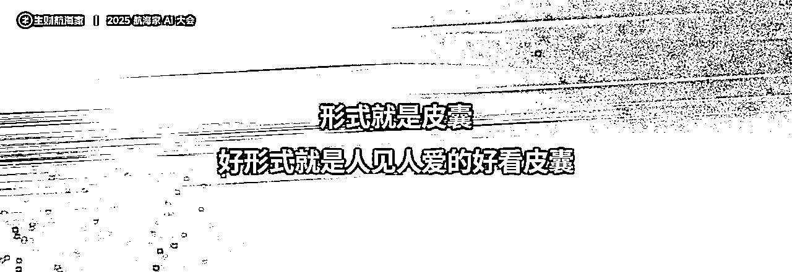
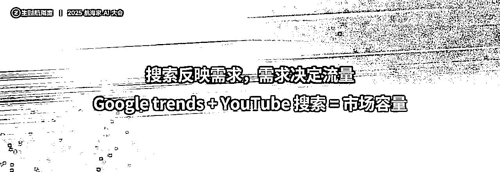
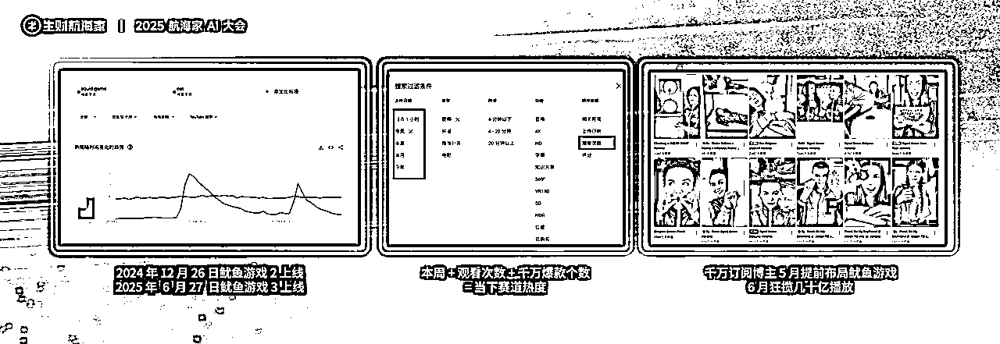

还有一些“百看不腻”的稳妥型形式：卡通动物（猫猫狗狗）、影视IP（漫威的钢铁侠、蜘蛛侠）、动漫IP（七龙珠、宫崎骏）、体育巨星（梅西、C罗、内马尔），以及政治人物和地方特色面孔。印度脸在印度观众眼里就是天然流量。

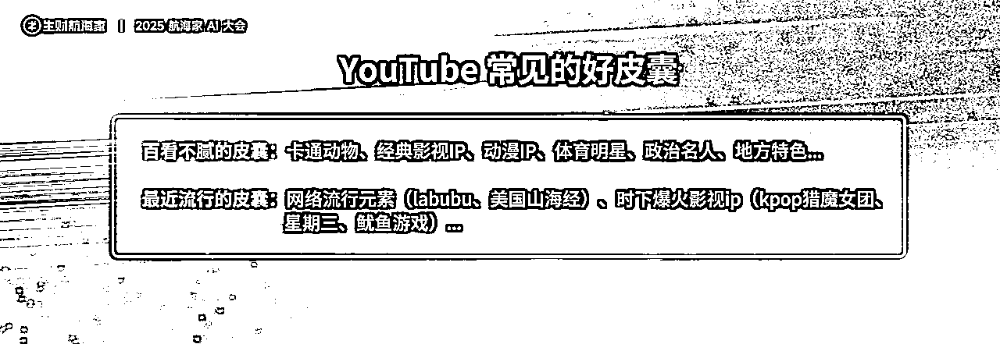

流行的形式则跟着周期走：近期的labubu、“美国山海经”，热播剧里的kpop猎魔女团、星期三、鱿鱼游戏。但真正值得注意的规律是：一条C罗梅西、一条猎魔女团、一条猫咪视频，表面八竿子打不着，讲的却是同一个故事——飞机上有人出事，另一个人去救。同样的内核，只要情感上能抓住人，换不同外壳照样能爆。

他们还会把外壳做到“整容级改造”。同样一个真人爆款故事，能同时演化出“大臣”等多个版本——大臣那条冲到9000万播放，其他几条从几百万到几千万不等。人物变了、场景变了、IP变了、画风也变了，但观众依然看得进去。一个好脚本，通过这种方式至少能长出40种以上新形式。

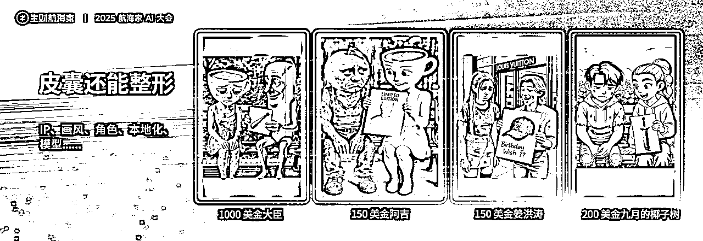

说完外表，再看灵魂。好脚本的本质，是让观众在点开的瞬间“放弃思考”。具体来说，要从两条路同时进攻：攻击逻辑脑，攻击情绪脑。

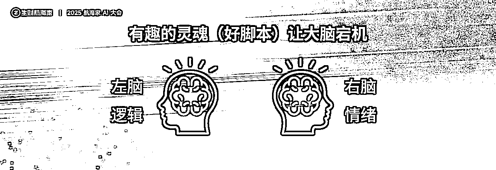

攻击逻辑脑，核心是“快”。前3秒就要亮出主线、制造冲突，把观众留住；然后用1到2秒的快速切镜，让大脑来不及质疑剧情合不合理；每一个镜头都必须推着故事前进，没有废镜头、不给多余信息；画面可以简陋，但重点要突出，要让任何地区、任何语言的人都能看懂发生了什么。简单来说，就是高频率制造冲突和感官冲击。

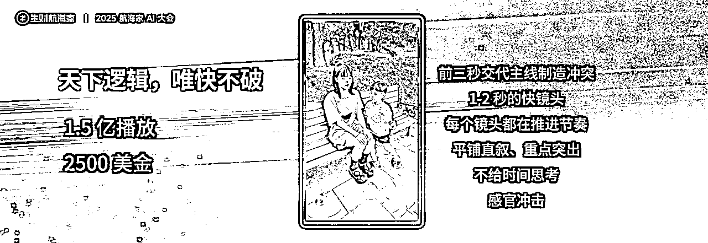

攻击情绪脑，靠的是反差与共情。教科书式的一句话“悲剧就是把美好的东西打碎给人看”——人类天生有损失厌恶，损失100块带来的难受，得靠赚300块才能抵消。放到视频里，就是要在每个转折点都反着观众的预期来：妈妈的穿着很旧，孩子却任性要买买不起的东西；妈妈做了西瓜帽子，孩子嫌弃地扔掉；妈妈明明没钱，最后还是把那顶帽子送到了孩子手里；孩子刚想开心，却发现妈妈因为换钱而没了头发。每一步，都踩在情绪最疼的地方。

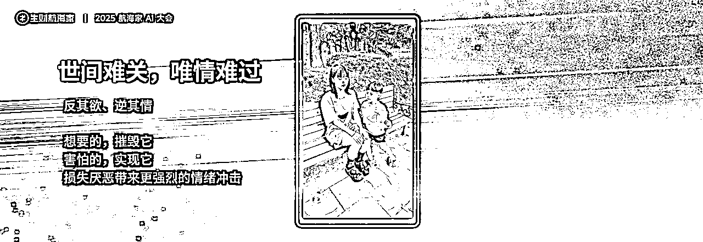

那么，好脚本去哪里找？他的观点非常明确：做AI视频，不要对标AI视频，要去对标真人博主。AI视频满打满算发展了一年，还处在“海草舞、社会摇”的早期阶段，很多AI爆款能火不是因为它质量好，只是蓝海里竞争对手太少、整体内容水平不高。而真人短视频已经卷了七八年，能从这片红海里杀出来的爆款，脚本质量和情绪调度都经过了反复验证。所以，最好的做法就是去真人博主那里，找那些已经引发过大量共鸣的爆款，然后借鉴它们的脚本结构。

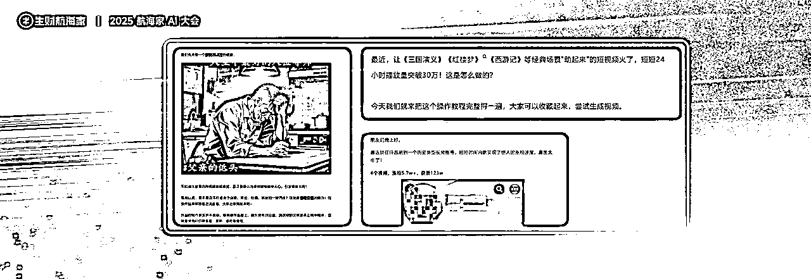
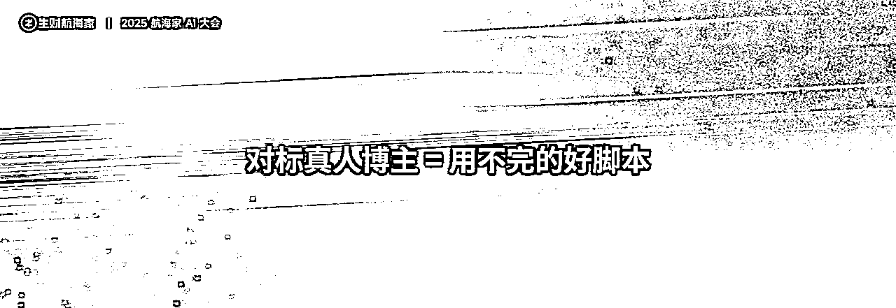

找到好脚本后，只做一遍太浪费了。逐镜头拆解看起来聪明，但拓展性太差，拆完只能改很少的元素。更好的做法，是把脚本抽象成“欲望”和“情绪”两个支点撑起的结构。还是拿妈妈的故事举例，拆出来大概是：

1. 欲望出现，情绪产生：孩子想要一顶帽子，妈妈买不起，孩子不理解；
2. 欲望落空，情绪激化：西瓜做的帽子被嫌弃、被扔掉，西瓜摔碎的特写让人心疼；
3. 欲望实现，代价出现：妈妈用头发换钱，买来了真帽子；
4. 损失强化，情绪爆发：孩子发现妈妈头发没了，闪回换钱过程，音乐把情绪推到顶点；
5. 情绪升华：大团圆收尾。

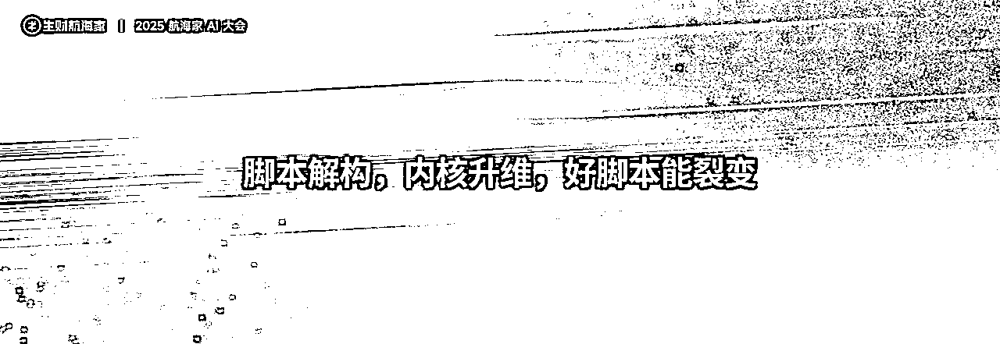
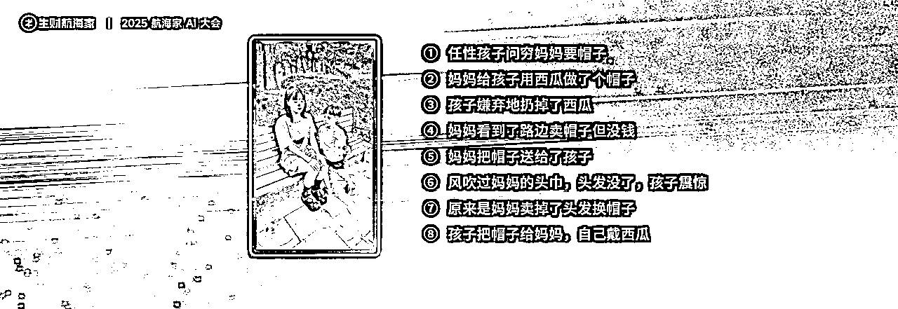
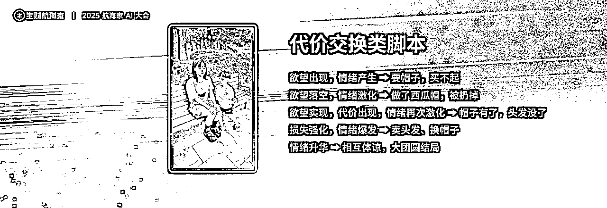

把这个结构里的内容换掉呢？孩子想要的是苹果手机，妈妈买不起；妈妈用纸杯做了假手机，被孩子扔了；妈妈去打工赚钱，却在路上遭遇车祸；孩子最后靠那只纸杯手机找到了妈妈的遗体；结尾，他握着假手机表达爱与后悔。会不会爆？这条视频用2.7亿播放证明了答案。

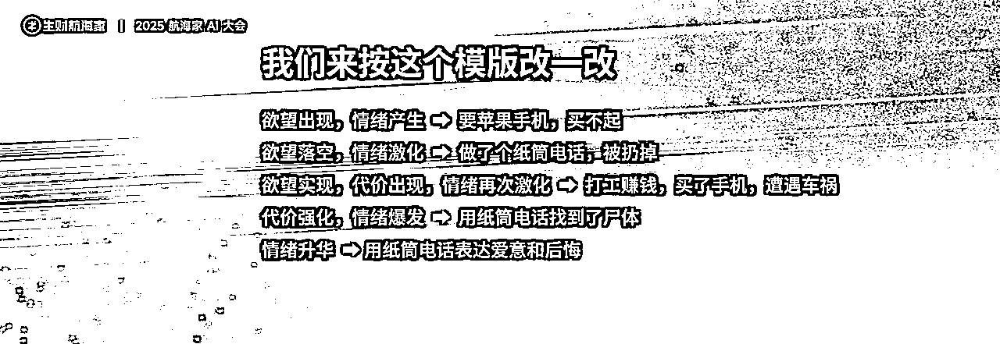

有人可能会说：拿已经火过的视频讲结构，这不是套娃吗？那好，不用那个博主的素材，自己从零做一条。再把苹果手机换成PS5：孩子想要PS5，收到的却是假的；妈妈打工赚钱，终于买到真的PS5，却出了车祸；妈妈的“在天之灵”把PS5送到孩子面前；孩子抱着游戏机，在妈妈的骨灰坛前痛哭。这是瀚伟圈友做出来的版本，是同一套骨架长出的新内容。

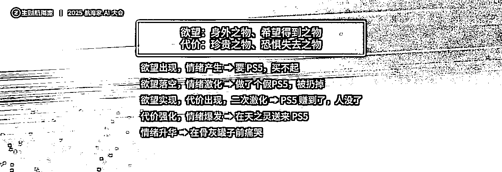

到这里规律就很清楚了：一个好脚本的内核，可以通过替换欲望、代价和情感载体，不断裂变出新的视频。这种拓展性，远比换角色、换场景要强得多。

这套打法不是孤证。圈友谷梓超的频道MR.DARGEE，大量爆款都提炼自同一个真人博主的同一套故事结构，单频道播放量已经突破10亿，而且他还不止一个频道、不止一套模板。也就是说，这条路已经被不止一个人走通，并且可以规模化复制。

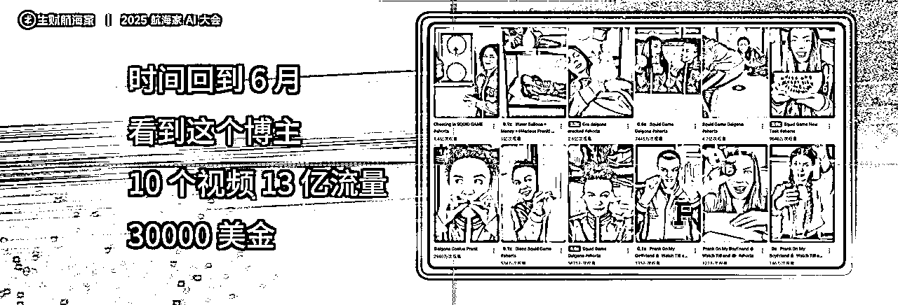
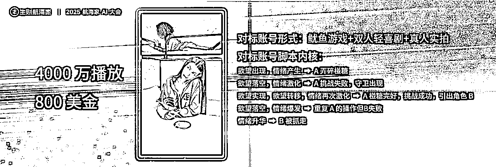
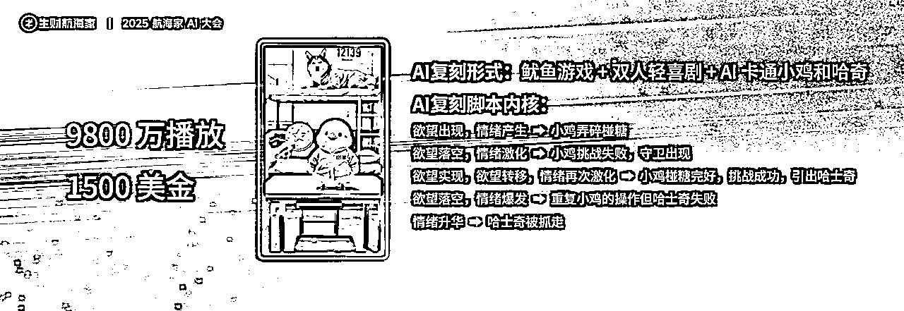
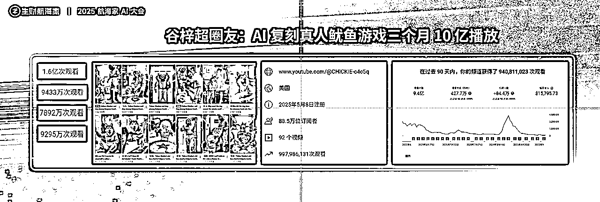

如果拉长到未来三年看，YouTube背后还藏着一条更长的坡：27亿月活本身就是通往海外用户的巨型获客渠道，小语种和垂类赛道还没有被充分挖掘，YouTube带货正在蓄势，百万GMV级别的案例开始出现，而海外AI自媒体在匿名、矩阵、To VC这些玩法上的蛋糕，比国内还要更大。普通人的逆天改命，也许不需要什么天赋异禀，只需要在一个还没被太多人注意到的平台上，比别人早一点开始。

至于Gary心里的那只“小绿瓶”到底是什么，他留到最后，没有直接揭开谜底。

##### 7.我们是怎么做视频的

好，前面把最关键的思路聊完了，剩下的视频制作环节，现在其实已经变得很轻松了，市面上各路工具已经把产能推到了非常高的水位。圈子里的朋友们也都在赚钱分享过这些利器，我这里就做个极简的流程演示，给各位看看我们日常怎么跑通的。

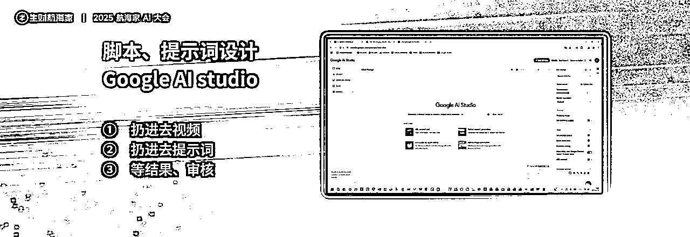

*   脚本提取：把对标视频的链接丢到 Google AI Studio 里，一两分钟内就能拿到完整的脚本结构和提示词，人只需要做审核，把出错的地方改一改就行。

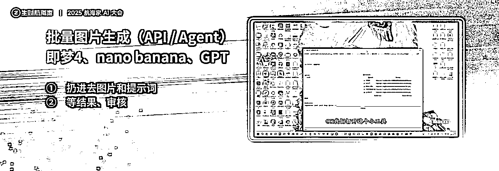

*   图片生成：我们主力是用 API，不过 RPA 和 Agent 也已经可以跑了。拿大臣圈友做的那个工具，把参考图和整套提示词丢进去，几分钟就能批量得到质量很稳的图。

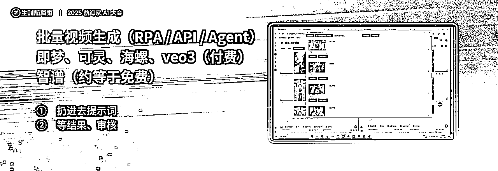

*   视频生成：路径也很多，RPA、API、Agent 都可以做批量化处理。像一泽圈友做的那套 RPA 脚本，接的是能无限生成视频的智谱AI，把提示词和图片放进表格里传上去，就能自动批量产出，成本上基本等于零。

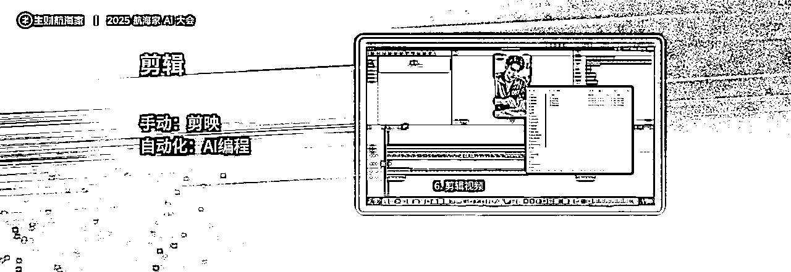

*   剪辑：剪映或者干脆用 AI 写代码来处理，大部分视频的剪法都不复杂，这里就不展开演示了。

##### 8.我对自动化的理解

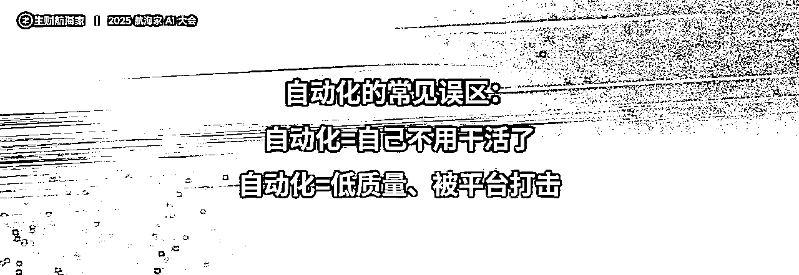

大家对自动化，其实普遍存在两种误解：一种觉得上了自动化，自己就彻底不用插手了；另一种觉得自动化等于品质妥协。这两件事，都跟自动化划不上等号。

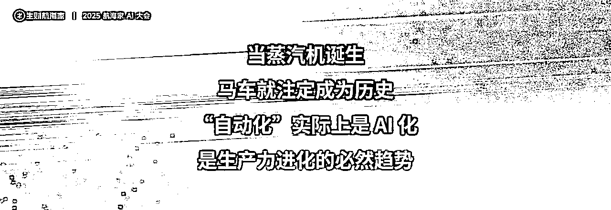

当年蒸汽机冒出来的时候，马车退出历史舞台就是迟早的事。我对自动化的理解，它其实是对整个工作流程做一轮 AI 化升级再造，这是生产力进化的必然走向，没必要把它理解成一个很窄的概念。

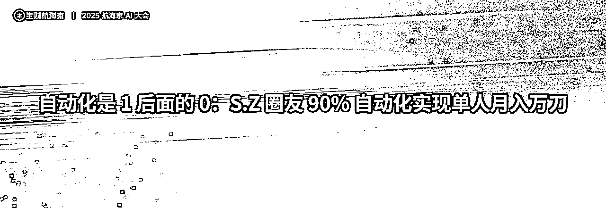

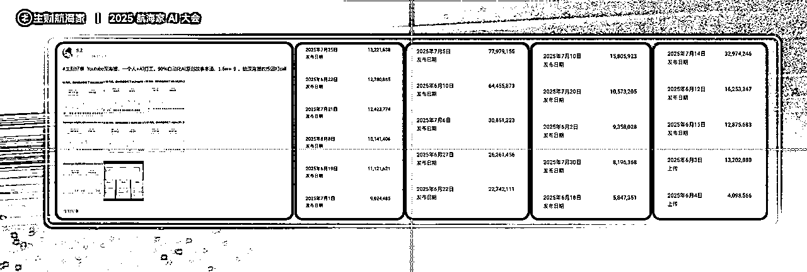

自动化是“1”后面那些“0”。你前面那个“1”不存在，后面挂再多的“0”也是空转。放在做爆款这件事上，就得先有稳定手工做出爆款的能力。你手工都做不出来，自动化怎么可能帮你变出来？一条千万播放的作品，价值顶得上 1000 条万播放的作品。在爆款这种量级的东西面前，堆数量是没意义的。

如果你手里已经有了那个“1”，那你就该想尽办法去把后面的“0”补上。

S.Z 圈友，自己动手写工具，把工作流做到了九成自动化，现在月入万刀。而且在 715 之后，他也没有被 YouTube 平台针对。这个截图是他发在赚钱好事的，大家都可以去看到。

#### 三、未来三年内的超级机会：打通一个 27 亿海外用户的获客渠道

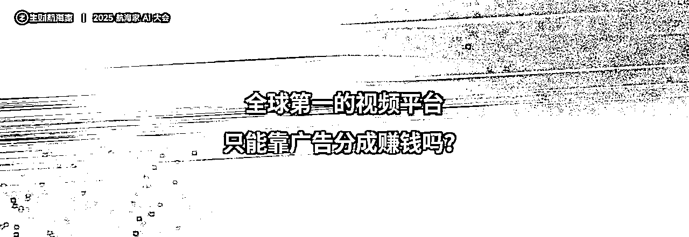

前面聊的，都是赚平台给的流量分成。但 YouTube 是一个月活 27 亿的平台，真正的机会可比这大多了。你看做抖音、做视频号的老板，谁会傻到只去赚那点流量分成？大家真正在做的都是带货、IP、私域。作为一个生意人，你应该琢磨的是怎么借 YouTube 这 27 亿海外用户，把你现在的盘子放大。

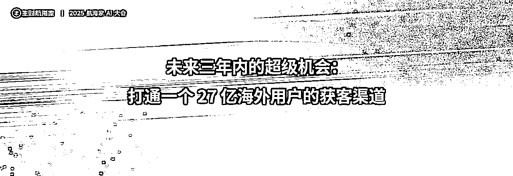

##### 1\. 聊聊小语种和垂类赛道

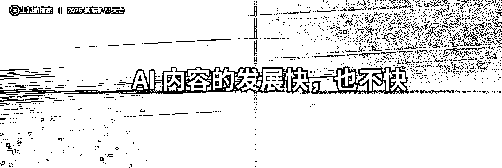

AI 内容的发展速度，说快也快，说慢也慢。

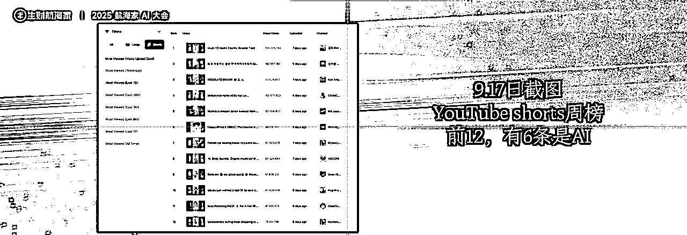

说快，是因为大家现在去看 YouTube Shorts 的榜单，有的时间点 AI 视频已经快占掉一半的坑位了。而在半年前，这个榜单上几乎看不到 AI 内容的影子。

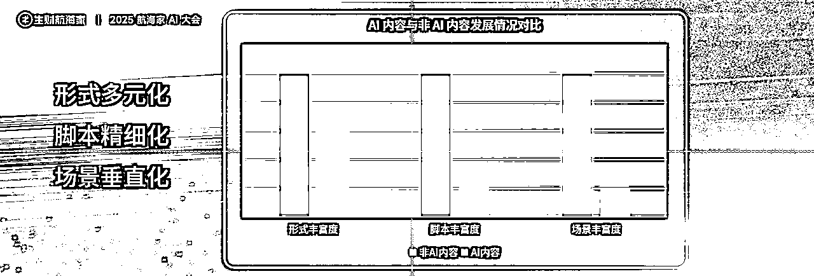

说慢，是因为 AI 内容在形态、脚本和场景这几个维度上，仍然有极大可挖掘的空间，这件事在 YouTube 上尤其突出。

形态上，AI 内容已经在逐步覆盖短剧、动漫、电影这些原本非 AI 主导的形式，但跟成熟内容比，还有一定距离；

脚本上，我们前面聊过，差距就更明显了；

场景上，现在 AI 内容主要还是集中在泛娱乐方向，对各种垂类场景的渗透率其实还很低。

这也就意味着，在大量还没有被人注意到的细分赛道里，YouTube 依然藏着巨大的蓝海。

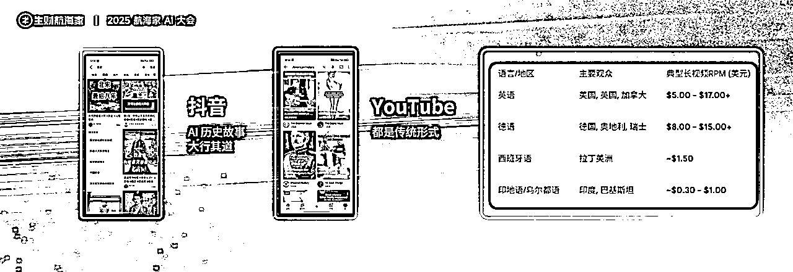

*   在抖音、视频号上，有关历史的 AI 视频已经遍地都是。但是在 YouTube 里你去搜“美国历史”，排在前面的依旧是真人讲解或者老素材的混剪，你想找一条 AI 做的都找不到。是 AI 做不了吗？当然不是，是大家根本还没反应过来。

*   这些垂类小赛道的广告单价 RPM 相当可观，比泛娱乐内容高出一大截。那前面那套做爆款的方法论，能不能直接搬到这些小赛道上去用？这个问题，留给各位去验证。

##### 2\. 百万 GMV，YouTube 带货蓄势待发

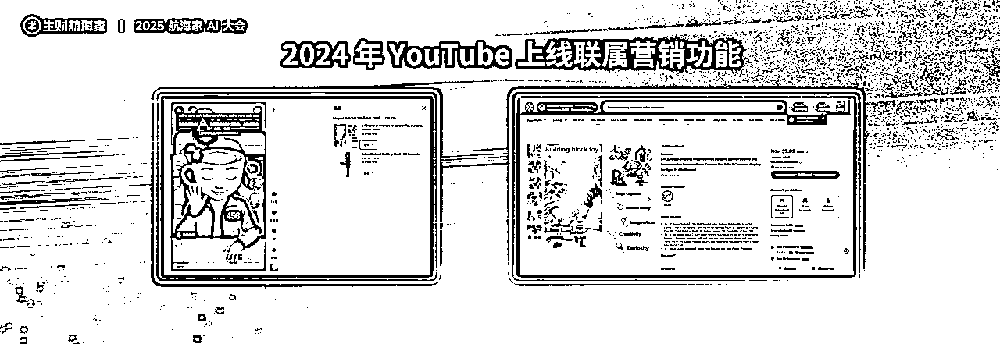

2024 年，YouTube 推出了“联署营销”功能，也就是带货，玩法类似于 TikTok 的精选联盟。但直到今天，我问了不少做跨境电商的朋友，他们压根不知道这个东西。

为了做测试，我们把所有那些纯娱乐、跟带货八竿子打不着的爆款视频，全挂上了 YouTube 官方的商品链接。结果，就在这个月，跑出了 100 多万人民币的 GMV。

YouTube 作为一个电商渠道，现在还远谈不上完善，但正因为不完善，信息差和机会才足够大。有在 YouTube 做带货打算的朋友，也可以直接联系我们。

##### 3\. 匿名、矩阵、To VC，海外 AI 自媒体的蛋糕比国内更大

*   AI 自媒体：海外现在的 AI 自媒体市场，已经到了“饥不择食”的程度，对视频质量的要求真的不高。一个没有任何真人出镜的日语匿名频道，只要做到 1000 订阅，一条视频就能拿到 200 美金的商单。这种模式，完全可以做成矩阵。

*   知识付费：我们的小船老师，三年前就已经靠 YouTube 做知识付费，赚到了自己第一个百万美金。现在他每年从 YouTube 上获得的收入，可能已经有几百万美金。

*   更多玩法：YouTube 是一个挺特别的平台，它连“把用户引到外站”的入口该放在哪里，都清清楚楚地告诉了你。国内那套已经被玩烂的流量变现套路，搬到 YouTube 上，可能全是一片蓝海。如果各位有这方面的业务需求，欢迎跟我们联系，一起去赚海外这桶金。

#### 结语：一个普通人的逆天改命的故事

最后，说说我自己的故事。

去年 9 月，也就是现在这个时间点，我的状态非常惨。

大学四年，我脑子里只有一个念头：赚钱就得进大厂。为了进大厂，我四年都在拼命实习，结果课翘得太多被延毕，校招也没赶上；

后来去互联网教育行业认真打拼，又撞上“双减”政策，想创业也没有方向；

到了 22 年，赶上特殊时期，我去做线下家政，结果合作的平台直接跑路，创业失败，为了给员工发工资，我欠了 20 万；

没办法，为了还债，我进了国企，天天应对人情世故和领导 PUA，但心里还是不甘心，结果两年胖了 40 斤，身体和心理都差点崩溃，最后只能裸辞保命；

离开国企以后，我的履历又乱、又创过业、还有很长的 gap 期，投出去 1000 份简历，几乎没有收到面试邀请。裸辞半年，项目没做成，工作也没找到。

那段时间我特别痛苦，不知道自己到底哪一步走错了。为什么明明那么努力地实习、加班、创业，最后却混到找不到工作的境地？

Anyway，去年 10 月，我面前其实只剩两条路：要么降薪去找一份工作，要么加入赚钱，最后放手一搏。我以前特别想不通，为什么很多看起来经验、能力都不如我的人，偏偏就能拿到结果？那我就进赚钱去看个明白，死也死个明白。

说起来挺搞笑的吧，怎么“加入赚钱”都变成我最后一搏的选项了？真的是无路可走了。

进了赚钱之后我才明白，“选择大于努力”这句话谁都会说，但说这话的前提是你得有选择。

以前我既没有信息，也没有选择，只能在肉眼可见的方向上拼命使劲。当然，在赚钱里我不只看到了 YouTube 这个风向标，也看到了很多国内赛道的玩法。但综合了前面讲的那几个原因，我最后选了 YouTube + AI 这个方向。

11 月，我开始全面冲刺 AI 短视频。每天除了吃饭睡觉，其他时间全部用来做视频、刷精华帖。也许是运气好，也许是切入的时间点确实早，13 天之后，我做出了人生第一条千万播放的视频，很快就开通了 YPP。很可能，我还是赚钱里第一个在 AI 赛道开通 YPP 的人。

靠执行力赚到了一点小钱后，在那个节点上，我隐隐约约意识到：光靠自己做视频的话，一个月赚两三千美金也不容易，而且不稳定，搞不好还不如回去上班。想要真正逆天改命，做自由职业、超级个体，就必须找到自己的生态位。其他东西我还想不清楚，那就先从分享、交流、破圈开始吧。

所以我没有埋头做视频，而是把过去一个月在 AI 赛道做爆款的经验写成帖子发出来，也因此拿到了第一篇精华帖。刚好又赶上了七天筹办的传术师社群和线下活动。当时为了省那 2000 块的机票钱，我犹豫了很久，因为那可能是我下个月的饭钱。在那次活动上，我听到了一些超级大佬的分享，看到了一个完全不一样的世界。活动里还有个很神奇的一分钟自我介绍环节。我是个超级 I 人，纠结了老半天要不要上台，最后心一横，来都来了，上去吧。为了让自己显得厉害一点，我说了一句我自己都很难听懂的话：“我有 5 个已经开通或者快开 YPP 的账号。”结果不出意外，大家包括龙哥都听岔了，以为我说的是“我有 5 个 YPP”。龙哥哥还把这个写在小本本上，发到了群里。我当时真的尴尬得要命。

后来准备走的时候，我在龙哥哥办公室门口纠结了很久要不要进去。其实我根本没什么问题要问，当时也问不出什么有水平的问题，就是想跟偶像合个影。我觉得能把一个以赚钱为目的的社群做成一种分享和利他的氛围，这件事实在太牛了。做社群这件事也非常契合我的盖洛普前三：交往、信仰、体谅。但这三个特质在以前的工作里可没少坑我，简直就是内耗和自我 PUA 的天花板。所以我很想近距离接触一下龙哥哥。最后还是敲了门，进去合了影。我都准备转身走人了，以为他根本不会认识我，没想到龙哥哥把我叫住了，来了一个灵魂拷问：“你已经开了 5 个 YPP 是吧？”当时我只能挠着头解释，说其实是听错了。但龙哥哥还是给了我一波鼓励，让我一定要好好做 YouTube，他说 10 年前他在 YouTube 上拿到过不错的结果，现在的机会依然很大。

后来，可能因为这次见面给龙哥哥留了点印象，欢欢来找我，让我和波妮一起做一期 YouTube 的私教陪跑。讲实话，当时心里是真的没底。开营的时候做问卷调查，75 份问卷加起来是 9000 万播放，而我当时自己手上的几个号加起来播放量都已经过亿了。再加上没赛道、没教程、没案例，真的能在一个半月还夹着过年的这段时间里，带大家跑出结果吗？

我不知道答案。但那时候我孑然一身，已经没有什么可以失去的了。大不了时间被浪费掉，然后灰溜溜地去找个班上。没有路，那我们就自己走出来。毕竟我名字里带个“淦”，干就完了。

一个半月之后，没想到真被我们干出来了。103 个人，一共做出 107 个 YPP。可能很多人听不懂这意味着什么，按账号价值来算，大概是 32000 美金。赚钱和我们自己都觉得这条路可以放大，后面也就有了深海圈。

深海圈启动之后，我们专门跑去杭州学了一段时间，见了不少大佬，补了很多认知和信息方面的功课。但最让我开心的，还是后来在赚钱办公的时候，我光明正大地坐在了龙哥哥对面，还悄悄偷拍了一张。我坐在那里心里偷着乐：两个月前我还要鼓起勇气敲门进去合影，现在偶像就坐在我对面。

刚起步那会儿，我们面临不少质疑：

“YPP 哪有那么容易开通？”
“月入千刀的人怎么数都数不出几个？”
“AI 视频是不是压根就不赚钱？”

面对这些，我能怎么办呢？人家说的是事实啊。是非成败都是干出来的，不是想出来的。多说无益，干就完了。

4 月，我们做问卷统计。看到播放量数据那会儿还挺开心的——人均 2000 万的播放量，比之前多了不止一倍。但那些声音一直都还在：“他们也就是 YPP 多一点吧，根本不赚钱。”骂得对啊，人均 300 美金，这就是事实。那就继续干。

6 月，123 份问卷收回来，人均 800 美金，亿播圈友也有了十几个。但那个声音还是没停：“就这点收益，还不如找个班上呢。”说得也没错，800 美金换算过来也就是 5000 多人民币，确实不如去上班。没啥好说的，继续干。

8 月底，146 份问卷的数据出来了：人均收益已经到 2600 美金，人均播放量 1.14 亿。看到这个数字，我心里才觉得总算对大家有个交代了。但还是有人在说：“翻来覆去就那么几个案例，整天讲人均有什么意义？”

那现在，9 月份，大家已经能在赚钱好事栏目和 YouTube 专区里看到数不清的好事和精华帖了。波妮从 6 月份开始每周在视频号连麦做得不错的圈友，到现在已经连了差不多 30 位。我们做带货测试，一个月又跑出了 100 多万的 GMV。

这个 flag，是我今年 1 月 1 号跨年的时候，在一个小群里立下的。现在它实现了。到今天，我可以站在这个上千人的分享台上，光明正大地宣布：赚钱 YouTube 深海圈，已经是全国最大的 YouTube AI 社群。

我真的就是一个特别平凡的普通人：没有背景，没有资源，没有钱。但也正因为如此，我才比谁都清楚：努力不过是最基础、最不值一提的付出。

《凡人修仙传》里，韩立结婴的时候，心魔问他：“如果你没有小绿瓶，你还能剩下什么？”

对我来说，我的“小绿瓶”，就是 AI 和赚钱。

我就是靠着赚钱和 AI，在 YouTube AI 这个赛道里，跟大家一路打怪升级，一点一点争取资源，一次又一次踩坑跌倒，才走到了今天。

其实我们都很幸运。今天的 AI 和出海市场里，还有足够多的生态位、足够多的选择和机会，多到让普通人也能拥有属于自己的“小绿瓶”，也能走出自己的一条路。

最后，在这个 AI 改变一切的时代，我想用赚钱的两句名言收尾，但我稍微加了几个字：“越分享、越生长、越幸运”和“越相信、越拼命、越看见”。这就是我的大道之路，这就是 AI 时代里 AI 永远取代不了的东西。

分享的本质，我理解就是利他。利他会带来链接，会带来贵人，然后自然就有了生长，有了所谓的幸运。这是 AI 再强大也给不了的。

相信的本质，我觉得是愿力。愿力会让你拼尽所有力气去努力，然后你才能看见结果。这也是 AI 给不了的。

利他之运，愿力之势，运势合一，逆天改命。

感谢这一路上波妮、龙哥哥、老马、林俊杰、怅惘、七天、欢欢、坤汀的支持和陪伴。也感谢台下坐着的我的女朋友曼心，还有我的爸妈。我一直都不是一个让人省心的孩子，谢谢你们一直以来的理解和信任。

感谢所有深海圈的教练和圈友们。

感谢每一位无私分享的航海家、传术师和精华帖作者。

感谢赚钱，感恩这个时代。

最后再立一个 flag：未来一年里，我希望跟大家一起，把赚钱 YouTube 深海圈做成全球最大、世界知名的 YouTube AI 社群，带着大家一起成为那批吃到时代红利的人。

淦，就完了。谢谢大家，一起龙哥盟。

最后打个广告：深海圈新一轮报名时间是 9.24 到 10.10，详细信息可以看下面的海报。

