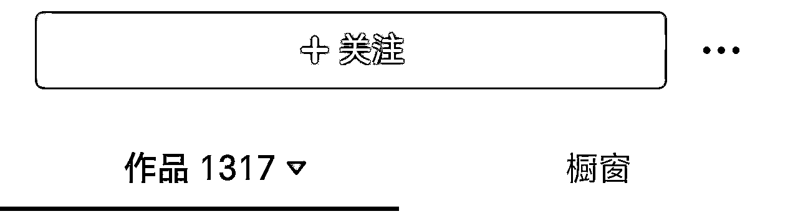
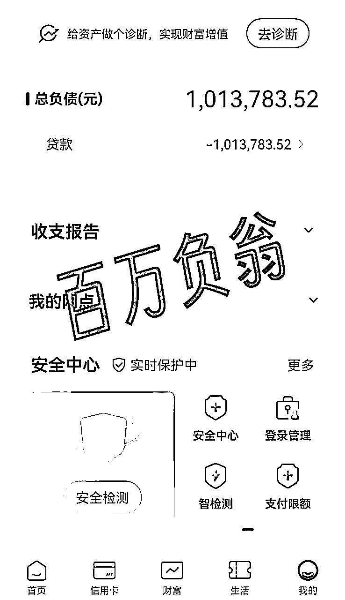
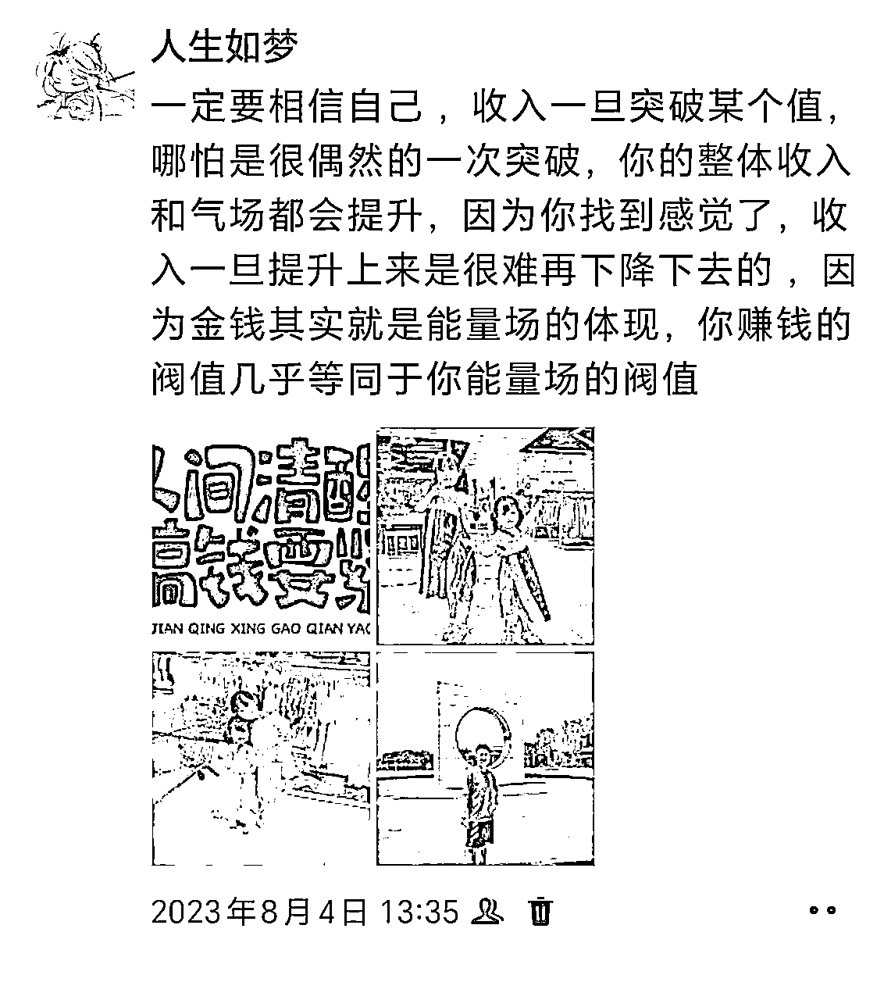
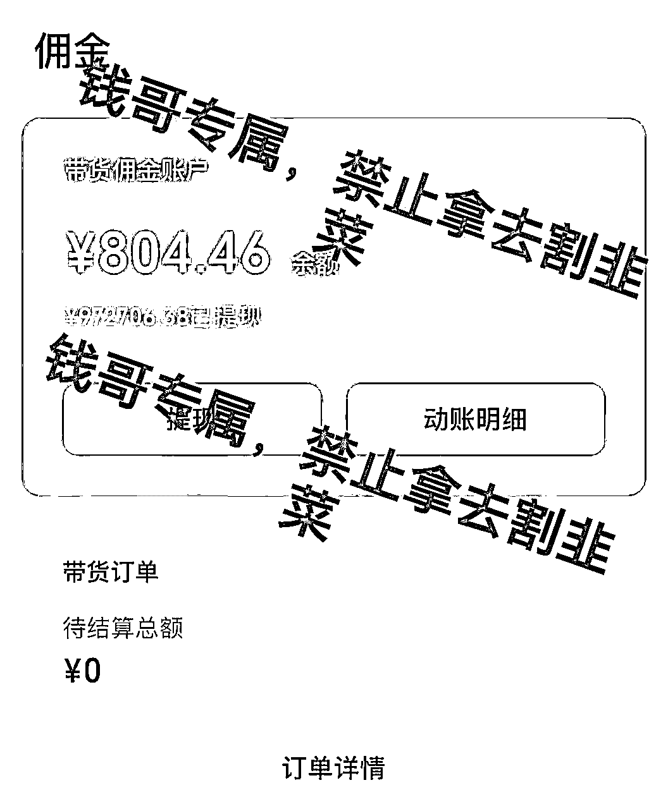
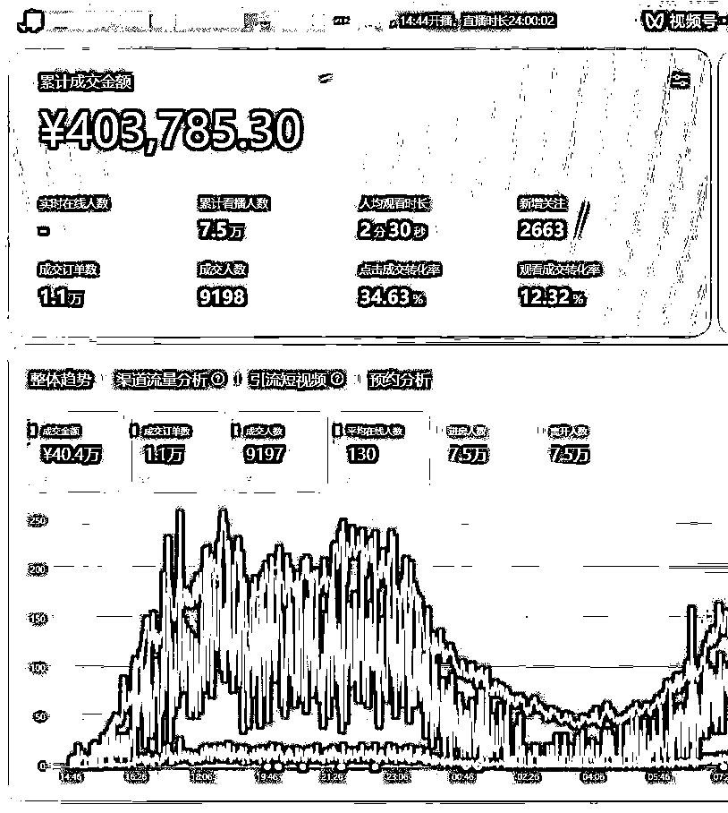
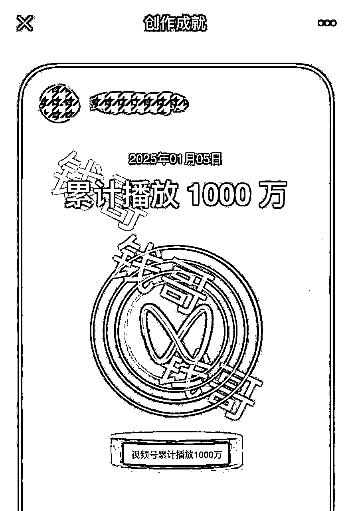
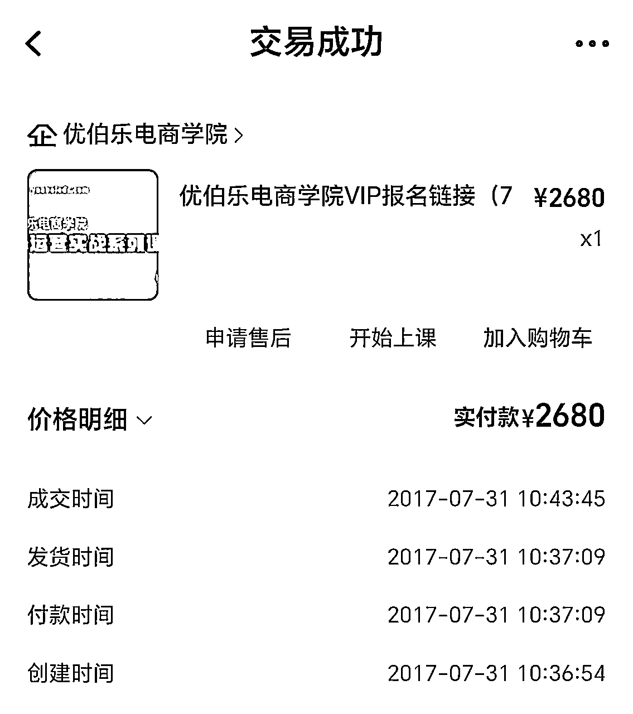
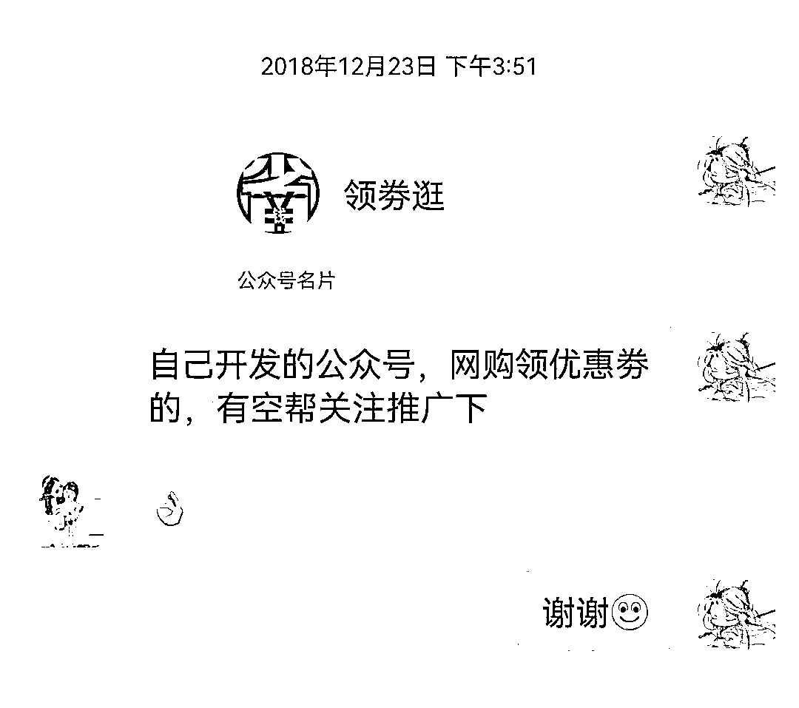
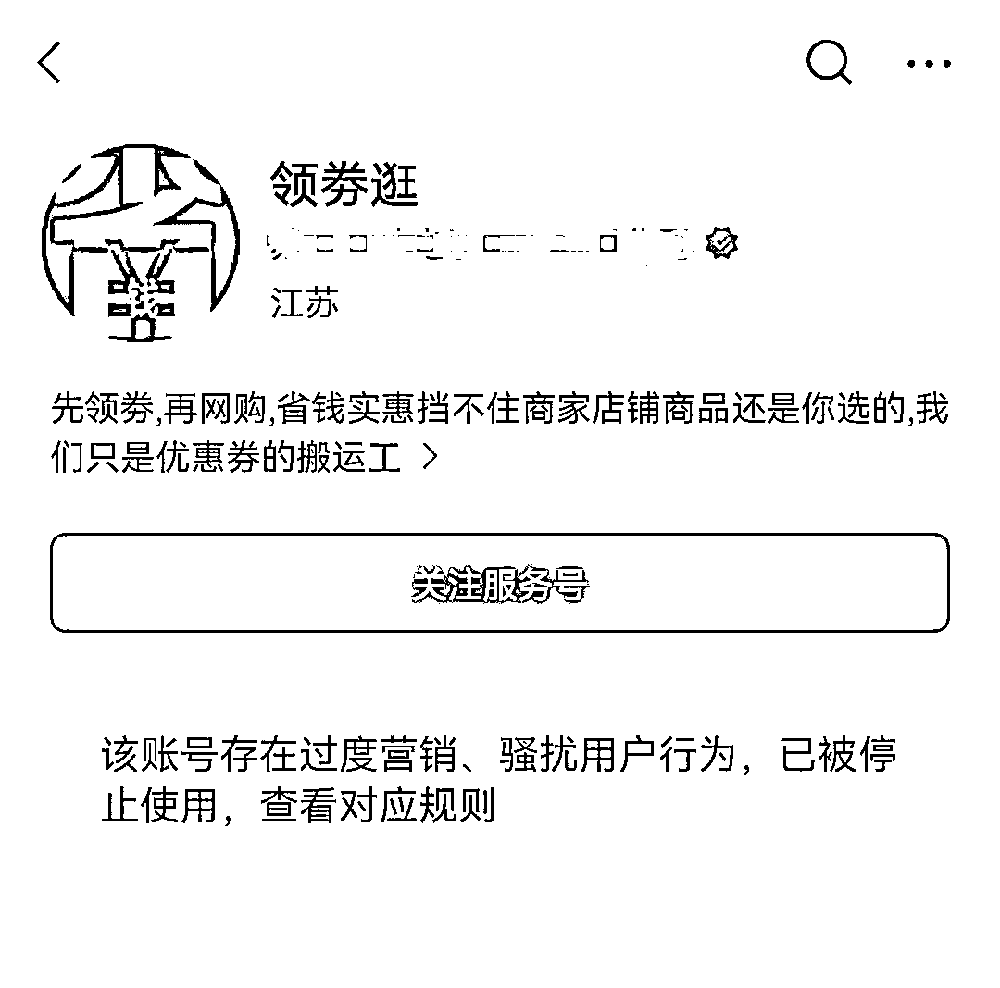

# 靠一个观点赚碎片系列：成功是概率
作者：龙哥

别再把逆袭归给运气，它是一道数学题

很多人瞧见他人暴富、出圈，心里蹦出的头一句话便是“这家伙撞大运了”。然而运气这东西，往往是因为你只做过一轮，而对方已经跑完上百轮。把单个动作拆开看，成败就像掷骰子；一旦反复执行，结果就会渐渐贴向一条可预测的曲线。

强者从不眼巴巴等好运上门，他们更在意反复动作背后的统计学规律。运气这东西没法操控，但分布曲线是可以改善的。你真正该做的，不是烧香许愿，而是微调出手的策略，把获胜系数一点点抬高。

必须承认，资产量级的大跨越在人群里属于极少数。你天天拿着筷子夹菜，几乎回回成功，却从不会为此激动。正因为突围的人少，突围的瞬间才显得耀眼。看清这个事实，并非劝你认命，而是劝你收起“等条件齐了再动”的借口。

你之所以迟迟迈不出第一步，多半把“没钱、没靠山、没本金”当成理由。可实际情况或许是，你缺的不是这些，而是直面栽跟头的胆色。一旦你想明白“输才是家常便饭，赢只是额外红利”，遇到挫折时便不再自我审判。心态松了绑，胆量自然跟着涨。

既然结果按比例呈现，你能做的就是把总次数堆上去。拿掷硬币举例：正面出现的比例早有定数，可你只掷一回，输赢全看天意；掷到一千回，比例便会向那个常数收敛。数学给出的笨办法，常常也是最可靠的办法。

线上小生意特别适合这套打法。踩坑开销不大，一个点子也许几千块就能完成一轮测试，反馈密集，还能同时押注好几个方向。对比线下门店动辄几十万的投入，这里连输十次也不伤筋骨。别等所有条件都凑齐才动手，现在要的是快速行动，再根据反馈不断调头。

之前参与一场关于AI的行业聚会，身旁有个年轻人说想效仿某位讲师，靠AI产出内容，目标年入千万。同伴提醒他：那位讲师已经有了深厚的技术积累。要是早几年，年轻人大概会打退堂鼓。这次他却笑着回一句：对方积累深，是好事，正因为前面有人蹚过路，我们后进场的人才能踩着台阶走。不必重复发明轮子，只要锁定路线，然后不断加码尝试次数，用频率换结果。

另一位讲师分享过AI制作动画和运营海外视频平台的方法，讲得挺好。我想从统计的角度补一句：哪怕脚本出色、画面精美，播放量飙升依然有很强的偶然性。你能做的，是持续优化内容，同时用发布数量去对冲随机性。我自己做小视频，两年多发了1300条，另一平台也超过1000条。没有谁能保证每条都火，但发得越多，撞上热门的可能性越高。

说到底，成就只是随机事件披着的外衣。你不再为一次落败辗转难眠，也不再去羡慕旁人所谓的走运。你要做的，是把精力灌注到尝试次数上，用足够多的样本去对冲波动。如此，才算是普通人翻身的根本心法。

附：一个普通人的十年试错清单

2013年，我成立了一家工业设备公司，接不到什么单子，只能靠转手卖零件勉强续命。实在撑不住就出去打工，打工憋屈了便折返回来打理公司，一眨眼过了三年。

2016年，看别人做网店眼热，进了一批衣服，结果连一件都卖不出去。

2017年，花了三千块钱拜师学电商，对方教的只有怎么写商品名、怎么买推广词，后来店还被平台莫名封了。

2018年，边做电商边关注导购生意，看到别人晒收益，我也搭了个订阅号里的返佣系统，结果刚上线没几天，号被封了。

2019年总算做出点小名堂，搞了个自动返佣工具，六年下来赚了大约十万块，中间还撞上各种账号被封的破事。

2020年小视频兴起，我试过游戏解说、影片混剪，都没水花，倒是明白了关注人数多，并不代表能换成钱。

2021年和2022年，我又折腾抖音的无人值守直播、半自动直播，还尝试在视频平台上发内容带橱窗链接，结果一连被封三十多个号，整个人陷入低谷。

2023年，我咬咬牙全面转做直播，加上2024年某个平台流量大涨，终于把直播变成谋生主力。为别人干活？从此，这两个字从我人生里删除了。

后来我参加了一场AI主题的峰会，给自己定了新方向：把AI变成新增长点，帮自己早日迈进一个更大的数量级。这十年，每一步都带着血泪，但回头看，每一次摔倒都成了后来上路的台阶——输，原本是这道题里最正常的一环。