# 24小时内在📕跑通生意闭环：给普通人的拆解笔记【龙哥盟线下Mini航海精华整理】

这篇是我在龙哥盟线下航海分享后整理的文字稿，全文约2.3万字。

关于如何在一天之内于📕搭建起可变现的体系，灵感来自《The Million Dollar Weekend》。

如果你正卡在定位、虚拟商品玩法、如何把个人长处产品化，这份笔记值得反复对照。文里还穿插了不少AI落地的实操案例。

📕体量庞大，每个鲜活的个体都能找到自己的切口。

我今天想先立一个总判断：把📕当作生意操作系统来看，别把自己钉死在单一身份上。用供给方和需求方双视角去看会更通透。因为后面我会反复强调的前提是——📕是终点，而不是跳板。

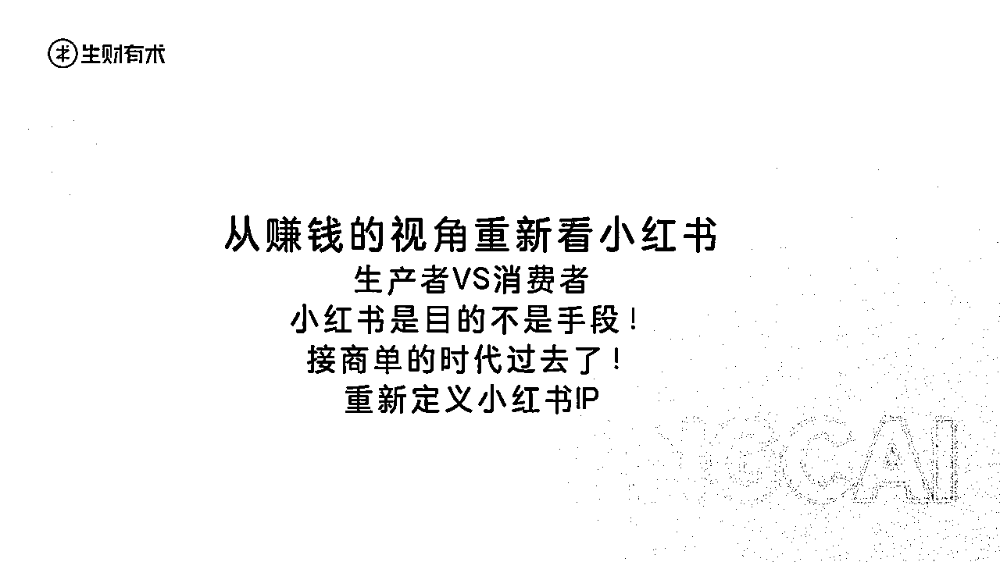

## 第一认知跃迁：只靠接广告单的窗口已关闭

2022到2023年的通用打法是：做内容、涨粉、入驻蒲公英拿商单。市面上几乎所有付费课程都在教这个。

现在规则变了。📕早已不是单纯的投放渠道。

举例：小猫补光灯App。由一名独立开发者打造，产品的破圈几乎全靠📕。在他眼里，📕相当于市场部。想让外界理解产品理念，就得借助📕表达。

同样想做AI产品的同学，务必自问：📕能为我的产品解决哪类问题。

我认识一位做AI背单词站点的创作者，累计成交破万，客单39.8元。底层代码与大模型嵌入都是AI驱动。若脱离📕引流，独立站获客成本很高。📕的获客效率极高，所以必须重新定义平台价值。

我从2021年起深耕📕。坦白说，如今平台的佣金比例已失衡。

### 广告单分成现状

分成指报价2000元，抽40%即800元。目前40%只是基准线。低于这个比例，连接触品牌的资格都没有。

现阶段合作流程不是品牌方直接选号，而是先由媒介公司筛选一轮，再推送给品牌。这一层下来，抽成成了默认规则。

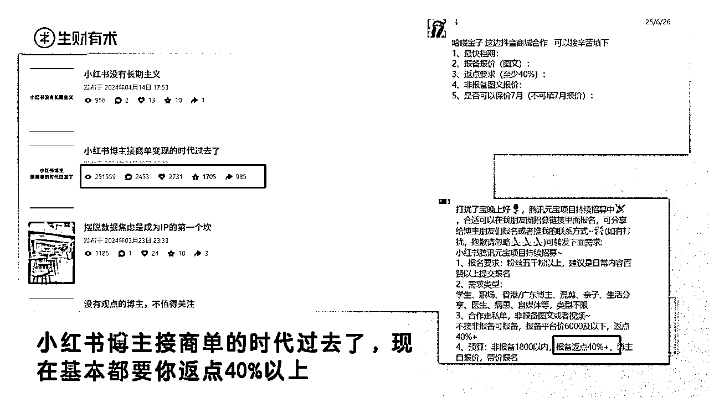

这是品牌方直接发来的要求截图：想聊品牌，先交40%分成。美妆赛道更卷，70%以上是常态。欧莱雅这类头部客户，分成要求常在70%以上。整个商单生态已不健康。

我2024年4月发过一篇笔记：靠接商单赚钱的博主时代已过去。那条笔记在📕获得25万阅读。传播点在于戳中了痛点：不能再只靠商单了。

我自己的数据：2023年6月，粉丝1.8万，月度商单约1万。2024年只接了1单，之后再无。

因此给新手一个清醒提醒：别再以攒粉达标入驻蒲公英为目标。除非你是天生吃商单的体质，能让品牌主动投放，否则这条路基本不可行。

AI赛道相对好谈，因为产品迭代快、需求多。但新手别把商单当成核心模式。可以接，但别当主业。

## 第二认知跃迁：本地服务里藏着百万级机会

前面提到要把📕当终点。接下来这个本地服务案例很典型。别只盯着虚拟物，线下场景同样能放大。

### 杭州上门做饭的生意模型

本地服务是从城市人群需求里长出来的。杭州是美食荒漠叠加高净值人群，中间存在明显空档：上门烹饪。四菜一汤108元手工费，评论区大量咨询包月。做副业，锁定几位包月客户就够。会做饭，在杭州就是壁垒。

### 杭州出行攻略也能变现

第二个案例是杭州游的数字产品。万物皆可数字化的思路。

西湖怎么深度玩？很多人不懂。这是底层真实需求，攻略就能成交。

### 租车生意的小切口

如今凌晨四点去西湖看日出成潮流。杨公堤凌晨堵成停车场，人群拥挤。很多人没有交通工具，就诞生了租赁生意。

夏季租电动车，秋季租自行车。因为气温差异。公路车日租160元，比共享单车更顺畅，起坡更快。杭州多数景点在山里：龙井、梅家坞，上坡共享车难以胜任。

杭州是全国第二大骑行友好城市，来的人多自驾。所以一批车+📕渠道，就是完整闭环。

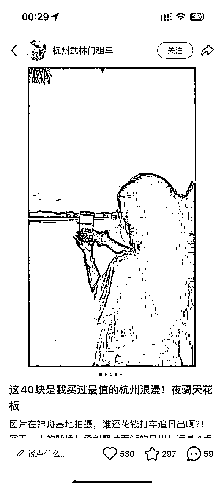

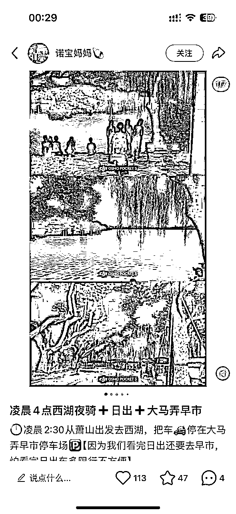

核心拆解思路是：从场景里拆你的技能，能否变现。

AI替代不了的蓝领服务在📕反而好卖。比如修水龙头、修漏水。

我父亲的同事从工厂离职，去三四线城市做超级个体，专做太阳能维修、防水，月入1万多元。对当地而言已是高收入。

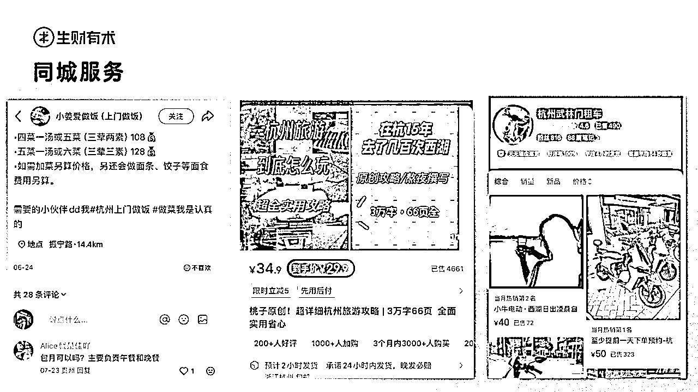

## 第三认知跃迁：职场号必须转C端

职场号基本接不到商单。因为商单本质是广告位。职场创作者每天上班劳累，谁给你广告位。

所以职场号要做C端。

### C端定义

广告是B端，C端就是用专业技能满足求职者付费需求。

比如售卖大厂面试经验。这类内容并非原创，可用AI智能体结合📕现有物料批量生产。

售卖产品经理学习包。

再如刚哥的运营课，在📕卖出几十万。他的做法是把内容做成手稿形态，不是精美知识库。那种粗糙的手写感反而成为差异化。搜索“刚哥的运营笔记”，1500多单、500多单、7000多单都有案例。

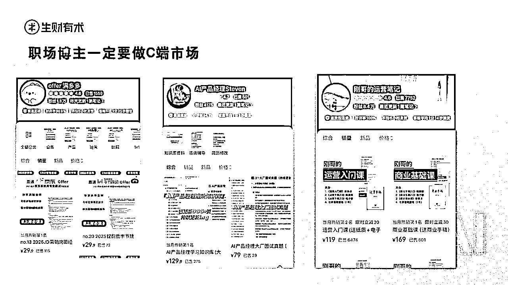

### 复盘问题：你到底是谁

抛开职场身份，你是谁？数据分析高手吗？大厂高管吗？

大厂出来为何要做付费？因为大厂是普通人拿到百万年薪的少数通道。

京东采销是📕上最热门的大厂岗位之一。我售卖京东采销面试题，月销几十份。有创作者只做京东采销相关，粉丝3000多，售卖面试题、求职辅导、简历修改、面试资料，一年20万。

如果你在一个岗位做到深度，就把这项技能抽离出来做垂直专家，这就是职场变现。

雅思8.0的英语生意，年GMV做到100万。学英语是东亚人的长期课题。

想做原创产品却没经验怎么办？用“协修”方法。协修是📕当下热门的词。

雅思单项突出，特别是口语，口语素材就能售卖。

考试专家的逻辑也有价值。你未必最后成绩最佳，但会总结方法论，比如把单词融入霸道总裁小说，情境化教学。

懂AI的教师是机会。很多人只卷技术，真正用户要的是落地方案。我是老师，你能帮我用AI做教案、做PPT吗？这才是价值。中国职场重形式，PPT做得好就是壁垒。

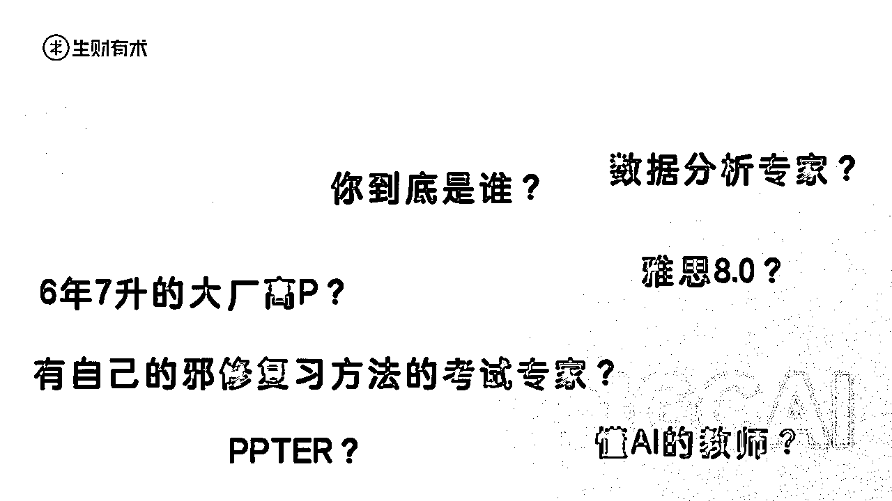

## 第四认知跃迁：个人优势+用户付费点=业务模型

十个问题帮你挖掘优势。重点是挖掘优势、身份、成就、角色。

“你的长处和📕用户的付费点就是你的业务模型”。理解吗？

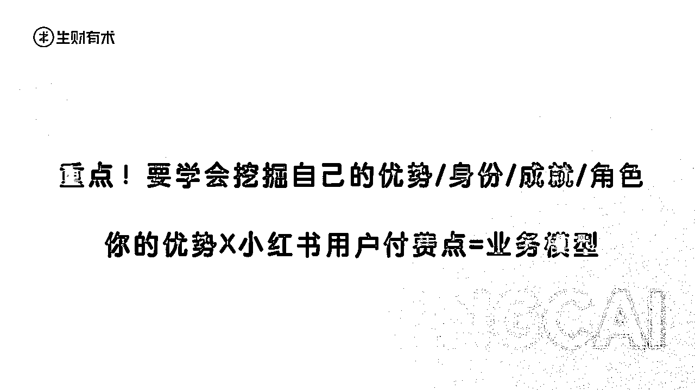

### MBTI+旅行攻略的完整推演

J人的优势是计划和清单。用户的付费点是旅行攻略。两者结合就是业务模型。

很多人懒得找攻略。出境旅行最怕被坑。📕攻略多，但担心是广告、内容浅。一次花费几千上万的旅行，花9.9元买份攻略是买安心。

9.9元买的是避坑保险。

J人+旅行攻略=东京出游攻略。这条笔记一篇卖出3000多单，相当于把去东京的费用赚回来了。

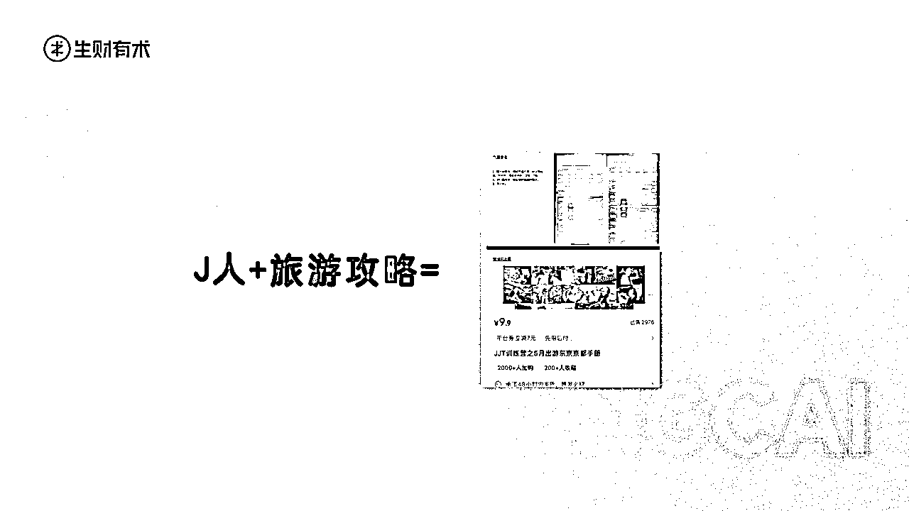

这不是终点。9.9元你获得的是线索。

所有线索行业都能用数字商品重做一遍。

买了日本旅行攻略的人，可能需要包车、当地团、酒店。买了攻略就留下了联系方式。数字商品能把获客成本做到一毛钱。

比如皮肤诊断报告一毛钱引流到私域，再转化光子嫩肤，9999元成交。报告靠AI就能生成。

关键点：优势市场化、技能市场化。📕付费用户众多，别低估。

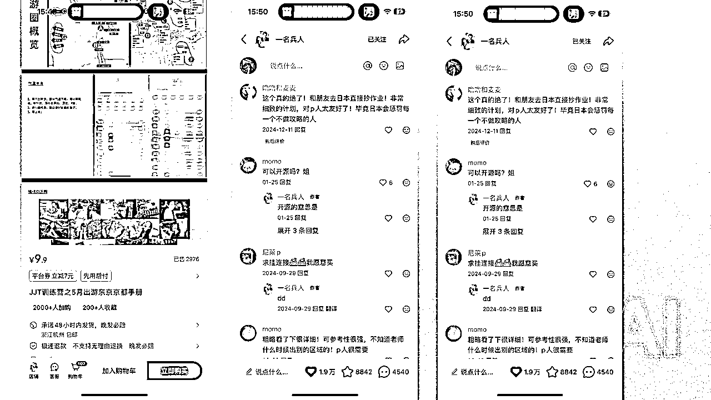

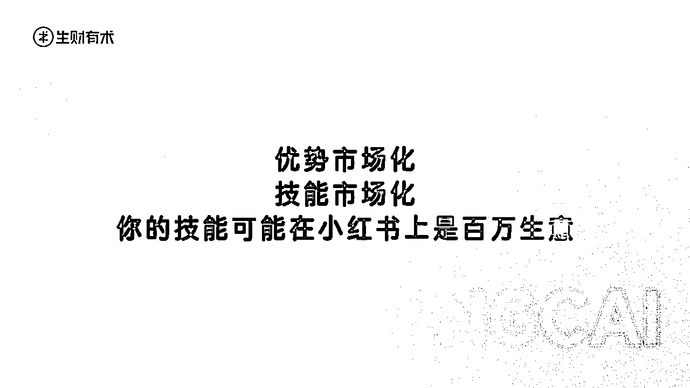

## 第五认知跃迁：YouTube+语言学习=600万生意

航海圈我一直说要逆向赚钱，去做油管YPP。YouTube+英语是成熟生意。

油管是世界语言学校，英语、法语、日语、韩语、俄语都有，月活几十亿。练口语素材的需求一直存在。

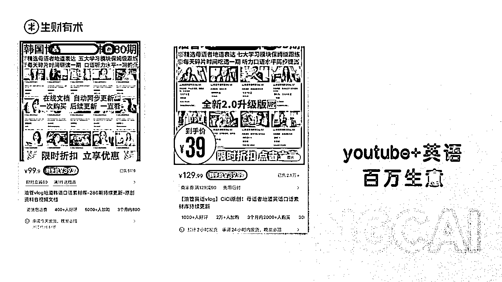

### 韩语赛道的时机

9月份我会押注韩语。为什么？9月国家放开韩国免签。免签=旅游增量。游客需要基础韩语，需求井喷。

案例：油管vlog地道韩语口语，售出5118单。韩国免签前生意就成立了，免签后是放大效应。

销量=需求验证。只需在YouTube找韩国博主素材，用AI优化成学习知识库，就是赛道。

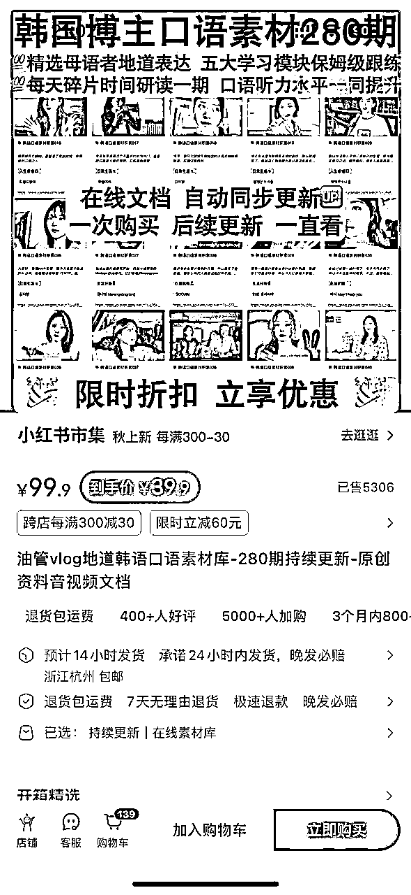

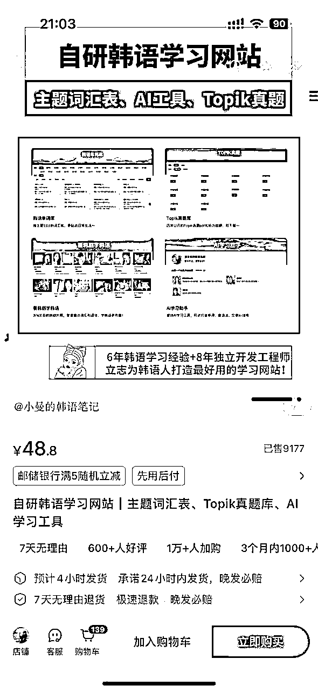

## 第六认知跃迁：找到优势的十个自问

### 1. 你拿到什么别人拿不到的大结果

大结果是个人评判标准，不是社会标准。

我二本机械转行广告，做过很多项目算不算大结果？算，因为这是普通人转行的灯塔。我二本考研上985且复试第一，对我就是大结果。从A到B克服的困难就是壁垒。

### 2. 你所在城市有什么可📕化的标签

杭州可复制：租电动车、手串开光、灵隐寺、游玩攻略。暑假自驾游→研学游，研学手册火。

北京：游玩攻略、烤鸭、火锅代排队，100多块帮你排队选位。

义乌小商品市场游学、胖东来代购、山姆分装、大学生拼单。山姆分装有学员一年引流2000多客户。这些不起眼的小生意都很赚钱。

### 3. 你在某个领域有没有超乎常人的积累

谈恋爱也能卖。恋爱攻略、恋爱心得在📕有人买。

### 4. 你有没有很强的基础技能

Excel、PPT、写作，这些基础技能都能变现。

### 5. 你有没有他人不具备的复合标签

故事感来源于标签叠加。比如：37岁大厂被裁+房贷+杭州房价下跌，怎么破局。这种标签共情极强。

比如复购率73%的私域社群案例，这就是有帮助性的利他标签，也是IP核心。

### 6. 在核心课题上你有没有傲人成就

健康、亲子、父母关系、亲密关系、自我和解，这些都是核心课题。

但只讲课题太虚，需要方法论支撑。比如《原子习惯》的个人成长法。你要给出可执行的SOP，而不是空谈。

什么样的内容能讲透？《原子习惯》给了个很具体的答案：它把成长切成一连串能落地的细节点，告诉你怎样靠不起眼的动作把一件事越做越好。单是“怎么让好习惯不断档”这一块，作者就折算出了几千万美元的生意。

说到底，拼的是认知。你在某个领域里，有没有形成自己的看法？“爱人社会化指南”能在站内爆火，就是因为作者对“怎么和人打交道”有一套自己的解读。

会向上管理、会说话、会组局，这些都能变成内容；哪怕是教人送礼，也有人在付费学。

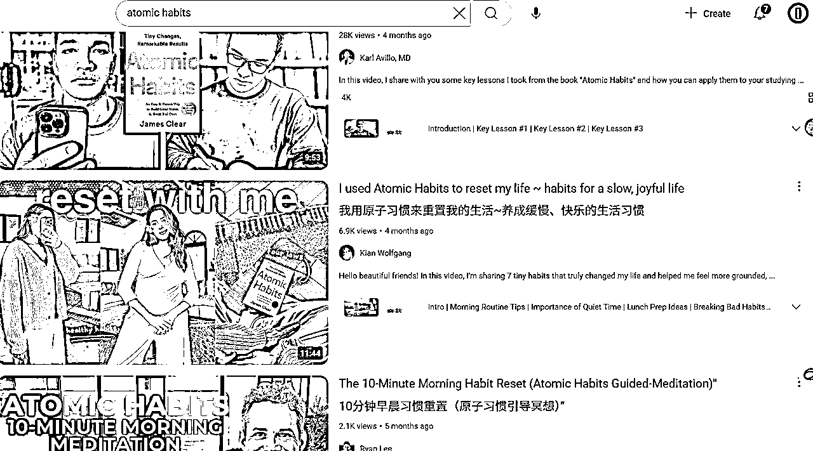

### 第七问：你在哪几个细分方向上，能排进前10%？

很多人有个思维定势：必须成了专家，才敢开口教别人。其实没有谁是绝对的专家，但先开口的人，先吃到了红利。

成绩单摆在那里：100分的能讲给90分的听，90分的能讲给80分的听。60分可以教50分，30分也能帮20分。

别总想着“我能教什么”，换成“我能帮到谁”，视角一下就打开了。

拿AI来说，这行听起来很硬核，可📕上有个文科背景的博主张专专，做到了10万粉丝。论技术深度，他不是最拔尖的；但他用的是“learn in public”的打法：我是什么人不重要，我最近学了什么、能帮到谁，才重要。很多AI号还在追热点——“又炸了”“国产AI太强了”，他却在公开自己的学习过程。结果，流量自己找上门。

如果某个方向你能排到前10%，就值得来这个平台试试。因为这里的需求被切得很细，几乎什么冷门领域都有人看。

### 第八问：你有没有一套独门的方法论，甚至生活哲学？

我经常说“邪修”——万物皆可邪修。邪修就是走野路子、找捷径、做反常识的事。这些东西天生就适合传播。

### 第九问：你的能力能不能接上业务？

你懂什么不是重点，能不能把能力和业务连起来才是重点。

我不懂AI的技术细节，但我做的智能体已经快有一千个人用过，还有人主动要付费。为什么？因为我懂的不是AI本身，而是AI怎么嵌进📕的运营闭环里。

AI本身不值钱，AI能帮业务跑通，才值钱。

### 第十问：哪个主题，你能一口气写满100篇？

很多人做这个平台做不下去，不是因为不会写，而是没有足够的内容库存。

100篇听着吓人，我把它降到20篇。

看一个账号的主页，一屏大概放4条。访客决定要不要关注你，通常会往下刷3到5屏，按5屏算，正好20条。

20条就是主页有没有“人味”的分界线。发3条就断更，谁会关注你？内容越厚，信任感越强。

一个月发20条，相当于两天一条，做起来并不难。想在这个平台起步，先把20条的门槛过了。

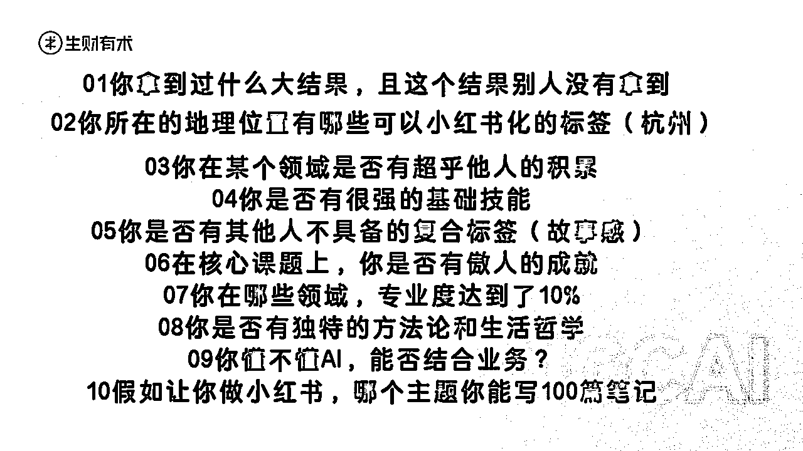

* * *

下面聊聊强项变现的两种方式：直接卖，和绕个弯卖。这套东西我在公开渠道搜过，基本没人系统讲过。

## 强项变现（一）：直接卖

如果你的看家本领本身就是商品，那就别绕弯子。比如雅思口语接近满分的人，直接开卖：把口语素材整理成2498份，定价一百一十元左右，再搭配口语进阶营、实战营等产品。凭这一个硬技能，就在平台上完成了转化。

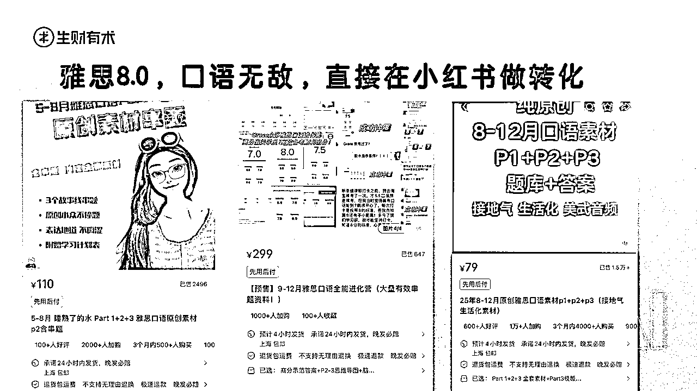

## 强项变现（二）：绕个弯卖

很多人的强项单独拿不上台面，那就要绑住一个用户愿意花钱的需求。

“J人+旅游攻略”就是这个逻辑：J人只是标签，旅游攻略才是成交点。

反过来看AI开发：你光会写代码，没人付钱；可如果你懂业务，能帮人解决实际问题，钱就来了。比如那份“帮淘宝店主写代码”的资料，会做开发、又懂落地，价值立刻显现。

AI开发本身不赚钱，但它能在赚钱的业务链条里，成为少不了的一环。

你会用AI做网站，再把网站拿到这个平台上去推，靠会员收费，整条链路就通了。AI和平台放在一起，能玩出的花样，远超想象。

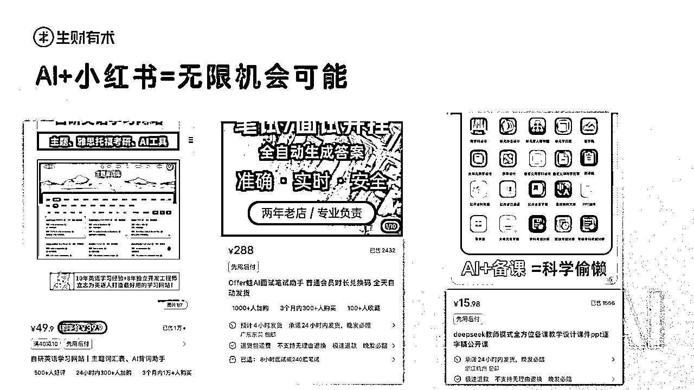

### 案例拆解：自制的英语学习网站

再说“主题词汇表VIPS”这个案例。用AI搭建，24小时就能上线，但大多数人做不了，因为英语功底不够。

这就叫复合型标签：懂英语+会AI，在这个平台上就是百万级的生意。

它定价39元，卖了1万份；更值得留意的是，头一天就有300人下单，说明需求非常旺盛。

### 更多AI落地案例

不少AI产品没有流量，根源是没找到真实痛点。

有个面试练习助手，普通会员兑换码卖288元，出了2000多单。教师圈里，“DeepSeek教师应用手册”也卖得很火。AI用来帮助备课，就是AI落地的典型例子。

AI是什么？会开发只是间接优势。要把它变成收入，必须挂在一个具体的消费需求上。

英语学习网站、AI英语、AI面试、AI备课——可以说，所有内容都能用AI重做一遍。

我还做过一个“约会助手”智能体，把聊天记录丢进去，它能帮你分析两个人有没有戏。后来还想过做一条挂脖录音的项链，用录音笔太像采访，项链隐蔽些。想法挺好，但能不能商业化，现在还没底。

## 核心之二：作品化——把强项变成物件

找到强项之后，下一步是作品化。很多人做个人品牌，只会卖咨询，开口就是“你有什么问题问我”，这是最笨的打法。

### 策展思维：一个篮子里装全部

作品化的核心办法，是策展思维，把所有积累收进一个篮子里。

这个平台上最贵的产品是什么？是知识包。那些标着“参考答案”的，有人做到了几千万。

每个人都可以建自己的知识包：你用过的工具、踩过的坑、学习的方法、对事情的判断，统统收进一份在线协作文档。这就是你的知识包，也是你的第一个产品。

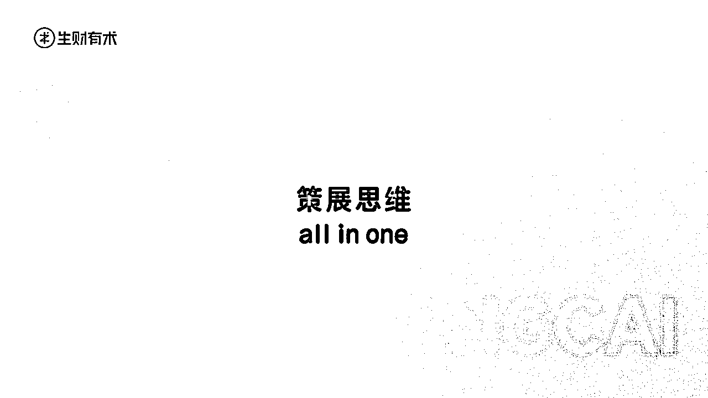

### 第一件产品：你的专属知识包

第一件数字产品，建议就是你的专属知识包。把你对某个领域的专业见解，毫无保留地写进去，这玩意能卖出高价。

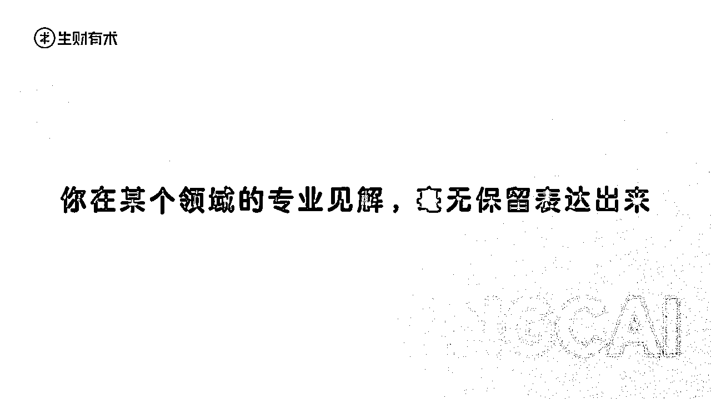

### 案例：书单里的策展逻辑

“行者创业学习方法如何书单”是个好例子。书单本身不值钱，值钱的是他给出的阅读顺序——从创业0到1，先读什么、后读什么。就像博物馆里的参观动线，你只管跟着走。

“行者专业系统读书学方案”卖99元，出了9000多单，利润几乎全归自己。

这背后的逻辑，仍然是毫无保留地呈现你的专业判断。

再比如申论模板范文，放在考公这个类目下，越是垂直，越是有人买，24小时卖了200单。还有人为了研究教师资格证考试，专门去报名，目的不是拿证，而是亲身走一遍流程，找出每一步的卡点，再借AI做出原创数字产品。

一份20万字的大厂生存指南，卖269元，也是同一个思路——你怎样进的大厂、在大厂里怎样向上汇报、怎样带团队，全部写进一份文档。

每个人都该想想：自己的技能，怎么能变成别人愿意付费的资产？

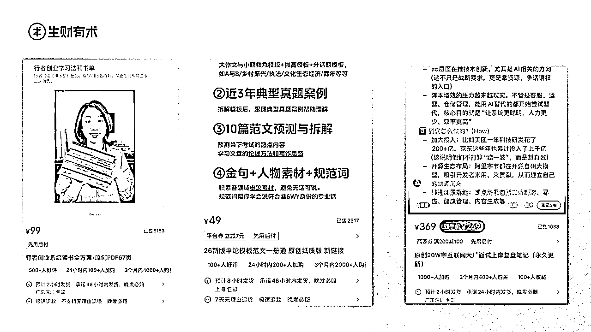

### 第二件产品：按需求切成碎块

只有一个大件产品，店里的货太单薄。所以，要把专业知识拆开，按具体需求一点一点地卖。

比如考公这个方向，可以拆成热点合集、结构化面试题库，单件32元，卖出了150件。还可以继续拆出申论模板、思维导图。

先有一个高价的整合产品，再去做拆分。以“如何进大厂”的知识包为例，可以拆出简历模板、面试真题、面试准备指南。这些低价小件，既能产生零散收入，也能把买家沉淀到私域，之后再用陪考服务这种高客单价产品去承接。

有了一个高价的整合产品，就能源源不断地长出副产品。职场方向也一样：知识包是树干，简历模板、面试题库、面试指南都是分枝。小件产品的意义不只是赚前端那点钱，更重要的是拿到后端的客资——加上微信，陪考服务的高转化就有了对象。

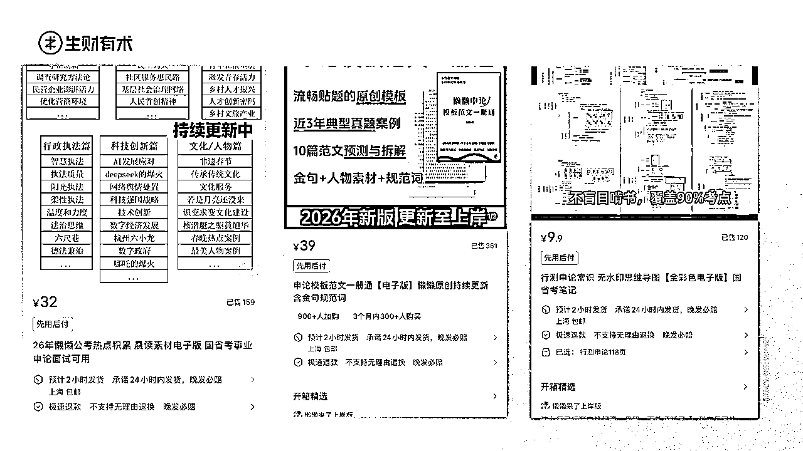

这套体系的骨架，就是“一个整合知识包+持续按场景拆分”。人人都有知识可包，关键是学会拆。

## 核心之三：搜索，是一项硬技能

很多人调研数字产品，习惯用专业术语去搜。

比如想做中小学课外辅导，就别搜“K12”，家长根本不这么叫。家长会搜“小升初”“幼儿园大班”“孩子吵架怎么办”这种非常具体的问题。

数字产品的检索公式，是“载体+场景”。载体包括资料包、模板、PDF、攻略、手册等等。“攻略”这个词几乎能接一切：恋爱攻略、约会攻略、人情世故攻略、送礼攻略、体制内生存攻略、互联网大厂生存攻略，都有人在卖，而且卖得不错。

30分能教20分，10分能教0分。有个实习生写了篇“我如何在大厂度过实习”，连怎么给mentor订奶茶都写进去了，结果卖出2000多份。

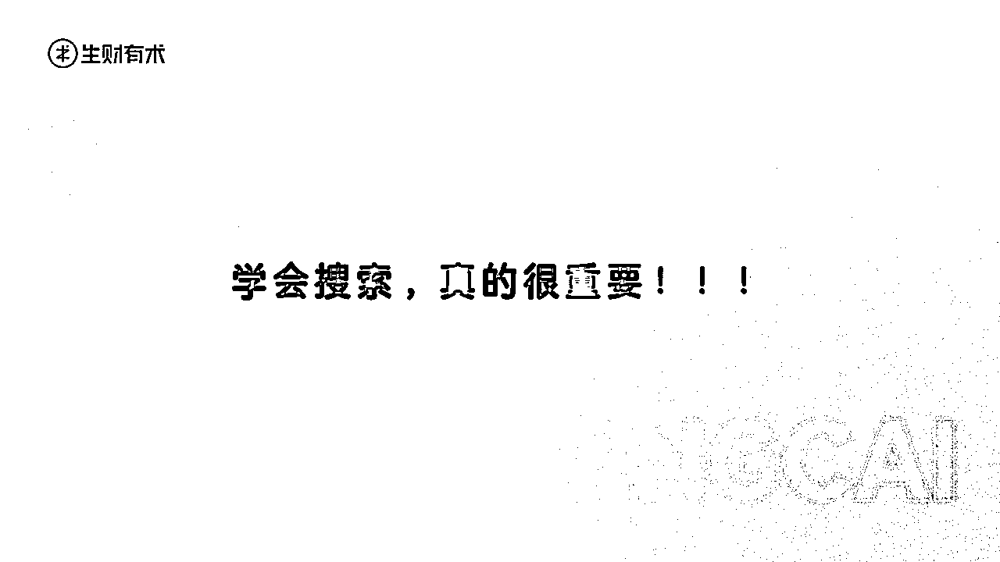

这个国家的人，太舍得为内容掏钱了。飞书多维表格、Notion这类工具，被做成智库产品，卖得很好；做海外数字产品的人，也经常用Notion。教师素材库、苹果快捷指令这些看似小众的东西，同样火爆。

所以要大量刷，大量看。我平均每天在这个平台上泡六到七个小时，常常刷到想吐。

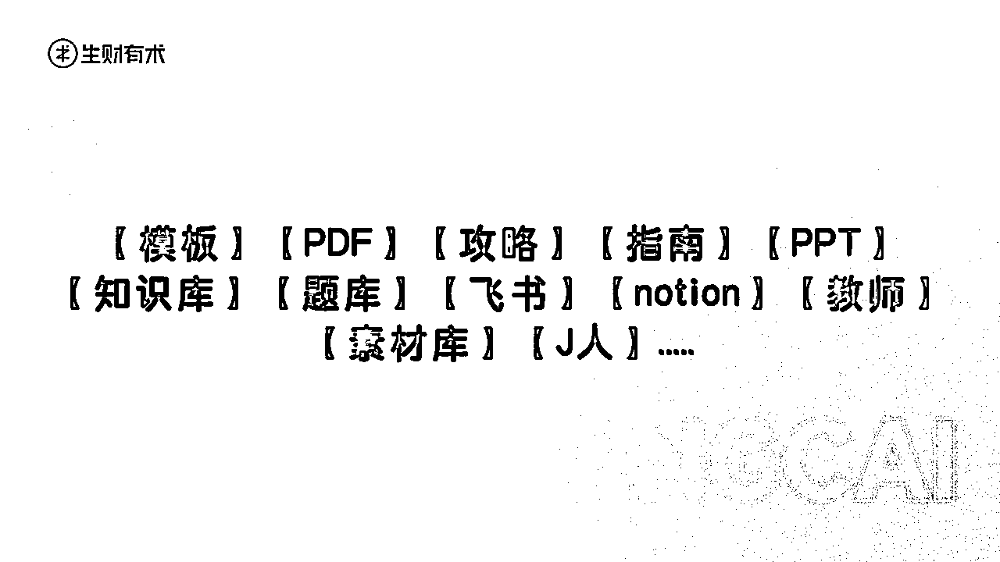

### 捕捉“这也能赚钱”的瞬间

我特别想写一个系列叫“这样也能赚钱？”。当你刷到某个产品，心里冒出“我靠，这样也能赚钱”的时候，立刻停下来研究它，把它拆透。

有一次我刷到一个恋爱攻略，觉得“这也行？”点进去才发现，他不仅写约会技巧，还一路写到见家长。整个链路都写全了，钱自然赚到了。

### 期末评语，也能卖13万

再讲一个让我意外的案例：卖期末评语。一个人靠这个，卖了将近13万。10元一份，出了1.3万单。为什么闲鱼、淘宝上没人买的东西，在这里能卖爆？因为这个平台卖的是具体情境，不是商品本身。

老师每到期末都要写评语，这是再具体不过的需求。而且每学期都可以推新品，复购天然存在。你能说，这位卖家一年只赚这13万吗？显然不能。

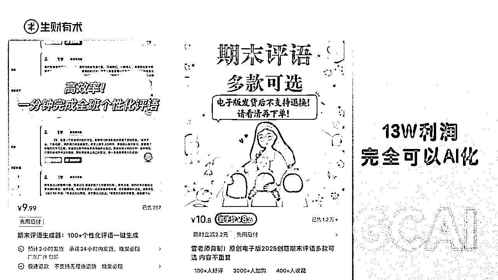

小学生每学期开学，老师都要做“新学期第一堂课”。单这一堂课，一年就能卖两轮。今年年初《哪吒》最火，春季开学时，哪吒主题的课件卖得特别好。到了秋季，哪吒没人提了，换成《浪浪山》主题，又能再卖一波。

所以，会做幻灯片、又懂教师需求的人，光靠副业就能活得挺滋润。还是那句话：这个平台卖的是情境，不是产品。

### AI进入教师场景

教师类目特别适合AI改造。期末评语生成器，从输入学生名单和期望，到批量产出评语，半小时都用不了。所有文字类的活儿，大模型基本都能干，根本不需要编程。

这种AI代写工具，只要产品化，就是商品。顺着这个思路，还能做教案、发言稿、PPT内容。有位语文老师做的AI作文批改产品，卖出2万多单。

* * *

接下来聊普通人的机会：没有一技之长，怎么在这个平台找到生意？我正在做“面试题”这个方向，目前还是蓝海。秋招马上到，用AI批量出原创面试题，执行力强的话，一个月副业赚一两万很正常。

## 选品，比执行更关键

很多人卡在挑产品这一步。传统的做法是哪个卖得多就选哪个，这其实是个误区。

中小学课外辅导已经卷成红海，新人很难挤进去。挑产品的本质，是找到一条适合自己的小而美路线。

记住一个法则：别只看销量，别进已经被头部垄断的市场。水浑才好摸鱼——一个方向还没有被讲成方法论的时候，才是进入的好时机。

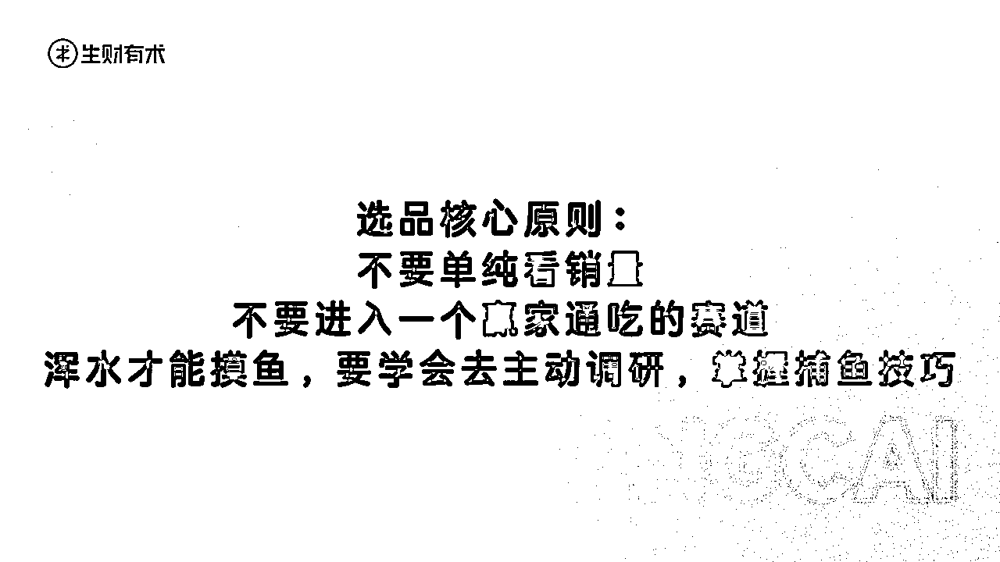

K12就是已经成熟的市场，面试题方向还没成熟。我给这类还没被好好讲过的地方起了个名字，叫“浑水赛道”，比如垂类英语、YouTube set。

真正值钱的干货，很少会写成文章发出来。它们往往只是碎片化的一句话、一个洞察，只出现在付费社群里，或者小圈子里。所以，固定的场域里才有真东西。

水浑的地方，要主动练习捕鱼技术，而不是等着鱼自己跳上来。

## 第二个核心：这个平台最新的选品法

这篇笔记我最早是丢在赚钱号上的，播放数据很拉胯，点赞才七十出头。“八月选品新思路”，是我最近摸索出来的东西。

如果你的📕还没开放进阶数据，建议马上把APP升到最新。上线后能查到两类关键信息：店铺注册节点、商品首发节点。

举个例子，7月4号首发的英语漫画，过去一个月冲到了1062单。单品破千的体量，基本可以判定现在处于红利窗口。英语漫画这个方向，你怎么看？

再聊那条“虚拟定制资料 词汇量暴涨”的玩法，怎么做？第一反应多半是闲鱼，闲鱼能用，但我后面会给一个更直接拿到货源的选品入口。

### 先拆解一个爆款

第一个案例就是“词汇量暴涨”。定价7.99，7月4号上架，一个月下来流水大概八千多，老截图还在我这儿。

7月31号又补了一波，卖了121单，对当事人来说仍算出圈。店铺只开了44天，动销率很高，起号速度很快。

要对标的也就是这类账号，多刷多看规律就出来了。

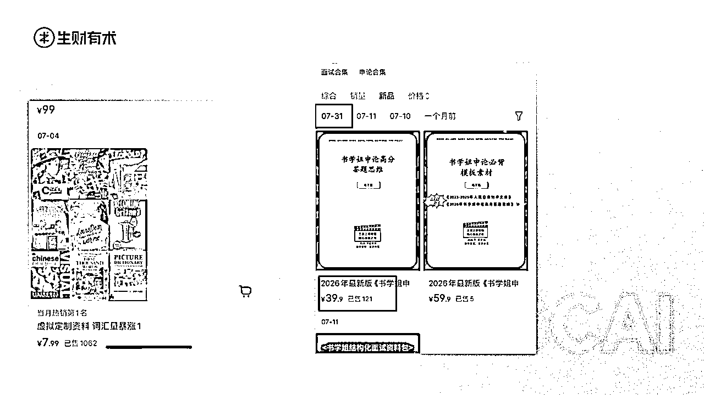

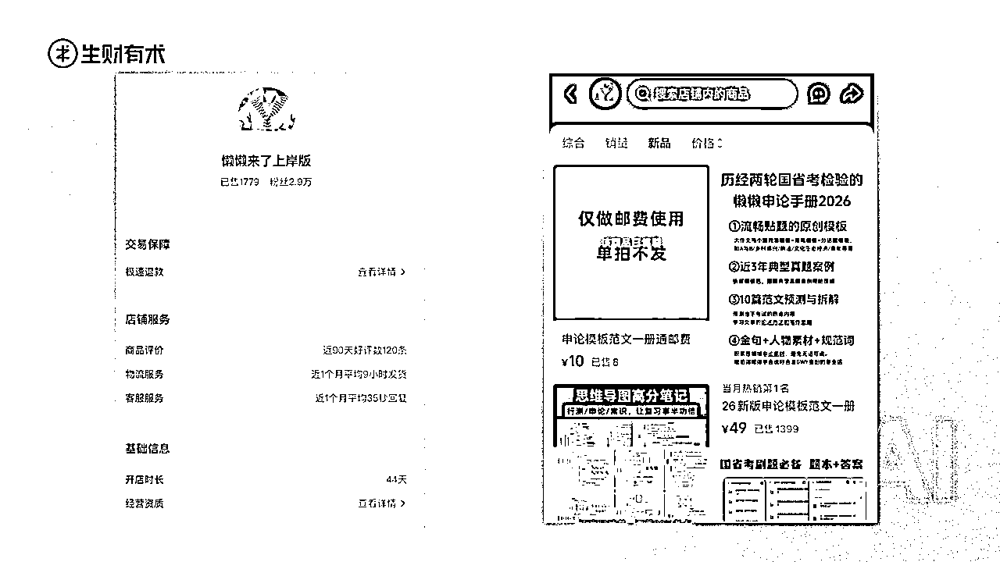

## 第三个要点：学习与拆解的方法

很多同行会问：赛道锁定后，怎么往细里拆？

### 第一步：先定赛道

选品先从定方向开始。比如我把第一个方向命名为“垂类英语”，也就是英语的垂直细分。不是去系统教学，而是帮用户用更高效的方式学英语，这才是垂类逻辑。

我自己英语也就四级水平，大多数人也差不多。那我们有什么优势？只能靠选品切口。

先模糊锁定一个赛道，比如“垂类英语漫画”。有初步想法别急着上，先做交叉验证。

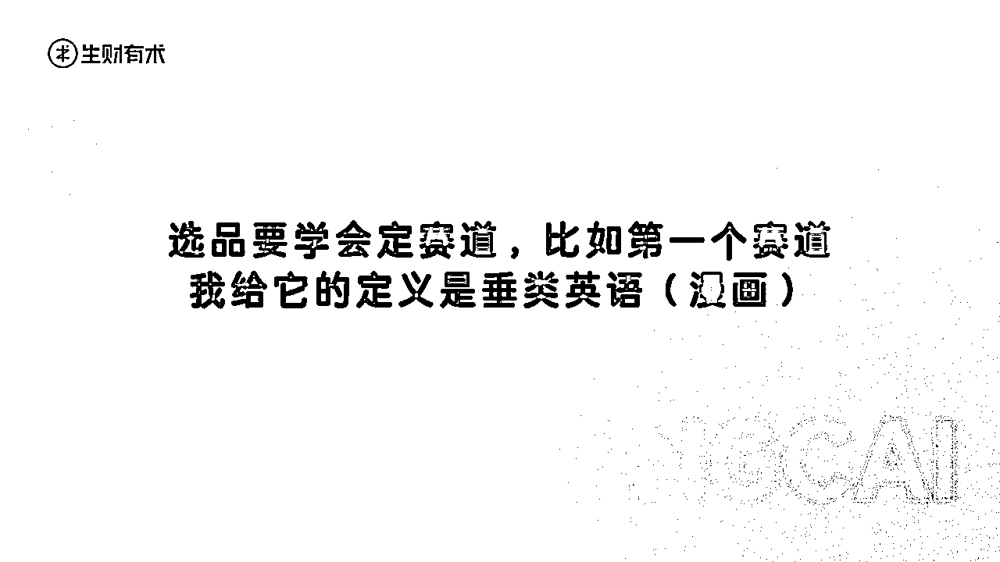

### 第二步：📕同类检索

用📕做横向检索，现在就能搜“英语漫画”看市场体量。可以发现很多人都在做，热度很集中。说实话我自己没查之前也不知道英语漫画能吃到钱。

觉得方向可行，下一步就要想货源。第一联想还是闲鱼吧？

接下来要琢磨两点创新：货源怎么拿到、怎么做出差异。

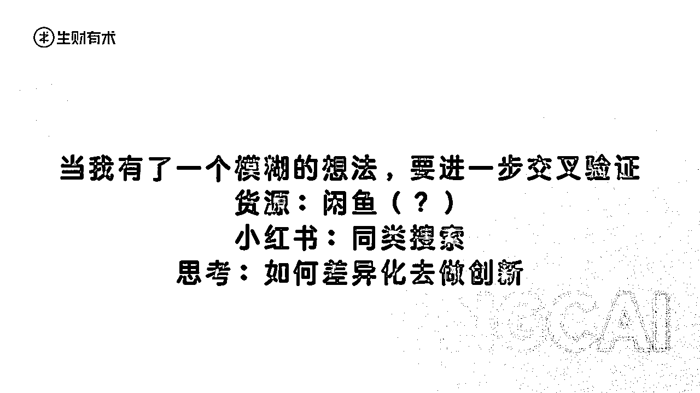

### 第三步：差异化思考

不能和别人卖完全一样的东西，一样卖就是低价内卷。K12从69.9跌到0.99就是典型，销量看着高，利润没了。

再看英语漫画，基本都是原版漫画在流转。源头报价多少？1.28元。逻辑是不是就通了？

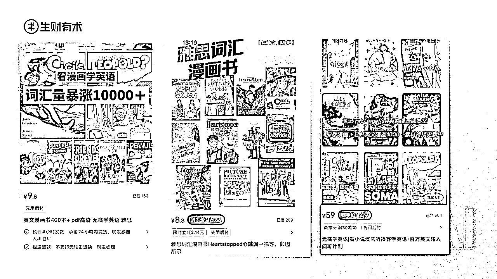

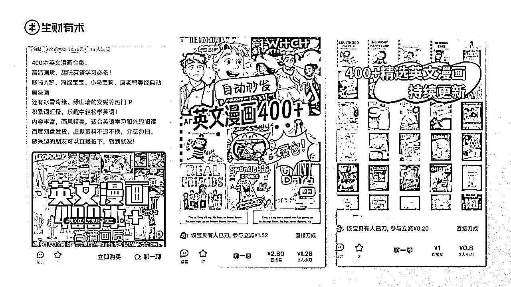

## 第四个要点：英语漫画的商业逻辑

英语漫画的本质是情景化记词。传统记词是什么？捧着词典硬啃，合上即忘，效率很低。

它能爆的核心在于场景化。每个年龄段都有对应的场景需求，而学英语是东亚通病，背单词更是长期痛点。

高三3500、四级词、六级词、雅思词，每个层级都是独立需求。这样选品是不是就能更精准？多问一句为什么，它能火是因为让背单词变得轻松、有场景，而不是从abandon死记硬背。不同人群不同阶段都能切进去。

## 第五个要点：原创赛道的机会

看原创赛道：“垂类英语赛道”。大赛道里找小场景，聚焦真实需求，还能用AI辅助复用，新手门槛很低。

这是之前我不会公开的，今天说开，就叫垂类英语赛道。

大赛道加小场景加持续付费需求。

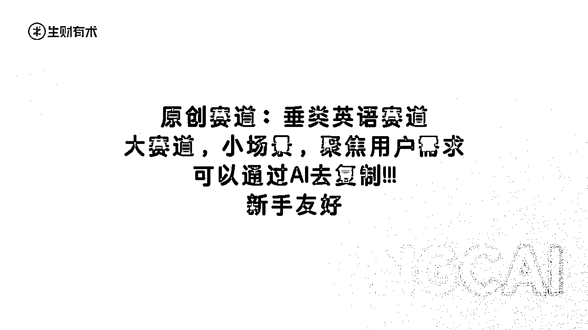

* * *

说到职业赛道，比如面试题赛道。语言学习韩语、日语、英语、法语，个人成长类都可以结合AI赋能。具体后面再展开。

刚才聊的是选品，另外也在带大家理解“AI加📕虚拟电商怎么做”。

## 第一个要点：大模型选对是地基

先问大家都在用哪些模型？ChatGPT？豆包？DeepSeek？有在用Claude的吗？还有Gemini，国内常叫做哈基米。

为什么提Gemini？闲鱼上十块钱能买一年教育通道，用2.5 pro。省钱先行。ChatGPT有人充两百刀当AI实习生，也有人充25、20刀。

其实有套利路径，后面会分享，尼日利亚区五十块左右能搞定。模型选择很重要。

我建议少用国内端，文字表达和指令理解上相对薄弱。长指令千字级测试过，DeepSeek、豆包执行度不足，Claude、ChatGPT、Gemini能更严格遵循指令。

### 我在用的集合工具：POE

Claude我长期用，但封号麻烦。现在全部放在POE上跑。POE是一个聚合层，主流模型文字视频都有。

文字需求我优先推荐Claude和Gemini。GPT-4现在更像冷静理科生，情绪价值偏弱。Claude的代码能力也很强。

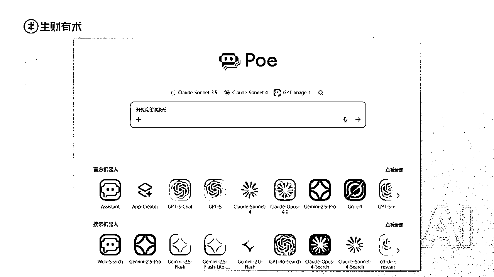

## 第二个要点：分布式提问，我的方法论

核心观点：不要对大模型一次性all in。知识库可以合并，提问千万别一锅端。

有没有这种感受：让AI一次出，字数够了，但读起来平庸，没张力？复杂指令下，答案就是水。

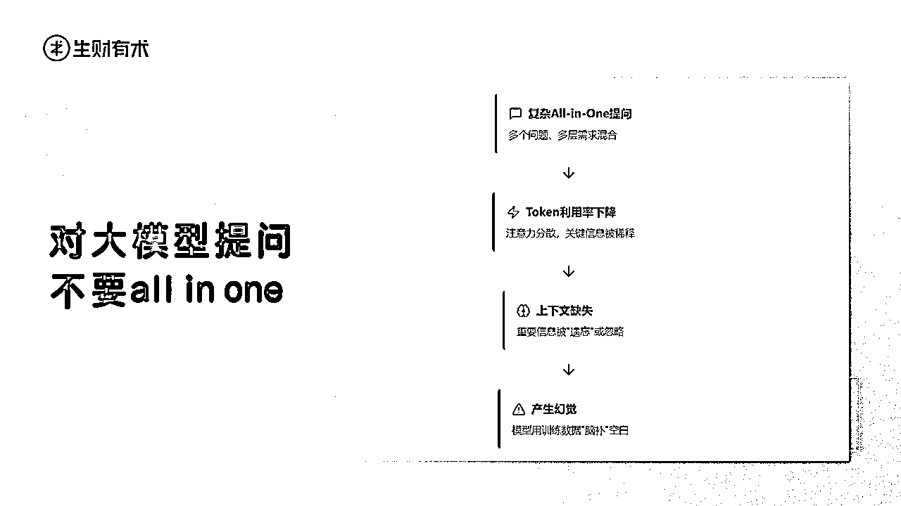

### 一次性提问为何会崩

复杂需求一次性丢进去，Token利用率就掉。Token可视为模型的算力货币，窗口有限，思考加输出都在消耗，注意力分散，回答自然平庸。

还有上下文丢失，聊久了模型就失忆，窗口饱和后开始幻觉。做严肃任务时这点致命。

可以去研究上下文工程。

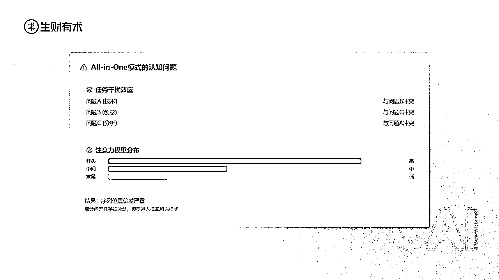

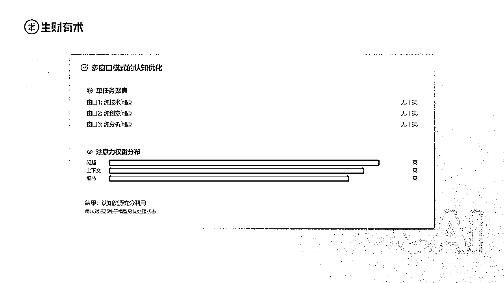

### 上下文工程的本质

上下文工程现在比提示词工程更火，它讲的是提问艺术，不只是step by step指令，还包括长短期记忆和工具调用，是做Agent的基础。

Token别浪费在复杂问题上，模型虽强，复杂任务下分配是平均的。

要精准答案，就别给复合指令，权重会失衡，前后互相干扰。

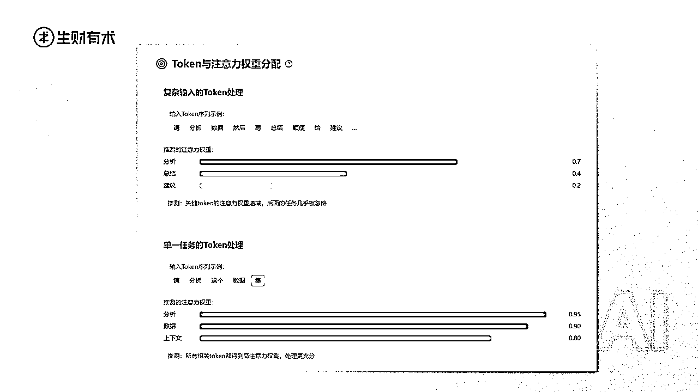

## 第三个要点：分布式提问实操

我提出“分布式提问”。九成文字需求都能用这个解。第一步先聚焦单一问题，拆工作流。

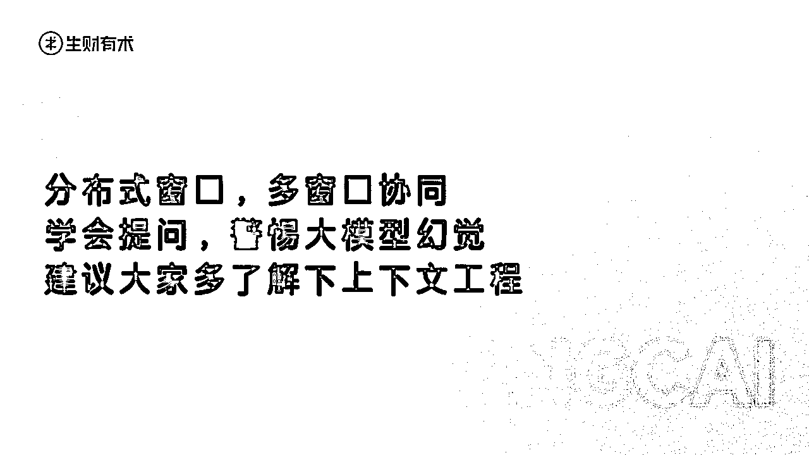

比如要做一个两万字的面试题库。普通做法是：你是一名HR，帮我生成两万字面试题库，要求……

这种出来能用吗？不能用，因为不够专业。

### 面试题赛道的价值

面试题在📕很火。账号“职场密码”开店251天，卖面试题卖到120万，全是AI生成的。

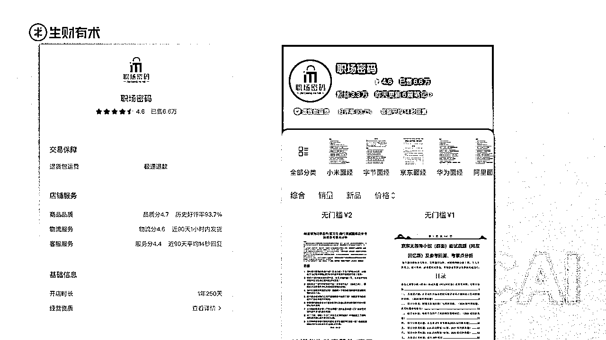

### 单任务拆解

单任务聚焦怎么做？把面试题当项目来拆。不是直接生成题目。

先整理题目清单，第二步生成参考答案，第三步整理到飞书文档。

可以开三个窗口：窗口一出题，窗口二出答案，窗口三排版。职场密码一个产品20到50道题，一次性生成20道，质量肯定不行。Token会被摊薄。

我会把注意力全部压在20道题上，每道都打磨。指令越多，后面任务越敷衍。单一任务拉满，才能靠智能体拿到好结果。

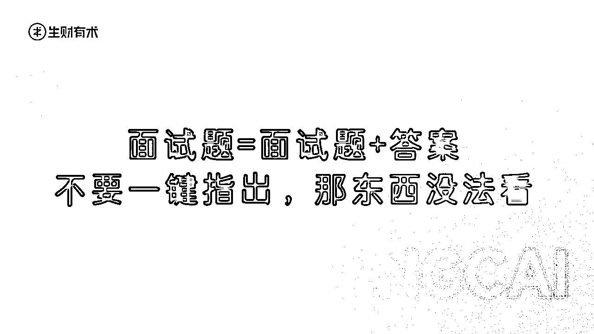

## 第一个要点：提问能力与幻觉防范

大模型幻觉很可怕，聊着聊着就忘了，浪费时间也浪费Token。一定要学会提问，防幻觉。

多看上下文工程的资料，微信、📕、YouTube上都有，一线AI大牛都在讲。

问个问题：虚拟产品下单首因是什么？解决痛点？减焦虑？价格？心理安慰？都对。

但我观察到，📕上低价不是好生意，低价容易让人觉得搬运。字数多才是优势。

面试题我生成三万字卖15.9元，你还能说什么？字数多等于多次生成积累。

### 多次生成的逻辑

两万字题库，别一次性要，每次三千字，生成七次就够了。提示词调优好后，多次输出远比一键直出靠谱。

“DeepSeek加豆包表格等于500篇笔记”这种案例，看着多，其实都不能用。因为AI圈对结果定义是任务完成了，而市场要的是能卖出去。

### 盲测检验质量

我做AI笔记，第一件事不是发，是盲测。A和B两篇同时给几个人看，让他们判断哪个是AI写的。超过一半人判断不出来，就说明内容平权了。

我很爱做提示词调优，就是为了这个。

## 第二个要点：AI加📕的变现

现在是垂直小号时代。几个月前AI加👸号就能拿推荐流，三月份我已经能用AI做📕。现在有账号纯AI起号在变现，笔记AI发，虚拟产品AI做，我来发货。

只是发货跟不上，手机老关机被扣钱。那就是我的实验号。

AI完全可以帮你搞定📕、👸号、脚本创作并拿到流量，关键在提问。

## 第三个要点：面试题赛道的商业价值再看

“职场密码”已售6.6万份。开店一年250天，按20元客单算就是130多万，矩阵号。

他页面写着“考查点和参考答案使用职场密码智能面试场景合成算法生成，仅供参考”。说明答案是AI生成的。

大家卡点在原创，其实不用。用户要的不是真题，是思路和安全感，AI就能给。

这个项目是可以照搬复制的，而且我为什么要一再强调它，现在时间点正好卡在8月，接下来9月就是秋招爆发期，需求扎扎实实稳住了。

### 上手时的实操提醒

做这种类目上线时，页面上务必标注“算法生成”，标题写清楚就行，有需求的人自然会搜面试题去找。

万一有人来抬杠，别纠缠。我们的本质动作是变现，不是去消耗精力扯皮。9块9的东西，你犯得着花那么多心思应付吗？平台基本会站在卖家这边，真要麻烦了直接给个退款，把精力锁回到核心动作上。

整个平台白嫖现象很普遍，特别是虚拟货。AI生成的这类素材，现在压根没有严格的检测机制，我没写AI生成它就是检测不出来。

今天顺带也教下怎么用AI写📕笔记且不带AI味。绝大多数人写AI笔记根本不懂提示词的门道。提示词里有个真正顶级的技巧叫Few Shot，也就是少量示例提示。

很多人写提示词都是“我现在是一名资深📕创作者，请基于这个主题写一篇笔记，要无AI感”。这种写法基本没用。AI很难和AI就“AI味”达成共识。

我判断一篇文案是不是AI写的，有个很直观的判断标准：如果一上来就是“姐妹们”，我敢说有80%的概率是AI写的。现在📕的语料里早就不流行“姐妹们”“谁懂啊”这种说法了，这些都是过去的老数据集。AI明显滞后。

## 第四大核心：面试题项目全流程复刻

我讲这个项目恰好是普通人能做的典型案例。完全零基础的人拿着我这套SOP就跑起来了。这套SOP外面要卖4000块，他现在已经回本了。我今天直接免费放出来，包括一对一演示，还有我用的POE账号，后续都会给大家。

为什么我断定它能稳定月入过万？看数据周期：8月10号到8月16号，这根本不是秋招的高峰期。

这七天卖了86单，日常流水稳定在300到400块。8月13号当天到了413块，更关键的是他只是做副业，每天就花一点空闲时间就拿到这个结果。

所以9月到10月秋招真正起来后，按副业强度来看，月入1万到2万是完全可期的。每天投入1小时。

我问过他日常操作，其实就一个核心动作：上新一个产品，发三篇笔记。📕吃的是搜索，30天就是30个品，90篇笔记。

我建议他可以上虚拟的占位产品，他说自己胆子小。能理解，很多粉丝急得很，下单1秒问什么时候发货，第3秒没回第4秒就退款。特别急性子。

我现在比较佛系，经常去骑车。有人问我，我就说去骑车了，下单的照样下单，也不会催发货。用户的心理状态真的不一样。

这个项目我直接拆给你了，下午还会再给你一个项目。

### Few Shot提示词方法

顶尖的玩法就是提示词工程，也就是上下文工程。

第一步是给它一个顶级对标，也就是少样本提示。谷歌的提示词白皮书里明确写过Few Shot Prompt。

少量示例对标能大幅降低AI的幻觉，形成清晰的风格锚点，打破默认输出模式，还能带入情绪和场景。

顶级对标的价值不只是模仿写法，更重要的是告诉AI在什么情境下，受众为什么要用这种表达方式去承载某种情绪，这是避免机械感的关键。人类的表达锚定的是具体情绪，而不是抽象的信息质量。

一定要记住：AI根本不知道什么是好，什么是好除了你给它高质量的案例它学不会。

为什么是少样本而不是多样本？因为Token有限，少样本能让模型高度聚焦在那个范例上。

当质量被锚定后，AI会以这个标准去校准输出，相当于给它一个质量下限。好与不好就有了边界。

更高阶的做法是再给它一个负面对标，一个正样本一个反样本，输出就会被限定在合理区间，不会飘得太远。

给AI看好例子，3到5个对标就够了，它就能学会。这个技巧既能用在虚拟产品，也能用在原创笔记。

* * *

说到渠道，我上午提过YouTube。“参考答案阅览室”80%的素材来源就是YouTube。今天下午我会讲怎么从YouTube变现。

整个生态里大家都在谈用AI做视频出海赚美金，本质是广告分成逻辑。流量的钱就是广告费。

我的打法是内容逻辑。📕聚集了全中国最爱为成长和审美付费的人群。📕+YouTube，这就是百万级生意。

下面这块内容也是今天行业主题之一，主题就是知识库。知识库也是我带直播的内容，你可能没跟上船也没关系，航海手册和高阶领航直播都会放出来，回头可以看。

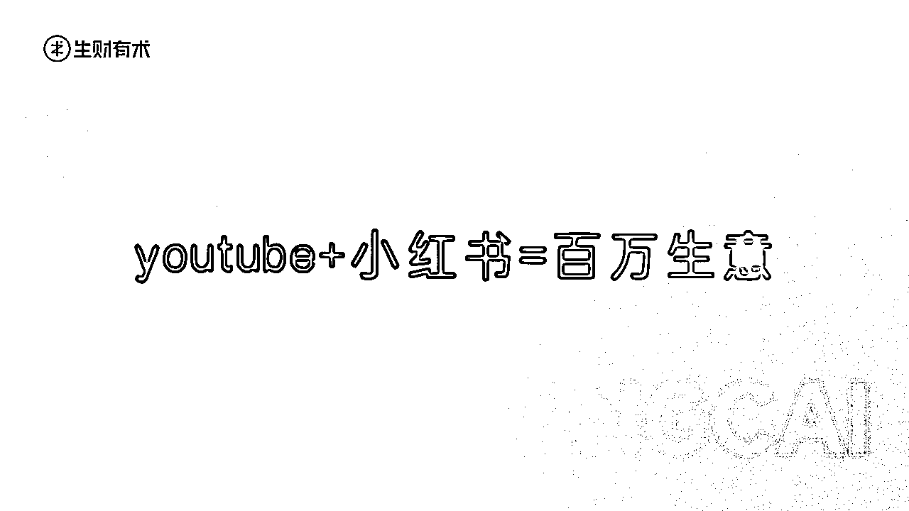

## 第一个核心概念：反向出海的商业逻辑

换个思路看YouTube，反向出海是什么意思？出海是为了赚美金，反向出海就是把海外优质内容搬回📕变现。这里的关键点是“搬运+整理”，纯搬运赚不到钱，纯搬运赚不到钱。

很多人以为把内容翻译一下放到YouTube就能赚钱，放到📕呢？也能赚，但前提是你会整理。

因为用户买的不是你的产品，而是你的思路。就像“参考答案”，去看它的详情页，它先立了一个心智定位：我们的知识筛选标准是什么，阅读理念是什么。先把理念砸进去，再告诉你怎么找。它不生产知识，也不只是搬运知识，它是搬运+整理。比如个人成长一类，职场提升一类，就是这样分类出来的。我们完全可以复制。明确告诉你，YouTube+📕=百万生意。

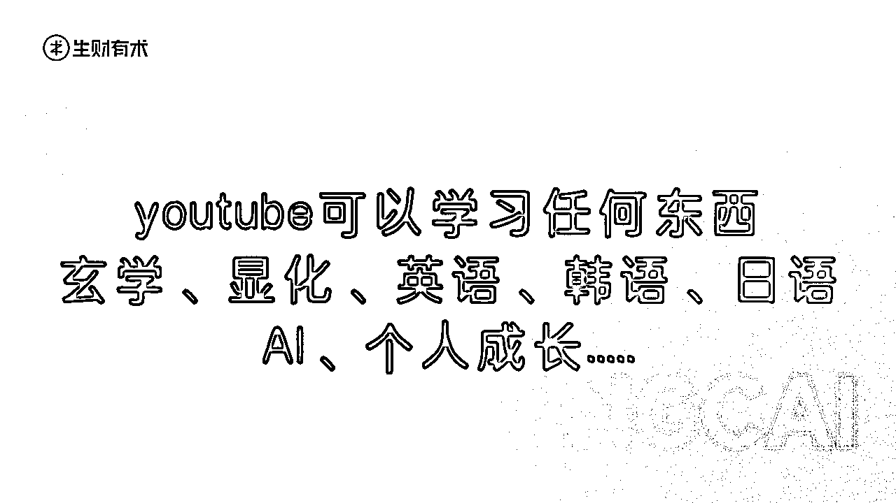

## 第二个核心：灵感来源与商业模式复制

再说下这个迷你赛道的灵感来源。我手上这本书就是答案来源，《Million Dollar Weekend》。学名“百万美金周末”。讲的就是用一个周末搭建你的商业模式，打造百万美金的生意。这本书在YouTube上很火，国外也很火。

国内📕上是不是经常刷到“24小时在📕搭建你的生意”“花一个周末梳理变现体系”？这些热门标题的源头就是这本书，讲的是48小时创办一家公司。本次迷你航海的核心主题也是这个，“24小时找到你的优势定位，包装产品，上架📕并开始赚钱”。反馈可能不会立刻到来，但今天结束前希望你能找到自己的定位并把它变成产品。

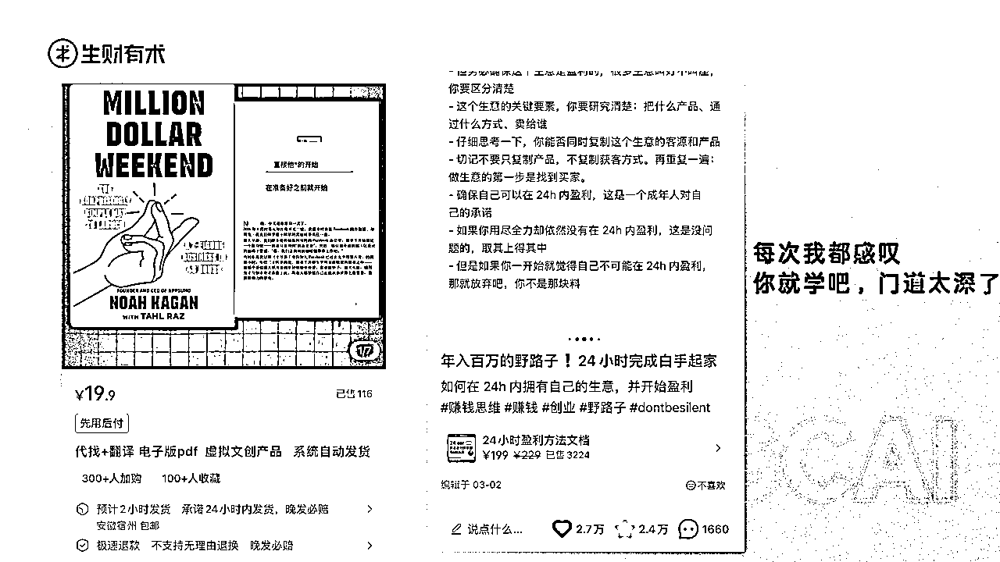

如果还没找到优势定位，就照着我今天拆解的项目去上架。比如垂类英语就是个很合适的切入点。

注意，这本书《Million Dollar Weekend》目前没有中文版。国外国内都火，这不就是可以直接搬运的信号吗？

直接翻译+做成116页的PDF虚拟文化产品卖19.9元。就是一本书的翻译，就能开始赚钱。