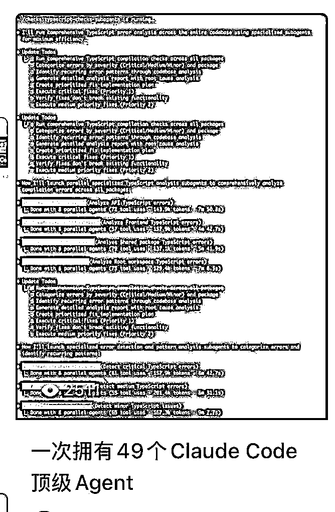
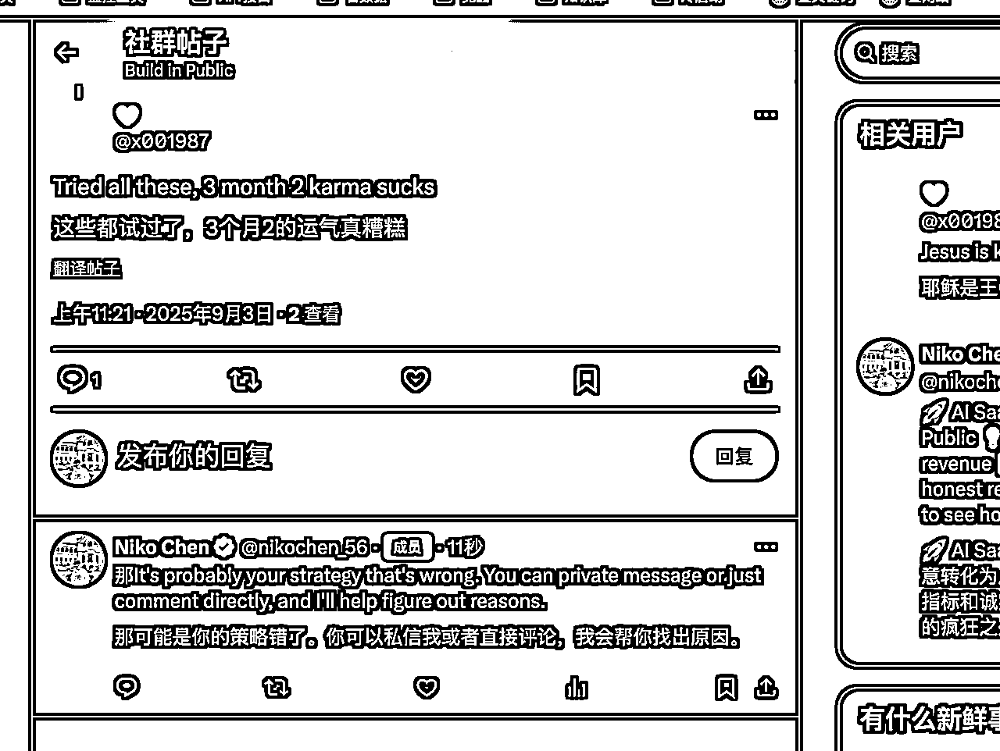
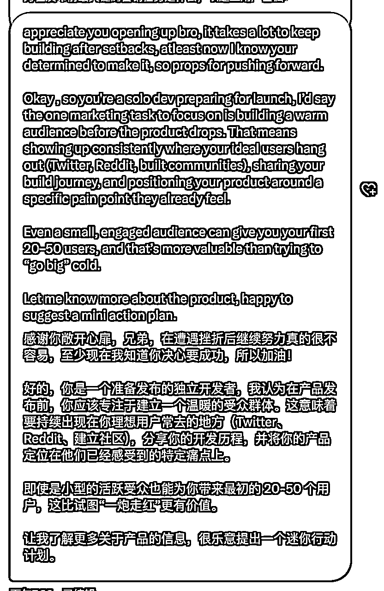
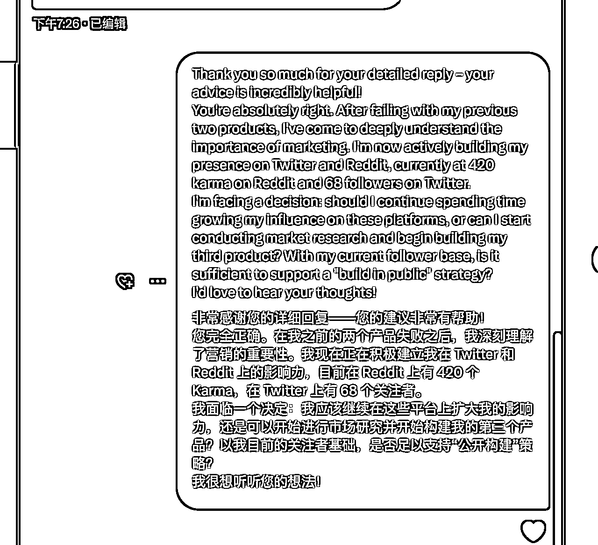
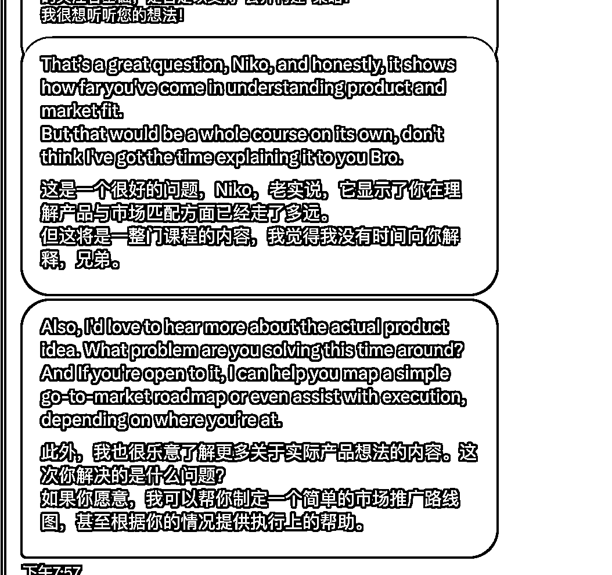
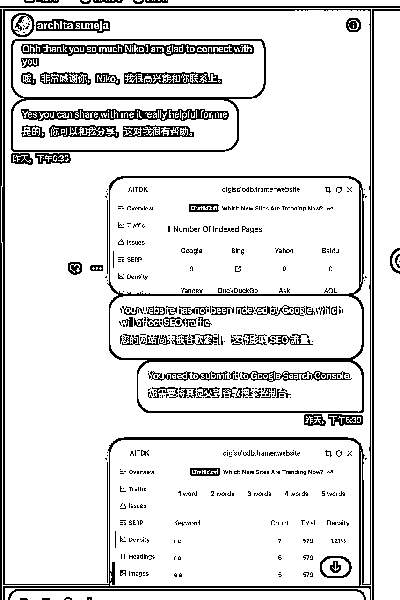
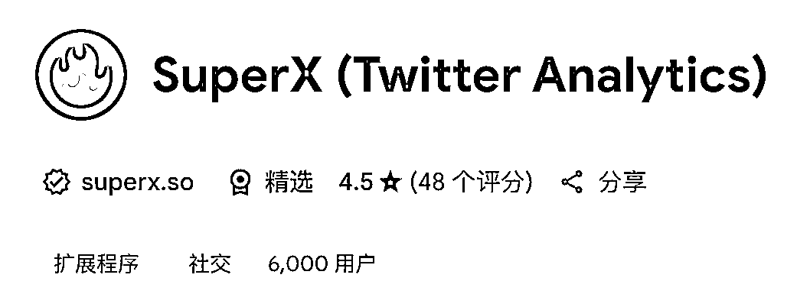
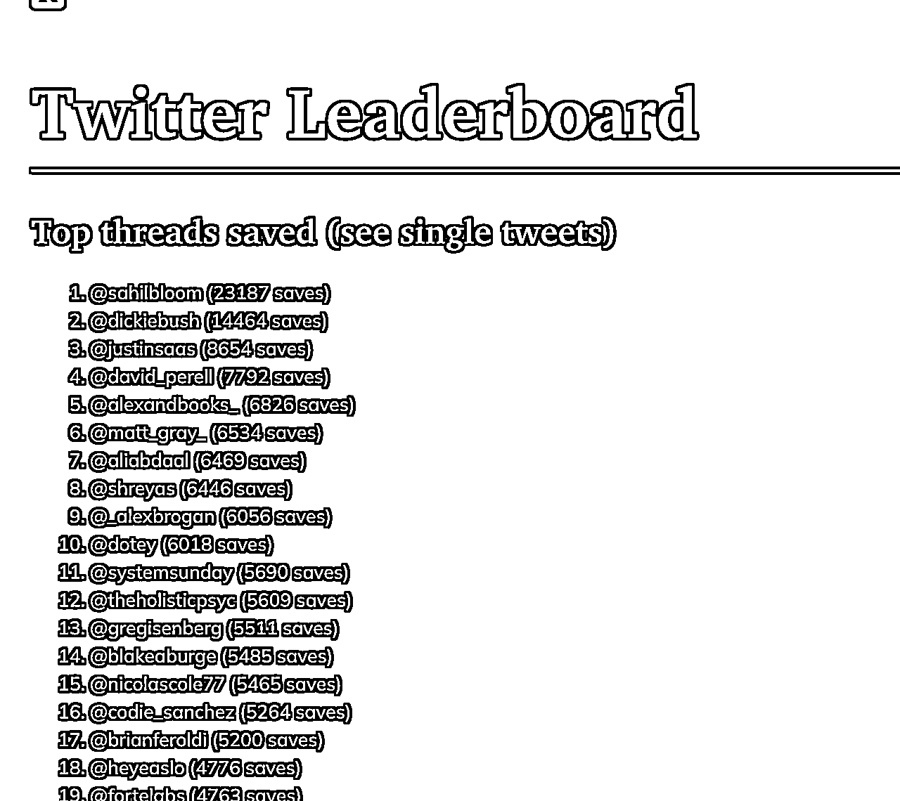
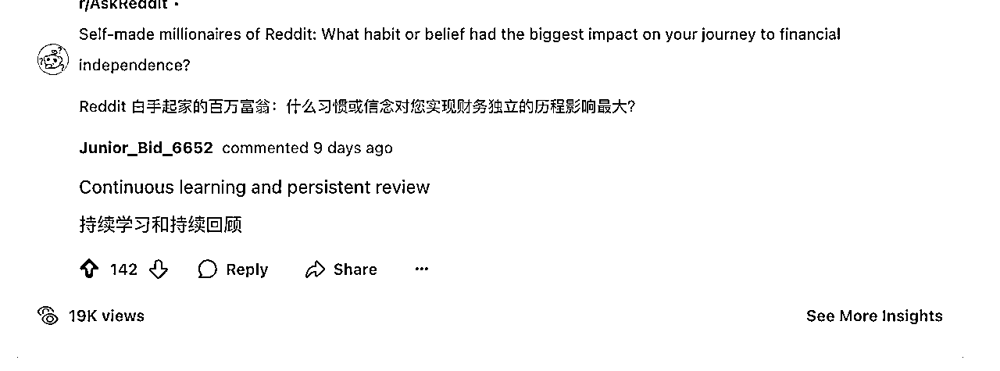
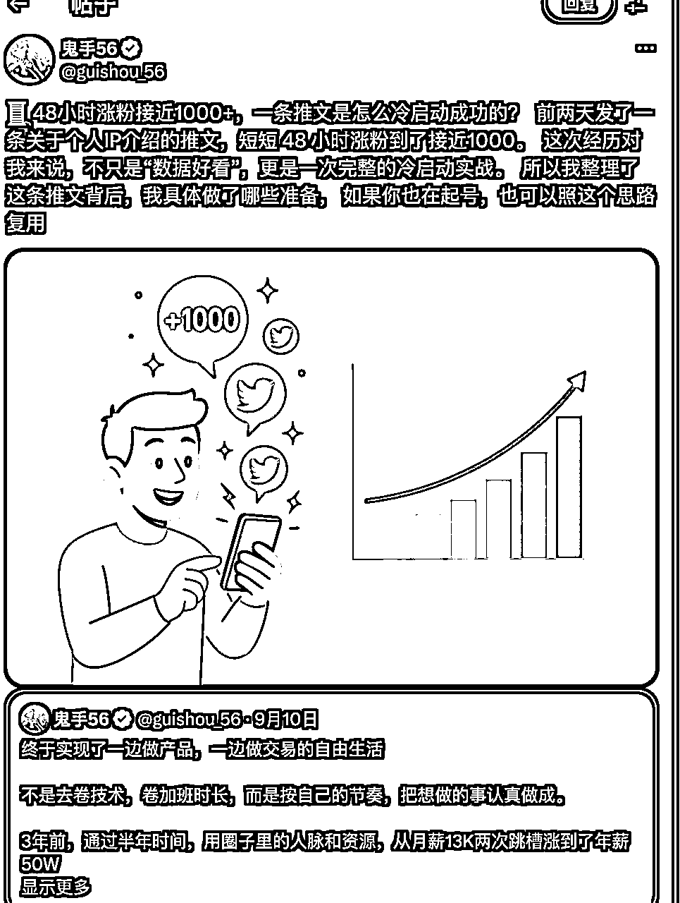

# 五个平台同步做的实战复盘：围绕极致利他做增长

## 同时操盘五大账号的真实体感

大家好，我是龙哥。最近深度参与了推特的航海项目，和一批做海外社媒的小伙伴一起交流拆解，这个过程很磨人，但也攒下了不少可用的方法论。

目前我手上有推特、📕、即刻、Reddit和👸号五条线在并行，思路就是一份核心内容多处变形利用。推特这边主做英文推，起号节奏偏慢，目前还在爬坡阶段。

即刻这边运气不错，三条内容都炸了，其中一篇登上了出海人的日常热门，另外两篇被官方账号转发并艾特，入选了即刻小镇日报7点榜单。粉丝还在100多的时候就接到了飞书的商单，涨到400+。

推特粉丝量已经快破千，最高的一条英文推文曝光冲到将近10万。

今天想聊的贯穿线是做内容必须一直保持的——极致利他。围绕这个主心骨，我会拆成五块来谈：借大V转发起号、信息溯源找爆款、多平台差异化分发、推特英文起号打法、Reddit养号实操。

## 一、借大V转发是最快的冷启动

起号最省力的路径就是被大V转发，关键点在于内容足够有价值，足够利他。航海里小伙伴的案例已经证明了这一点。

我之前👸号的一篇复盘笔记，被知识星球曹大转发，他的星球几万用户，一波就带来了冷启动流量。

自我介绍的写法也要讲究，按照手册的思路，把个人经历写成带数据、带转折的故事，讲清楚你现在的状态，这正是别人想成为的状态，让人有读下去的欲望。

再加上老师和航海教练们的转发助力，我的推文粉丝量直接起飞。这次航海最大的收获就是人脉加持，教练们全程在护航。

## 二、溯源信息源，掌握爆款的第一手

信息源的追踪同样重要，yangyi老师在高手领航里也反复强调过。

看到优质的信息要学会倒查来源。比如刘小排老师分享过49个顶级 Claude Code Agents，我直觉这条在📕会吃香，就让GPT去找了那张图的原始出处，结果来自Reddit。改写后同步到各平台后，📕那条阅读2500，点赞62，收藏106，当时粉丝只有85。

再说小排老师最近提到的 Rube MCP，能自动化运营Reddit、自动回复推特、自动回邮件，覆盖各种自动化场景，能力很强。

体验后我第一件事就是溯源，发现最早的信号是8月22号在海外一些小众社媒上出现的。

养成溯源习惯，就能慢慢积累自己的高质量信息池，第一时间拿到圈子里的原始信息。

Reddit上有很多独立开发者和创业者分享干货，我看到优质文章就会点进作者主页，把他所有的帖子翻一遍归档到素材库。多泡在社媒里，灵感和素材会越积越多，写不动的时候直接从库里提炼。

我也会专门搭建自媒体内容来源，比如对标账号、Reddit的相关子版块、通往AIGC之路、之前在Reddit和📕都火过的内容，二次加工利用。不知道写什么时打开这些来源刷一会，思路很快就出来了。

这个阶段的本质是建立一套系统化的内容供给体系，保证灵感持续输入。

## 三、一份素材，多平台差异化输出

不同平台调性差异很大。📕偏种草、偏美好，配上合适的标点和排版会更饱满。即刻更看重内容质量，不支持md格式。同一份原始素材发到不同平台，必须单独润色。

我实际测试了四款AI，GPT、Claude、Gemini、DeepSeek。实操下来Gemini写英文推文效果最好，DeepSeek写📕笔记更顺手。

推文的数据化运营我参考了yangyi老师的方法，用Notion沉淀数据，反复找爆款、拆解、测试、回流，慢慢培养网感。

## 四、推特起号：英文推的极致互动打法

中推和英推的逻辑完全不同。我做的是海外产品，目标用户在海外，国内用户价值相对低，而且中文圈Build in Public很容易被抄，所以一开始就押注英文推。

中推可以靠圈子互相转发起势，英文推基本没有捷径。0到500粉阶段的核心是极致互动，每天花大块时间在头部大V的推文下留言，争取进入热评前列，借他们的流量池曝光，每天输出10到30条高质量评论。现在我依然保持这个习惯。

核心也是利他。评论的思路是“我能怎么帮你”，提供关注、转发、检查网站SEO等具体选项。特别关注刚起步的人，给只有两个粉丝的人留言，说很高兴成为你的第三个粉丝。

举个我常用的评论模板：

这种做法同时能认识很多朋友，大家都很乐意互助。刚跟一个英推上的私信沟通，还没整理进飞书，他在请教产品冷启动的问题。

前提是自己先提供价值，比如我会主动帮别人分析产品SEO问题。

前期增长很慢，但能逐步融入圈子，积累一批高质量连接。

工具推荐两个：插件SuperX，可以分析账号数据、查看爆款推文；信息源是推特高质量用户排行榜。

https://readwise.io/twitter_leaderboard?thread 这个是推特高质量用户的排行榜

有了这两个资源就能按yangyi老师的方法论执行：

1. 用排行榜锁定优质信息源
2. 用SuperX看对方前10爆款推文
3. 用自己的话转述，并加入观点引发讨论
4. 反复循环

## 五、Reddit养号：利他评论的复利

Reddit养号同样是利他。找准几个匹配自己的子版块持续回帖，比如我是独立开发，就在创业相关板块活跃。看到别人提问如何找需求、如何拿到第一批用户，第一时间评论，曝光最大，评论 karma 有机会爆发，我最高一条评论拿到100多karma。Comment karma起来后，post karma自然更容易。

搬运时可以直接搬📕的爆款猫狗类内容。

这条回复就是逛帖时顺手发的，没想到炸了。

另外踩过一个坑：搬运图片千万别用原创图，被社区发现会一起骂，血的教训。

## 总结

回顾多平台运营，我总结了几个要点：

1. 核心理念：极致利他。无论是推特点评、Reddit回帖还是内容创作，都要先想用户能得到什么价值。
2. 系统化运营：
* 建立内容来源体系：Reddit优质作者、对标账号、素材库
* 组合使用AI工具：Gemini写英文推文，DeepSeek写📕笔记
* 按平台特性差异化分发
3. 耐心和坚持：英文推没有捷径，需要每天10-30条高质量互动的持续投入
4. 工具善用：SuperX插件、推特排行榜、四个AI协同使用

不要追求一夜爆红，建立长期内容体系和稳定节奏更重要。现在即刻400+粉丝，📕单条2500阅读，推特将近1000粉，都是日积月累的结果。

希望对各位船员有帮助，我们一起在航海路上走得更远。

附上我的推特0-1000粉复盘帖：https://x.com/guishou_56/status/1966479001771278585

里面详细拆解了0-1000粉冷启动全流程，欢迎点赞关注互动，我会持续输出干货。