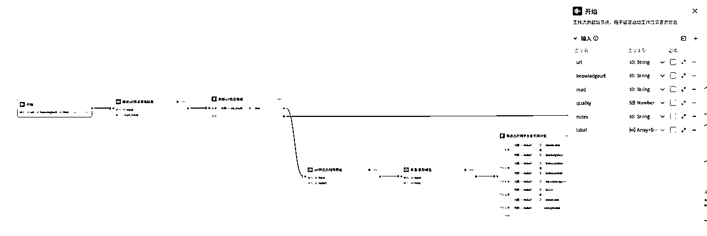
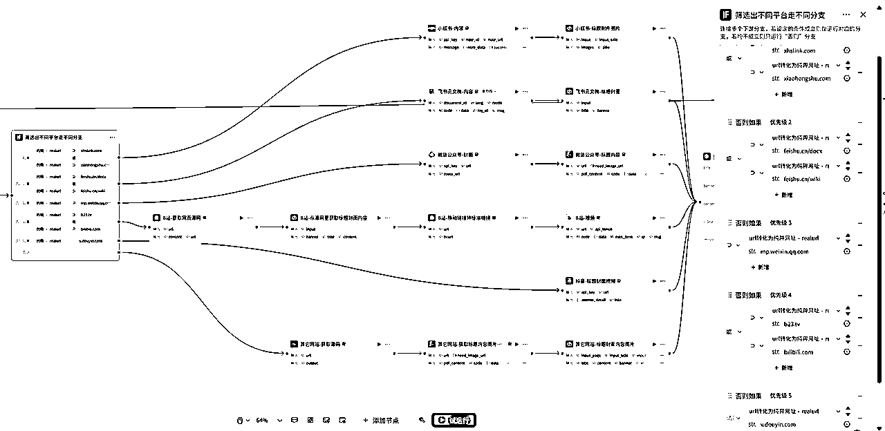
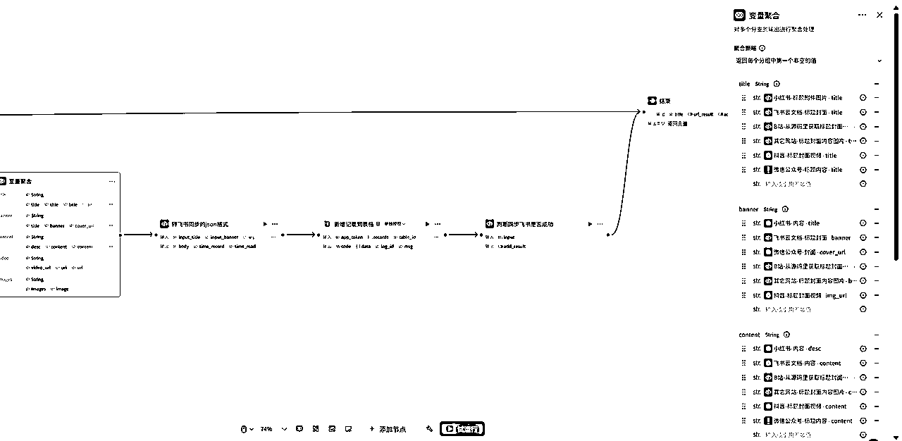
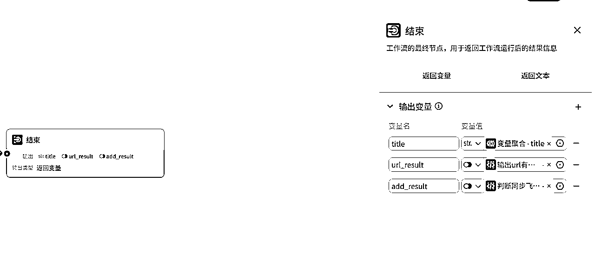

# 「勿传播」一键全网统一收藏 · 不外传教程


# 先碎碎念几句

嗨，我是「求索的木子」，全网保持同一ID，目前是一名产品经理。

不少朋友私信问我工作流是怎么搭的，我这里可以分享一下我个人版的搭建思路。

希望对你有参考价值，但要提前说明，并没有现成的工作流文件可以直接套用。我更想做到授人以渔，而不是单纯授人以鱼。里面涉及的不少小窍门，后续在实操中用起来会很顺手。

# 工作流详解

## 整体流程









上面就是我个人版的完整工作流框架，起始节点和终止节点的变量我都做了截图展示。搭建时可以根据自己的需求删减不需要的变量。

出于稳定性的考虑，我目前用到的部分插件是付费版。如果你对稳定性要求没那么高，也可以自行替换成功能相似的免费插件。

## 代码优先的原则

要牢牢记住一个原则：在 Coze 里，只要能用代码块搞定的事情，就别让大模型去做。大模型不仅准确率不稳定，调用成本也高，真的不划算。

也有朋友担心我不会写代码怎么办？

不用担心，接下来的这个小方法就很值钱了。

完全可以让豆包、DeepSeek 这类模型来帮你生成代码，下面是核心的提示词用法：

```
帮我写一段代码，可以在IDE中编辑的JavaScript代码。

## 背景
有几个输入的变量
input_page，为一段网页的源码，类型为，里面包含了，比如：

<title>产品经理如何从0-1打造一款AI产品？ | 人人都是产品经理</title> 
```