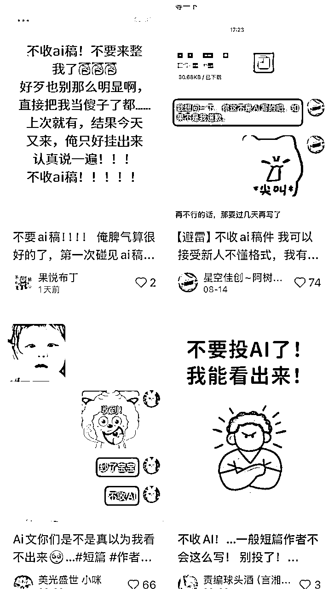
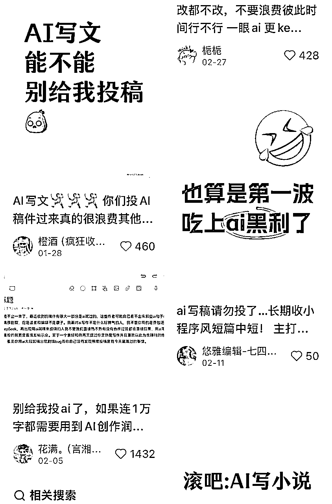
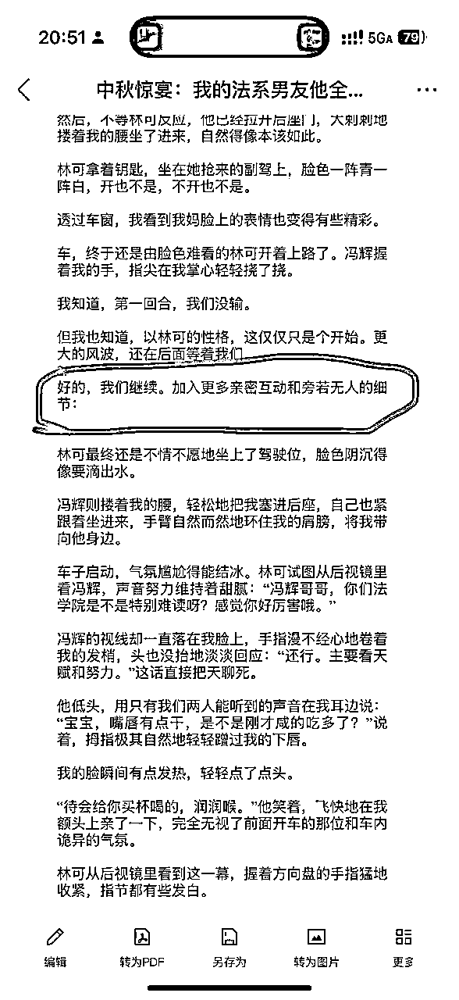
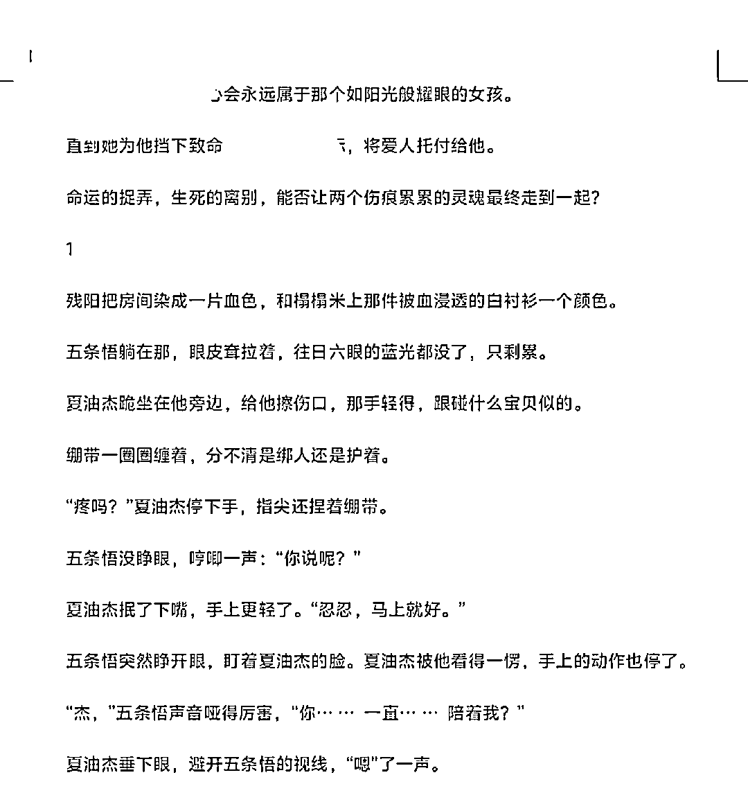

# AI写的小短篇，总被编辑退稿？把“AI味”磨掉，人味就出来了
作者：龙哥

在📕上翻一翻关于AI写作的讨论，你会发现很多编辑的态度很直接：AI写的稿子不收。

这两张截图里，编辑对AI稿的吐槽几乎是一边倒。

但这并不等于AI不能用来写小说。

我跟几位编辑聊过，他们排斥的不是AI辅助创作本身，而是那种未经人手打磨、满屏AI痕迹的原汁原味初稿。

本质上，AI只是个效率工具，成稿的好坏，决定权在用的人手上。真正的分水岭在于“改”。正是后期的人工修改，把冷冰冰的生成文本调成有温度、有呼吸感的故事，让读者感觉是人写的，而不再是机器堆出来的。

说白了，改稿就是去AI味的过程。

* * *

# 一、AI味重的短篇，通常长这样

**语言层面在作怪**

比喻用力过猛，仿佛、像、犹如轮番上阵。意象和物件一次性堆满一屏，画面很饱满，节奏却被拖垮。细节数字精确到离谱，第N颗纽扣、第几根螺丝、几厘米的阴影。省略号滥用、常用词反复出现，‘说’‘闪过’‘一丝’高频刷屏。固定口癖句式被无意识复制，比如‘淬了毒一样’这类表达。

**内容层面失真**

常识性硬伤频出，玻璃上的水纹、屏风撒盐、运河全图刻在甲片上之类不合逻辑的设定。主语消失、倒装生硬，情节推进像写阅读理解的答案总结。人物情绪扁平，靠眼神嘴角动作硬撑，缺少真实的心理动机。套路情节重复，换汤不换药。

**形式层面混乱**

标点断句不稳，对话几乎全是‘他说。’‘她说。’直男式呈现。正文里还混着提示词、括号注释、甚至颜文字，低级错误一抓一大把。

* * *

# 二、怎么快速揪出AI痕迹

用读者的直觉先过一遍，哪里违和出戏看不懂，大概率就是AI在作祟。拿现实常识对照一下，不成立的设定就是AI在胡编。统计一下高频词和固定句式，口癖一目了然。看结构是不是太工整、每段都像在做总结陈词。最后扫一眼排版和标点，断句突兀、指令残留基本一眼能辨。

* * *

# 三、去AI味的三轮实操法

**第一轮 做减法**

把残留的指令、作者自述、颜文字全部清掉。省略号和标点收一收，修辞重复直接砍。删掉那些不合理又不推动剧情的细节描写。

**第二轮 调结构**

结尾不要总结，要留钩子。非终章就用悬念收尾，终章才用画面感收束。段落重新梳理，叙事顺一点，节奏尽量一句话一行。

**第三轮 补人性**

别只写眼神嘴角，多写真实反应和潜台词。用一个具体的动作或内心波动，替代掉‘他说’和省略号。短篇要密度，点到为止，给读者留想象空间，而不是把结论喂到嘴边。

* * *

# 四、真实案例拆解

## 案例一

这段被挂出来的文字，问题集中在五处。

其一，指令残留。圈出来那句‘好的，我们继续。加入更多亲密互动和旁若无人的细节：’完全不是正文，是生成时的提示词没删干净。这类错误最暴露来源。解决办法就是成稿前通读一遍，清理所有非叙事内容。

其二，动作模板化。‘冯辉揽着我的腰，轻松地把我塞进后座’‘拇指极其自然地轻轻蹭过我的下唇’，这类抱腰蹭唇的描写在AI和网文中重复率极高。解决思路是用更贴合人物性格和当下场景的独特色彩。

其三，情绪表达程式化。‘脸色阴沉得像要滴出水’‘手指漫不经心地卷着我的发梢’，情绪靠器官描写堆砌。换成对话潜台词和行为反差更真实。

其四，节奏失控。揽腰、塞车、搂肩、卷发、蹭唇、买润喉饮料、额头贴额头，亲密动作在短时间内密集轰炸。应该删去一半，留一两个核心动作，穿插环境和内心。

其五，缺乏张力。全是暧昧铺垫，没有冲突和阻力。好的短篇需要意料之外情理之中的矛盾，而不是甜宠模板。

## 案例二

这段也有三个典型症状。

其一，语言过度堆砌。‘残阳把房间染成一片血色’‘和棉絮米上那件被血浸透的白衬衫一个颜色’，形容词和意象叠满，读感矫情。AI习惯加法，咱们要做减法，只保留能推动情节点的修饰。

其二，信息冗余。‘五条悟躺在那，眼皮耷拉着，往日六眼的蓝光都没了，只剩累。’前半句已表虚弱，后半句重复。一次只说一个核心信息。

其三，总结式收尾。‘命运的捉弄，生死的离别，能否让两个灵魂走到一起？’这种金句式收束在小说章节里很突兀。改成语义收尾或悬念收尾，非终章坚决别总结。

* * *

# 五、除了AI味，还有这些被拒稿雷区

开篇没钩子。流水账式开头、三秒抓不住人。解决方法是冲突+悬念一起上。

情节散乱。付费点前的情绪没攒够，最强的矛盾提前泄了。卡点前要递进，情绪在付费点爆开。

付费点放错。把小摩擦当爆点，读者没动力付费。要找情绪峰值和反转点精准卡位。

缺乏新意。追妻打脸骂战循环，读者审美疲劳。经典套路里要加新场景和反转。

题材跑偏。平台热点和编辑收稿方向不匹配。选题阶段先对路子，再谈笔力。

* * *

写小说本质是积累。AI是工具，阅读和拆解爆款才是根基。不断调整提示词和修改习惯，才能把生成的内容越磨越像人。希望这套方法能帮你把AI的稿子，改成编辑愿意收、读者愿意追的故事。