# 白牌美妆天猫店3年从月销5万做到年销2344万：一名运营的完整复盘

大家好，我是吴安。毕业后一直在天猫体系里打转，从客服、运营助理一路做到运营主管，期间操盘过图书和美妆两个类目。今天这篇内容，是过去3年我主管一家白牌美妆天猫店的完整记录——从月成交5万起步，一路做到年销2344万。希望能给正在做天猫或白牌的朋友一些参考。

## 一、爬坡阶段：月成交从5万到30万

2022年入职这家品牌时，它还处在0到1的冷启动期。整个公司的销售渠道分为三块：抖音、天猫、分销。抖音是绝对的大盘，月GMV在数百万级别；天猫这边比较惨淡，一个月只有5万左右，单日成交几千块；分销则因为品牌毫无知名度，基本推不动。

公司当时定的是大单品策略，所有精力都押在一款喷雾上。对白牌团队来说，集中资源打一个爆款，其实是务实且高效的选择。

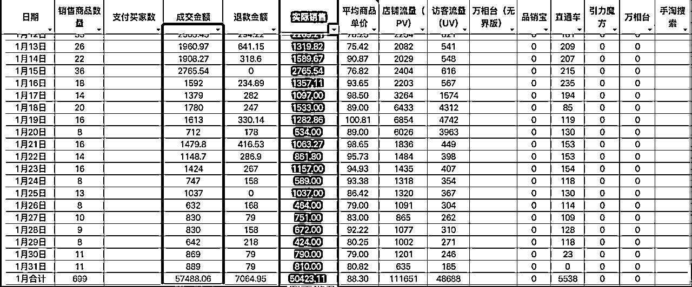

天猫团队配置非常轻：运营加助理，一共两个人。我作为运营，从店铺整体节奏、单品推广、付费投放到达人对接，全部一个人扛。公司不给大预算，但要求有利润，同时给我下达了明确目标：把天猫月成交从5万做到30万。

接到目标后，我没有急着烧钱，而是先做了一轮深度洞察。

第一步，把市场、竞品和自身全部拆开分析。当年的分析表格已经找不到了，下面用24年的数据作为示意。

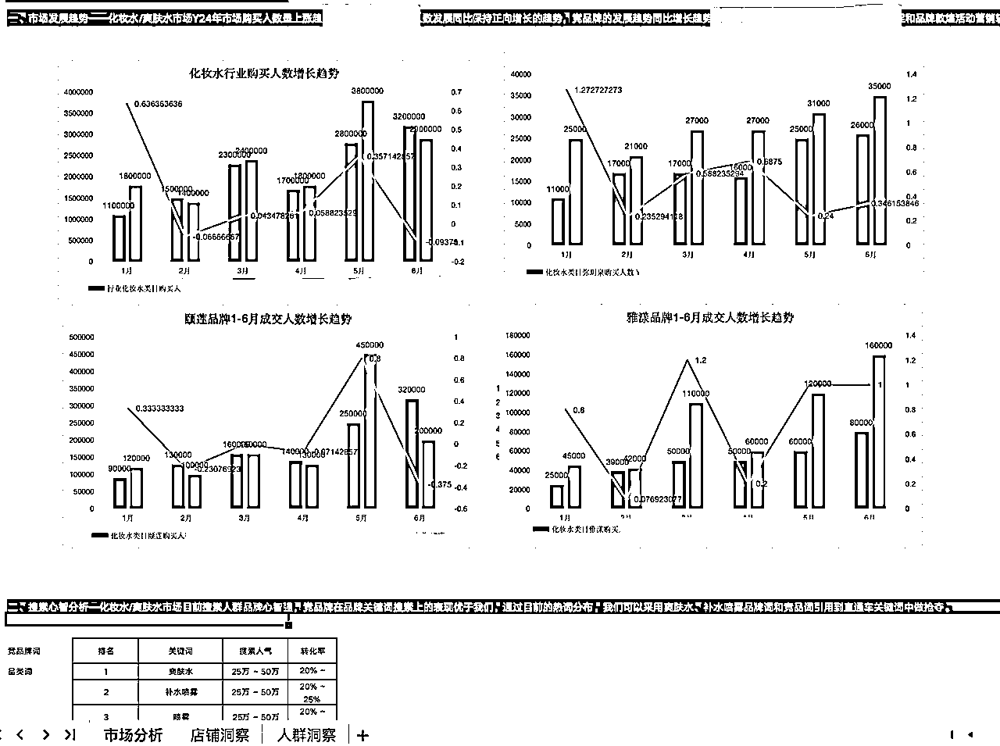
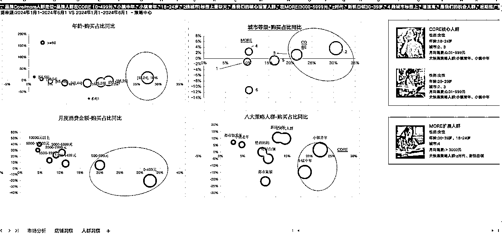
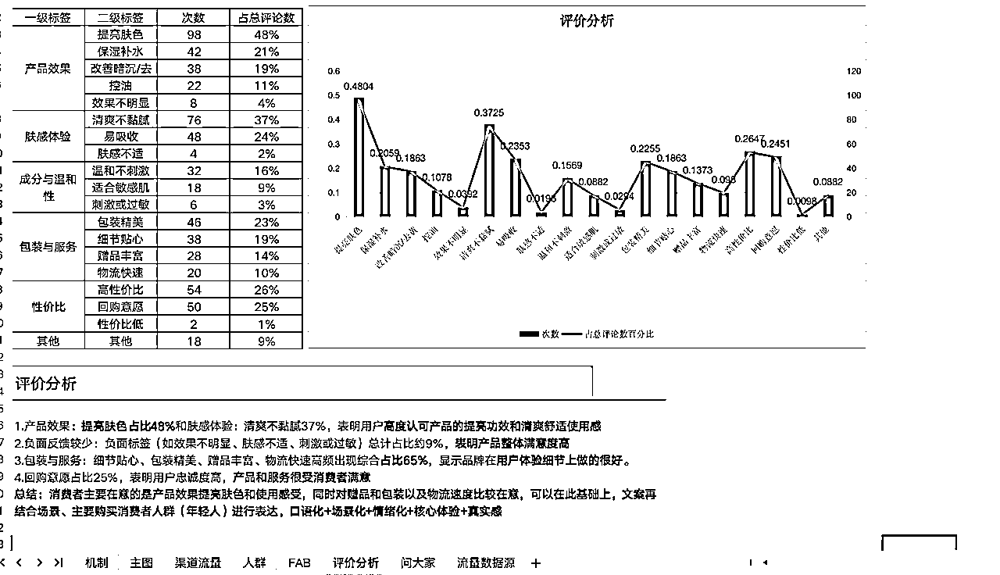
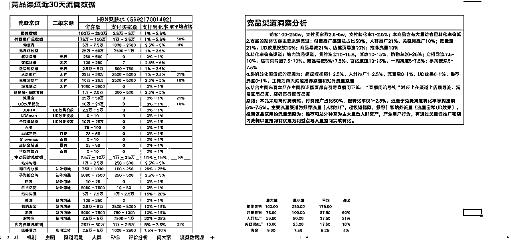

分析之后要回答三个问题：第一，同样类目里，顾客凭什么买我们？第二，跟竞品相比，我们的优势究竟是价格、功效还是赠品？第三，竞品有哪些渠道打法值得我们借鉴？

从产品本身看，这款喷雾在抖音能跑量，说明产品已经得到市场验证，不存在选品问题。真正的短板是品牌声量太小，而公司又拿不出预算做大规模推广。更尴尬的是，价格和TOP品牌持平，但品牌力完全不在一个量级。

既然品牌拼不过，那就先从价格机制上找突破口。我选了一个人群画像高度相似的TOP竞品，专门盯着它的价格和促销规则打：它日常价88，我卖78；它活动价78，我卖68。它买一送一，我就买一送二。同时增加一个低规格、高毛利的SKU当引流钩子。

价格调整之后，开始优化基本功。主图、详情页、评价、问大家、买家秀、SKU图，这些基础模块看着不起眼，但每一处都直接影响转化。

这里分享一个方法：把自己当成真实买家，完整走一遍购买路径。从打开App、搜索关键词、刷列表、被某张主图吸引、点进详情、翻评价、看问大家，直到最后付款。每一步都记录下“是什么影响了我的决策”，然后针对这些关键节点逐一优化。

评价和问大家尤其需要精细化。文案和图片要场景化，让买家有代入感，有效打消他们的顾虑。比如“学生党闭眼入”“比大牌用着还细腻”这类口语化表达。图片不要做得太假，别清一色都是精修买家秀。有私域池子的商家，可以每天安排3到5单主推款的评价维护，同时把平台自带“评价有礼”功能打开。

基本功做完后，开始拓展渠道。我把竞品跑的渠道全部列出来——达人直播、付费推广、淘客，逐项对照，看哪些我们还没做。结果补上了淘客渠道，也开始重点经营天猫达人。这里有个现实难题：头部的顶级主播通常不愿意接白牌。所以我在不放弃大主播的前提下，把重心转向中小主播，合作方式是纯佣金或保量。即使不追求当场卖出多少，也要借达人完成品牌曝光。

后来天猫达人渠道真正破局，是靠一个很有意思的案例。那位主播不讲“喷脸”场景，而是直接告诉粉丝“用喷雾洗脸”，客单价瞬间从几十块拉到几百上千。为什么能成交？因为方法对、场景对、人群对、信任够，用户自然会为这样的内容买单。

直通车、引力魔方、货品运营这些付费工具有很多执行细节，比如测图、圈人群、拉标签，这里不展开，重点说逻辑。

还有一件事，我从月销5万时就开始做——会员运营。很多小商家不知道，天猫小商家一开始并不能开通“0元入会”，买家必须确认收货后才能入会。而“0元入会”的解锁条件，跟月度入会人数和会员成交额挂钩。怎么提前搞定？三个办法：

第一，设置1元有价券。买家先花1元买一张5元优惠券，顺便完成入会，还能获得免费小样，随订单一起发出。为什么愿意花这1元？因为有优惠券加小样，明显不亏。

第二，让合作较深的达人来几笔大额订单，冲一冲会员成交占比这个考核指标。

第三，包裹卡引导。在包裹里放卡片，引导顾客入会、参与评价有礼、进私域。

为什么这么早就要做会员？因为天猫搜索和推荐算法，会优先展示用户有行为沉淀的商品。会员越多、用户行为越多，免费流量越容易进来。

## 二、淘宝免费流量的分配逻辑

这是当时总结的一张平台算法框架图：

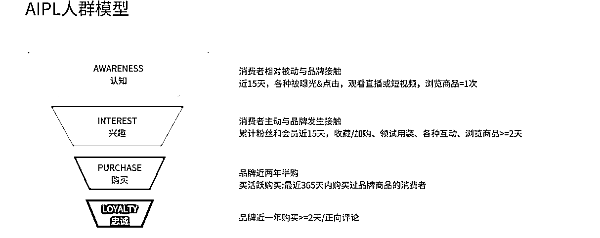

权重占比大致是：GSV占25%，商业化占25%，人群资产占40%，权重运营占10%。权重运营包括店铺体验分、层级，以及单品的点击率、转化率、加购率、复购率、差评、纠纷、投诉、介入、退货等九项指标。

商业化说白了就是付费推广，它的本质是为GSV服务的。商业化效果越好，GSV的压力越小。举个例子：同样拿1000个免费流量，甲商品能卖200万，乙商品只能卖100万，平台会把更多免费流量给谁？答案显而易见。

但只冲销售额也不够。不同渠道带来的销售额，权重并不一样，会对应各自的系数。比如付费渠道和淘客渠道各带来100万成交，前者的权重远大于后者。所以现在天猫竞争这么激烈，付费投放是绕不开的一环。

人群资产的权重最高，专业说法是AIPL——认知、兴趣、购买、复购四类人群的总规模。人群资产越厚，品牌认知度越高。日常运营的核心就两件事：不断扩大认知人群，同时推动人群从A到I、从I到P、从P到L持续流转。

这一套组合拳打下来，三个月时间，店铺月成交从5万到10万再到30万。

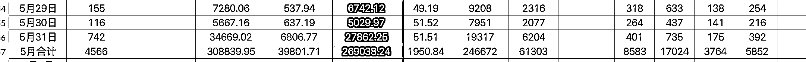

店铺由此跨上一个新层级，进入更大的流量池。从那以后，月成交再也没掉回30万以下。

## 三、放大阶段：月成交从50万到100万

做到30万之后，店铺基本稳定在30万到50万区间。想再突破，产品仍然只有那一款，团队依然是“运营+助理”。

内容端开始小规模试水，但还没到单独招内容运营和剪辑的程度，就请抖音部门的剪辑每天帮忙产出一批短视频素材。抖音官方旗舰店卖得好，加上直播达人和种草博主多，会给天猫带来一小部分外溢流量。当然，这个外溢的前提是抖音体量远大于天猫。

也试过小红书种草，但当时短期没见效，公司很快叫停。所以那个阶段还是决定向内求，回到货品、人群和渠道本身。

### 货品矩阵的第二次调整

主链接已经稳定在月销5000多件，在付费ROI的要求下，怎么继续提？我的答案还是看竞品。

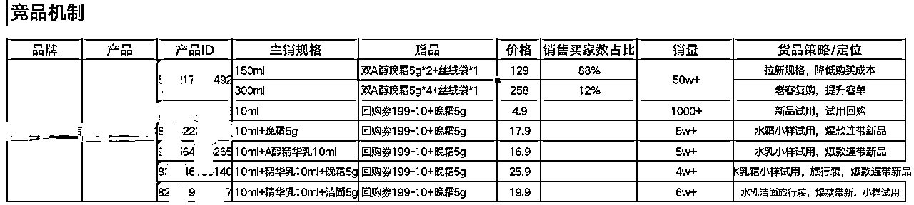

观察发现，竞品有两个规格机制是我们没做的：50ml双支装和300ml三支装。虽然都是喷雾，规格不同，对应的场景就不同。50ml双支装主打“可上飞机高铁”的便携场景，300ml三支装主打老客囤货场景。不同场景对应不同人群，虽然会和原有链接有重叠，但整体增量是划算的。而且竞品已经验证过市场——50ml双支装月销过万，不用犹豫，直接干。

于是把之前的单品打造流程重新走一遍：分析关键词、分析竞品人群和评价，重做主图和详情页，在私域池里做销量递增，再铺设评价、问大家和买家秀。

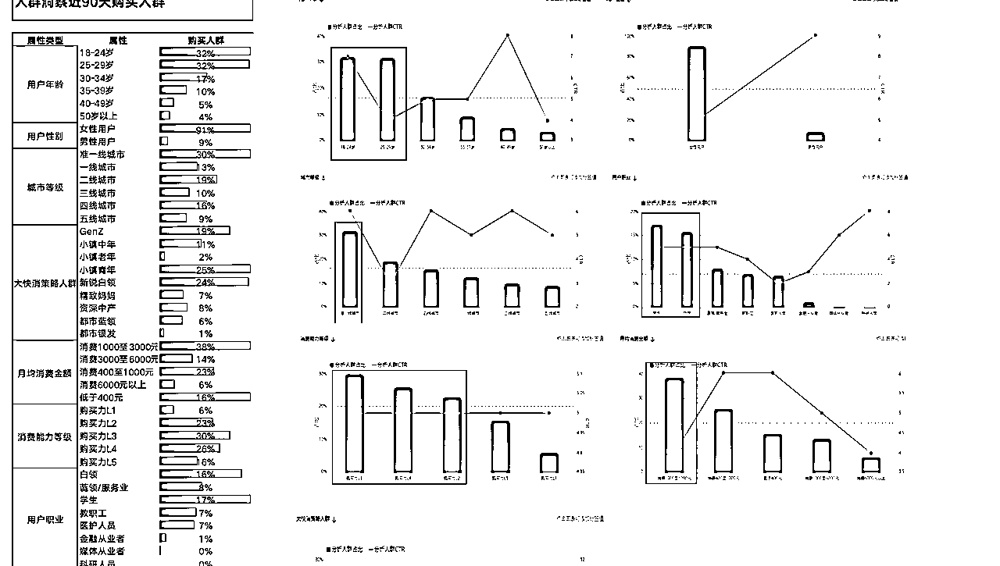
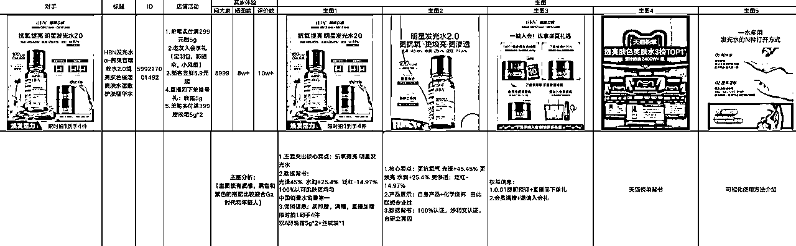
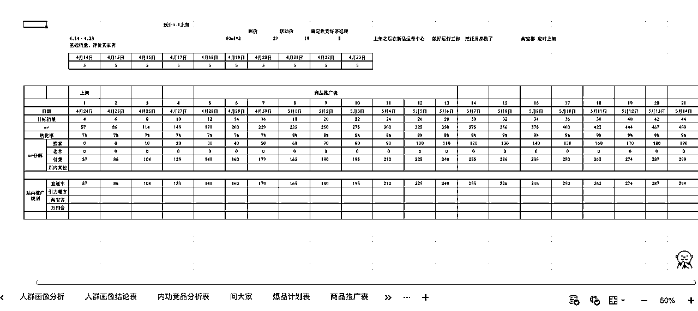
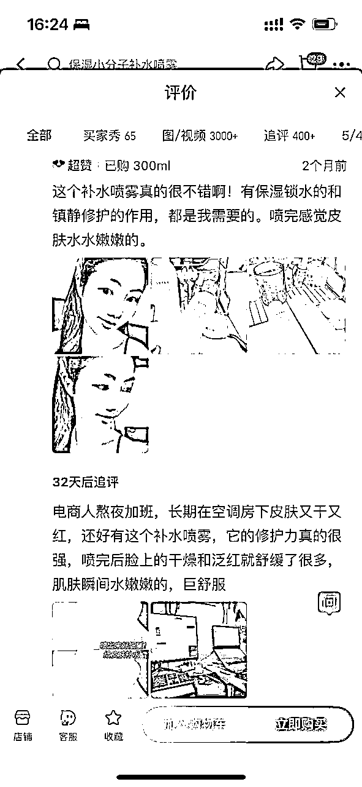
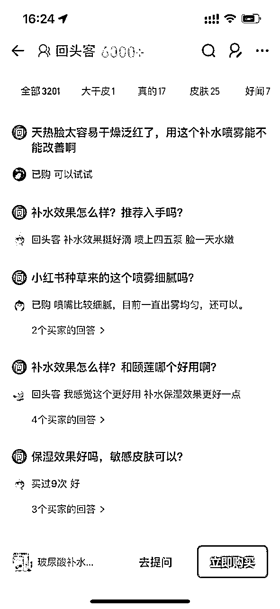

当时打“飞机场景”的品牌只有我们一家，再加上价格有优势，这个链接很快就起来了。

这里分享一个打单品的小技巧：当客单价在20元以下时，前期想快速进流量池、做销量递增，可以借助“顺手买一件”这个工具。把价格设为19.9或9.9，具体看数据反馈。但关键是不能一直挂着，要手动控制每天的单量。比如计划表里今天需要4单，那就只放4单，哪怕能卖更多也要手动关掉；明天再按计划放8单，形成持续的递增数据，喂给平台算法。

300ml三支装也按同样的流程打造，但当时购买人群和复购人群还没形成规模，所以只做了基础铺设，付费端没有给太大的费比，主要靠自然流量承接老客。等到月销100万到200万那一步时，这个链接已经跃升为次爆款，因为人群资产足够厚了。

到这里，货品布局基本成型：

- 50ml双支装：拉新款，主打便携出差、可上飞机高铁，用轻费比换增量；
- 300ml单支装：主推款、活动款，负责正面对抗竞品，投入重费比；
- 300ml三支装：利润款、囤货款，承接老客，做利润、拉客单，费比适中。

### 渠道突破：溯源直播、达人与派样

先说溯源直播。所谓溯源，就是把达人请到品牌工厂或原料产地，做一场声势更大的直播，配合比日常更有力度的活动机制。

我们当时基于那位“用喷雾洗脸”的达人，日常直播已经能带来不错的销售额。为了冲刺更高目标，决定做一场雪山溯源直播。整个过程非常琐碎：提前预定溯源时间和地点、设计机制和活动、准备背书报告资料，还要在主播直播间和粉丝群做预热，安排机票住宿行程、当地人员、开播环境网络，最后甚至要背着很重的喷雾爬上海拔几千米的雪山，累得够呛。

但结果相当值得：单场直播做了44万。当时我们全月也就四五十万，这一场直播直接把店铺送进了下一个层级。

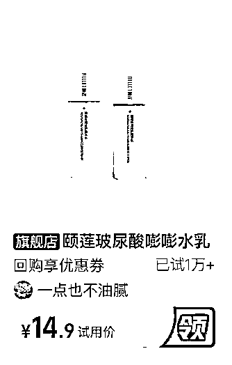
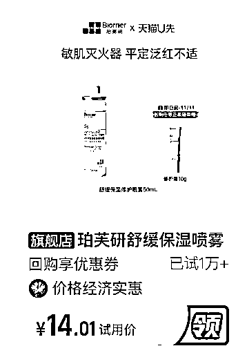
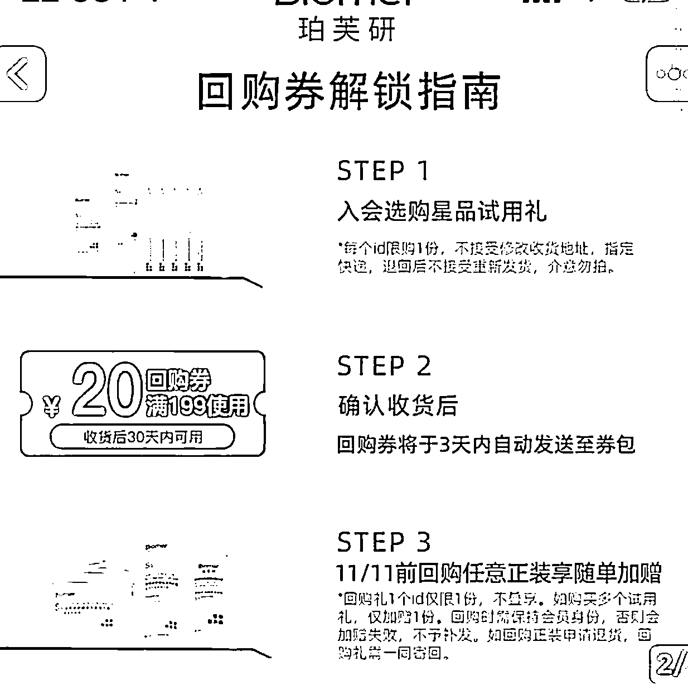

达人合作方面，当时天猫直播正处在最火热的时期，淘系超级头部主播不用多说，我们显然还够不着。但随着销售额不断增长，开始能搭上第二梯队的主播，比如蜜蜂惊喜社、蜜蜂心愿社、陈洁kiki。然而，凭什么让这些达人愿意卖一个白牌？答案很直接：给更高的佣金。

美妆护肤品牌绕不开的还有u先派样。派样的核心目的是拉新和复购，对P人群资产帮助很大。既然是拉新，后面就要靠复购来回本，所以对应的就是用户运营。当时人手有限，真正的精细化用户运营延迟到月销100万之后才做。

派样有一个关键认知：白牌阶段，同样是低价，顾客为什么选择你？拼的是权益和视觉。同等价格下，赠品要做得有吸引力——因为已经是低客单，拼的是数量压制，不是金额。还可以加一张回购券，虽然实测回购流转率不高，但能算作赠品的一部分。另外，派样的主图视觉很多商家不重视，但你做好了就能形成明显差异。

线下校园活动也值得一提。人群洞察数据显示，我们的购买人群中大约17%是大学生。于是联合市场部，在开学季做了一次校园快闪。目的有三个：为线上传播提供素材、拓展校园人群、现场引导学生入会并派样。

这种活动成本其实很低，主要就是产品成本，加上校园场地租赁费和货架费。核心思路是：想低成本拓展人群，就去找这群人的聚集地。学生聚集在学校，而人的关系网会产生裂变——一个学生试用了，至少整个宿舍都会知道这个品牌。品牌认知度本来就是细水长流的事，除非你手握大资金，否则急不来。

### 平台资源：新锐商家千星计划

销售额做到一定程度后，平台小二会主动找上门。平台之间同样面临竞争，会对商家分层，并把资源向不同层级倾斜。

当年销从50万做到380万时，平台主动联系了我们，建联了千星计划小二、行业小二和阿里妈妈小二。

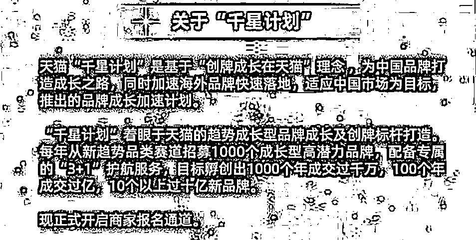
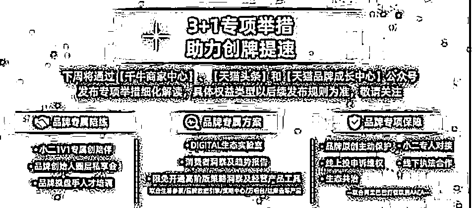

这里必须提醒所有做平台的人：一定要关注平台资源。平台自己也要增长，所以会拿出补贴来激励商家。商家层级越高、销售额越大，拿到的补贴资源就越多。这也是为什么TOP级商家很难被超越——强者恒强，资源越滚越多。做到头部，甚至能主动向平台要资源。

入选千星计划之后，原本够不着的佣金膨胀、推广费用对赌返点、TOP级达人资源、各类会场资源、平台新媒体联合传播资源、超级单品，全都源源不断注入到店铺里。

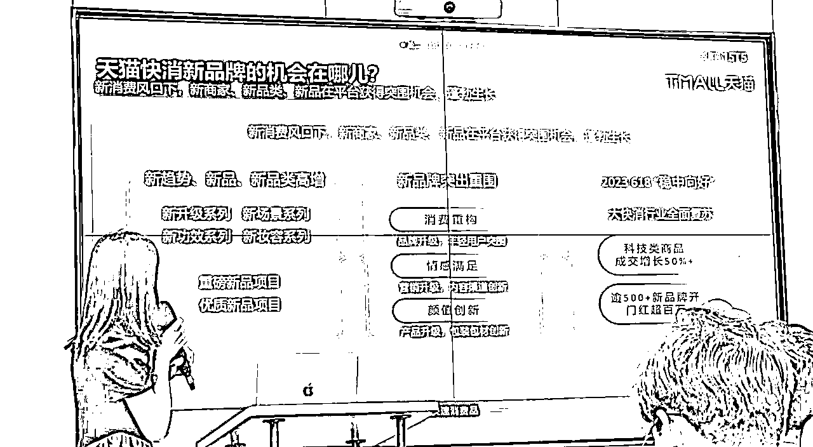
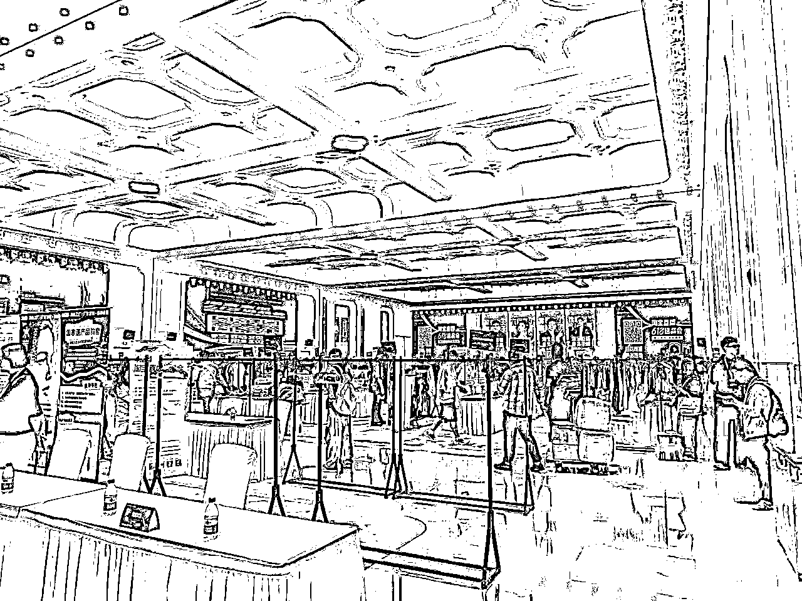

如果你正在做平台、做店铺，请尽快找到对接你的行业小二和组织。

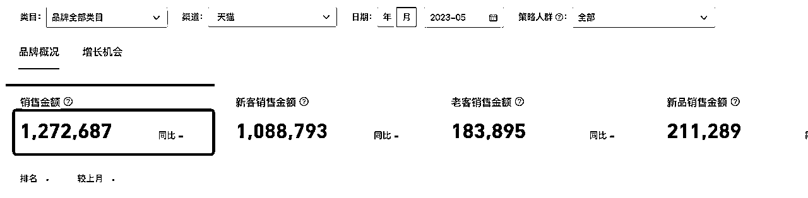

## 四、精细化运营：月成交从100万到200万

这个阶段，单纯靠粗放式打法已经很难增长。竞争异常激烈，还要保证利润。而且随着店铺销售额和人群资产不断上升，每天都有大量新客变成老客，如果老客流失，是巨大的损失。要知道，一个老客的获客成本远低于新客。

所以，会员精细化运营被提上了日程。团队配置也相应升级为：运营主管、运营专员、付费推广、会员运营、内容运营、运营助理。每个板块都有专人负责，我开始把更多精力放在整体运营方向的把控上。

### 会员生命周期怎么做？

先看会员搭建的整体框架。

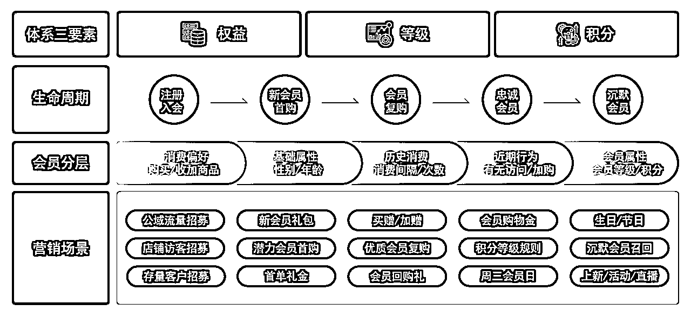

会员体系的搭建是一项系统工程，包括会员商城页面视觉设计、会员等级设置、积分兑换等等。这里重点讲会员生命周期。

新会员入会与首购，主要通过以下触点完成：平台入会立减工具、主图和详情页展示、包裹卡、客服引导、短信触达。

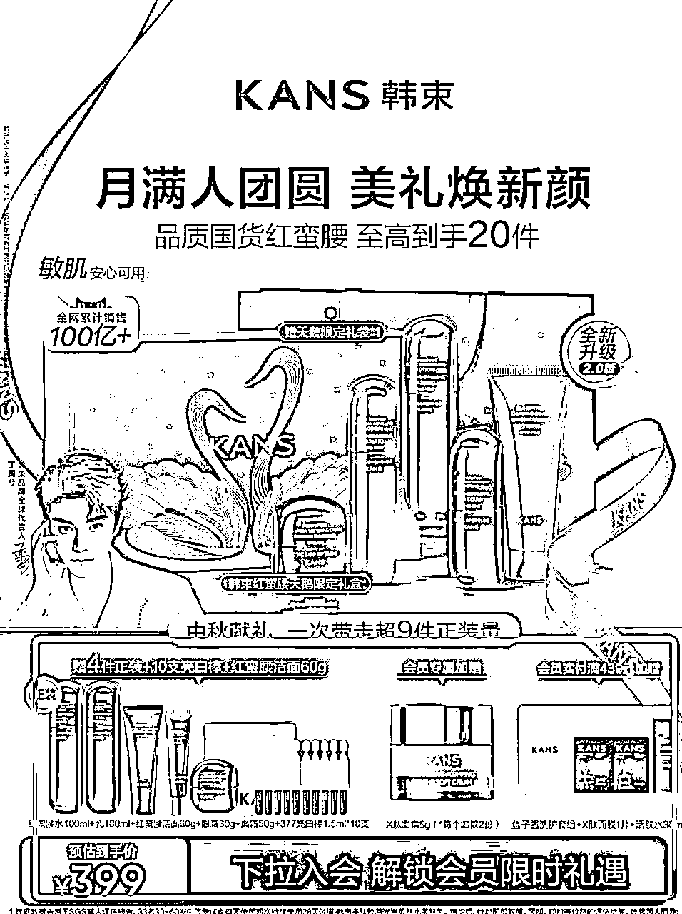
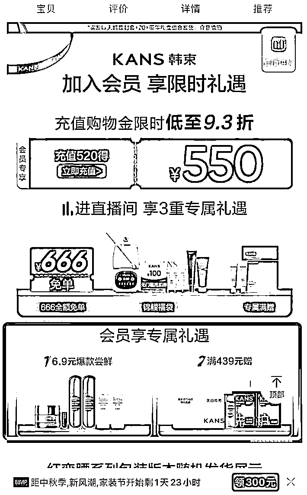
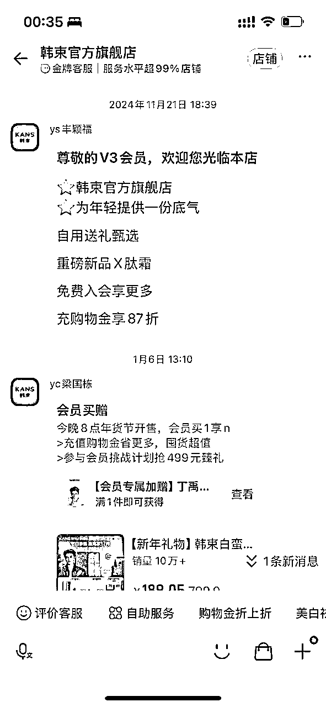

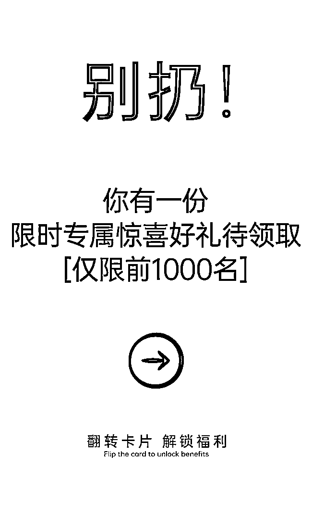

我们测试过一个效果很好的方法：顾客下单后但还没入会时，立刻发一条短信引导入会，流转率很高。短信文案大概是：“亲，看到你下单了某商品，现在点击入会即可0元再享专属权益，随单发出哦，点此直达。”这个操作不需要手动插件，自己就能实现。

会员复购和沉默召回，核心是三个动作：触达、权益、行为交互。

第一是触达。利用CRM插件圈选会员老客人群，一般按复购周期来：圈选近120天购买过一次、但近30天未购的用户，用短信做精细化触达。同时通过达摩盘这个平台分析工具，用付费方式触达同一批人群。短信和付费工具双管齐下，对老客和沉默用户进行多次触达。

第二是权益。针对老客复购，我们给出的权益是复购礼金和复购加赠。针对沉默流失客户，测试下来最有效的还是直接半折。

第三是行为交互。持续推动用户与品牌产生互动，这背后是一整套用户运营动作。

## 写在最后

回顾这三年，从月销5万到年销2344万，核心逻辑其实很清晰：底层是洞察，中间是执行，顶层是人群资产。每一步都不是石破天惊的妙招，而是把基本功做扎实，再把每个环节的数据反馈利用起来，不断迭代优化。希望这篇复盘，能给正在做天猫或白牌的你一些实实在在的启发。

我们会把会员商城当成一个互动场子来做，让会员每天签到攒积分、参与抽奖、用积分换商品、填问卷等等，不断拉动会员的参与感和活跃度，把沉睡和流失的需求降下来。

小tips：

1.如果能做购物金，一定要立刻上。

2.问卷非常好用，货品方向、赠品组合都能得到很实在的建议，多跟用户聊聊。

3.本来就有的会员权益，可以在详情页做一个跳转入口，用“折上折”的话术再强调一遍，用户会有占便宜的感觉，转化自然就上去了。

给大家推一个工具：RFM客户管理模型

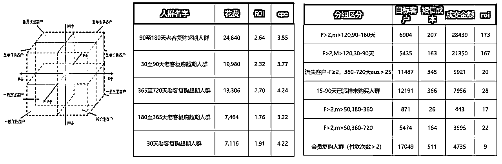

预算紧的时候，人群就得切得更细，像上图里就有的人群ROI干到了173。

RFM到底是什么？我简单概括一下，细节可以去问AI或小红书。

R是用户两次购买之间的间隔
F是用户购买的频次
M是用户单次购买的金额

就用这三条维度给用户分层，哪些人要优先触达、怎么留存，用什么权益去招呼他们。

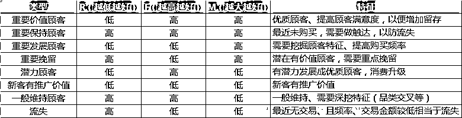

## 4.2 内容营销，是站内沉淀人群资产的关键渠道

2023年，天猫顶不住抖音短视频的冲击，也开始在商家群里力推站内短视频。一种是商家自己生产，另一种是逛逛达人的种草短视频。

结合之前说的算法逻辑，短视频很容易触发用户行为，进而给品牌带来可沉淀的人群资产。

内容主要负责种草和扩量，属于前端环节，后续还是要想清楚人群怎么流转，从A人群往P人群走。

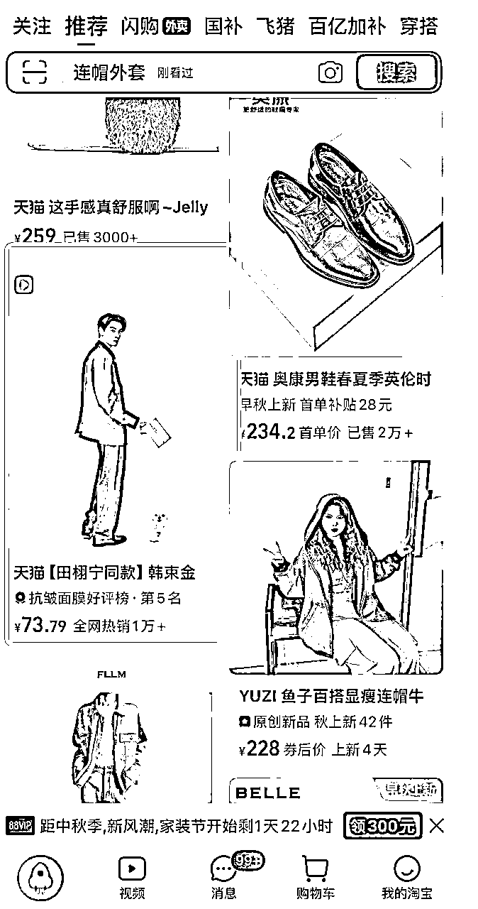

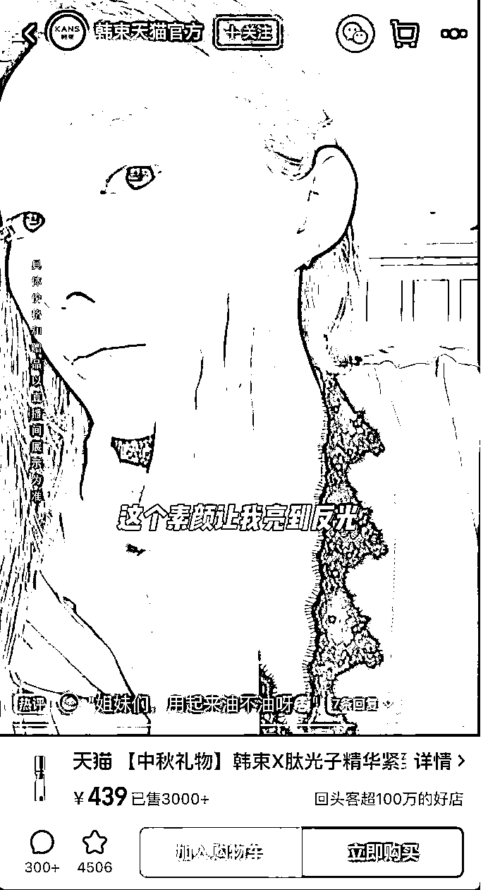

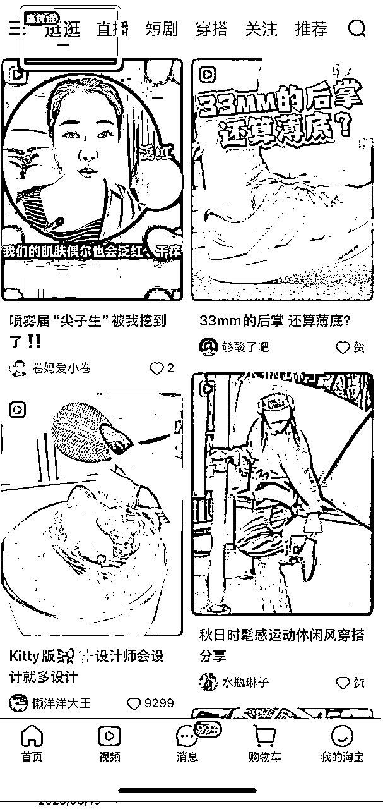

自制短视频：我们是靠AI剪辑+人工配合，走量优先，提升效率。

总结的经验是人群、内容、货品三者必须匹配。要清楚产品的用户是谁，是学生、宝妈还是白领，她会在什么场景出现，场景里有什么痛点，产品怎么解决。

逛逛达人的视频和抖音、小红书的KOL很像，需要对接脚本、寄样，视频就出来了。不同点在于逛逛达人很便宜，10w粉200块就能做一个，现在也有纯佣的机构，寄样就行。当然便宜也有代价，内容质量参差不齐。如果产品成本低，逛逛达人就是低成本扩量的人群资产渠道。

直接上短视频打法：找Top榜单和抖音榜单找对标→拆解→复刻→数据复盘→好素材继续复刻，差的就优化。

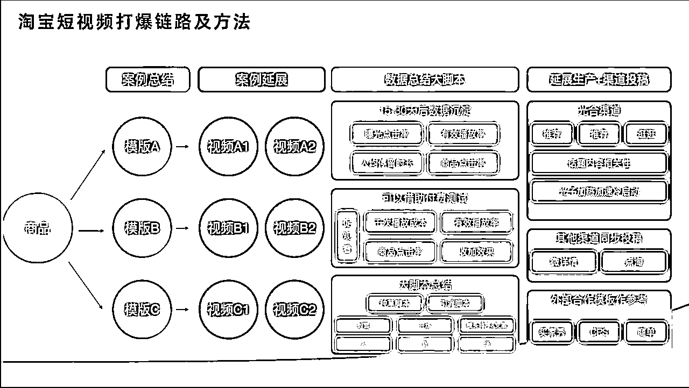

## 4.3 活动营销，促销绕不开，也是做跃层的好时机

买卖这件事本质上离不开活动。

从人群视角看，为什么618、双11一定要好好做。我们对竞品的销售额和人群做过分析会发现：

一次好的活动爆发会把人群资产推高一波，抖音大厂直播也是同理。

人群资产像波浪一样上下起伏，波峰就是活动期，波谷回落后会比上次的波谷更高，这取决于你是否把活动带来的新增人群做好了运营。

大促也是拉开和同层竞店差距的窗口，会带来类目内、跨类目的拉新，竞品人群的抢夺，以及老客的唤醒留存。

那怎么做一次合格的活动？

1-做好蓄水，大促一定要提前蓄水
2-做好玩法策划，尤其是前四小时的爆发，大促前四小时是赛马制
3-活动期间做好盯盘，避免失误造成损失

蓄水的落地方案：大促前大概一个月就要开始蓄水，这时候要拉好规划表，同步给各部门

需要市场部对接抖音达人、小红书达人要多少，逛逛达人要多少，自制短视频要多少，平台资源要多少；老客短信要什么时候推，达人排期要提前锁，达人侧可以谈秒杀款做预热。

视觉表达也要提前定，主图、首页、详情页、会员页。这里有个小技巧：用生意参谋-商品-商品排行，按访客数排序，会看到一批访客高但销售额少的链接，这些链接不冲销量但引流很强，别浪费。把玩法、跳转、关联产品都装修到主图、附图和详情页里。

玩法策划：直接决定活动期的爆发系数。

我们会把产品分层，低客单走前N小时秒杀、前N小时半价做引流，高客单和爆款走前N小时加赠，用来把爆发集中在开始前4小时。

活动也是给新品做连带的好机会，可以做满三免一之类的，提高新品动销。

如果没有思路就去抄大厂，瑞幸、蜜雪冰城、美团都能抄。

给大家准备了活动收集库，想法枯竭的时候翻它。

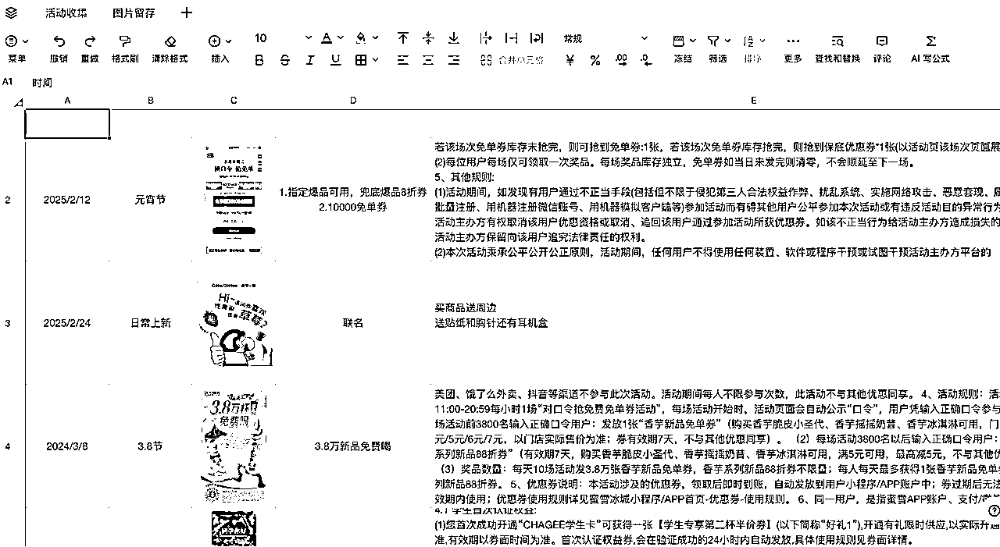

活动期间的维护和复盘：一定要说一下这个坑。我们当时活动一开始价格没核对仔细，直接出了一批错误价格，虽然损失不大，但电商运营容不得马虎，总有一堆羊毛党盯着，出一点错就一窝蜂涌上。

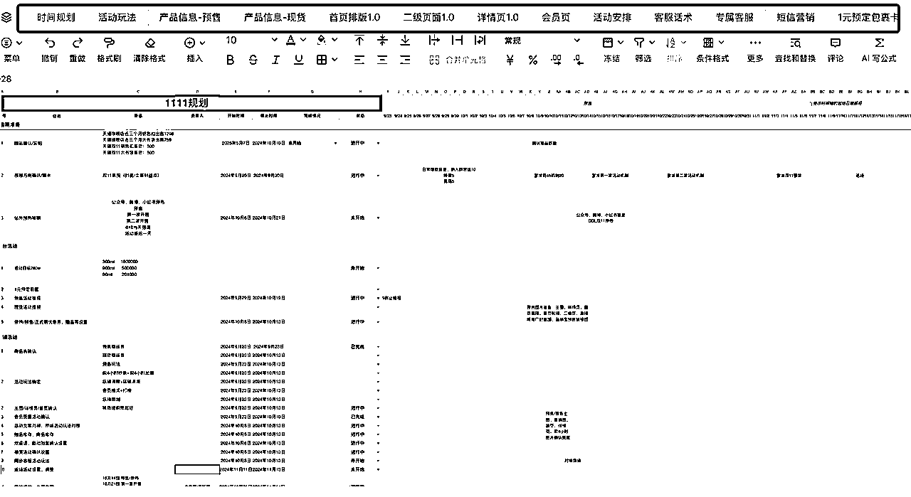

附上我们的规划表格，需要的可以私我。

## 4.4 全域推广，小红书、微博、抖音站外必须要做

小红书达人种草：

今年做淘系和小红书的应该都听过“红猫”计划，核心是小红书笔记可以直接挂天猫商品并跳转，大大缩短了从种草到下单的链路。

天猫没有抖音那样的内容生态，只能把小红书当成后花园来联合破局。

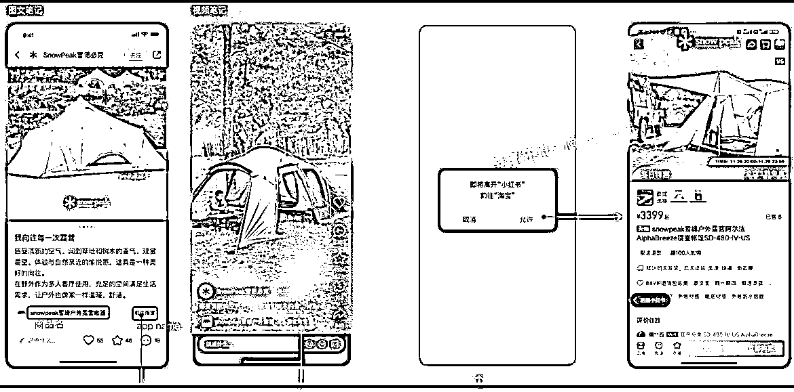

这说明做品牌的商家不能再只做站内，老玩法已经不够了，必须全域联动。

22年的时候我们也做过小红书推广，但当时不能立刻变现就停了。现在再看，这条路又活了。

品牌预算有限请不起明星，小红书既能种草又能成交，性价比很高。

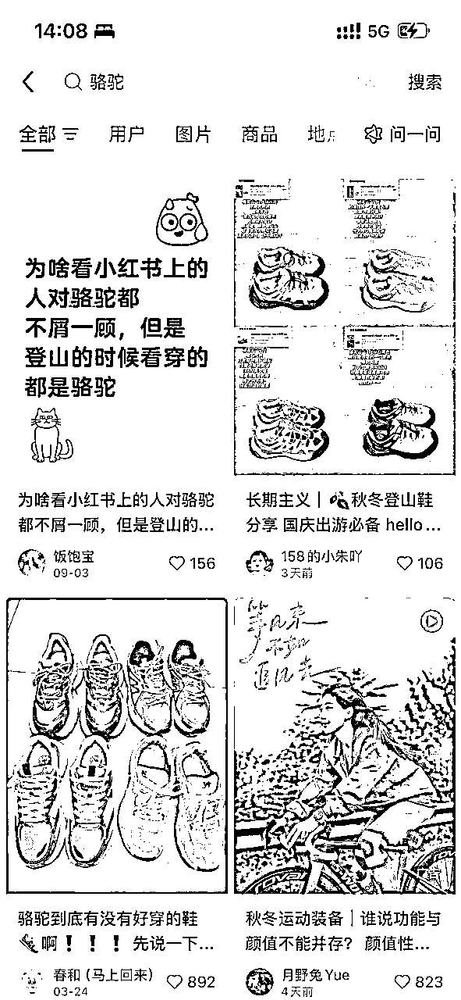

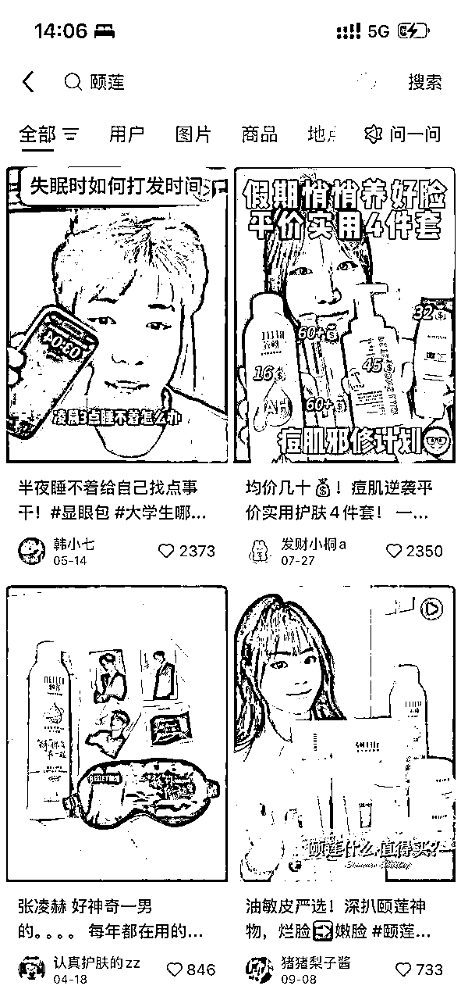

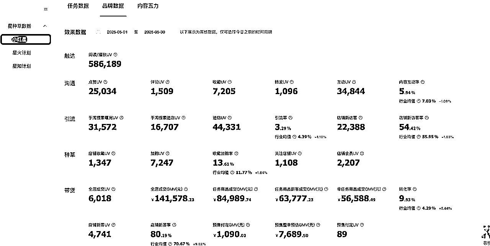

而且小红书种草可以通过淘宝星河的星任务后台看到种草数据，品牌有数据可追溯，可以给这部分种草成交人群做画像，优化种草方向。种草人群数据再通过达摩盘二次圈选，在站内付费渠道再触达一次。

微博达人种草：

打法是：先和机构沟通好保量销售额目标，然后在淘宝后台建任务，机构找微博达人发微博+在私域群推，完成约定销售额。

好处是走淘宝后台，不用签合同那么麻烦，结算周期是30天后退后销售额，完不成目标会按比例退回，资金风险小。

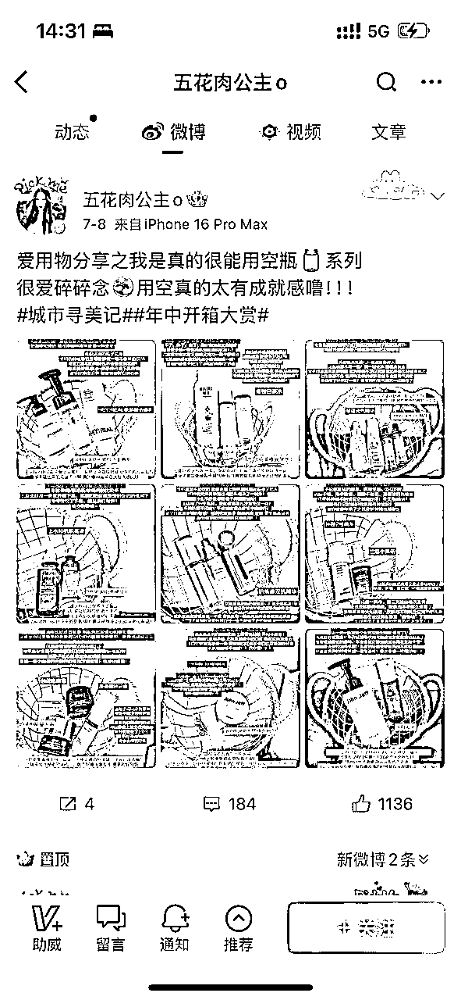

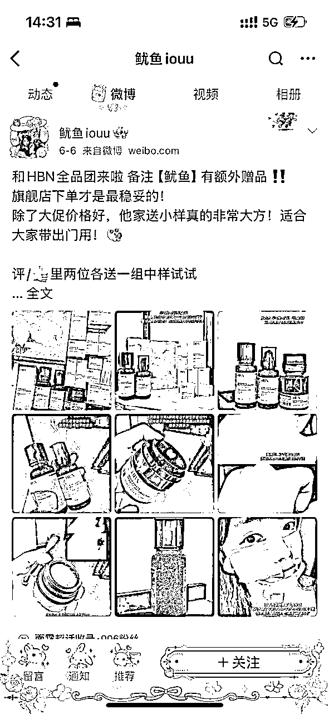

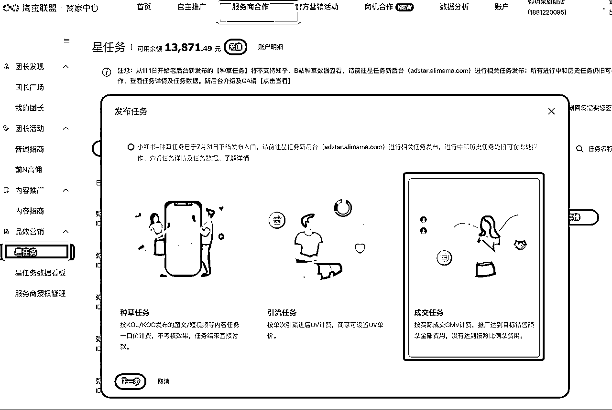

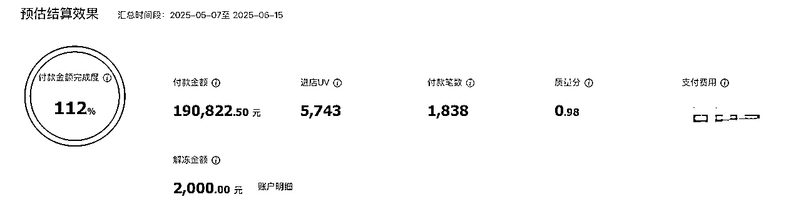

目前合作下来会有黄牛混入，但销售额是真实的，30天后也不会无故退款。很多大牌都在做，根据自身情况参考即可。

我们从100万做到200万的过程中，小红书和微博达人种草贡献了相当一部分。

另小建议：

店铺做到一定体量，事情变多，就要把人力解放出来，用AI或影刀这类工具代替日常数据采集。运营助理每天要采竞品图、竞品数据、店铺数据、货品数据等等。

我们当时花小钱请程序员做了个影刀小程序，每天至少省半小时。

上面提到的AI剪辑也可以直接拆解脚本、混剪，减少剪辑和编导的工作量，把精力放在质量和创新上。

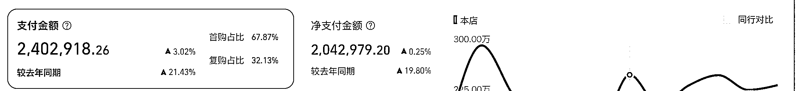

就这样我们完成了月销100万到200万的突破！

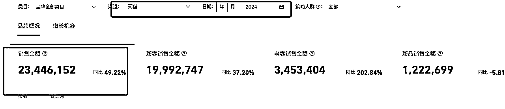

年销售额从21年的50万做到24年的2344万的增长。

# 五、总结：底层逻辑复盘

以上就是我从0到1，从50万到2344万的简要路径。一个店铺从几十万做到几千万不是一个人能完成的，尤其是做品牌，需要市场和团队多部门配合，细节很多一篇文章写不完。但从大框架看就是人货场，人群有需求、产品能解决问题、在正确的场域用正确的视觉和文案表达出来。

下面是品牌发展阶段的参考：

## 3.1 品牌发展阶段和策略

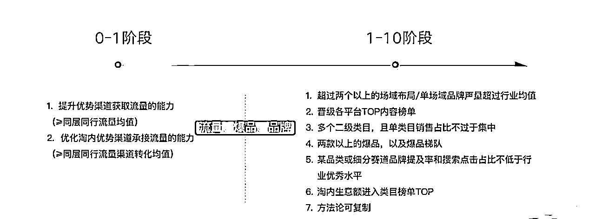

阶段性核心策略

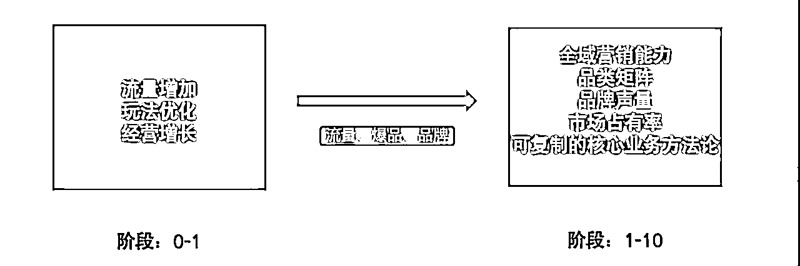

## 3.2 心得一二

1-白牌起步没钱或小钱，先求确定性，在不亏损的前提下把货卖出去，这时候不要讲究视觉调性，没品牌感也行，先活下来，先攒一批已购客户的种子池。

2-起步没预算做营销时，直播达人卖货是优选，种草+成交，前期找纯佣或保量主播合作，不亏就做。等品牌有声量后再压佣金，然后把重心转到自营，因为达人不可控，自营才能把命运握在自己手里。

3-预算有限、人员有限、精力有限，建议做大单品策略，先把一个品打爆再带动其他品动销，比如东鹏特饮、可口可乐。

4-盯紧竞品，每天看渠道、货品、价格、活动有没有新动作，及时跟进。

5-除了本类目的TOP品牌，也看看别的类目，会有意外的灵感。

6-管理团队要做梯队培养，员工离职别浪费时间。把技能和工作流程标准化，建立运营知识库。

7-一个天猫运营团队的核心三驾马车：运营+内容+推广。

8-好产品是最基础的，多做问卷调查去沟通客户，会得到意想不到的反馈。

9-不建议刷单，平台算法很强，刷单账号打的标签不精准。

10-设计很重要，低成本阶段靠活动和店铺视觉优化，图的需求量很大，很需要专职设计。

## 3.3 问题汇总

这是我第一次做分享，受赚钱平台和大家影响才决定把经验写出来。

大家有电商相关问题可以发出来，我会根据复杂度尽量解答，复杂的问题一两句说不完，大家谅解！

最后感谢赚钱这个有爱的平台，大家一起加油💪，加油！欢迎大家带我赚钱哈哈