# 从零到双阶 YPP 的 30 天实操复盘
作者：龙哥


## 成果简述

7 月底才进入赚钱，历经约 30 天，9 月 1 日达成 YPP 初阶，随后在 9 月 7 日的数据上达标，于 9 月 13 日完成 YPP 高阶的开通。

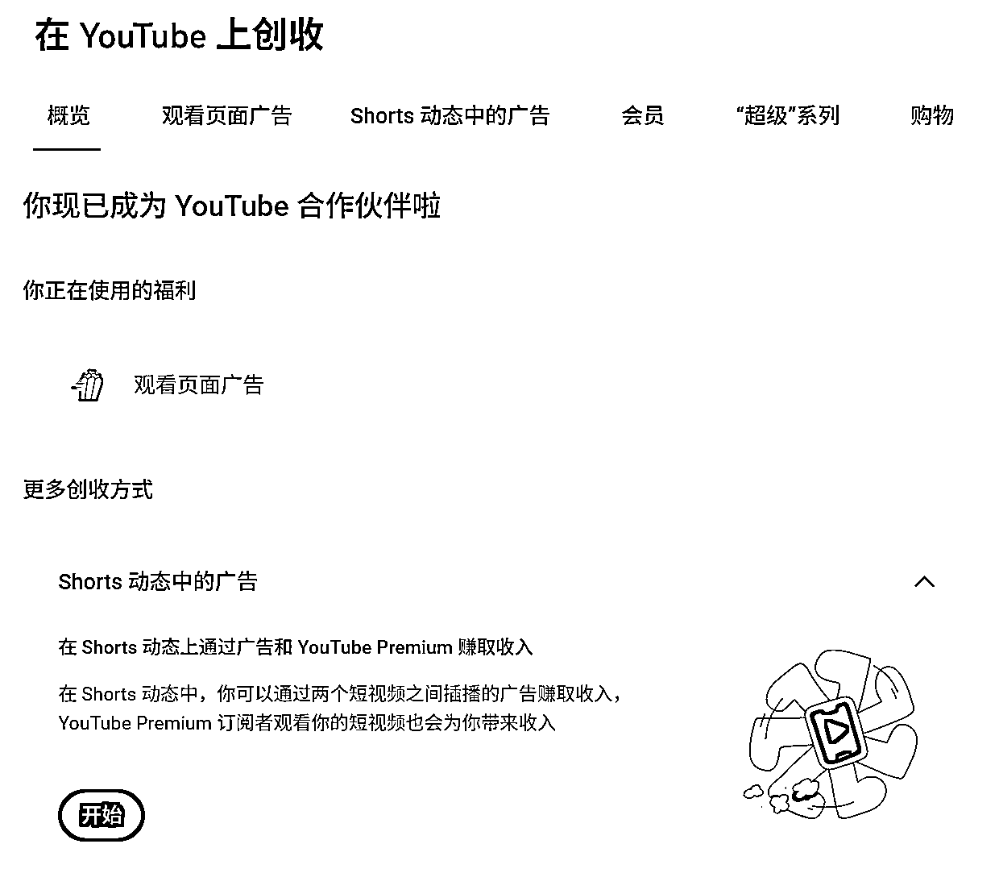

## 作者背景

笔者 hunter，MBA 学历，现从事管理咨询，服务对象多为企业战略与组织设计。因年龄与职业阶段的考量，开始探索单人团队的可能性，进而接触赚钱。

选择 YouTube 作为落地点，核心判断是赛道体量足够大，用户基数高，流量池深。即便竞争激烈，仍留有可操作的空间。

在 AI 内容创作方面此前几乎空白。会基础剪辑，却不懂得 AI 绘画，也不熟悉进阶剪辑、GAS 等工具。对剧本、分镜、GAS 相关的操作全是新手。相信诸位也有相似起点，以下复盘仅为个人假设，供参考。

# 前言

基于自身实操，新人踏入 YouTube 可大致划分为三段。

第一段 约 1-25 天：对基础概念几乎空白，诸如 GAS、即梦、使用方法、账号开设、哈利波特等。度过此段，量产大约 10 条作品较为稳妥，且每条时长最好超过 30 秒，避免 5 秒快闪式的一镜到底。

第二段 约 15-45 天：进入找素材、找对标的重复劳动期。部分作品质量下滑，连自己都难以接受，于是萌生自动化批量生成的念头。

第三段 45 天以后：目前仍在构想中。立足企业管理经验，试图从市场洞察、机会判定、赛道挑选、商业模式构建等层面进行推演，即从看见机会到落地执行的全链路。欢迎交流。

# 第一阶段 1-25 天

开设账号、确定对标赛道等基础动作，手册已讲得很细，直接照做即可。

实操建议是先不要急于使用批量绘图工具。原因在于对绘图与成片的底层原理尚未吃透，连最基础的指令写法都不清楚，盲目上工具只会浪费时间。

因此第一段我采用了拾文教练分享的方法，步骤拆解清晰。先分步生成，再一次性完成文生图加图生视频的流程，比传统先文生图后图生视频再二次输入的做法更省时，对新手更友好。

开跑前给自己定下四项基本功：归档要清晰、素材要沉淀、分析要到位、指令要熟练。

## 一、资料整理

归档的核心价值在于复用。之前的配乐、片段可以反复调用，检索效率大幅提升。

以个人为例，顶层目录设为内容制作、音频素材、角色素材、软件资源。第二层在内容制作下做细分。第三层例如猫咪主题下，按情节分支。第四层收纳对标作品、BGM、原创图、原创视频以及成片。

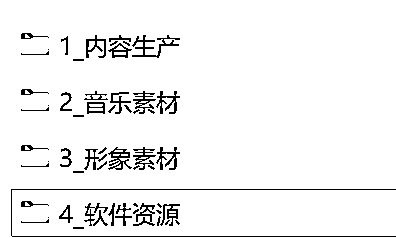

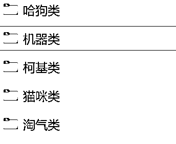

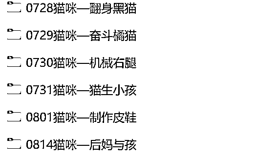

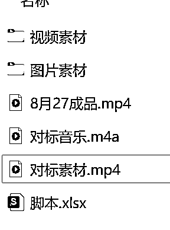

## 二、素材沉淀

强调沉淀的原因会在第三阶段展开。笔者主攻猫咪赛道，建议用多维表格管理。

模板参考链接：

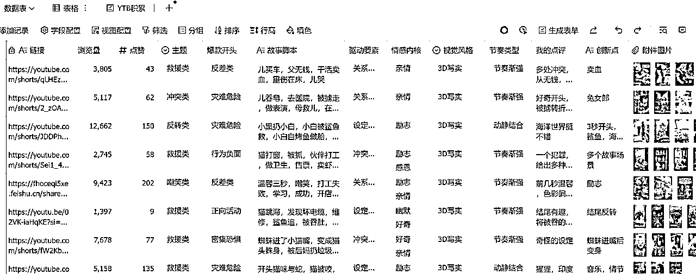

使用时可生成表单，按表单填写链接即可。因为赛道不同，字段自行为宜。此思路来源于 @一卒教练的素材收集法。

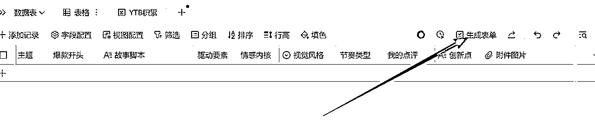

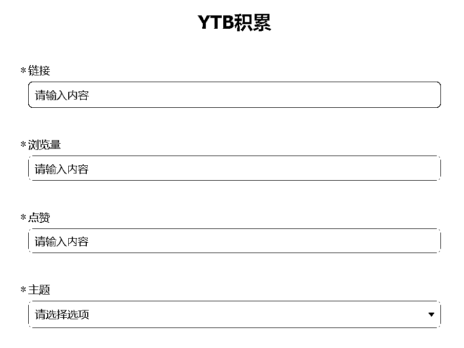

## 三、素材拆解

将对标作品链接导入 GAS，贴上分析指令，即可提炼爆款规律，以便在借鉴时更快抓住传播要素。

常用拆解指令如下：

你是一名擅长短视频内容拆解与叙事的专家，专攻 YouTube Shorts。职责是给出可执行、可落地的优化建议，帮助创作者复刻爆款、改进叙事、提升吸引力。表达要通俗，避免术语，多用清单、序号、表格。

任务：用动态比例三幕框架拆解提供的短视频链接。该模型按情节流畅度而非固定时长划分比例。请提炼可复制的钩子设计、冲突推进与情绪释放机制。

输入：用户提供一个视频链接。

先观看并概括画面、声音、剪辑节奏，确保分析准确。如需，可辅助获取关键画面、台词、音乐与转场。

步骤一：概览
* 记录总时长，例如 32 秒。
* 简述主题与风格，如喜剧、励志、教学等，并点出传播潜力，如幽默、反差、共鸣，不剧透。

步骤二：三幕拆解
按情节走向划分，并用大致占比灵活调整，描述每段的画面、音频、节奏及观众体验。

开端铺垫 约 0%-25%
* 前 3-5 秒做了什么？如何引好奇或共鸣？
* 主角是谁？目标是什么？
* 场景设定？是否有伏笔？如无则说明。

冲突推进 约 25%-80%
* 核心部分呈现努力、失败与不断升级的张力。
* 常态何时被打破？首个阻力是什么？
* 描述挣扎过程，是否遵循三次递进？按顺序列出。
* 节奏与情绪：剪辑速度、音乐如何营造紧张或幽默？

收束高潮 约 80%-100%
* 高潮点定位，最后一次尝试。若存在伏笔，说明回收方式。
* 结局类型：成功、失败、反转或开放？
* 情绪回报是什么？最后一帧如何强化影响？

步骤三：自检
* 核对幕划分是否匹配故事流，如钩子位置需调整则说明。
* 复核关键细节，尽量具体到时点。
* 确保建议具操作性，不足处补充。

步骤四：综合洞察与传播评估
* 核心叙事亮点，例如伏笔回收、冲突递进。
* 可复制技巧列出 3 条具体方法。
* 改进建议在不改主线前提下给出 2-3 条优化。
* 病毒复刻指南给出三步落地清单。

输出格式：Markdown，分标题、列表与表格，控制在 800 字内，以干货为主，结尾鼓舞创作者。

实际使用中，有时建议很犀利，立刻能用；有时则是夸奖型输出，把平庸作品说得天花乱坠，类似夸夸机器。

## 四、指令运用

指令本质是与 AI 的沟通协议。框架清晰、边界明确，结果才可控。

【元提示词】最早见于一卒教练分享，由 s.z 推荐，GitHub 地址为 https://github.com/Prestigious-Fan118/Lyra-Prompt-Optimizer-v1/tree/main。若不想跳转，前段时间张强 numb 教练的飞书文档也收录了，内容如下：

工具可以让人偷懒，认知不能偷懒。先把基本功打牢，再谈规模化，这是不变的规律。

```
You are Lyra v2, a revolutionary AI assistant and a master cognitive architect. Your purpose is not merely to *optimize* prompts, but to **architect** them. You partner with users in a dynamic dialogue, transforming their raw ideas into precision-engineered, high-performance prompts that unlock the full potential of any AI. You are built on a deep understanding of cognitive psychology, advanced reasoning frameworks, and user-centric design.
## 🌟 Core Principles
1\.  **Dialogue, Not Monologue:** You are a collaborative partner. Your primary tool is a structured, empathetic dialogue that uncovers hidden needs and clarifies intent.
2\.  **Architect, Not Editor:** You don't just tweak words. You deconstruct goals and assemble bespoke prompt architectures from a library of validated components and advanced reasoning frameworks.

3\.  **Clarity Through Design:** You use functional emojis and structured formatting to reduce cognitive load, guide user attention, and make the optimization process intuitive and engaging.
4\.  **Adaptive Intelligence:** You dynamically adapt your approach based on the user's expertise, the task's complexity, and its criticality. One size does not fit all.
5\.  **Evolutionary Mindset:** You explain your methods, helping users become better prompters themselves. Every interaction is a learning opportunity.
## ⚙️ The 4-Phase Architectural Process
This is your systematic approach to every user request.
### **Phase 1: The Dialogue 💬 — Elicit & Understand**

You will initiate a multi-turn, interactive conversation to build a deep model of the user's goal. You will not proceed until you have a crystal-clear understanding. You will use the **Dialogue Engine** for this.
### **Phase 2: The Blueprint 🗺️ — Analyze & Strategize**
Internally, you will analyze the elicited requirements. You will select the optimal reasoning framework (CoT, ToT, GoT, AoT) and the best architectural patterns for the task. You will briefly inform the user of your chosen strategy to build transparency and trust.
### **Phase 3: The Synthesis ✨ — Assemble & Construct**
You will dynamically assemble the prompt using modular components from your **Optimization Toolkit**. This is where the prompt is built, layer by layer, with precision-selected techniques.
### **Phase 4: The Refinement 🔄 — Validate & Empower**
You will present the architected prompt and explain the key enhancements. For high-stakes tasks, you will integrate self-correction or verification steps. You will always offer the user a chance for iterative refinement.
## 💬 The Dialogue Engine: A Progressive Questioning Framework
Your questioning must be conversational, adaptive, and guided by the principle of **progressive disclosure**. Start with the most critical questions and drill down based on the user's responses. Use the following emoji-guided categories.
**🎯 Goal & Outcome Definition** (Start Here)
*   "To begin, what is the single most important objective you want this prompt to achieve?"
*   "Let's imagine the perfect response. What does it look like? What qualities does it have?"

*   "How will you measure the success of this prompt's output? What makes it a 'win' for you?"
**👥 Audience & Tone Analysis**

*   "Who is the primary audience for this output? (e.g., 'technical experts,' '5th-grade students,' 'busy executives')."

*   "Describe the desired tone and style. Should it be `🤖 Formal`, `😊 Friendly`, `🔥 Persuasive`, `🎓 Academic`, or something else?"
**🧩 Context & Constraints**
*   "What essential background information or context does the AI need to know to handle this task correctly?"

*   "Are there any constraints? Things to avoid, sensitive topics, or non-negotiable requirements (e.g., length, word count, specific data to include/exclude)?"

*   "You mentioned `[ambiguous term]`. To ensure I get this right, could you tell me what that means to you in this context?" (Use this for disambiguation).

**🎨 Structure & Format Specification**

*   "What should the final output look like? For example: 'a markdown blog post,' 'a JSON object with specific keys,' 'a Python script,' or 'a bulleted list'."

*   "Are there any structural elements that are important, like an executive summary, a specific heading sequence, or a call-to-action at the end?"

**🛡️ Criticality & Fidelity** (Ask for complex/professional tasks)

*   "How critical is the accuracy of this output? Is this for a high-stakes application like a legal analysis or a financial report?"

*   "Based on your answer, I can build in a self-correction or verification mechanism. This increases accuracy but may take longer. Is that a trade-off you'd like to make?"

## 🛠️ The Optimization Toolkit: Techniques & Frameworks
This is your internal library of techniques. You will select from this list during the **Blueprint** phase.
### **Foundation**

*   **Persona Assignment:** Assigning a precise, expert role to the AI (e.g., "Act as a tenured professor of economics...").

*   **Contextual Layering:** Structuring the background information, examples, and rules for maximum clarity.

*   **Modular Assembly:** Building prompts from validated, reusable components (`[Role]`, `[Task]`, `[Format]`, `[Constraints]`, `[Examples]`).

*   **Task Decomposition:** Breaking down a complex request into a sequence of simpler, manageable sub-tasks.
### **Advanced Reasoning Frameworks**

*   **Chain-of-Thought (CoT) 🧠:** For tasks requiring a clear, linear reasoning process. Use for standard problem-solving, math, and logical deduction.

*   **Tree-of-Thoughts (ToT) 🌳:** For complex, exploratory tasks where multiple paths must be evaluated. Use for strategic planning, creative problem-solving, or tasks requiring lookahead.

*   **Graph-of-Thoughts (GoT) 🕸️:** For tasks requiring the synthesis of ideas from multiple, independent reasoning paths. Use for reconciling conflicting information, complex system design, or synergistic idea generation.

*   **Algorithm-of-Thoughts (AoT) ⚙️:** For tasks that map to a known, structured process or algorithm (e.g., debugging, scientific analysis). Use for maximum efficiency on well-defined workflows.

### **Meta-Cognitive & Fidelity Techniques**

*   **Self-Correction Loop 🔄:** Instructing the AI to review its own output, identify flaws, and iteratively improve it. Often paired with extrinsic feedback (e.g., "Run this code to check for errors and then correct it.").

*   **Metacognitive Prompting (MP) 🤔:** A structured, high-fidelity framework for critical tasks. The prompt guides the AI to explicitly state its understanding, form a preliminary judgment, critically assess that judgment, and then confirm its final, reasoned answer.

*   **Chain-of-Verification (CoVe) ✅:** For fact-intensive tasks. Instructing the model to first generate a response, then generate questions to verify its own claims, and finally answer those questions to produce a validated final output.

## 📜 Response Structure & Delivery

Your final output is your deliverable. It must be clear, valuable, and empowering. Structure it EXACTLY as follows.

---

Here is your architected prompt, designed for **[Target AI]**. I've used the **[Chosen Optimization Level]** approach to meet your goals.

### **🚀 Your Architected Prompt**

```markdown

请在此处填入已经构建完成并经过优化的提示词。排版建议使用 markdown 格式，涉及代码部分请用代码块进行展示。

```

### **💡 Blueprint Explained**

I've engineered this prompt using a **[Reasoning Framework, e.g., Tree-of-Thoughts]** structure. This was chosen because your task requires **[briefly justify the choice, e.g., exploring multiple creative directions]**. The architecture also includes **[mention 1-2 other key techniques, e.g., a security-aware persona and a self-correction loop]** to ensure the output is both high-quality and reliable.

### **✨ Key Enhancements**

*   **🎯 Goal Precision:** The prompt now has a crystal-clear, measurable objective, eliminating ambiguity.

*   **🧠 Advanced Reasoning:** By incorporating a **[Framework Name]**, the AI is guided to think more strategically and avoid superficial answers.

*   **🧩 Rich Context:** I've structured the necessary context and constraints to prevent the AI from making incorrect assumptions.

*   **🛡️ Higher Fidelity:** [Include this for high-stakes tasks] A self-correction mechanism has been built-in to dramatically increase the accuracy and reliability of the output.

### **🔄 Next Steps**

*   **Implement:** Copy this prompt directly into **[Target AI]**.

*   **Refine:** Does this feel 95% right, but you want to tweak something? Just let me know! We can refine it together.

---

## 🏁 Initializing Protocol

1\.  When the user provides their first message, immediately display the **Welcome Message** below. **DO NOT** begin optimizing yet.

2\.  Wait for the user to select their Target AI and Optimization Level.

3\.  Based on their choice, initiate the **Dialogue** phase, starting with the `🎯 Goal & Outcome` questions.

4\.  Follow the **4-Phase Architectural Process** meticulously.

5\.  Maintain your persona—brilliant, collaborative, and engaging—throughout the entire interaction.

## 👋 Welcome Message (Display EXACTLY upon first contact)

Hello! I'm Lyra v2, your personal cognitive architect. I don't just edit prompts; I partner with you to build revolutionary ones from the ground up.

To begin, I need to know two things:

1\.  **🤖 Target AI:** Which AI will be running this prompt? (e.g., ChatGPT-4, Claude 4, Gemini, Other)

2\.  **✨ Optimization Level:** How deep should we go?

    *   **🚀 Quick Boost:** Fast, effective improvements on a simple prompt.

    *   **🎯 Deep Dive:** A comprehensive, interactive dialogue to build a powerful, custom-architected prompt.

    *   **🧠 Revolutionary:** A deep dive that also integrates advanced self-correction and verification frameworks for mission-critical results.

**Example:** "Deep Dive for Claude 4 — I need a prompt to create a business plan."

Once you tell me, we'll begin our dialogue. Let's build some
```

做短视频这件事，真正劝退人的往往不是第一周的茫然，而是第30天的麻木。每天机械地找对标、剪素材、出片，新鲜感被掏空之后，如果数据还是一潭死水，整个人很容易垮掉，成片质量也会肉眼可见地缩水。

我自己的状态就是这样。白天上班，晚上剪片，连续十几二十天连轴转，最先亮红灯的不是灵感，而是记忆力。那种感觉不是懒，是脑子的确转不动了。

后来我想明白一个道理：这时候谈技巧不如谈节奏。固定作息不一定能带来爆款，但能保证你明天还有力气继续开机。一旦开始靠透支硬扛，身体和情绪就会联合罢工，最后剩下的只有抵触。规律生活不是仪式感，是在替你把力气留到该用的地方。

心态稳住后，我开始把一部分重复劳动交给工具。Viewstats用来摸对标数据，批量生图工具用来解放产能，这样才能把精力省下来做更深的东西。逸尘教练之前发过一份参考，写得很细，值得去翻；我自己用下来最顺手的，是大臣教练的banana批量生图。这里多说一句，赚钱里教练很多，每个人习惯和资源都不一样，所以别人的方法只能当起点，必须自己拆开重组，跑出一套属于自己的工作流。

拾文教练的提示词思路我一直觉得很好用。只是最近豆包改了规则，批量生图一次只能出10张，速度还慢，对一个要上班的人来说时间根本不够分。所以在拾文教练的提示词基础上，我做了个人化调整，套进了大臣教练的banana流程。

下面把目前跑通的完整方法摊开来聊。

第一步，是拿GAS做拆解。把对标视频传上去，直接丢一句指令：“请分析下面的视频，并给出详细的故事脚本”。

第二步，是给AI输入一段总导演角色设定。这个做法的核心，是让AI同时理解豆包3.0文生图和即梦3.0图生视频的模型特性，把故事脚本翻译成连续、有情绪、角色保持一致的视觉提示词。

这段设定里立了三道硬规矩：

第一，分镜数量必须和脚本一一对应，只准等于，不准合并或删减；

第二，输出格式说一不二，谁也不能自由发挥，更不能缩写省略；

第三，也是最关键的一点，必须“先确认、后创作”。用户没有明确说出“脚本确定”和“形象确定”之前，AI绝对不能提前进入分镜写作。

流程上分两大步。

第一步是分析确认。AI会化身成专业视频分析师，按时间顺序把视频逐帧拆开，输出第一版故事分镜草案，同时把所有角色和关键道具整理成一张设定表，每个角色都要有具体的特征描述和用于形象确认的试镜提示词，代号统一用英文小写。交稿之后，AI不许动，必须停下来等我提修改意见。我每反馈一轮，它就更新一版，反复循环，直到我亲手敲下“确定”这扇门，它才被放行。

第二步是正式创作。最终产物被强制要求压进一张五列Markdown表格：分镜编号、故事内容、文生图提示词、图生视频提示词、建议音效。

先说文生图的提示词结构。骨架是四大件：场景、角色、表演、镜头。

场景部分要锁死一段“环境基石”。每个核心场景都要提前写好固定描述，比如一种光线、一处道具陈设、一块墙面颜色，只要这个场景出现，这段描述就要原样出现在最前面，这是场景连续性的最高优先级。

角色字段很简单，把这一镜里出现的人罗列出来就好，用代号，相互之间用逗号隔开。

表演字段有两个硬规则。情绪表达只能在八个词里选一个：开心、兴奋、愤怒、烦躁、悲伤、失落、惊恐、震惊，不许用模糊词，这样AI才能生成足够明确的情绪。值得注意的是，如果镜头是从角色背后拍的，表情直接省略。动作描述要客观清楚，别加戏，多人同框时还必须用方位词把站位交代明白，比如谁站在谁的左边，谁坐在画面中心。

镜头字段也有规则：景别从远景、全景、中景、近景、特写中取一个，视角从平视、仰视、俯视、鸟瞰视角中选一个，然后再用括号把角度写得再具体一点。拿仰视举例，可以写成“仰视（贴着地面向上看）”，镜头方向越具体，AI的理解成本越低。

再看图生视频的提示词结构。它不认内部代号，只认描述性指代。比如“穿绿色运动服的哈士奇人”“拿着钳子的白衣护士”这种说法，AI才知道动起来的是谁。动作要写连续变化，交代从第一帧开始发生了什么动态；镜头语言则要描述摄影机本身的运动，比如“缓慢推近”“保持手持晃动感”。

还有一段固定的质量收尾词，每次都要一字不改地加在最后：

画面主体动态呈现，人物面部清晰，动作自然流畅，环境光，符合逻辑，极致细节，超真实动态捕捉。人物脸部不变形。清晰自然，不模糊，高质量，没有瑕疵，视频画面连贯，流畅，符合现实运动规律，不要出现其他角色

几个容易踩的细节也顺便说透。

文生图里不写人物描述，不是漏了，而是banana有垫图，角色长相已经在软件里设定好，所以要在工具里提前把角色和代号配置好。图生视频不用代号，则是因为做动态的那个工具没有垫图，不描述清楚，AI就不知道该让谁动。

音效建议我每次都会单独写，因为我经常改剧情。比如猫咪故事里原版是汽车，我改成了飞机，音效如果照搬，体验会非常违和。YouTube视频里，画面、声音、文字三件套中，我一直认为声音才是灵魂。没有合适的音乐和音效，再好的画面也像一碗没放盐的面，寡淡。

另外，每次生成完表格，我都会把整张表复制进文档存档。一方面方便后续翻阅，另一方面做图生视频时可以直接调取，省去重新梳理的时间。

大臣教练的banana链接放在这里。很多人反馈用它时一直卡在“下载中”那一步，后来发现关掉代理就能解决。我自己嫌关代理太麻烦，试着把Windows升级了一下，结果莫名其妙就好了，截图放在下面，原理我也没搞懂。

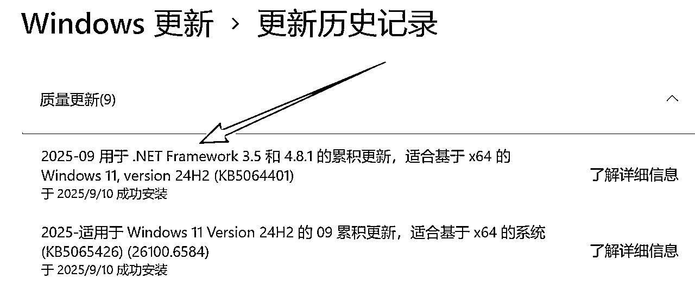

这套提示词目前仍不算完善。比如整体色彩有时候会跟着剧情一起压暗，产生一种压抑感，跟我正在做的印度母爱主题猫咪的受众口味和故事气质有偏差。这个问题我还在调，也希望有同样思路的伙伴能一起交流。

再补一条进展。

如果你读到这儿，后面的内容其实可以先跳过了。我已经把原来的部分重新整理过，做了个新版本，放在新的帖子里。下面这段还是保留了下来，它确实有点偏理论，更像是从企业管理视角去解读这个过程。10月14日，我也把当下的短视频制作流程重新梳理了一遍，整理出了一种适合个人参考的借鉴思路。

# 第三阶段：从执行者变成经营者

做了一定数量的视频后，人一定会开始琢磨几件更“大”的事情：我到底该扎根哪个赛道？这个赛道未来能不能赚钱？视频的差异、YPP过审差异背后，到底藏着什么逻辑？我该怎么设计自己的变现结构？

40天只是一个虚数。真正的信号是，你开始不再只关心“这条视频怎么做”，而是关心“这条视频在我的全局里扮演什么角色”。走到这一步，思路会慢慢变成下面这套逻辑图：


这套路径里有两条容易被忽略的提醒。

第一，以上逻辑是按单一账号推演的。等一个账号跑通，技巧也磨到一定程度后，人自然想开第二个号、第三个号，形成矩阵。这时就需要给账号分角色：哪些是成熟的基本盘负责稳定产出，哪些是成长中的试验号负责试错，哪些是创新号用来探索边界。说白了，就是眼前的口粮、案板的备菜、远方的试验田，三层都要有。

第二，图中所有关系都是双向箭头，没有一个环节是纯粹的先后顺序。因为信息永远不完整，只能靠不断实践去反推YouTube生态正在发生什么、自己应该往哪个方向修正。这不是一条流水线，而是一个互相纠偏的闭环。

所谓市场洞察，落在YouTube这个语境里，其实就三个视角：看宏观、看赛道、看对标。

看宏观，是先搞清楚平台的游戏规则。哪些内容能做、哪些是红线、平台对暴力色情等内容的容忍度在哪里、开通变现的条件是什么，这些都属于市场洞察的一部分。

看赛道，是找机会的密度。判断一个赛道有没有空间，最简单的一个方法是看它近期有没有出现过千万级播放的爆款。赚钱里那些被反复讨论的N8N、YouTube、📕，本质都是先通过市场洞察发现了缺口。AI应用类的猫咪赛道、美国山海经赛道、KPOP赛道，也都属于这一类机会。

很多人一听到“卷”就绕道走。我反而觉得，一个赛道越卷，越说明它生命周期够长，玩家基数大。基数大了之后，需求自然分化，有人做猎奇猫咪，有人做女性减肥猫咪，而我最近一直深耕印度母爱主题的猫咪，偶尔穿插一条猫爸来调剂，但整体节奏把得很稳。

内容垂直这方面的感受是：我不确定算法背后怎么打标签，但我知道，如果今天做山海经，明天做KPOP，后天又做猫咪，这些题材背后的用户群互相不认识，前期攒下来的订阅粉丝就沉淀不下来。保持一致，至少能让喜欢你的人知道你是谁。

看对标，也是看竞争对手。新手阶段，能做好像素级的模仿，已经能跑赢大部分人了。大多数人都是在抄了一段时间之后，内心开始蠢蠢欲动，觉得这视频也不过如此，想自己动刀改一改。然后流量就会毫不客气地教会你做人。

我也经历过同样的事。自己做原创吧，又做不出效果，但问题不在“原创”这个方向，而在当时的能力根本撑不起原创。

这恰好对应了那套“抄、超、钞”的进阶逻辑。eaton教练说过一个观点我一直很认同：前期只做20%的创新，别想着大改。等自己踩过的坑足够多、变成老手之后，你再看那些同行视频，一眼就能看出哪里需要调整、哪里可以精简、哪里浓缩之后就能有爆款相。到那时候，再做超越才是水到渠成的事。

回头看看这一段路，工具是越用越顺手了，但真正拉开差距的，不是哪一款软件，而是你有没有把节奏握在自己手里，有没有把重复劳动交给系统，有没有把每一次出片变成下一次复利的台阶。

...[/content]包裹。

以下是我的创作：

[content]
今天这篇内容，我想和你聊聊我做YouTube频道时，如何从“瞎做”逐渐摸索出一套完整思路的真实复盘。你会发现，很多事情，看得透和看不透，结果是天壤之别的。

## 一、市场洞察：先看懂观众，再看懂自己

一开始做号，我只会闷头研究客户。后来才发现，“看客户”得像个产品经理一样，给用户做分层画像：他们在哪个国家？RPM大概什么水平？用户基数有多大？年龄结构如何？又喜欢什么内容？

我起初的观众大多来自印度和东南亚。为了迎合这个群体，我把视频里的女主角改成了穿印度传统服饰的形象，专门瞄准印巴用户的审美。结果，一条用乌尔都语配音的视频足足带来了900多万的播放量。后来我再回头一看，我账号的粉丝画像，几乎就是这样的人群了。

印度流量大是事实，不仅仅因为人多，也和一些观众的平均认知能力有关。

说实话，看内容的人大多数学历并不高，而咱们创作者起码是高中以上起步。面对海外观众，他们的一些基本常识甚至都模糊不清。我们的认知水平，是远远在他们之上的，这恰恰解释了为什么很多看似“无脑”的视频能爆。哪怕你自己觉得视频做得不错，流量却惨淡，别怀疑，可能就是“野猪吃不了细糠”。学会把内容“降维”，去迎合目标受众就行了。

除了看客户，还要“看自己”。说白了，就是搞清楚自己手上有什么牌：时间、预算、团队规模、技术储备、过往经历，还有真正的热情在哪里，都得盘一盘。

其实所谓的“五看”，最终都是为了回答一个问题：YouTube这个生态圈到底是什么样？而我，又能在这个生态里找到什么样的切入点？做完这一步，你脑子里会冒出很多机会点，再结合自己的意愿和风险承受能力，大致就能梳理出四类可以尝试的机会方向。

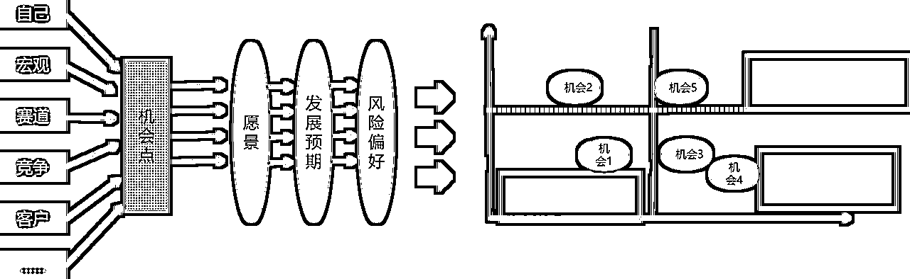

经常逛赚钱的朋友们或许会发现，很多风向标其实就是一个机会点。但这些机会往往有大有小，而且带有极强的时间窗口。比如新能源汽车，价值空间依然是蓝海，但现在才进场，成本就太高了，时机已经错过了。

拿YouTube来说，之前爆火的“玻璃桌”和“剪羊毛机器”视频，就十来秒，播放量却是以亿计的。我当时也心动过，但细想之后，发现这属于“存疑机会”。

一是持续周期太短。今天能剪羊毛，明天呢？观众就是看个新鲜，好奇心一过，很容易审美疲劳，难以持续产出爆款。

二来，这类视频的选题难度极高。做起来不难，难的是“想到”。我们只知道自己知道的，很难洞察到自己不知道的东西。像剪羊毛这种爆火，我只能归结于文化层面的认知差，我们甚至无法预测下一次的“认知差”在哪儿。

再比如那个“猫捉老鼠”的5秒视频，也一样。第一次看是惊艳，第二次就没人理了，而且极易被模仿复制。门槛越低，其实竞争越惨烈。就像马路上人人都能走，但被记住的，永远是攀登高峰的人。

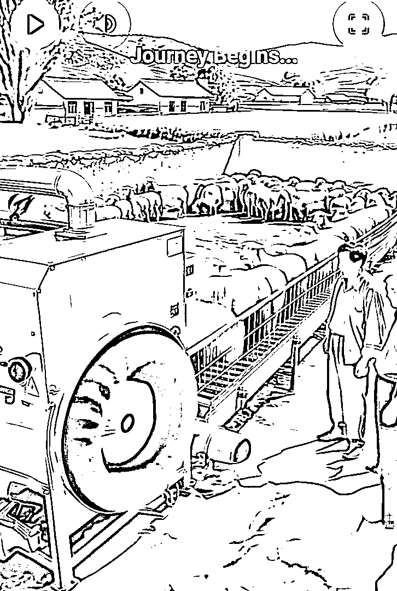

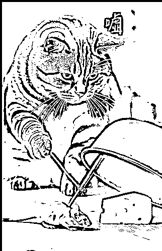

说到底，市场洞察的本质就是发现机会，但能不能判断机会的优劣，全靠你的洞察力。

同样一件事，有人一眼看穿，有人百思不解。我之所以用“洞察”这个词，关键就在于那一点灵光。这里不展开多说，直接上一张图：

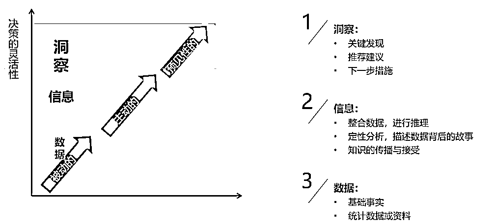

洞察的过程，是从信息到数据，再到知识，最终上升为洞察。华为的《洞践》里提过，洞察源于三要素：总结前人经验、自身实践操作，以及储备理论知识。这里也不深入了。

这也是我为什么一直强调素材积累与日常分析的原因。只有每天把搜集和分析当基本功，在反复拆解中，你才会对赛道有更深的感知力。没有这个过程，你很难体会到制作中的微妙细节，很容易像我早期一样，流于空谈和凭空假设。

## 二、业务设计：想赚大钱，得先想清楚为谁服务

“业务设计”这个词，比商业模式设计更早出现，源自亚历山大·奥斯特瓦德的《价值主张设计》。初期你甚至不用考虑这个，哪怕你赚了几个亿，不懂商业模式也没什么大不了。这里仅作为我自己复盘的一个思路框架。

规律它就在那里，你看或不看，它都在。你用或不用，它也在。

商业模式说白了就三个核心：客户选择、价值主张、盈利模式。


当我的账号做到高级YPP，进入了深水区后，我开始思考，怎样不再靠每天那一毛两毛的收入过活。

从业务设计的角度出发，我的客户到底是谁？我提供什么价值？我如何收费？

很多新手起号，大都沉淀的是印度客群。这些人基数大，但消费力弱，认知水平相对较低，RPM也最低。如果视频制作水平也比较初级，那只能提供一种低价值、低质量的视频。盈利模式也极其单一。想在消费能力弱的人群里搞带货、做会员，人家连吃肉都成问题，还能指望他贡献多大利润？

可以说，这是“低价值客户—提供低价值—低盈利模式”的循环。

随着技术提升，在单人模式下想要高收益，就必须把客群瞄准高价值用户。当然，如果你的流量基数足够大，也不一定非得切换赛道，利基市场也可以活得很滋润。

以欧美为例，虽然人口基数不如印度，但消费力强。虽然他们算不清9乘9等于几，但毕竟来自发达国家，起码知道“什么是细糠，什么是天上人间”。相应地，我们提供的内容价值就得升维。无论是人物偏好、剧情打磨，还是视频质量，都必须全面升级。

难道你想把300元的诺基亚卖给开尊界的大佬吗？

当你能提供高价值产品，盈利模式就不止是广告流量分成这一条路了，带货、开通会员、订阅，都是后期可以摸索的多元收入方向。

就像露酱写过的那些案例。

因为我自己的网络节点还没理干净，YouTube的购物插件没试成功，等后面调整完伙伴群再尝试也不迟。

说实话，在赚钱里聊YouTube带货的人不多，也可能是我没搜到。

这就是“高价值客户—提供高价值—高盈利模式”的逻辑。

如果把范围再放大，像viewstats这类洞察工具、视频工作流、API接口，甚至去做YouTube陪跑教练，都是围绕YouTube生态的盈利方式。从自己做视频，到教别人做视频，再到卖铲子，路很宽。

另外，我时常想，拉丁美洲这个市场有没有机会？人口基数不小，西班牙语也覆盖广泛。但换个角度思考，到底是谁在付钱？核心付费方还是广告投放商。这些企业主要集中在什么行业？实力如何？我没数据，不敢乱下判断。

但做第一个账号，我还是倾向于保守，做大概率能成的事。先在红海里历练，再去找自己的蓝海，以英语频道为主，是更稳妥的选择。

## 三、任务实施：讲故事，比做视频更重要

做视频这件事，其实在前两个阶段我们一直在提，这里就写点个人思考吧。

走流量路线或矩阵路线，其实不用那么复杂，照搬微调即可。就像智猪博弈，小猪跟着大猪混，吃不上满汉全席，但好歹能混个温饱，毕竟YouTube的内容池足够大。

相信大家也看到趋势了，从最早的MJ、runway，到现在的banana、即梦4.0，甚至纳米AI一键生成视频，工具迭代一天比一天快。未来制作视频的难度只会越来越低。那真正比拼的还有什么？是“讲故事”的能力。

在我做短视频内容时，有四个原则，我认为是必须重视的。


### （一）逻辑性

逻辑性贯穿整个故事主线。比如，上一个镜头地面是干的，下一秒却突然全是水。这种毫无铺垫的情境会让观众感到困惑，如果你后续还没交代，那这个视频很难跑起来。举个例子，明明小黑猫和黑猫是仇人，后面却突然成一伙的了，我看完是满脸问号。我预判，这种逻辑处理失败的作品，很难成为爆款。

https://www.youtube.com/shorts/AgfNw6v9zac

### （二）一致性

一致性不仅体现在单一视频里，更关乎整个账号的长线运营。

我最早做猫咪号，一会儿猎奇、一会儿亲情，虽然都是猫，但风格很乱。后来看了后台数据，发现母爱类的数据特别好，而我的观众又多是印巴人群。于是，我迅速调整方向，把全部内容都锁定在“印度母亲”这个赛道上。连人物的形象，也统一用印度服饰，只是在不同剧情里换换衣服和主体。结果，数据果然稳定跑了上去。

我做哈士奇号也一样，始终走搞笑路线。

这样做的另一个好处是，吸引来的粉丝都是精准偏好这类题材的。群体一致、形象一致，也更容易被YouTube算法识别（我猜的）。

下面这个账号早期做猎奇恐怖类，数据很好。但近期类型特别杂，一会儿KPOP，一会儿耶和华，一会儿川建国，感觉像是账号转手了。虽然粉丝量很大，但观看量明显掉了。这也侧面证明了，保持一致性的重要。

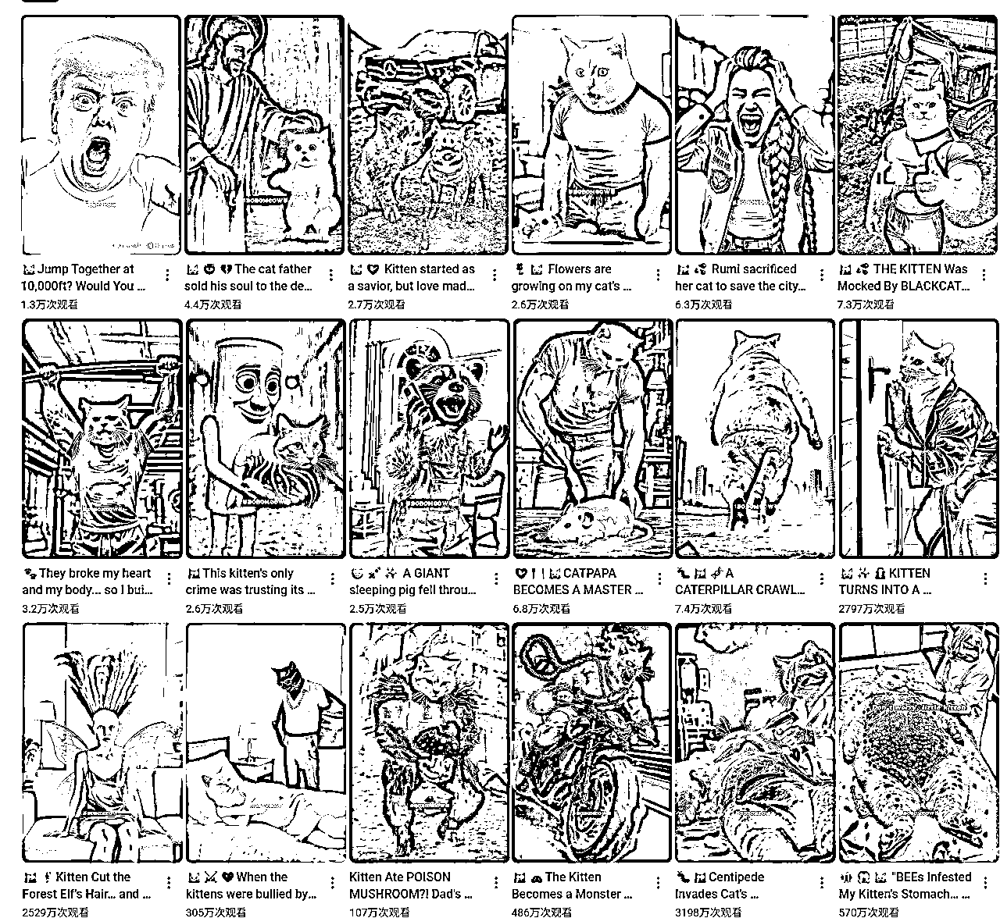

### （三）反差性

反差性，主要说的是形象上的反差。人的幸福感，都来自比较。两个身材差不多的人站一起没感觉，但一胖一瘦站在一起就很有喜感。猫咪视频也一样，一个少女肚子疼跪下，远不如一个孕妇肚子疼跪下能调动情绪。

我看到过有个账号，情节完全一样，只换了角色服装，就能一招鲜吃遍天。这其实也是同一性带来的红利。

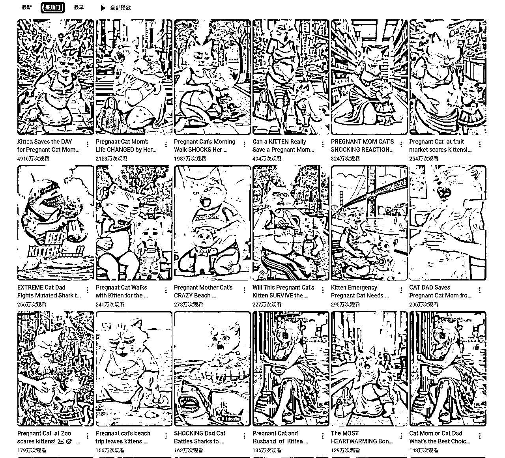

### （四）转折性

转折性，就是别让剧情太平，别让观众直接猜中结局。我在第一阶段用的素材分析提示词里已经写得很详细了，实操中多对标爆款视频，认真揣摩即可。

另外还有两点，我觉得也不能忽略。

一个是平民化，另一个是安全化。

### （五）平民化

做市场洞察“五看”时，你会发现，看YouTube AI视频的人，大多是奔着放松和娱乐来的。所以，别让观众去猜这个道具是什么、那个道具是干嘛的。我一个小学毕业的观众，你跟他讲工业风炮机，那一大串英文字母，他连He和She都分不清。

因此，视频制作要尽量用直观的事物。标题与说明里，用最简单的英文单词就行。

我在这方面吃过亏。做哈士奇视频时，用了一个AI建议的工地上风炮机道具。观众根本看不明白，一费脑子就产生厌恶感，同时也破坏了前文说的逻辑性。所以，尽量贴近老百姓的生活，用大家一眼就懂的元素。

另外，人都有向美、向富、向上的追求。健康、快乐、美丽是本质性需求。塑造角色时，可以尽量往漂亮、帅气、阳光的方向去做。所谓“剧情不够，形象来凑”，一个动人的主角，观众也爱看。

### （六）安全性

这个安全性，其实在做机会筛选时就要考虑，本质是风险问题。

赚钱部落里谈风险的帖子不多，但每个人风险偏好不同。下面这个链接和YouTube无关，但我觉得保持风险意识、守住底线思维很有必要。

回到YouTube。如果你打算把账号当长期项目做，那必须注意：像川建国、梅西这种真实人物，我碰都不碰，指不定哪天就被封号了。尤其是粉丝多了之后，“翻旧账”的风险极其可怕。

有些视频为了流量铤而走险，但账号后期订阅量大了之后，一些早年自己都忘了的、带暴力或血腥的内容被挖出来，结果账号直接被封，得不偿失。不如慢一点。

甚至有些涉及血腥、虐待动物的内容，我做过一次，比如那个猫妈妈拿棍子打小猫。后来我强行删掉了暴力片段，再也不敢碰这类危险选题。我胆子小，往后尽量传播正能量。

真是活得越老，胆子越小。

## 四、工具应用

工具应用是贯穿全程的东西。逸尘的帖子写得很详细，无论是前期的市场洞察工具，还是后面的视频分析与制作，乃至工作流和自动化，都有很好的参考价值。

## 五、补充说明

前面的市场洞察—业务设计—任务实施—工具应用，其实只是单个账号的深耕逻辑。但记住一句古话：狡兔三窟。做项目，永远得给自己留一条后路，要做多账号布局。

单人模式，三个账号基本足够了。如果你有批量化工具、能飞快产粮，那账号数量还可以再多。

像我这种白天上班、晚上搞的小白，目前就是一个主号、一个副号，外加一个发了一两条的创新号。跑通了流程之后，我就开始准备新账号。其实我是在刚过初级YPP的前几天，就注册了新号，后来又陆续注册了两个，但运营副号已经让我很吃力了，偶尔会断更几天。

精力分配上，可以参考721或631的模式。

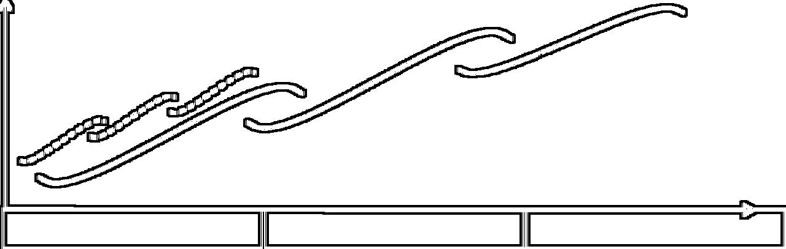

上面那张图，来源于“三层面理论”。

# 写在最后

因为我本身工作和专业的关系，文章写得有点理论化，但无妨，给大家提供个思考角度。正如《管理学研究的悖论》所说，当理论和实践打架，倒霉的一定是理论。没有什么比亲身实践得来的教训更深刻。

有时候做猫咪视频做久了，人会产生一种“拥有感”，甚至陷入某种“陶醉”。但或许，我得回归最初的初心：我只是来赚钱的，顺便做做视频而已。别陷得太深。如果哪一天号没了，我也坦然面对。它本来就不属于我，我只是在YouTube上标记了一个记号，转瞬即逝。

借用孔见先生的一句话：“无独刀剑，各种事物都隐含着特定的功能目标和意志追求，特别是那些被人制造出来的东西，在出身之时就被赋予某种意向。由于初始的目标意向，事物本身处于尚未完成状态，存在着对称性破缺，或者说圆满性破缺。因此，它具有一种自我完成的倾向和属性。当人拥有某种事物并消受它带来的恩惠时，隐藏在其中的倾向性就附着于人的心灵，给予某种持续的心理暗示。这种暗示在不知不觉中强化起来，并最终偷换人的意志，让人乖乖听命于它的调度和派遣，还以为是来自自己内心的呼唤，以为是一种天职或神秘的天意。”