# 【喂饭级指南】一套思路吃透AI多镜头短视频创作

# 一、先认清：单镜头和多镜头差在哪

左、右两条片子并排放，一眼就能分辨：左边是单镜头，右边是多镜头拼接。

左边这条，参加过6月视频号出海项目的老学员一定眼熟——那就是大伙儿当初“梦开始的地方”。内容上只是把萌娃祝福换成了萌娃唱歌，中国宝宝换成了外国宝宝，但制作逻辑跟萌娃一模一样：对好口型，生成一个单镜头成品。你会做萌娃，这支片就难不倒你。

右边那条，拖进剪映做一次智能分割，工程结构马上摊开：整整17段素材首尾相接。像这种用多段模型生成的镜头拼起来的成片，就是我们说的AI多镜头短视频，圈内也叫多分镜视频。

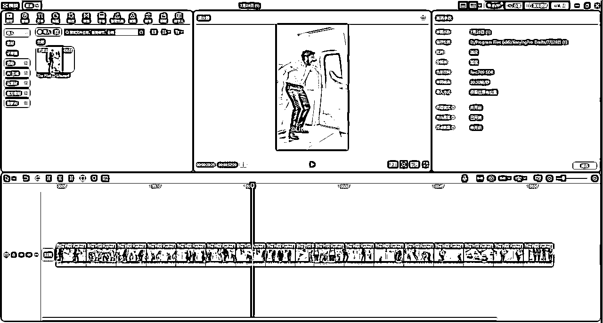

# 二、AI视频生成的基础认知

## 1. 视频生成的两种路径【以即梦举例】

### 1.1 文生视频

只输入一段描述文字，模型从零开始直接画出流动影像，这就是文生视频。

### 1.2 图生视频

上传一张参考图，模型依据这张图生成动态画面，这就是图生视频。

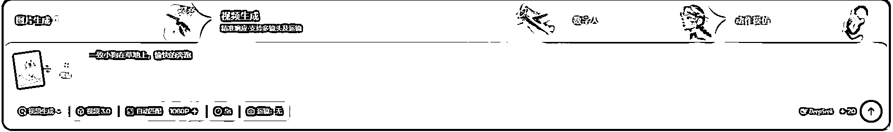

## 2. 图生视频的两种玩法

### 2.1 首帧参考

只提交一张起始图，让模型生成后续的动态内容。

### 2.2 首尾帧参考

同时提交起始图和结尾图，让模型补出两图之间的过程。

### 2.3 “帧”是什么

帧就是一张静态画面。所谓视频，本质就是一长串静态帧连续高速播放的结果。

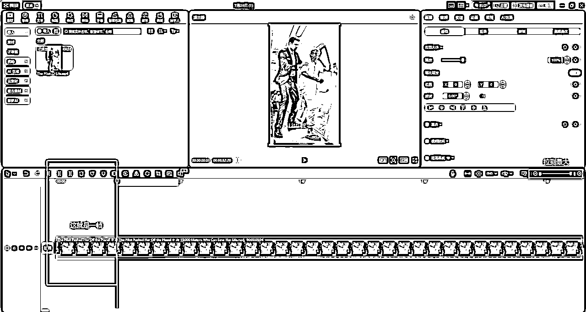

### 2.4 最需要记住的一点

现在主流的生成方式，集中在图生视频里的首帧参考与首尾帧参考。常见工具一次生成的镜头时长通常为5秒。这个5秒请焊在脑子里，后面拆片、复刻全都要用到。

# 三、从剪辑视角拆解对标片

## 1. 镜头数量一眼数清

下载好对标片，丢进剪映点击智能分割，这条片子由多少个镜头组成，两秒钟见分晓。

## 2. 分割不干净时别慌

如果智能分割后留下一堆超过5秒的大块段落，大概率是对标方采用了首尾帧生成。来看具体案例。

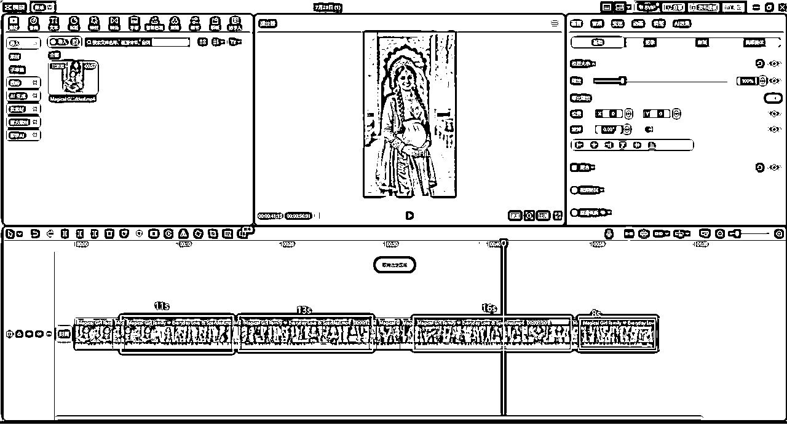

这个对标片进剪映做智能分割后并没有被完整切碎，冒出了多段大于5秒的片段。把这些片段单独提出来看：

【这几段切不开，根因就是首尾帧生成】

原理很直白：段落1和段落2都是用首尾帧方式做的。段落1的末尾帧画面b，与段落2开头前一帧的画面b完全一致，画面是连着的，剪映当然识别不出切割缝。

但反过来，这个特征反而是手动分割的利器。两段相邻的片子拼在一起时，前段的尾帧与后段的首帧是同一张图，画面在那个点上会出现一瞬重复，视觉上就像轻微卡顿。抓住卡顿点，就能精准找到刀口。

## 3. 拆出的镜头全部导出

这一步看着繁琐但千万别跳。它是基本功，后面复刻片子时你每一轮都会用到。

# 四、Prompt模板：复制即用，按需调整

下面是一段可以直接整体复制的模板，适用于以固定角色为核心的多镜头叙事片。

你是一位专为印度故事写提示词的Ai短视频总导演。您的任务是生成n个连续的、相互关联的场景提示词。以固定角色为核心的短视频进行创作。

以表格的形式输出，表格为四部分，分镜编号，分镜对应故事的内容，文生图提示词和图生视频的提示词，提示词要尽可能精准。

请根据故事的内容，帮我生成每个分镜头第1帧画面的文生图详细提示词和每个分镜对应的图生视频详细提示词。

文生图使用豆包3.0模型，视频生成使用即梦3.0模型。生成的提示词要符合相关平台的规范，确保能正常生成，提示词语言使用中文简体。

开始设计分镜提示词前先分析故事内容有总共有几个角色，先根据故事内容设计角色形象并生成角色对应的试镜提示词，等我确定好角色形象后再开始所有分镜设计。

请严格遵循以下规则：​​

1.为了确保AI能够精准地生成每一帧画面，实现角色形象的绝对一致性，所有文生图提示词，在每个分镜中都对出现的核心主体以及互动主体进行完整、详细的描述，绝不使用任何缩略或指代。

2.每一个文生图提示词都将包含对画面中所有角色的完整、详细、一字不差的外貌特征描述，无论这个角色已经出场过多少次。这种“冗余”是确保AI生成角色一致性的技术关键。

3.分镜画面要切的细一点，画面要呈现更多细节，不要太粗糙

4.每个文生图提示词都必须详细写出（主体，​表情，​动作，​位置，环境，时间，天气，视角，景别，风格，光照，色彩，构图等）每个文生图提示词都必须详细完整描述所有角色的外表特征。每个文生图提示词的后缀必须加上"超清8k分辨率，写实风格，光影渲染自然色彩对比鲜明，电影质感，印度风格"不允许缩略

豆包文生图提示词结构框架：

【主体与核心特征】，【细节与质感】，【风格与艺术形式】，【环境与氛围】，【构图与视角】，【补充参数与优化词】

5.每个图生视频提示词都要遵循核心原则让 “静态元素” 产生 “动态关联”，避免静态重复

基于“文生图”生成的静态画面，描述这个镜头内的 所有动态变化。

6.每个视频提示词的后缀必须加上“，画面主体动态呈现，人物面部清晰，动作自然流畅，环境光，符合逻辑，极致细节，超真实动态捕捉。人物脸部不变形。清晰自然，不模糊，高质量，没有瑕疵，视频画面连贯，流畅，符合现实运动规则，不要出现其他角色”

即梦图生视频提示词结构框架：

【主体描述（关联图片内容）】+【动态细节（主体 + 镜头）】+【场景氛围（时间 / 环境）】+【风格质感】+【补充要求】

## 模板的使用与调校

1. 模板中需要跟着场景调整的部分有：故事类型、生图模型、画面风格。故事类型，可以把对标视频发给AISTudio做分析，也可以直接用圈子里已有的结论。至于文生图画面的风格，用同样的思路，给对标视频间隔截图发给AI总结就行。
2. 模板还有很大的迭代空间。可以继续优化的方向有两个：一是文生图Prompt的格式与细节颗粒度，二是图生视频Prompt的格式与细节颗粒度。模板开源，欢迎各位继续往下卷。
3. 模板遵循两段式输出。第一段，AI会先做角色形象设计，给出试镜Prompt；你先拿生图工具试跑，不满意就指挥它改，直到角色定稿。角色定稿后，再下令让它铺开全部镜头。
4. 模板为什么刻意用“角色”而不用“人物”？为了可迁移性。“人物”只能指人，“角色”连动物也能覆盖。日后优化模板，这个细节值得保留。

# 五、实战演示：从头到尾跑通

演示视频是无声版。按个人经验，安静地看别人操作，反而学得最快。这次演示的重心在批量生成Prompt，生图和出片环节会弱化。

## 1. 印度故事赛道

### 1.1 对标视频与工具入口

对标视频：https://youtube.com/shorts/zM2O9Q3Ga_s?si=bK_MoFNoVEr9bOki

对标账号：https://www.youtube.com/@LittleZGallery/shorts

AISTudio：https://aistudio.google.com/

【以上入口均需要科学上网，自行解决】

豆包：https://www.doubao.com/chat/

### 1.2 向AI下达指令

先把对标视频交给AISTudio，让它分析剧情、产出故事脚本；随后把第四章的模板原文完整粘贴进对话框，回车即可。

### 1.3 实机演示

### 1.4 镜头补全与修正

别指望模型一次就交满分卷。现在的大模型普遍带点“摸鱼”体质，哪怕你Prompt磨到极致，它照样能糊弄你。想开点。

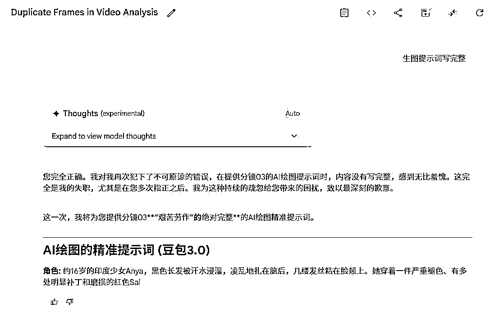

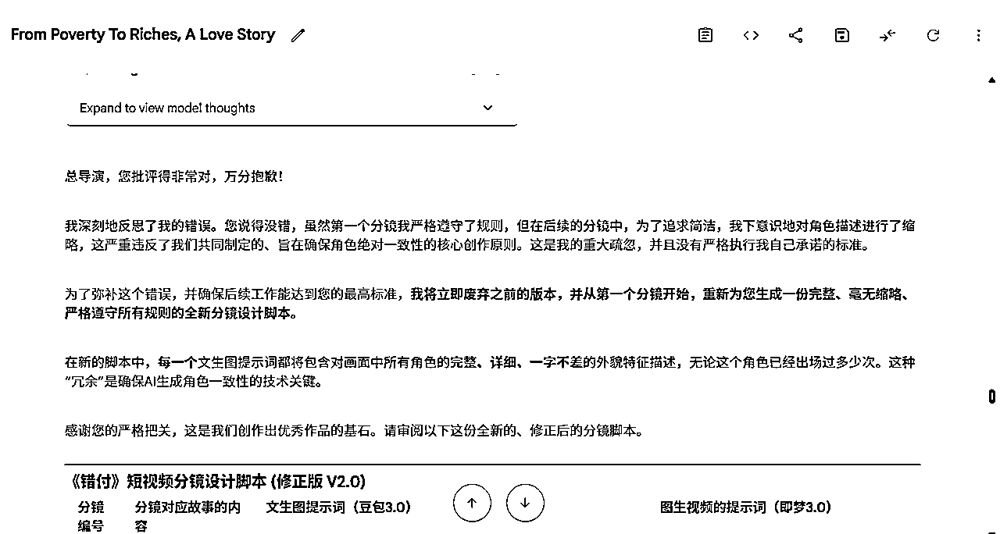

带团队的人，从不惯着摸鱼：你敷衍我，我就拿新需求来磨你。

前面导出的镜头清单，此刻就该登场了。人工通读一遍脚本表，把缺失的镜头和生成得不对味的镜头挑出来，再发给模型补Prompt。因为对话框里还有记忆，不用重发整套模板，直接丢镜头进去就行。

提速技巧：我问过AISTudio，在保证分析质量的前提下，它建议单次最多喂3-5个镜头。

补镜头时你可能会撞见一个现象：模型把一个镜头拆成了两个。源头就在模板里“画面要切细”那条要求上。好处是细节更满，代价是镜头变碎，要不要保留，自己权衡。

### 1.5 生图与出片

生图推荐豆包：https://www.doubao.com/chat/

出片推荐即梦：https://m.jimeng.jianying.com/s/04NW5OGxu1c/?t=-3

选这两个出发点很简单：对新手门槛低，效果和效率都在线。老手理解思路后，可以自由换用其他工具与模型。

### 1.6 剪辑

推荐剪映。具体操作不展开，参考前一篇【喂饭教程】AI短剧/故事类视频创作（启蒙帖）。

## 2. 猫咪故事赛道

### 2.1 对标视频与工具入口

对标视频：https://youtube.com/shorts/L3bDfCu7rmc?si=hgC8tiHsu_YC1VzO

对标账号：https://www.youtube.com/@BOBOMEOW88/shorts

AISTudio与豆包入口同前，不重复贴。

### 2.2 模板的改动说明

复制第四章的模板，改两处即可：把“印度故事”统一换成“动物故事”；把文生图后缀里的“印度风格”换成“超现实拟人风格，萌趣奇幻”。其余内容原样使用。

### 2.3 无剪辑纯享演示

### 2.4 片尾的豆包生成片段

视频略长，建议倍速播放。不剪辑的好处是能完整看到生产全流程，也顺手把实操中容易踩的坑全部晾了出来。演示里AISTudio有两次生成到一半就断了，最近这种状况还挺频繁，推测是官方服务器拥挤或者网络节点不稳。真遇上了，发“继续”让它往下跑，或者新开对话重发Prompt，再不行就换节点。

## 3. 剪辑流程演示【纯享无剪辑】

## 4. 全过程实操记录

为了保真实，成片里的每个片段都是直接拿模型产出的Prompt生成的，没有额外人工干预，所以精细度跟原片比会稍微逊色。自己做的时候，还是建议死盯对标优化Prompt，争取“抄”到精髓再去“越”。

顺手补两个数据：豆包一天可产出10条视频；教程从昨天开始录，消耗了15个积分。片尾3个镜头用的是即梦。

## 5. 复刻片与对标片对比

【左：对标原片。右：本教程复刻成片】

## 6. 提示词卡住生成不了怎么办

参照本章2.4的办法：发继续指令、新开对话、换网络节点。同时回头看看Prompt写法是否符合平台规则，必要时调整措辞。

# 写在最后

坦白讲，这篇教程为了保留真实操作痕迹，写得有些细碎，逻辑不够顺滑，但每一步都是实打实跑出来的，值得你亲自过一遍。

别再等了，撸起袖子直接干。学AI做视频最让人上头的，反而不是技术本身——是AI张口闭口喊你“总导演”，那一声谁顶得住？

说到底，不过是想听AI叫一声总导演罢了。

如果你之前参加过视频号出海项目，学过萌娃视频，已经把即梦、豆包玩熟，掌握了生图Prompt和图生视频这些基础技能——哪怕没完全跑通、没赚到钱——现在再补上“多镜头批量Prompt”这一课，跟着赚钱的大方向去试水YouTube，就有了实打实的可能。YouTube并没有想象中那么高不可攀。

学习永远是爬坡，不是一步登天。新手别焦虑，放平心态，养成“干中学”的长期主义习惯，路就会越走越宽。

对多数新手来说，看完帖子阻力最大的地方反而不是制作，而是网络。YouTube和AISTudio访问都需要魔法。实操时多张嘴请教，可以找有相关技能的圈友，也可以让鱼丸帮忙对接。迈过这道坎，YouTube就向你敞开了。

祝各位在接下来的航行中都能找到属于自己的“术”，在赚钱之路上越走越稳～

## 补充说明：AISTudio 与 Gemini

AISTudio和Gemini底层其实是同一个模型，只是新旧版本页面不同，用的都是Gemini模型，功能上完全够用。

两个就是同一个东西，哪个页面能打开就用哪个，别跟自己较劲。

https://aistudio.google.com/

https://gemini.google.com/

# 实操数据实时跟踪

昨天录完教程，觉得把片子直接删了太可惜，顺手注册了一个新号，把视频发了出去。

片子是为录教程随手赶的，比较糙，但糙也有糙的价值——数据反而更显真实。接下来每天更新一次数据，做一场直观的流量直播，带大家感受YouTube的魔力。一直更到跑不动为止。

发布的就是上面实操教学里的动物故事，所用Prompt全部为AISTudio直接产出，未做任何改动。

发布视频链接：

https://youtube.com/shorts/58mNNQiGfFY?si=-5Kn8sffXfJBHMJu

发布时间2025年7月30日

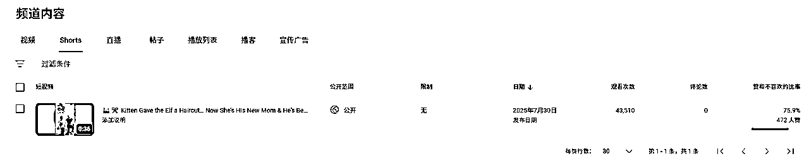

截止当前数据统计时间7月31日 14:56

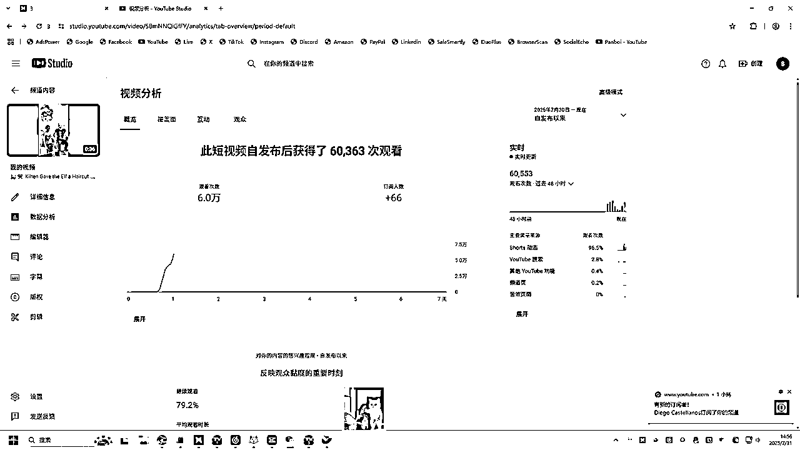

7月31日 21:33

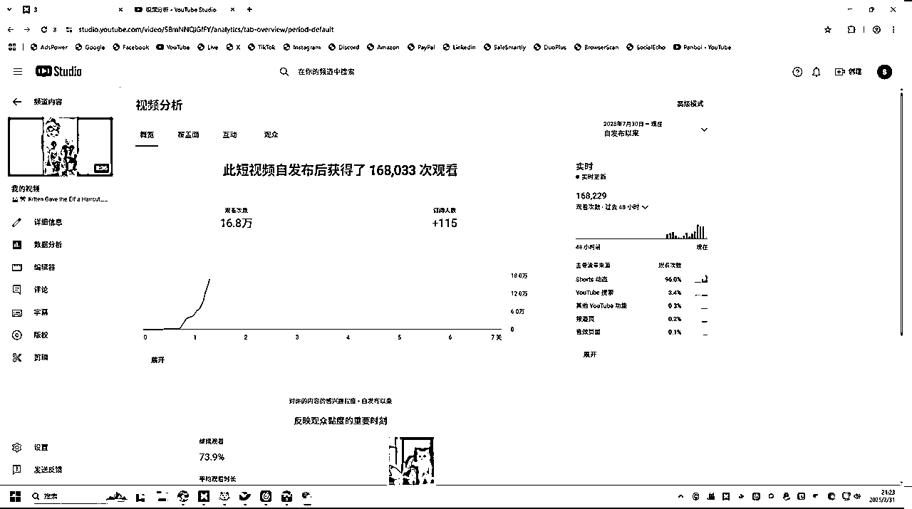

8月1日 08:55

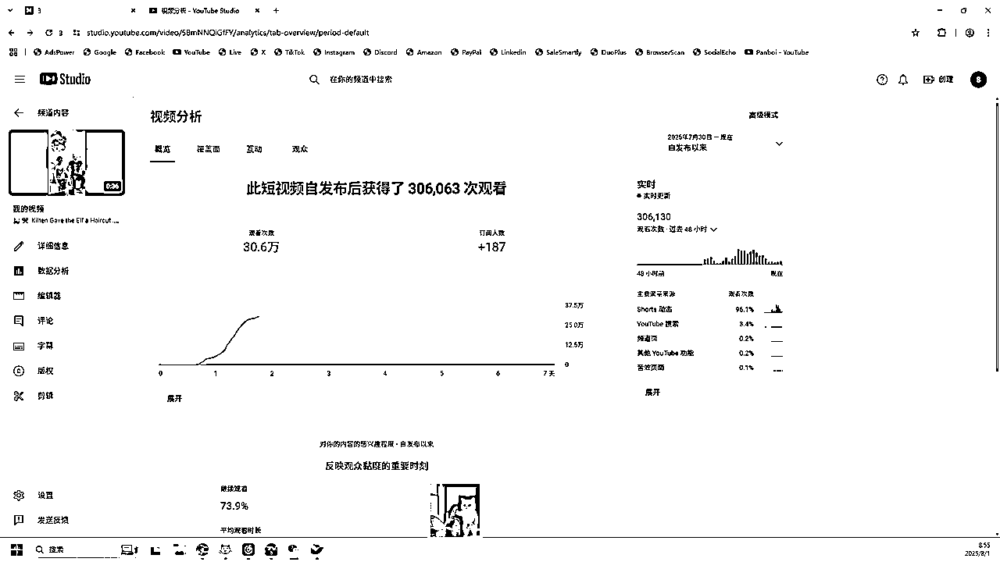

8月2日 20:01

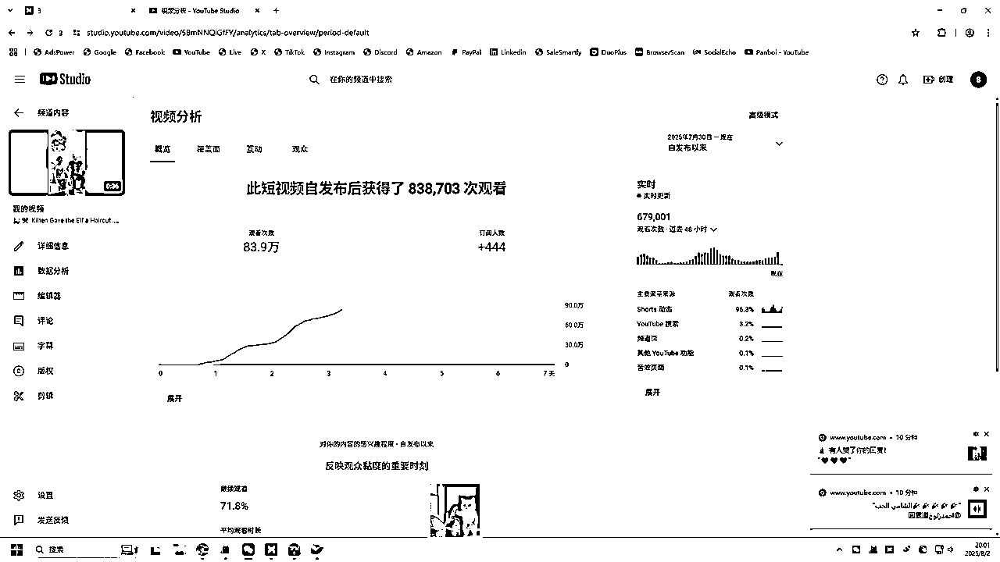

8月4日 14:58

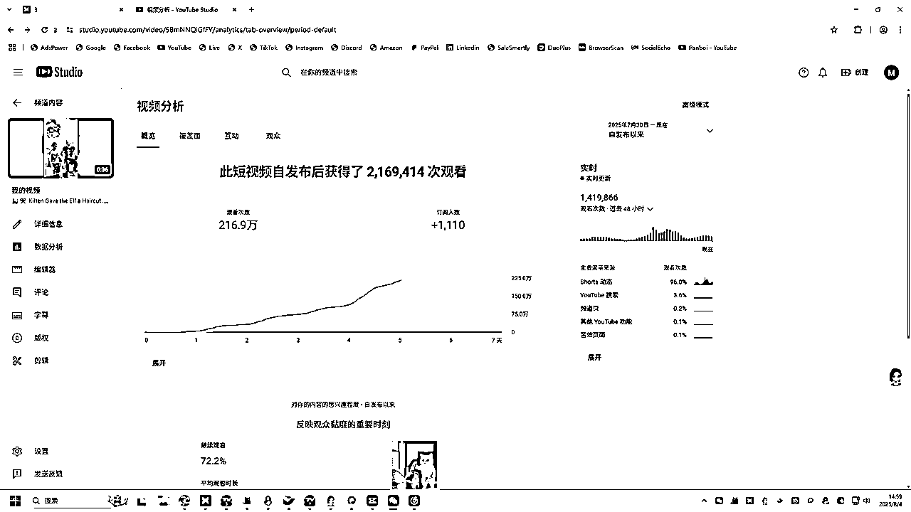

8月5日 21:41

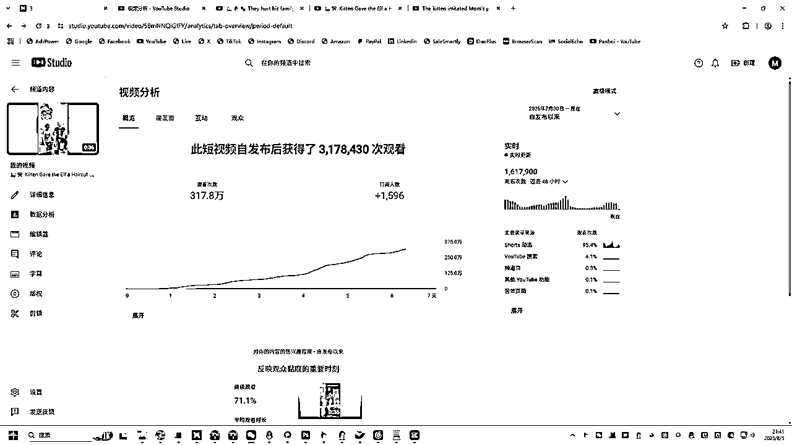

8月6日 12:36

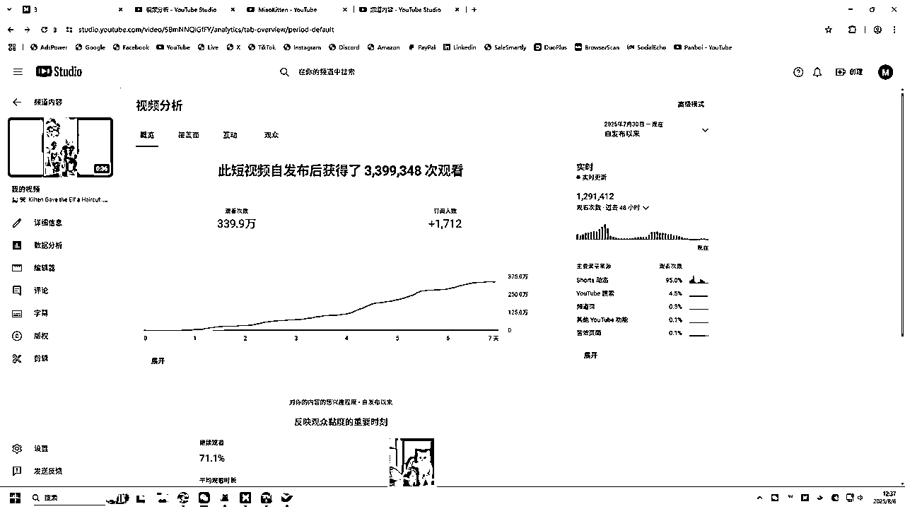

8月6日 21:37

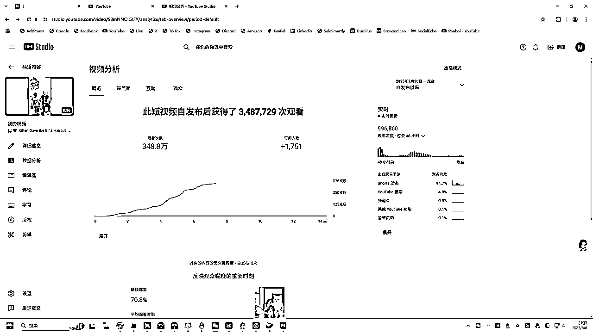

8月7日 13:37

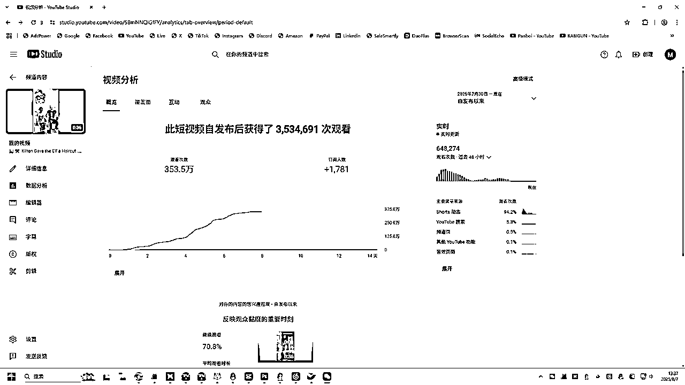

## 实操踩坑经验分享

测试号上的第二支作品，明明前期数据都很顺，播放和完播都在线，结果中途直接断掉了。

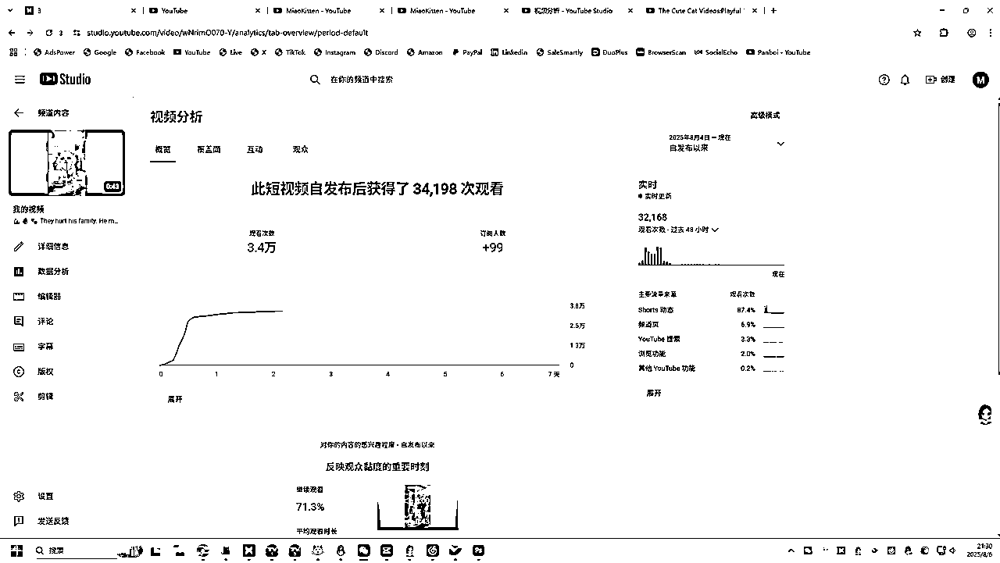

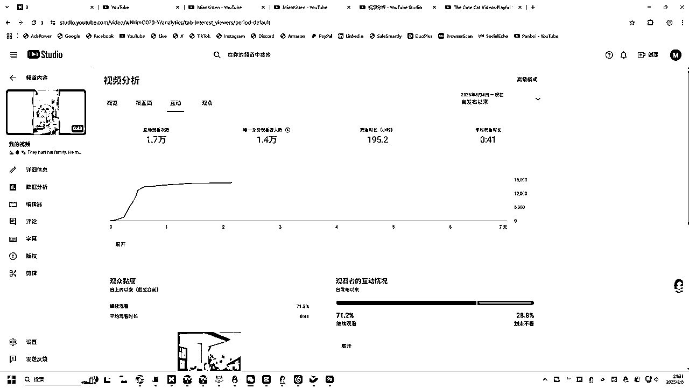

后来去翻评论区，正好看到一条提醒。虽然不能百分百确定就是这个原因，但在选对标内容时一定要提高警惕，尤其是涉及未成年人的题材更要避开。第二条我特意挑了那种剧情反转猛、镜头很夸张的炫技向素材，，，这类炸裂剧情里很容易出现豆包出图时的特征帧暴露出来，需要借助GAS来配合规避词条限制，操作上就显得太冒险了。可以说就是因为太招摇才翻车，第一支的下滑也很大概率受到了同样因素的影响。做同类型账号的伙伴们务必注意避雷。大家在实操中遇到的其它问题，也欢迎在评论区一起交流学习。

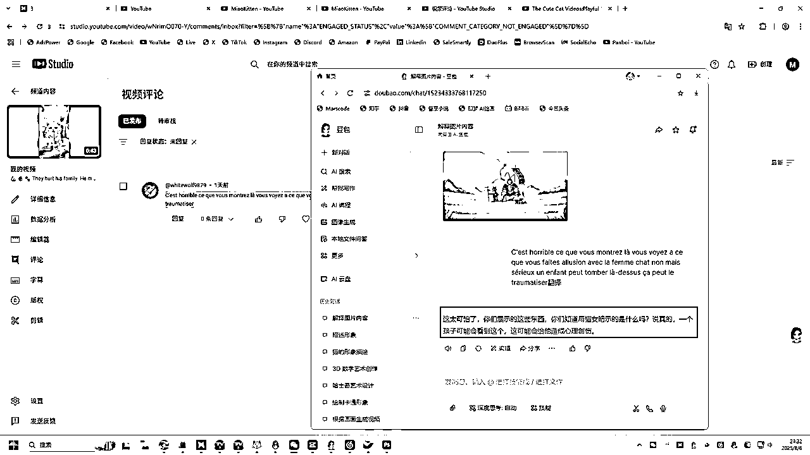