# 26岁裸辞，回老家All in AI一年半，现在怎么样了？

我是袋鼠帝，一个在云南昭通小县城长大的普通人，也曾在深圳当了5年程序员。

2023年底，我做了个让很多人觉得“疯了”的决定：裸辞，离开深圳，去昆明，全力以赴做AI。

为什么？因为当时在大厂式的打工生活里，我已经快喘不过气——KPI像座山，年终奖像张饼，永远看得到吃不到；更可怕的是，每天重复着同样的日子，我仿佛能看到自己十年后的样子，像一台生锈的机器。

我想拉自己一把——只要跑起来，风就在身边。

现在，距离那个决定已经过去一年多。有人问我后悔吗？我的答案很干脆：不后悔，而且爽翻了。

这一年多，我把自己的AI👸号从0做到了现在：从去年4月到现在，发了211篇原创内容，累计阅读量330万左右。虽然这个数字可能不如某篇爆款单篇高，但在AI领域里，我多次冲进个人👸号排行榜前十。

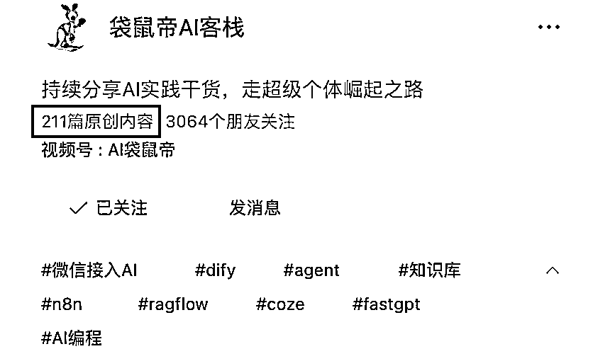
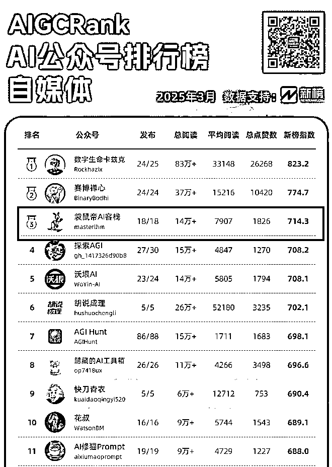
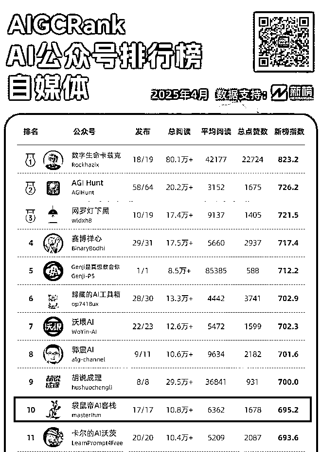
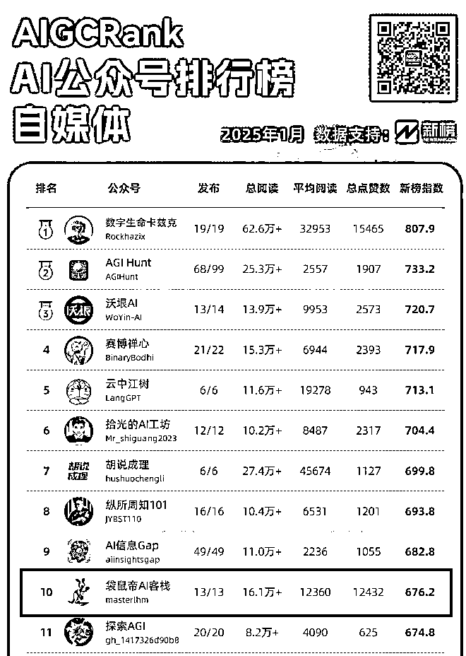
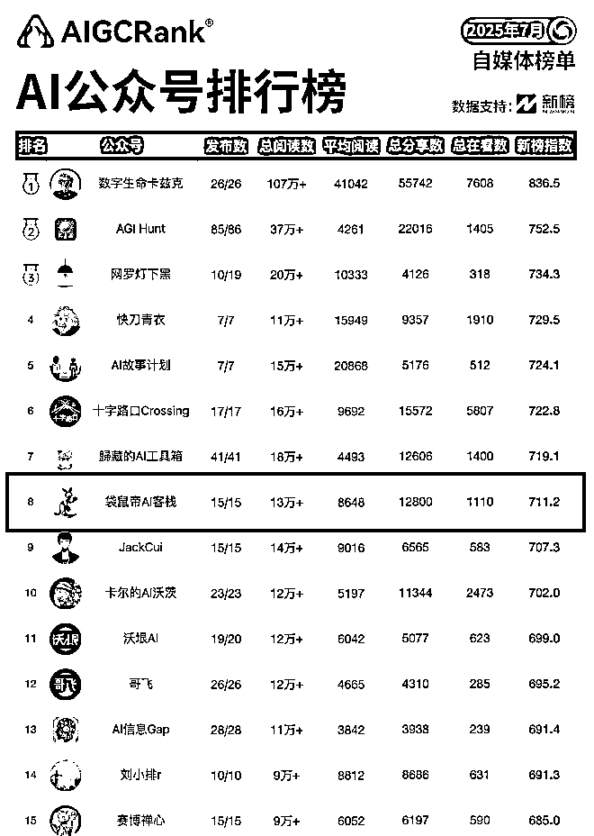

至于收入嘛，说实话，24年全年靠👸号只赚了不到一万。但今年到现在，这个数字已经翻了至少10倍——不多，但至少证明这条路能走通，我也完成了自己设定的短期目标。

经常有朋友问我：“做AI自媒体真的赚钱吗？普通人现在入场还有机会吗？”

这种问题，一两句话真说不清。正好前几天龙哥盟邀请我去星球做分享，也就是借那个机会，我把自己的完整经历整理了出来。

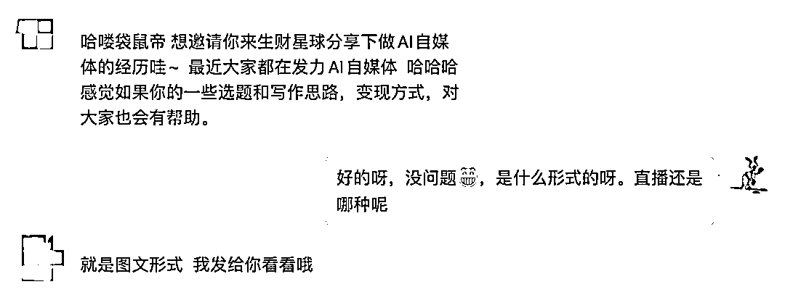

先看一张图吧——是某个👸号的流量主收益截图，注意，不是我的。

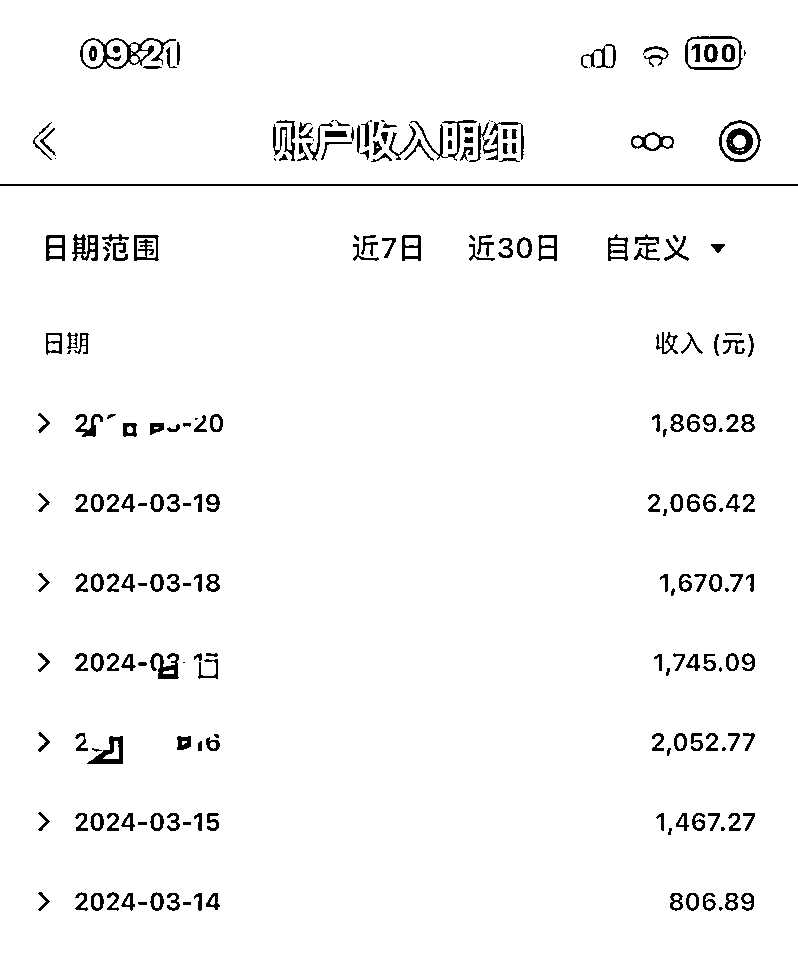

这收入，对大多数上班族来说，都挺有吸引力吧？如果手里有10个、100个这样的号呢？我当时看到这组数据，浑身鸡皮疙瘩都起来了——原来还有这种玩法！

于是在24年最初三个月，我先去做了抖音和B站。每天研究选题、学剪辑，忙得昏天黑地，也积累了一些流量，但一分钱没赚到。那种感觉就像在漆黑的旷野里开车，看不到方向。

直到去年4月，我被前面那张截图“点醒”，转战👸号。

先说个残酷真相：一篇200多万阅读的👸号文章，开了文中广告，流量主收益是多少？我自己实测过——只有7000多块。

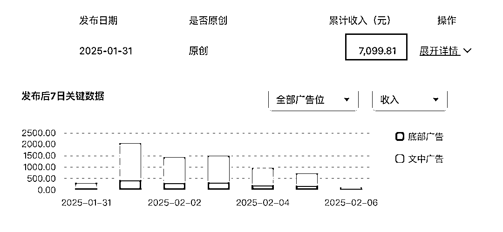

是不是瞬间冷静了？而且这种级别的爆款，可遇不可求。我到现在流量主累计收益，也就下面这么点：

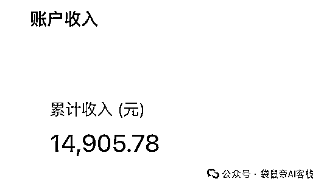

所以，今天我不是来教你怎么靠流量主赚钱的。我想讲的是，一个从云南“山卡卡”里走出来的普通人，All in AI自媒体这一年多，真实的踩坑与爬坑过程。

如果你指望一夜暴富，可以关掉了。但如果你想了解👸号起号，或者“普通人怎么0成本创业”，这篇内容一定能让你少走很多弯路。

先说说👸号为什么值得做：

1. 它现在是公域流量，背后是几亿🛰️用户；
2. 文章通过朋友圈、社群传播，非常方便；
3. 读者质量高，老板、高管、创业者很常见；
4. 限制最少，二维码、链接随便放，是引流🛰️的最佳渠道。

我觉得👸号上1个阅读，至少抵得上抖音10个播放。而且对新人号的流量扶持，一直很友好。

接下来，聊聊我的故事。

我是云南昭通人，真正大山里的小县城。从小父母就教育我：靠人靠天不如靠自己。

大学是个普通一本，毕业那天，我打包行李，买了张去深圳的单程机票。那时候有种迟来的觉醒：我要去大城市学真本事。

结果现实很骨感——找不到工作，最后只能贷款2万多，参加了一个半年期的程序员培训班。

那段日子苦到极致：8人间宿舍，上下床，床板还会长臭虫。半夜睡着觉得身上有东西在爬，一巴掌拍下去，满手是血。

但正是那种环境，激发了我的学习欲望。我几乎每天第一个到教室，半年培训下来，走神时间加起来不超过5小时，经常为一个bug熬到凌晨两三点。那种解决问题后的快感，是以前从没体验过的。

毕业后5年，我待过4家公司，做Java开发。

第一家是十几人的跨境电商公司，作为最年轻的“牛马”，通宵是常态，半年后公司疫情倒了。第二家是汽车行业，干了一年多不涨薪，跳槽去编程猫，结果遇上K12政策，公司裁了一半，我有幸上榜。最后去了一家证券公司，两年多，等来的是年终奖的大饼和越来越大的压力。

23年底，我终于做了决定：裸辞，回昆明。

没有光鲜履历，没有大厂背景，没有人脉，没有存款——这就是我All in AI之前的全部家底。但正因为如此，我才想试试，一个普通人，能不能靠自己的判断和坚持，走出一条路来。

回昆明后，我给自己定了个小目标：24年每月平均赚2000块，就算赢。

当时我分析了两件事：

第一，自媒体是普通人0成本创业最好的途径，杠杆够高；
第二，AI是未来十年的大风口。

所以，做AI自媒体。

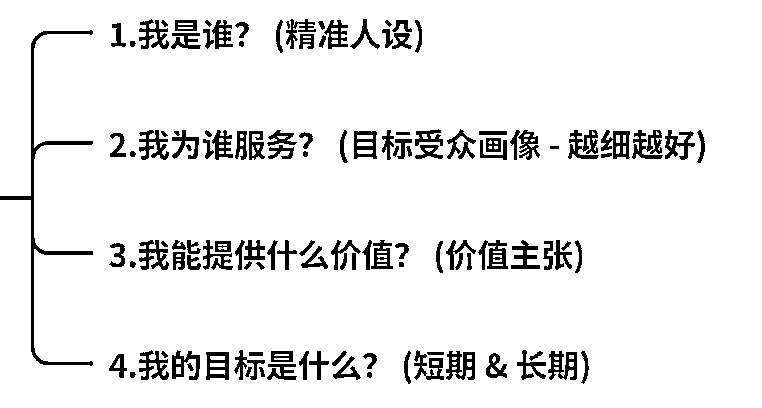

最开始三个月，我在抖音和B站发力。剪辑技术很烂，但其实剪辑只是锦上添花，真正重要的还是选题和节奏。可惜那段时间虽然有了点粉丝，却一分钱没赚到。

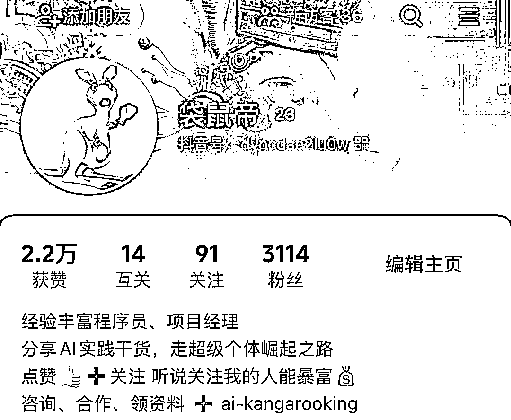

直到看到一个AI群里的大佬发了几张👸号流量主收益截图——就是文章开头那两张。他想找合作的人做AI洗稿。

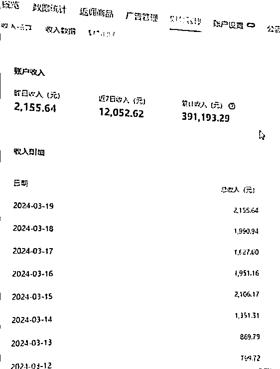

我当时心潮澎湃：这玩意儿我可以用AI全自动搞定啊！感觉马上就要发财了。

于是爆肝两天，用ChatGPT开发了一个Python写的AI洗稿工具，能批量生成文章，直接存进👸号草稿箱。我还免费给那位大佬的团队用，顺便收集反馈。最初的十几篇文章，都是这么来的。

我以为按照大佬的方法，连续更新半个月就能进流量池，然后搞矩阵号，走上人生巅峰。

结果，现实狠狠打了我的脸。

我每天更新，坚持了快一个月，阅读量始终只有几十、几百。每天早上醒来第一件事就是看流量主收益——

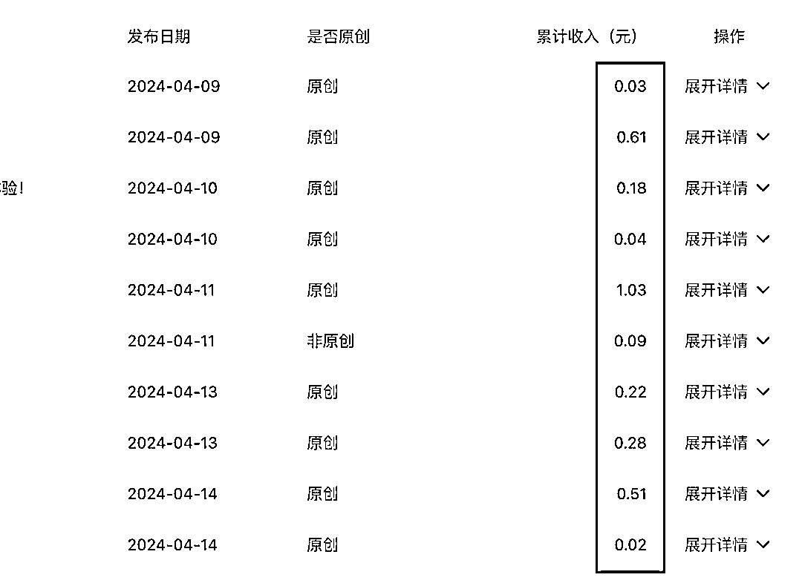

那点钱，连瓶可乐都买不起。

后来才知道，👸号开始严打AI洗稿，不给推荐流量。那位大佬的同行走下坡路，他也退出了这个赛道。

我意识到，流量主这种项目，靠平台机制吃饭，不是长久之计。

但在这个过程中，我发现了👸号的一个优势：开放。可以随便放链接、二维码，引流到🛰️特别方便。不像📕，我去年3月3000多粉的号，莫名其妙就被永封了。

于是我开始自己写。

没想到手写了几篇，就爆了一篇10万+。

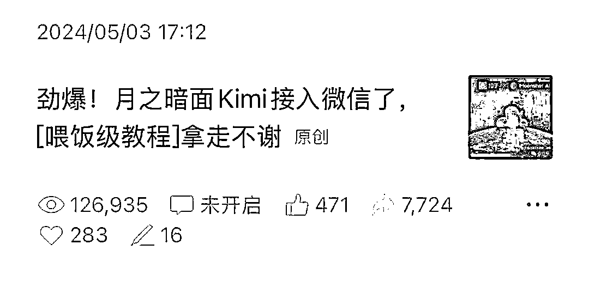

那感觉怎么形容呢？每隔几分钟就忍不住看一次后台，阅读量几千几千地涨。像个突然被世界看见了的孩子，无比兴奋。

我冷静下来复盘，发现了一个爆款公式：

**热点AI工具 + 国民级应用场景 + 喂饭级实操教程**

当时的热点是Kimi和Coze，后来变成NanoBanana、seedream4.0。我知道现在写一篇“seedream4.0接入🛰️”大概率也能爆，但我不想一辈子只写这类东西。

我22年写技术文章时，总想写深度拆解源码的硬核内容，结果没人看。因为大多数人不需要那么深，也看不懂。

后来我调整了方向：不写纯技术，只找有趣、实用、黑科技的场景，结合当下最火的AI工具，用最简单的方式教给大家。

一个很重要的心态：不要妄自菲薄。你觉得“这谁不知道啊”，但信息茧房有多坚固，远超你想象。你眼里的常识，很可能是别人眼里的信息差。只要你认真做了，内容就有价值。

当然，初期也不能太水。我手写第一篇起，写一篇至少要3-4个小时；到现在，一篇内容往往要打磨1-2天。

我的经验是：👸号一篇能不能爆，选题占50%，标题占30%，内容占20%。选题和标题决定了流量下限，内容决定上限。内容够好，点赞、转发、完读率才会高，系统才愿意推荐。但注意，千万别做标题党——标题和内容完全不符，会毁掉信任。

对大多数普通人来说，做自媒体初期，我强烈建议先搞流量，也就是死磕选题和标题。因为没有流量，内容再好也传不出去。而一篇精心打磨的文章发出来石沉大海，对积极性是毁灭性打击。

所以，先用最短时间做MVP产品去试错，而不是一上来就自嗨式地憋大招。

那怎么找选题呢？一个小技巧是去数据平台，比如“次幂数据”，找那些粉丝不多但阅读量很高的“低粉爆款”。别人已经验证过的爆款选题，你用自己风格重新演绎，大概率还能爆。起号阶段，找到对标账号“抄”——不是抄内容，而是抄选题、抄思路、借鉴优点，融入自己的东西。

那段时间，我写的不少内容虽然没到10万+，但流量都相当不错。

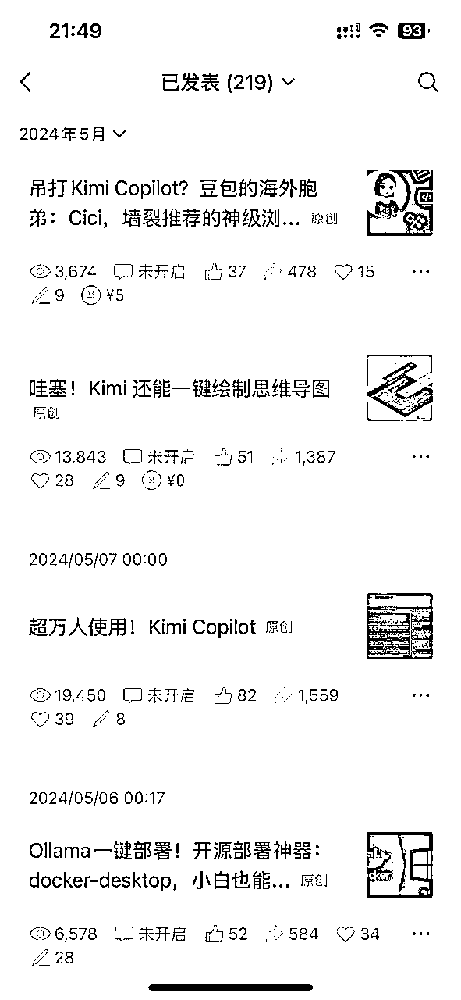
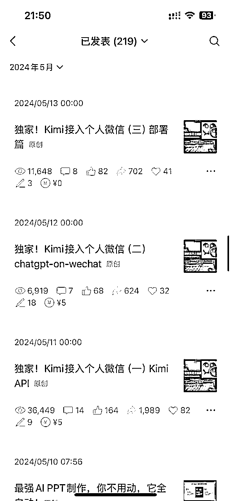

慢慢地，账号吸引了一批开发者、动手能力强的小白、创业者和做私域的朋友。

前期也不用在排版上耗太多精力，看着舒服就行。现在我的封面会用seedream4.0生成。做得多了，网感会练出来——一个标题扫一眼，大概就知道会不会爆。当然也经常翻车，翻车就要复盘。

24年底，👸号给我总结了一整年的成绩：

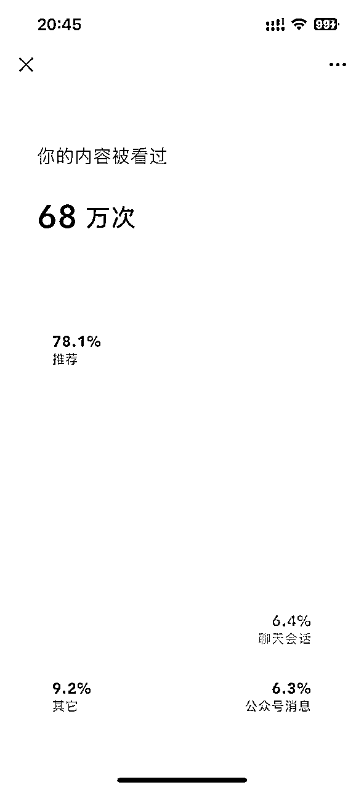

其实24年我过得很随性，8月自驾游还断更了一个月。平时会在私域卖点小产品（比如AI配音工具），接一些AI定制开发和商单——当然，广告也不是乱接，要真有价值才接。

全年收入不算多，但超额完成了月均2000的目标。

24年底，我花一个多月开发的🛰️AI助理桌面版慢慢烂尾，我也没有太纠结，干脆把重心完全转到👸号上。

这个决定，让我在春节那会儿，狠狠吃到了时代红利。

DeepSeek突然爆火，🛰️指数疯涨。我立刻意识到：千载难逢的机会来了。

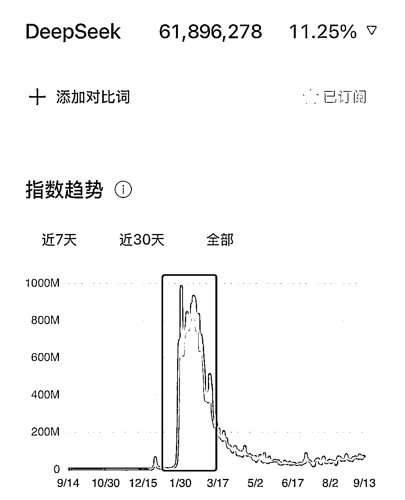

除夕那天，我丢下年夜饭冲到电脑前，开始研究。我在B站看到一个小号发“DeepSeek接入🛰️”的视频，居然100万播放！我马上想到：我之前写🛰️接入AI就火过，这波加上DeepSeek，绝对能出爆款！

预感会爆，但没想到会那么爆。除夕夜发布后，几天时间涨了200多万阅读，直接把我的账号推到了全新高度。

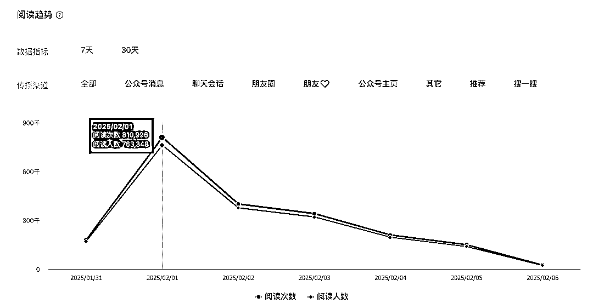

那个阅读量，几分钟不看就多好几万。虽然涨的不是余额，但那种兴奋感，比赚钱还爽。

我24年一整年累计阅读才60多万，这一篇，抵我正常更新三年多。

这件事让我彻底明白：持续的普通日更，远不如一篇精心策划的爆款。爆款才是账号增长的核心。

而爆款，需要时机。回顾AI高速发展的这两年多，真正的流量红利期其实就那么几次：
23年初的ChatGPT
24年初的Sora
25年初的DeepSeek
25年3月的Manus，也算一个小红利期

我的经验是：你得一直待在牌桌上，才能在机会出现时第一个抓住它。

那次我只发了👸号，视频没跟上，现在想想还有点可惜。下面是那段时间前后的常读用户变化，2月份几乎涨了10倍。

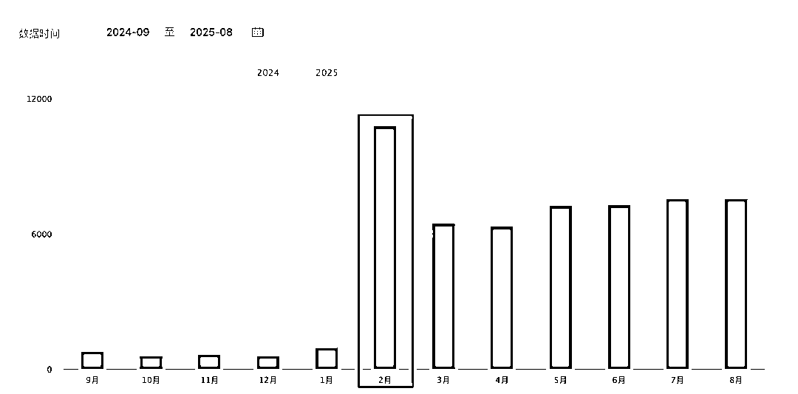

经过那次爆发，账号明显上了一个台阶。有了更多流量和常读用户后，我开始转变思路：不再只追流量，而是优化内容质量，打造个人IP。

我慢慢砍掉了定制业务——一个人从需求对齐到验收、售后，流程太长。真正的All in，是把所有能量集中到一个点上，看看自己能走多远。

这个过程里，我受邀参加了一些大厂线下活动，认识了很多圈内大佬，也和不少网友面了基。以前我几乎没有圈子，都是一个人埋头做事，现在世界突然宽了。

当然，也有新的焦虑。最近刷抖音，看到个观点说：这世界上最恶心的一句话，就是“把自己的兴趣找到，然后把它变成自己的事业”。

可对我来说，这一年多的经历恰恰相反。正因为把AI和写作变成了事业，我才从那个焦虑疲惫的深漂程序员，变成了一个眼中有光、脚下有路的自由人。

后悔？不存在的。我等风来，风也真的来了。如果你也想试试，请记住：别想太多，先动起来，保持在牌桌上，风起时，你自然会被推着往前走。

回头看，24年我做👸号的状态，太像一次凭好奇心上路的探险。那时候没有KPI压着，写起来全靠新鲜感和偶尔冒出来的小满足——一篇内容数据还不错，有人点赞私信，会突然上头，灵感像泉水一样冒出来，写得又快又嗨。

等到我真正把所有筹码都押在👸号上，情况就变了。目标变清晰了：涨粉、阅读、影响力、收入。每一个动作都开始被结果牵着走。

性质一变，状态也跟着变。All in 几个月后，焦虑偷偷上来了，创作的热情被抽走了大半。我变成了一种被动的自己，明明待办清单很长，却提不起劲，手会停在屏幕前发呆，拖延变得理所当然，懈怠感也越来越重。

PS：讽刺的是，这段时间的作品质量反而是上去的。每篇都像是要拼命证明什么，耗掉大量时间和心力，写完也只剩疲惫。

数据上的焦虑更明显。流量一波动就心慌，阅读数下滑就会陷入自我怀疑。以前几千阅读能让我高兴一整天，现在连这种数字都提不起情绪，反而更失望。

从表面的数据看，自从DeepSeek那波热度过去，我的曲线好像没怎么往前走。但仔细看，还是有积累的。AI板块的风口已经散了，我却还能守住基本盘，让更多人记住了“袋鼠帝”这个名字。

圈子里的氛围也在变卷。凌晨三点还在抢热点的同行越来越多，内卷的节奏让人喘不过气。

接触的人越多，能力上的自卑感越强。大佬见得多了，自己就显得平平无奇，甚至有点自惭形秽的感觉。

我一直在尝试调心态，最近稍微缓和了点。

把这段时间的体会整理一下，也许能给正在经历或将要经历同样阶段的你一点参考。

第一，把人生当成体验，而不是一场竞技

停止无意义的比较。世界上永远有比你更强的人，盯着别人只会消耗自己。把注意力收回来，问一句：今天的我，比昨天的我好一点了吗？哪怕只进步一点点，也值得自己给自己鼓掌。

与其和对手赛跑，不如把更厉害的人当成老师，既没有压力，又能学到东西。

自媒体是一场长线拉扯，重点是享受这个过程，而不是比谁跑得快。节奏，始终要握在自己手里。

第二，压力的根源大多是恐惧。我怕流量掉，怕没人认可。对抗这种恐惧，我的办法是学会“无所谓”。

我会反复提醒自己：最坏的结果也不过是回去找份工作养活自己，饿不死。

都出来闯了，谁还真能回去安稳上班呢，不可能的，哈哈哈。只能用这种自嘲的心理暗示给自己减压。

当你不再那么害怕失去，肩膀就轻了。轻装上阵的时候，比背着石头硬干效率高得多。

第三，找准真正驱动你的东西。

我能撑到现在，并不是因为自律或毅力，也不是因为什么宏大梦想。而是捕捉到了“分享—反馈—成长”这个闭环带来的快乐和成就感。

这种发自内心的主动热爱，加上持续的正反馈，才会让人愿意废寝忘食，还觉得值。

做任何事都一样，找到那个让你主动上头的原因，而不是被迫去做。被动永远违背人性，很快就会产生抵触。

铁汁们，你们的三连就是我动力来源的证明～

不过说实话，以上三条对现在的我来说，更像是一种自我安慰，效果有限。

直到上周末，我刷到影视飓风19年的一条旧视频，Tim讲他做自媒体前五年是怎样挣扎、怎样变现、怎样走出来。链接在这：https://www.bilibili.com/video/BV13t411t7P6/?spm_id_from=333.1387.search.video_card.click

我很少会因为一条视频落泪，这次却控制不住。太像我现在了。

Tim当年也陷入过懒惰和丧失激情的低谷，他的解法是撕掉身上贴的标签，回到做自己的状态。

我理解的标签，就是外界对我的定义和期待，也是我自己给自己设的框。它像无形的墙，把我困住。就像那句歌词说的，杀死人的不是挫折，而是期待。

所以我想试着回到起点，撕掉这些标签。写教程并不是我一辈子想做的事，我想做能点燃我自己也点燃别人的内容。

我也准备去补一下Tim当年提到的那两位创作者，Dan Mace和Yes Theory，虽然现在还没看完。

希望能尽快走出这个坑，如果走出来了，我会再写《下》。

这一期本身也是我的一次尝试，想分享点更真实的东西，也希望评论区能给我点反馈，对我很关键。

没想到写着写着就快一万字了，这是我200多篇里最长的一篇。能看到这里的，你基本就是我的铁粉了，谢谢你。

另外我还在探索个人IP的路上，所以没太多成体系的经验可以分享。推荐一本我觉得很有用的书《1000个铁粉》，电子版和纸质版都可以看，我也有佣金。

现在的变现比较单一，All in 👸号后主要是接商单，商业化做得一般。

总结来看，👸号赚钱大致就这几条路：

1.靠流量主，写爆文、做矩阵。感觉不稳定，去年那位做得好的大佬也退了。
2.做产品，用👸号做引流变现。
3.做IP，积累信任后接商单或卖自己的产品。

如果还有其他玩法，也欢迎在评论区教我。

最后分享一个“邪门”但有效的玩法：盯住现在流量最好的选题，持续深耕。流量会变得非常稳。

可以参考“刘小排”和“郭震AI”，一个死磕Claude Code，一个深耕DeepSeek+知识库。

给想入行的朋友一句劝：刚开始别All In。先找到你做👸号的快乐点，找到能让你持续输出的动力，再慢慢坚持。

另外，多花时间在爆款上。一次爆款，有时候顶得上你几年平庸的积累。

「写在最后」

我的起点很低，没背景没人脉，是个I人也不擅长表达。我能走到今天，靠的只是对未知的好奇心、持续学习的习惯，以及一次次被打倒后愿意再试一次的笨劲。有时候一篇内容要打磨好几天，这篇也不例外。

AI时代最大的魅力，是它给了普通人参与的机会，把我们拉到了同一条起跑线。它不看出身、不看学历，只看想法、创造力和执行力。

我所有的转折，都来自这波AI浪潮。而这波浪潮，其实才刚开始。

如果你也在自媒体或创业路上遇到困惑，欢迎评论区聊聊。也希望大家给点内容和商业化的建议，我会认真看。

欢迎畅所欲言！

>/ 作者：袋鼠帝

能看到这里的都是凤毛麟角的存在！

如果觉得不错，随手点个赞、在看、转发三连吧~

如果想第一时间收到推送，也可以给我个星标⭐

谢谢你耐心看完我的文章~