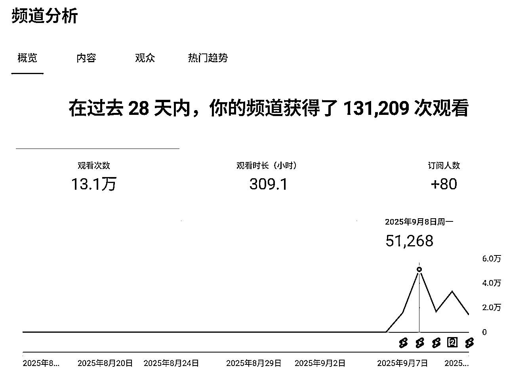
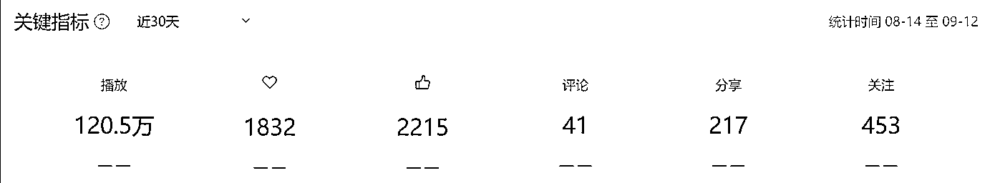
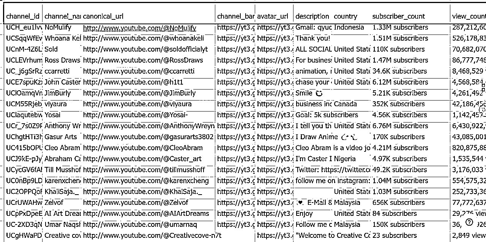
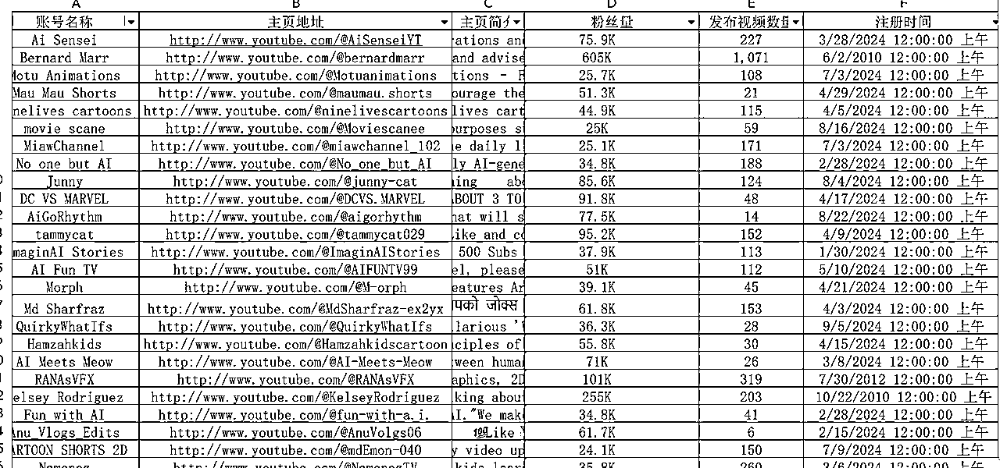
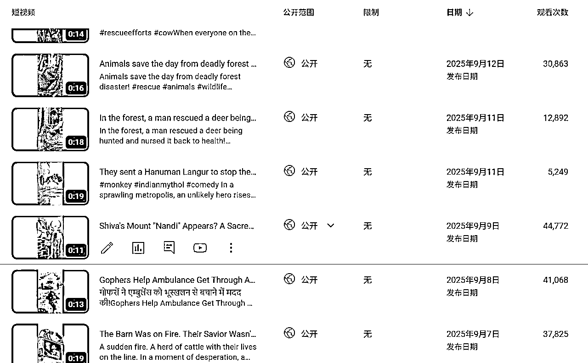
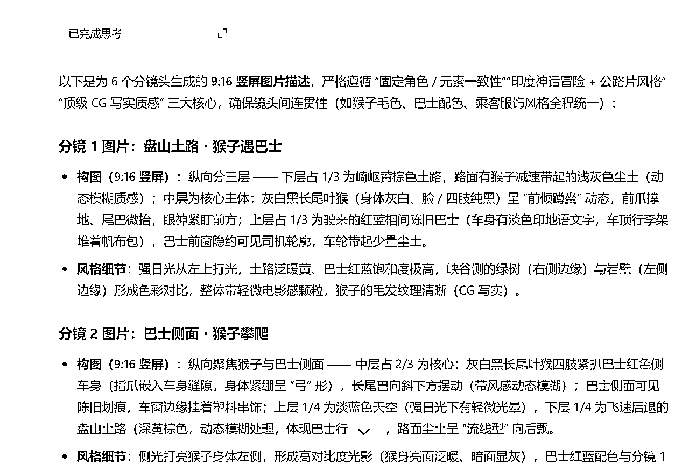
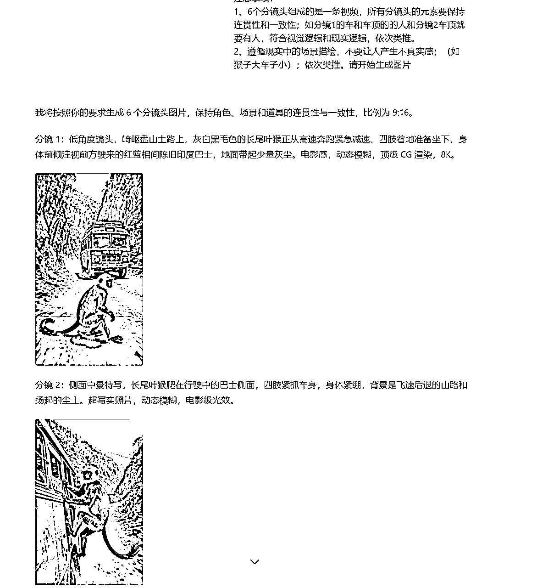

# 40+零互联网经验的新手成长复盘帖

40+、零互联网经验、第一次航海，我如何从“连YouTube是什么都不知道”到6条视频13万播放？

大家好，我是龙哥。6月加入赚钱，9月第一次参加航海，同时上了“YouTube AI视频”和“AI视频制作”两条船。3号开船，7号发出第一条视频，截止12号一共发了6条。YouTube累计13万播放、98个订阅；视频号120万播放，靠5条视频开通了创作者分成——后者完全是意外。

收到领队大魔王和志愿者Leo丨站在雞蛋一邊的邀请时，我挺意外。我当时的第一反应是：我还没变现，按赚钱标准不是不该出来分享吗？但他们说，很多圈友和我一样零基础，第一步往往最难迈出。不是拿到很大结果的人才配分享，我的经历也许正好能给同样第一次航海的人一点启发。

如果你也符合下面几条，对号入座一下：

- 没有任何技能可以迁移到航海项目；
- 平时不刷短视频、不用AI，连“出海”怎么上船都不知道；
- 没有自己的变现模式，之前做的是传统行业或职业；
- 从没接触过互联网和新媒体项目；
- 40岁以上，甚至觉得“人生可能就这样了”。

如果中了几条，下面这篇复盘可能对你有用。

一、找山门：到底做什么？

说句实在话，进赚钱之前，我不知道还有这样的社群。6月关注的一个👸号博主提到赚钱，接着视频号就给我推了龙哥介绍“赚钱是什么”的视频。我第一反应是：这不就是“得到”加知识付费吗？但后来发现很不一样。外面的知识付费大多是“把钱给我，跟我走”，赚钱则说：这里有很多人拿到结果的项目，可以链接资源、有人陪伴，门票还给退。就这样，我买了门票。

进来以后，发现项目多到看不过来，但大多数离我太远，好多名词都看不懂。怎么办？我的思路可以总结成四个字：道法术器。

- 道法：从外界的不确定性里找确定性；
- 术：找筛信息、确认类比、亲自实测；
- 器：用自己顺手的工具和方法。

有了这个框架，我把注意力放在航海上。6月那期已经错过，我就等8月底新一期。19个航海项目摆在那里，怎么选？

先定位：对我这种普通人，任何一个航海都是从0开始，没有技能和资源可迁移。所以上船的意义是学习新技能、涨认知、了解一种变现模式。我给自己定的公式是：学习技能 × 赚钱项目，技能优先，项目靠后。

再往深一层看，商业这件事，底层逻辑还是价值交换。价值交换的前提是我有别人需要的价值，持续交换要有能力护城河。普通人怎么“低买高卖”？买的是什么？我找到了三个确定维度。

时间。李笑来说过，个人时间有三种卖法：同一段时间卖一次、卖很多次、购买别人的时间。我要想办法让我的时间更有价值。

宣传成本。互联网上做项目都要宣传，宣传本质是流量。刘小排有句话的大意是：互联网里低买高卖的核心就是流量，不额外付费时，流量越大，成本越低。

趋势。AI视频、自动化、出海，是未来比较确定的方向。自动化要先手动跑通整个流程，知道坑在哪才能自动；AI视频的本质是内容，AI负责降本增效；出海则能让时间价值再放大一次——汇率就是最简单的算术题。

所以我最后选定了：AI视频制作 + YouTube AI视频。逻辑是：用AI降低视频制作难度，做出内容，再靠YouTube的流量分成赚广告主的钱。

二、入山门：进山前先解决四个问题

开船前有四天准备时间。那会儿我对YouTube的认识就是“一个全球最大的视频平台”，仅此而已。赚钱里2000多篇YouTube相关帖子，我看了很多，却像看天书——住宅IP、指纹浏览器、ADS、频道……全都认识，合起来不知道在说什么。我收藏了几十篇，后来实践时发现不少已经过时。

但这几天我做了四件事，让局面开始清晰。

第一件事：先“出门”。

要了解YouTube，首先得能打开它。我问了一圈朋友，没人知道方法。后来在一个付费课程里看到一种方法，太贵也没敢买。最后靠赚钱帖子里的线索，自己出去以后找到了更基础的教程。想初步了解的朋友可以看这个系列：https://www.youtube.com/watch?v=XKZM_AjCUr0&list=PLqybz7NWybwUgR-S6m78tfd-lV4sBvGFG

看完我用了类比法去理解“IP”。IP就是一种身份：个人IP是身份，网络IP也是网络身份，相对唯一。正常上网是“连接IP→传输数据→网关解析→到达目标→数据返回”。类比成出国定居：你得有签证，有亲戚帮你证明，有飞机场和航班能飞过去。住宅IP就像住亲戚家，公司IP像去亲戚公司；机场没有航道了，换一条就行。IP污染就是身份太杂，对面认不出你。指纹浏览器就像给每个身份配一个独立的房子，互不干扰。我现在只养一个号，还没轮到住宅IP。

第二件事：注册YouTube。

我的办法很朴素：用手机🐧邮箱（PC端没有Google入口）创建Gmail账号，填姓名、生日、性别。创建时手机号只用来收验证码，不是实名制——这个号码要是出问题，关联的账号都会有麻烦。辅助邮箱可以跳过，之后再补。PC端登录后会有二次认证，输入手机号不需要验证码，设置住址可以跳过。高级认证我按航海手册来的，这里不展开。语言默认英文，我先把Google账号和YouTube都改成中文。

第三件事：华为手机安装Google服务。

我的手机是华为，亲测有效。步骤大致是：先删掉以前装过但不能用的版本，设置锁屏密码，关闭🛰️双开、隐私空间、悬浮导航、增强防护。下载谷歌框架包：https://www.mediafire.com/file/5tl1mfylfaf1k9f/mobile6.zip/file ，解压后把系统日期改到2029年，进入“备份和恢复”从内部存储恢复，安装“谷歌服务助手”。激活时会有7个权限，少于7个说明前面装错了。再回到设置开启自动日期，按文件名顺序安装GMS文件夹里的文件。接着打开应用权限、通知横幅，登录Google账号，进入Play商店就能下载YouTube了。

第四件事：用“类比”看透YouTube。

那几天航海手册出了试看版，看完还是一知半解。直到我发现一个类比：打开视频号和抖音，一个个和YouTube对照着看，一下就通了。

你看不懂英文不要紧，翻译软件不一定准，但放到视频号/抖音的语境里，马上就懂了。

Channel=频道=个人账号；Short=短视频；video=视频；subscriber_count=订阅数=粉丝量；Shorts Feed=短视频的自然流；#=短视频话题；Tag页=话题页。

发布一条视频的流程也一样：上传视频→填标题→写主题内容→加#话题→必要设置→发布。新手创作者路径也类似：注册账号→做账号四件套（头像、昵称、背景图、简介）→找对标→模仿对标→选题→拍摄→剪辑→发布→运营。找对标就用#搜索，用视频里的音乐搜，刷着刷着算法也会主动给我推类似内容。

简单说，YouTube有点像“短视频平台+长视频平台”的结合。这么一看，很多词就不可怕了。

三、登山：边学边做，先动手再理解

开船后，我给自己定了几个原则：两个航海项目的高手领航撞在同一天，只能选一个直播；没听懂没关系，抓住“这一步我到底要什么”；卡点解决了就先往下走；直播有回放，群里问教练、志愿者都行；多翻群，你能发现“你不知道你不知道”的东西；帮别人解答问题，收获最大的是自己。就算只懂三成，也不耽误动手做。

第一次高手领航，我有两个关键收获。

Gary曹淦教练讲“赛道”。他说赛道定位背后是商业模式定位：我赚谁的钱？靠什么赚？账号定位则是：我是谁，我有什么优势，何以见得。YouTube上我们的商业模式就是赚广告主的钱，靠视频流量。视频内容分形式类和故事类：形式类有跳舞、搞笑、恶搞、宝宝走秀、音乐、动物变身等，靠形式吸引人，一般很短，拉完播率；故事类讲究起承转合，有情节，知识博主和影视解说都算。我之前天天找对标，还是不知道自己该做什么。听了教练的话，一开始定了非洲版动物救援/警示赛道。第一条发YouTube，顺手发到视频号，结果第二条在视频号爆了100万播放。我忽然意识到，我要做的不是“非洲版动物救援”，而是“动物和人类互助”这个全球性话题。非洲用户多，所以一开始才选那里做切口。

明月教练讲“AI制作视频”。注意，是AI制作视频，不是AI视频。他讲了首尾帧：同一镜头内，给AI指令让画面里的图片产生运动。我一下理解了“图生视频”。再反推一条视频的构成：无数视频片段组成，一个片段就是一个分镜头，分镜头从开头到结尾都在一个画面中。AI做视频的流程就是：分镜头提炼→分镜头内容生成图片→图片生成视频→剪辑。这就是我从完全不懂到能上手的最小必要知识。

接下来就是实践和测试。先看两个平台的数据。YouTube这边是：

视频号那边，一定记住：要声明原创，发完第一时间写评论，不然没有广告分成。别闭门造车，多平台试试。我其实没怎么碰过抖音、📕，最熟的是🛰️。8号早上忽然想“为什么不发视频号试试”，于是有了这条意外的爆款。

制作时长也很有意思：第1条用了8个小时，第2条5小时，第3条3小时，第4条7小时，到第5、6条只需要1.5到2小时。为什么差这么多？因为我的方法跟教练们不完全一样，有点像明明想练九阳神功，结果自己琢磨出了半步九阴真经。

回到最开始那个问题：没变现，能不能分享？我的答案是，能。至少我证明了“40岁、零互联网经验、第一次航海”也可以从0到1，做出第一、第二条视频。离变现我还有很长的路，但第一步，我走出来了。

如果你也和我一样，希望这篇复盘能给你一点确定：先从不确定性里找确定性，再把不可知拆成可知，最后动手做一条。你不需要等到很厉害才开始，开始，才可能很厉害。

很多人以为AI做视频很高深，其实说白了，就是学会“跟AI聊天”。专业一点，叫“写提示词”。我也不是啥高手，但之前收藏过一些帖子，里面有大神分享过现成的模板。

当时我给自己理了一套流程，叫它1.0版：先找对标视频，丢给谷歌Studio，用一卒的提示词拆出分镜和图片提示词，再改角色、用豆包出图，然后即梦生成视频，最后剪映收尾发布。想法很美好，现实全是bug——图片角色不统一，图生视频AI压根看不懂，反正第一次就这么连滚带爬做出来了。

做完第一条，我就在想：怎么更快？最耗时间的就是改提示词。于是又去翻赚钱，找到了大臣教练的版本。

我拿两条视频做了个对比测试，还专门建了个Word记录问题：测试大臣和一卒的提示词，针对动物类分镜头，哪个批量出图更符合要求。结果第一次全失败，换了模型、换了节点还是失败。后来换了个API通道，发现云雾能行，Sora也成功，这才确定不是我网络的问题。再看提示词，大臣的描述AI理解得很准，其他都不行，所以说跟中英文没关系。最后我用豆包测，大臣的提示词也能懂。区别在哪？举个例子：一卒写“一只灰色长尾叶猴从远处跑向一个着火的棚屋”，大臣写“能看到一只灰色长尾叶猴的背影，它正跑向远处的牛棚”。后者明显更具体、更给AI画面感。

用了大臣的提示词，我4小时做出第二条。但还是太慢。为啥一卒的报错那么多？我回头看他视频才发现，那套提示词是给Sora批量出图用的，还得先固定人物形象。我做的是动物救援视频，没法固定形象，所以不适合。

到了第三条视频，我决定“从不确定里找确定”。不确定的是各种指令报错，确定的是我会跟AI沟通。那我干脆问AI啊！我直接问：我有两段提示词，你帮我判断哪个更适合用来做分镜和生视频。AI还真给我分析了，甚至说一卒的更符合，还讲了优劣势。我又问：既然这段老出错，你能不能把两段优点合并，给我一个新指令？结果这个新指令让我3小时就做完了，报错率还特别低，有些基本不用改。你看，不懂就问——为什么不先问问AI呢？

第四条视频迎来了里程碑，我遇到了AS教练，才明白什么叫“复刻爆款短视频”。原来我之前一直在原创？服了。复刻是指保持对标视频的内容不变，只替换场景元素，比如换人、换背景，这叫二创。完整流程是：谷歌Studio分析视频给分镜和提示词→老马工具分割视频出图→用豆包/智普生成新图→替换原视频图片→图生视频→剪辑。我终于觉得自己上道了，可这条又花了7小时！因为老马分割器、AI分镜头、剪映分割，三者的画面完全对不上，我从晚上10点干到凌晨3点。第二天还是用回原来那条原创指令，先有再优化吧。

但AS教练有一个动作让我彻底开窍，后面效率直接起飞。直接上图，给大家感受一下：

看懂了吗？我把谷歌Studio分析出来的分镜头提示词，全部丢给豆包，豆包会自动重新整理，然后你跟它说“生成分镜头图片”，它直接就完成了，出错率只有30%。更绝的是，再往前走一步，直接让它在这个对话框里生成视频，成功率特别高！为什么？因为AI有记忆啊！这个动作是AS教练从山海经制作流程里演示的，关键是你得知道自己卡在哪，带着问题找答案。

后来我做的几条视频，只要分镜头动作不太复杂，基本都用豆包一条龙搞定。注意，只是“不太复杂”——我这里是动物救援类视频，其他类型没测过。

以上就是一个零基础新手用AI做视频的真实体验。跟航海里的大佬们比不了，但希望能帮到和我一样的新手。登山路还很长，数据分析、爆款拆解、基础操作我都还没学会，要探索的东西太多。但我知道，一切皆是选择——先想清楚要干嘛、怎么干，然后才知道怎么选。回过头看，很多东西突然就听懂了，不像之前满耳朵都是天书。

最后说山顶。这艘船的目标是开通YPP变现，或者找到适合自己的商业闭环。但这些天我最大的感受是：别太盯着终点，沿途的风景其实特别美。我学会了怎么出发，搞懂了YouTube是什么，知道了怎么跟AI对话，摸清了AI视频全流程，还开了视频号广告分成，体验了播放量破百万的兴奋，更有一群负责的教练、领队、志愿者，和一起赶路的伙伴。拿赚钱那句话共勉：

何以赚钱，唯有航海！