# 做Youtube视频只需十几分钟？我掏心窝子分享“深海圈”入圈前的最全复盘

> 大家好，我是逸尘。先解释一下，这篇文章为什么叫“中级篇2.0”而不是什么高级篇。

说来惭愧，之前给自己定了个小目标：自动化工作流彻底跑通、月收入再上一个台阶，就写高级篇。结果视频做到一半，我发现遇到了瓶颈，自动化也没能完全打通。所以，这次决定先把“中级篇2.0”的思考分享出来，等月入两三千美金的时候，再来补“高级篇”。

另外一个问题是，既然还没到高级水平，为什么不憋一憋再写？因为撞上了天花板，我观察到“深海圈”里的一些方法和工具，确实能帮我提效不少。于是，我决定先躬身入局，边学边沉淀。在开始水滴石穿的积累之前，把过去从0到1快速复刻对标视频、搭建工作流的所有心得，毫无保留地掏出来。

# 先说下背景

目前我的一个账号已经拿到了高级YPP，总播放量突破1.7亿，手里攥着两个千万级爆款，百万级播放的视频也有好几个。

坦白讲，这些成绩也成了我继续扩大的“挡路石”——单点收入的天花板太低，流量一卡，就有点一蹶不振。

这篇文章，我打算从四个维度展开，跟大家聊聊：

1. 如何拆解并复刻一个爆款视频
2. 分享我的半自动化工流
3. 对百分百全自动化工作流的思考，以及破局流量瓶颈的思路
4. 建立在YouTube内容之上的更大商业版图

我这个人向来“闻过则喜”，欢迎各位大佬拍砖指正。

# 第一板块：一个对标爆款视频的完整复刻路径

这部分内容主要面向刚入门的新手，已经开通YPP的朋友完全可以跳过了。

## 找赛道：别一头扎进工具里

很多新手找赛道时会陷入一个误区：先研究各种自动化工具。我个人非常不建议这么做。一是技术门槛太高，浪费时间；二则，你要找的是一个合适的赛道，就这么一个就够了——就算你用工具爬了几万个视频，最终还是只选一条走，何必呢？

任何行业都是这个道理，找到一个“低量爆款”的赛道才是关键。所谓“低量”，指的是对标账号的视频数量比较少（最好控制在30个以内）；“爆款”，对我来说每个视频基本得有千万播放，甚至上亿。

思路很简单：你学一个千万体量的账号，最多也就做到百万级。但你要是学一个亿级体量的频道，自己就有机会冲到千万级。

### 传统找赛道的方法

1. 多开几个号，使劲刷Shorts，找到自己打心底里感兴趣的视频。至少做完那条视频的那一刻，你是愉悦的。如果实在找不到，“不反感”的也可以，做着做着看到收益，兴趣自然就来了。

2. 点开视频下方的标签，逐个进去看看。如果同类爆款视频很少，说明这是个蓝海赛道；反之，爆款内容多，说明赛道容量足够大。⚠️注意：一定要看最近一周的视频，那些陈年旧库的爆款，参考价值不大。

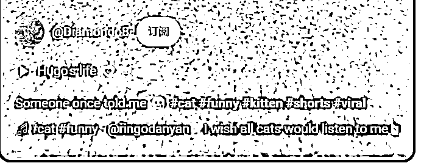

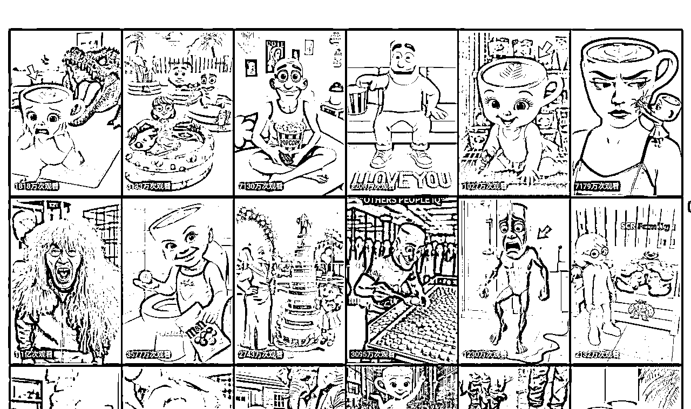

3. 刷到感兴趣的账号，顺手订阅、点赞，系统就会给你疯狂推同类视频。如果发现这类视频最近热度很高，但总量并不多，那这大概率就是你的方向。多操作几个号，你就能筛出几条感兴趣的赛道，最后权衡一下选一条路深耕。

总结一下就是：

- 最具潜力的信号：同类视频少 + 订阅多 + 播放高 + 你感兴趣
- 还能做的信号：爆款多 + 播放高 + 你不反感

### 用工具替代人肉筛选

**1）viewstats**

地址：https://www.viewstats.com/

付费工具，但Top榜单免费看，更多筛选条件就需要付费了。

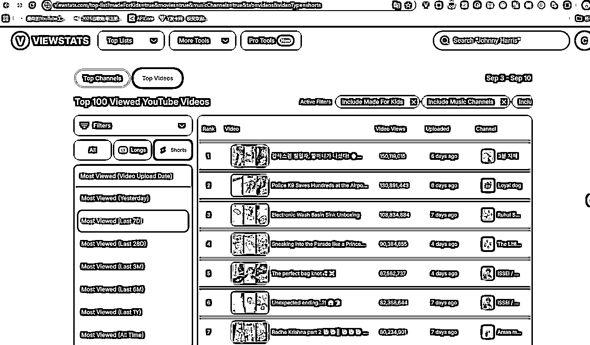

优点：野兽先生出品，数据准确度很高，功能也比较强大。
缺点：免费版只能看Top榜单，没法增加太多自定义筛选条件（比如按某类关键词去搜，再叠加播放、评论、点赞等限制）。当然，付费玩家随意，氪金就能解锁全部。

**2）vidIQ**

地址：https://app.vidiq.com/

也是很强悍的数据分析工具。

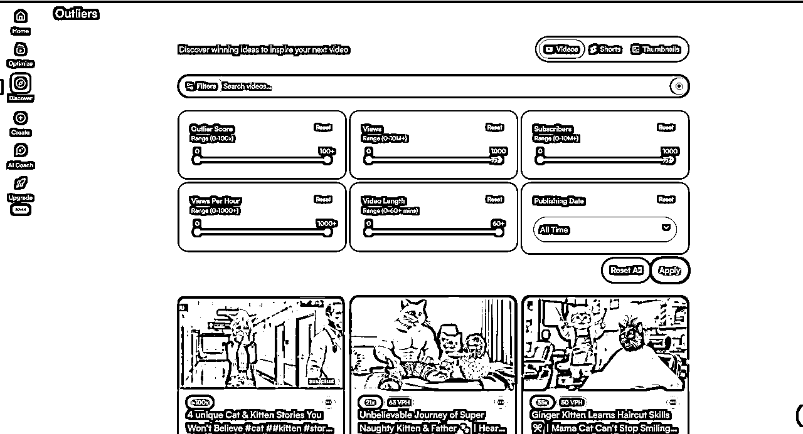

优点：数据更新及时，功能全面，价格比viewstats便宜一些。
缺点：免费版能用的功能少得可怜。

**3）圈友思明自研工具**

地址：https://www.media-copilot.com

这个工具用来查对标账号非常实用。

优点：目前限时/永久免费，找思明大佬内测还能免费领；筛选条件比前两者更丰富，数据量也够大。

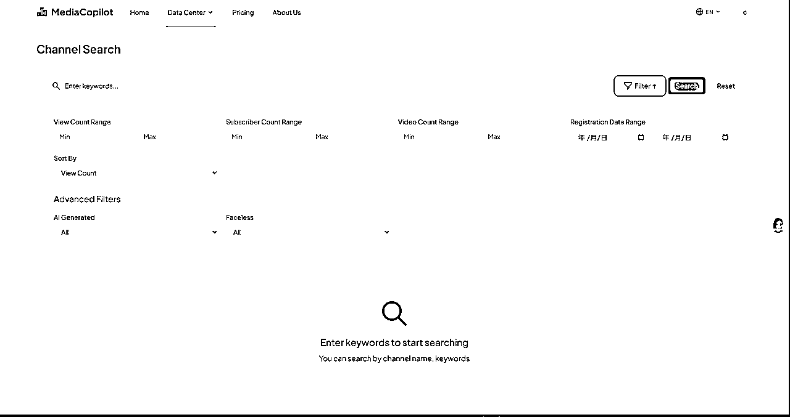

## 拆爆款：用Google AI Studio“解剖”对标频道

拆解爆款，必须借助一个神器——Google AI Studio：https://aistudio.google.com/

不熟悉界面操作的朋友，可以翻我以前发的帖子。这里我想强调一个关键步骤：利用GAS对整个对标频道做整体分析。

GAS支持一次性上传十个视频链接。做法很简单：把对标频道里所有爆款视频的URL都复制粘贴到对话框里。记住，一次性丢进去越多越好，数据越多，GAS分析得就越全面。

不过前人经验是：历史记录最多只能保留十个视频。但这里有个小技巧——你可以继续对话，然后把多余的视频链接删掉，腾出空间继续添加新视频，之前的对话记忆也还在。这个操作我不止用过一次，非常顶用。切记，历史列表只能留十个，否则就没法继续对话了，会报internal error。

（下图就是我拆解今天做的视频时，把对标账号120万播放以上的视频全部丢给GAS分析的截图。一个对话大概消耗20万Token。）

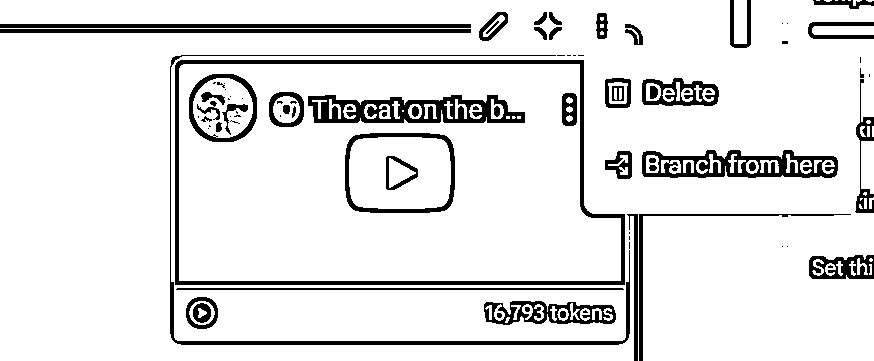

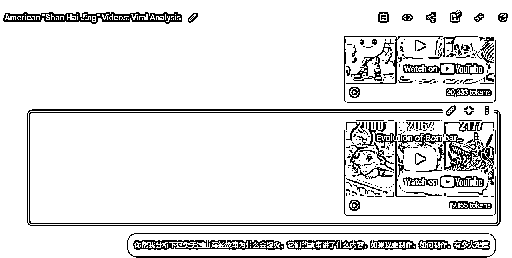

通过这个操作，GAS会告诉你这个爆款频道的内容核心是什么，以及用什么方式可以制作出来，而且会事无巨细地全盘托出。

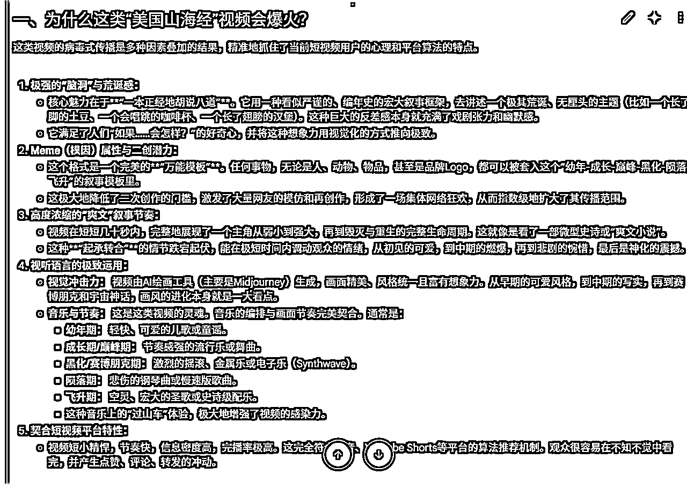

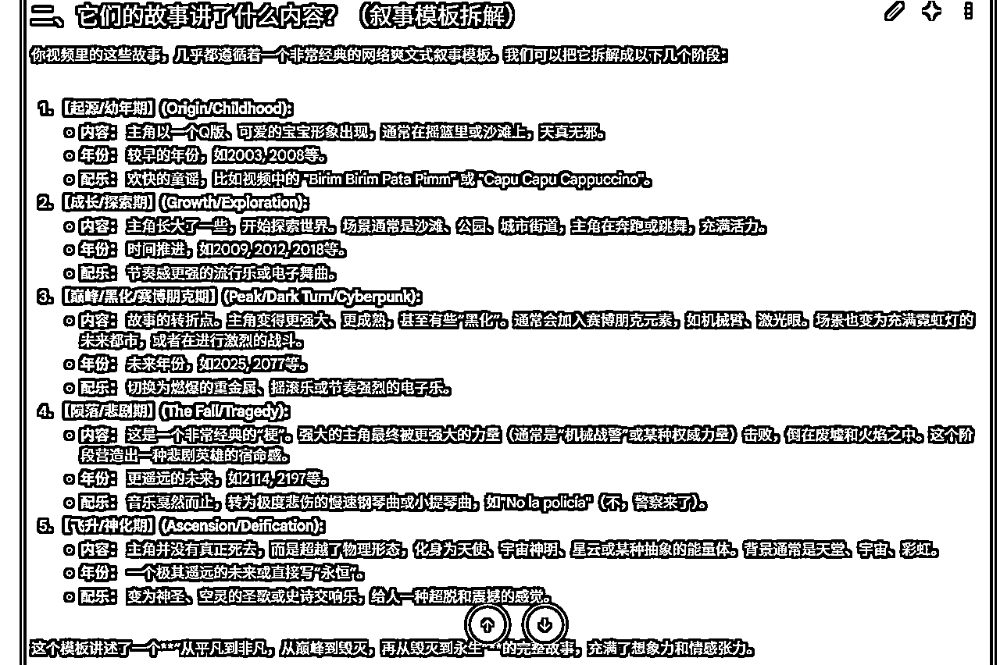

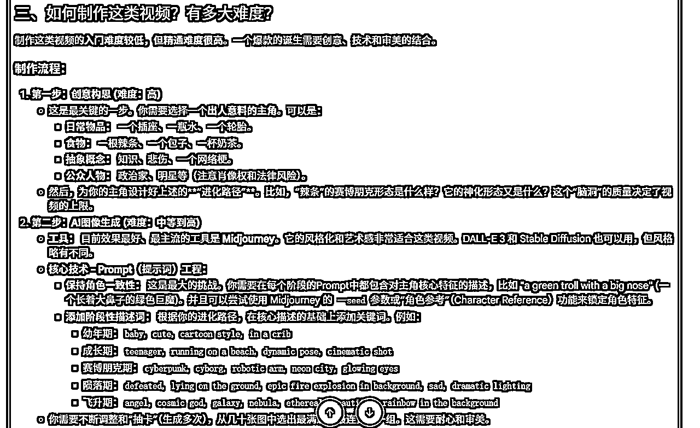

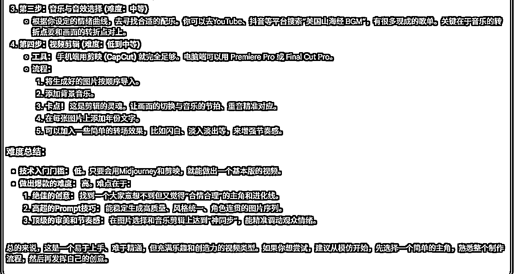

做完这一步，这个频道的核心内容、爆火原因、所用的技巧，基本就能了解个七七八八了。

## 自我审视：这活儿我能干吗？

接下来，你需要再仔细看一遍对标频道的爆款视频，把每个细节都抠出来：内容、音效、BGM、转场、滤镜、特效。扪心自问，这些以你现在的技术能完成吗？

如果有些做不了，但确实对这个频道很感兴趣，我提供一个解法：

把视频发给GAS，让它告诉你某一帧用的是什么技术、该怎么实现。如果你能看懂GAS的解释，那说明你也可以做到，放心去干。不要害怕，所有能力都是从无到有的。不会就学，关键是要敢于下场——No what, no why, just how to do it！

## 微创新：动最小的“手术”

有些人在初级阶段容易犯一个致命错误，包括我自己。我之前做对标视频时，把内容改了百分之八十以上，只保留了少数非爆款元素，结果前期进展非常缓慢。

前面说过，“抄”才是最大的学问。这个阶段我要大声说三遍——不要创新！不要创新！不要创新！

至少新手阶段千万别创新！原创后面会有更多可能，但难度比抄大得多。“不要创新”指的是，别把你的天马行空用在这个阶段，只做最小幅度的微创新，动最小的手术——换人物主体（别换得太离谱）或者换个服饰，背景也可以适当调整，但绝不能动摇视频的主要内容。

具体操作如下：

**1）分解**

把对标爆款视频的URL丢给GAS，输入提示词（这个提示词已经迭代过很多次，效果比刚开始时强太多了。不过等我进深海圈，肯定还会继续迭代，现在这个版本只能算半成品）。

值得一提的是，我这套提示词和一卒大佬的相比可能精准度稍逊一些，但它是基于我自己的工作流不断迭代出来的。之后我的一些工作流，可能也会参考一卒大佬的做法——用“人物A、B”来替代，再在Excel表格里一键替换。不过这种方式只适合从头到尾服饰不变的故事，如果是多套服装或多形态的，我的这套万能提示词就更吃香了。

```
拆解这个视频的**每一个分镜**，给我生成能完美复刻的文生图提示词
用连贯的自然语言描述每一个分镜的文生图提示词(视角+景别【远景、近景、中景、特写、俯视、仰视、平视等等】+主体+主体的表情+行为+环境等)
文生图描述词示例：(平视中景，一只白色的大胖猫，在躺椅上戴着墨镜，手拿酒杯躺着晒太阳，身上盖着浴巾，背景是大海。)

修改主角：
【具体要修改的主角内容】
（比如：把“xx”换成“xx”）

必须遵循的原则：
视角的取值，必须且只能从`平视, 仰视, 俯视, 鸟瞰视角`中选择一个
景别的取值，必须且只能从`远景, 全景, 中景, 近景, 特写`中选择一个
“主体的表情”的取值，**必须且只能**从以下词汇中选择一个”开心，无奈，兴奋，愤怒，烦躁，悲伤，失落，惊讶，惊恐，震惊”
** 所有动作描述必须是客观、可执行的，并明确指出角色的相对位置**
每个镜头独立描述，因为我进行生图的时候每张图都是独立生成的，所以所有主角的提示词在每个镜头中保持一模一样，不得有一个字的不同（你必须假设每个分镜都会被一个**完全独立、无记忆**的图像生成AI所处理）
具有相同环境的镜头对于环境的提示词必须保持一模一样（比如在同一个房间里面，有两个镜头，那么这两个镜头对房间的描述词必须一模一样）

输出内容：
最后只需要给出我文生图提示词即可
不需要类似分镜1、分镜2的内容，只需要单纯的各个分镜的文生图提示词
```

**2）检查遗漏分镜**

GAS不一定能一次性把全部分镜输出完整。你需要再看一遍视频，核实有没有遗漏的分镜。如果有，就用截图或关键帧捕获工具抓下来，再让GAS补上。

**3）二创或微调人物细节**

A. 我所说的二创，指的是对人物描述词之外的细节进行微调，迭代版本如下：

```
你现在来帮我修改一些分镜的提示词。比如，我需要你帮我变动一下每个分镜的背景提示词（比如说，有一个镜头，背景是背景是模糊的、带有大片草坪的现代化别墅和绿树，你就可以给我增添一些别的不影响画面的事物，对整个画面进行微调，但不要影响故事的主体和主要内容展现，主要是为了避免抄袭的嫌疑。如果你没明白微调的含义，我再举一个例子，有一个镜头，在一间被摧毁的现代化卧室里，你就可以对这个卧室里面的陈设以及颜色进行一下描述，来修改一下这些不是很重要的元素，使得整个画面的主要内容与对标视频相同，但是次要背景与对标视频不同，有效帮助我进行二创）  ，但是主体的描述词不得进行二创
更换具体环境： 比如将“白色游艇”替换成“现代化的私人码头”、“豪华游轮的露天泳池边”或者“海边悬崖上的观景露台”。
增加环境细节： 比如将“沙滩”具体描述为“散落着贝壳和海草的白色细沙滩”，或者在“大海”背景中加入“远处的帆船”或“海面上的薄雾”。
改变时间和天气： 比如将“天气晴朗”的白天调整为“日落时分的金色黄昏”，或者在战斗场景中加入“乌云密布、风雨欲来”的紧张感。
调整色彩和氛围： 比如将“深蓝色的水下”描绘成“阳光穿透的、清澈见底的绿松石色热带浅海”，并在其中点缀“五彩斑斓的珊瑚礁和小鱼群”。
```

B. 修改人物描述词：我经常给人物换个服饰，或者直接换掉主体人物。这一步要看情况灵活处理。操作时，把“（某个人物的描述词）”替换成“（你想要的人物的描述词）”即可。

C. 一起换（不太建议，但有小概率爆款）。

```
你现在来帮我修改一些分镜的提示词。比如，我需要你帮我变动一下每个分镜的背景提示词（比如说，有一个镜头，背景是背景是模糊的、带有大片草坪的现代化别墅和绿树，你就可以给我增添一些别的不影响画面的事物，对整个画面进行微调，但不要影响故事的主体和主要内容展现，主要是为了避免抄袭的嫌疑。如果你没明白微调的含义，我再举一个例子，有一个镜头，在一间被摧毁的现代化卧室里，你就可以对这个卧室里面的陈设以及颜色进行一下描述，来修改一下这些不是很重要的元素，使得整个画面的主要内容与对标视频相同，但是次要背景与对标视频不同，有效帮助我进行二创）   和人物提示词（将主体的衣服颜色、种类等次要元素进行创新，不得改变主体的性别、外形、年龄等核心元素）进行微创

更换具体环境： 比如将“白色游艇”替换成“现代化的私人码头”、“豪华游轮的露天泳池边”或者“海边悬崖上的观景露台”。
增加环境细节： 比如将“沙滩”具体描述为“散落着贝壳和海草的白色细沙滩”，或者在“大海”背景中加入“远处的帆船”或“海面上的薄雾”。
改变时间和天气： 比如将“天气晴朗”的白天调整为“日落时分的金色黄昏”，或者在战斗场景中加入“乌云密布、风雨欲来”的紧张感。
调整色彩和氛围： 比如将“深蓝色的水下”描绘成“阳光穿透的、清澈见底的绿松石色热带浅海”，并在其中点缀“五彩斑斓的珊瑚礁和小鱼群”。
```

**4）文生图提示词补充（非必须）**

如果前面生成的提示词你觉得还不够丰富、元素太少，就需要进一步优化。提示词示例如下（具体根据自身情况调整，下面的内容只是一个举例）：

“你现在来帮我修改一些分镜的提示词。比如，我需要你帮我微调每个分镜的背景提示词：镜头一，背景是模糊的、带大片草坪的现代化别墅和绿树，那你可以帮我添加一些别的不影响画面主体的事物，对整个画面做细节微调，但不要影响故事主体和主要内容表达。主要目的是为了避免抄袭的嫌疑。如果你还没明白，我再举个例子：镜头10是在一间被摧毁的现代化卧室里，你可以对卧室内的陈设和颜色做更详细的描述，把这些次要元素的细节替换掉，确保主要画面内容与对标视频一致，但次要背景不同。这样能有效帮我完成二创。”

**5）细节打磨（非必须）**

这一步就完全随你心意了，哪个地方觉得不好看，想换个颜色之类的，直接调整就行。描述得越精准越好。但别小看这步，很多爆款的微创新灵感就藏在这里，某个颜色可能就是千万播放甚至亿级播放的那把钥匙。

特别提醒一下：景别设置一定要仔细，远景、近景、特写、仰拍、俯拍，这几个维度都特别关键。

## 小结：

这一步看似不起眼，实际决定生死。刚开始做的时候，我会花1到2个小时静下心来慢慢磨。记住：“你若静心，花自盛开”，每一次精心雕琢都是伟大作品诞生的必需一步。

（现在熟练之后，这步已经被我提速到了几分钟就能搞定。）

## 文生图：直接决定观众的第一眼触点

这一环节同样举足轻重，因为图片是你和观众之间的第一层窗户纸。图片质量不过关，内容再好也白搭。所以需要反复抽卡、打磨细节。一般刚开始也会花1-2个小时。（现在优化后，已经能提快到几分钟到几十分钟完成）

但核心还是效率至上。把前面那80%的文生图提示词打磨得极其精准，图片自然大概率一次过，生图时只需做细微调整。记住“磨刀不误砍柴工”，先把提示词吃透，再大规模生图，效率翻倍都不止。

### 抽卡的三种方式

**1）豆包一次性出图（不推荐，出错改起来麻烦）**

具体方法参考李澹归老师的帖子，我不再赘述：https://scys.com/articleDetail/xq_topic/1524488222818842

**2）即梦批量出图（推荐）**

具体操作还是看李澹归老师的另一篇帖子，这里衷心感谢李澹归老师，帮我节约了不少时间：https://scys.com/articleDetail/xq_topic/2852211242585521

我的迭代版本方法会在“半自动化工作流”部分详细讲。这里只想给大家几个容易踩坑的注意点（建议先读完原帖再来看我的提醒）：

1. 每次重新登录后，都要再次点击“添加账号”才能使用。

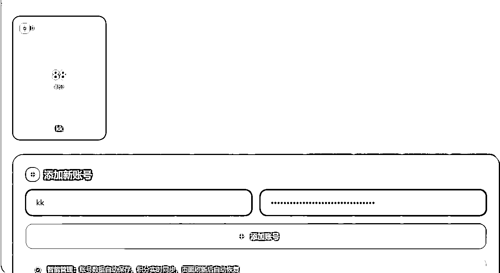

2. 有时候图片生成出来是空白的，别浪费时间去重试。其实你的即梦账号里已经生成了这张图，去网页版即梦里就能找到。

**3）批量出图付费工具（不推荐）**

需要付费，想尝试的圈友可以瞧瞧这款Chrome插件，支持GPT/即梦/MJ等主流生图工具，自动操作为你加速。官方文档：https://www.yuque.com/autojourney/docs/pkil2i72vcqfweld
Chrome商店搜索：AutoGPT

## 对抗顽劣图片的方案

尽管大部分图都能顺利生成，但总有那么几张角度不对、服饰变形、身体结构出Bug。我的应对策略有几招：

1）**最推荐：即梦4.0或香蕉模型** 指哪打哪，字面意思，用了就懂。GAS和Lovart都可以免费使用。

2）**反复抽** 字面意思，抽到满意为止。

3）**精修提示词** 这一步比较看直觉。仔细观察你的提示词，思考改哪里能解决问题，然后逐个击破，反复生成直到成功。

4）**换一家生图工具** GPT（Sora）、豆包、即梦、Runway、海螺、可灵、MJ都是备用选项，多试试总有一款适合你。

5）**截图法** 把你想要的图片（或关键帧）截图发给AI，附上提示词，成功率会明显提升。

## 去水印环节

注意：即便是即梦会员，左上角依然会有“AI”水印，所以去水印是绕不开的步骤。这里我整理了三款免费好用的去水印工具：

如果不考虑画质，一款谷歌商店的插件就够用了（720p，不过我个人觉得有点难以接受）。


后两款能保持原画质：第二款完全免费，第三款至少我现在用着还不要钱。缺点是它们一次只能去一张图的水印，所以建议两个同时开干。

- https://online.niuxuezhang.cn/online-photo-watermark-remover/detail/
- https://www.arkthinker.com/zh/watermark-remover/

（另外，还有个批量去水印的文件夹工具，内含很多脚本，这里就不一一展开了。）

## 如何解决“人物一致性”问题

这里最推荐的方法依然是：即梦4.0或者香蕉模型或者GPT。字面意思，试了你就知道多好用。

再说说过时的方案：我其实不只依赖即梦生图，只是在“山海经”这个题材上，视频主体并不要求严格一致，所以我用即梦完全没毛病。

做故事向短视频的朋友，最头疼的通常不是创意，而是主角的脸不稳定——明明同一只猫，换个镜头就换了一张脸，观众一下子就出戏了。我也踩过不少坑，把市面上常用的AI生成工具轮流试了个遍，像GPT、即梦、可灵、豆包、Runway、智谱清言、Vidu这些，最后才总结出一套勉强能走通的方法。今天就直接把干货倒出来。

先交代一个前提：我没开Midjourney会员。所以接下来这套方案并不是终极答案。如果你问圈内人，大家公认最省心的人物锁定方式就是付费订阅Midjourney，没有之一。

**第一步，固定角色形象**

真正好用的其实就两个：GPT和Runway。操作方式很简单，把你希望反复出现的角色参考图先传上去。比如我之前做猫爸带小猫的短片，就把猫爸的原图同时给了GPT和Runway。

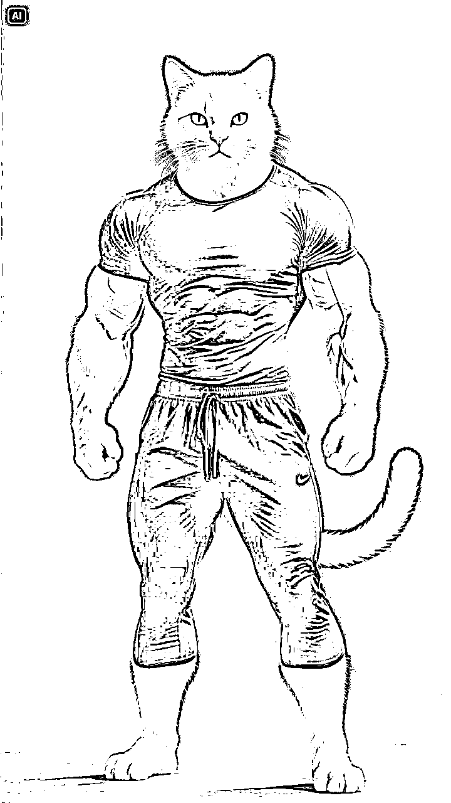

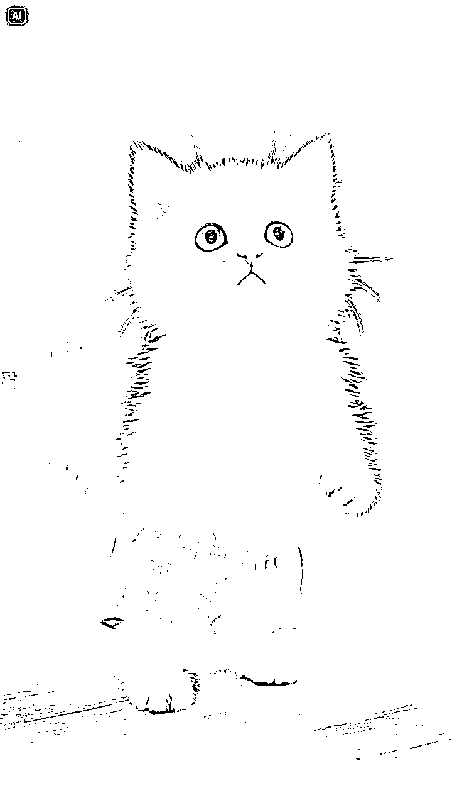

然后告诉它们：这张图里的角色，就是后面所有文生图指令里的主角。再配上具体的画面描述，生成出来的图就能保持角色长相一致，不会崩。

当然，这两个工具都有次数限制。GPT一个账号大概只能生成不到十张图，Runway则是720p扣5积分、1080p扣8积分。想免费多用，就多注册几个号；预算足够的话，直接配合我后面提到的自动化工具一起用效率更高。

**第二步，图像转视频的动态指令**

很多人在生成静态图的时候，就顺手把图像转视频的描述也写进提示词里了，这样做其实不对。更稳妥的做法是：先把所有分镜图统一丢给Google AI Studio（以下简称GAS），让它基于图片来生成动态指令。

你可以一次性把28张分镜全部传上去，我没测过上限，但完全没压力。

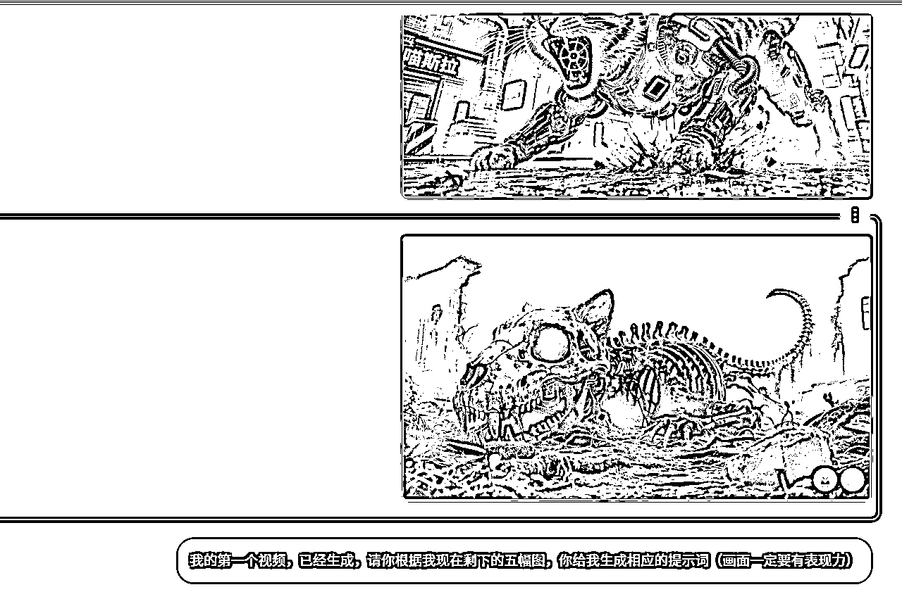

我用来迭代的核心指令大概是这样的：让GAS扮演一位资深影视导演兼AI视频提示词设计师。它的工作流程如下：先逐张分析静态分镜，理解画面里的主体、状态和环境；然后为每个分镜生成动态描述，动态描述必须包含镜头运动方式，比如推拉、摇移、升降、环绕、横移、纵移、前后跟随等；同时还要写清楚主体做什么动作、表情如何变化；最后把所有这些内容整合成一个流畅的中文长句。描述的重点不是静态画面里已有的细节，而是“发生了什么变化”，动作和表情要写得足够具体。为了帮助它理解，我还会补一个例子：过肩镜头向前推进，一只母猫坐在沙发上，电视里正播放星球撞击地球的新闻，猫的身体逐渐前倾，表情从平静变为震惊，最后变成恐惧。

这个方法的准确度很高，但我还会再加一步保险——用输入法自带的语音输入把每个分镜的动作直接说出来，让GAS照着这段话生成指令。这样出来的提示词，我基本不需要修改。注意，所有对话必须保持在同一个GAS会话窗口里，否则它会失忆。

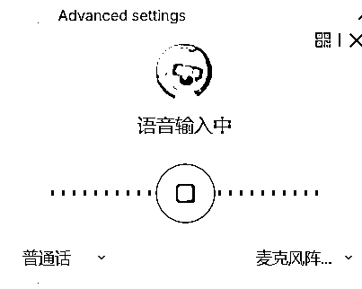

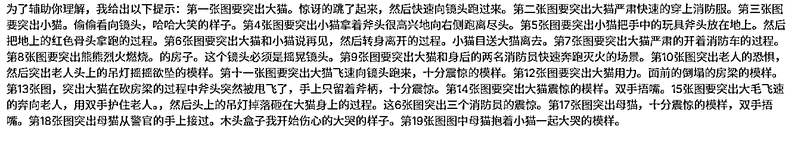

**第三步，图生视频工具怎么选**

我的结论是：即梦加豆包，是普通玩家能摸到的最强组合。两个都是免费为主，质量也够用，速度还不慢。可灵别买，谁买谁交智商税，我实测感觉它连豆包的免费额度都比不上。

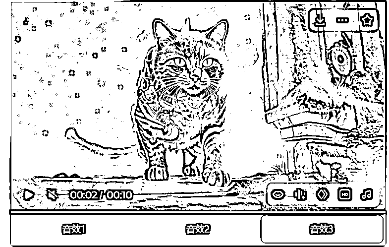

**第四步，剪辑和音效**

剪辑功底还是要有的，但GAS可以当你的外挂老师。我之前看到对标视频里有一个很高级的回忆转场，自己完全不知道怎么下手，直接把视频丢给GAS，它马上用剪映一步一步教我做，连我这种小白都能看懂。所以，看到什么想要的效果，先别慌，把它交给GAS。

动物类视频没有对白，音效就成了决定成败的关键之一，至少能影响三成观感。但靠自己在剪映音效库里瞎搜，常常搜不到合适的。我一般用两个办法：

第一，把视频链接发给GAS，让它分析该配什么音效，然后照着它给出的名字去剪映里搜。

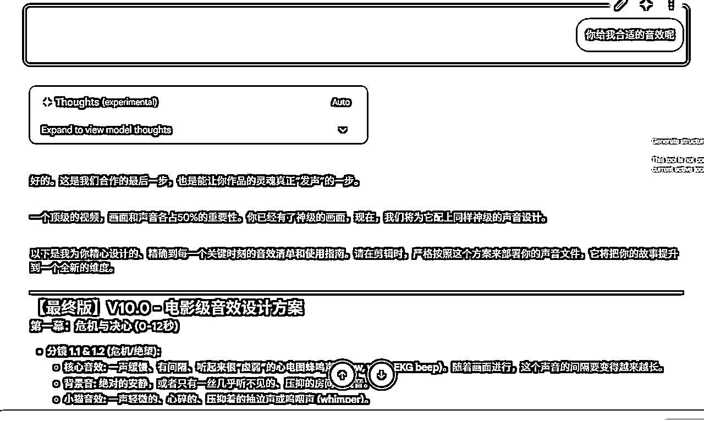

第二，直接去爱给网（域名是aigei.com）找免费可商用的音效，试听后再下载。

剪辑完成后，别急着自我感觉良好。再去看看你的对标视频，和它逐帧对比一下转场、音效、色调，有差异就改。

**第五步，发布前的自我诊断**

成品视频不要马上上传。我会把它发给GAS，同时附上对标账号的爆款视频，让它帮我找差距。GAS给的评价框架其实很有用，大致包括：选题有没有新意、开头抓不抓人、叙事逻辑通不通顺、节奏和转场自不自然；画面清不清晰、构图稳不稳定、光线合不合理、剪辑流不流畅；音质好不好、配音有没有感染力、BGM贴不贴内容；以及字幕是否清晰、整体有没有细节瑕疵。

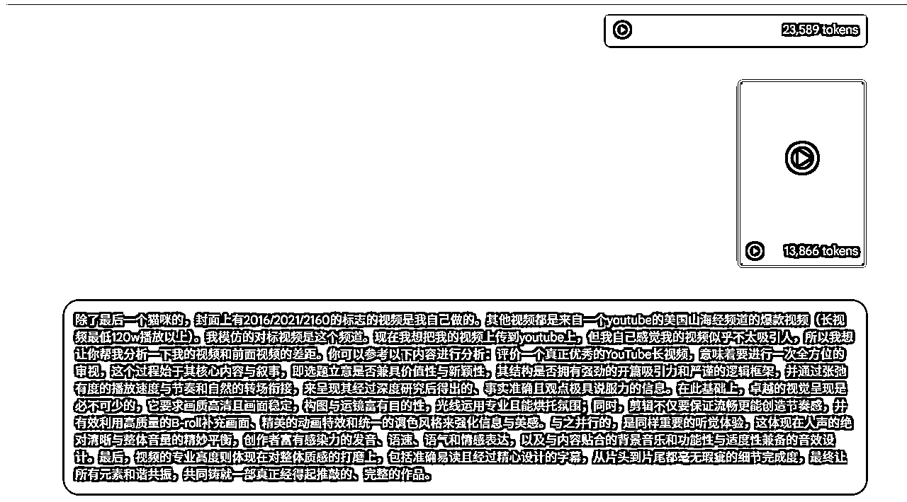

我让GAS对照这个框架诊断，它给了我一份很长的修改建议，我照着又改了一版才发出去。

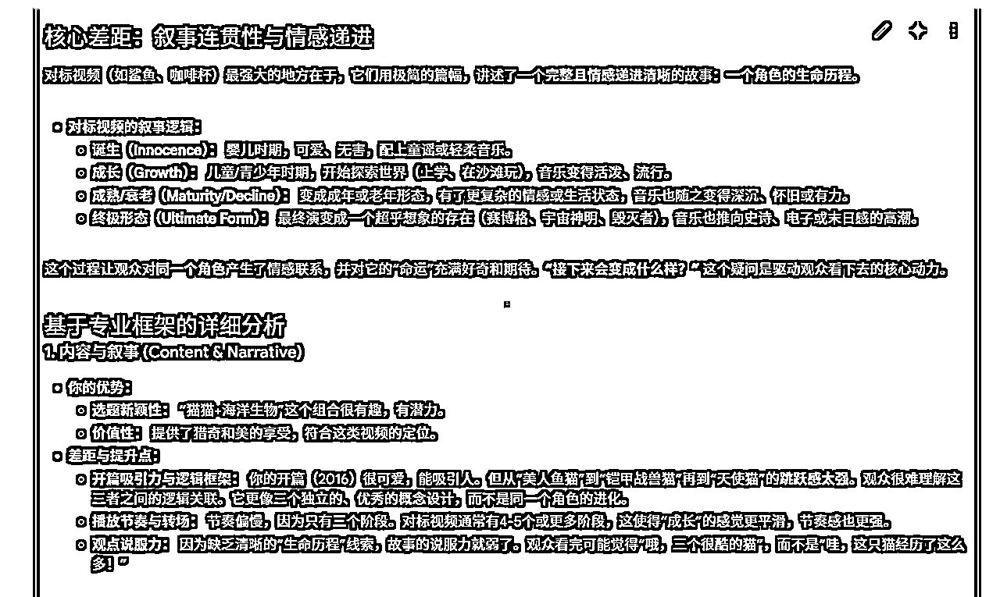

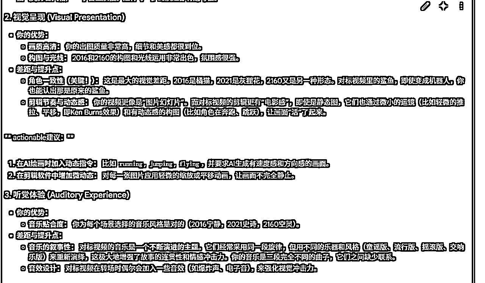

这里有个小技巧：诊断用的视频导出480p、25fps就够了，不用高清，反正只是给AI看的，传上去还快。

**第六步，上传时的几个细节**

导出分辨率我一般就按默认来，其实2K或更低都不会影响播放量。具体导出设置可以参考下面：

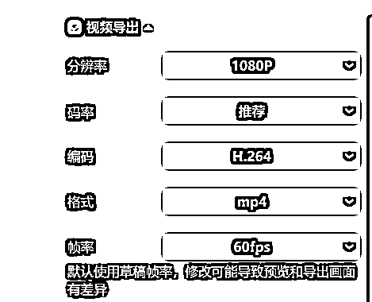

标题和说明我都是让GAS代劳的。标题我会要求它生成一个优化过SEO的英文标题，必须带#cat #kitten #catstory #meow这四个标签，长度控制在70个字符上下。描述就写一段完整的英文简介，概括一下剧情，留点悬念，再加1-3个表情，鼓励观众点赞分享。除了固定的四个标签，再补上5到15个内容相关的标签，帮助搜索。

如果不想从零写，也可以直接模仿对标账号的标题和说明，然后让AI润色，但别改掉核心信息。

发布时间和地区方面，我建议把IP设置为美国，因为前期推来的流量大多来自美国观众；但美国观众的审美也最难伺候，这是要权衡的。时间上可以多试几次，隔几天换一个时段，不用预定，直接发。频道做起来以后，一天更新三四条都可以。

Shorts的封面不用太讲究，用手机版改缩略图时，挑视频里最精彩的一帧就行。

**第七步，好用的效率工具**

下载YouTube视频，我推荐用iiilab这个网站（youtube.iiilab.com），就目前来说最好用。

封面我都是用Canva做的。方法很简单：先用即梦生成16:9的图，再扩成9:16，然后去闲鱼花一块钱买个Canva会员，套用YouTube封面模板就可以了。

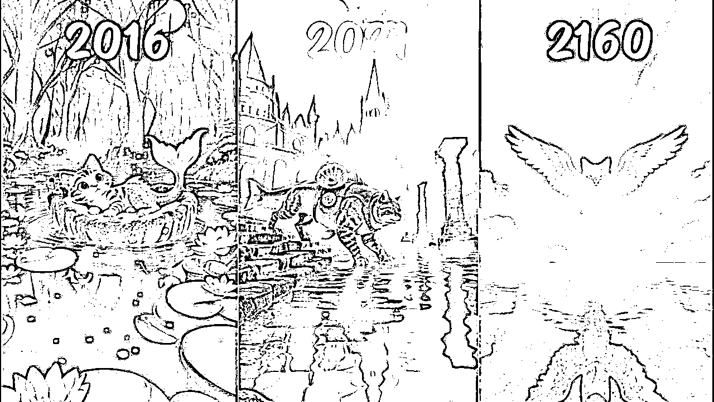

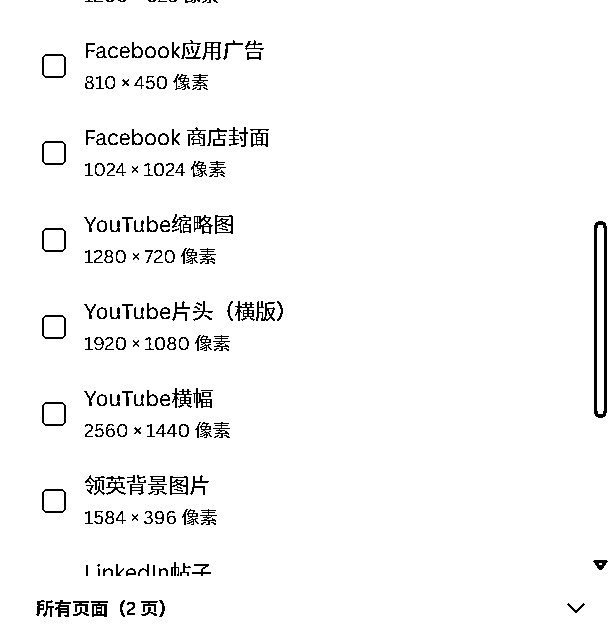

除了做封面，Canva还能做视频里的小道具，比如以前做的一封信，就是用牛皮纸模板改的，再加点英文内容，进剪映做关键帧动画就有效果了。

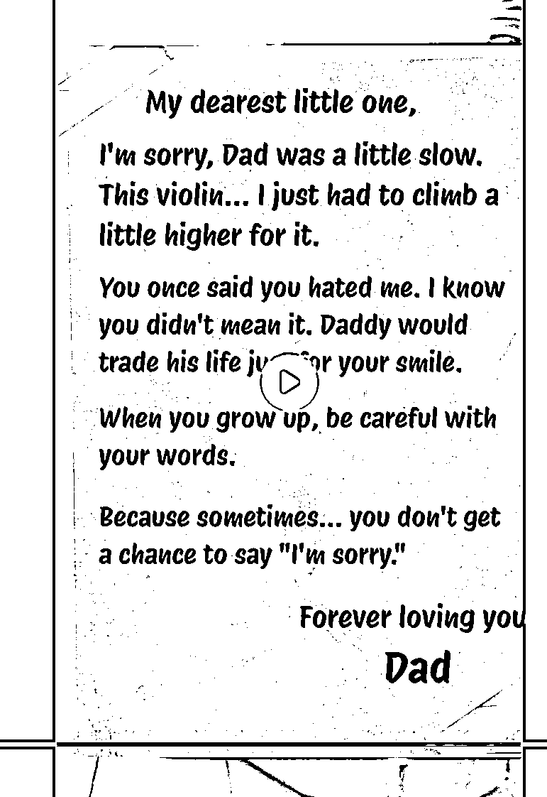

插件方面，我常用的有这几个：vidIQ、PocketYouTube、Screenshot YouTube、Shazam、ViewStats和评论翻译。它们各自的功能是：
- vidIQ：功能很强，但要付费；
- PocketYouTube：可以给频道分组、标记未看视频、快速找对标爆款，懂的人都知道这个有多值钱；
- Screenshot YouTube：看名字就知道，截图用的；
- Shazam：识别对标视频里的BGM；
- ViewStats：统计视频数据；
- 评论翻译：把英文评论翻成中文，看起来方便。

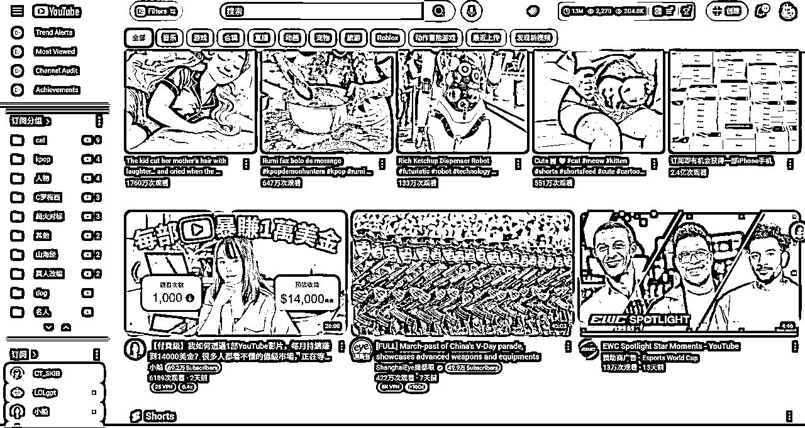


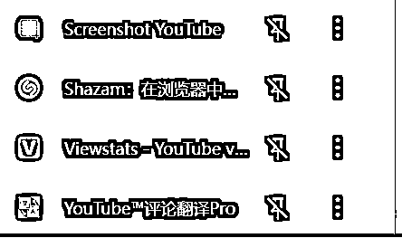

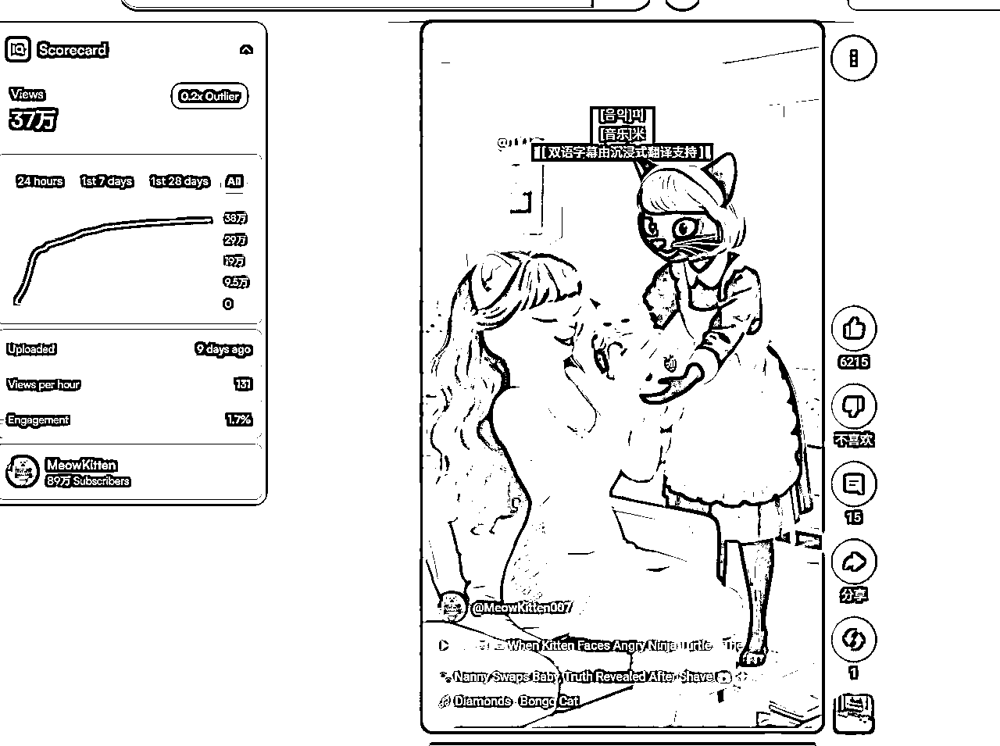

**每日数据复盘**

我每天都会抽空看看前一天的视频数据，重点盯三个指标：继续观看率、热门地理位置、观看次数。连续观看率尤其重要，能跑到千万级的视频，留存基本都在75%以上。如果观看增长是持续的，就有爆的可能；如果一直在掉，就离断流不远了。地理位置则决定了你的广告收入，印度观众会带来大量流量，但不用刻意规避。

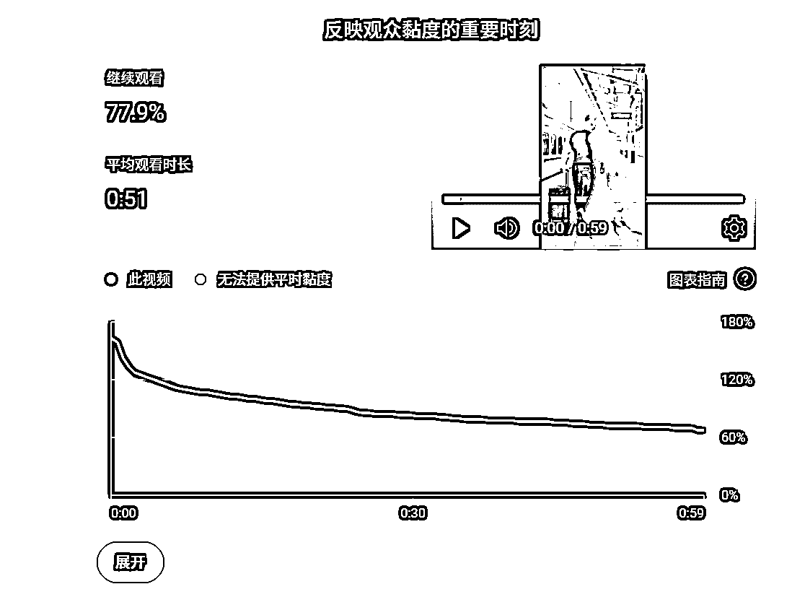

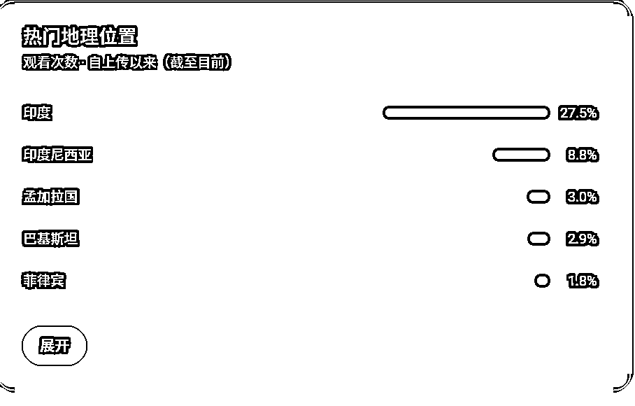

**半自动化工作流分享**

下面是我自己比较成熟的半自动流程，适合多分镜视频。

1. 选对标赛道：手动搜索加上一些工具，再结合朋友推荐。
2. 文字生成图像：提示词写法参考上文。我自己改了一个李大佬的批量生图工具，顺便做了个Sora版本的，能一次生成两张。直接在浏览器里用AI编程工具改改就能用。流程就是：写好提示词，导入工具，微调一下，然后生成，不满意就重新生成，来回几次就搞定。注意提示词要用markdown格式导入。

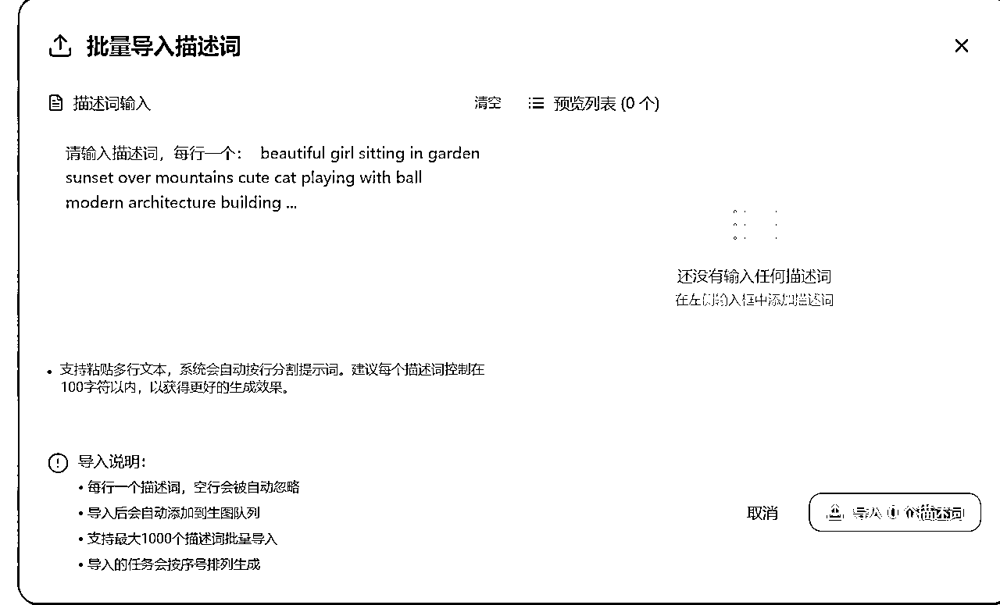

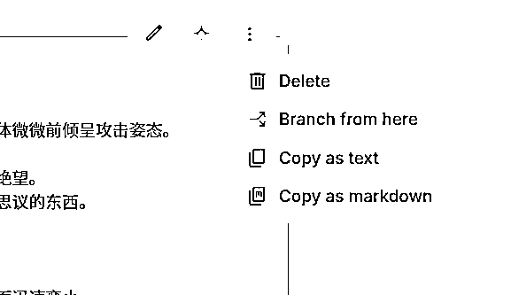

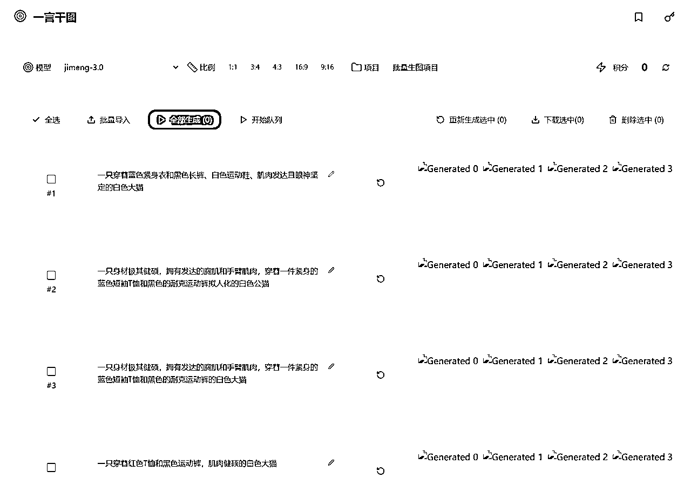

3. 图像转视频：先把动态指令写好，用语音输入辅助，五分钟左右搞定，然后交给即梦或豆包生成。即梦支持高并发，可以不断上传图片排队；豆包每个手机号每天免费10次，而且实测效果比可灵的付费模式还好。动作复杂的用豆包，简单的用即梦。只要有四个手机号，一天做二三十个分镜轻轻松松。

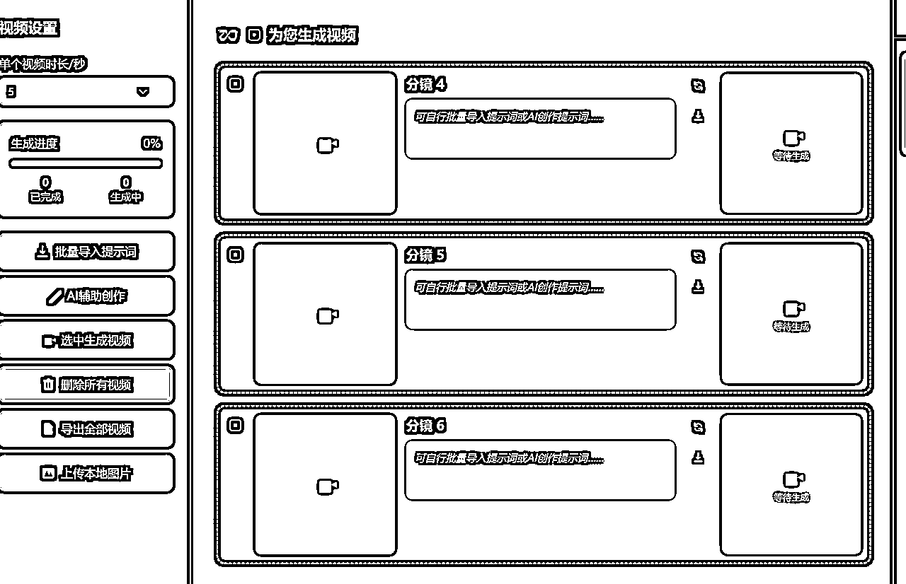

4. 剪辑：有免费的剪映API可以调用，如果你把图生视频的接口接上去，它能自动按顺序导入视频并创建草稿，省掉手动拖拽的力气，每个视频能省一两分钟。

5. 音效：有些生成工具自带音效，比如可灵（但依然是辣鸡）。剪映SVIP的AI音效也能给每个片段生成音效。如果都不满意，再用上面的方法。最省事的办法是直接下载对标视频的音频，用的还是那个iiilab网站，能省下十几二十分钟。


**关于全自动化的思考**

一个视频从零到成片，大致要经过：创意、大纲、文字生成图像指令、生图、图像转视频指令、生成视频、导入剪映草稿、拖拽排序、删减、加BGM、加音效。如果要自动化，就得把每个环节都串起来。

纯抄袭式操作很容易自动化，半个小时就能搞定一个，但这种内容生命周期很短。原创则几乎不可能全自动，因为创意、图片选择、视频选择、部分音效都必须人工介入。所以现实的目标是最大程度自动化，同时保留人工审核点。

目前最难的三个卡点：第一是稳定产出爆款创意；第二是不同创意对应不同提示词，文生图的稳定性很难保证；第三是音效和BGM的匹配。我也还在摸索。我的思路是：先建一个属于自己的灵感素材库，尽量用文字记录，因为文字输入便宜，图片视频太贵。等素材够多了，就丢给多模态模型，让它自动组合创意，再分成5秒、8秒、十几秒、几十秒这几个时长层级，分别去测试。

先把思路拆成 N 组可复用的提示词模板，丢给多模态模型去做创意发掘和拼接。这样一套模板其实也不是一成不变的，后面人工再去调优、打磨，就能不断衍生出经过验证的爆款底层逻辑。模型能力越强，这个玩法的上限就越高，我觉得深海圈完全可以把这个方向拿来做。

2. 文生图这块的提示词

既然创意端有 N 种预设，对应的文生图提示词自然也会形成 N 条分支。跑成熟了之后，整条从文案到成图的提示词链路就会非常稳定可控。

3. BGM 和音效的搭配

也是同样的思路建库，把历史上跑出来的爆款视频里用的背景音乐和音效类型全部沉淀下来。之后就可以像搭积木一样无限组合，想象空间很大。

## （二）关于流量瓶颈的突破

我最近实测了一下，5 秒的短视频和 59 秒的短视频 RPM 几乎打平，甚至 5 秒的 RPM 还要更高一点，播放表现也更猛。这说明只要创意足够炸，播放起来了，收益并不会因为时长短而变差。把“短”做到极致，正是我现在主攻的方向。

# 四、以 YouTube 视频为根基的更大世界

不知道有没有细心的圈友注意到

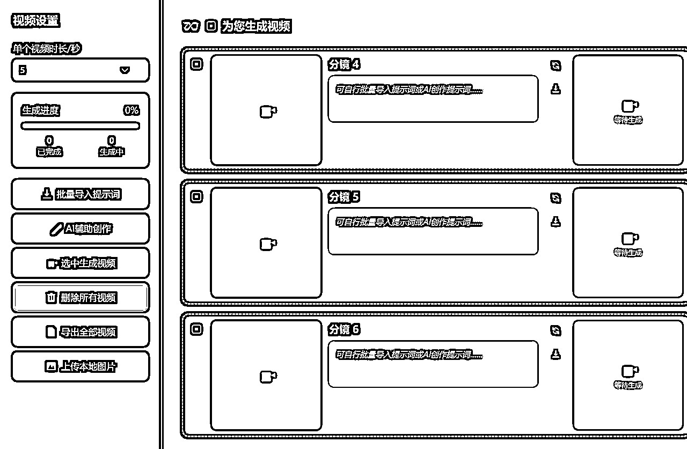

之前我放出来的那个图生视频界面为什么看起来顺眼，其实那就是我和黑客松队友在做的一款 AI 故事视频工作流的雏形。

从灵感到成图再到成片，整个链路追求的就是快和顺手，都是按照我的真实创作痛点来设计的。整体逻辑前面也讲了个大概，唯独创意这一步目前还比较粗糙，毕竟底层的素材库还没做大。但生图和生视频的体验是真的丝滑，最近又按需加了“改图”“按顺序导入剪映草稿”之类的提效功能，打算在北京黑客松决赛前把这个东西打磨成一个能商业化的产品。到时候上线前一定会先找一批圈友来免费内测；即便正式上线，也能做到成本价体验，不可能完全免费，毕竟 API 一次调用一次就得花钱。

之前已经邀请群里的几位大佬先行体验了，反馈基本都是除了价格其他都很顺手。所以后面我重点要解决的就是成本问题，是接残血大模型还是走低价 API 路线。等你们自己搭工作流的时候，也别忘了考虑这笔账。

这里说的以 YouTube 视频为根基的更大世界，其实就是说 YouTube 本身主要还是吃流量分成。要想把盘子做大，就得放眼海外做工具站，用 SaaS 订阅的模式去收美金。放在国外，一美元能让用户产出好几条高质量视频，性价比完全ok。

另外关于 YouTube 长视频，我接下来也打算系统研究一下。短视频追求的是极致的短，长视频的“长”也不是指时长那么简单。我前不久做了个长视频，时长是同款短视频的 17 倍，看完之后我对短视频的兴趣瞬间就被拉低了哈哈。

一起加油，希望早点日入万刀！