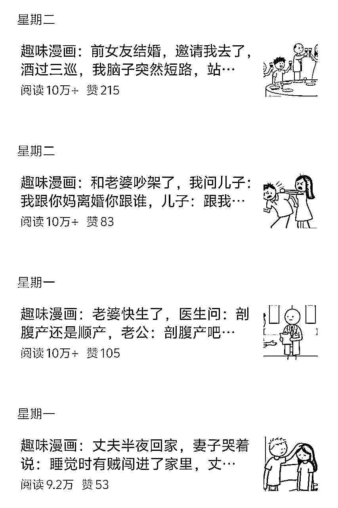
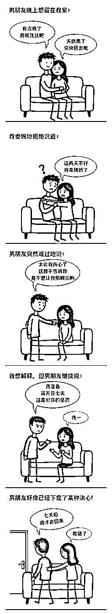
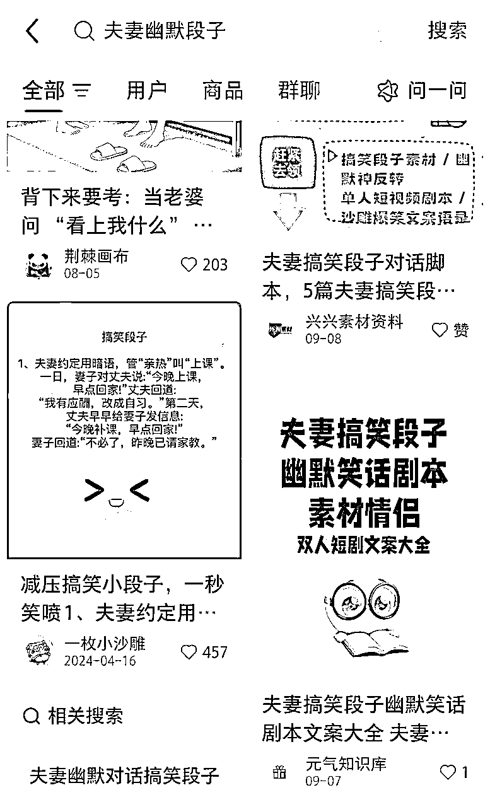
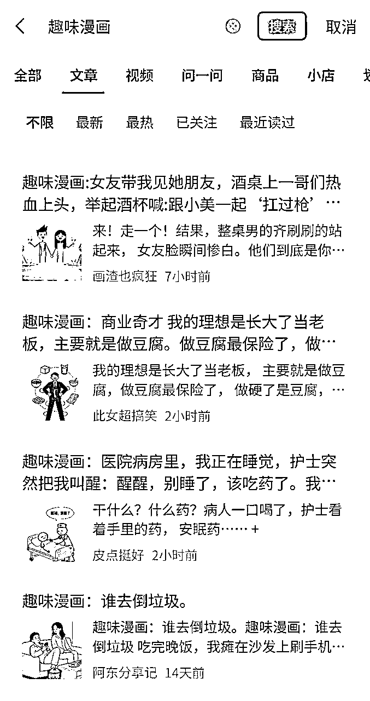
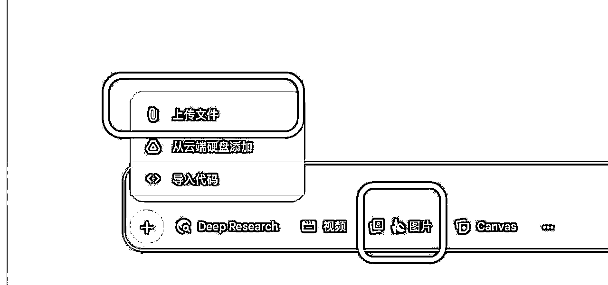
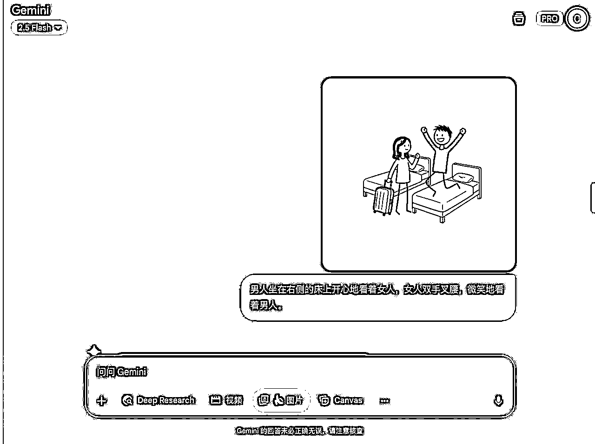
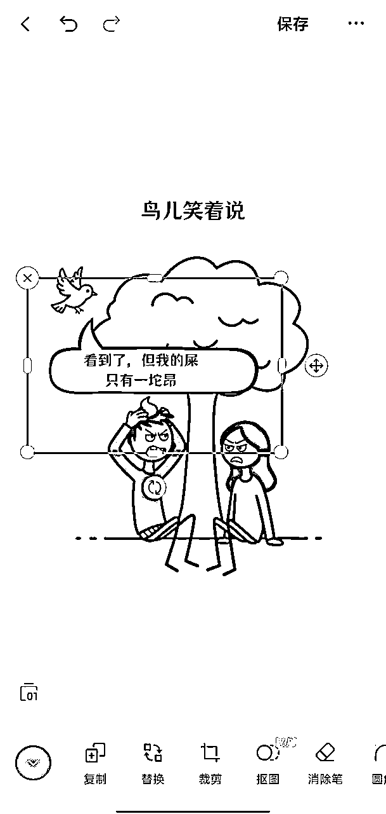

# ('趣味漫画篇篇10W+，怎么制作？只需三步即可制作，可保持人物一致性，保姆级实战教程', (2, 43))

公众号“趣味漫画”篇篇10W+？三步就能做出来，人物一致性问题这样解决，保姆级教程

大家好，我是钱磊。在生财潜水了很久，一直只看不写，今天终于鼓起勇气发出第一篇帖子，希望各位多多包涵。

最近微信公众号上特别流行多格连环漫画，我也凑热闹做了一批，发现这种内容的流量相当可观，平台也愿意推荐。

很多朋友看到热度，也在网上找教程，但翻来覆去大多是让你用coze搭建智能体。真去试过的人应该都懂，出来的成品常常让人头大：要么角色长相飘忽不定，要么场景前后对不上。

连环漫画最讲究的就是剧情衔接与人物延续，故事里明明是同一个主角，画着画着却换了一张脸，读者瞬间出戏，阅读体验自然大打折扣。

其实有一款工具能避开这些坑——Gemini 2.5。它的文生图效果很能打，而且就我目前体验到的，保持角色一致性的能力可以说是数一数二。

直接上我做的成品：

人物的脸部、服装、气质是不是都稳稳地统一住了？整套流程熟练之后，30分钟左右就能完成一幅，下面就把详细操作拆给你看。

第一步：把文案先搞定

漫画的灵魂是剧情，画面再精美，如果故事无趣，照样没人买单。

找文案有两条路：

1. 在抖音、小红书上直接搜“夫妻幽默段子”，挑喜欢的段子做轻微改动就能用。

2. 去找同类爆款公众号，搜索关键词“趣味漫画”，能翻到大量高阅读案例。参考时可以模仿思路，但千万别直接照搬，记得加入自己的二次创作。

拿到文案后，把它拆成若干画面。假如要画四格，就拆出四句对应的提示词。举个例子：

①男人和女人站在宾馆房间内，房里有张双人床，男人高兴得差点蹦起来，女人左手拎着行李箱

②男人坐在床的右侧，满脸欢喜地看着女人；女人双手叉腰，微笑着回望他

③男人坐在床右侧，女人坐在床左侧，两个人四目相对

④男人抱头崩溃大哭，女人上前轻声安慰

第二步：把提示词交给Gemini 2.5

使用Gemini需要一些“魔法方式”，这个大家自行搜索就能解决，这里只讲核心操作：

如果你不满意Gemini默认生成的角色形象，可以先上传一张参考图，让它在此基础上调整。不过别忘了把“生成图像”的开关打开。

接着把刚才拆好的提示词逐条输入。

这里有个小提醒：一定不要让Gemini直接在图里生成对话文字。它对中文字符的渲染还不太稳定，一旦偷懒让它写字，画面上很可能出现一堆乱码般的“外星符号”。

另外，背景尽量选择纯白色，这样后续抠图、去水印都会省事很多。

第三步：后期加工图片

到了这一步，基本就进入收尾环节了。市面上有很多图片编辑工具都能用，像剪映自带的编辑器、醒图、稿定设计、黄油相机、美图秀秀等。

我个人习惯用稿定设计，前前后后用了好几年，顺手了。

大家看到的那些对话气泡、旁白文字，其实都是在后期阶段加上去的。看上去精致的连环漫画，几乎都是这样“拼”出来的。

如果你需要对话泡素材，可以去百度搜索PNG格式的聊天框，下载后可以反复使用。对话文字就用你找来的文案，稍作二次创作即可。

全部搞定后，去公众号后台发布，坐等流量上门就行。

眼下公众号对这类漫画内容似乎还有流量扶持，想做的朋友趁早动手，别等红利过了再拍大腿。

我猜这篇内容发出去以后，一定会有不少人开始实操。如果你在学习过程中卡住了，欢迎直接来找我交流，随时都在。