# 用主动社交破局，我从百万负债走到稳定变现，过上想要的生活

> 来源：[https://oee5lr7gsk.feishu.cn/docx/IoHgdLSmxoTou3xe72tceHUQn4b](https://oee5lr7gsk.feishu.cn/docx/IoHgdLSmxoTou3xe72tceHUQn4b)

# 前言

各位圈友大家好，我是根源，2020年4月加入生财至今。

现已累计20篇精华帖被收录，成为资深传术师，并成功发起7场局，担任过时间管理的航海教练。

目前主攻赛道是知识付费，个人品牌叫小源说说。

从2022年初正式转向知识付费起，结合私域运营搭建课程体系，到现在已积累约两千人次付费，个人年收入稳定在七位数区间。

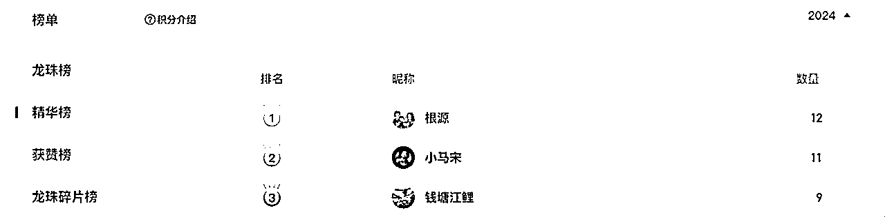

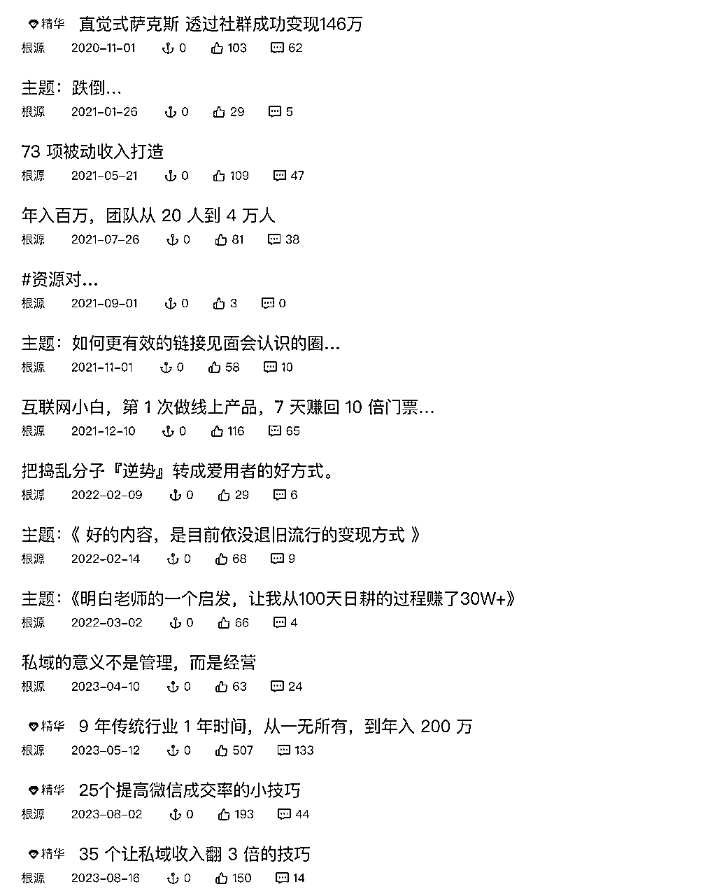

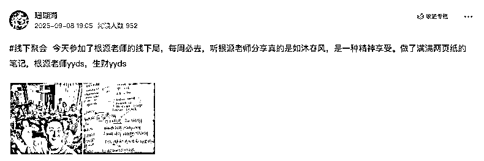

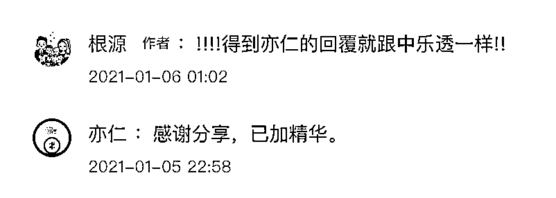

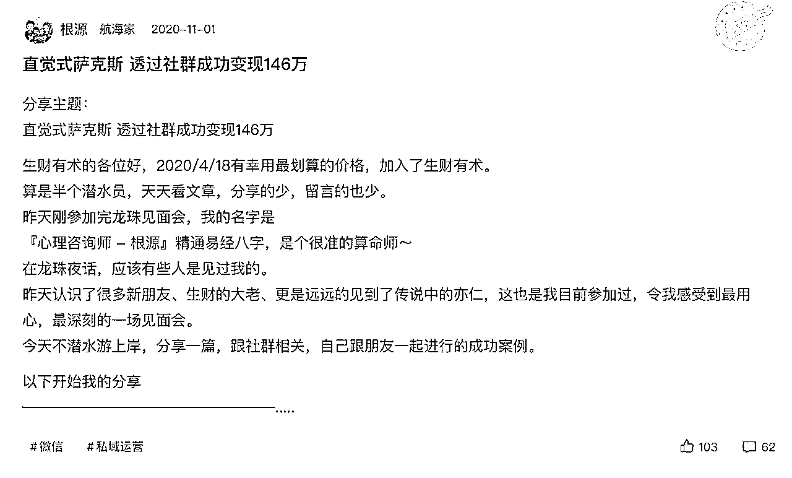

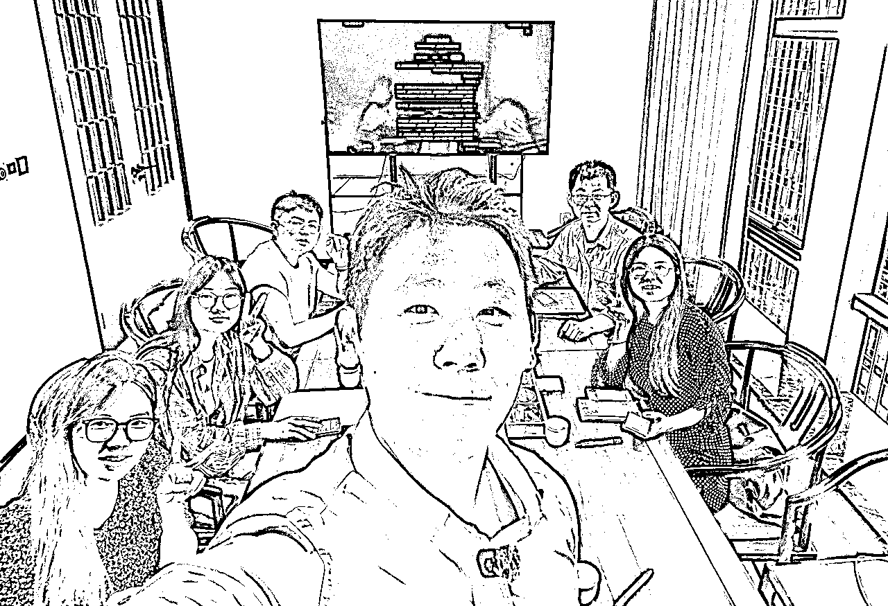

这篇内容，我想坦诚地复盘一段从负债百万到现金流稳定的真实经历。它不煽情也不鸡汤，甚至有点笨拙，但每一环都是我亲手走出来的。

回到2018年，那是我人生的最低点。引以为傲的四万人销售团队一夜瓦解，月收入从二十万断崖式跌到三千，还背着上百万的债务。

更重的是，我的大儿子恰在那个节点出生。我们搬到一座新城，零人脉、零资源、过往的经验全部失效，连下一顿饭都要精打细算。身为一个男人，如何在这种境地下重启？

我把过去十三年里沉淀的销售与培训方法全部拆解，用最原始也最踏实的方式重新出发。

整篇文章，我会讲清我是如何靠一千多次线下见面，一点点重建社交网络；又是如何借助社交势能让机会反向找上门，最终搭建起自己的知识付费闭环。

你看到的不仅是一次逆风翻盘，更是一套可复制的脱困逻辑。包含心态校准、目标拆解、微迭代的方法，以及我在生财这样一个高质社群里，从边缘到发光的成长路径。

如果你正卡在迷茫期，希望我的踩坑经历能给你一点参考与底气。让我们用行动去换取自己想要的生活。

下面正式开始。

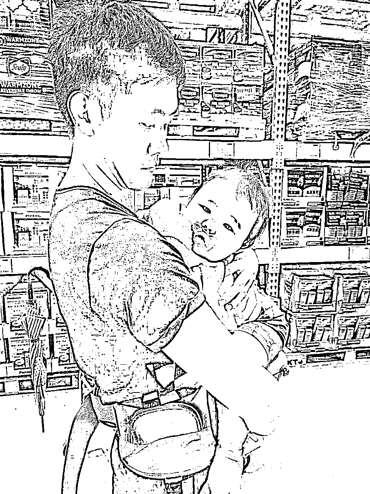

（孩子在人生最糟的阶段出生了）

# 从谷底爬起的个人成长笔记

## 第一部分：崩盘与再出发

### 2018：刻骨铭心的一年

我最认同的身份是：跌过又站起来的人。

2018年是我记忆最深的一年。团队崩塌，收入从每月二十万跌到三千，负债百万，儿子出生，夫妻矛盾不断加剧。

我们来到陌生城市，没有任何人脉，没有客户名单，连下一步该做什么都一片空白。

我的导师曾告诉我：只有在谷底，才会逼出真正的创造力。

那年真的熬人。好日子刚过去，孩子又出生，靠打工上岸几乎不可能。于是我先进入一家保险经纪公司，做起了保险代理人，先求活下来。

### 生存分工与复制复盘

初期业务几乎没有产出，人脉和信心都是零。于是夫妻分工协作，她外出找工作养家糊口，我专心做业务，重新积累人脉、重建团队。

困境时要反问自己：过去到底靠什么成功的？先把当年的成功路径完整复刻，过程中再做微调。

失败会让人怀疑过去，但那些经验都是真刀真枪得来的。想再起来的最快方式，就是回到自己曾经验证过的路径，再跑一遍。

我是做销售出身，清楚销售靠人。想做成，就得先认识更多人。

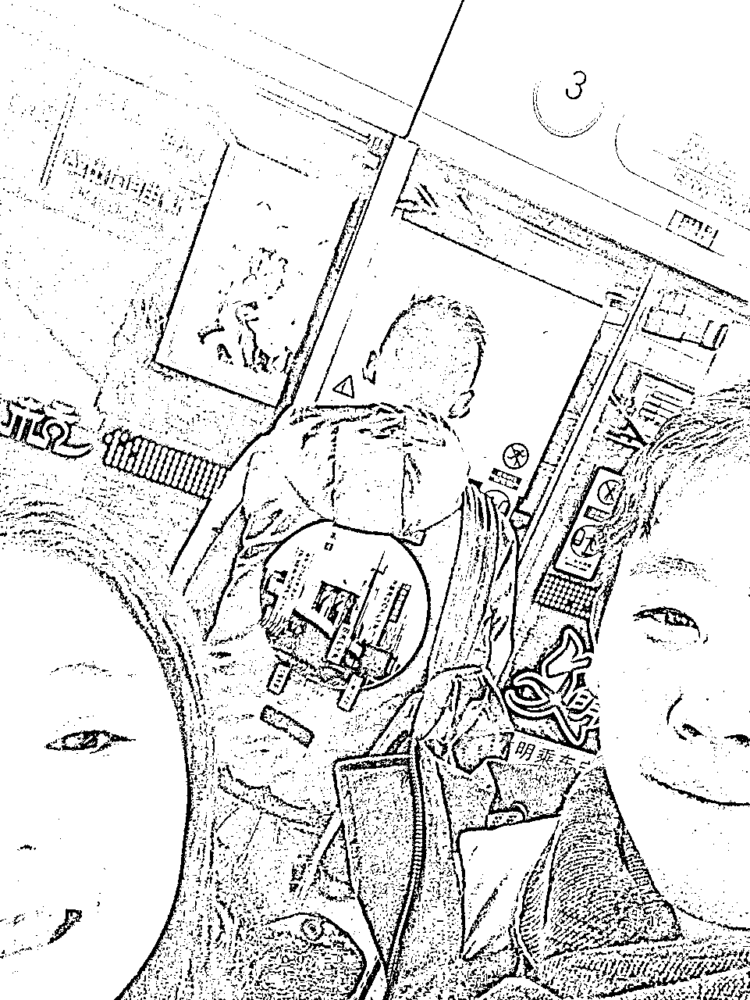

（当时只能坐地铁出行，打车费都舍不得）

## 第二部分：找客路的探索与转向

### 线下摸索：笨但扎实

之前的经验都在线下，扫街派单、陌生拜访、去星巴克搭讪加微信。

我印象最深的是，每周至少三天，我会泡在不同的星巴克超过六小时，只为和独自喝咖啡的人聊上几句。被拒很多次，但线下能聊，能看人，比线上踏实。

### 线上尝试：高效却空洞

杭州互联网氛围浓。朋友建议我线上更有效率。一天线下能见几个人？线上用摇一摇、附近的人，甚至花钱买群，效率确实高。

我就开始每天固定一小时摇一摇，花一块钱买群，十赠一。很快发现微信加人有上限，一天主动加超过五十人就被限。

加了人也不知道怎么聊，对方基本不回。淘宝群里的人质量也差不多。大半个月下来，摇一摇、附近的人、买群都试了，没产生实质连接。

随后我又试了探探、陌陌，认识不少人，但并无价值。那时我内心深处觉得线上交友太低效。

### 转折：发现免费线下活动的价值

我问朋友杭州有没有更好的线下认识人渠道。他告诉我杭州免费活动很多，并推荐我一个活动APP。

下载后我打开了新世界。由于没钱，只能挑免费的。那段时间一日两餐，中午吃麻辣烫让老板多放汤，晚上用汤煮粥。穷到每一分钱都要算到下个月的保命钱。

只能报免费活动。当时经验不足，挑的就是一两百人的创业主题场，人多就觉得能认识更多人。

我给自己定下三条硬指标：

* 每周至少参加四场活动；
* 每场至少加四个人，活动座位前后左右四个位置；
* 见面后一个月内务必约对方出来喝咖啡。

当时做保险，也兼做心理咨询、八字算命。

我一直相信：从零到一靠重复正确的事，前期不一定立刻见效，不出结果不代表方向错，只是正反馈还没来。

从2018年6月到2020年1月，近一年半的时间，我每周固定下场，累计认识近三千人。回头看，这个数字挺惊人。

## 第三部分：进化与方法沉淀

### 从量变到质变

每次活动后我都在优化细节：

从大场转小众场，从免费场转付费场，从随机报到主题精选。

出场前自律要求：提前半小时到场、着装得体、背包里放笔记本、二十张白纸、三色粗头笔、充电宝、线材、一本书，包内整洁，头发整理好。

自我介绍我至少改过一百次，后期能根据人群灵活切换十几种版本。

起初是我主动加人，后来只要我站起来做自我介绍，就有别人主动来加我。

### 成功三要素

我总结下来，走出困境并不难，只要做到三点：开始、微调、目标清晰。

参加活动是开始，复盘是微调，每年设定收入目标是方向感。

其中微调最关键。很多人今天像昨天，明天像今天。每天只微调一点，一年就是三百六十五次改变。

比如从出门不擦鞋到会擦干净，从不带充电宝到带充电宝还多带一根线。借对方充电，关系自然加深。这些微小改变叠加起来，就是差异。

## 第四部分：进入新圈层

### 贵人带路，进入生财

大量参加活动半年后，我认识了人生关键贵人，他把我带进了生财有术。

起初只是活动后加了微信大树，有一句没一句聊。一年后他约我喝茶，说他最近在一个互联网社群里，效率和质量都远超他见过的任何圈子。

他提醒我4月8号要加入，当时门票965元还得抢。

当时我现金流极差，省钱是本能。在马桶上抢票，手机卡了三分钟，生怕涨价。当时能省一点是一点。

这段经历想表达的是：穷的时候每一笔开销都要慎重，更要认真对待。

### 在圈子里学习与沉淀

没钱时报的活动基本都是免费的，或60、100块的付费场。出行坐地铁、公交、共享单车，极少打车。

所以花钱的地方我都会认真对待。进入生财后，我给自己定目标：把九百多块的门票赚回来，先把生财在做什么搞清楚。

每天至少看十篇精华帖，坚持下来量就上去了。过程中我才发现原来有这么多生意模式。

刚开始我不敢轻易联系作者。因为生财的资源与我过去接触的都不一样，感觉需要更慎重。

我清楚交际有成本。约见、请咖啡都是钱。认识一个人至少花百来块，有课程群从三四百起步。对当时的我来说不小。

所以我认为：认识不用太多，但想深度连接，在能力范围内付费是最快的关注路径。

## 第五部分：熬与起飞

### 贫穷期的心态坚守

2018到2019年，我深知贫穷的连锁反应：夫妻吵架、情绪低落、身体变差、焦虑失眠。多数人穷时只会抱怨。

那两年我做对的一件事是：工作时间绝不打折。虽然会吵到凌晨两三点，早上七点半照样起床开早会，工作任务一丝不苟完成。

和赚钱有关的事，我不拖延不妥协。这是年轻时在老师指导下养成的习惯。

### 熬的回报

从谷底爬起就是熬。近一年没什么成绩，每月只赚三五千。靠老婆稳定工作才撑住家计。

但只要不打折，每个季度都能感觉到身边的人和质感在提升。

那时我常问自己，为什么认识的人都不太靠谱？后来明白，因为当时的自己也不够成熟。

到后来，我从主动加人、主动约咖啡，变成有人主动加我、主动约我。那一刻我知道自己状态回升了。因为别人愿意靠近，说明我开始输出价值。

### 真正融入生财圈

在大树的引荐下，我认识了玛丽姐，被拉进跑步群，认识了涛哥、大周、刺猬等一众生财朋友。我常自嘲是“跑”进生财圈的。

那个跑步群有押金打卡机制，40天跑满37天、每周5公里，否则押金进奖金池。当时1000元对我来说是巨款，但不参与就融入不了。

我在群里固定时间出现，接话、聊天。慢慢大家都认识我。有些新来的人会误以为我是大佬，因为我总能接上群里大佬的话题。

这段伪“狐假虎威”的经历，让我认识到更多圈友。

### 龙珠与筑基年

第二个转折点是看到龙珠机制。一颗龙珠当时能卖8000。过去有经验，我就发了人生第一篇帖子。

生财对新人友好，内容尚可就能评精华，精华就有一颗完整龙珠。拿到龙珠那天最开心的是能卖出8000块，够一个月生活费。

文章进精华后，开始有人主动联系我。人脉积累带来业务起色，手头宽裕后每月能拿出几千用于社交。

2020年是我在生财的筑基年。生活逐渐稳定，人脉质量提升，我开始重新调用过去的成功经验。

最大感悟是：过去的经验并非无效，只是我没找到结合当下场景的方式。持续尝试、坚持重复，我又找回了状态和自信。

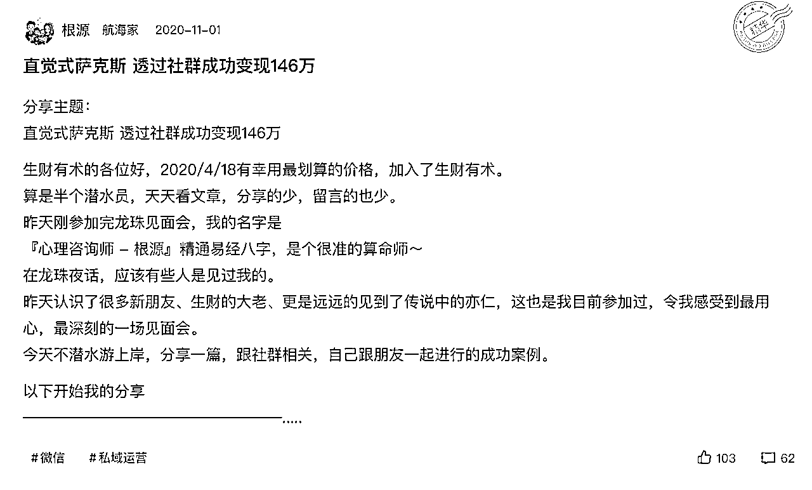

（2020年11月打的第一篇文章，写了将近半个月）

（没想过能成精华，当时发文到得精华间隔近两个月）

### 新目标与新节奏

2021年4月18日，我一次性付清生财费用。那次付一千多元毫无压力，甚至没犹豫。依旧紧张抢票怕涨价。

玛丽姐送我一张龙珠俱乐部的线下会门票，我才知道跑步群里很多大佬都是龙珠会员。

从此新目标明确：想进龙珠俱乐部。那时入群需要有龙珠，还需有人推荐。

每个阶段都有不同目标，目标带来关注，关注带来靠近。

这一年也是我第二年入生财，也是我决定大量认识生财圈友的一年。

因为我相信：找到好项目，比刷文章更有效率的是大量见人。想法和项目都靠聊天碰撞出来。

这一年我的节奏是：杭州有圈友能见就见，有活动就参加，官方志愿者也积极参与。

### 小咖拉米的美德：勤奋

这一年内容看似丰富实则枯燥：见人、看文章、见人、看文章，周而复始。但正是这种重复，把我推到了起飞线。

六年前刚加入生财有术时，我也有过很长一段时间的“小透明”心态：满屏都在晒战绩、晒收入、晒方法论，随便一个自我介绍都像在给大佬递名片，而自己好像什么都不算。但后来我才明白，那个让你自我怀疑的平台，恰恰也是让你完成蜕变的加速器。

第一篇帖子发出之前，我也以为没人会看，更没指望能加精。可事实是，文章发出去之后，很快就有人顺着文字找过来，主动加我好友。他们中有些人比我强，有些跟我水平差不多，也有一些比我小一些，还有人说单纯被我的勇气打动。四类人里，后两类占了大多数。这让我第一次意识到：无论身处什么样的生态，总有人比你厉害，也总有人会在你身上看到他自己想成为的样子。只要把一段真实经历认真写下来，属于你的同类，会自己一步步靠近。

而这恰恰是很多人最大的误区——总觉得自己不够好，以为那些优点一定要被公开认证过才算数。可真相是，每个人的闪光点都客观存在，只是没被表达、没被看见。当我们不习惯写作、不习惯对外展示时，优点就像藏在地下的种子，连自己都忘了它在哪里。你需要做的，只是把它写出来。

那写什么呢？很多人卡在这一步，觉得自己没有项目、没有成绩、没有可讲的履历。我懂这种感受，因为我也是这么过来的。但后来我发现，所谓“素材”根本不用宏大。职场被主管重用而加薪，这是赚钱心得；因为看了别人的分享而调整做事方式，收入有了变化，这也是有启发的内容；甚至是你踩过的坑、走得慢的经历，一样值得认真写下来。判断标准只有一条：它对你是否真的有帮助。如果连自己都觉得没营养，就别指望对别人有什么价值。

所以，不要总想着写给谁看，也别盯着阅读量、点赞数、加不加精。就给自己定一个节奏：每周或每两周更新一篇，到点就写，先养成输出的习惯。写着写着，你会发现关注你的人越来越多，主动联系你的人越来越多，你可以结交的圈子也越来越大。当年我写第一篇文章时没拿到精华，但从第一篇文章到后来能持续输出，靠的不是瞬间爆发，而是把分享变成了一种习惯。

第二个阶段，我学会了用新方法做旧项目。进入生财之后，我面对海量的项目和帖子，并没有急着去追风口，而是优先选择那些我曾经做过、熟悉的事情。这时候有趣的事出现了：同样一件事，别人用了完全不同的玩法、不同的商业模式，做出了让我惊艳的结果。我于是意识到，互联网不缺新赛道，缺的是把旧经验重新理解一遍的能力。

基于这个思路，我选择了知识付费——因为我有过培训背景，带过团队，有过线下经验。但这一次我要用生财里那些人验证过的新方法来重新做这一切。做的时候不会完全陌生，因为底子还在；不懂的部分，边做边学就好。这比从一个零基础的领域硬磕要踏实得多。

第三个阶段，也是我这一整年收益最大的方向——有策略、有节奏地大量认识人。

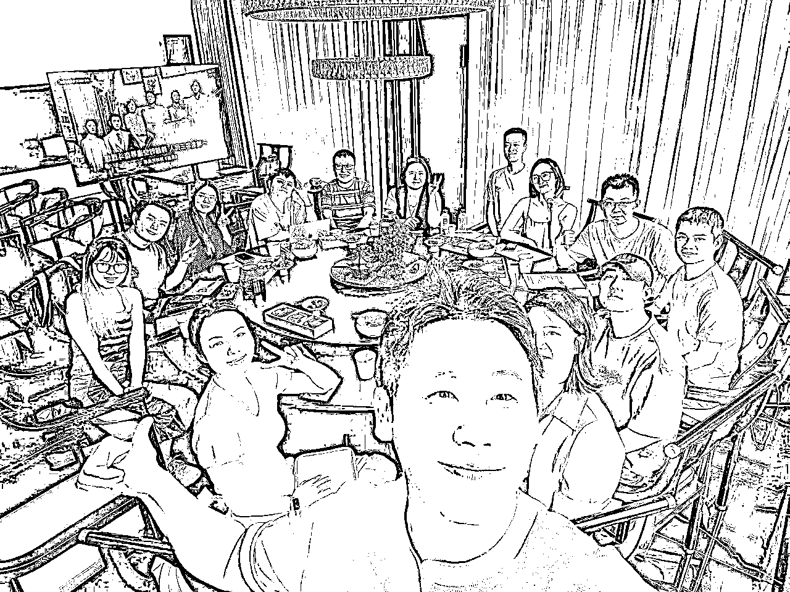

如果把这件事换个说法，我会告诉你：不是盲目地到处加好友，而是在固定的时间段内，完成固定数量的链接。比如我给自己定过目标：每周至少认识10个人，一个月就是40个人。设定这个目标的原因有两个：一方面这是我过去做业务时养成的习惯；另一方面，很多项目灵感和方向，并不是靠单方面阅读就能得到的——文章能给你认知，但下一步真正该做什么，往往是在和人交谈的过程中才被激发出来。

看文章其实有更高级的用法。在我还不知道自己该做什么的时候，我会通过阅读去寻找那些“人”——那些我喜欢文风、认可观点的作者。文风讨你喜欢，这个人本身大概率也聊得来。我会去留言区观察，那些和我在同一篇文章下产生共鸣的人，我也尝试去结交。留言的人未必比作者厉害，但那些和我水平相近、价值观相近的人，聊天的时候没有隔阂，也更容易走到一起。所以你看，往上，你可以找你想成为的人；往下，你能找到同频的人，而这两者同样有价值。

有了目标对象，剩下的就是主动链接了。我的做法很简单：通过星球私信，真诚地告诉对方，我在某篇文章下看到你的留言，觉得讲得特别好，想和你认识一下。只要保持礼貌，大概率对方都会同意。这世界上，被认真欣赏的人，通常不会拒绝一份真诚的友谊。

这时候你可能会问：认识那么多人，真有必要吗？圈子是需要更新的。以我自己为例，过去做线下培训，后来转型线上知识付费，旧客户的消费习惯还在线下，让他们线上买单很难。我花了整整一年时间，积累新用户、建立新圈子。2022年正式推出课程时，购买我产品的人，几乎全是那一年里新认识的朋友。只有新圈层，才能接受你的新项目和新逻辑；旧朋友很多时候会停留在过去，对你的转型表示不解甚至不感兴趣。

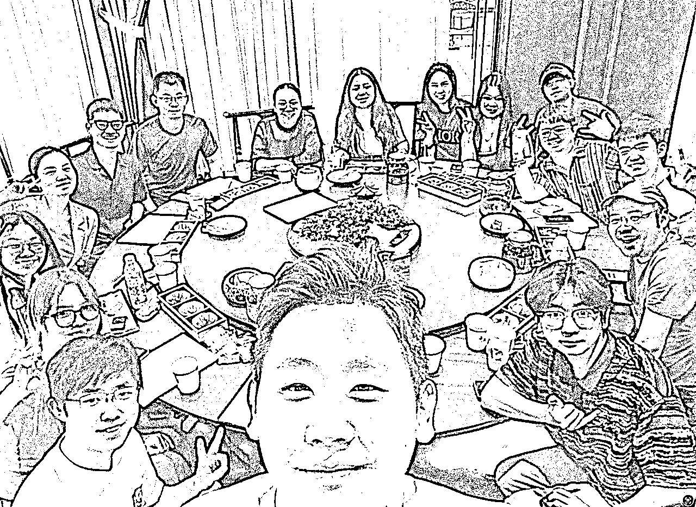

这里我必须坦诚地说一句：从我的第一篇精华帖到第二篇精华帖，中间隔了快两年。但我始终没有停下来。持续写，持续认识人，持续找到自己的生态位。

所以，如果你刚刚加入生财，我会建议你从四件事开始：

第一，大量阅读文章，但不要只看内容，更要去找那些你喜欢的人——价值观匹不匹配、思考方式和你同不同频，都可以在一篇篇文字里被辨识出来。

第二，找到自己也可以分享的东西。你不一定需要多成功的项目，过去的经验、走过的弯路、职场上真金白银的教训，都算数。给自己写第一篇文章，不用管数据怎么样，先完成它。

第三，给自己设一个人脉目标。一周认识5个、10个、20个都可以，线上也好，线下也罢，只要固定下来就执行。你可以从每周加20个好友开始做起。

第四，积极参加生财组织的各类活动，特别是志愿者的角色。志愿者有官方身份背书，你可以借着这个身份认识教练、船长，还能和10到15名船员建立关系。当志愿者能让你从系统运营的角度学到大量细节，这是你站在普通用户位置上永远得不到的收获。

但请记住：人脉是有代价的。最直接的，就是交际成本。参加线下活动的AA、请人喝茶吃饭、报名付费社群和课程，这些都是实实在在的支出。其中，买课和进付费群不只是消费，更是一种高效率的链接方式——在你想结交的那位老师心中，“买过课的”和“普通圈友”完全是两种身份，前者可以更深入沟通，后者只能维持表面互动。同时这也是倒逼你投入精力的一种方式：你花过钱的人，你一定会更认真地对待。

所以一定要给自己设置边界。比如每月收入的10%，或者存款的10%，都可以作为学习投资的限额。定了上限，就不用再纠结：假设今年限额一万元已经用光，即使再出现想报的课，也要忍住。多花钱不必然带来多成长，量力而行才是成年人该有的自律。如果对方课程真的很贵但你又想学，尝试沟通分期，例如五万元课程分五年来付，每年一万元，既能保住链接，又不打破预算。

我见过一种人，副业赚一万，却敢花两万去投资，结果年底一算账，一分钱没赚着。要知道，当你真正重视成本的那一刻起，才会尊重自己买下的每一个课程。

还有一个很常见的坑：买越多的群，等于没有群。同时加入几十个群，进到大观园一样眼花缭乱，反而不知道该把精力放在哪里。新人阶段，三到五个付费群已经是上限。你只需要认真经营好这几个群，在群里积极发言、承担角色、提供价值。群主看得见你的能量，他会主动介绍新朋友给你；群友也会被你吸引，主动来认识你。三五个人脉圈认真经营，就已经够你忙的了。

说到底，赚钱本身并不容易，而且需要时间。这种话，可能很多内容创作者都不会刻意告诉你——因为文章里写的基本都是结果，过程里的狼狈很少有人愿意公开展示。我一开始也会焦虑：为什么别人都能赚到钱，我还没有结果？为什么别人总是看起来那么顺利？后来我意识到，这种误判完全是因为我们只看到了他人经历中最光鲜的段落。赚钱从来没有容易过，别人只是把痛苦的部分藏在了没写的章节里。

我用一个三年的规划来应对这种焦虑。

第一年，先打基础：三个月内，每天读十篇以上文章；六个月时，每周线上认识至少30人，发布至少4篇内容；九个月时，每周线下见至少21人，发布至少4篇内容；十二个月时，至少参加一次大型活动和五场以上的小型活动，发布至少4篇内容，并把每月更新的频率固定下来。

第二年，选定方向、死磕到底：前三个月找到对标项目，百分之百听话照做，少提问多执行；中途开始对比同期朋友的反馈，找出差距；九个月时专注变现，赚到第一个一块钱；年底之前赚回门票，并且每个月保持一到两篇稳定更新。

第三年，全力以赴放大收益：只盯利润，所有动作都围绕变现展开；不换项目，寻找并请教同等项目里收入较高的人付费学习；控制成本，同时保持前半年的行动量，目标25万；最后阶段，再用同样的节奏冲击50万。这个目标，我认为在生财用三年时间实现是完全可行的。但前提是，你千万不要频繁换项目。选定一个，至少坚持做一到两年，哪怕要增加新的方向，也尽量不要丢掉第一个。特别是新人，耐心比聪明重要一万倍。

固定的事情重复做，重复的事情一直做。这句话听起来朴素，却是几乎所有人成事的底层逻辑。

最后，简单分享一下这六年我攒下的一些成绩：加入了龙珠俱乐部；我的沟通课曾经被选为会员日礼品；2024年拿到了精华榜第一名；累计发表主题63篇，其中20篇被加精，去年一年就有12篇；成为航海家俱乐部成员、担任过“时间管理”航海教练、还作为嘉宾参加了2025年航海家线下活动；同时我也拿到了资深传术师的身份，并且连续续费了六年生财有术。

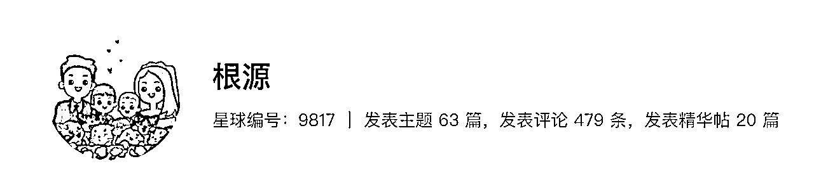

这些成绩背后不是运气，而是每一个细节都尽力做到最好、每一篇文章都认真完成、每一次见面都用心准备、每一段关系都认真维护的结果。

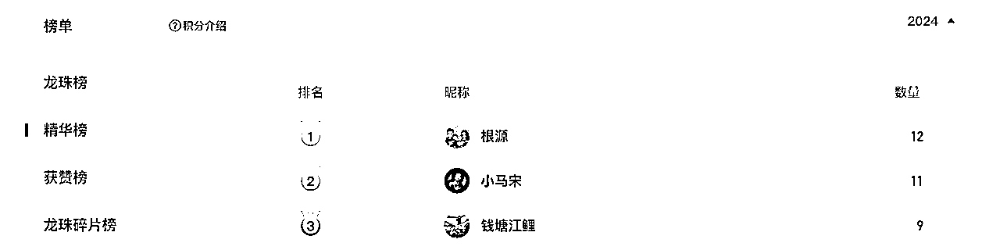

如果这篇文章里的某一个阶段、某一段建议、某一次复盘，恰好能照亮你此刻的某种困惑，那就是我写下它最大的意义。愿你在生财的路上，做事有章法、做人有温度、赚钱有耐心。

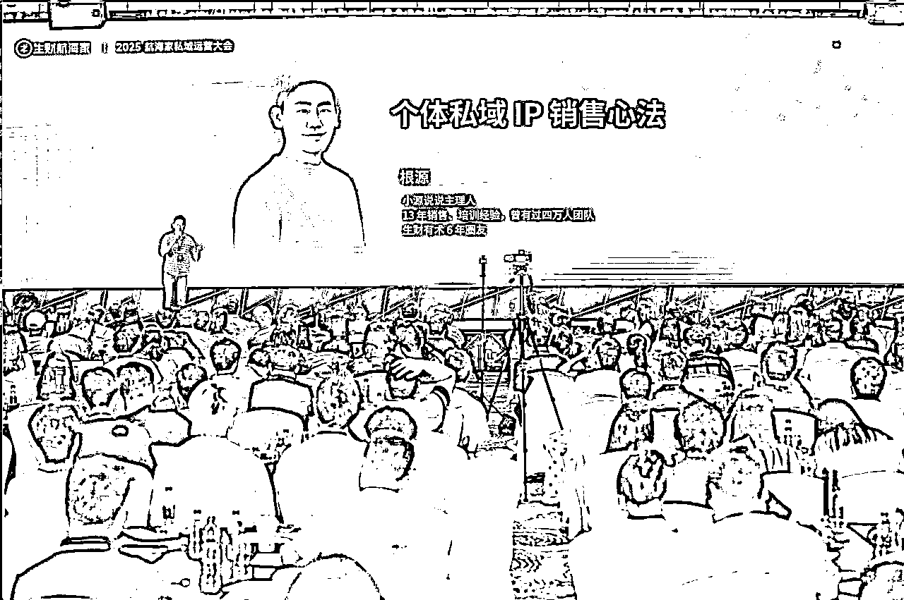