# 出海学徒实录：四个月攒下零点零一刀，十五天冲破一千刀


# 一、开篇说明

各位好，我是王马扎。从今年三月下旬起正式触摸海外 AI 赛道，到八月底首次站上千美元线。本文把从零到首笔 0.01 美元耗时四个月，再从 0.01 美元到千美元只用十五天的全过程拆解出来。

先做个交代，文中涉及的需求挖掘、AI 出品等方法论，基本来自龙哥盟，以及我的两位导师 @哥飞 和 @刘小排 ，相关版权归属赚钱与两位老师。

下面内容是三月下旬至今我亲身跑通的路径，糅合了在赚钱和老师那里的学习心得，如有偏差欢迎交流。

# 二、个人经历

2020 年 4 月 18 日加入赚钱，算下来已五年。2019 年把全家迁往杭州，对我而言是人生转折。这是我第一次在赚钱写这么长的复盘。

赚钱彻底改写了我。加入前我只懂打工，对生意一无所知。

我来自农村，大学毕业后想多挣钱进了传统国企，结果环境很糟：十八线县城，每天戴安全帽穿工装，久了还有尘肺风险。

干了三年一线后调到北方二线城市，仍是传统行业，薪资不高且常加班。

后来听前同事说互联网码农收入可观，我咬牙花一万多报网课，裸辞去图书馆自学，从第一句 hello world 起硬敲。那时还没 AI 编程，完全靠手写。

三个月后投出几十份简历，最想去杭州，最终被南京一家仅三人的小公司录取，也算半只脚进互联网。

当时老家已有房有车，孩子两岁，放弃这一切去从未踏足的南方，对我来说是豪赌。

在南京不到一年，我拿到杭州一家世界五百强车企的 offer，对我这履历算是意外。

入职杭州的同时全家搬迁，正式开启杭漂。家人很喜欢这座城，两年后升职加薪在杭州购置房产，才算落地。

加入赚钱五年，我跟着做过不少尝试：知乎好物、小红书带货、AI 写作交付、公众号爆文，还做过职业规划咨询，做过几十场个体咨询。虽然没赚大钱，却是我作为独立个体赚到的第一桶金。

# 三、为何押注海外 AI 产品

这些年踩坑无数，成少败多，长期在焦虑与找项目的循环里。

迷茫时总问自己该做什么，后来明白答案不是想出来的，是在不断试错中撞出来的。

过去的项目，有的吃红利，比如知乎好物，红利结束难为继；有的能挣钱但我排斥，比如 AI 写作服务要一件件谈单，消耗大；有的就是纯体力，比如职业咨询，一场准备要四小时，想放量很难。

海外 AI 产品这件事，刚好契合我：能赚钱、我喜欢、我有一定技术底子，而且大势很清晰，就是用 AI 去造 AI 产品。

去年航海家大会上，龙哥的一句话印象很深：“我们都是小鱼，从一个池塘游到另一个池塘，直到某个瞬间会发现自己进入了属于自己的大海。”

现在我就有这种感受，焦虑少了，节奏更沉稳，开始有终局思维。因为我觉得自己好像找到了那片海。


# 四、追词期，花四个月拿到第一分钱

从首次出海到赚到 0.01 美元，我用了四个半月。大概上线了 15 个站点。

下面是我在即刻记录的 AdSense 收入，七月二十六日首个站点通过 AdSense 拿到 0.01 美元，八月二十二日到五十美元，九月初破百。

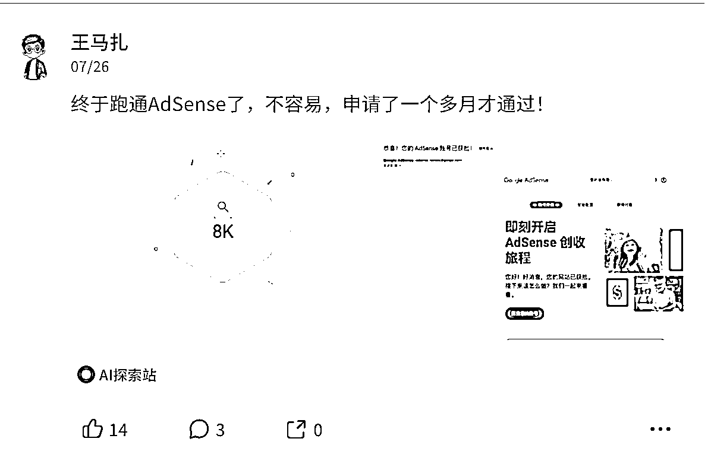
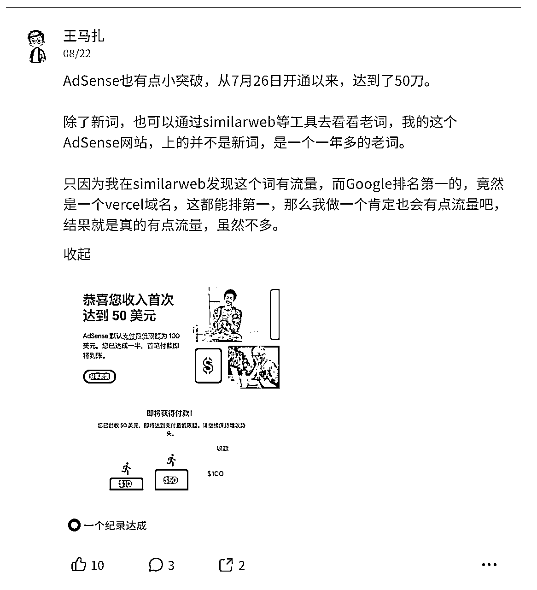
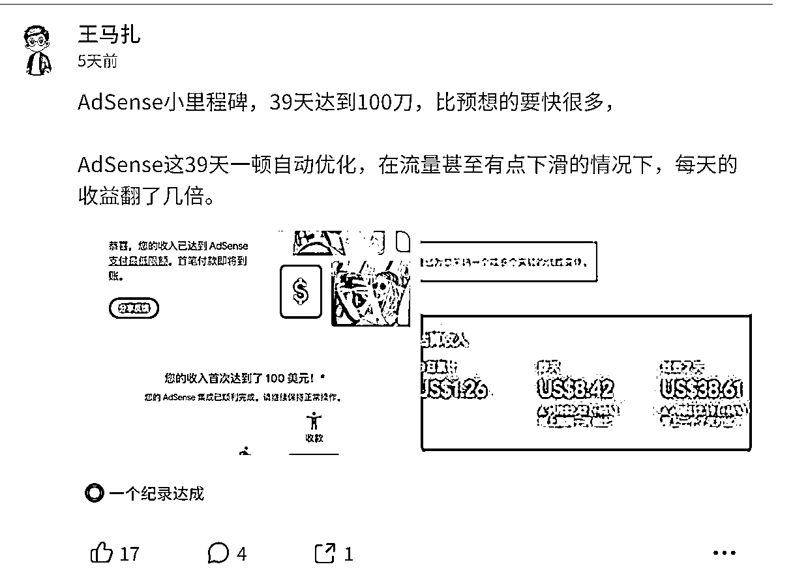

整体走得很曲折：

### 4.1 前三个月上站回顾

第一阶段 3 月中旬-3 月 30 日：正式上手用 AI 建站，第一批做的是出海小游戏，跟三月的 web 航海，半个月上线七个游戏站，流量几乎为零。最大收获是学会用 Cursor 建站，GCS 提交、GA 接入流程熟了。

第二阶段 4 月初-4 月 26 日：参加完 3 月 30 日赚钱航海家闭幕会后，和圈友交流发现不能只做游戏，AI 工具订阅的想象空间更大。4 月初我一边做几个游戏，一边花两周注册美国公司并申请 Stripe。

三月末 ghibli 爆火，我也注册了一个域名，花了二十多天做第一个带支付的 AI 工具站，到现在也没出单。

第三阶段 4 月底-6 月初：我陷入了完美主义。用 Similarweb 找到一个新词 italian brainrot，但当时技术不够强，又总想把交互打磨完美，最后产品根本没上线。新手常见坑就是过度打磨。

总结：出海前三个多月上线约十个站点，只有一次 AI 工具站，其余都是 iframe 游戏站，还有一个未发布的工具站，没有起色。

### 4.2 第四个月出现正反馈，如何找需求

转折点是 6 月 7 日，我去上海参加 @哥飞 老师组织的线下活动。一天高强度输入回来后，十天内我连发了五个新站，这次都是基于 HuggingFace 模型的 AI 工具站，不是游戏。

如图所示，是我当时发在即刻的记录，回头看很激动。

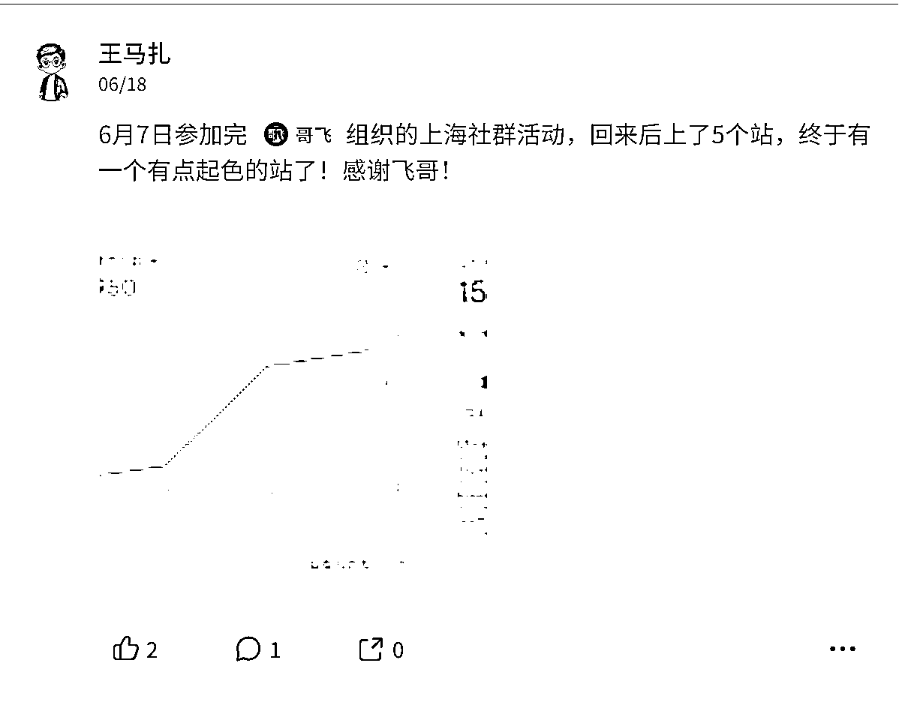
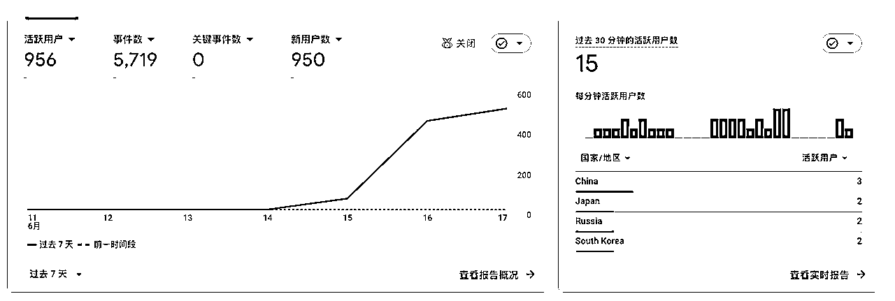

五个站里有两站持续有访问，最终靠 AdSense 带来第一笔 0.01 美元。

这两个站的思路不同：一个是全新出现的热词，我是第一个用该词注册域名上线的；另一个是存在一年多的老词。

先说新词。

这个词是我在 X 平台看到一个大号发的，拿去 Google Trends 一查，确实是新出现的，搜索量约为 GPTs 的五分之一。截图显示在我注册前 .com .ai .net 都已被注册，但都未上线。

我只是新手，没抱太大期望，花三美元注册了一个冷门后缀。

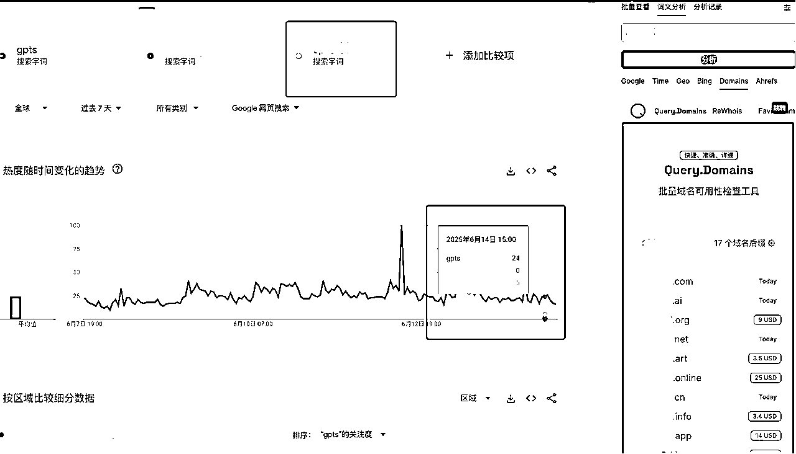

几个小时后站就搭好了。上站后我主要在 GSC 里提交 URL 和 sitemap 加速收录，同时接入 Google Analytics 做数据追踪，还加了 plausible，看数据更顺手。细节就不展开了，航海手册里写得很全。

再说老词。

在分享挖掘方法前，先看这个站点：域名用的是 vercel 免费二级域名，站长连域名都不买。右侧 AITDK 显示四月流量两万四，网站只有一个首页嵌一个 iframe 组件，其他什么都没有。

偏偏这个站排在谷歌首位，典型软柿子。六月五日的笔记里我也记下了。

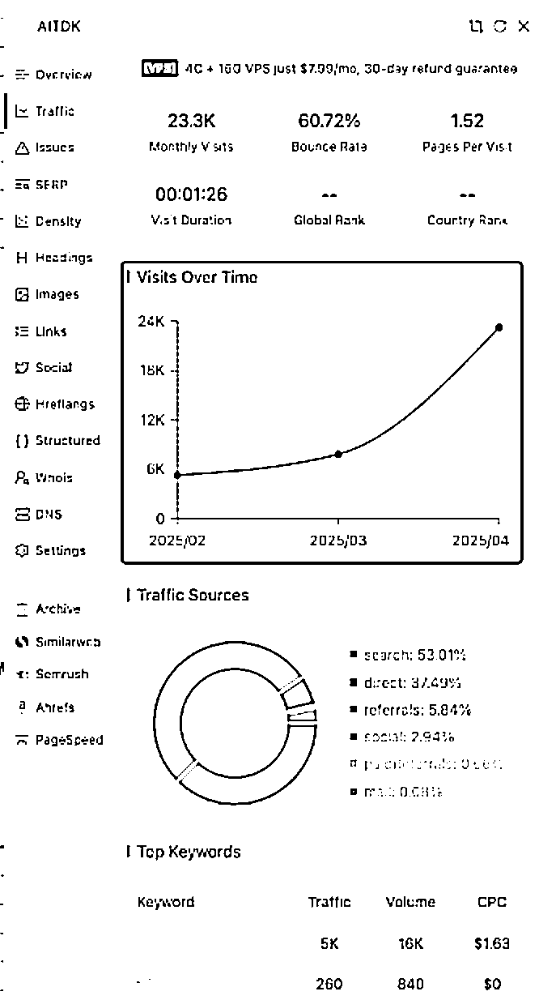
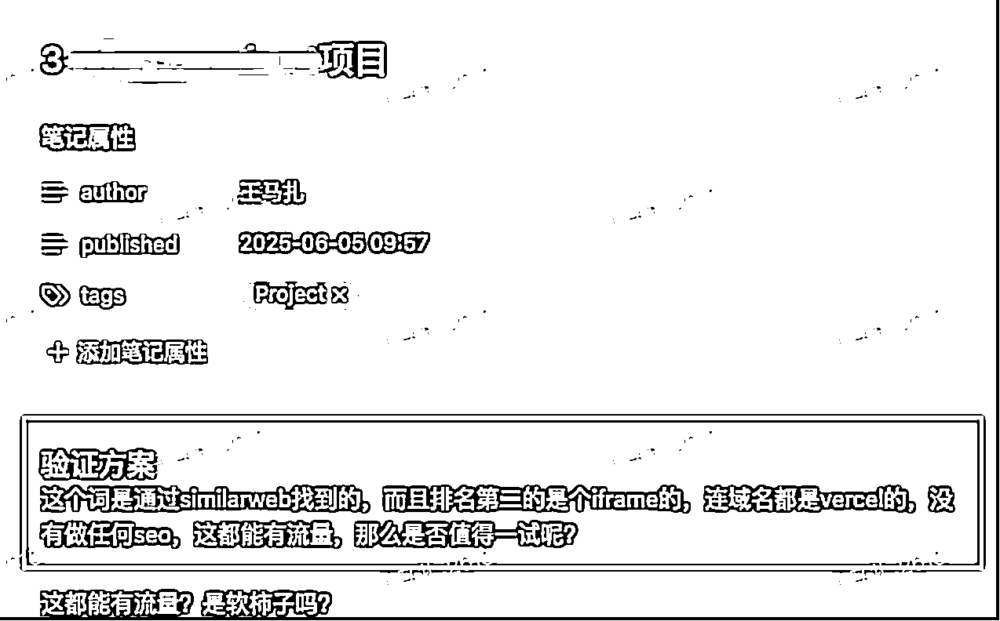

挖掘思路来自 @哥飞 老师社群：打开 Similarweb 输入 huggingface.co，在关键词研究里选“着陆页”，看最近 28 天哪些内页流量在上涨。然后把这些内页的关键词拿去 Google Trends 验证趋势，再用 Google 搜索看竞争对手强弱。找到那个“软柿子”，做一个体验更好的版本，就有机会拿流量。

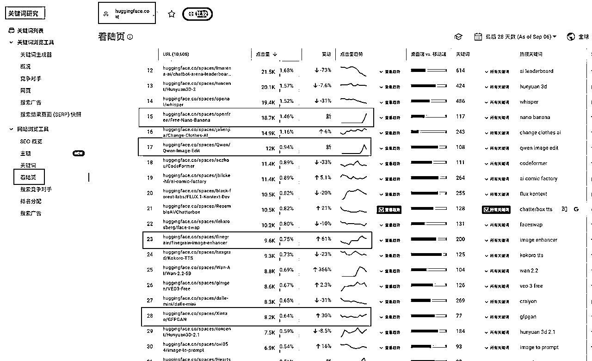

需要说明的是，找需求是慢活，也看运气。很多时候研究好几个小时一无所获。我的经验是，新手别指望找到流量巨大竞争又小的词，不现实。只要觉得有机会就先上线跑通整条链路，拿到正反馈再迭代，这是渐进过程。

### 4.3 流量暴涨后被惩罚，归零

上面两个站上线没几天就有了流量，尤其是新词站，第二天就爆发，日 UV 不到一千，对新手来说是巨大的正反馈。

可没过多久站就被谷歌惩罚了，流量基本归零。截图能看出从 6 月 20 日起曝光和点击曲线贴地。

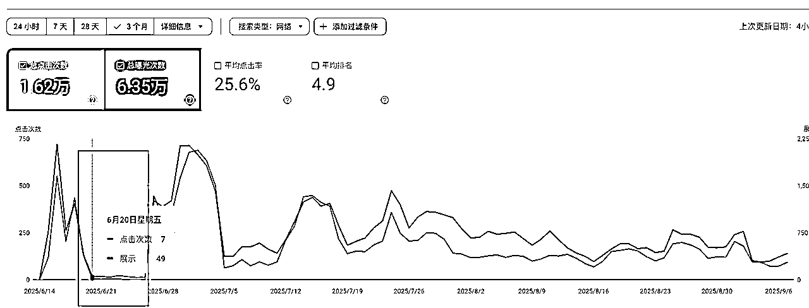

上线前拿到了第 3 名，还有一个词第 1。加了多语言后核心词直接搜不到了，两天后我又加了内页，排名第一的词也没了，像是被 ban 的感觉，换 IP 换浏览器都一样。

我赶紧问 ChatGPT o3，它给出几个可能：

①多语言路径冲突。GSC 里 /ja 和 /ja/ 同时出现，被判定重复页面，降低权重。
②模板复用导致跨站重复。我用有流量的站代码做了一个新站，虽然隐藏了语言切换按钮，但搜索引擎仍收录了多语言 URL，导致两个域名下出现相同内容。
③sitemap 缺少 hreflang 标签，没告诉搜索引擎这些是同一页面的不同语言版本。
④http 没有 301 到 https，GSC 里两个协议同时出现。

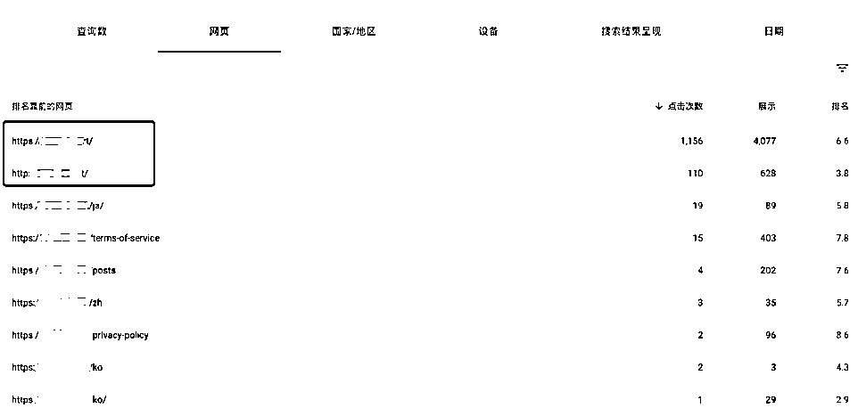
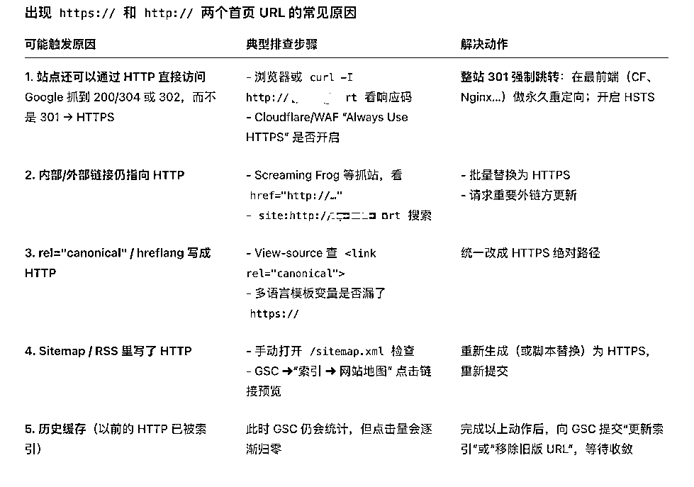

那段时间很沮丧，还没开心一周站就废了。当天复盘笔记如下。

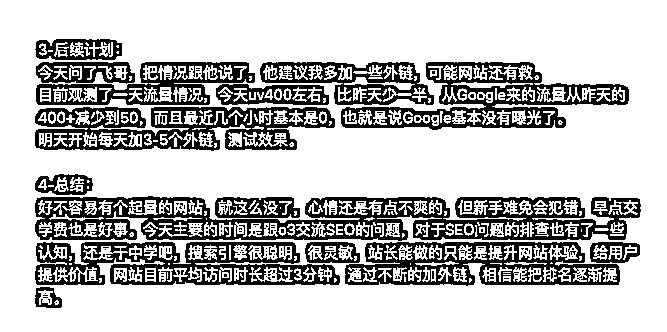

我联系了 @哥飞 老师，他建议多加外链，站还有救。

于是我一边按 o3 建议修复，一边上了几十个外链。

### 4.4 流量回升，AdSense 屡拒

整整一周后流量悄无声息回来了，6 月 27 日起被拉升，后面几天还创新高。虽然是追新词，随着竞争加剧和热度下降，流量慢慢下滑也在预期内。

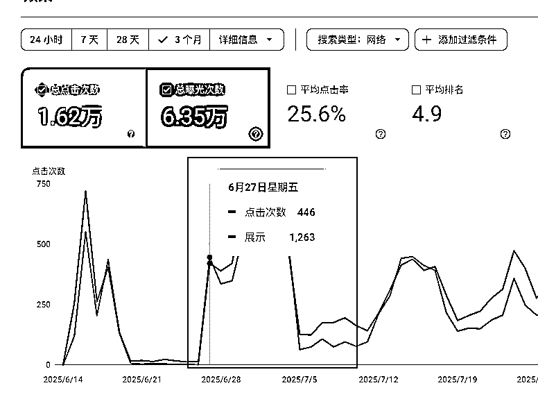

流量问题解决后我想变现。当时参加 6 月航海，按手册把两个有流量的站提交了 AdSense。每天多次刷新页面，太想赚第一美金了。

两周后被拒，理由是低价值内容。

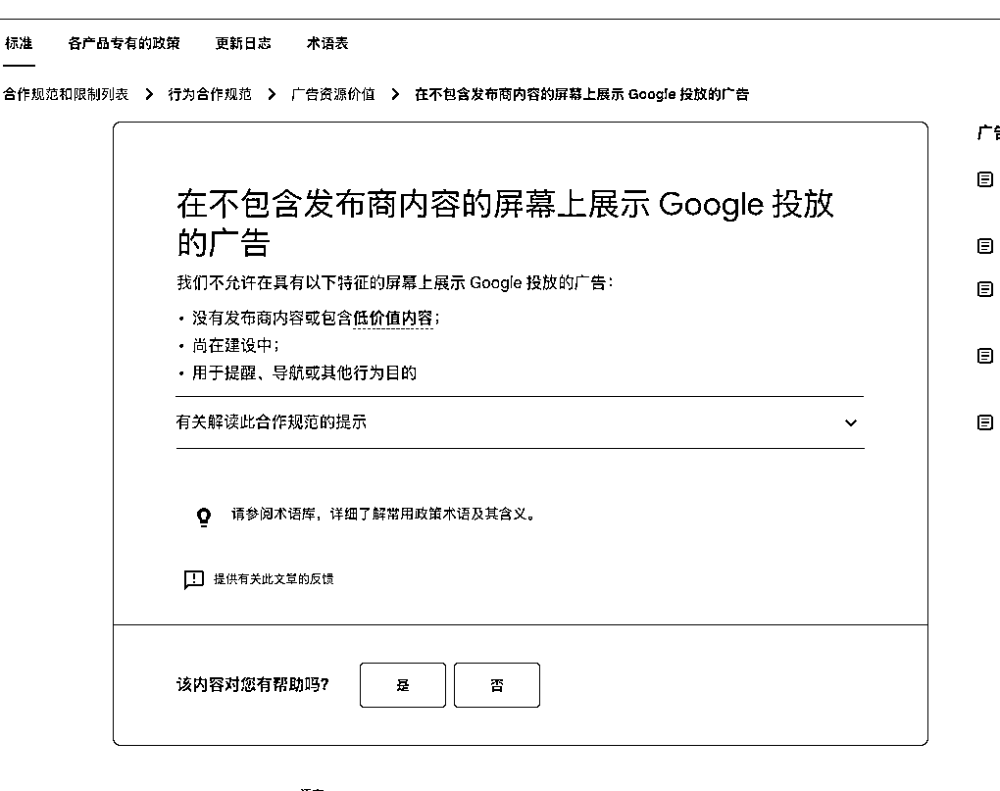

继续问 o3 排查，它说网站太单薄，缺少 /about /contact /blog 等页面，AdSense 会判定为低价值。

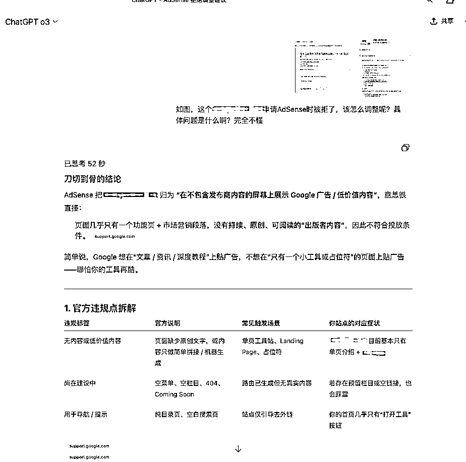
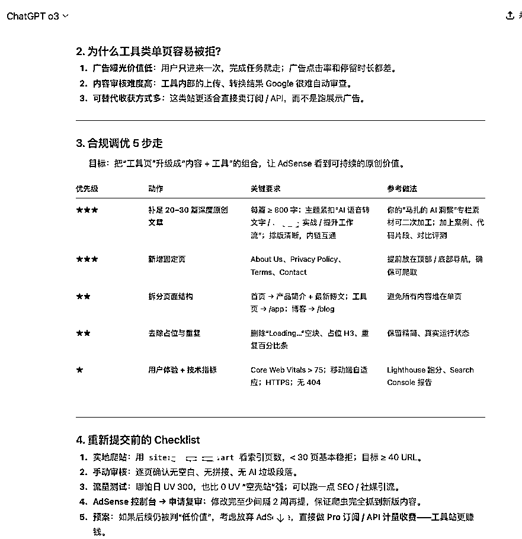

我补了内页、关于、联系、博客并发布了几篇内容后重申，结果又被拒，理由类似低质量。中间我甚至怀疑是账号问题，删掉重申也一样。最后做法是被拒后等两天，不做改动再申一次。

### 4.5 一个半月后 AdSense 通过，第一笔 0.01 美元到手

本来已不抱希望，7 月 26 日打开 Gmail 发现一个站通过了 AdSense，后台显示已赚到 0.01 美元。四个多月的小闭环终于跑通了，很开心。

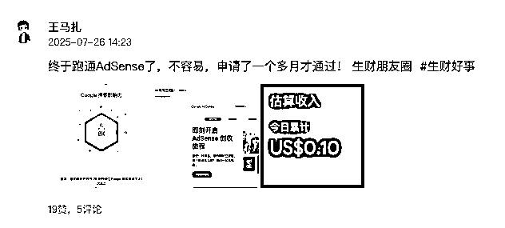

几天后另一个站也通过了，我几乎没做什么改动。

AdSense 的好处是省心，系统会自动优化，收入还能涨。后来我去搞订阅站没怎么管，40 多天总收益涨到一百四十多美金。

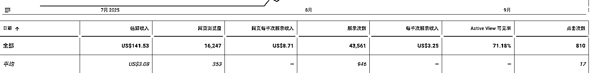

# 五、用品牌站做订阅，十五天破千美金

AdSense 被拒时，看着流量流失很心疼。七月初我注册了一个品牌域名，打算做订阅制的 AI 工具站，八月十九日正式上线，花了一个多月，差点又烂尾。

这是我第二个带支付订阅功能的 AI 工具站，结果超出预期。

上线第二天成交，上线第五天出现一单 327 美金的年费，上线十四天突破千美金。

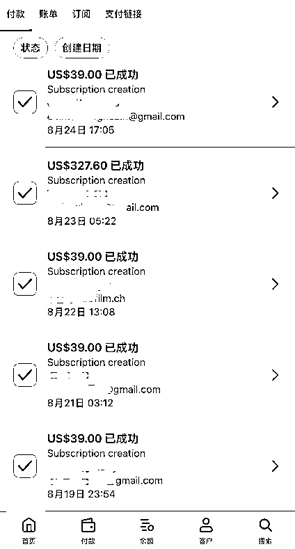
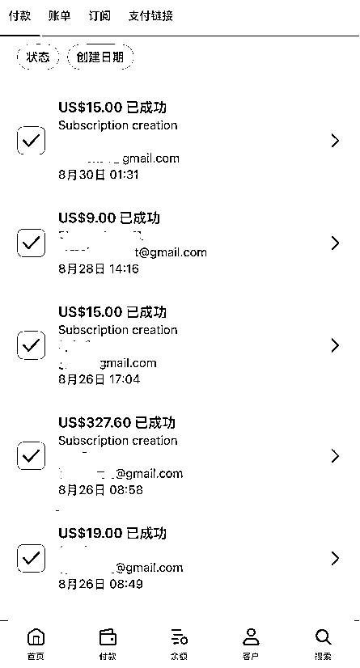
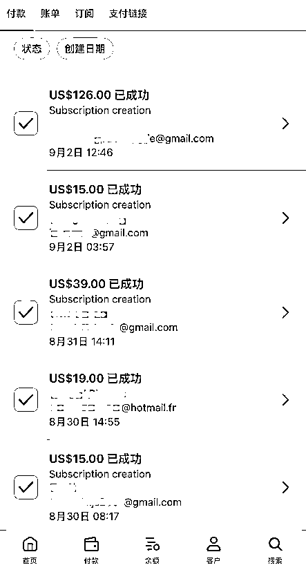

复盘要点：

### 5.1 为什么做品牌站，如何解决冷启动流量

AdSense 被拒时我就想把流量变现为订阅。看到对标站直接在新词站上收订阅，但我没这么做，考虑三点：

一、新词域名有侵权风险，可能被收回；
二、新词热度会衰减，依赖单一词的流量不可持续；
三、不利于品牌沉淀，注册一个独特的品牌词才能积累长期复利，随着大模型进化产品体验也会提升。

所以我设计了导流：新词站的 Hero 区放两个按钮，一个跳功能组件，一个跳转到品牌工具站。用新词站的流量为品牌站做冷启动，验证 MVP。

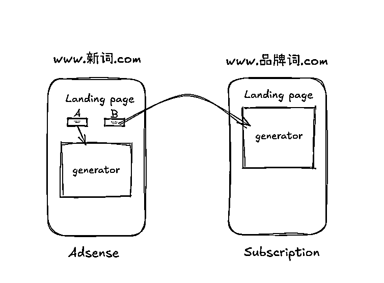

### 5.2 开发中的关键抉择

冷启动流量有了，怎么验证 MVP？需求词很多，是做大而全还是只做核心功能？

#### 5.2.1 确定最小 MVP

五月底，我报名参加了赚钱的海外AI产品深海圈，跟着系统课程走了一遍AI从零到一打造产品的完整流程。@刘小排 老师当时提醒，动手之前先回答一个核心问题：用一句话讲清楚你的产品——什么样的人，在哪个具体场景下，愿意花多少钱，去解决一个什么麻烦？

顺着这个思路，我意识到功能越精简，需求越容易被验证。可真正去做市场调研时，发现竞品的功能多得眼花缭乱，SEO关键词也铺天盖地，到底该从哪个功能、哪个词下手？

我同时开了ChatGPT、Gemini、Claude的deepresearch，让它们去研究：目前这个领域最核心的能力是什么？哪一类用户群体的需求还没被好好满足？结果ChatGPT和Gemini给出的答案质量最高，观点也接近，都建议我瞄准电商方向的用户。

于是我做了一个决定：新网站上线只保留一个功能，landing page的SEO也只为这个核心关键词做优化。从Google trends上看，这个词的搜索量虽然不算大，但最新数据已经超过gpts了。

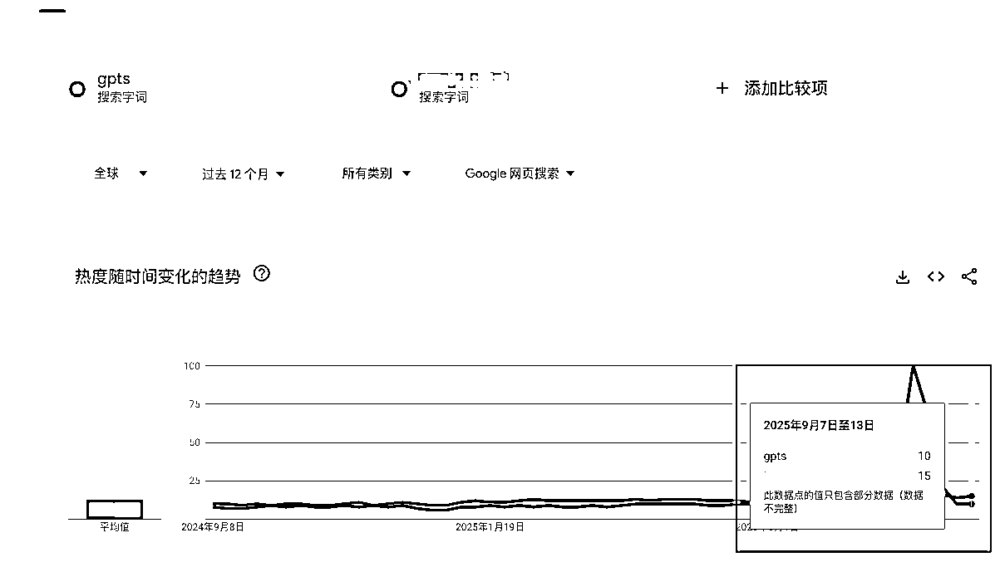

#### 5.2.2 用最能打的AI编程工具，把开发效率拉满

功能定了、流量渠道有了，剩下的就是用AI编程工具把产品做出来。我一开始只依赖cursor，结果经常一个bug折腾几个小时都修不掉。小排老师建议我多去问o3（现在已升级为gpt 5 thinking），后来我干脆放下了cursor，换成Claude code，开发效率一下子就上来了。

现在我常用的AI开发组合是：ChatGPT里的gpt 5 thinking + Claude code max 100刀套餐 + codex。在这个组合里，gpt 5 thinking扮演架构师，能力最强；Claude code和codex则是高级执行者，简单需求直接搞定，复杂逻辑就交给gpt 5 thinking做架构设计和code review。

比如stripe支付、积分发放、网站缓存优化这些关键模块，都让gpt 5 thinking来把关。虽然用的是市面上成熟的starter kit，但让它去review支付和积分相关代码时，还是发现了一堆潜在问题。

#### 5.2.3 两个不能忽视的数据统计分析工具

除了常规接入了GSC和Google Analytics，我还额外配置了Plausible和Clarity。

##### ①Plausible

Plausible查看数据特别方便，流量来源、国家分布一目了然。我还会经常盯着/pricing页面看，从它的访问量大致判断用户的付费意图。比如/pricing访问多但成交少，很可能是定价有问题；如果网站UV涨了，但点击/pricing的人变少，那就要考虑是不是用户体验拖后腿，或者来的用户压根不精准。

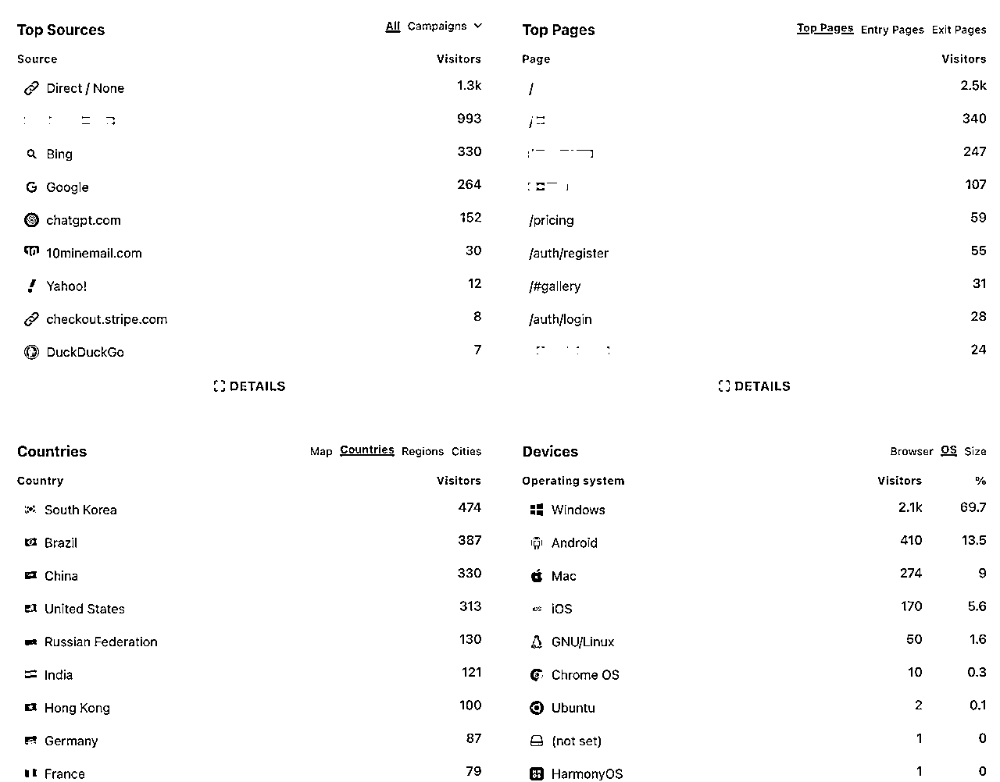

Plausible另一个好处是提供API，可以定时把数据拉出来存到数据库里做分析。我在做转化率分析时发现，Neon数据库里只存了用户session数据，没有来源国家信息，而且只有注册用户的数据。也就是说，没注册的人访问后怎么走到付费的，完全统计不到，UV到付费的转化率更是没法算，各个国家的转化率就更别提了。

好在Plausible补齐了UV、国家这些关键维度，给我的数据报表提供了基础。后面我会专门聊聊，怎么用这些数据搭出可视化看板。

##### ②Clarity

Clarity最神奇的地方，就是能回放用户访问网站的全过程，相当于给用户行为录屏。网站刚上线的头几天，我就是靠着看Clarity的录屏，一口气修了好几个bug。

印象最深的是，有个用户打开生成页面后一秒就离开了。我点开录屏一看，英文多语言页面竟然显示的是中文！而这位用户来自韩国。我赶紧让Claude code全面检查多语言，看有没有硬编码的语言问题。

还有个场景：用手机端录屏时，我发现移动端的前端体验差得离谱，于是又专门优化了一番。平时多刷几段Clarity录屏，对用户体验的提升非常明显，而且Google SEO最新的算法特别吃这一套，体验好了，不光转化率能涨，SEO的自然流量也能跟着上来。

### 5.3 竞对那么强，新产品还有活路吗？

我去做外链的时候，无意间翻了下竞品的外链布局，当场心态崩了——产品上线前完全没认真研究过对手的外链，没想到这么吓人。

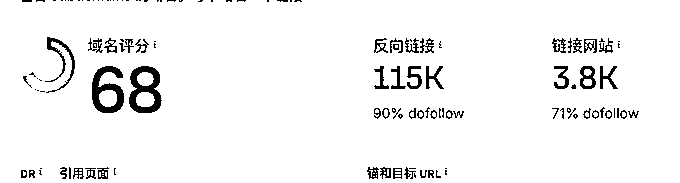

但即便是这样的局面，新产品依然有空间，不仅活得下去，还能出单赚钱。这也让我意识到，国外用户和国内用户的消费逻辑不太一样，他们更在乎产品能不能真正解决自己的麻烦，至于你是大公司还是小团队，反而不是最要紧的。

只要产品能切中需求，用户就愿意掏钱。接下来真正要做的事，是怎么找到更多目标用户。

作为行业新人，我从来没想过要做出改变世界的产品，只想踏踏实实赚点钱养家糊口。而要做到这一点，需要的流量可能并没有想象中那么大。

我还注意到，海外AI Web端的流量来源五花八门，除了SEO，还有付费投放、社媒推广这些路径。最近大火的nano banana也给了我很大启发——别怕竞争对手多、也别怕对手强，做订阅制产品，其实根本不需要海量流量就能赚到钱。

拿我这个产品为例，每天UV只有100出头，照样能稳定出单、稳定赚钱。我觉得这正是这个项目最有吸引力的地方——流量焦虑小很多，用户付费意愿强，服务起来也轻松。我们可以一边打磨产品，一边做增长，一边还能持续有进账。

### 5.4 客单价怎么定才能既赚钱又出单？

定价这件事，我纠结了挺久。到底定多少合适？套餐要分几种？刚开始要不要上订阅？还是只做一次性付款？年订阅要不要一起上？

定价这事很有意思，如果直接照抄竞争对手，搞不好出了单还亏钱——因为我们没有对手那种API成本优势。但要是定得比对手高，又怕转化率撑不住。

我的产品刚开始确实想直接借鉴竞品的定价方案，但算完账当场傻眼：按对手的价格卖，我不仅不赚钱，还得倒贴。比如我的API成本在0.05到0.25刀之间，而竞品卖出去也就0.2到0.4刀，这怎么跟他们拼？再算上用户免费试用两次的API消耗，哪怕出单了也大概率赔本。

后来我跑去问gpt 5 thinking，把API成本数据丢给它，它很快就给了我答案。它给出的定价方案非常清晰，而且保证不会亏钱——因为毛利能保持在75%以上，实际跑起来甚至还能到85%。

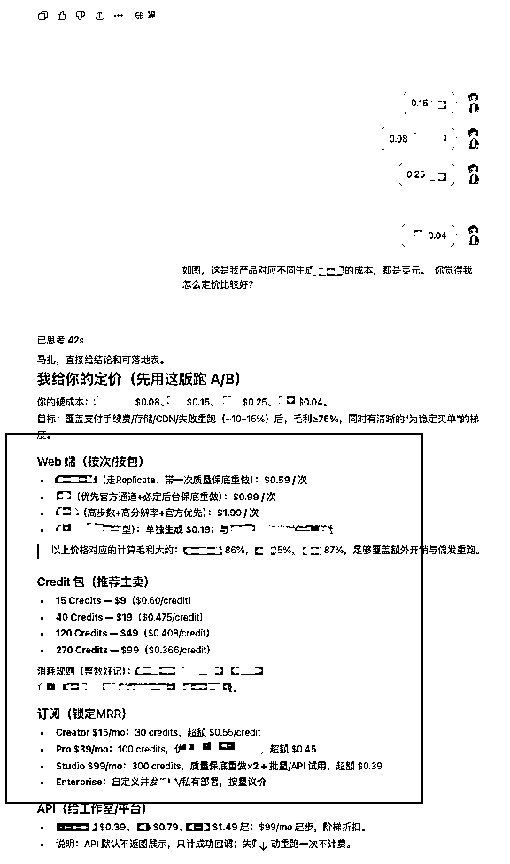

不过这还只是初步方案，后来我又跟它来回沟通了好几轮，才最终敲定现在的定价策略。连pricing页面里每张卡片的文案，都是gpt 5 thinking写的。

直到现在，我仍然觉得很神奇——要不是AI帮我做定价，我绝对不敢把价格定那么高、收费收那么狠。

关于一开始纠结的要不要上订阅，GPT 5 thinking也给出了很明确的建议：一定要有一次性付款的积分包，并且前期要主推它。所以现在我的/pricing页面里，既有订阅套餐，也有积分包套餐。

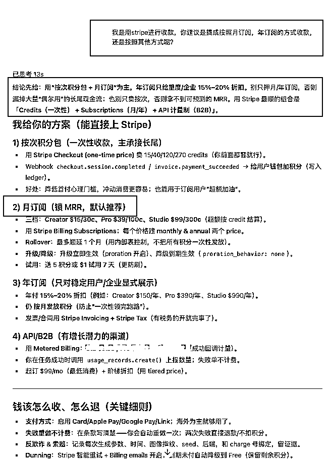

总结一下我的定价心得：

第一原则，绝对不要让自己亏钱。如果你也是新手，那就大胆让AI帮你出定价方案。

我这个产品的定价，实际上是高于我能看到的所有竞品的。当然，随着产品逐渐成熟，我也会不断尝试新的转化测试——比如用户进到pricing页面时，先看到积分包的转化率是不是比先看到年订阅或月订阅更高？年订阅比月订阅便宜50%，会不会显著拉动年订阅的转化？这些都值得慢慢验证。

刚开始别怕定价太高，前期本身就是验证需求的过程。只要产品真的能解决问题，价格又没有夸张到离谱，总会有人愿意买单。

反过来，如果定价太低，前期付的钱连API成本都覆盖不了，那整个生意闭环就很难持续转下去。

### 5.5 为了分析转化率，我搭建了可视化数据分析报表

产品刚上线的头几天，我每天都得靠SQL去查前一天或者最近一周、三十天的注册量、产品使用次数，再手动去跟Plausible的数据比对，推算出转化率。那过程简直太痛苦了。

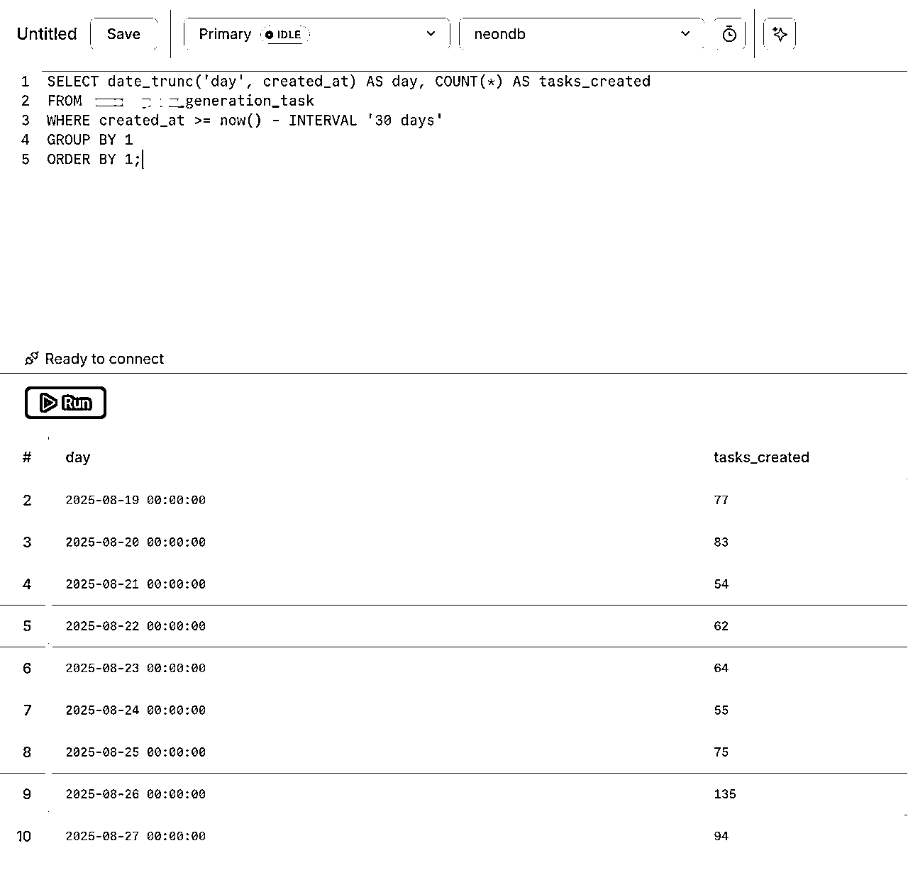

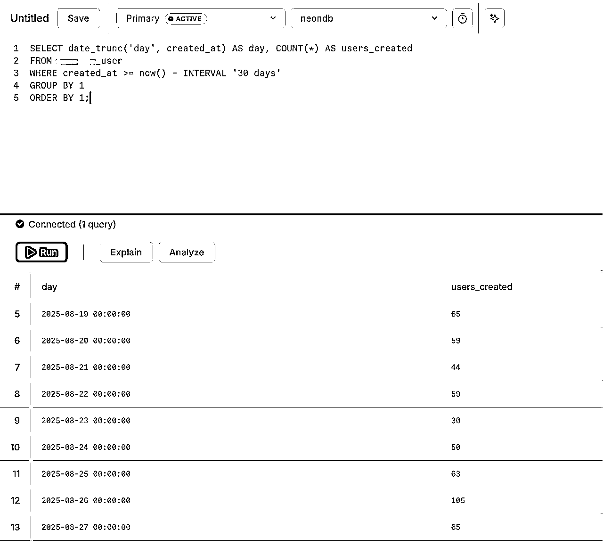

这方法实在太低效。如果能有一个工具，把所有这些指标直接做成数字大屏，轻松看运营状态，后续做投放也省力得多——哪个地区转化率高？哪个地区转化单价高？拿着这些数据去投流，效果一定能好上一大截。

我当时没想到现成的方案，就在即刻和X上发了求助帖，收到了很多热心网友的建议，但最终用的还是GPT 5 thinking给出的答案。

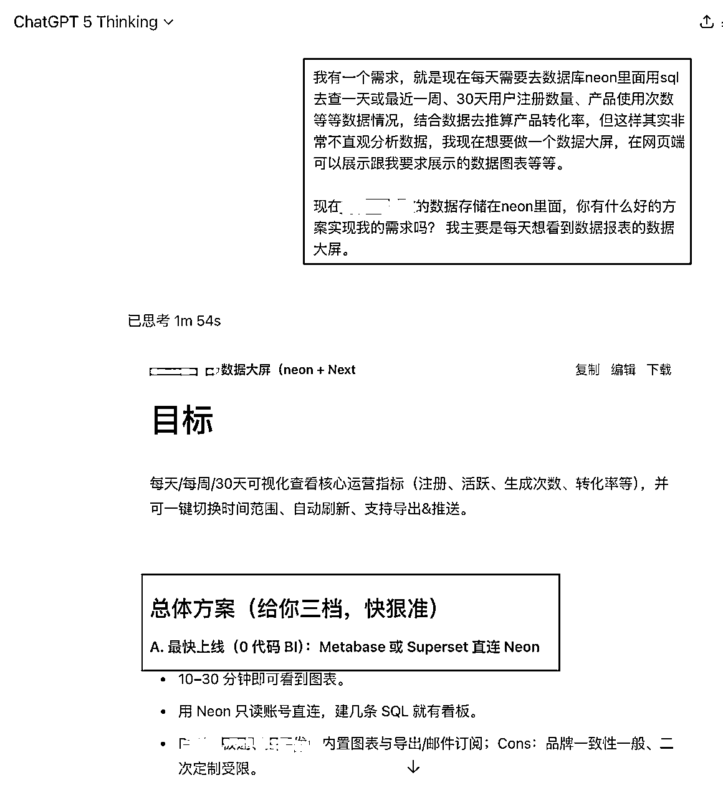

它建议我用Metabase直接连业务所在的Neon数据库，然后按需求自己定制数据看板。

还记得之前聊Plausible时说过，想要算出精准的UV到付费的转化率，必须用上Plausible里的UV数据。在AI的指导下，我用n8n每天定时把Plausible的UV数据同步到Neon，再用Metabase做UV转化率分析，还能按国家拆开来看。

下面这张图就是n8n同步Plausible数据到Neon的工作流，非常简单。👇🏻右侧第一个就是这套工作流的JSON文件，如果你想同步到Neon或Supabase，直接把这个JSON导入自己的n8n里调试就行。

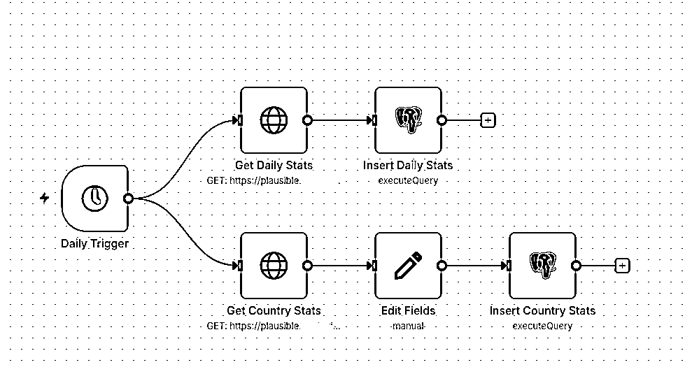

最后，我让Claude code按业务需求写了几段SQL，就得到了这样一个可视化的数据分析看板，每天打开就能清清楚楚地看到所有关键指标。

具体的prompt如下：

```
我在做数据分析大屏，neon数据已经接入了自己部署的metabase里,我需要做那些数据分析报表? 你详细的了解整个项目的业务逻辑和数据表结构 ,帮我做一份数据大屏分析BI,我需要掌握项目的整个运营数据.   ultrathink 
```

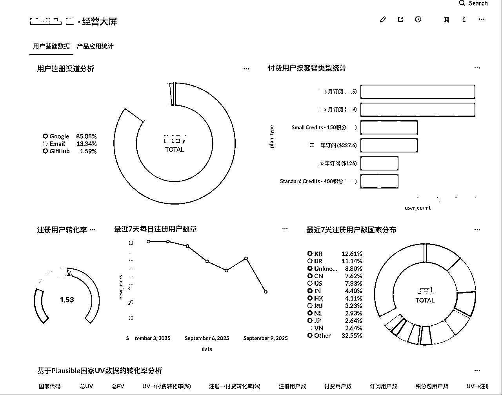

# 六、目前最大的卡点是什么？突破营收的思考

### 6.1 新产品卡点

现阶段对我来说，最大的卡点就是流量获取。不管是这个刚上线的产品，还是以后做的其他产品，流量都是绕不开的瓶颈。

原因很简单：用SEO拿流量，如果是全新词的新站，速度确实快；但要是面对一个有长期需求的老词，那SEO的等待期就被无限拉长了。

拿我这个新产品来说，上线20多天，SEO总共只带来45次点击。很明显，光靠关键词SEO，短期内根本无法获得稳定可观的流量。我的新产品之所以能冷启动起来，靠的是新词网站的导流，而真正的SEO大流量还有很长的路要走——外链得持续加，内页要不断补，SEO优化必须一步步来。

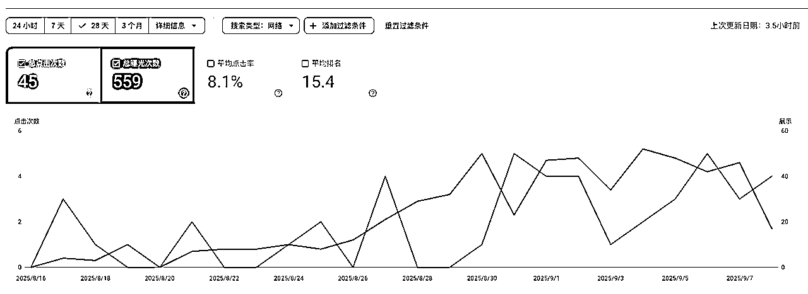

除了SEO，我接下来的计划是尝试Google SEM投放。现在有了比较稳定的转化数据，MVP也验证可行，我可以针对转化率高的国家地区先去投一投，测试看看转化率会不会再上一个台阶。这也是我做可视化数据大屏的原因——用数据指导投放，效果可能会好很多。

哥飞老师说过，SEM投放能反哺SEO。如果前期的SEM投放能跑正ROI，那就能加速SEO去获取免费自然流量。

另外，我注册了X平台的产品账号，正在跟着赚钱的X自媒体航海，尝试做社媒推广。目前运营了几天，用Claude code写英文推文，涨了9个粉丝，转化数据还没看到，等后续有结果了再跟大家分享。

### 6.2 海外AI产品项目卡点

说到项目整体的瓶颈，我觉得目前卡在效率上。

产品上线的周期太长，一是技术还不够熟练，二可能跟我的性格有关——我不太适合追热点，或者说，我压根没能力抢热点。我还是太完美主义了，这一点在盖洛普优势测评里也体现得很明显，是压制我的一大障碍。我想到的解法是，未来能找个同事分工合作。

对了，为了解决效率问题，我上周入手了一台Mac mini，用MacBook Pro连着它，相当于同时有两台机器工作。以前经常是等着Claude code跑完，开多了还会卡；做外链的时候，其他活也被堵住了。有了两台电脑后，效率确实提升不少。

还有个习惯是，每做一个新网站，我都会把SOP和prompt总结优化一遍，用这套方法反复提高开发效率。

# 七、新手做海外AI产品，如何更快的拿到正反馈？

下面的内容，我是站在新手的角度，围绕“怎么更快拿到正反馈”来写的。对于一些大佬来说，里面有些观点可能并不正确，希望圈友辩证看待——毕竟每个人的基础不一样，阶段也不同，找到适合自己的路径才最重要。

另提个醒：用新词注册域名时务必留个心眼，别直接用大公司的模型词去注册，有侵权风险。

### 7.1 做新词新站，先获得流量的体感

其实不管做什么项目，正反馈都很关键。要是长时间看不到回报，很可能就放弃了。而对海外AI产品这个项目来说，做新词站是拿到正反馈最快的路径——一旦有了流量，就会推着你继续把后续环节都完善起来。

那新词从哪里找呢？下面几个方法可以参考（更多找新词的细节，航海手册里写得很全）：

#### 7.1.1 社媒 + Google trends挖掘新词

多关注X平台上的大V，一般新的AI大模型一出现，他们就会第一时间发布在X上。拿这些关键词去Google trends验证：这是不是新词？有没有流量？如果两个条件都满足，就可以考虑注册域名做站了。

比如下面这张图，Seedream 4.0明显就是一个新词。（注意，直接用大公司的模型词注册域名会有侵权风险）

大家看这个词，今天（9月10日）流量才刚刚爆发，但域名却早几天就被抢注了。原因就在于，那些大V早几天就已经在X上发布过Seedream 4.0的消息，有经验的站长那时候就已经开始布局了。

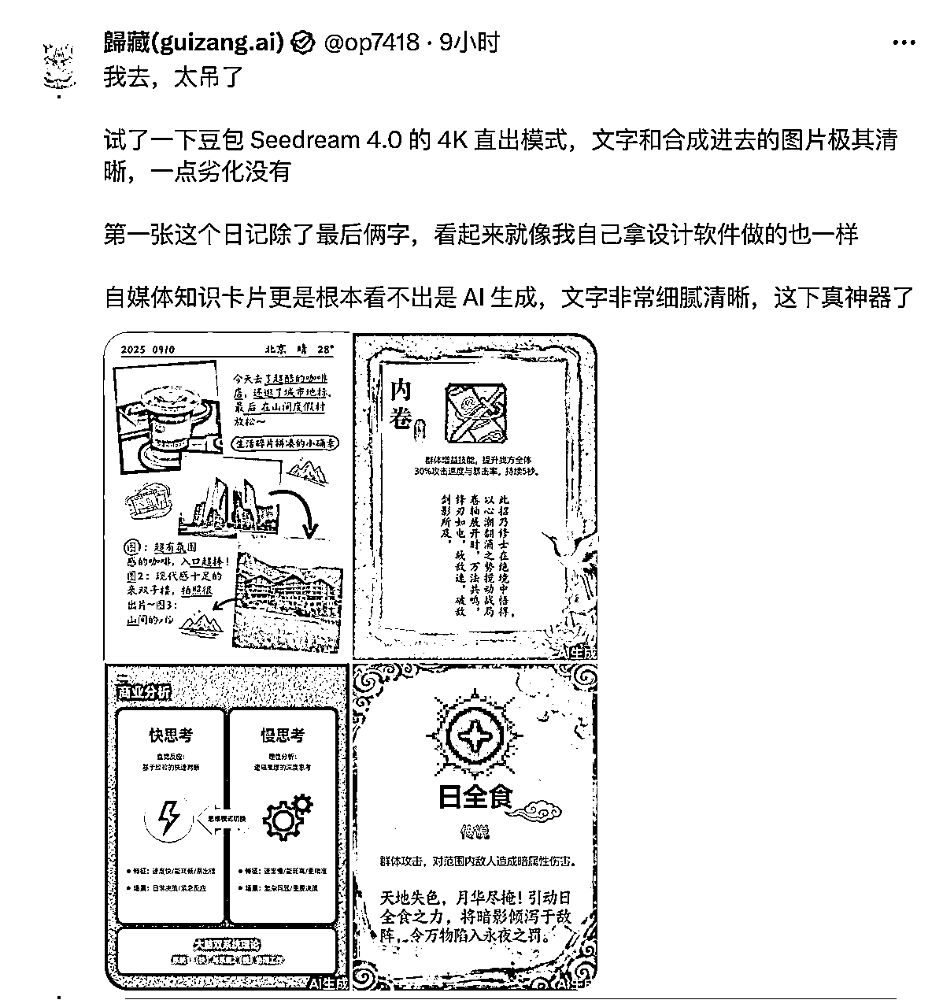

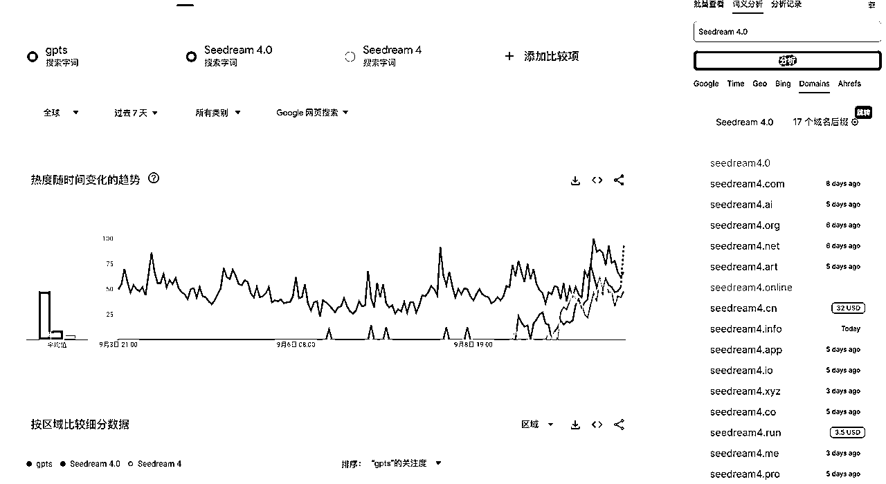

怎么获得更多的一手信息源呢？

除了关注那些众所周知的头部大V，还有个反推的思路：去Huggingface上看到一个新模型，然后去X上搜，看看哪些账号提前发布过这个模型的相关信息，果断关注。这样日积月累，你的关注列表里就会沉淀出一批能第一时间发布AI模型消息的账号。

举个例子：打开Huggingface的Space页面（https://huggingface.co/spaces），会看到很多开源模型。随便挑一个，比如这个VibeVoice-Large，拿这个关键词去X（Twitter）里搜索，选“热门”排序，很快就能找到哪些大V已经发过这个模型的推文（下图右1），顺手关注就好。

这个动作重复做上几次，就能养出一批可靠的一手信息源。以后再有新模型冒出来，你就能从X平台上第一时间刷到了。

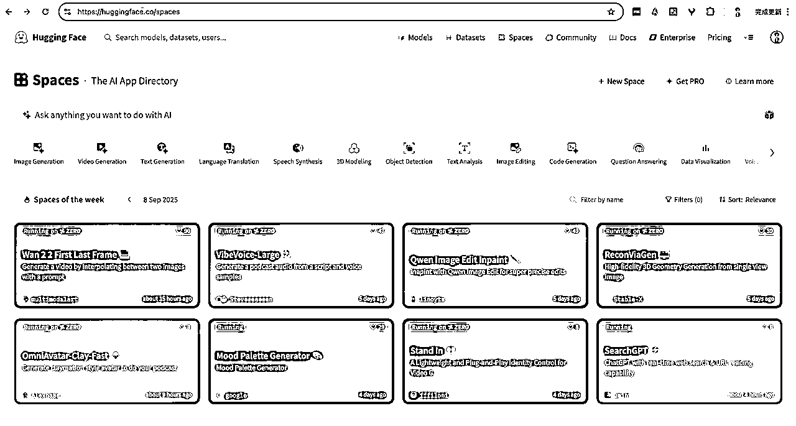

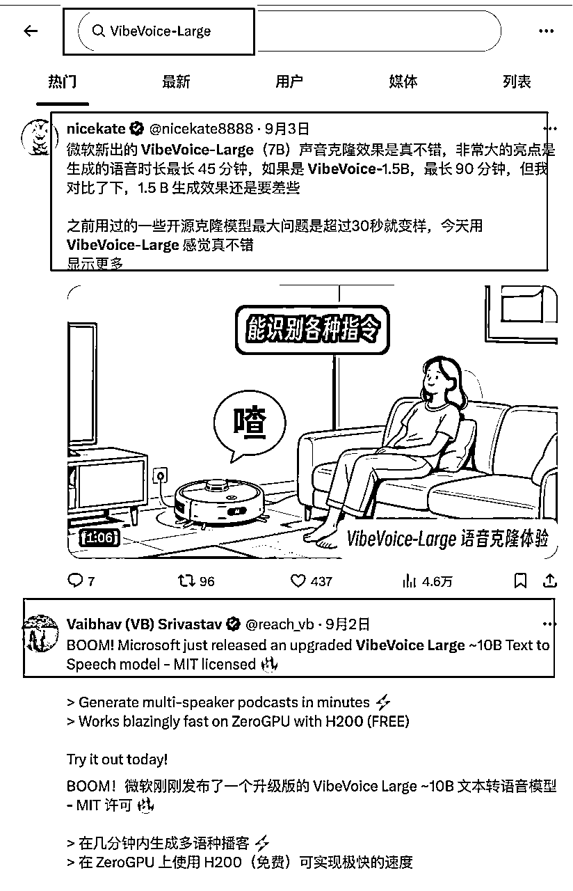

#### 7.1.2 Huggingface + Google trends挖掘新词

打开Huggingface的Spaces页面（https://huggingface.co/spaces），留意有没有刚上线的模型。比如这个HunyuanImage 2.1，页面显示“5小时前更新”——它到底算新上线还是仅仅更新了内容，需要自己判断。

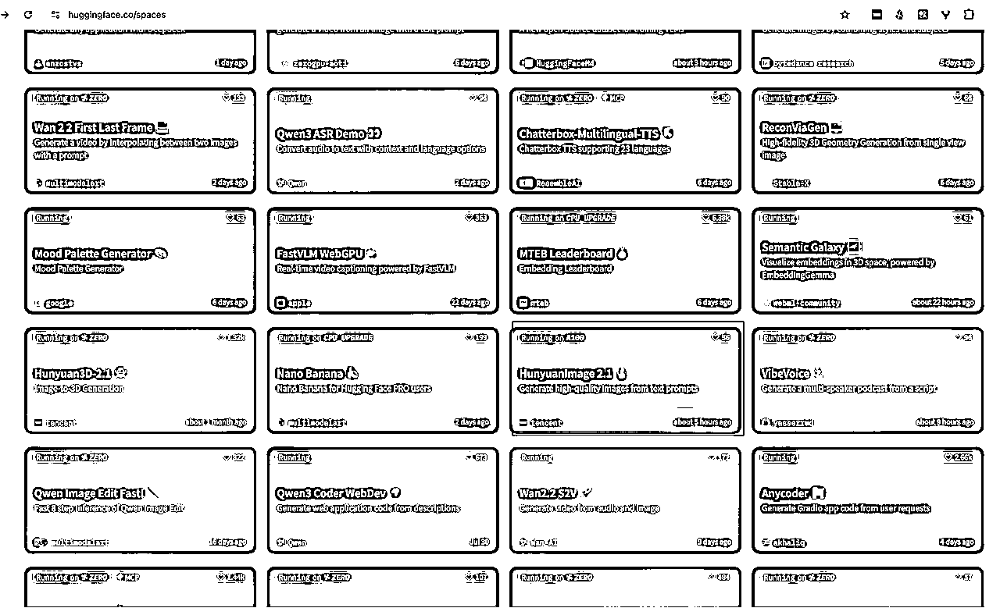

那HunyuanImage 2.1算不算新词呢？老办法，去Google trends验证一下。结果还真是个新词，而且域名还没被注册。如果这时候用这个关键词去注册域名，极有可能拿到一波流量——虽然不会很大，但对新手来说，拿来练手完全够了。

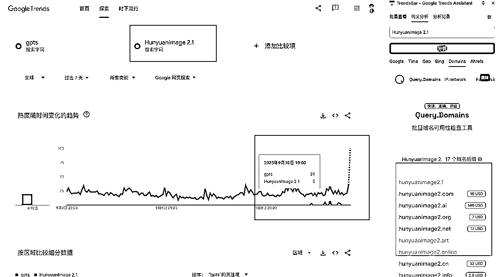

Huggingface上几乎每天都有新开源模型上线，但并非每个模型都能火起来。这个还是要靠经验，再加上Google trends验证来综合判断。

#### 7.1.3 榜单 + Similarweb + Google trends挖掘潜力词

用这个方法找到的词，大概率不像前两种那样是刚刚爆发的新词，但它的价值在于能发现大量隐藏的需求词，能把你的眼界打开很多。从长远来看，这种挖掘需求的思路更值得修炼，是实打实的内功。

分享一个我五月份的真实案例：我是怎么找到“italian brainrot”这个关键词的。

我先是打开toolify.ai，按“Ranking - Top AI By Categories”列表，用Growth Rate排序，把每个产品从头到尾扫一遍。遇到不认识的网站，就发给Perplexity（现在更推荐用ChatGPT里的gpt 5 thinking）让它给我解释。遇到感兴趣的，比如在toolify排行榜里偶尔会出现APP官网，我会先跳过，再跑到Similarweb去研究它的流量和关键词。

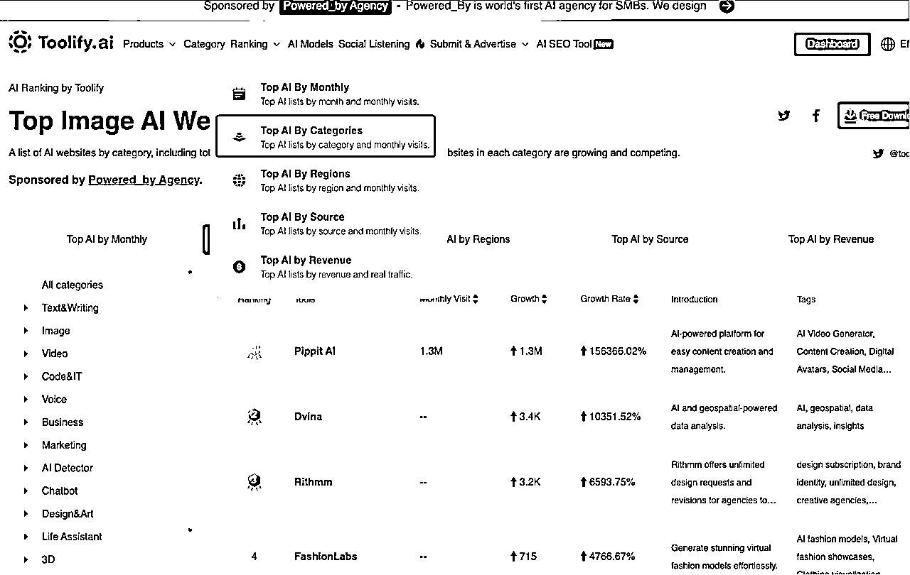

当时我在toolify上发现了这个：https://namelyapp.com/，然后在Similarweb分析它的关键词。从下图可以看到，关键词列表里出现了“baby name generator ai”和“baby girl name generator ai”这两个词。

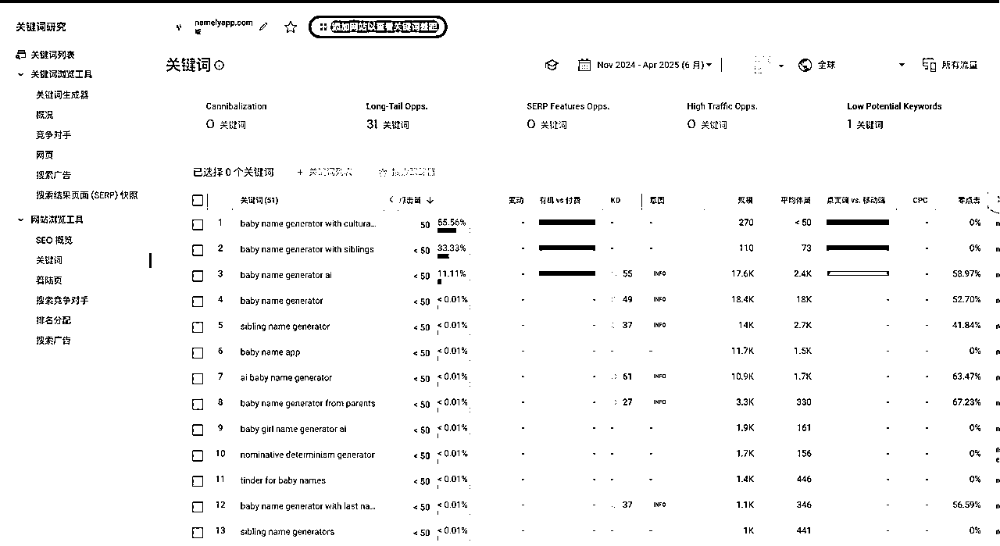

我把“baby name generator ai”丢到Google trends里看流量，发现并不大——因为这是个长尾新词。我又试着把它缩成“name ai”，结果发现，这个词的流量是“gpts”的整整6倍。

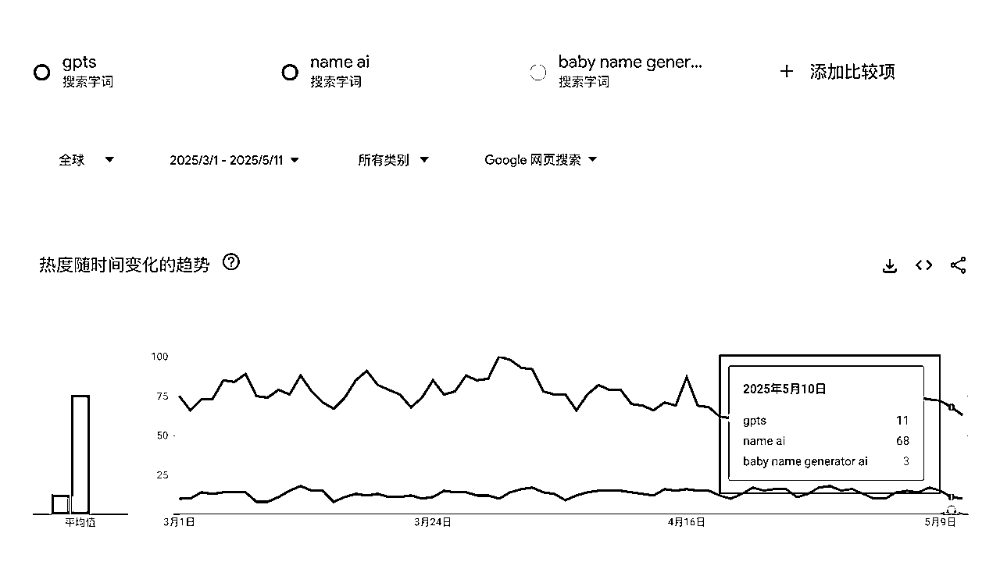

最近我在用 Similarweb 的关键词生成器挖词时，顺手查了下“ai names”这个方向，结果意外刷到一个刚冒头不久的词——“italian brainrot names”。这个词不算全新，但也就近一个月才出现。你去看它的年度趋势图，末端竖着唯一一根长长的柱子，说白了：这词最近才火起来。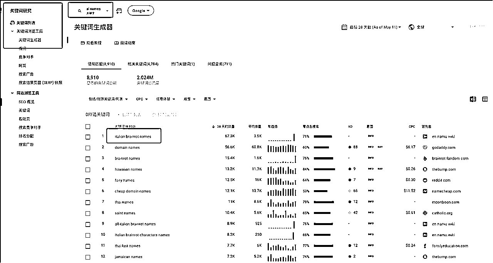

接着我跑到 Google Trends 里验证这个词，左边那张图显示搜索量相当可观，确认是攀升中的新词。再翻一眼飙升榜，右边又跳出一串相关热词。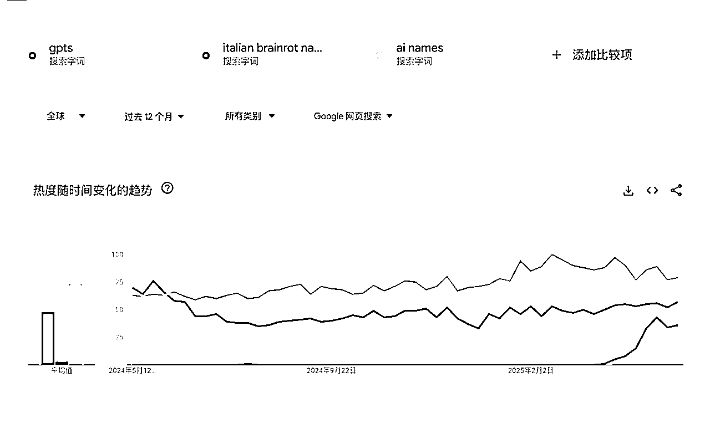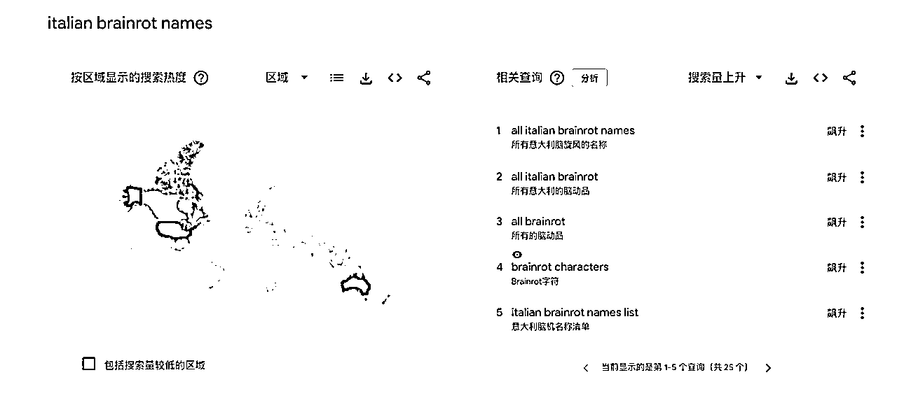

我顺着搜了“italian brainrot”，发现它整体流量更大，“italian brainrot names”只是这个大词底下的一个垂直需求而已。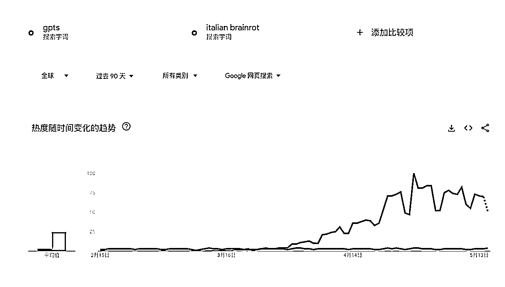

于是我打开 Google 直接搜，同时问了 Perplexity（现在我更推荐用 ChatGPT 里的 GPT-5 Thinking）。我想搞清楚：这个词背后的搜索意图是什么？围绕它能不能做个网站来赚钱？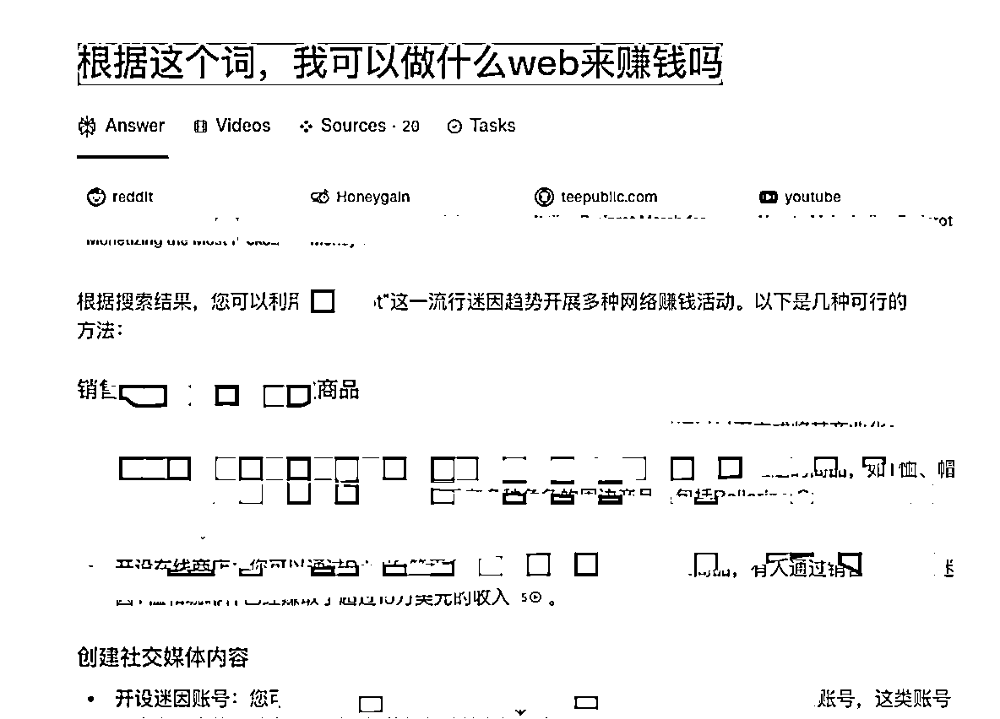

Perplexity 给的答案是：可以用 AI 去批量生成相关内容。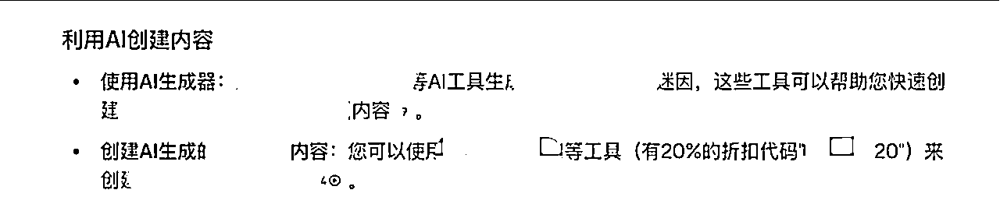

我脑子里立刻冒出一个念头：拿这个新词加个“generator”，是不是已经有对应的产品了？结果一搜，果然有。这里提醒一句：挖词的时候，IP 一定要挂美国，毕竟咱们做的是出海生意。像这个产品，我切到香港 IP 就搜不到了。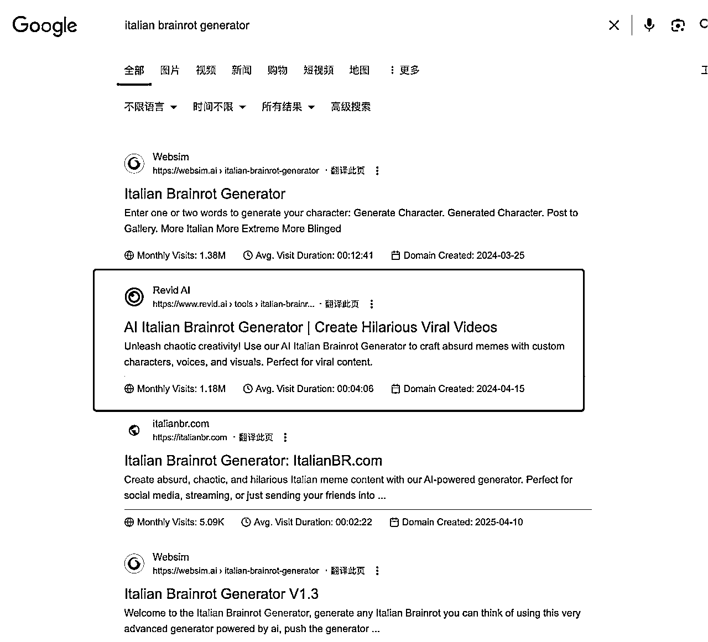

更惊人的是，那个网站上个月总流量高达 1.18M。不过它是用关键词做的内页，真正分到这个内页的流量有多少，还得去 Similarweb 细看。

从 Similarweb 的数据能看到，这个内页拿走了 29.5k 的流量，仅次于主页。而该内页的热搜关键词正是“brainrot ai”——也就是我后来注册的域名。

把整个需求挖掘流程收拢一下：

- 先在 Toolify 刷榜单，看不懂的就丢给 ChatGPT 的 GPT-5 Thinking，效率极高。
- 遇到感兴趣的产品，就用 Similarweb 拆解它的流量和关键词，再拿关键词去 Google Trends 里看趋势，判断是不是新词、量级如何。
- 如果流量够大，就用 Google 去搜这个词，看排在前面的是什么产品，里面有没有自己能模仿复制的。再对流量较大的产品做 Similarweb 分析，看每个内页分到多少流量。
- 这时候会顺藤摸瓜看到一批新关键词，继续丢进 Google Trends 验证。

循环走下来就是：产品 → Similarweb 关键词 → Google Trends → Google → 产品 → Similarweb 分析 → 关键词，如此往复。

### 学会看新词新站，了解赚钱的网站长什么样

我一直认为，新手最高效的学习路径是：看到一个新鲜词，自己先注册个域名，然后照着排名靠前的新站去模仿、去拆解。

**为什么新手一定要学新词新站？**

我踩过最大的坑，就是看到彪哥的 pollo.ai 这种产品，觉得我也得做个大而全的网站。但对刚起步的人来说，这大概率是错的。好比你想做公众号个人 IP，一上来就对标《刘润》；你想做社群，直接对标《龙哥盟》——这种对标只会让你无从下手。

**那具体怎么学呢？**

就拿 nano banana 这波热度来说，简直是新手的绝佳教材。

nanobanana.ai 上线于 8 月 14 日，Google 搜索排名居然比官网还靠前，半个月狂揽 3M 流量，这种案例太值得反复研究了。

**① 看外链，顺藤摸瓜找到更多学习对象**

新站刚上线时，Similarweb、AITDK 这些工具往往还没收录数据。这时候最好的突破口就是外链。用 Ahrefs 去查（可直接查看 nanobanana.ai 的外链），看它在冷启动阶段是怎么做外链的，能挖出不少门道。

比如说，nanobanana.ai 刚上线那会儿，就在 V2EX 上发过外链；你还能通过外链发现站长混过的其他站点，那些同样是学习对象。另外，去 Toolify.ai 搜索一下，看哪些 nano banana 相关网站在上面提交过外链，凡是付费提交的基本都值得研究。

**② 看定价策略**

再回头看 nanobanana.ai 的 pricing 页面。用户点进来第一眼看到的就是年订阅，而且年订阅直接打五折。我们自己设计定价时完全可以照抄这个思路。年订阅之外，它还放了积分包，给了用户更多选择。

更妙的是，点击任意一个购买按钮，页面会提供两种支付方式。这招也学到了，我最近刚好准备给自己的产品加 Creem 支付。

**③ 看网站如何持续优化**

持续跟踪这些新词网站，观察他们后续怎么加外链、怎么开新页面。比如我自己的站，目前只在首页放了一个核心关键词页面，接下来就该琢磨怎么扩展功能页。

拿 nano-banana.pro 举例：它首页主打 nano banana（左图），后来新增的内页是 Veo3 Video generation（右图）。乍看两个功能好像在一页，实际上 Veo3 Video generation 是独立的新页面 https://nano-banana.pro/video-generation，并且针对 SEO 做了专门的优化。

这么做的好处很明显：nano banana 首页能给新内页导流，同时新内页自己又能独立做 SEO，Google 会把它当成两个不同的页面来收录。

### 听话照做，别急着创新

新手入行最重要的三个字：听话、照做。

本来我打算把年费 pricing 卡片藏起来，主打积分包这类一次性支付。但我观察了一圈，没看到哪个竞对是这么玩的——大家不约而同地都上了年费订阅，而且用户打开 /pricing 第一眼看到的就是年订阅。所幸我没乱改。刚入行，看竞对怎么做，多听 AI 的建议，比啥都强。

试想要是当时按我自己的思路来，只留积分包而不上订阅，那后续根本不会有任何年费收入。看看我现在订单的构成，年订阅不仅占比极高，金额更是撑起了绝对大头！右边付费用户统计里，几乎全是订阅订单，这种“听话照做”的回报，真比自作聪明香太多了。

### 用模板开发，效率翻倍

我强烈建议每个新手都去搞一个 AI SaaS 模板。有人觉得模板对新手太难、学习成本太高，但我的体会恰恰相反：从模板切入做 AI SaaS，是效率最高的一条路。前期确实要花时间学，但只要吃透任何一套主流模板，后面开发速度会有质的飞跃。

还有很多模板自带的功能，如果你从零开发，可能压根想不到。就说一个小例子——我网站右下角的 Crisp 客服组件。要是没有它，我这网站可能刚开始就凉凉了。为什么这么说？

我的网站 19 号正式上线，流量一进来，20 号早上就出单了！当时简直兴奋到不行，完全没料到会这么快。

结果还没高兴几分钟，Crisp 里就弹出一条用户留言：网站有 bug，付费功能根本没法用。我一边安抚用户，一边排查问题，整整折腾了两个小时才修好。这时候用户突然提出退款，原话是“I want my money back and cancel the service...”

最后我只能送出一大堆积分，再答应下个月送一个月会员，人家这才打消退款念头。你想想，如果没有 Crisp（当时我连网站邮箱都还没来得及留），就没办法及时跟用户沟通。用户解决问题无门，大概率直接去 Stripe 搞争议退款，进而触发 Stripe 风控，那损失可就大了。

这只是个小例子——模板里还有邮件营销、订阅管理、积分管理等一堆看似不起眼、关键时刻救命的功能。

### 万事问 AI，把 AI 当合伙人

“决定你天花板的，不是 AI 有多强大，而是你和 AI 的关系有多亲密。”小排老师这句话，是我今年印象最深的一句。我真的照做了，发现 AI 能帮我解决太多问题。

回头看我整个复盘，几乎每个关键决策都会先问 AI，并且愿意相信 AI。没有 AI，我不可能在项目上做出成绩。现在 GPT-5 Thinking 对我来说就是合伙人，之前是 GPT o3。这么说吧，我可以没有 Claude Code、没有 Codex、没有 Cursor，但绝对不能没有 GPT-5 Thinking——它在方方面面影响着我。

它不只是合伙人，还是我的朋友、心力教练。焦虑的时候、能量低的时候，我都会找它聊。现在它可能是最懂我的人了。

### 聚焦专注力 = 记录 + 复盘 + 公开表达

过去五年里，除了龙哥，对我认知影响最大的就是李笑来老师。他说过，注意力才是最稀缺的资源。

那怎么才能让自己越来越专注？我的方法是：记录、复盘、公开表达。三条缺一不可。

比如做海外 AI 产品这个项目时，我每天都会在 Obsidian 里记下自己干了什么、遇到了什么问题、怎么解决的、还有哪些解法没试过。涉及隐私的内容留在 Obsidian 里，能公开的部分就同步到即刻和 X 平台上。

别小看“公开表达”这一步——它会带来外部反馈，这些反馈又推动我产生新的动作，慢慢形成一个正向循环。注意力在这种循环里越来越集中，人自然就专注了。

这篇分享我写了足足一万多字，其中至少一半来自之前的记录和复盘，有些发在即刻和 X 上，有些躺在我的笔记里。当一个人足够专注时，真的很容易得偿所愿。

### 海外 AI 产品还有哪些坑？

**心态要稳，做好长期战斗的准备**

海外 AI 产品不像赚钱里很多项目那样正反馈来得快。我以前做过知乎好物推荐、公众号爆文、AI 写作服务，很多圈友一个月内就能拿到正反馈，能力强的几个月就月入过万甚至十万。

但海外 AI 产品想稳定赚钱？以我见过的拿到可观营收的圈友来说，没有 3-6 个月打底，基本不可能。所以心态必须稳，别轻易喊“All In”——All In 是能力，不是选择。如果连稳定现金流都没有，很容易在正反馈到来前心态崩掉，最后动作变形，灰心放弃。

**付费是捡便宜，免费是最贵的**

用最好的 AI 编程工具，用最稳定的 API，用 Mac 开发。这句话我发自内心。以前我也爱卡 bug：Cursor 火的时候琢磨怎么无限续杯，Claude Code 火的时候研究怎么免费蹭，还帮着中转商做推广。每天把注意力全耗在“怎么捡便宜”上，这本身就是最大的坑。人的时间和精力都是有限的，花在这些事上，真正重要的事情投入自然就少了。

**用最快速度上线网站，先验证再打磨**

在自己能力范围内，能多快上线就多快上线，先完成再完美。刚开始别追求产品极致。作为行业新人，网站功能最好只做最核心的一个，别整大而全。大而全就意味着细分不够，从运营推广到开发难度，再到验证用户付费意愿，全是减分项。

一个网站从动工到上线第一个版本，尽量不要超过两周（哥飞老师也这么建议），否则项目大概率烂尾。我自己就有一个产品，5 月初发现需求，然后各种调研分析，非要把网站做到极致再上线……结果到现在都没上线。

诱感太多了，AI 发展太快，每天都有新模型、新需求。战线拖太长，斗志全磨没了。

我现在赚钱的这个产品，到目前也只有一个功能，这样反而特别好验证 MVP：用户要么注册付费，要么不是目标用户直接走掉。我就用这一个功能，去跑通“营收 = 流量 × 转化率 × 客单价 × 复购”这个闭环。根据闭环去调整：缺流量就搞流量，转化率低就去查影响转化的环节——CTA、定价、功能交互等等。

当你完整跑通这个闭环后，剩下的就是复制：做新页面、加新功能，或者去做全新产品。因为流程里的每个环节你都门儿清了。

**任何新产品都有 90% 的失败率**

新网站上线后，别期待太高。降低预期，然后继续做下一个。哪怕是大神，也不可能做一个成一个。

我自己做了 20 多个网站，有流量的只有 3 个，而且流量少得可怜。但这个项目的好处是：没有数量限制，我可以做无数个尝试。以前做公众号爆文，用公司资质注册，再找亲戚朋友，好不容易凑了 50 多个号，结果最后流量全没了，也搞不到更多账号。过了很久我才反应过来，那个项目的天花板是账号数量。

而海外 AI 产品呢？哪怕失败率高达 90%，只要我们不断增加分母——做 100 个，不就有 10 个能成么？

### 送给想尝试的朋友一句话

“真正能走得远的人，靠的不是资源厚度，而是迭代速度。”这句话出自龙哥，具体在哪讲的我不记得了，翻遍星球也没搜到，但我的笔记里明明白白记着。

海外 AI 产品这个项目，天花板足够高，门槛也不低。想做出成绩，只要常常复盘、持续迭代，把自己的迭代速度拉起来，熬过新手期，想象空间真的很大。

### 致谢

感谢 @哥飞 老师和 @刘小排 老师。

感谢 @哥飞 老师，带我看见了项目的全貌，教会我如何挖掘需求、获取流量。每天的分享和鼓励，陪我们熬过了最没有正反馈的阶段。看到那么多圈友赚到钱，我想我也一定可以，每天动力满满。

感谢 @刘小排 老师，教我怎样把 AI 的能力真正用在自我成长上，让我自己的能力越来越强；也教我如何用产品思维去做产品。这些能力对程序员出身的我来说，更多是思维层面的转变，而这一点至关重要。

也特别感谢 @龙哥 和赚钱的小伙伴们，把这么多优秀的老师聚在一起，带着大家赚钱，让我找到了为之努力的方向。