前几天直播聊了聊B站视频创作的完整链路——从怎么选品，到最终发布和维护，全程演示了一遍。今天把这套打法写成文章，给没赶上直播的朋友们做个回顾。

先聊账号定位和选题。选题不用太纠结，跟着你账号本来做的类目走就行。像冰箱、洗衣机、电视这类3C数码，热度一直很高；也可以选你熟知的品牌。我个人更看重佣金，哪个品类佣金高就做哪个，说到底选择比努力更重要。以前我在知乎只分到一杯羹，是因为一直死磕骑行品类，结果一到冬天收入就断崖式下降。当时没转去做3C数码家电，同样的付出，赚的却少很多。所以这次我做B站好物，索性多备了好几个号。下面要演示的，就是我一直运营的全平台IP号“十方的骑记”。

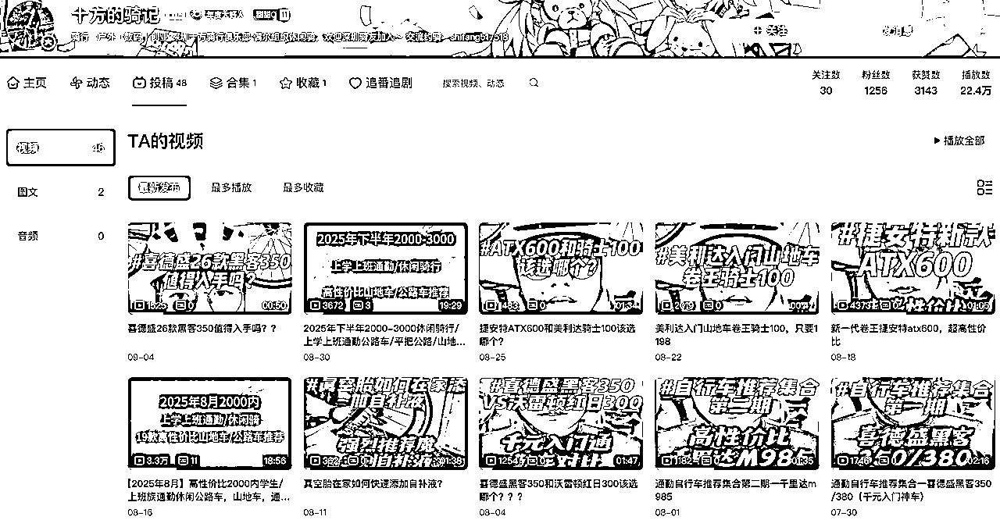

这个IP号的定位决定了内容方向，第三个选题就围绕它展开：2025年下半年，2000元以内值得入手的山地车合集。

定下题目以后，接着要做的是找货。我的习惯是按淘宝和京东的销量数据来筛。销量排行意味着市场已经帮你验证过，卖得好的品，你去推，出单概率天然更高；评价好的品，踩雷的概率更低。操作起来也不复杂：先进淘宝，选好你要做的类目，设好价格区间，按销量排序，取前三十到四十款基本就够了。排在后面那些出货平平的款，推广起来只会更难，不用浪费时间。

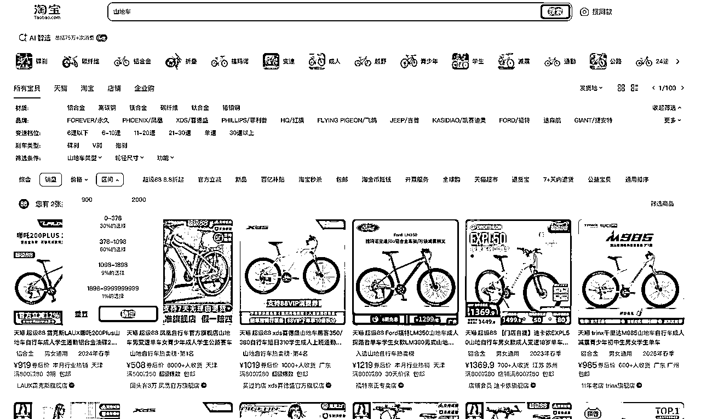

接下来是整理产品素材，这部分挺费功夫。我一般会收集产品图、价格、型号、配置这些信息，然后统一填进飞书表格，方便横向对比。说实话，就算不想精细加工，这些配置表直接做成视频内容也完全够用，而且以后还能反复调用。

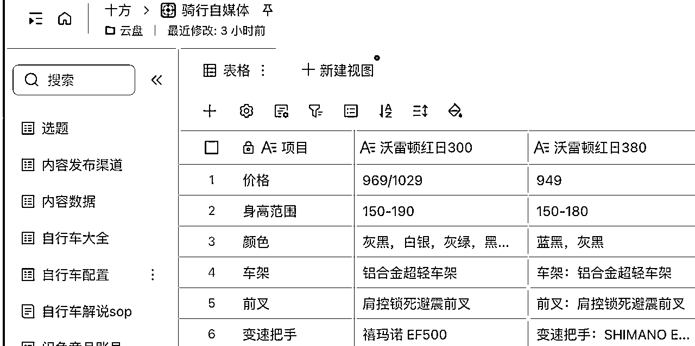

收集数据这步，我找了ChatGPT帮忙。做法很简单：把产品配置页面截图发给它，让它整理成结构化文本，我再复制到表格里，效率一下就上来了。更进阶的思路是用AI工作流，输入链接就能自动输出图片、型号、价格、配置等信息。这个我后续也会研究，做出来了再分享给大家省时间。

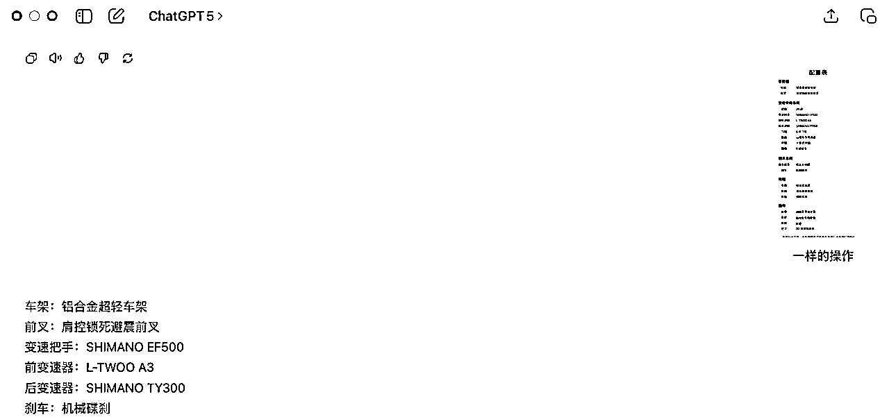

挑产品这步，要特别说，因为它既耗时又关键。想出单快、出单多，一定得舍得花时间选品。选得好不只是赚钱，更重要的是用户会信任你。我经常从四五十个品里筛一二十个，一筛就是好几天。怎么筛？对比配置、看评价、研究不同博主的评测，一番折腾下来，自己也快变成半个专家了。

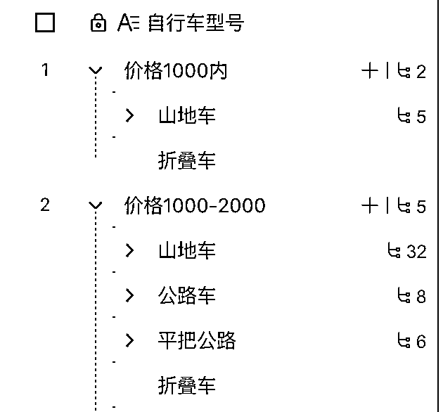

具体筛选标准，我常用这几个维度：

第一，看配置。同价位里，优先选配置高、性价比强的。这需要你足够了解产品，知道哪些参数是好东西，哪些是可以妥协的。

第二，看佣金。销量差不太多的时候，闭眼选佣金高的。很多时候两个品看着差不多，佣金却差一倍，那我肯定选佣金高的；哪怕它稍微差一点，只要佣金够高，我也选它。选择大于努力，这句话值得多讲几遍。

第三，主流品牌+新兴品牌组合着推。除非接了商单，否则主流品牌是避坑的可靠选择，品质基本有保障。像我选自行车时，主流品牌求稳，新兴品牌拼性价比，这样搭配能覆盖大多数用户需求。不过第二个视频出单就很少，原因是主流品牌自己卷起来，性价比已经不输新兴品牌，但主流品牌又没开好物推广。这种组合在出单上其实不理想，大家要注意这个坑。

第四，参考其它博主的推荐。常去小红书、抖音、B站、知乎逛逛，把数据表现好的内容记录下来，尤其是头部博主推的品。注意，不是那些纯带货号，而是内容真有数据说服力的。他们推的产品我基本都会记下来，再和之前收集的对比。只要重复出现，这个品就直接入选。

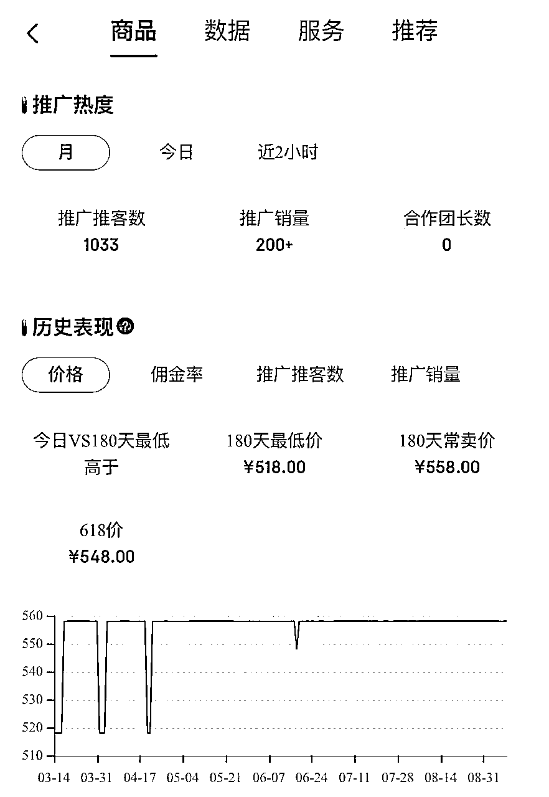

第五，看淘宝联盟和京粉的推广数据。这两个平台都有类目推广排行，也能看到单品推广情况。这个数据对判断好不好推很重要：能看出有多少人正在推、竞争是否激烈，还有每日每月的推广销售情况。推广量越大，说明这个品越容易出单。

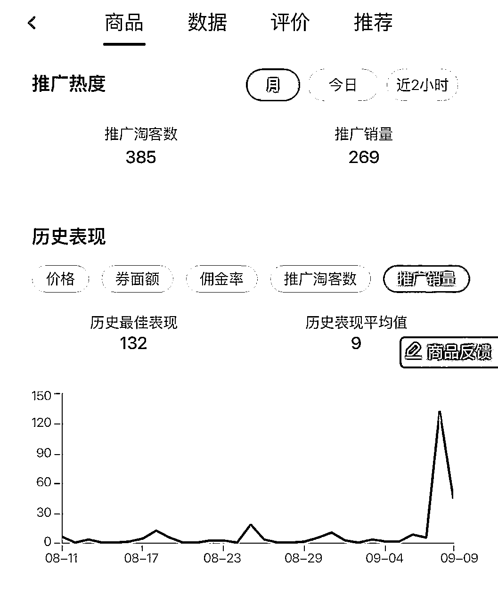

第六，查行业信息。想做某个品类，至少要先对这个领域有基本了解。特别是想做IP的朋友，乱推荐很容易暴露不专业。比如自行车行业，很多好物博主在推永久、飞鸽、凤凰，实际上这几个品牌在业内口碑已经很一般，基本靠贴牌。稍微懂行的用户看到你推这些，多半会觉得你不靠谱，什么都不懂就乱推荐。

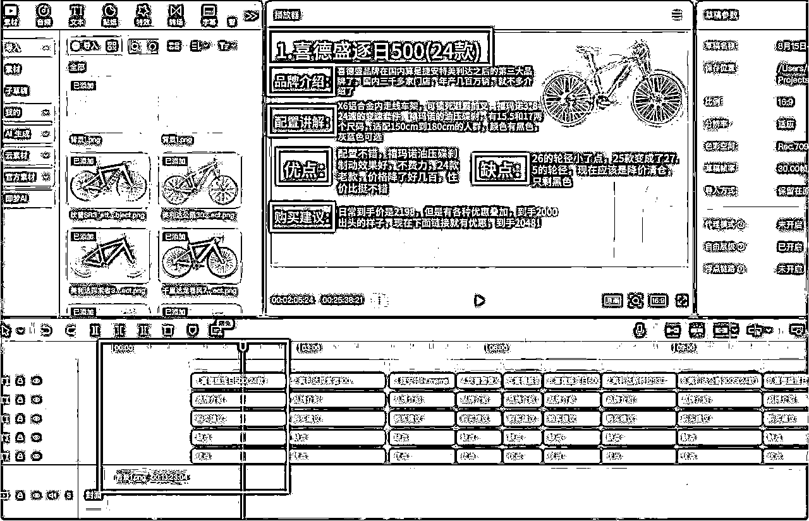

产品定下来，就可以做视频了。我不用PPT，直接用剪映搞定。原因很简单：方便、快捷，而且我做长视频本来也没打算出镜。以后就算出镜，也是开头结尾露个脸，中间还是这种图文形式。视频内容结构很简单：背景图+6段文案+自行车图片。介绍不同产品时，只要换掉对应文案和图片，整期内容就出来了。省掉PPT步骤，确实高效。

另外分享一个抠图工具：Aiarty Image Matting。一键抠图，支持批量处理和批量导出，非常省事。下载链接：https://pan.baidu.com/s/1cOVsGTSfkd6mY0snR_tuhQ 提取码：51rr

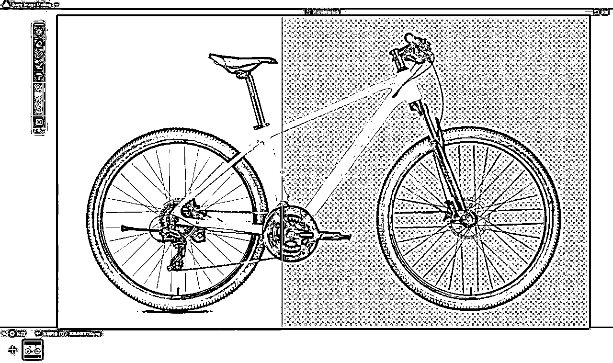

接下来写文案，这步同样重要。我的习惯是针对每个品单独写，整体用“总—分”结构：先讲品类的背景知识、挑选要点，再逐个介绍产品的优缺点。这块基本是模块化流水线作业，但也要下苦功。每个产品我都会去小红书、抖音、知乎、B站翻其他博主的讲解，再加上自己的理解揉在一起。这样写出来的内容可信度和准确率都会高很多。

写着写着，一篇内容顺便就成了知乎文章：《2025年8月2000内休闲骑行/上学上班通勤公路车/平把公路/山地车推荐集合》。如果想做IP，这类文章可以分发到知乎、公众号、B站等平台，继续扩大影响力。

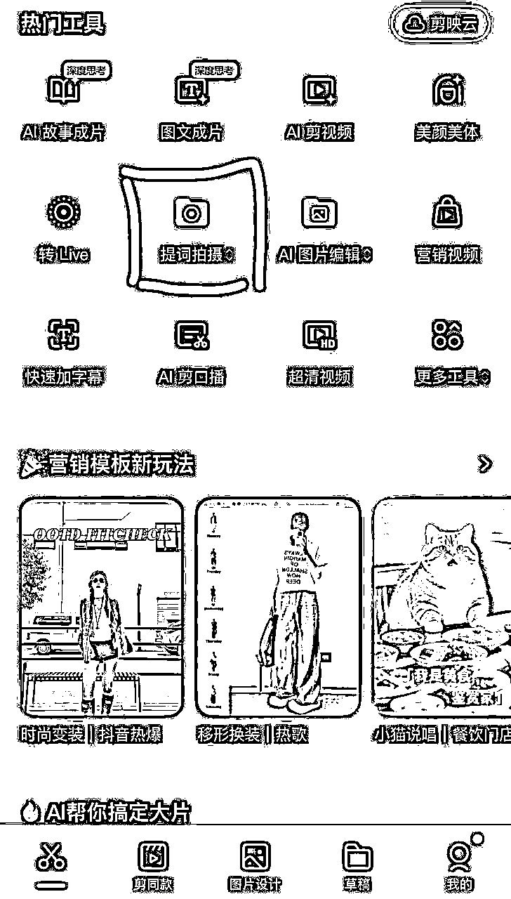

文案到位后就是录音。说白了就是把稿子读一遍，我用剪映的题词拍摄功能来录，每次大概要录一到两个小时。嫌麻烦的话，也可以直接用剪映的朗读功能，既能克隆自己的声音，也能用现成的AI音色代替。

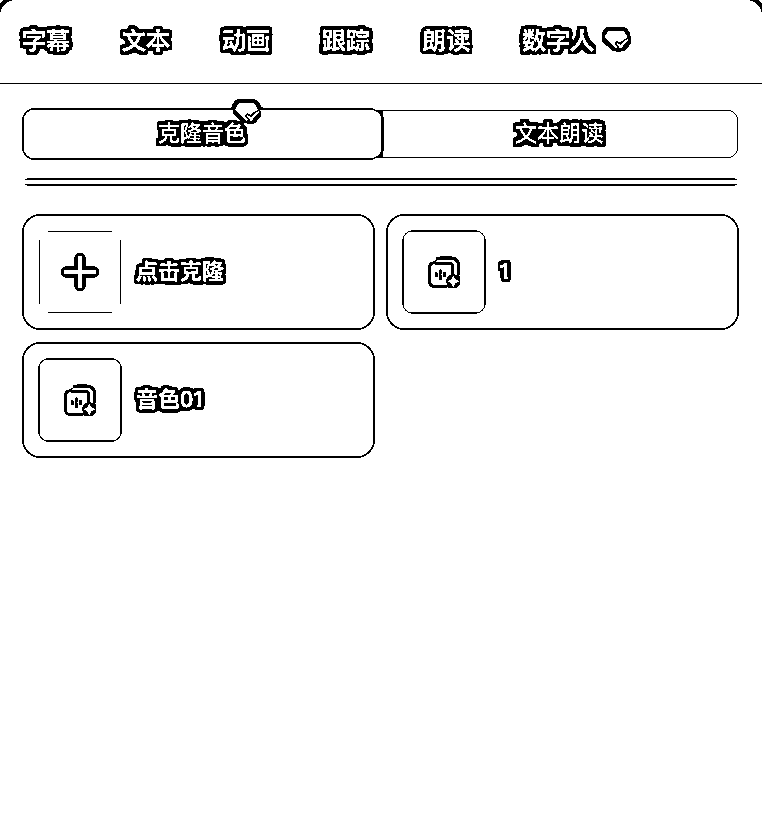

所有素材准备完毕，剪辑反而是最机械的环节。把录音导入剪映，按录音内容把每个产品对应的视频段落切好，一定要先调好时间轴再识别字幕，能省掉大量改字幕的功夫。字幕生成后，从头到尾过一遍视频，检查并修正错误，内容就算完成了。

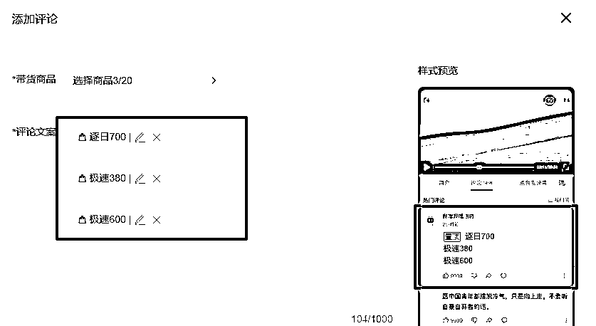

发布建议在电脑端操作，这样挂商品链接更方便。有一点要特别留意：评论区添加商品后，一定要看右边的展示效果是否整洁。我会反复调整，确保观感舒服。具体样式可以参照一些优质账号，哪种顺眼就模仿哪种。

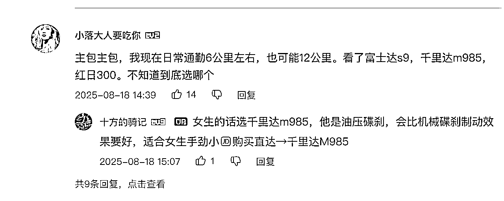

发布之后还有一步不能省：维护评论区。只要有人提问，我都会很详细地回答，讲清楚理由，再把链接放上。说实话，我的很多订单都来自评论区咨询的用户。所以，评论区千万别忽略，这是转化的重要入口。

以上就是B站好物视频从零到上线的完整流程。如果你也在做，或者正准备做，希望这篇整理能给你一些有用的参考。下次直播，我们接着聊更多实操细节。