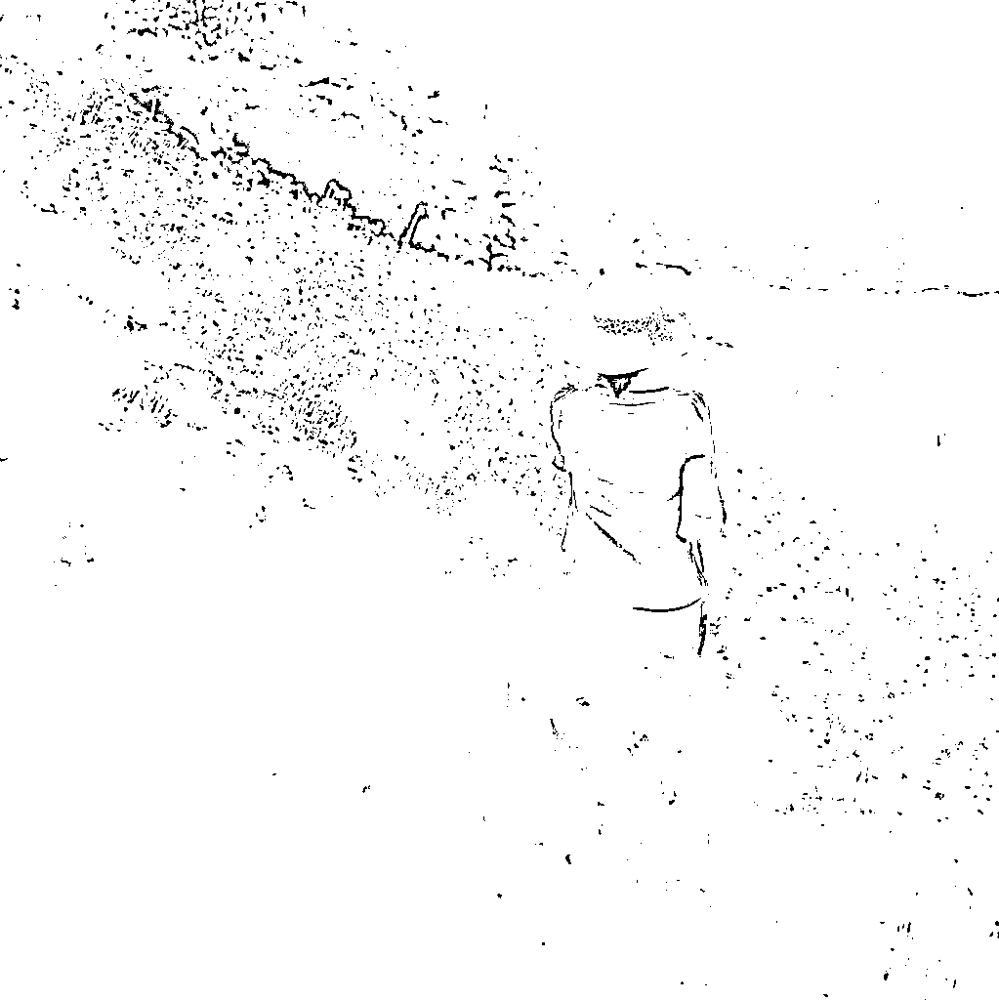
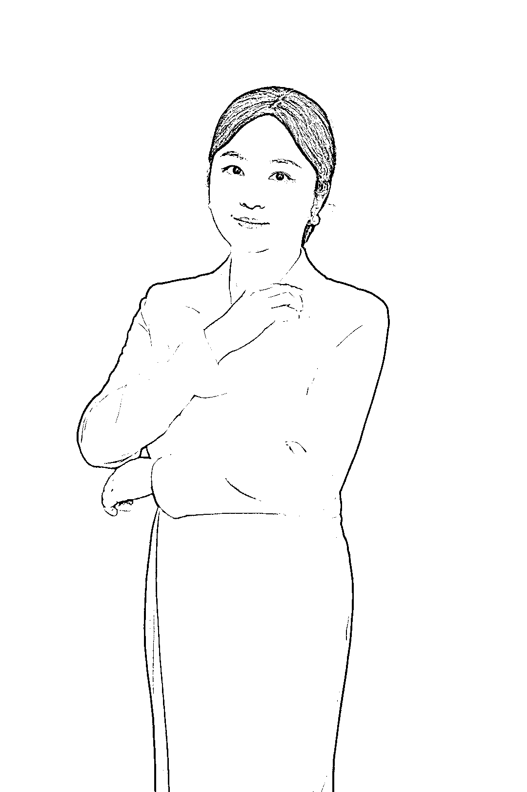
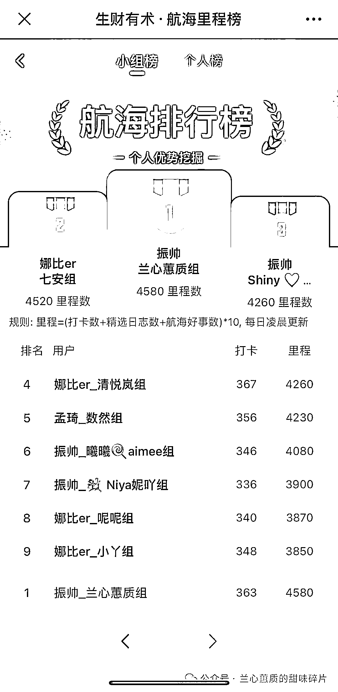
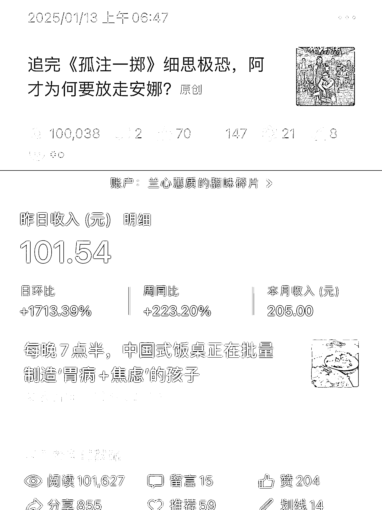
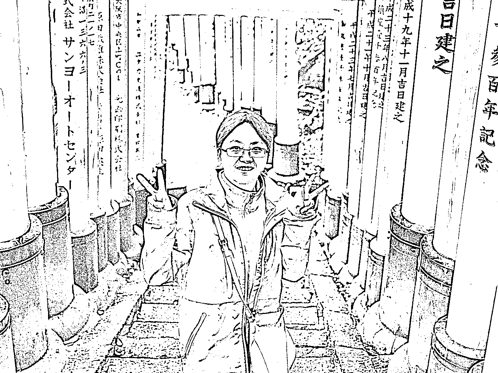
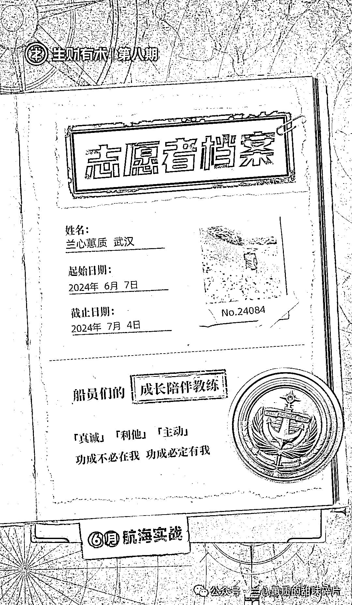
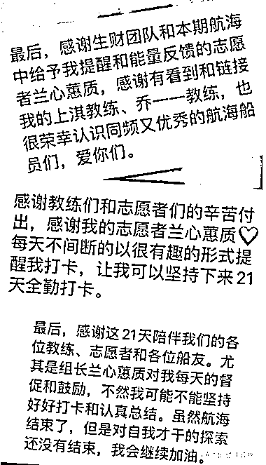
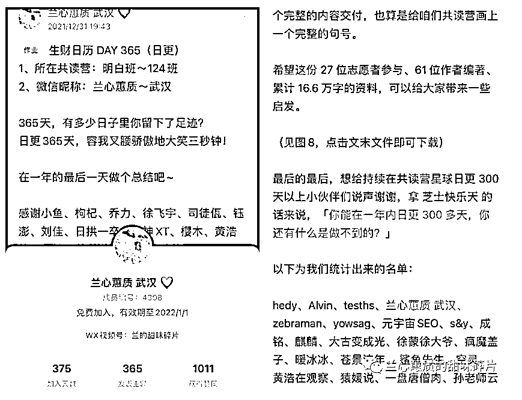
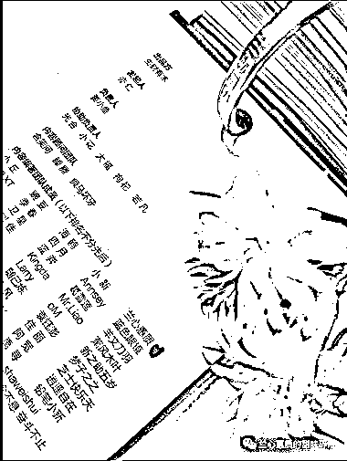

# 从国企办公室到 10 万 + 阅读：一个宝妈如何用志愿者身份完成破圈突围

作者：兰心蕙质 | 武汉

两年前，我还在为“能干点什么”而迷茫。如今，我是一名在国企综合部挑大梁的宝妈，也是靠文字、图文和短视频做起来的 10 万 + 公众号与视频号创作者，还在赚钱有术里持续担任志愿者。

今天想把这段经历摊开讲讲。

我是谁？很简单。
一个 15 岁儿子的妈妈，白天在国企里负责综合事务，业余时间用内容记录生活。更重要的是，我给自己立下了一个目标：不断去感受、去分享生活里的温情与美好，最终触达 100 万人。

很多人好奇，我的内容是怎么从零到破圈的。答案不在某个爆款技巧上，而在赚钱有术志愿者的身份上。

过去 24 个月，我一直深耕志愿者工作。期间累计 3 次拿到 A+ 评级，每次都收获 60 点术值，并三次被评为金牌志愿者。对我来说，志愿者并不只是帮忙，它像一个支点，撬开了赚钱有术庞大的知识与人脉资源库，让我从信息焦虑到信息过载再到信息变现，路径越来越清晰。

写这篇分享，不是为了晒成绩。我的初衷很明确：给那些对志愿者心动却犹豫不决的新人，一条看得见的成长轨迹。如果你也在找一个能持续成长的入口，不妨先了解清楚再做决定。

完整路径拆解在这里： [`m661tsgjbp.feishu.cn/wiki/HsL6wTASPi1mOykyMbKc5Xstnsf`](https://m661tsgjbp.feishu.cn/wiki/HsL6wTASPi1mOykyMbKc5Xstnsf)

* * *

互动回顾：

薇薇 : 必须给我的督学老师怒赞，在我参加航海的时候，每天都来提醒，一如既往！

鱼丸|龙哥助理 : 从写作困难到公众号 10w+阅读，如果你也看到了共建者的成长和收获，不妨点个赞、留句话，或者转发给你身边那个也想一起共建的人～也欢迎加入志愿者队伍：[`scys.com/view/form/z27VzRot`](https://scys.com/view/form/z27VzRot)

兰心蕙质 武汉 ❤️ : 谢谢大忙人薇薇老师👩‍🏫为我赋能[玫瑰]

兰心蕙质 武汉 ❤️ : 谢谢鱼丸[爱心]

明白（晚 9 点半睡觉） : 棒

兰心蕙质 武汉 ❤️ : 谢谢明白老师👨‍🏫领我入门

小宋 : [微笑]

小宋 : 我直接赞赏[微笑]虽然没看完，看了个开头的充满了满满的冲击和野心。