# 知识IP如何把垂直公众号小号跑通：从持续发文到私域变现的复盘

> 来源：[https://wajc9k860mx.feishu.cn/docx/Bb07dA6E3o8zooxJ1KtcBuiEnUg](https://wajc9k860mx.feishu.cn/docx/Bb07dA6E3o8zooxJ1KtcBuiEnUg)

最近龙哥老师提到垂直小号的打法，我看完很有触动，和自己过去十二个月做的事几乎重合。朋友把截屏发过来，说这不就是在写你嘛，催我去参加垂直小号大航海。感谢主办方的邀请，今天把这一年的实践做一次梳理。

我现在的主营是知识服务配合陪跑，客单价5000元以上，月成交30-46单，约七成付费来自公众号。

## 一、为什么坚定做公众号

去年六月开始创业，第一件事是想清楚从哪来流量。

没流量就没客户，没客户想法再好也没用。当时视频号、小红书、公众号都在同步试水。视频也出了几条在同品类里算不错的数据。最终能沉淀下来的，还是公众号。

核心反馈来自业务本身。

去年六月号粉还不到一千，发了一篇阅读直接冲到两万多。

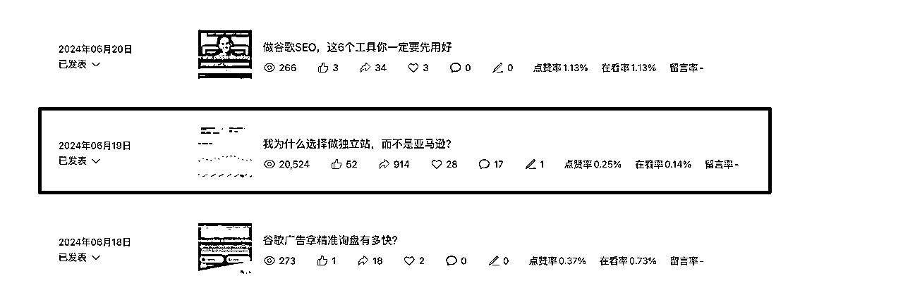

文章发布后几天加了上百人。以同等播放量对比，视频的导流效率明显更低。

那段时间也有品牌找合作。后续陆续有客户来加，说文章写得专业，这类人群决策速度更快。

我经常看后台读者榜，最近阅读量靠前的读者里，有4到6人当月就报名了课程，自己读完就被说服。

跟朋友举例过，阅读前十里两个是内部，剩下八个里当月付费四个，一个预约下一期。

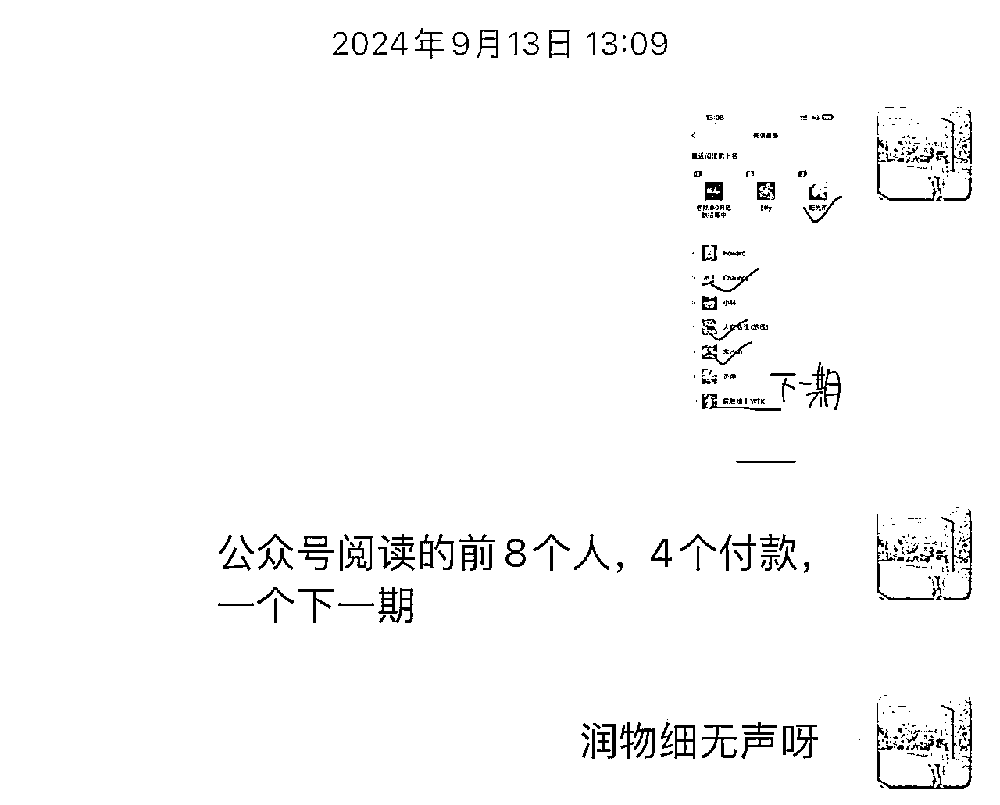

另一个佐证来自头部机构的分享。

在群响会员群里，合伙人Toby提到他们几个月内超过七成的私域新增来自刘思毅和群响官方公众号。

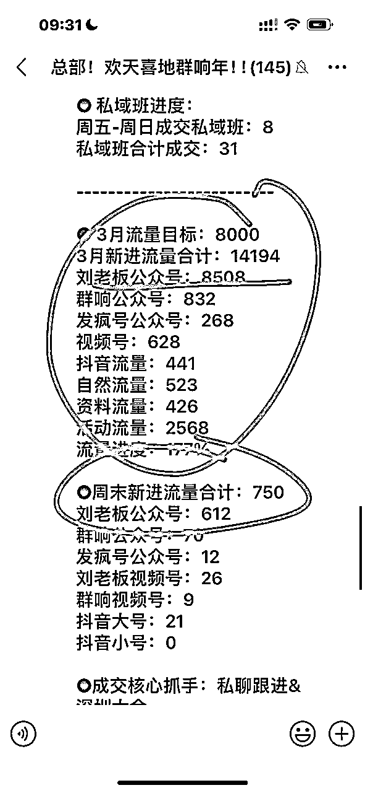

群响在私域圈很权威。他们的盘子主要靠公众号供血，说明这个渠道并未过时，反而仍具高价值。

于是我定了方向：把公众号做起来。目标很朴素，工作日日更，一百篇为第一阶段。坚信会有反馈出现。

为此每天晚上留时间写稿，确保次日早上八点半准时推送。有次晚上十一点才从外地赶回，仍把第二天的稿子写完发布。

那篇稿子次日就爆了，一万阅读配九百多转发。

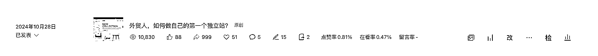

当天就进来了近百个精准好友。那一刻我确认，坚持是有结果的。

* * *

## 二、赛道选择：客户痛点集中，供给稀缺

发文前必须先回答：扎在哪一赛道。

之前在原公司负责外贸独立站培训，接触大量案例。线下课也会访谈学员。

发现一个矛盾：市场上都在讲独立站、SEO，但客户真正点赞、真正出效果的，多半是谷歌广告。

简单说，SEO 靠内容优化拿自然排名和免费流量，见效慢。谷歌广告是付费投放，配合落地页能迅速获取询盘。

SEO 长期价值不可否认，但周期长。广告加落地页的组合，能让客户短时间内看到真实询盘。

市场上呢？几乎没有机构单独做“谷歌广告+落地页”的深度陪跑。绝大多数把独立站、广告、SEO 全部打包讲。

我想，外贸人要网站的本质是获客，为何不直接给一个快速获客的聚焦方案。

于是我们把产品收窄为落地页搭配谷歌广告推广的专项陪跑。考量有三层：

第一，结果快。知识服务最怕客户等太久。广告加页面的模式很轻，照做就能上线，很快看到询盘，信任感迅速建立。

第二，线上交付成本可控。创业初期不宜直接做重线下，成本高履约重。从线上起步，价格更友好，交付更可控，先把模式跑通。

第三，形态简洁。带学员做一个页面，教会设置广告后台，就能完成一期。简单意味着易落地，满意度高，也容易沉淀案例。

这个判断后来被验证。细分赛道让我们更快拿到结果，也更快积累案例。

* * *

## 三、实操路径：日更、对标、沉淀方法

### 日更：前百篇是基本功训练

开始时只有一个念头，先写够一百篇。认为自己在行业里待过，写够数量必有爆款出现。

早上八点半推送变成铁律，上一天多晚都得完成。

日更过程中摸出几个习惯：

*   和客户沟通时实时记下他们踩的坑，形成选题；
*   在微信搜一搜找行业热文，结合自身案例改写；
*   内容分干货和促单两类，既让新读者进来，也让意向读者下决定。

内容始终源自真实痛点。

### 对标：搭建选题素材库

起步期做了大量对标工作。

在搜一搜里用行业关键词找爆款，把标题、结构、观点整理成表格，形成选题库。最初是手工维护，后面一两个月更新一次，逐步交给助理。

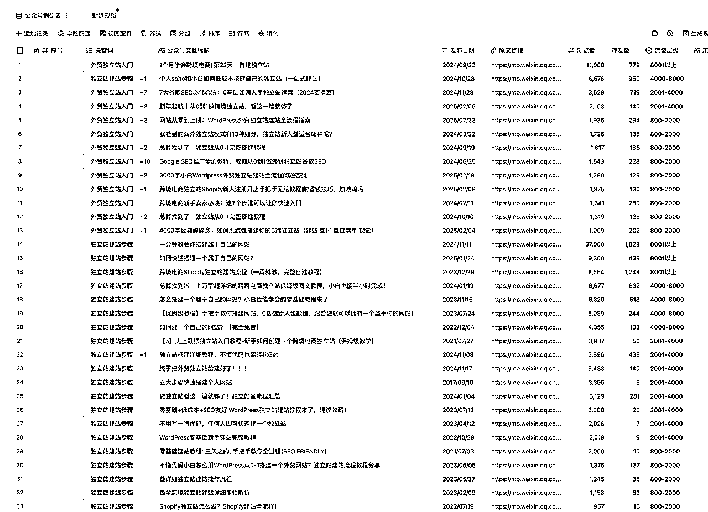

另一种做法是把对标号的历史文章批量采集成表。既能看爆款规律，也能看到对方的运营演进，从标题变化看出方向迁移。

采集我在淘宝找商家，搜“公众号文章采集”即可，几百篇整理成表不到十块钱，比自己折腾工具划算。

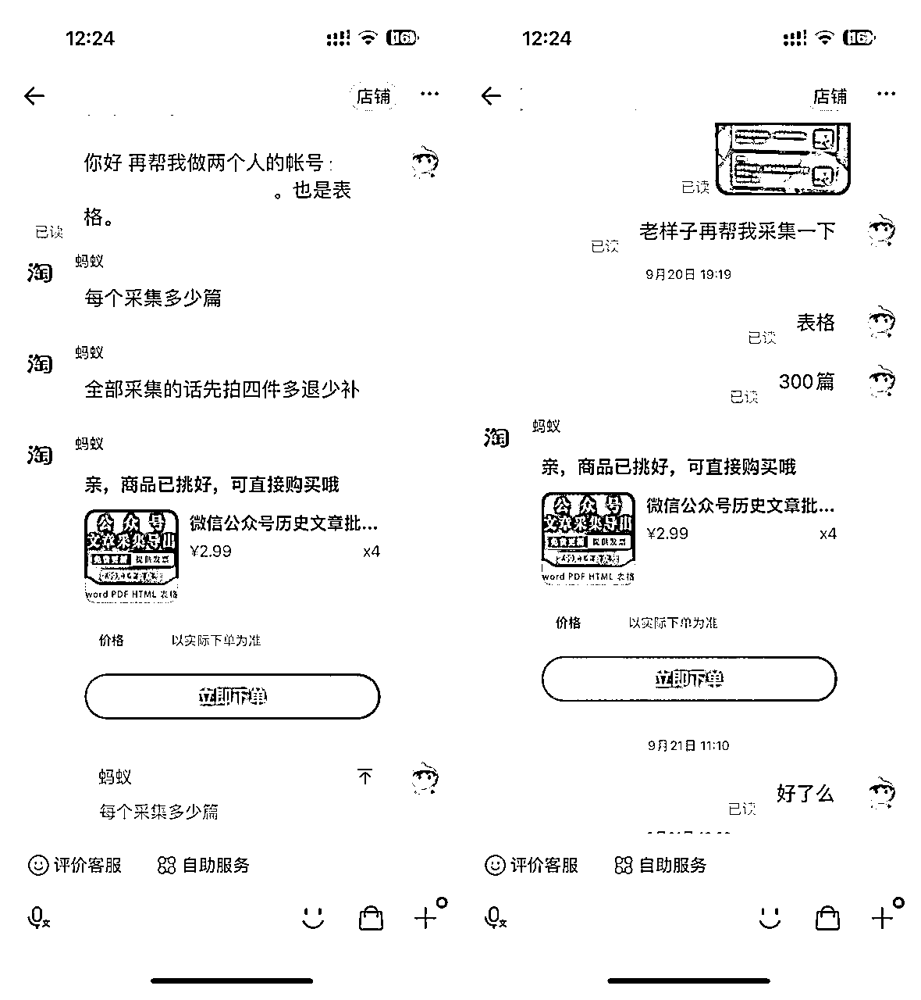

采集后的表格包含文章正文、链接、封面、数据、发布时间等，导到飞书多维表使用。

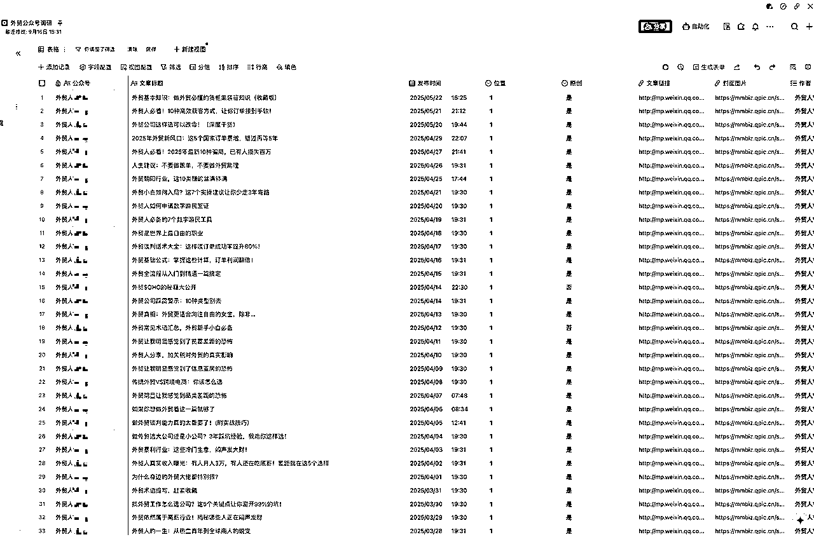

分析爆款时重点看：标题写法、开头钩子、金句密度、节奏安排。标题占比极高。

但不照抄。单纯模仿没有转化。我的做法是在文章里软性植入自身方法论，用分析问题给出方案的逻辑自然带出产品，而非硬广。

### 流量峰值

去年九月底十月初连爆两篇。国庆前一篇，假期在家手机一直响；同选题再写一篇，数据是前者的两倍以上，阅读两万加，转发两千多。

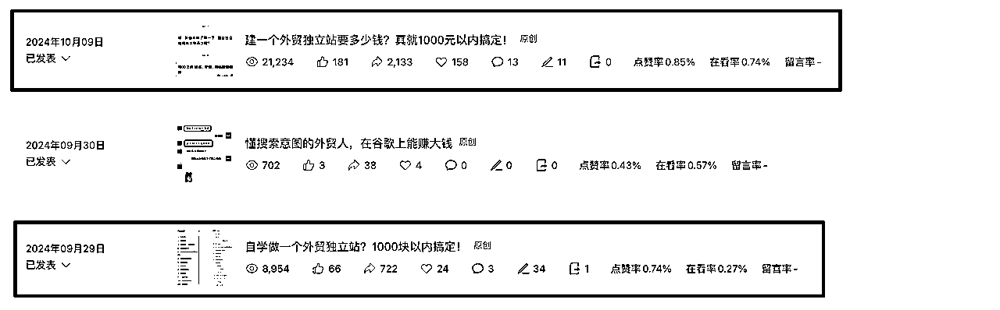

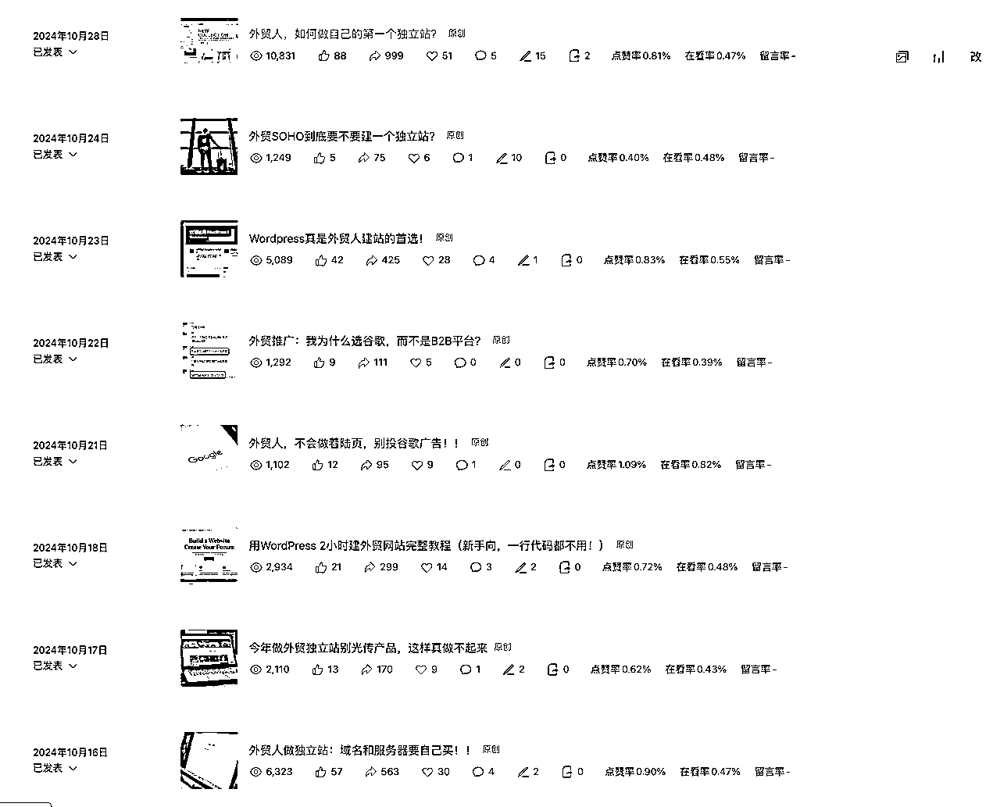

流量上来后具备提价底气。十一月客单从3980提到4980，人量保持稳定。

### 低谷调整

去年十二月到今年三月，推荐流量断崖。文章从几千上万跌到几百，新增从日几十降到个位数，焦虑感很强。

调整两件事：不断更，保持在私域客户面前的可见度；持续测试新角度、新切口。

记住润宇老师一句“按时出摊”。做号像开店，下雨天人少也不能关门。每天出摊才是常态。

* * *

## 四、AI加持：效率与思考的双重放大

日更锻炼了执行力，积累了语料。AI改变了效率。

2022年就接触过AI，感觉机器味重，一直没深用。25年春节听了龙共火火老师直播后重新开始，主打听劝。

现在主要用GPT，长期记忆功能很关键。

建立了AI共生创作流程：

1. 把自己过往文章喂给它，沉淀写作风格；
2. 每天把客户对话、灵感、案例丢给它对话；
3. 用语音聊的方式报标题和核心观点，让它生成初稿。

我只需做两件事：给标题，口述想表达的信息。其余它来完成。

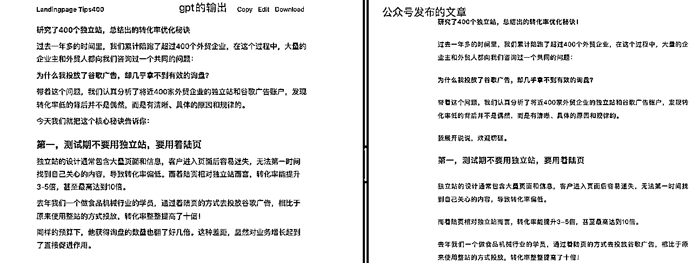

以前一篇要一到两小时，现在两小时能出一个周的内容。1.5小时定选题标题，半小时语音对话成稿，再交助理补案例配图排版，流程已标准化。

更深层的价值是陪伴与镜像。每天对话，它对我的业务和思维模式越来越熟。不仅写文章，还能梳理产品逻辑、优化私域SOP、生成招聘培训文档。把流程大纲告诉它，它搭框架，我填内容。

这次分享的框架也是AI共创出来的，让它以采访形式提了20个问题，我回答后框架就成。

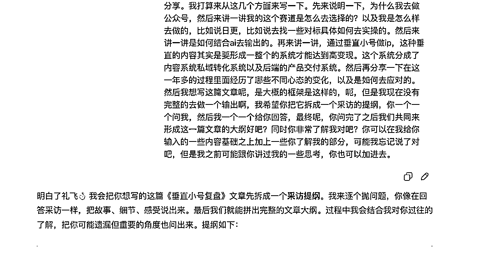

今年四月到八月的内容基本都是AI共生模式，持续获得推荐。

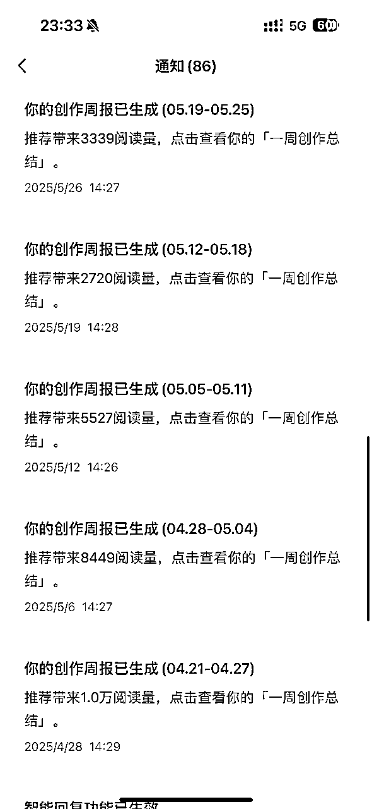

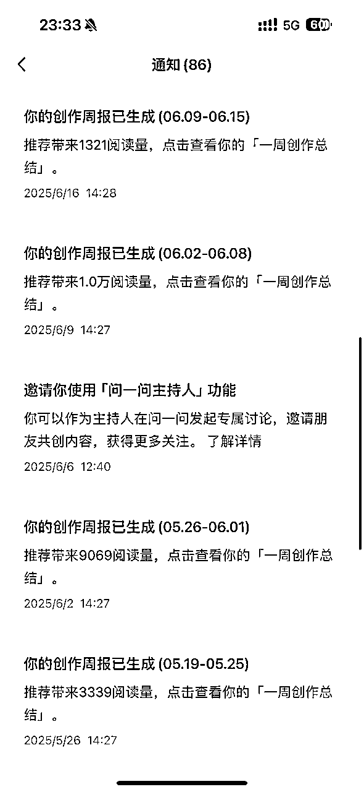

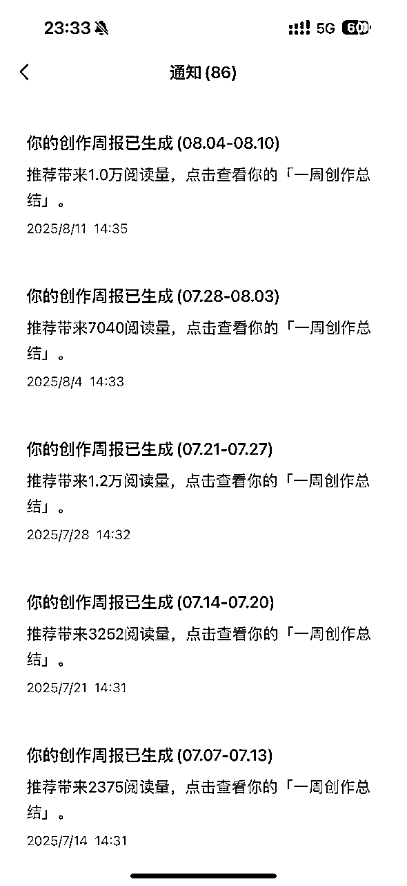

这四个月稳定支撑了每月30人以上的招生。

* * *

## 五、变现系统：内容、私域、交付闭环

内容只是入口，完成变现需要系统。现在跑三套：内容系统、私域转化系统、交付系统。

### 内容系统：从引流到促单

*   交付内容化。课程里学员操作细节、真实反馈写成图文，既展示交付细节，也让潜在客户看懂课程如何进行。此类文章转化力强，评论常有人问价，被转发咨询。
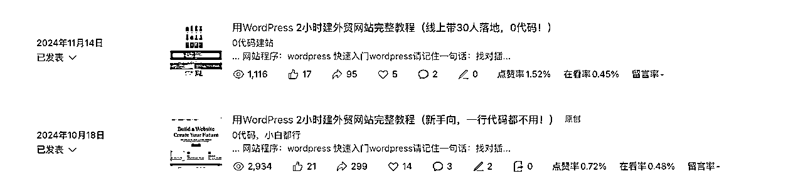
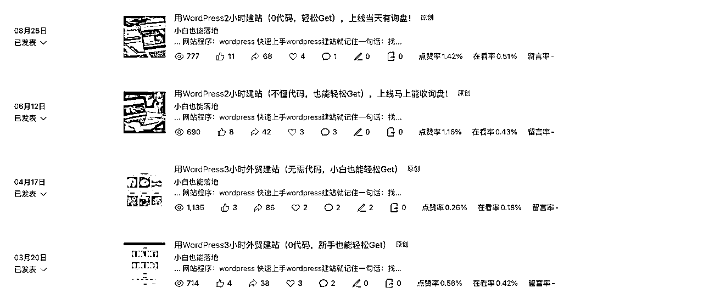

*   裂变触达。每期陪跑结束会做数据复盘，把学员成果整理成可领取笔记。客户想看成果，也会转朋友圈和群，单次平均带来约60人二次传播。
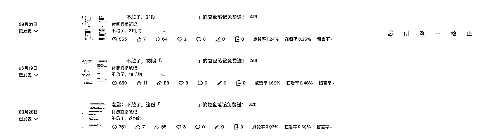

*   为销售准备弹药库。把交付记录、复盘、案例归集。意向客户提问时，直接甩一篇成体系文章，90%疑问可解。内容本身就是销售话术延伸。

### 私域转化：动线标准化

朋友圈每日更新是基本功。高客单成交需周期，我们对客户做分层打标签，高意向低意向用不同跟进策略。

把客户动线做成标准化SOP交私域助理执行，她每日反馈卡点，我再调整素材和策略。

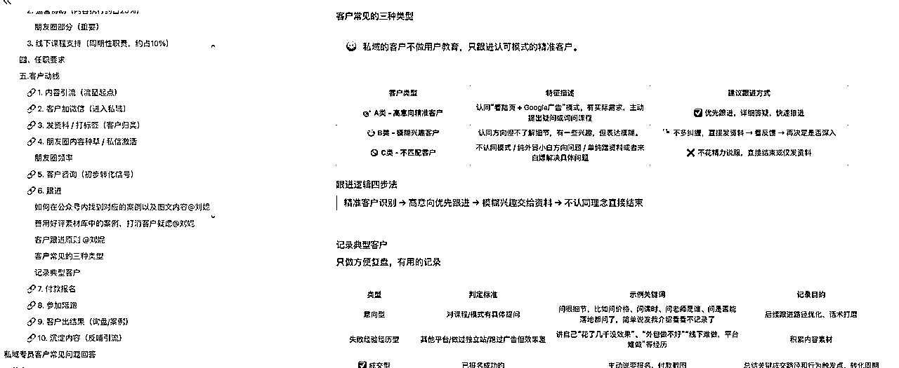

### 交付系统：用结果反哺内容

陪跑模式好处是结果可见。学员能快速上线页面、投放广告、拿到询盘。正向体验带来复购和推荐，案例反哺内容形成闭环。

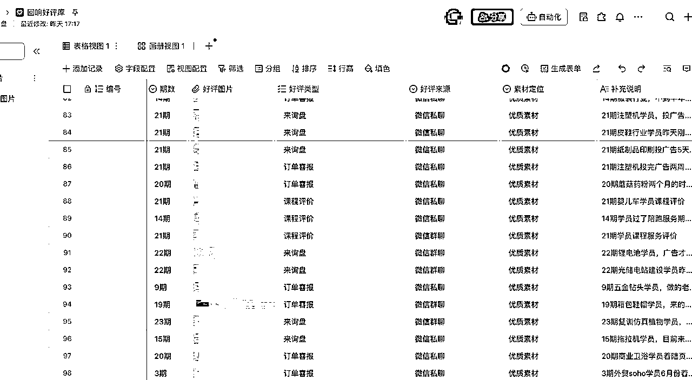

目前私域约7500人，付费用户接近500。公众号粉丝1.1万，累计变现超200万。产品集中在4980到7980区间，未做低客单。

* * *

## 六、复盘与展望

一年多实战总结三点：

1. 执行是基本功，按时出摊是根基；
2. 内容是入口，私域和交付同等重要；
3. 推荐流会波动，案例和口碑才是长期资产。

如果重来会：

* 早做双账号多平台，分散单一推荐依赖。八月起已开始跑第二个业务号，并尝试自然流与付费；
* 更早把重复动作标准化，避免创业初期事事抓手；
* 更长远预判三个月到半年的潜在问题。

垂直小号不是流量游戏，是系统经营。推荐是持续输出价值的奖励，不是根本。根本是持续为客户创造价值，沉淀专业口碑和案例。

正如龙哥老师强调的专业、深耕、细分、价值密度高。哪怕粉丝只一万，也能跑出可观变现。

我会继续按时出摊，在这条路上走下去。