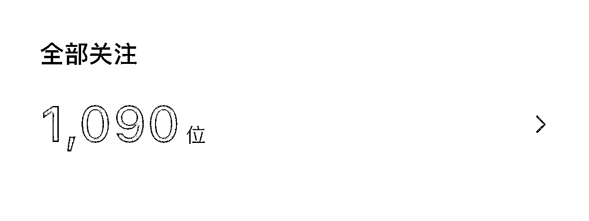
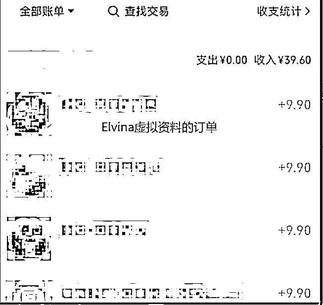
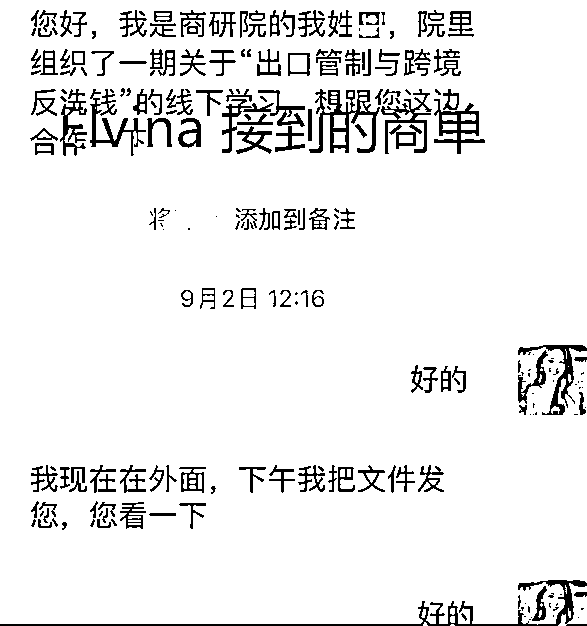
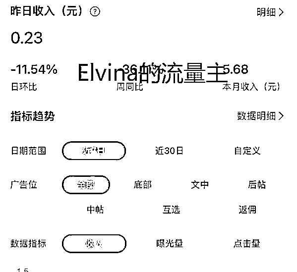
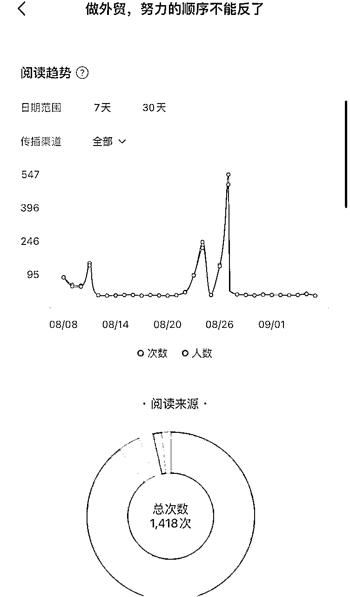
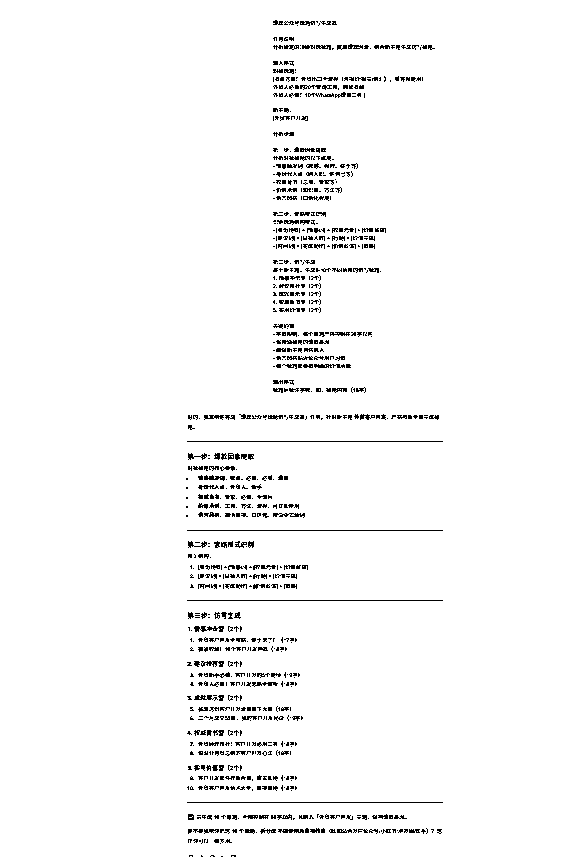
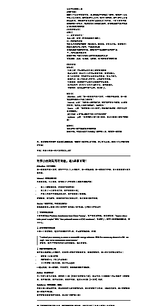
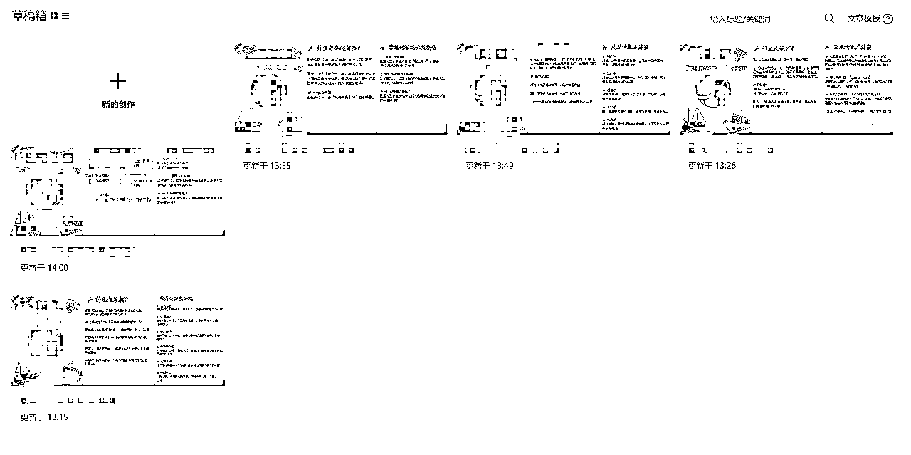

# 40天从零到千粉，我的公众号小白起号实录

> 来源：[https://ucnv9lx0aamj.feishu.cn/docx/Gu5xdbA3HoCU81xJN5Icj7dCnfc](https://ucnv9lx0aamj.feishu.cn/docx/Gu5xdbA3HoCU81xJN5Icj7dCnfc)

我没有做过自媒体，也没碰过公众号，更没有发动过朋友帮忙转发。仅仅用40天，一个彻底的外行小白，就把账号做到了1000+粉丝，还收到了商单询盘和资料成交。今天把全过程拆开讲清楚。

大家好，我是Elvina。本职在做外贸，副业是AI代写和运营一个垂直公众号小号。之前在赚钱社区里学着用Cursor做了个小程序，赚到第一笔副业钱；AI代写累计5个月做到10万+；业余热爱健身。

航海已过半，恭喜收获满满的朋友们。

我从未经营过任何内容号，8月7号开始坚持日更，整整40天后，粉丝顺利破千，咨询了我合作意向，还售出了自己的付费资料，当月流水也有几十块。虽然和赚钱里的头部玩家比还差很远，但第一步已经稳稳迈出。

图一粉丝破千



图二，卖的4份虚拟产品



金额虽小，但证明了零基础也能靠内容实现变现

图三：第一个商单咨询



图四，流量主收入（虽然很微薄，但可以积少成多）



# 我为什么会开始做公众号

直接说起因。

7月20日，龙哥老师在赚钱抛出“垂直小号”这个超级信号，当时我只是随手记下。没多久发现老师自己亲自下场日更了。看样子这不是玩笑，于是我决定跟上节奏，大佬冲前我跟在后面喝汤。

当天就注册了公众号，第一篇当天发出。回头再看初稿，写得真的很糟糕，阅读只有62个小眼睛。

第二天我去翻了同行们的号，发现大家发的主要是图文。我也换成图文试试。没想到第二篇的阅读很快破百。那一刻我就明白了，图文才更吃香。

还在用纯长文的小伙伴，可以试着换个形式，效果可能完全不一样。



# 新手最怕的第一步，其实是发不出来

很多人卡在“不敢发第一篇”。

不敢发的核心是怕丢脸，怕写得烂被嘲笑。其实关注你的人根本不多，我微信有3000多人，但后台数据能看到，真正点开公众号的人不到个位数。

怕熟人看见尴尬。

怕发出去没流量白忙活。

我想说，想赚钱就先放下身段。明星都开始直播带货了，你还在纠结被谁看见？真正该害怕的是没人知道你存在。

流量才是变现的基础，有了流量就能卖别人的产品、卖自己的课、接广告。

想要被看见，就要主动去各大圈子和平台曝光自己。别人看不见你、不知道你在做什么，你才真的要慌。

要从nobody变成somebody，要么被介绍，要么自己造势。你不主动宣传，谁知道你脑子里有多少好东西。

先把第一篇文章发出，哪怕难看也要发。

# 起号要先把定位理顺

### 第一步，用经验和成长路径锁定赛道

账号能走多远，取决于内容产出能力。赛道选对了，才有源源不断的话题。

我有7年外贸从业经历，目前主业还在做外贸，未来也会继续深耕，这条赛道的内容我根本不愁。

同理，你有小红书运营经验，可以做运营号；做副业赚到钱，可以做副业变现号；甚至你正在学编程的日常成长，都能成为内容源泉。

### 第二步，反向推用户画像

定位要从想卖什么倒推。

先想清楚未来要卖的是资料、课程、陪跑还是工具，再想清楚谁会买。是纯小白、新人业务员、在校生，还是想进阶的人群。

以我为例，我平时常被问外贸问题，所以产品方向定在“外贸知识付费”，目标用户就是想入行外贸的小白或准备转行的新人。

### 第三步，选题要聚焦

起号期最忌贪多。成长随笔、宠物日常、副业感悟、情感碎碎念全都写，账号会显得很乱，用户也记不住。

我选择聚焦“外贸小白成长”。围绕目标用户的痛点拆选题：小白关心怎么找客户、怎么写开发信、怎么拿首单；进阶用户关心怎么提升转化率、怎么用工具提效。

当读者觉得“关注你就能解决问题”，定位就成功了。

# 我的核心生产工具：ChatGPT

一篇内容分标题和正文两部分。

## 1.标题

先让ChatGPT帮忙出热门选题。

标题提示词：

```
爆款公众号标题仿写生成器

任务说明
分析给定的顶级对标标题，提取爆款因素，结合新主题生成仿写标题。

输入格式
对标标题：
[收藏这篇！外贸出口全流程（含报价/报关/结汇），看完就能用！
外贸人必备的20个查询工具，抓紧收藏
外贸人必看！10个WhatsApp爆单工具 ]

新主题：
[外贸客户开发]

分析步骤

第一步：爆款因素提取
分析对标标题的以下维度：
情感触发词（震撼、强烈、终于等）
身份代入点（刚入职、你自己等）
权威背书（总监、专家等）
价值承诺（知识库、方法等）
语言风格（口语化程度）

第二步：套路模式识别
识别标题结构模式：
[身份场景] + [情感词] + [权威元素] + [价值载体]
[建议词] + [目标人群] + [行动] + [价值主体]
[时间词] + [完成动作] + [价值载体] + [效果]

第三步：仿写生成
基于新主题，生成8-10个不同角度的仿写标题：
情感冲击型（2个）
建议推荐型（2个） 
成就展示型（2个）
权威背书型（2个）
实用价值型（2个）

关键约束
字数限制：每个标题严格控制在20字以内
保持原标题的爆款基因
确保新主题自然融入
语言风格贴近公众号用户习惯
每个标题都要有明确的价值承诺

输出格式
标题后标注字数，如：标题内容（18字）
```



能得到类似这样的方向：

1. 情感冲击型（2个）
1. 外贸客户开发全攻略，终于来了！（17字）
1. 抓紧收藏！10个客户开发神器（18字）
1. 建议推荐型（2个）
1. 外贸新手必看：客户开发的5个捷径（19字）
1. 外贸人必备！客户开发思路全解析（18字）
1. 成就展示型（2个）
1. 我靠这份客户开发清单拿下大单（18字）
1. 三个月成交50单，我的客户开发秘诀（19字）
1. 权威背书型（2个）
1. 外贸经理推荐：客户开发必用工具（18字）
1. 资深业务员总结的客户开发心法（18字）
1. 实用价值型（2个）
1. 客户开发邮件模板合集，拿去即用（18字）
1. 外贸客户开发话术大全，直接套用（18字）

## 2.正文

再写正文。

正文提示词：

```
公众号二创提示词
#你的身份：
你是一个公众号文案专家，请详细阅读并遵循以下原则，帮我进行公众号笔记二次创作，现在需要在公众号上撰写一些内容，提升我在公众号的seo权重，你所做的事情对我们品牌来说至关重要，一定不要忽视我给你的每一条指令，都是非常重要的创作原则，能够帮助你生成更加满足我们所使用的内容
#我需要你可以：
##能力
一，真实身份代入：
人设示例：外贸小白/想求职做外贸的人
二，内容结构专家：
擅长套用流量结构模型（如AIDAR、图鉴体、反常识开头、情绪钩子）
熟练拆解热点笔记结构、生成爆款标题
会做选题规划和内容矩阵，懂得用户生命周期匹配内容打法
三，用户心理洞察深刻：
能精准捕捉不同类型保研人的常见焦虑与信息差
文案风格：真诚、有情绪、可信赖，有“你能做到”的陪伴感

#写作要求
##标题：
-明确人群：在标题中可以明确人群和需求场景
-挑战与悬念：提出引人入胜的问题或情境，激发好奇心。
-结合正负刺激：平衡使用正面和负面的刺激，吸引注意力。
-紧跟热点：融入当前流行的热梗、话题和实用信息。
-明确成果：具体描述产品或方法带来的实际效果。
-口语化表达：使用贴近日常交流的语言，增强亲和力。
-字数控制：保持标题在20字以内，简洁明了。

##正文：
-Attention，示例：“第一次给客户写开发信，一封邮件都没回，那一刻我真的怀疑自己不适合做外贸。”
-Interest，示例：“当时我一味推销产品，结果客户完全不理我。后来我才明白，客户真正要的不是低价，而是信任。”
-Desire：示例：“如何写第一封开发信”，并且展开来讲解（内容占比在全文的50%）
-ACTION：示例“给出解决方案+引导领取资料”
-reinforce：示例：“希望你能比我少踩一些坑，早点迎来第一位客户的回复。”

##创作：
我会发布一篇主题和想要讲的内容
你来补充，在600-800字左右即可
```



就能得到类似下面的成文：

# 外贸小白别乱写开发信，这3点最关键！

第一次写开发信，我一口气发了几十封，结果全军覆没。那一刻我怀疑自己是不是不适合干外贸。

后来才发现，不止我，很多新人都在犯同样的错：

* 有人上来就谈价格，直接被拉黑；
* 有人堆砌专业术语，客户看不懂；
* 还有人标题都不写清楚，邮件进了垃圾箱。

这些细节看似小事，却直接决定客户会不会点开、会不会回。

第一封开发信到底怎么写？我总结了3个要点：

主题不要写成“New Products Introduction from China Factory”，客户没兴趣。直接写：“Inquiry about solar panel supplier” 或 “Your potential partner in CNC machines”。简洁明了，客户一眼就知道来意。

② 开头要有连接感

别一上来就报价格。可以先点一下客户的行业或趋势，比如：

“I noticed your company is active in renewable energy solutions. With the increasing demand in EU, we might have some cooperation opportunities.”

这样客户会觉得你是定制联系，不是群发。

③ 正文控制在5行内

客户一天收几十封邮件，写成长论文没人看。第一封信点到为止：

* 你是谁，公司优势
* 能提供什么，核心产品服务
* 希望的下一步，是否能回复或通话

一句话：首封邮件的目标不是成交，是拿到回复。

为了让大家少踩坑，我整理了一份【外贸开发信模板合集】，覆盖初次联系、未回复跟进、压价应对等场景。需要的话后台回复【开发信】领取。

外贸不是一蹴而就，你会被“已读不回”很多次，但只要持续优化方法，第一次客户回复一定会来。

希望这篇能帮你早日拿到第一单！

# 日更怎么坚持

日更靠的不是灵感，是储备。

我经常出差，时差和强度会让状态很差。但为了保持日更，我会在出发前两天集中写稿存进草稿箱。

到地方后，每天起床点一下发送即可。



这样就算最忙也不会断更。

零基础也能快速起号，流量起来就能卖资料、接商单，同时还能沉淀个人IP。

如果你也想做个人IP，不妨从公众号开始。赶紧发出第一篇，别再怕丢人了。