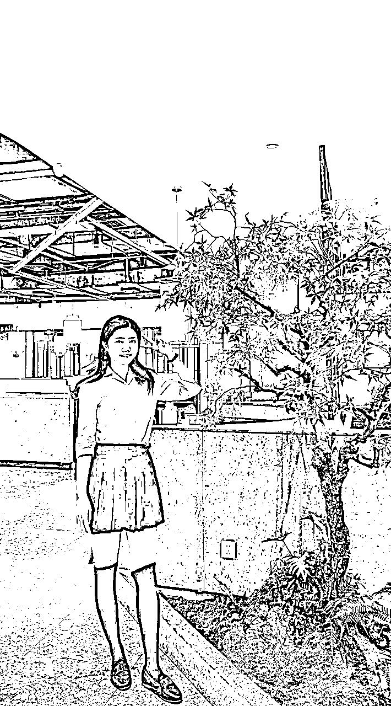
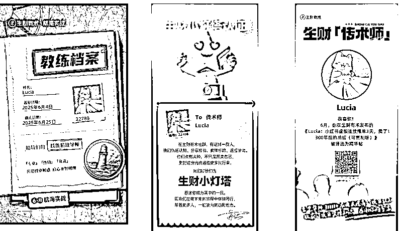
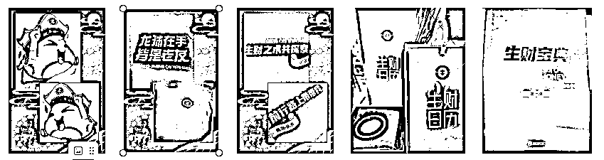
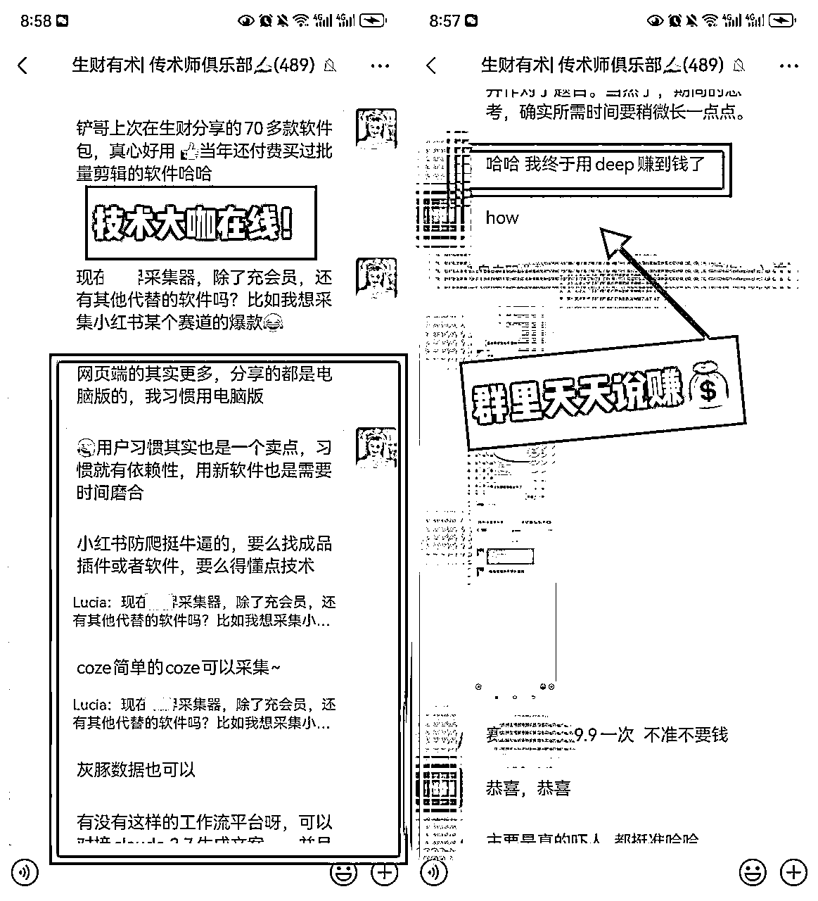
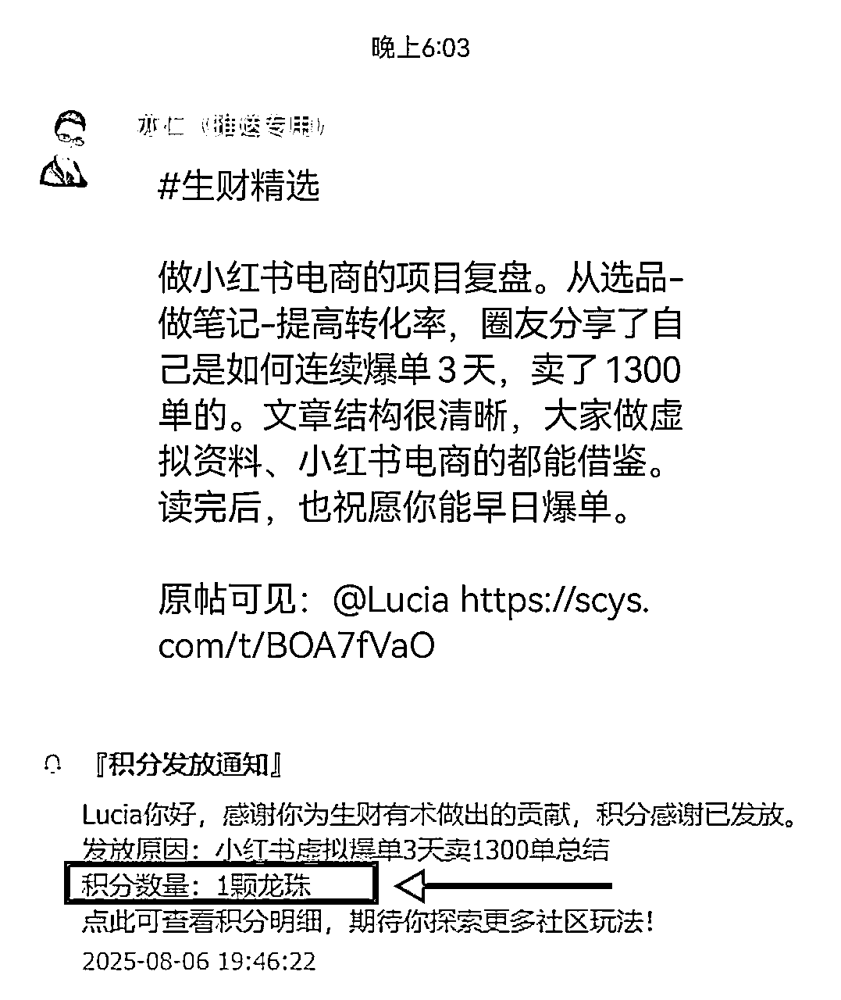
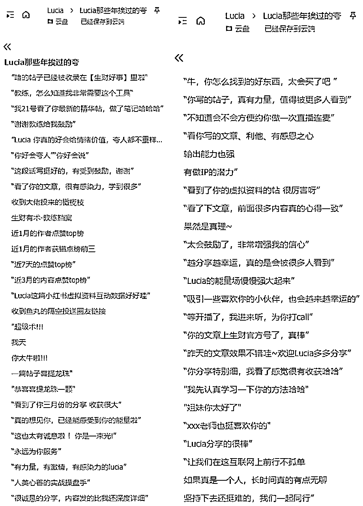
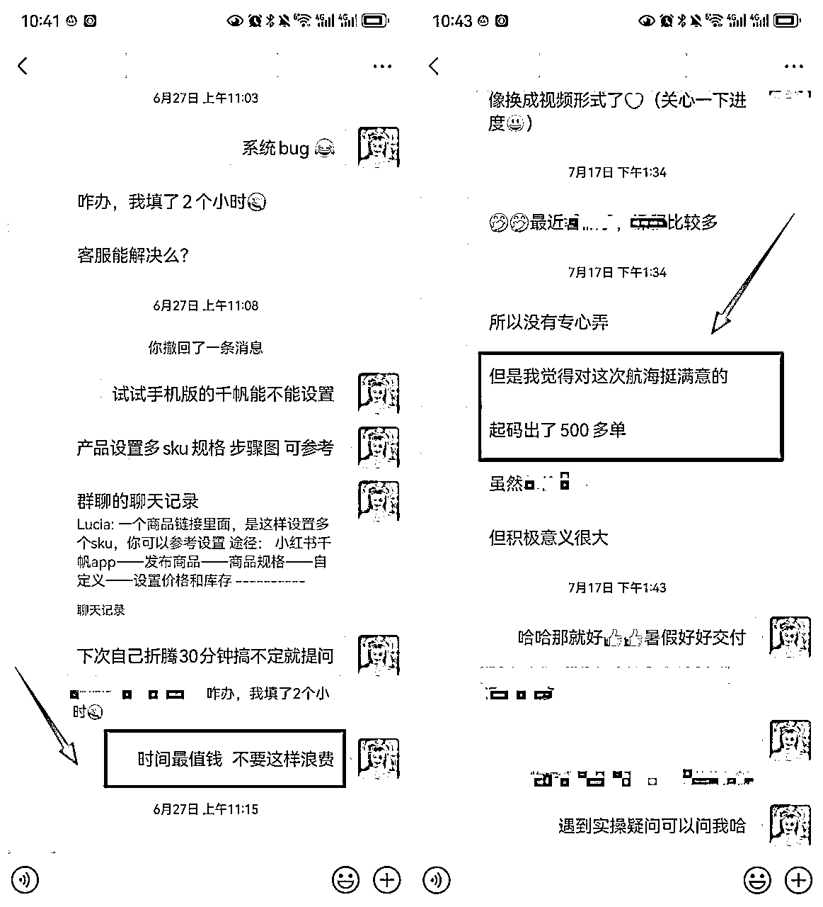
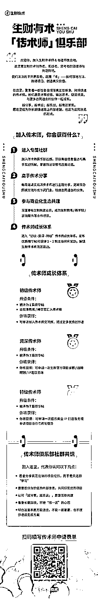
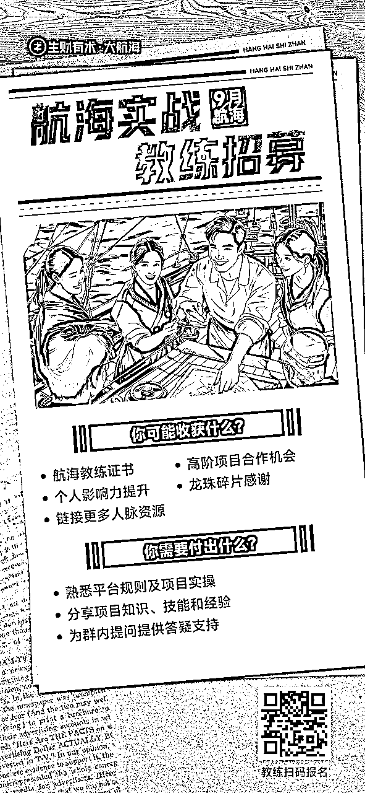

# 那颗龙珠只是序章：复盘之后，我更想聊聊这两个身份给我的隐藏礼物

> 来源：[https://cbwtkywz24.feishu.cn/docx/NsfFdTURno5dHCxCwhtcb3W7nCe](https://cbwtkywz24.feishu.cn/docx/NsfFdTURno5dHCxCwhtcb3W7nCe)

嗨！我是Lucia，先通报个好消息：前阵子我写的一篇内容，拿到了一颗龙珠。谢谢每一位看过的、给我点赞的、帮忙转发的圈友。快乐一个人吞下去多浪费，按老规矩，咱们复盘里见，爱大家！

今天这篇，我不想只聊龙珠本身。回望这段经历，我更在意的是「传术师」和「航海教练」这两个身份，在头衔之外，还悄悄塞给我的一堆额外赠品。

先指个路：

一、我是谁：从赚钱路人，到被看见的共建者  
二、身份一：传术师，让我从被鼓舞变成去鼓舞人  
三、身份二：航海教练，让一个小透明被需要  
四、什么样的人适合推开这扇门  
五、最后是一些真心话

---

# 一、我是谁：从赚钱路人，到被看见的共建者

Lucia，ESFJ，熟人眼里“最像I人的E人”，摩羯座，土生土长的广东人，可惜碰不得辣。

普通本科，后来以公派身份去荷兰留学，财商属于晚熟品种。眼下在做小红书虚拟产品，项目正在从1往10跑的阶段。过去就是个写字楼里闷头干活的打工人，现在呢，文章被评过精华，龙珠也拿过了，还被人主动找上门来请我当教练。副业赚到的钱，已经悄悄超出主业。

2024年12月，我发了一篇拆解小红书的文章，获评精华，我也因此正式成了传术师。后来靠另一篇内容，直接换来一颗龙珠。2025年年中，我报名参加了小红书航海，和近两千位伙伴一起出发，完整跑完了全程。

下面是我2025年的几篇代表作，欢迎点开看看：

1/ 龙珠贴：小红书虚拟连续爆单3天，卖了1300单后的总结（可复制版）  
https://t.zsxq.com/slYbi

2/ 小红书1万阅读，千赞赚6k，上班族是如何做到的（小白友好版）  
https://t.zsxq.com/Ey0c8

3/ 闲鱼虚拟1万曝光6小时卖50单，上班族如何实现(小白进步版)  
https://t.zsxq.com/RZmUi

再晒几张我的海报：

还有赚钱寄来的一堆周边——抱枕、黑T、鼠标垫、龙珠、赚钱日历、赚钱宝典……收到手软。

说回正题。在赚钱，传术师和航海教练不只是挂个名头，更是共建者团队中的正式角色。对共建者还不太熟？点开看看就明白了：

传术师：https://t.zsxq.com/bRZ2U  
航海教练：https://t.zsxq.com/DiuVB

如果你刚进赚钱，还在找方向；或者你已经在路上，想看看同路人是怎么长出来的——那这篇文字，也许能给你递个梯子。

---

# 二、身份一：传术师，让我从被鼓舞变成去鼓舞人

当上传术师，我拿到的回报远远超出预期。

### 第一个收获：一步跨进高手局

文章被加精后，我收到了传术师社群的入群邀请。点进去那一瞬间，脑子里只有四个字：这波不亏。

群里的人，白天聊赚钱，晚上聊风向，那个卷的程度，真的会让人头皮发麻。

有一回，我快半夜11点了还被一个问题卡住。一泽看到消息后主动私聊我，零点前就把问题拆完了。换我自己慢慢啃，起码得耗上大半天。那一刻我真实感受到：有一个程序员朋友，心里踏实多了。他不仅帮了我大忙，还把珍妮老师、叶凡、林泽，以及他身边一整圈朋友逐个安利给我——人脉王这个称号，他完全担得起。

后来我又在赚钱刷到蘑菇发的一条关于视频号虚拟资料的精华内容，刚想着怎么去认识她，转头发现，她就在我们同一个群。缘分这种事，有时候就是这么巧。

以前只在榜单上仰望过的名字，如今一个个变成了日常聊天的人。这个群给我的感觉就是：想搞钱、想遇贵人、想避开弯路，所缺的信息和资源，这里几乎都配得齐。

### 第二个收获：从写不出，到讲得清

当传术师之前，写作对我而言真的挺陌生。我习惯“看一眼就会做”，很少沉下心做系统输出和总结。让我把脑袋里的东西落到纸面上，又难又别扭。

进了群之后，我开始有意识地把每次写作当成一次刻意练习。写着写着，表达变得顺畅了，逻辑也清晰了。写作不再只是记录，而是逼我复盘、催我沉淀的过程。

比如“电商怎么找对标”，我是这样梳理的：

1. 先选品、再选号。先找出3-5个同行都在稳定出单的品，每天大概5-10单的那种，先把市场的可行性验证掉；
2. 等自己的店铺靠这些品跑出持续单量后，再回头找对标账号。重点观察他们新上的品是不是也能出单，能出，就直接借用他的选品逻辑，省下大量试错时间；
3. 死磕一个品，反复打磨到爆。别人已经验证过能打爆的品，我没理由做不出来。

把日常零散的想法整理成可执行的方法，再按步骤去落实，不久之后，我真的爆单了。

从2024年12月到现在，我陆续写了几篇实操分享：先写小红书，再写闲鱼，最后是那篇帮我拿下龙珠的小红书。半年不到，我把自己的经验一点点织成了网。写作让我在梳理里看见规律，也在总结中照见成长。

### 第三个收获：分享不是消耗，是复利

三篇精华内容，换来了一连串正反馈。实际收到的回报，远超我最初的想象。

被龙哥大大推送转发的那一刻，我整个人又惊喜又有点慌，第一反应是：我配吗？但那种被前辈托举一把的感觉，后劲真的很大。

更打动我的，是来自陌生圈友的回声。有一次，一位圈友告诉我，我的文章对他很有帮助。那一刻我忽然理解了什么叫做“戒不掉的成就感”。原来分享从来不是把东西送出去，而是在给予的当下，让更多东西流向自己。这世界的资源和机会，远比我们以为的慷慨。越敢给，越容易收到回响。

写作还有一个附加功能：让别人看见你。文字就是一个人灵魂的投影。而且分享真的不需要等自己变得多厉害——只要能照亮一小部分人，这件事就已经足够有意义。

在赚钱，我真切信了那两句话：“越分享越幸运”“文章会自己走路”。我把每一条被夸奖的留言都存了下来，能量低的时候就翻出来看看，每次都能重新充满电。

如果你觉得身边没有人可以说话，那就来赚钱说吧。大胆分享，坦诚表达，然后放心地把一部分自己交给这里。

---

# 三、身份二：航海教练，让一个小透明被需要

再聊聊航海教练这段路。

### 第一个收获：被看见，然后被认可

成为教练这件事，是在我当上传术师之后才敢想的。那时候我特地跑去请教小红书的希平教练，熟络之后，他对我说：“小红书店铺航海，你其实也可以来当教练。”我当场愣住：我？我行吗？

后来我又去请教闲鱼航海的安之教练，他的答案也差不多：“你做小红书的教练，完全没问题。”那是我第一次如此清晰地感觉到自己被看见。于是没再犹豫，直接上了。

不过真做了教练以后，我发现自己的角色更像一个陪跑的人。

有个第一次参加航海的圈友，特别爱提问，也特别愿意听话照做。我一直盯得紧，对他能不能出结果，心里其实早早有了底。

某天他焦急地跑来问我：“听说小红书一天最多发20篇笔记，那我该怎么办？”我没有直接把答案递过去，而是先问他的想法：“按你自己的判断去做。没有任何手册或教练能代替你思考。第一单你已经开出来了，接下来要靠你自己的判断。”当然，后续讨论里我也给了不少实质建议，帮他拆掉具体卡点。

他悟性很高，没过多久就兴奋地告诉我：出了500多单。隔着屏幕我都能感受到他那份开心，而我也跟着无比欣慰。这样的片段，在教练期间隔三差五就会发生。

慢慢地，认识我的人越来越多。从前仰望的大佬也开始递来橄榄枝——有人说“读过你的文章，收获很大”，有人邀我做星球嘉宾，还有人找我谈讲师合作。

一位圈友非常喜欢我写的拆解文，请我去她的群里做分享，后来一路深化合作，我成了她好几个内部项目的共创嘉宾；另一位圈友是公司CEO，先后两次郑重邀请我担任他们小红书项目的顾问，帮团队出内容策略和运营建议。

说实话，我受宠若惊。我们原本素不相识，他们在赚钱里也一直很低调。后来我忍不住问他们：为什么会选我这样一个名不见经传的人？他们的回答出奇一致：“都是赚钱圈友，天然就有信任基础；你有精华帖，又是平台严选过的传术师和航海教练，实力毋庸置疑。”

感恩赚钱的光环，让我的影响力往上走了一个台阶。靠着这些机会，我几乎实现了“兴趣养活自己”，平时的大部分开销都被副业覆盖。这种超预期的状态，是当初完全没想过的。

### 第二个收获：被99+消息训练出来的信息处理力

当教练之后，我的微信几乎没有安静的时刻。消息常常99+，咨询、求助、突发状况排队涌进来。一开始手忙脚乱，不知道先处理哪条。后来在一次次的实战里，慢慢练出了快速分级、快速响应的能力，而且还能保持耐心去答疑。

我也意识到，解决问题不等于丢下一个答案。有些问题我当下也没有把握，但我会第一时间告诉对方：“消息我收到了，正在帮你想办法。别慌，我会陪你一起解决，不会丢个链接让你自学。”很多时刻，这种被接住、被陪伴的感觉，比一个标准答案更让人安心。

遇到我搞不定的领域，我就直接去「教练群」求助。那里妥妥是一个官方严选的高手池：luke、星萤、叄斤、柚柚可乐、重洋、小海、夏林……每一次碰撞都让我有收获。

印象最深的是luke。他平时话不多，但每次开口都是关键信息：“利基市场”“长坡厚雪”“Claude”“POE”“关键词布局”……这些词当时听得我一愣一愣的，回头看才发现，当初自己到底错过了多少宝贵的信号。

还有几位领队，美妙人生、媚子、剑渊，又负责又温暖。能够认识你们，是我的幸运。

### 第三个收获：学会因材施教，长出自己的SOP

接触的圈友多了，我发现每个人的学习方式真的很不一样：

有人必须先把底层原理啃明白，才愿意迈出第一步；有人被完美主义绊住，迟迟不敢动手；有人目标明确、执行力爆表，第一天就能批量上手工具，边做边迭代；还有人比较敏感，有了困惑也问不出口，习惯自己硬扛。

为了更好地陪跑，我开始搭建一套自己的小流程。把几个核心微信群置顶、打开通知，确保消息第一时间看到；高频问题提前整理好，放进微信收藏夹；解答时尽量用图文，步骤编号标得清清楚楚，让对方一眼就能照着做。对不同的人，我会多解释几句原理，再附带一点鼓励，帮他们重拾继续向前的信心。

时间一长，这套流程早已不只是答疑工具，而是一点点沉淀出了信任和陪伴感。回过头看，它也在反向塑造我自己的系统化思维。

---

# 四、什么样的人适合推开这扇门

如果你本身就喜欢真诚地分享、喜欢和人打交道，那么去做传术师或航海教练，大概率会是一段享受的旅程。

### 欢迎爱分享的人

所有套路都经不起细节的检验，而真正动人的细节，只能从真心出发。比高圈友有句话我很喜欢：“真诚是社交中最大的杀手锏。你往那一坐，把心掏出来：这就是我的全部了，你看着办吧。”

守住真诚利他的心态，就不必说自己都不信的漂亮话，更不必为了讨好谁而强凹姿势，也没必要违心地吹彩虹屁。真心换真心，才是最长久的连接。

### 欢迎爱交朋友的人

曾经被温柔善待过，所以也想一直温柔待人。我虽然是个E人，日常却很少主动社交，更多时候是闷头做事，忙完才想找人聊几句、回回血。但当我真正拥抱赚钱这个环境，我遇到了一种可以卸下所有防备的友谊。它无关功利，只关乎信任与善意，像一剂良药，在漫长的日子里帮我抵御孤独和虚无。

### 欢迎想再上一个台阶的人

看到这里，你应该能感受到，这两个身份给我带来的成长是具体而扎实的。所以我特别建议所有打算做内容、做产品的人来体验一下：这里有完整的场域，让你系统学习怎么看数据、怎么做社群运营、怎么把模糊的想法表达清楚、怎么通过写作一步步塑造个人IP。

如果你也是“会做不会说”的人，是习惯“凭感觉做事”的人，或者正在探索一个全新领域、想快速摸到门道的人，那这里真的很适合你。我太懂那种状态了。大胆一点，去顶一顶自己的天花板。向上走本来就是在爬坡，每多懂一点，前面的路就会宽一寸。

### 想要更多合作机会的人

如果你和我一样是个普通人，却希望被更多人看见、信任、喜欢，希望把影响力做大，希望撞上一些意想不到的合作机会——最直接的那种就是被人拉着一起搞钱——那来这儿就对了。

一个人闷头走，进步终归有限；一群人并肩走，才能走得更远。我特别期待遇到聊得来、能一起做点事的人。哪怕暂时没有合作，多交个朋友、多交换一点想法，也很有意思。

---

# 五、最后是一些真心话

我就是一个被赚钱改写命运轨迹的普通人。没有这个地方，你可能根本不会认识我。我大概率还在某个角落，重复着一眼望得到头的日子。

给已经身在传术师或航海教练队伍里的你：你们正待在离钱最近的信息源旁边，公开分享的次数越多，发生质变的概率就越大。接好运！

还有一句，答应我，一起继续写，一起向航海家社群冲，好吗，搭子们？

给还没有加入、但已经心动的你：这里确实藏着很多赚钱的信息，只是这条路，目前还只有少数人在走。往前换一个圈子，然后开始写。分享是美德，这句话真的不骗人。

最后想认真说几声谢谢。

谢谢七天，用心把传术师社群运营得温暖又有凝聚力，把那么多人连接在一起，也让我发现了输出的价值。谢谢三七军师，在我脑袋卡壳的时候耐心帮我理清思路、送来灵感，辛苦了。谢谢韩哥，一次次拉我参加线下活动，我们聊过很多细节；我想看什么，他总第一时间分享过来；不管遇到什么事，他都让我知道，好朋友们一直在。他帮了我太多，我常常愧疚自己还没做得更好。谢谢张柯，网感超强，商业直觉也敏锐；谢谢澄歌，那句“越分享越容易被看见，也越容易遇见同频的人”，我一直记在心里。

像这样的圈友还有好多好多，他们此刻就散落在赚钱的各个社群里。

欢迎你，也来做传术师，来做航海教练，一起在这个生态里继续生长，一起赚钱有术。

