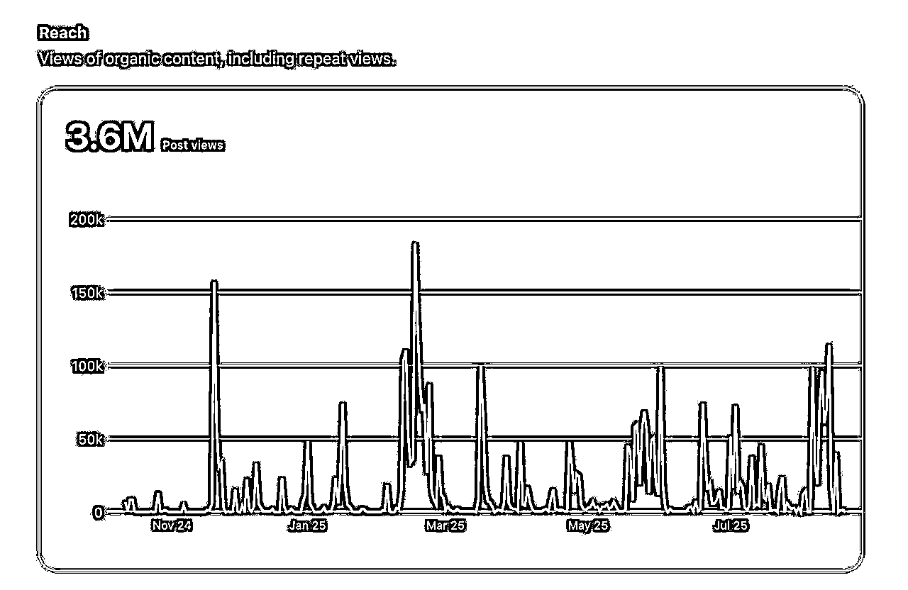
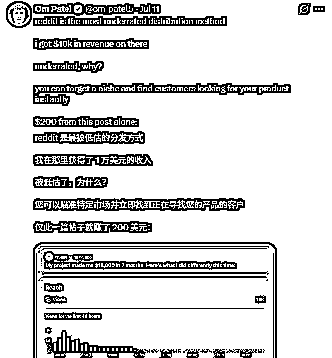
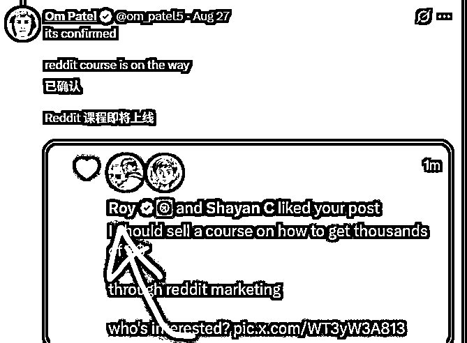
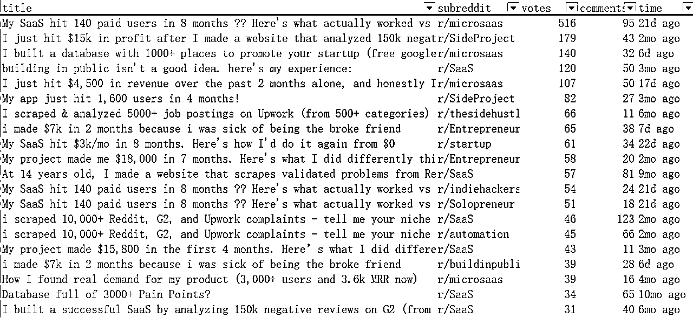
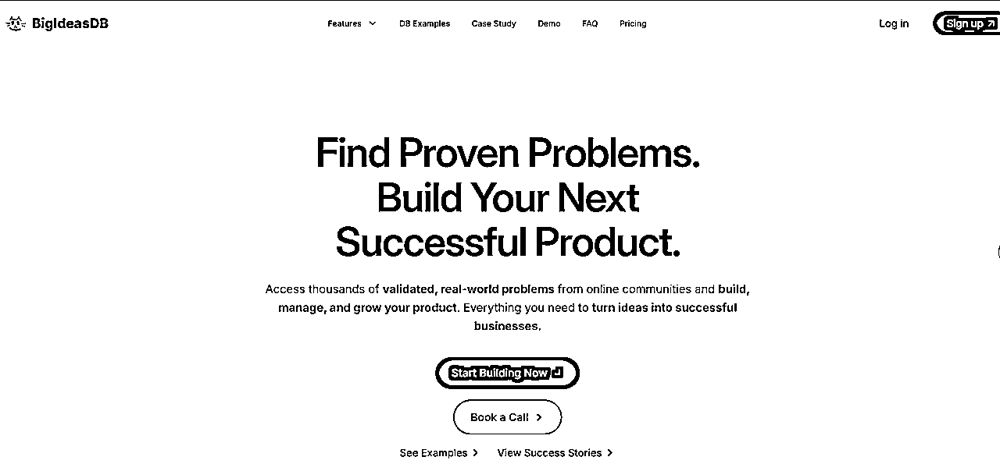
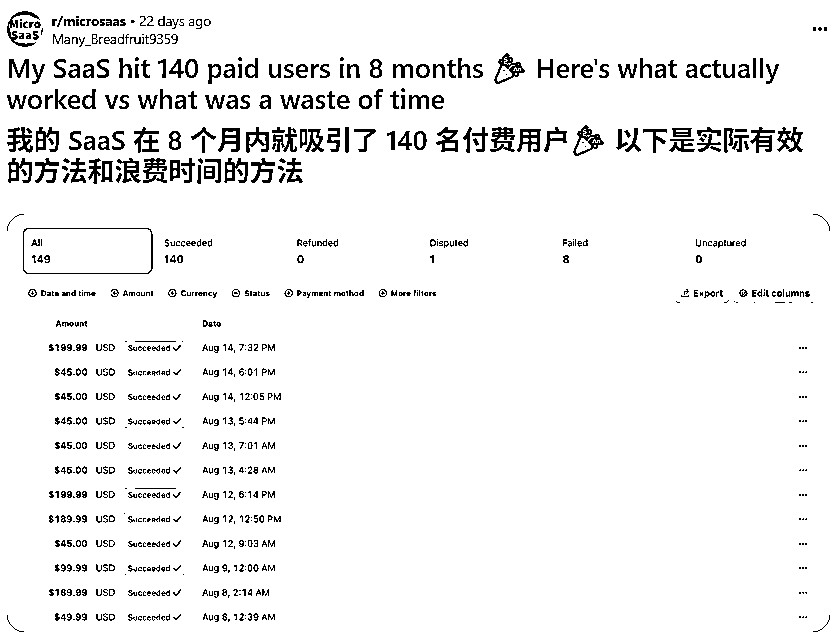
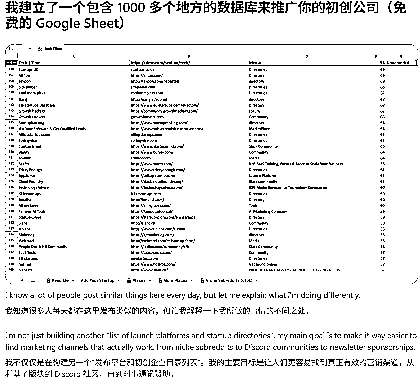
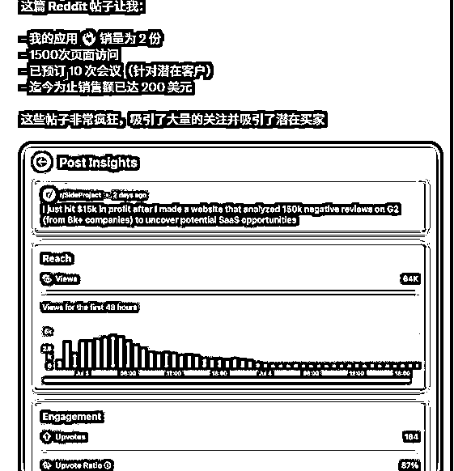
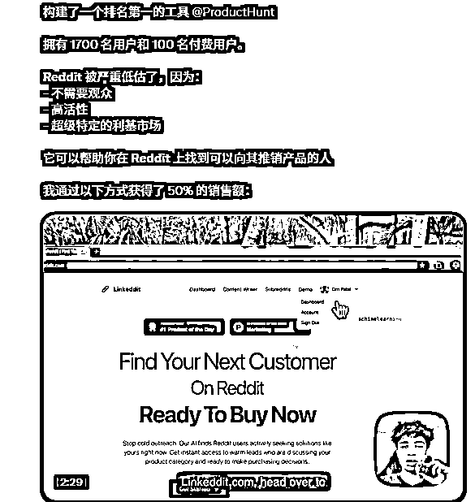

# 15岁高中生靠Reddit月入上万？他做对了哪几步

> 来源：[https://gwlxqear42r.feishu.cn/docx/KSlAducaFocSsnxRmULc4ktEnhd](https://gwlxqear42r.feishu.cn/docx/KSlAducaFocSsnxRmULc4ktEnhd)

Reddit怎么才能带来真实流量？这个问题困住很多独立开发者，却被一个15岁的高中生做通了。他的单帖阅读屡破百万，半年累计把SaaS做到了万美元级收入，还被Cluely创始人点赞关注。我拆解了他的发帖逻辑和引流打法，整理成这篇复盘，供想出海的同学参考。PS：文末有彩蛋。

上周刷Reddit时，我撞见一条很反常的帖子。楼主放出一个超1000条推广渠道的表格，随后就有50位用户主动在评论区报上自己的产品和联系方式。现在海外获客成本水涨船高，一条帖子能撬动这么多精准潜在客户，立刻勾起了我的好奇心，于是去扒了下这个人。

发帖人Om Patel，简称om。过去半年他在Reddit的累计阅读超过300万，是r/SideProject等头部社群的Top 1%发帖者，主推的SaaS也因此拿到过万美金的收入。更夸张的是，这位顶流运营才15岁。

om的操作很快在海外开发者圈子里发酵，就连Cluely的创始人Roy都给出了点赞。我看着后浪一波波扑过来，决定在他开课前先把他的内容营销套路扒清楚。

他长期践行Build in Public，凡是高互动的帖子都会同步到X上炫耀。顺着推特就能定位到他的Reddit账号，账号karma接近5千。虽然他把主页内容设成了私密，但用用户名搜索依然能找回大部分历史帖子，再配合Easy Scraper插件就能还原内容轨迹。

先搞清楚他在卖什么，再看他怎么引流。目前他主推的是BigIdeasDB，一个面向独立开发者、创业者和产品经理的SaaS工具，定位是自动化市场研究。核心思路是把Reddit帖子、G2差评、Upwork招聘信息、应用商店评论等真实用户反馈汇总，帮助用户挖掘经过市场验证的创业灵感。

产品本身就长在Reddit生态上，所以回源引流顺理成章。他常去的投放位是r/SideProject、r/microsaas、r/thesidehustle这类社区，聚集的都是在找项目、做产品的独立开发者，和他的用户画像高度重合，而且对软性推广的容忍度相对较高，放链接不易被踢。

## 一、内容分型

om在Reddit的帖子大致能归为三类：

1. 经验沉淀型。核心钩子是“我能带你做什么”。他把自己做产品、做增长的实操体会讲出来，吸引同样卡点的开发者。

典型标题如“我的SaaS 8个月做到140个付费用户，哪些招数有效哪些是坑”、“公开造物并不是万能药，以下是我的教训”、“项目上线前4个月赚了$15,800，这次我改动了什么”、“我如何找到真实产品需求，现在用户3000+、月收$3.6k”。

标题里放具体的数字制造冲击，内文讲方法论树立专业感，最后在正文结尾或评论区自然带出产品。对自媒体人来说这套很常见，但在开发者社区能既会造物又会讲故事的人很少。

1.  痛点拆解型。核心钩子是“我发现了什么问题”。重点在于呈现调研过程和成果，用数据处理能力吸引正在找需求的开发者。

典型标题如“我做了个分析8000+家公司G2差评来找SaaS机会的网站，已实现$15k盈利”、“我抓取了1万+条来自Reddit、G2和Upwork的吐槽，报上你的赛道我就给你一个真实痛点+SaaS点子”、“我整理了一个包含1000+个创业项目推广渠道的数据库，免费表格开放下载”。

这里可以大胆推测，公开的数据表其实是在为后期的课程预热种草。留下数据的这群人已经有产品了，需求点不在找灵感而在找渠道，而om的Reddit引流经验正好对上他们的痛点。我会继续观察他后续动作，看是否如我所料。

1.  Build in Public型。核心钩子是“我正在构建什么”。分享开发和增长过程中的进展，用持续输出换取社区信任。

典型标题如“我的应用4个月内用户突破1600”、“我给我的SaaS拍了个零成本发布视频，来点反馈？”、“我给应用上了免信用卡试用，转化率提升了10倍”。

真正的Reddit营销不是硬塞链接，而是编织一个能引发共鸣和讨论的叙事。下面拆解他的内容骨架：

## 二、内容骨架

### 标题写法

可借鉴的公式是：我做了 X（具体行动），得到 Y（具体结果），用来解决 Z（具体痛点）。这种写法直接打在目标用户的焦虑点上，用可量化的结果代替空洞承诺，例如：

“我做了一个分析G2上（来自8000+家公司）的差评以发掘SaaS机会的网站，刚刚实现$15k利润”

=行动（分析差评）+成果（实现$15k利润）→痛点（发掘SaaS机会）

“我做了一个 AI 助手，它掌握来自 G2 和 App Store 上 20 万+ 条软件评价、Reddit 帖子，以及 Upwork 职位发布 中的所有抱怨/痛点。”

=行动（构建AI助手）+成果（知道所有痛点）→痛点（人工调研）

### 正文写法

Reddit社区极度反感硬广，所以价值先行，把产品包装成“项目分享”或“调研发现”，om的模板基本是：

*   开场白：用亲切的社区问候切入，如“hey everyone!” 或“Just shipped something I've been working on for months...” ，迅速拉近距离。  

*   痛点引出：简短说明自己为何做这个东西，和社区的共同痛点对齐。

*   方案展示：详细介绍产品功能，用用户能听懂的语言描述。例如AI助手不是“复杂AI模型”，而是“能即时访问我们数据库的助手” 。  

*   额外价值：附赠免费的Next.js模板或数据表格，换取信任。

*   互动收口：结尾以征求反馈、邀请试用等互动收尾，而非“点链接购买”。这样把单向推销变成双向对话。

## 三、增长路径

总结om的Reddit增长打法，是把平台当长期运营场，而不是一次性引流渠道，形成“三步走”节奏：

第一步：倾听与验证，以“解决问题型”开局

*   目标：做市场调研、验证痛点、积累初始信任。

*   方法：先不卖。像om那样展示你如何用工具/方法挖出一个真痛点，并释放少量免费洞察，比如“我分析了1000条亚马逊评论，发现了这个痛点”。

第二步：构建与分享，以Build in Public为常态

*   目标：持续曝光、保持活跃、积累社会资本。

*   方法：稳定分享开发历程，公开挑战和每一个小里程碑，让社区感觉自己参与了产品的成长，产生情感联结。

第三步：发布与互动，以“经验分享型”引爆

*   目标：把关注度转化为流量和用户。

*   方法：在新功能上线或里程碑时，写一篇精心打磨的复盘帖，突出功能如何解决具体痛点，并附上演示视频或资源。评论区要积极回复，把它当成获取反馈、建立长期关系的阵地。但别跟喷子硬刚，容易被限流。

感谢看到这里！如果这篇复盘对你有用，欢迎点赞、赞赏并转发给需要的朋友~

最后附上那个包含1000+海外引流渠道的汇总表下载，希望能帮你出海赚美金，一起龙哥盟！