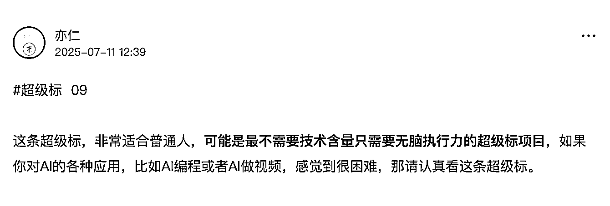
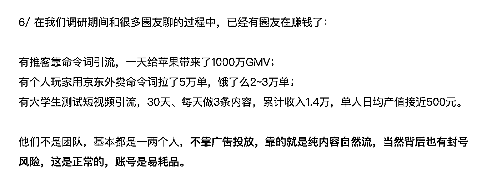
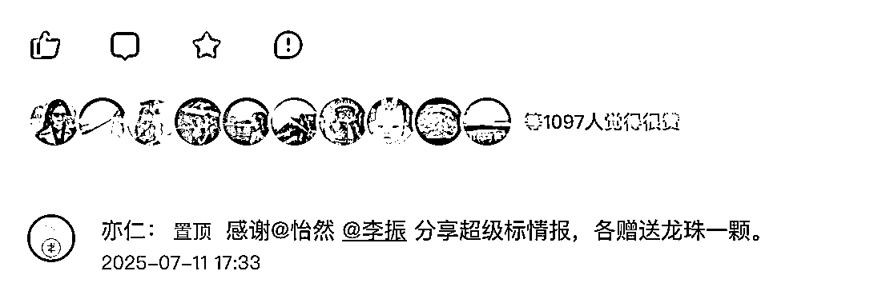
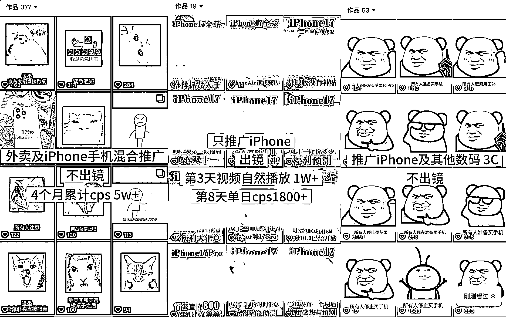
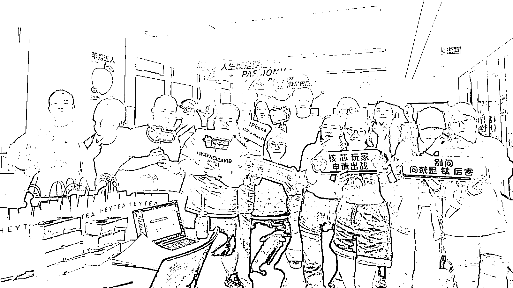
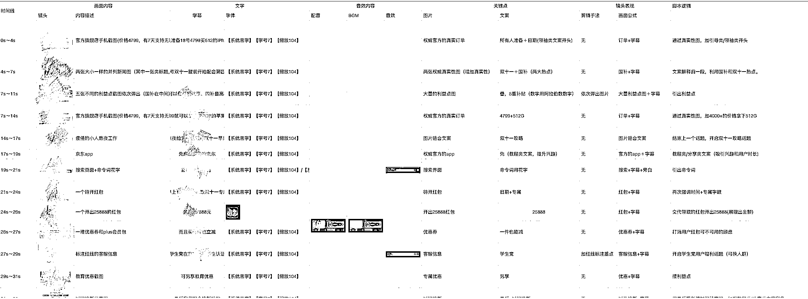
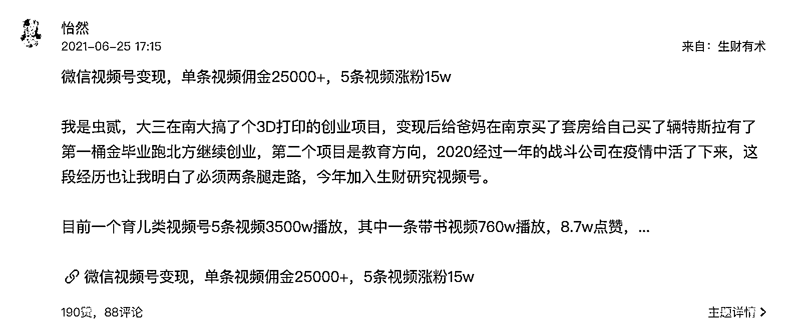

# (198 赞)抖音自然流密令词 CPS 这波机会怎么抓
作者：龙哥

## (198 赞)抖音自然流 CPS 项目机会拆解

作者： 怡然

日期：2025-10-19

* * *

大家好，我是龙哥，网名邓怡然。

圈内很多人可能更熟悉我“天才少女”的称号，借这句话回应一下：感谢大家抬爱，天才谈不上，我只是把当下能跑的流量打法和内容逻辑理解透了。

今天这篇很直接，聊一个现在正到位的机会：**抖音自然流 CPS。**

**并且我们将在双十一窗口期，和龙哥盟联合推出一期关于抖音自然流 CPS 的 mini 航海。**

个人自我介绍和本次主题关联不大，感兴趣的朋友可以另看：一条视频私域引流 30w+，我怎么通过内容在抖音精准引流[`t.zsxq.com/uo1Yo`](https://t.zsxq.com/uo1Yo)

这个思路是怎么来的，其实要从一顿饭说起。

今年 6 月广州航海家流量大会的嘉宾晚宴上，我和龙哥老大、家蒙几个人围坐聊天。

家蒙讲了他在做的 B 站好物项目，我则分享了自然流+密令词的组合玩法。那天聊到两个关键信号，一个是 5 月 11 号，iPhone 16 首度跌破 6000 元叠加国补后到手 5499，一条自然流内容一晚卖了 1000 万的苹果；另一个是外卖大战已经白热化，抖音上大量曼波风格的外卖视频在吸量，玩法上很有空间。

就这么聊了十来分钟，后来衍生出了两个爆款赛道——

B 站好物，和外卖内容推客。

感谢龙哥老大给的超级标龙珠

**  **

抖音自然流 CPS 的本质是：**门槛低到只剩执行力，普通人也能上手的项目。** 可推品类覆盖外卖、数码家电国补等。

先说清楚这个项目在做什么，再说为什么就是现在。

最重要的，还得把不合适的人先筛掉。

# **一、项目是什么：抖音+自然流+密令词**

把短视频发到抖音，用密令词把用户导到电商平台，完成交易后拿佣金，这就是抖音自然流 CPS 的闭环。

盈利路径来自电商联盟，推广数码 3C、国补家电、外卖等品类，买家确认收货后按比例结算佣金。

**不用囤货，不用开店，不用花钱投放，一个人就能完成创作到变现的闭环。**

过去的内容电商强调的是“拍内容直接带货”，而现在的自然流 CPS 更像是“拍内容种草密令”。

和挂小黄车带货不同，**内容要足够原生，平台能感知到你是在提供信息差而非硬卖**。密令词机制，本质上是把流量获取和转化路径重新拆开了。

上面几组账号案例，有出镜也有纯脚本，脚本都能复用。能出镜的话，内容形式会更宽。

选抖音的原因很现实：📕对自然流挂密令词的风控很严，基本跑不动。抖音只要内容真的有价值、够原生，**越像素人分享的视频越容易被推，爆量概率越高。**

# **二、为什么是现在？**

我到今年 4 月前都是投放派，即便自然流有量也会主动放弃，觉得能用投放加杠杆的事没必要靠自然流硬铺，人效低、不性感。

但今年两个变化让我改了主意。

第一个是外卖大战里，自然流个人推客单日出单 50 万单的案例真实存在。自己实操后也发现，找到方向后用数量对冲概率，自然流的量级完全可以做大。

第二个信号来自联盟方。今年双 11 合作伙伴大会上透露，联盟在期间给个人推客的分成池有 8000 万，而且大部分被少数头部个人推客拿走。这个信号太性感了。

这就是航海的起点。

**为什么一定要现在上？玩法性感 + 时机对 + 平台配合。**

只要抖音不强力封禁自然流密令词引流站外的行为，这个赛道就值得做。更关键的是，双 11 期间京东联盟官方主动扶持自然流密令词，激励和活动力度都远超平时。

原本计划是十一月开航，但为了不错过双 11 红利，我们提前开船，用 mini 航海快速启动。

# **三、航海能带来什么？**

**  **

除了我，这次会有海宇教练全程带队。海宇在星球里露脸不多，他做过大量品牌内容营销项目，他团队一年卖了 5 个多亿的 iPhone。本次我们定的小目标是带大家一起做 5000 万 GMV。

**我们会从零开始，把自然流 CPS 的完整流程跑通**

**  **

玩法并不复杂，航海的核心是拆解可复制的脚本。

自然流 CPS 投入低、可复用，练出来的内容能力也是后续所有内容项目的基础。

流程是：发第一条视频 -> 用密令词把第一个用户拉到平台 -> 实现首单拿佣金 -> 复盘数据 -> 快速迭代。

**联盟官方为这次航海准备了充足的密令词资源**

**  **

我向平台申请给赚钱圈友准备 500 个密令词，人手一个。京东联盟直接给了 1000 个，最终京东、美团、淘宝三家平台合计拿到了 2000 多个。属于资源充足的仗。

但名额会控制得很严，人均资源更多，直接干。只要满足平台出单门槛的密令词航海结束后仍可继续使用，可以作为长期个人业务运营。

# **四、劝退说明**

**  **

前面说了，这是一个不需要技术，只拼执行力的项目。

但恰恰因为不需要技术，门槛反而更高，因为没有捷径可走，完全看执行强度。

因此先劝退四类人群：

1️⃣  **双十一期间已有其他项目在跑的** ——请先保证现有业务不掉线。

2️⃣  **执行力弱、只想看风口的** ——这次节奏快，必须高频输出。

3️⃣  **只想听课不想动手的人** ——我们是实战营，不是培训课。

4️⃣  **急需正反馈的人** ——前期数据可能很差，容易挫败。

自然流的反馈周期并不短，可能有人第一条就出单，也可能有人连发十几二十条才有第一单。正反馈很爽，但冷启动是煎熬。

劝退不是为难大家，而是避免盲目跟风。真正理解了项目逻辑后仍愿意投入的人，执行才会坚定。

如果你不是以上四类，基本不需要额外能力。

文章提前发出来也是为了让大家先判断，别临时冲动报名。

**【更新补充】**

**报名时间 10 月 21 号 20:00，赚钱会发正式报名贴，限 450 人**

看到这里还不被劝退的朋友，记得设闹钟。

后面是一些碎碎念。

# **写在最后**

**  **

坦白说，这次航海对我也是挑战。

我习惯带着团队落地，现在要带一群线上没见过面的伙伴远程执行，能否达成预期我心里没底。我自尊心有点强，怕做不好体面收场。

但我确定的是，这是一个能复制且能拿结果的机会，那就干。

契机从一顿饭开始，决定开航则源于另一顿饭。九月深圳航海家晚宴上，我和龙哥老大、坤汀聊到平台给个人推客分走巨额佣金，为什么头部不能是我们赚钱的人。敲定合作后，龙哥老大又带我们去找李克老师吃饭，那顿饭我回味了一个月

饭后还特意穿上了淘宝闪购的第一件外卖服留念一下。

被老大这么多顿饭喂养，这事儿必须认真做！

我在赚钱待了五年，正好是第二次创业失败的低谷期。那段时间在赚钱试了无数玩法。

第一篇帖子写的是视频号带货，和现在做的完全不同，那时还用着花名

那段正反馈给了我很大鼓舞，也跟着赚钱做过淘宝蓝海、知乎好物等不少项目。低谷时赚钱给的信息和信心都很珍贵。这次我也想从一个受益者变成一个能给圈友提供信息和信心的人。当然也有私心，想借这个平台鼓励期把势能做大，走到下一个版本的自己。

一起航行！一起龙哥盟！！

* * *

评论区：

有尔 : 给天才少女打 call[爱心]

篮子🍀 : 哇，期待这个航海！

岽子 : 新人炒鸡期待，准备撸起袖子了

小鹅 : 除了流量和天真蓝 db11 亿无所有的小姐姐一枚

华龙 : 跟上

sunflower : 订好闹钟，准备跟

Vic 胜前 : ➕1 蹲蹲蹲

西瓜 : 上次 mini 航海没报上！这次狠狠蹲！！！