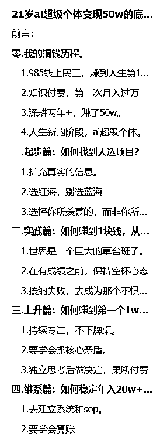
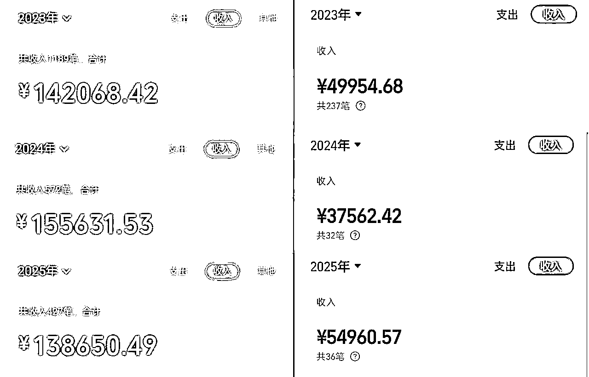
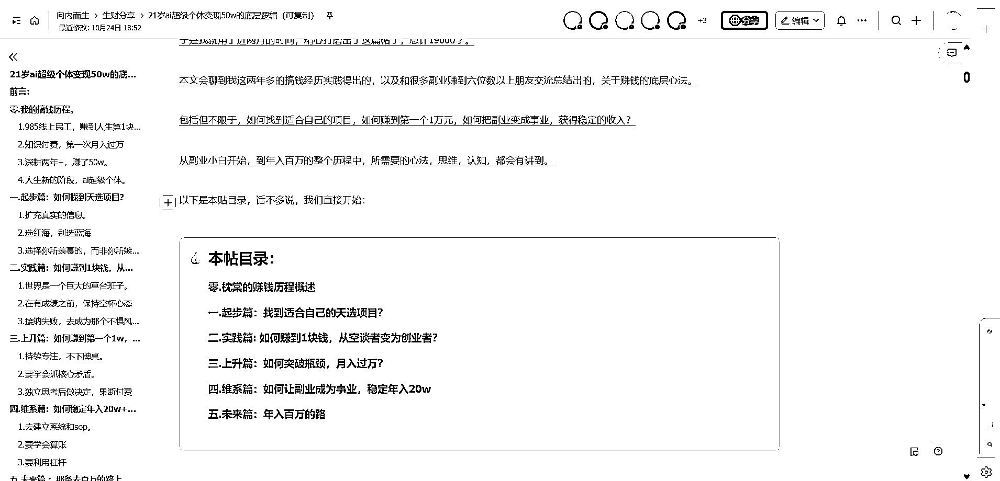

# 从零碎收入到稳定年入二十万，我是怎么把副业做成可持续的现金流的？

大家好，我是枕棠。21 岁，本硕刚毕业，已经在赚钱里混了三年，现在是第三次来跟大家聊我自己的变现路。

这次想把这两年来实操踩过的坑，以及和几位做副业到六位数收入的朋友深度交流后提炼出的东西，系统性地摊开讲清楚。

会围绕几个核心展开：怎么选到真正适合自己的赛道、怎么拿到第一笔一万元、怎么把一次性的项目收入沉淀成长期稳定的事业。并且会结合从小白起步到冲击年入百万的完整轨迹，分享一些我认为更关键的心法、思维方式和认知升级。

这篇笔记的雏形，其实要感谢一次线下分享的契机。谢谢掌柜一直以来的组织和关注，给了我一次在 30 人小范围线下沉淀观点的机会，让文章框架得以成型。

特别感谢林途老师，线上线下聊下来，对事业的整体格局以及细分垂类账号的打法，都给我很大启发。感谢吴熳姐姐，多次头脑风暴让我补上了 Coze、多维表格等 AI 工具的信息差。感谢戴哥，来到北京后每一次的转折和试错，戴哥都给了非常具体又专业的指引，像一盏灯一样照亮方向。

最后还要感谢赚钱社区和龙哥老师，过去三年里我基本都浸泡在赚钱里，很多关于赚钱的底层认知和第一性原理，就是在这里一点点长出来的。[`p3ak6osfed.feishu.cn/wiki/T9rSwYuI3i8UZkkORgvc4hagnrc?from=from_copylink`](https://p3ak6osfed.feishu.cn/wiki/T9rSwYuI3i8UZkkORgvc4hagnrc?from=from_copylink)

* * *

读者反馈：

林途 : 干货浓度很高，复盘很到位。

鹤儿 : 能赚到钱是必然的[强][强][强][强]，写得太清楚了

枕棠 : 哈哈谢谢[爱心][爱心][爱心]

枕棠 : 哈哈谢谢林途老师，一直向您看齐[爱心]

练多就菜 : 同龄大学生里能做到这一步的，真的不超过 1%

枕棠 : 感谢[爱心]

飞掌柜 : 你的干货输出也帮助到很多人了，期待精华[得意]

枕棠 : [爱心][爱心][玫瑰][玫瑰]谢谢掌柜