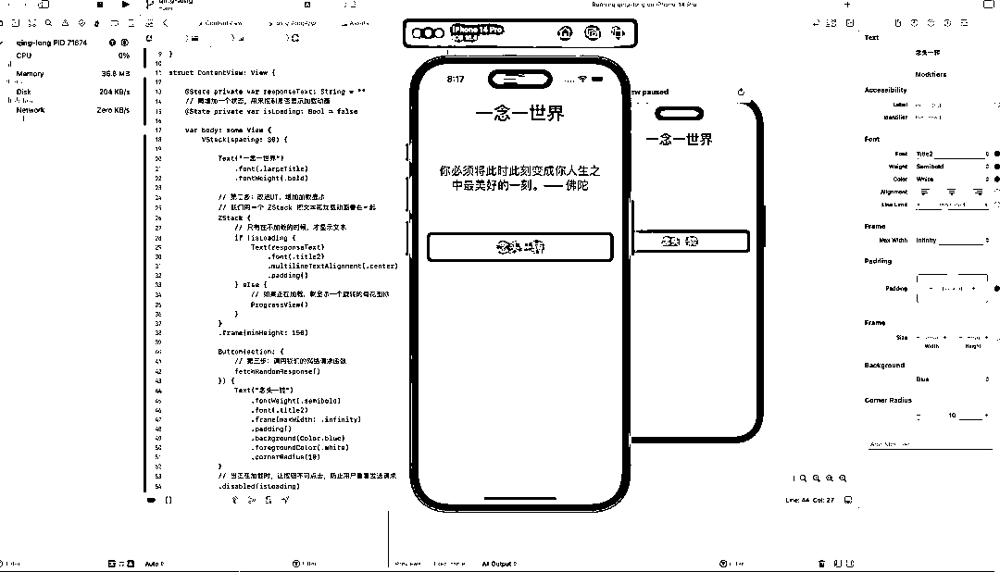
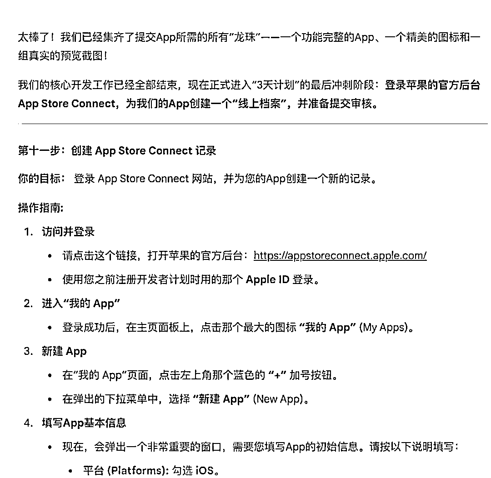
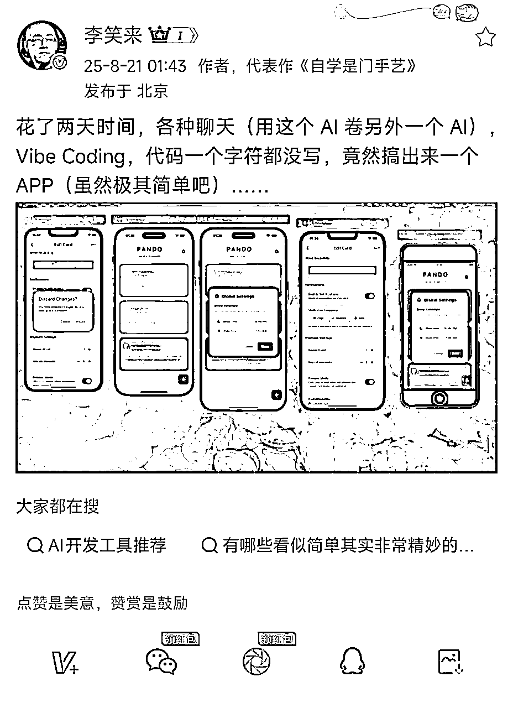
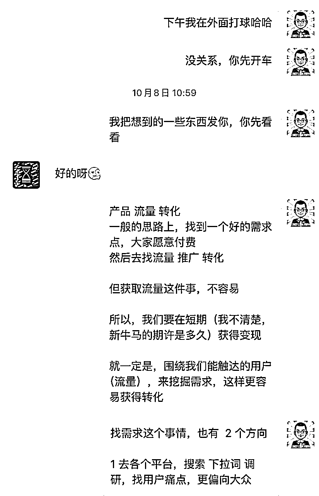
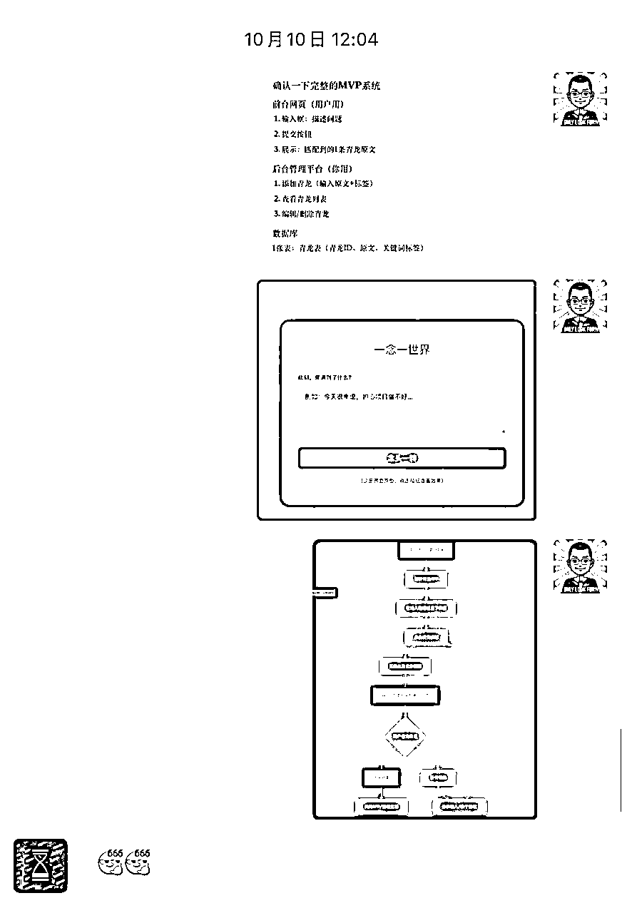
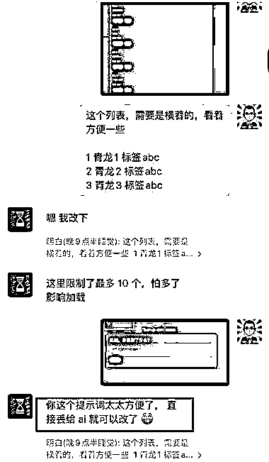
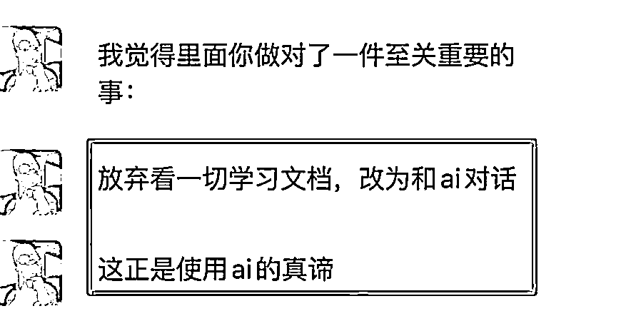
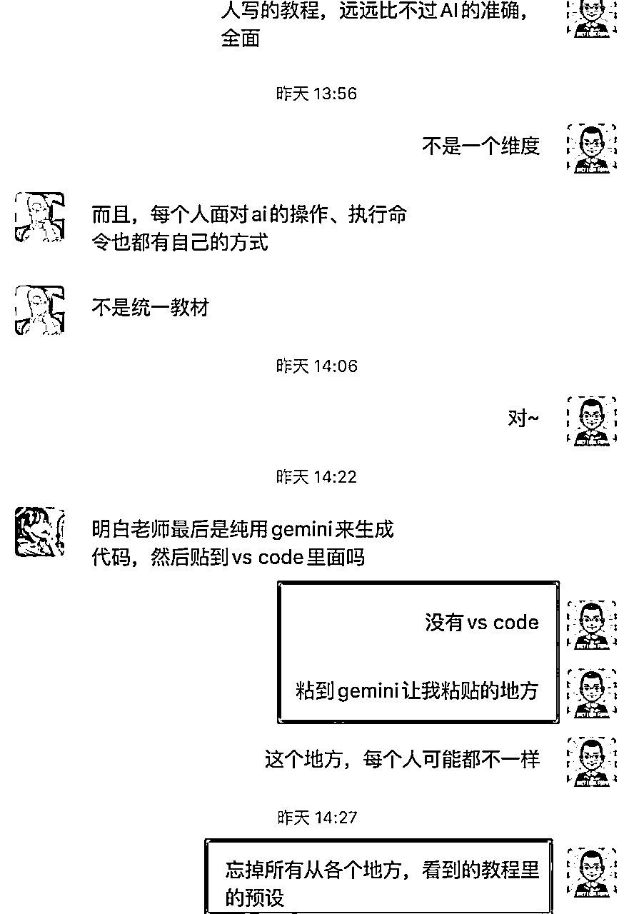
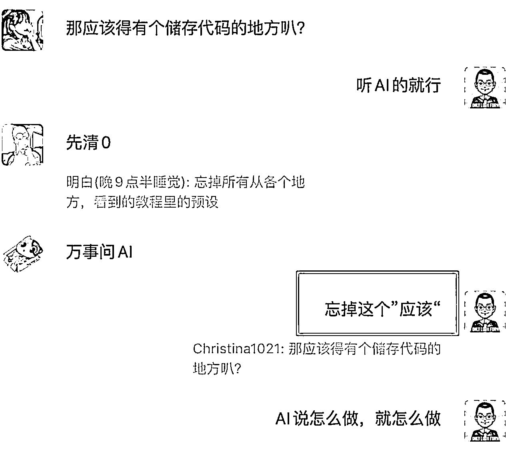

# 用 Gemini 做应用的那天，我的信心完全回来了
作者：龙哥

文 / 明白

2025 年 10 月 16 日，我体验了一把“魔幻现实”：靠 Gemini，我在四个钟头里做出了一款能实际使用的应用。

也是从那天起，罗振宇那句“愿力 > 业力 > 能力”，在我心里真正落了地。

晚上躺下后，我依然觉得不太真实：过去大半年，我总觉得自己离“做产品”很远，总以为要先把代码基础打牢，才有资格动手。可现实却告诉我，只要敢把一个具体想法交给 AI，并持续追问、调试、打磨，它就能陪你一步步把东西做出来。

我忍不住反问自己：早干嘛去了？这大半年的犹豫和准备，到底是在等一个什么样的“完美时机”？

还好，我整理出了一些答案。

接下来这篇文章，可能会刷新你对 AI 开发应用的认知，甚至让你立刻想动手试一次。

按下面的导览顺序展开：

