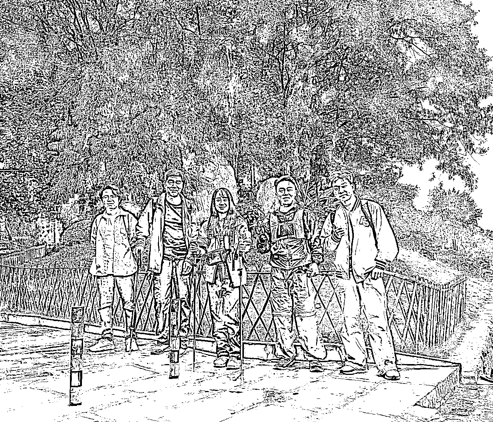

# 当现实比剧本更让人鼻酸，我在徒步路上遇到了两种截然不同的活法
作者：龙哥

前天跟赚钱的伙伴们一起爬山，认识了一位五十出头的老哥。聊下来才知道，他原来在国企拿着五十多万的年薪，却主动辞了职。

原因只有一个：22岁的儿子，自小就有轻度自闭症。大哥想亲手带他走进社会，让他慢慢学会独立。

这段时间他陪着孩子尝试过地推，也尝试过送外卖。他的话很简单：你放手去试，卡在哪儿了就跟爸说。

甚至他现在每天泡在赚钱里研究各种项目，也都是为了给儿子攒一个未来能靠得住的生计。听到这里，我心里堵得慌。

当晚回到家，自己的家庭就出了变故。22岁的我，一夜之间得扛下本不该这个年纪就要扛的家务事。看着这两种命运的对照，我既感动又难受。

我从小在充满争吵的家里长大。父母常年冷言冷语，嘴里挂着的就是“我们家穷”。久而久之，我变得自卑、退缩、胆怯。考上飞行员进大学后，我发誓要靠自己改写人设。

这些年我一个人逼自己成长，扛过无数次的压力和自我突破，才一点点把自己从不自信磨成了现在的样子。上学、做副业、攒下一点积蓄，我以为终于能松口气了。没想到变故又来了。

难过是真难过，但我只能把这件事往好的方向想。

我有健康的身体，这是父母唯一给我的底气，我已经很幸运了。
我有份喜欢的主业，只要持续学、持续做，财富的基础就不会缺。
再加上这几年副业攒下的人脉、项目经验和各种技能，就算哪天主业遇到瓶颈，我也还有退路可以慢慢积累。

没有人会为我兜底，我只能做自己最坚实的依靠。保持成长，心态往前走，这关一定能过去，以后只会越来越稳。

赚钱朋友圈

* * *

评论区：
劳模姐|零碳园区 : 加油💪
瑶玲 : 加油，命运给了你低谷，勇敢走过去了，未来剩下的都是高走了
龙哥 : 你已经很棒了，加油。
戴智慧 : [加油][加油][加油]谢谢老大
戴智慧 : [加油][加油][加油]
戴智慧 : [加油][加油]
呆文刀 : 加油[强]
冬丽传奇 : 加油，不过工作只能说攒钱，远远说不上积攒财富，财富是爆发性才能积累下来的