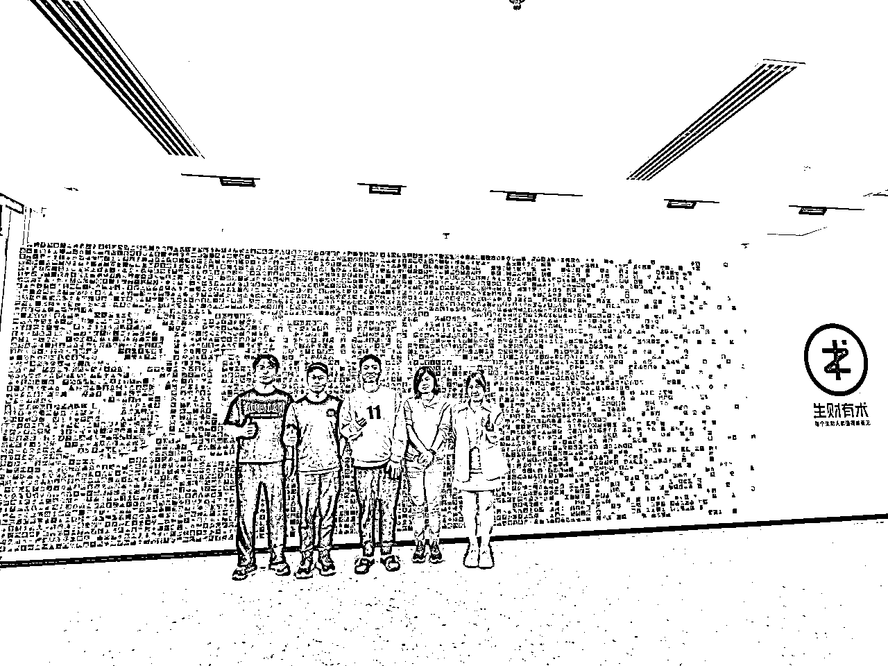
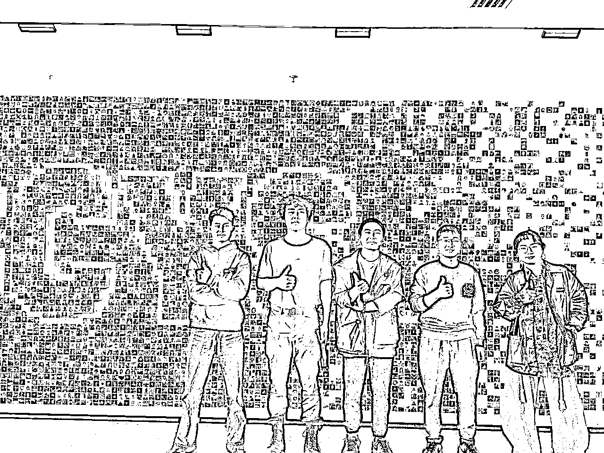
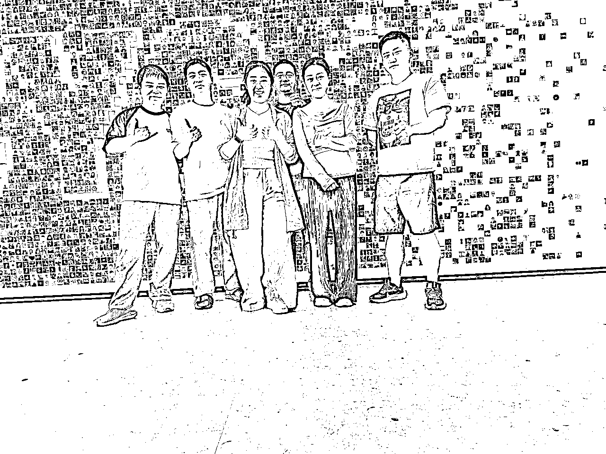
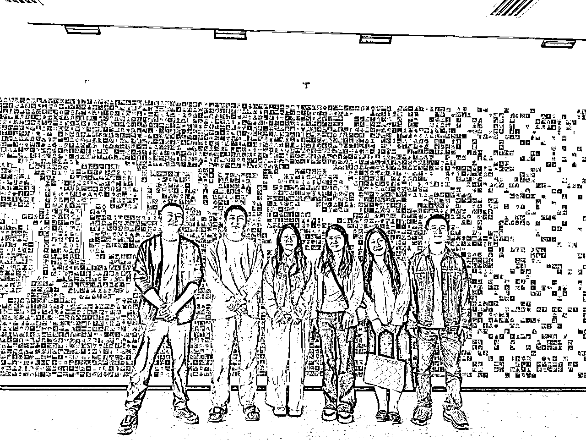
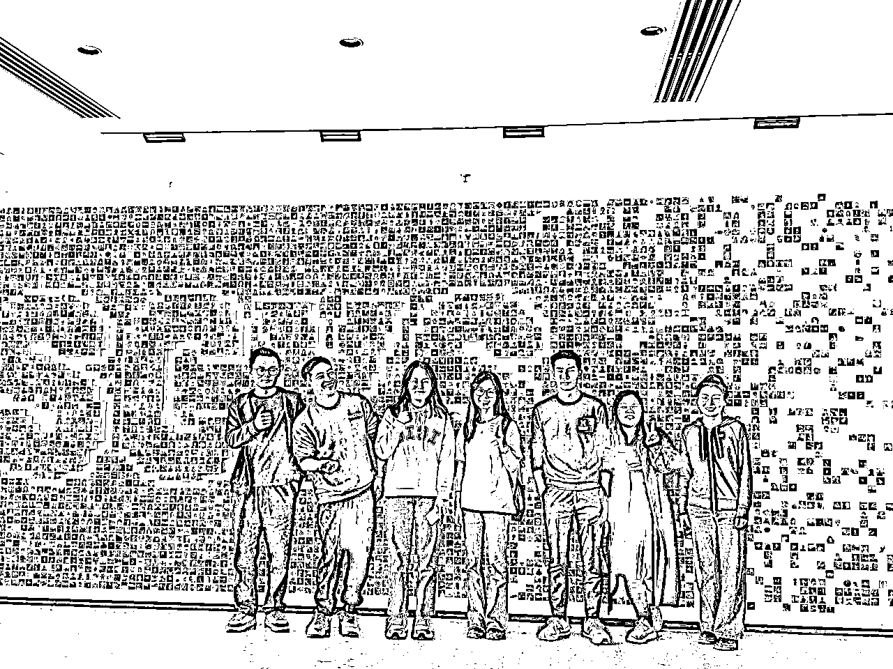
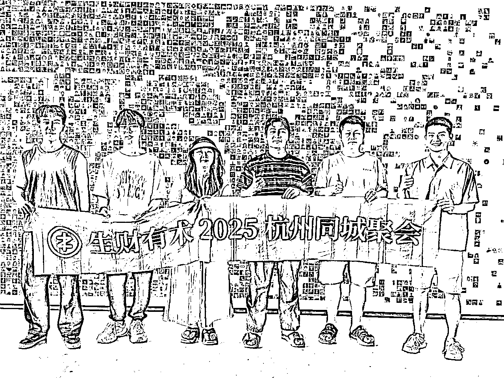
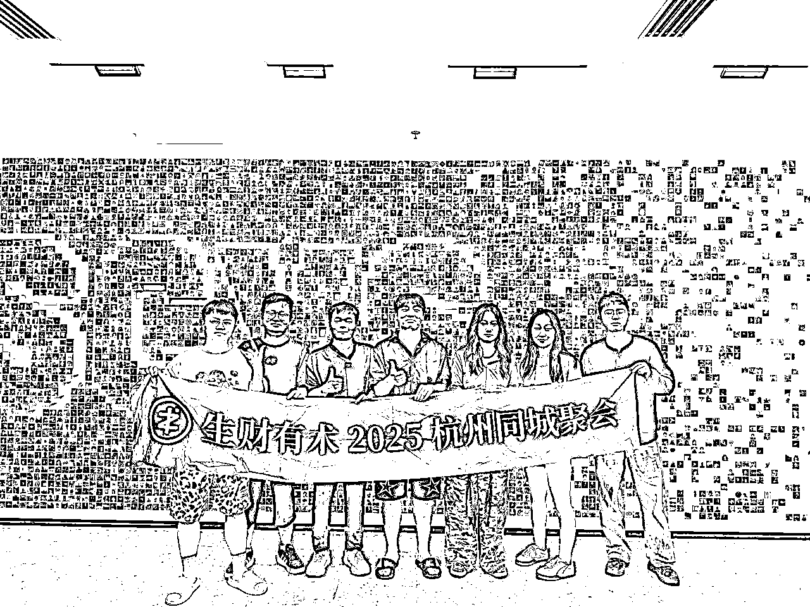
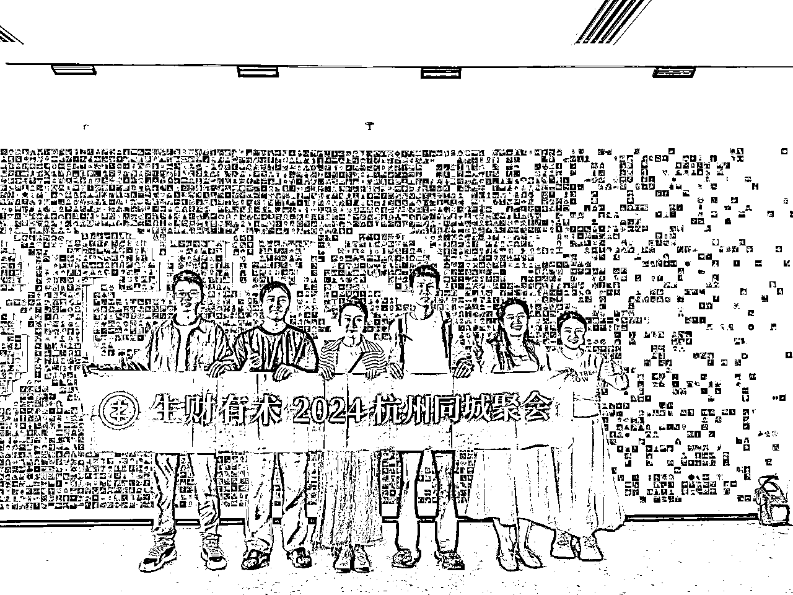

# 31场线下见面会，内向者的加速成长实验
作者：龙哥

来自龙哥盟社区精华帖

撰文：易芝（专注AI与RPA方向）
发布：2025年10月16日

先说说我的标签：一个在种草社区负责获客的人。过去半年里，我发起了31场线下活动，数量排在全站第一。很多人听到这个成绩，下意识以为我特别外向。其实恰恰相反，我是那种聚会结束要独自充电很久的典型内向者。

之所以坚持办这31场局，是因为我发现了一个秘密：在线下面对面的交流中，原本卡住我很久的问题，往往几十分钟就能被拆开；你会认识很多原本够不着的人，机会会在不经意间出现；你还能用最小的成本，拿到最新鲜的生意样本。这些东西，坐在电脑前很难得到。

更重要的是，组局这件事给了我巨大的复利。它让我从“等待别人看见”变成“主动创造连接”。我慢慢意识到，一个内向者能拿到组局数量的第一名，不是我自己能力有多强，而是组局这种舞台本身需要有人主动站出来。当你把舞台搭好，合适的人自然会聚到你身边，很多合作和灵感就是这么长出来的。

这篇文章不谈具体操作流程，只想把这段经历讲给还在犹豫的你听。若你也曾想牵头组织一场线下活动，却因为害羞、担心自己不够格而退缩，希望我的故事能给你一点勇气。当你真正行动起来，成长速度会超出预期。

大家怎么说：

鱼丸（官方助理）：31场线下聚会带来的收益实在太明显了！祝贺这位伙伴在这里找到了适合自己的发展节奏。发起人的价值并不取决于个人能力强弱，而是创造相遇的土壤。想通这一点，心里的负担会小很多。若你也有牵头做一场聚会的念头，别再犹豫，点这个入口就行：[报名通道](https://scys.com/t/BOA7NKpe)

杨 1：干得漂亮！
易芝：鱼丸的鼓励收到啦～
行动派小K：什么？你竟然是个内向型人格！
行动派小K：这成绩好厉害！我一直不敢张罗线下活动，但看完你的经历，我也开始心痒痒了。
高盛：这就安排！
易芝：走起！
阿懂：原来是INFJ！