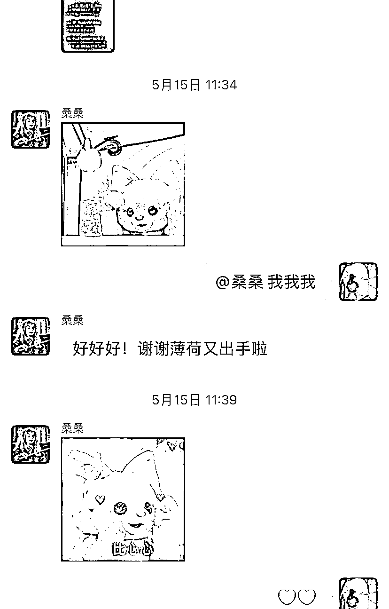
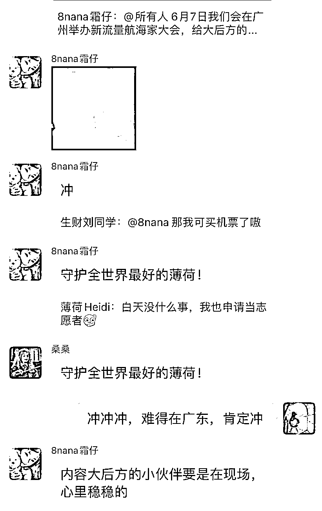
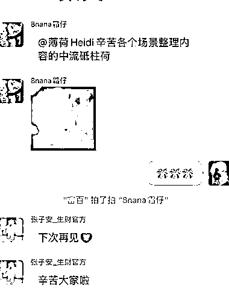
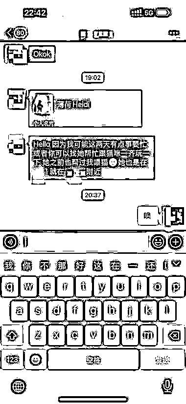
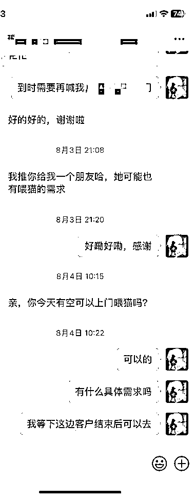

# ('(精华帖)(110 赞)靠谱是会复利的：我用 4 个动作，从接零散小单到被主动推荐', (2, 43))

你有没有过这种体验：活干得挺好，客户却没下文了？明明很努力想让人觉得自己靠谱，对方却总是将信将疑？眼看着别人被推荐、被续约，自己却还在满世界找机会？

说实话，我也在这个坑里蹲过很久。后来我慢慢琢磨出一套自己的方法，然后从上门喂猫、整理逐字稿这种不起眼的小事开始练手，一步步走到今天——客户主动来找我续约，合作方愿意把我推荐给别人。

这套东西，说白了就是“靠谱的复利”。它不是讲大道理，而是真正的商业逻辑：靠谱不是与生俱来的天赋，而是可以一步步训练出来的能力；不是虚无缥缈的玄学，而是有清晰路径的方法；不是自我感动式的鸡汤，而是能实实在在带来回报的投资。

我发现自己从“随时能被替换”到“被大家需要”，关键就靠四个动作。做志愿者的时候我就发现，光嘴上说“我很负责”没人信，得拿出具体的东西来证明——比如把一件小事做得出乎意料地好，好到让人忍不住想“哇”一声。上门喂猫半年，因为每次都把情况汇报得清清楚楚，猫主子们放心了，邻居也开始找我帮忙；整理逐字稿，因为每篇都整理得足够细致，后来20多篇内容都有人主动来约。

这套逻辑跑通了之后，你的靠谱就会开始“滚雪球”：不用你去追着客户跑，客户会回头找你；不用你到处自荐，合作方会帮你宣传；靠谱不再是你自己给自己贴的标签，而是别人眼里实实在在的口碑。

所以，别再觉得靠谱是天生性格了，它是有方法、有路径、有回报的。希望我们都能成为一个“被需要”的人。

也欢迎在评论区@一个你觉得靠谱、愿意长期合作的人，说不定缘分就从这里开始了。

飞书文档里我把这套方法完整梳理了一遍，有需要的朋友可以自取：[`lqhefhcsx54.feishu.cn/docx/XdfsdJhDrooulMxmKwucohZXnUe?from=from_copylink`](https://lqhefhcsx54.feishu.cn/docx/XdfsdJhDrooulMxmKwucohZXnUe?from=from_copylink)

* * *

评论区里已经有不少朋友分享了感受：有人觉得这些事看似简单、做到很难，但看完后愿意再多做一点；有人说这篇文章没有那些“月入百万”的大佬故事距离感，反而更像普通人的成事指南；也有人对照着发现自己还有很多可以完善的地方……看来，靠谱这件事，确实值得掰开揉碎了琢磨。