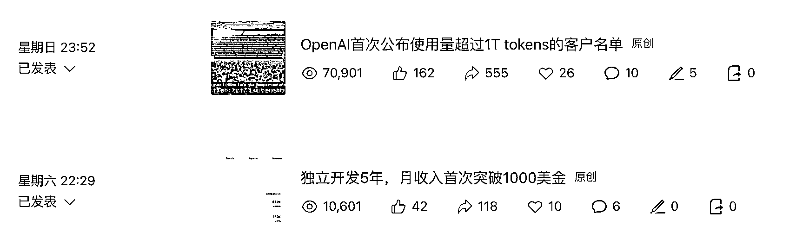
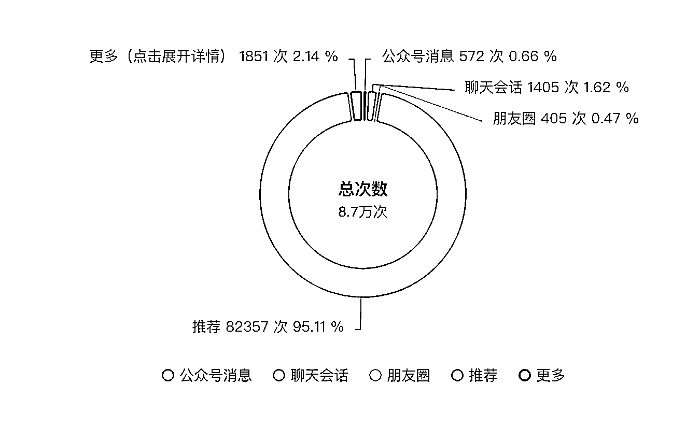
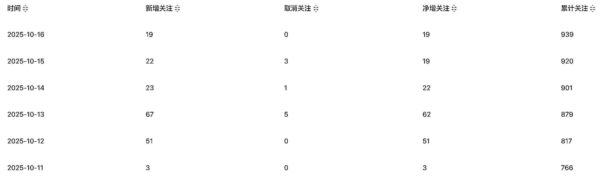
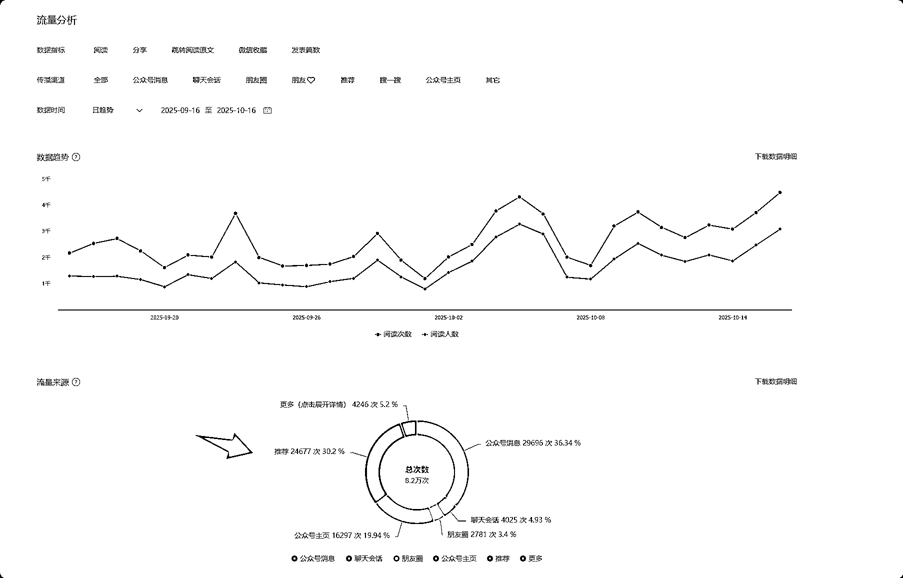
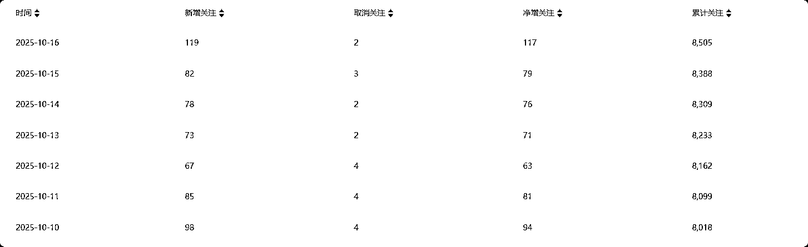

# 被踢出训练营的作者复盘：做商业微号，怎么把钱真正装进兜里

最近圈子里在转一篇很硬的复盘。作者自称是赚钱平台👸号垂直训练营最早被要求退费的那个人，航海家群也一并被移除了。颇有意思的是，他对平台的退款效率评价很高，龙珠奖励也全额返还，算下来相当于白嫖了一年会员。

他说自己早在今年中旬就察觉到，👸号的推送逻辑已经向信息流靠拢。跟赚钱里一位老导师涛哥私下聊了多次，听到的建议基本都执行了。6月账号还在四千粉徘徊，现在已经接近一万，下个月冲破一万概率很大。粉丝体量不算爆炸，但变现效率在同行里排得上号，数据他也贴出来了。

先聊一个普遍存在的迷惑行为：细分赛道的爆文操作。

这是团队里一个小号，在他手把手带出来的，底线要求是每天至少更一篇。表层数字看着在涨，粉丝曲线也在往上走。但数字之下埋着不少坑，慢慢拆。

这是该操盘手的涨粉走势。

再看他自己的大号截图：

差距看出来了吗？

先统一一个认知：做商业垂直，真正算流量的，是能沉淀到你私人微信里的联系人。涛哥的说法是，落到口袋的现金和加到微信的好友才是硬指标，其余都是虚荣指标。阅读量如果不能变成私域沉淀，本质就是自嗨。

他被清退的起因挺有代表性。作者说理念冲突，核心在于引流。他引用吴彦祖演的一部杀手电影里的台词，大意是我接单是要收费的，而且价格不低。他的私人微信在群内是严禁公开的。这件事大家都知道。后来他建议那些不会变现的人可以把流量卖给他，他来承接，结果被定性为价值观不合。

他跟平台负责人私交不错，也承认负责人的包容是平台走到今天的关键。但作为一个社群操盘者，他很清楚：有真本事的人像野马一样难拴住，听话的往往执行力可以，天花板有限。这个规律放哪都成立。

赚钱前两年风头正盛，是个现象级的社区。今年节奏变了。先是赚钱的头部玩家陆续退圈，然后平台收紧了关于导流的细则，边分享边引流的人也淡了。再跟几个城市的核心玩家喝酒聊天，大家共识是派系化很严重。体量越大，这种毛病越明显。派系化的问题负责人知不知道，他不敢打包票。他的态度很鲜明：自己的圈子绝不允许小团体存在，一把手拍板最高效，这是实践总结出来的。

他认为平台当下的短板在运营层面。每位教练、每位志愿者都想借大平台孵化自己的小IP，羽翼丰满就单飞。他亲身待过教练组，也见过城市群里的各种情况。以前竞争少，现在外部选项多，人才外流是最大隐患。

同时他也表明立场，跟平台不少核心人物关系很好，说这些也是为平台好。涛哥曾经说过年轻人是优质资产，他记住了，所以后续会继续分享，也会把之前烂尾的连载补回来。

下面是干货部分。**做商业垂直号，核心就是成交，不以赚钱为目的的内容就是耍流氓。** 他的另类打法如下：

1. 精准粉和泛粉是冲突关系。文章一旦爆，通常标题覆盖面更宽，商业相关度就下降。赚钱路径要二选一：要么靠自有产品成交，要么靠广点通类程序化广告吃流量。选后者就别再自称商业垂直号。

2. 文章内广告必须开。他在训练营里反复提过，因为腾讯需要你帮它分钱，才更愿意给你推。他以前嫌广告影响体验不放，后来发现不可行。用了人家的渠道就得给回报。

3. 号有基因差异。有的号随便写就容易上权，有的号怎么写都沉。起步时多养几个号，哪个基因好就All in做大号，其他的做矩阵补充。

4. 先想清楚用什么产品成交，再定选题。写作是为了卖货，不是自我表达。虚拟品的成交效率远高于实物，实体不如直接做👸号带货，省事。

5. 变现定价最快的测试是卖付费文章。发一篇收费内容，看付费人数，再把单价和转化数调优，找到收益峰值。学会卖付费文章后，可以延展到专栏、小报童模式。星球这类重运营产品不建议，社群只有在课程为核心的体系里才有生存空间。

6. 想卖社群可以走捷径：去找负责人或鱼丸谈平台推广分成，用体验卡做归因，利润可观且不扰民。他就是用这招帮涛哥的小伙伴快速回本年费的。

7. 想借助平台起步，最简单的方式是挑一个航海方向吃透，能当志愿者就当，能当导师就当。围绕航海主题做👸号，用学到的内容开自己的社群或付费圈层，下沉触达平台覆盖不到的新手。模式跑通后可复制到其他航海主题。星球交付体验差的话，直接拉微信群，转化和升单都更顺，资产也在自己手里。

8. 干货输出越多，转化难度越大。人性如此，白嫖党会被大量免费内容吸引。

9. 👸号是写给读者看的，不是写给自己看的。赛道确定后，提炼核心关键词，在微信搜一搜里检索，点最热排序，按阅读高到低，把别人的标题抄下来，内容自己重写，通常很容易破圈。

10. 不同粉丝量级有不同变现逻辑，不是一定要先攒流量再谈盈利。当你的变现能力成熟，流量会为你所用，利润甚至足够去收购同行的粉丝。

最后，关于引私域的更多骚操作，他会在之前未完成的连载里补上，欢迎关注。有启发的话点个赞。

评论区也很真实，有人以为会是激烈开撕，结果是点到为止。作者回复：负责人不是坏人，问题点到为止即可，过度较真不是好处理方式。这份分寸感，倒也显得成熟。

