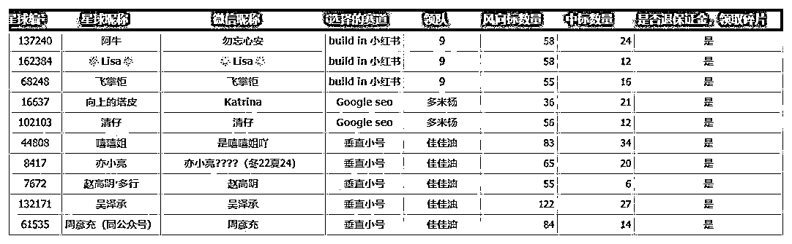
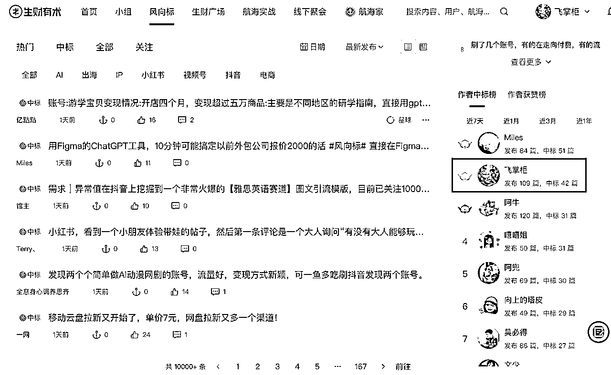
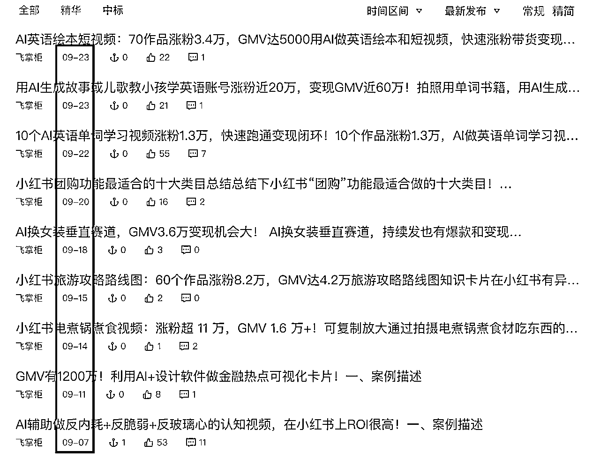
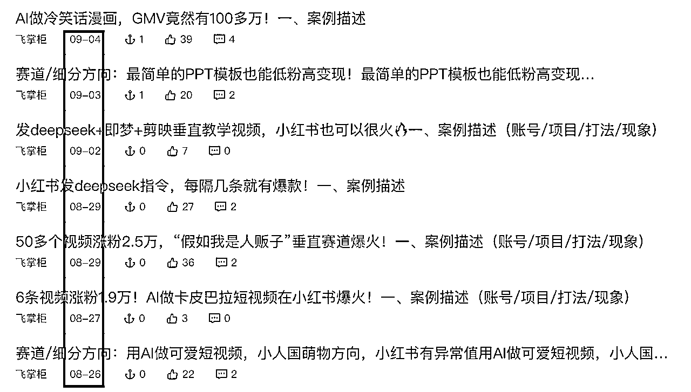

# ('(精华帖)(61 赞)如何挖掘小红书面风向标签？18 条中标锦囊送给你', (2, 37))

前几天，我在生财的“小红书超级标研究院”活动里，狠狠体会了一把什么叫“被推着走”的快乐。

说起来挺不好意思的，以前我自己研究风向标，一周能憋出三五条就算不错了。结果这次活动刚过十天，我居然一口气写出了55条，其中16条直接中标。说实话，看到这个数字，我自己都有点懵。

群里好多伙伴也一样，要么产出超过50条，要么中标次数直接拉满20次，保证金全退，碎片也拿到了，整个氛围就是：干得起劲，收获得踏实。

能有这个成绩，真心不是一个人的功劳。首先要说的就是领队少波，真的是每天群内群外追着喊，想偷懒都不好意思。再加上我们组里的Lisa、勿忘心安这些伙伴，写完就发群里讨论，互相提意见、分享心得，那气氛是真的顶。可以说，我能走到中标这条路上，很大一部分是被他们鼓舞出来的。

还有鱼丸李李和运营愣楞，一直鼓励我写这篇复盘，本来我就有这个打算，但一直犹豫，他们的“推一把”让我彻底定下心。你看，人生很多时候就这样——没人推你时犹豫不前，一旦有人给你加把劲，冲就完了。

下面这18条“中标锦囊”，是我这段时间实打实踩出来的经验，一条一条送给你：

**1.** 别把风向标想得多高深，摆正心态，它根本不设门槛；
**2.** 混对圈子很重要，得主动扎进高能量的活动里；
**3.** 干了才有机会，不干永远都是零；
**4.** 用关键词搜索，是找风向标的基础动作；
**5.** 官方活动和热门挑战赛，值得重点关注；
**6.** 账号的变现路子越宽，中标的概率越高；
**7.** 多拆解“每天拆解”这类账号，找对标模型；
**8.** 自己真刀真枪跑过的项目，写出来更有说服力；
**9.** 盯住有潜力的账号，今天不中不代表明天不行；
**10.** 善用标签机制，能明显提高命中率；
**11.** 数据表现越亮眼，越容易成为“中标体质”；
**12.** 评论区和私信，是挖风向标的富矿；
**13.** “加我领资料”的老套路，依然会有爆款诞生；
**14.** 那些“低粉高变现”的异常值，往往是爆款苗子；
**15.** 教育这种经典赛道，一旦搭上AI，机会就来了；
**16.** 别小看任何小项目，格局得打开；
**17.** 搞清楚平台流量规则，能让你挖得更准；
**18.** 想多中标，大佬们的方法一定要用起来。

说到底，风向标平台并不少，关键在于掌握方法，聚焦深耕。客户注意力在哪，生意就在哪，钱也就跟着走。小红书背后每一种变现模式，其实都是一套完整的打法。人生发财靠机会，东方不亮西方亮；但风向标这东西，转眼就可能过时，持续实操才能让自己跑得更快。

详细的拆解内容我已经整理成一篇文档，想深挖的朋友可以直接点开看——[`kqubish8iq0.feishu.cn/wiki/QieXwIyMKibaEDkV9HTcohYNnZe`](https://kqubish8iq0.feishu.cn/wiki/QieXwIyMKibaEDkV9HTcohYNnZe)

如果你也在研究小红书风向标，或者正犹豫要不要尝试，我的建议就一句话：先动手，再动脑，别怕走弯路，就怕站着不动。

* * *

大家看完有什么想法，都来评论区聊聊，你最近挖到过什么有意思的风向标吗？或者有什么卡住的地方，也欢迎抛出来一起讨论！