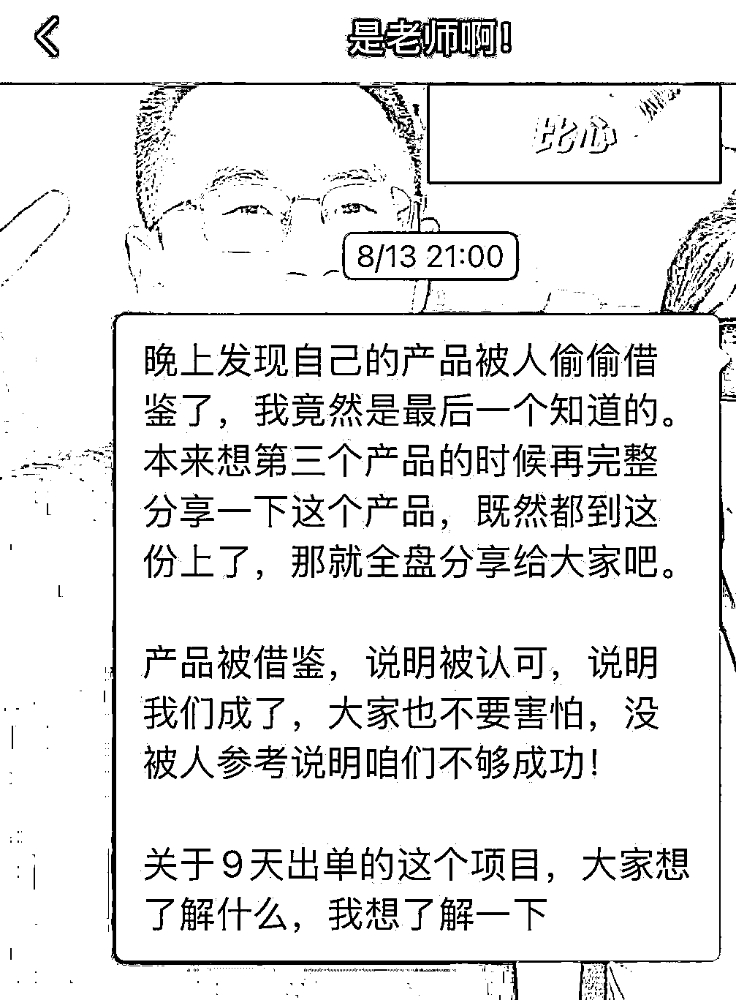
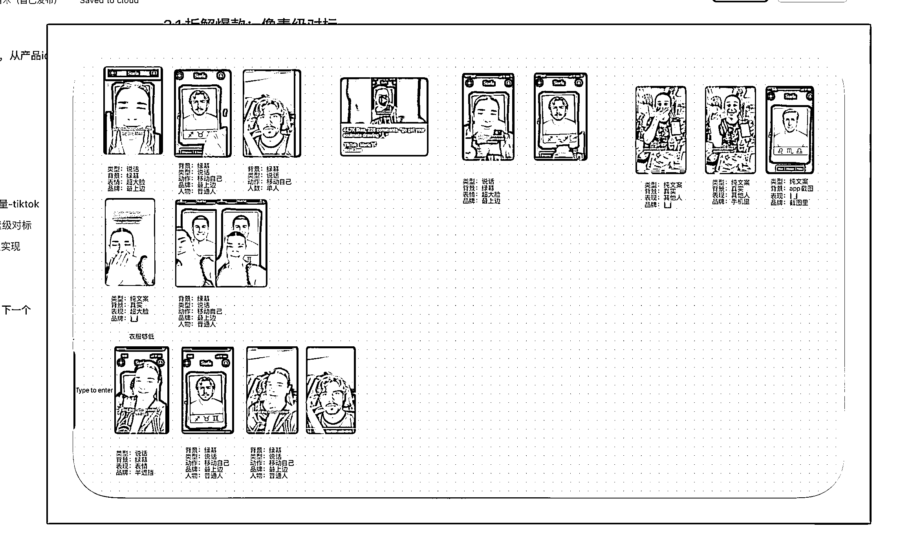
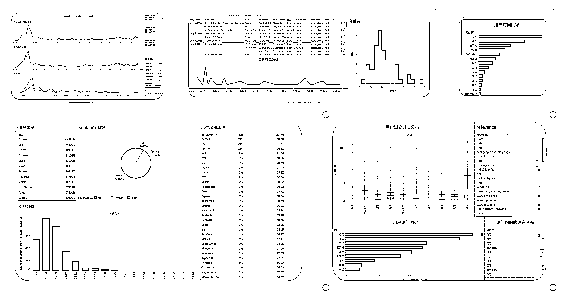

# (精华帖)(51 赞)被抄袭以后，我直播分享了第二个产品的全流程

产品被抄之后，我干脆开了一场“全程拆解”直播。

前几天在深海圈，我就这样把自己第二个产品的玩法从头到脚讲了一遍。主题很简单：怎么把出单周期从116天压到9天。全程没有藏着掖着——从Idea怎么定、产品怎么理解，到快速把站点搭起来，再回到流量源头TikTok；之后盯数据、翻用户反馈，最后判断是迭代还是换下一个品。每一个环节我都整理进了飞书文档：https://ewtk6agpo4c.feishu.cn/docx/Taymd2ioSoemsdxC80ocxhtKnfe

可能有朋友要问：该讲的都讲了，怎么当时不发，现在才发？说实话，直播完那晚我就有点后悔，觉得自己太冲动了。这内容一发，基本等于告诉所有人：这个品我不打算继续了。而且干货确实太足，谁看了都能少踩一堆坑，我多少有点私心。不过920之后，我彻底转向海外流量，拿到了一点小成绩，开局还不错。那就当是给师弟师妹们的礼物吧——希望在老师正式开课之前，这篇记录能给你们信心，也能真正帮到大家。

帖子发出来后，评论区很热闹。有人感叹时间过得真快，我回：是两个月啦，哈哈。有人搬好小板凳说要来学习，有人夸我捕捉需求够敏锐，还有人感慨进步快得惊人，更有学妹专程来道谢。

最意外的是，有位朋友主动认领了那个.app域名。他说得很坦诚：做的时候真不知道我也在做，后来看到我的帖子才知道。最初是在白鲸出海的👸号文章里看到soulmate drawing这个需求，于是搜了一圈，发现有十几个同类项目，整合了一下就上线了。他也直言，抄的成分确实有：比如官方app才是正主，他做个web站确实在蹭热度；图片风格也是照着复刻的；注册时填姓名、城市这些基础信息，当时看到同类产品都是这么做的，为了快速上线就一起照搬了；而性格分析那个功能，如果是我原创的，那确实是从我这抄的。他说自己现在已经在尽量不做纯模仿，只是像“新词”这类东西，到底该怎么界定抄袭、模仿，还是李逵和李鬼，他也有点拿不准。如果冒犯了我，他愿意道歉。

看到这里，有同学直接替我回了一句：“人家根本不是在说你。”我也笑了：感谢帮我说出来。

一场“被抄袭”的小插曲，反倒让我下定决心把东西全盘托出。反正真正的好内容，不怕更多人看到。