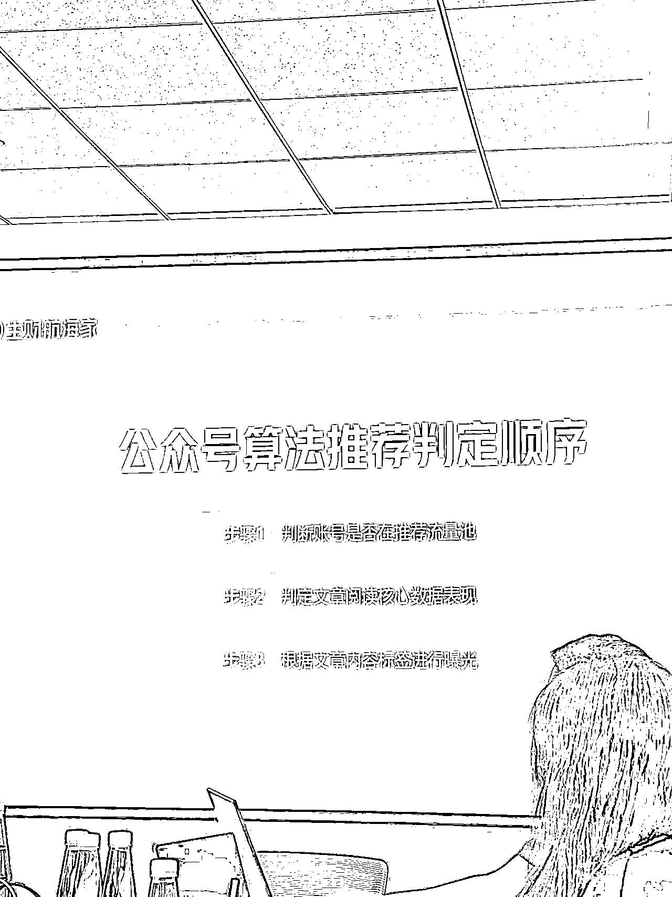
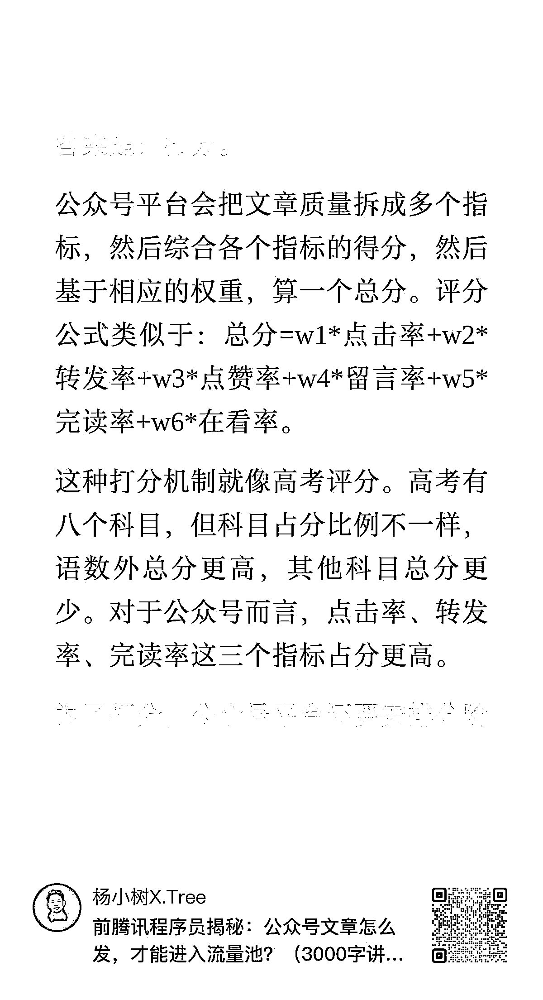
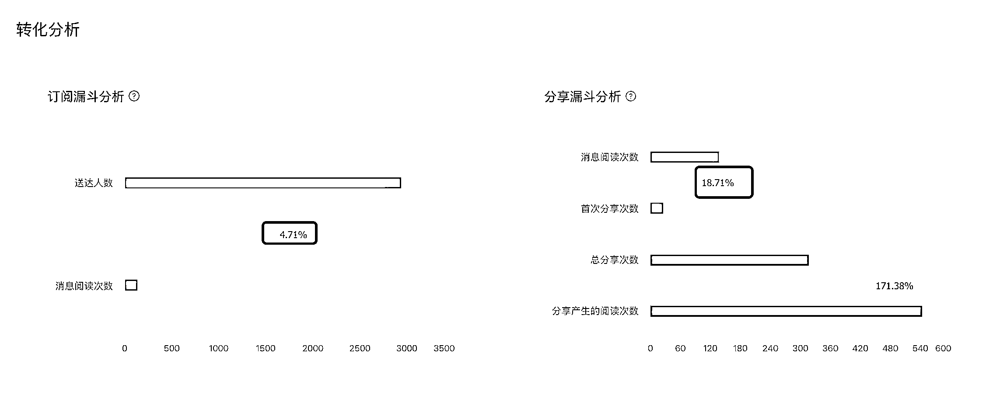
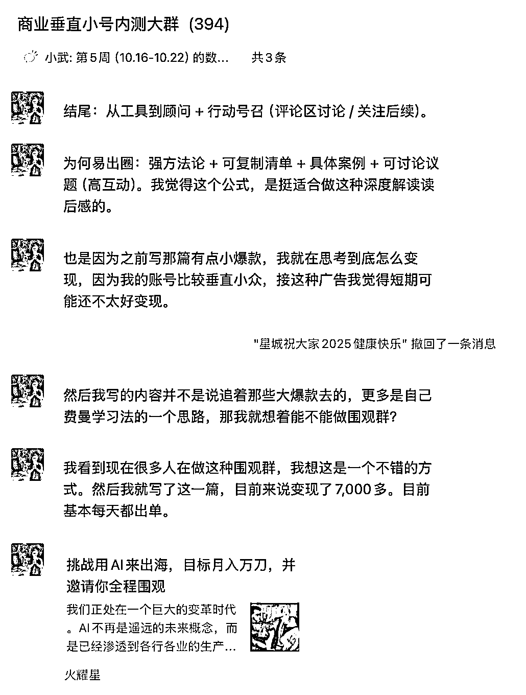

# 跟着 374 人一起做商业垂直小号 35 天，我总结了这些改变规则的发现

上次给大家交了个阶段性汇报之后，群里近四百位圈友的实战反馈又堆满了。我把这一个月多的交流浓缩成十条正在发生的趋势。

**以前的经验正在失效。**

过去发完两周没动静基本就可以判死刑了，现在完全不是这个节奏。公众号的推荐逻辑正在从订阅驱动转向算法驱动。

老逻辑：订阅列表 > 朋友圈转发 > 看一看
新逻辑：社交推荐 > 机器推荐 > 订阅

系统更看重内容本身的质量和互动信号，而不是你有多少粉丝。

我自己也在试号，最高一篇冲到 1.3 万阅读。结合一位前腾讯研发给出的模型，推流评分大致是这样的：

我们在群里反复验证的一个临界点是，粉丝完读率基本是拿到第一波流量池的门槛，普遍要 4% 以上。第二波流量池则主要看转发率和完读率的配合。

所以现阶段最值得盯的三个数据是：粉丝完读率、转发率、完读率。

程奕人老师上课给出的自检顺序我觉得很实用：
先判断号是不是还在池子里，再看这篇文章的核心表现，最后看系统给它打了什么内容标签做了何种曝光。

文字信息和笔记的流行也不是偶然。波波老师在 6 月北京 AI 传术师见面会上就点过，现在用短文字更高效地给用户打标签，精准度比长文更高。万兴老板也说过，他们的小小包麻麻号发纯文字也能上 10w+。

小树老师的说法很到位：推荐系统就是把对的人和对应的内容撮合起来。匹配越准，用户停留越久，商业价值就越大。

龙哥在《超级标》里说的那句被我们反复复盘：商业垂直小号的核心是够细。赚钱太宽，出海赚钱更准，AI 出海赚钱才算真细分。细分了不怕没人看，群里写 ToB 销售的@小吴姐、@轻舟，写 YouTube 的@萧炎，写 AI 修图的@兔子，拆解 AI 流量增长的 @... 都出了爆款。

算法现在能把很垂直的话题推送到极其精准的人群。文字语义能力变强了，反复写同一个主题，算法识别度会越来越高，读者信任感也会累积。

公众号之所以现在还值得深耕，是因为它是目前唯一兼具沉淀关系和算法推荐的平台。更像一个新时代的个人官网：足够真诚，长期就有长尾流量和转化。

账号定位不是工具，是你这个人。垂直让算法找到你，人感让用户记住你。

**为什么要选公众号做？因为微信占有了大多数人的关系和注意力。**

人群画像要清晰到可搜索。不是泛泛写短视频怎么拍，而是外贸工厂的短视频怎么拍，不是写副业怎么起步，而是 AI 出海的副业怎么做。

只求广度会极速内卷，只求深度才有壁垒。你可以成为 ToB 销售专家、n8n 工作流专家、高客单产品专家。

垂直小号本质是内容垂直 + 人设垂直。

要围绕垂直内容和垂直 IP 全面打造。垂直内容带来垂直用户，垂直 IP 强化人设，促进合作。千万别今天娱乐明天成长后天卖货。文章里也要有活人感，让人知道这是你的经验、你的判断、你的观察。

比如选一个泛副业博主和一个 AI 流量拆解博主，后者的粉丝商业价值明显更高。

你的收入和你选的人群、赛道强相关。第一天就要想清楚：写给谁看？什么场景？为什么要为此付费。

流量与产品可以拆成四个象限：别人的流量、我的流量、别人的产品、我的产品。做商业垂直号的第一步是先把我的流量做起来，再考虑带产品。可以是自营的陪伴群、风向标群，也可以是别人的体验卡。

产品侧再分标准化产品和服务类产品。标准化产品边际成本低，用来放大影响力；服务类产品用来赚利润。

找对标要找对标账号的真爆款，人设差距太大就别硬抄。选题可以用微信指数看关键词搜索热度。

林途在群里的一句话我印象很深：爆款是可复制的。很多文案类小号几个月做到 50 万粉，完全能当养老项目。搞钱赛道如肥猫说财、朱芒果、反向的猫，一个号的价值非常大。朱芒果从 7、8 月开始基本篇篇 10w+，框架简单，就是把爆款素材重做。

决定账号上限的，是内容配比。程奕人课上提到的组合是：
话题观点类文章 > 直接相关的需求痛点 > 用户故事/品牌故事/产品介绍/活动宣发

基于近 30 位爆款圈友的案例，我用 AI 提炼了 50 条实操要点，核心就十个方向：

1. 垂直 + 人感 = 爆款底层逻辑。有人设有温度的专家号。
2. 真实成长线 > 完美设定。小白成长比专家说教更吸粉。
3. 人设从“我是谁”转向“我能解决什么问题”。
4. 聚焦一个具体人群，让人两秒认出你是为他写的。
5. 持续输出一类价值，比多领域更易被系统识别。
6. 动人的是成长过程，不是完美设定。
7. 质量问题本质是数量问题，爆款是选题堆出来的。
8. 爆款选题 = 痛点词 + 高热词 + 新场景。
9. 不知道写什么就往情绪靠，钱和结果永远有需求。
10. 选题对标法：关注同赛道爆款→模仿框架→局部创新。

其余 40 条围绕标题、结构、封面、评论区运营、复盘节奏展开。总的来说：首日曝光 + 长尾增长是现在的组合拳，每周复盘找异常值，评论区是高权重互动场，引流话术要统一可复制。

今晚又有同学反馈内容变现做到 7000+。信任感建立起来持续触达目标用户，收益是确定性的。

如果你有共鸣，欢迎在评论区聊聊你的观察。[`t.zsxq.com/xxOS0`](https://t.zsxq.com/xxOS0)

* * *

评论区：

小辣椒 : 我有一篇几百浏览的，一个月后突然推流上万，还有一篇一万多，两个月后突然又推变 10 万了

七天@龙哥盟 : 哇塞，欢迎分享给大家，发一篇赚钱好事呀。

秋水 : 这是公众号在学习小红书[微笑]

刘智行 : 正在努力吸收七天老师的智慧中，知识进进进～[太阳][太阳]哈哈。