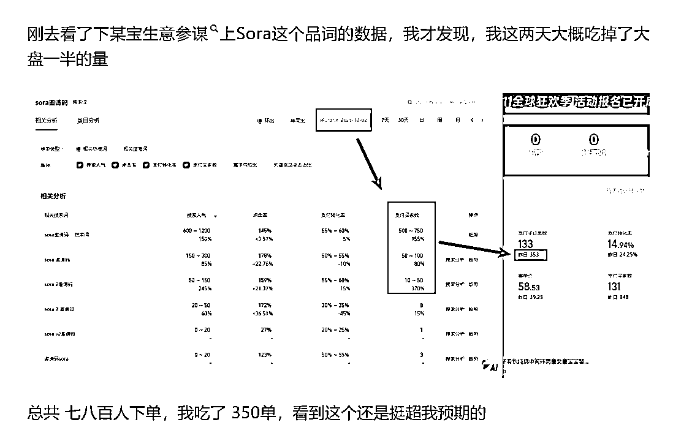

# ('(32 赞)很多人不想上班，只是没找到适合自己的路径。', (2, 29))

嘴上说不想被考勤绑住的人，多半是还没找到自己能走得通的那条路。

上个月参加了一场线下小聚，屋里坐着十几位对“坐班”提不起劲的朋友。越聊越发现，大家磨蹭不前的症结高度统一。我也曾经历三段跳：在公司边上班边试水，跳出来做个体户，现在做小规模创业，到今年正好三年。整场聊下来，我更确认一件事：不想去办公室不等于逃避，只是那条既踩得实、又走得远的路，还没被找到——我们不是懒，而是缺一个方向。

先对齐一下位置：你现在在哪一格

当天来的人基本分成三类：还在公司内观望的、已经出来接单试水的、还有正琢磨要不要自己干的。

我的路线是：一边上班一边做小生意验证 → 辞职做自由人 → 轻资产创业。

但这三年里，我见过最多的不是成功转身，而是反复折腾、一直在原地转圈的人。有人看别人做小红书出了单就冲进去，没过几个月，要么嫌自己不擅长，要么觉得人太多，就撤了。有人热衷玩工具，AI绘画、自动化工作流之类，换了一茬又一茬，新鲜感一过期就换下一个。还有人一上来就搞IP、搞产品，忙活大半年，连第一块钱都没见到。

如果你心里也冒出过离开工位的念头，先别急着辞职，也别急着追风。下面这些底层逻辑，不保证让你起飞，但一定能让你少掉进几个坑。

第一步：别先问“做什么”，先问“能不能做很久”

这三年来，我被问得最多的就是：“沧海，现在做点啥能快点摆脱坐班？”

但说真的，最难的一直不是找项目，而是判断这件事能不能陪你把路走完。

太多人起手就错了：看到小红书能变现，就跟着注册账号；听说AI账号能捞钱，就埋头冲进去；甚至有人抱着“一个产品吃一辈子”的想法，花三个月精心打磨，最后连用户在哪都不知道。

结果呢？要么几个月后撞到行业天花板，要么自己先撑不住——心态崩了，钱包也瘪了，只能换方向续命。这不叫试错，这叫反复从零开始。每次都是全新开局，前面的积累全被清零。

如果只让我给一个建议，那就是：先找一件就算外部环境翻天覆地也不会消失的事；或者，哪怕你横跨好几个方向，也要让它们能互相托举。

打个比方：你做职场求职陪跑，既帮人改简历，又带人练面试。这两件事面对的是同一群人，交付体系也相通——改简历的客户可能接着买面试辅导，面试辅导的客户又会把朋友介绍来改简历。这样的积累才滚得起来。反过来，今天画AI图，明天做母婴带货，看起来忙忙碌碌，回头一望，人还在原地。

当然也有人会说：“我就是喜欢新鲜，你让我天天重复，我浑身难受，控制不住自己，就享受从零到一的刺激，怎么办？”

这没什么不对。要知道，不是所有人都适合做从1到10的放大工程。

我见过一些人，几天时间就能把一个小项目跑通，赚个几千上万，但你要让他招人、写流程、做SOP，他头都大。也有的人，AI编程、自动化工作流这类新工具换着玩，永远追着热点跑。

如果你属于这一挂，别逼自己去做深度聚焦——你可能真做不到，逼自己反而是折磨。对你来说，越聚焦越煎熬。你更适合往资源连接的方向走：你天生喜欢接触不同行业、收集各种情报，那就把这些信息串起来。比如，帮做AI的人对接有技术需求的商家，帮做小生意的人牵线流量渠道。

我在自己还没形成体系之前，参加过二十多期不同类型的商业项目。我记得很清楚，没有一次打完卡，当然也没拿到过退款。但每一期我都能拆出背后的门道：这个玩法是怎么设计的？报名的人都是什么画像？他们为什么愿意掏钱？这些观察，后来帮我解决了不少用户的真实困惑。

所以，兴趣广泛从来不是毛病，关键是能把“尝鲜”和“沉淀”结合起来，而不是被新鲜感牵着鼻子走。

第二步：从零到一别搞复杂，先做那种伸脚就能踩到钱的事

如果你现在还在公司，想先找点事儿试试水，又没有老师带，千万别学人一上来就搞什么“全流程闭环”——又做产品、又定定位、又搞流量、又做销售。这对新手来说太难了，大概率会把你所有热情烧光，最后什么都不想碰。

那从零到一的核心是什么？

快速拿到正反馈，做倒手生意。

什么事能让你迈一步就见到钱？答案是差价：信息的差价、资源的差价、平台的差价。别觉得倒买倒卖不体面、是走偏门，恰恰相反，对新人来说，能快速赚到第一笔钱，比什么都金贵。

我第一次靠业务时间赚钱，靠的就是资源差价。

2021年，我还在公司做设计经理，带过一位下属，他辞职后去做抖音特效道具，一个卖500块，专攻中老年“丑萌”风格，卖得特别火。我一看就明白了：这玩意儿根本不用原创，找素材拼一拼就行。我花了一周把流程跑通，然后在QQ群、APP上找兼职，把流程免费教给他们，我负责对接平台、发工资。那段时间最忙的不是做业务，而是每天给兼职结账——当天有收益当天就发。

现在我创业的主业，就是带不想坐班的人从零起步做自己的小事业，用大家自己的技能、爱好和优势去做产品，系统地带每个人完整跑一遍商业链路：定位、产品、销售、获客、运营。

再比如，我现在睡觉时间也能进账的钱，主要来自卖AI账号和资源变现。这就是典型的倒手生意，赚的是信息不对称的钱。单笔利润有时候只有几块钱，但几个月下来，被动卖了七千多单。

就拿AI账号说事儿：只要用AI的人，谁都离不开各种账号，不管是镜像还是官方。我把这些资源收拢到一起，有人要买就发链接，不会用就丢教程，不用交付、不用售后，基本等于躺着收钱。这事儿难吗？在AI已经满大街的今天，找到几百个、哪怕上万个在用AI的人，根本不难，哪个平台、哪条渠道都能触达。

我靠这个，一个月能赚一两万。今年四月GPT-4o出来那阵，单月冲到了五万。再加上另外两个设计方向的被动小项目——对接设计需求和业务撮合，只要他们成交我就抽成——这样一个月被动现金流稳稳落在三四万。

有了这笔钱托底，你才有心思去琢磨更长远的事。

不过话说回来，很多人看不上小钱，觉得“要做就做能赚大钱的”，憋个大招、干票大的。但你想过没有？新人一上来就同时搞商业定位、产品、内容、销售、运营，来回打磨，学平台规则、做内容、练转化话术——这是整整五道工序。新手得把这五步全走完才能见到钱，难度有多大？有多少人能走完全程？更别说赚钱了。

反过来，赚差价的钱，先学会做倒手生意。尤其在生财这类圈子里，到处是机会和信息资源，不需要你有产品，不需要你会引流，发个朋友圈、对接个资源就能变现。哪怕一次只赚几十块，也能让你亲眼看到“我这人也能赚钱”——这种即时正反馈，才是你能坚持下去的燃料。

就像国庆放假那几天，Sora突然爆火，一堆人在找邀请码。邀请码本身是免费的，但我亲眼看到群里有人把它挂到淘宝上，一个卖50块，卖了几百单。这就是倒手生意，拿信息差赚认知差。

你可能会纳闷：闲鱼上才卖3块5，他怎么敢在淘宝卖50？这跟能力有多强、技术有多硬有关系吗？没有。只是他知道这个信息，知道这样能卖出去，懂人性就够了。

还有个坑，必须提醒新人：别以为“存半年生活费就能辞职单飞”。

我见过太多人，攒了几万块就辞职了。刚自由那阵觉得时间全是自己的，想熬夜就熬夜，想几点起就几点起。几个月后开始心慌，半年后钱花光了，又灰溜溜回去找工作——这是最常见的剧本。

真正做好辞职准备，不是存够半年的开销，而是备好“一两年生活费 + 一个能来钱的小项目”。有了被动现金流兜底，你才不会慌，才不会把日子全耗在焦虑内耗里。

选方向不是选热门，是选你能打得过的对手

当你靠小生意或倒手稳住了收入，也有了一些积蓄，胆子自然会变大，会想往更长久的方向走。这时候，就会遇到“选方向”的问题。

很多人跑来问我：“现在什么方向火？AI、跨境、私域，我该往哪走？”

我的回答是：选方向不是选风口，而是选你打得赢的对手。

你要先想清楚：这个方向里站在顶部的是谁？他们干了几年？资源、人脉、经验比你强出多少？你冲进去，凭什么能赚到钱？将来狭路相逢，你手里握着什么牌？

我当初决定做“帮职场人转型做自己的事业”，不是因为这个方向火，而是因为我自己就是这么走过来的。

三年前，我就相信会有越来越多的人离开公司。我懂上班族的焦虑，懂单干后的卡点，懂刚起步时的那些坑——这些亲身经历，就是我的护城河。每年有一千多万人离开职场，如果我当时跟风去做医美，哪怕市场再热，我不懂行规、不懂用户，大概率早就被打回原形回去上班了。

选方向还有个小窍门：别只盯着行业切，要盯着人群切。

我很认同一个判断：现在只有两类人能赚到钱，一类是头部IP，一类是极度聚焦人群的玩家。

核心赛道、核心人群、核心需求，三件事要对齐。

行业是会变的。比如去年还火得不行的数字人直播，我认识的一位大佬今年已经转行了。但人群的需求不会变：设计师永远有“想搞点额外收入”“不想坐班”的需求，职场人永远有“想多赚点”“想换个活法”的需求。

我以前把朋友圈分成“设计师”和“非设计师”两个标签，同一条内容发两次，结果付费的人里八成都是设计师。

后来我拆解他们的需求：搞AI账号、学AI绘画、找副业方向、辞职创业——这些需求正好铺满他们从公司到单干的全过程。于是我就针对设计师做延伸：带他们搞AI绘画，带他们做小生意，再陪他们转型自由人。这样一来，用户回头率特别高，很多人在我这里反复付费五六次甚至七八次，还有人跟着做高客单价的深度项目。

反观那些只盯项目或行业的人，比如只做AI绘画教学，一旦AI绘画热度降了、工具迭代了，学员就跑了。因为他们是跟着项目走，不是跟着人走。而盯人群的做法是，用户认你这个人，哪怕你后面换了产品，只要还能解决他们新冒出来的问题，他们依然信任你。

定位不是焊死的，而是动态调的

线下聊到长期发展，很多人卡在两个地方：一是定位定得太死，不敢挪；二是找参照时只抄了项目，没抄到根。

先说定位。很多人觉得，定位一旦定下来就不能改了。真不是这样。

定位是活的，核心标准只有一个：你做这件事不累、心里不排斥。

我最早的定位是“带大家做AI相关项目”，后来发现，很多人学完技能就走了——他们跟的是技能，不是我这个人。于是我调整了定位，改成“帮职场人解决转型问题”。从AI账号到副业规划，再到创业陪跑，只要你转型路上遇到的问题，我都帮你处理。慢慢地，用户开始跟着我走，回头率也一路上来了。

找参照不是抄项目，是抄人

再说找参照。很多人找参考，只看“对方做什么项目”——对方做小红书引流，我就跟着做；对方卖199的课，我也卖199。但这样下去，你永远只能跟在人家屁股后面。

真正的参考，是“抄一个人”：找一个跟你很像、又已经反复拿到结果的人，去琢磨他的思维方式、他的行动路径、他怎么拍板做决定。

我之前想做高客单价陪跑，就找了一位年赚千万的同行当样本。我没有直接抄他的课，而是花1.8万付费，再花三个月持续追踪他的动态：翻他公众号早期的文章，拆他的标题写法，听他的直播，把他的逐字稿一句句拆开看。

花钱，是让你看到真相最快的办法。我把他的交付流程也研究了一遍，最后发现：他早期卖599的课，后来涨到999，不是因为他贪心，而是因为投流成本涨了——599会亏本，999才能打平成本，真正的利润靠后面高客单的项目赚。这个定价逻辑，比抄他的课程内容有用一百倍。

更关键的是，要找和你像的人对标。

比如你性格内向，就别找一个靠直播炸场火起来的人当样本。你刚毕业，就别对标那些有十年老经验的人。

我有一个学员，开广告公司的，线下生意在下滑，想转线上。我让她找了一个参照对象：同样是广告出身、性格内向、但特别擅长做内容的人。她照着我说的方法去拆解对方，把自己的经验做成课，几个月就卖了108万，几乎全是利润。现在她已经出了四门课，前几天又卖了一百多份。

为什么“抄人”比“抄项目”靠谱？

因为项目的红利一定有过期的一天——就像去年的数字人直播，今年已经不火了。但一个人的做事底层逻辑不会变：怎么找用户、怎么设计产品、怎么解决问题。这些底层能力，能帮你扛住任何变化。

不想坐班，不是不工作，是选一种对的干法

有人问我：“到底什么才算长期事业？能做个二十年、三十年的那种。”

我的答案是：这件事，等你老了回想起来，依然觉得“值得”；而且你做它的时候，不排斥、不痛苦。

比如做外贸的朋友，担心AI冲击、害怕跨境内卷，问我“外贸能不能做一辈子”。

我的建议是：先别想太宏观，先问自己喜不喜欢做外贸。如果你不讨厌和客户打交道，也不排斥对接资源，那就先做着。1比7的汇率差就摆在那，只要你能在里面找到自己的差异化——比如擅长服务小B客户，或者能帮客户解决供应链的难题——就有赚不完的钱。

还有刚毕业的小朋友，想把“营养健康”做成副业，纠结要不要现在就全力投入。

我告诉他：先别谈喜不喜欢，先看清自己站在哪。你刚工作两个月，没存款、没经验，不如先做点轻量的尝试——比如在朋友圈分享营养知识，帮身边人做简单的饮食规划，先把第一块钱赚到。等生活稳定了，再考虑要不要深入。

很多人都把“不想坐班”理解成“不想工作”，这完全是两回事。

我们不想的，是被考勤机绑住、被KPI推着走、去做自己毫无感觉的事。我们想要的，是能掌控自己的时间、能赚自己认可的钱、能做有积累的事。

不想坐班的这条路，从来不是一步到位的，而是“先迈小步，再迈大步”。

先靠差价赚到第一笔钱，再靠找一个像样的人找到方向，最后靠积累做成长久的事业。

慢慢来，不着急。让自己更靠谱一点，积累更多一点，路自然走得更长一点。

希望你也能找到那条属于自己的路——既能养活自己，又能活得开心。

我是沧海大表哥，职场十年设计经理，裸辞创业第三年。累计付费用户7200+，帮助10000个同频的人开启自己的小事业。如果你也正卡在某个路口，欢迎找我聊聊，或者评论区见。

* * *

评论区：

练多就菜：同为设计师，听了很有感慨

沧海大表哥：哇，难得在生财看到同行设计师

练多就菜：可以链接一下吗？

沧海大表哥：当然可以，找鱼丸就行

橘皮乌龙：很有收获，我自己就经历过一次从公司跳出去、半年后又回公司的循环

沧海大表哥：感谢关注，欢迎随时来聊