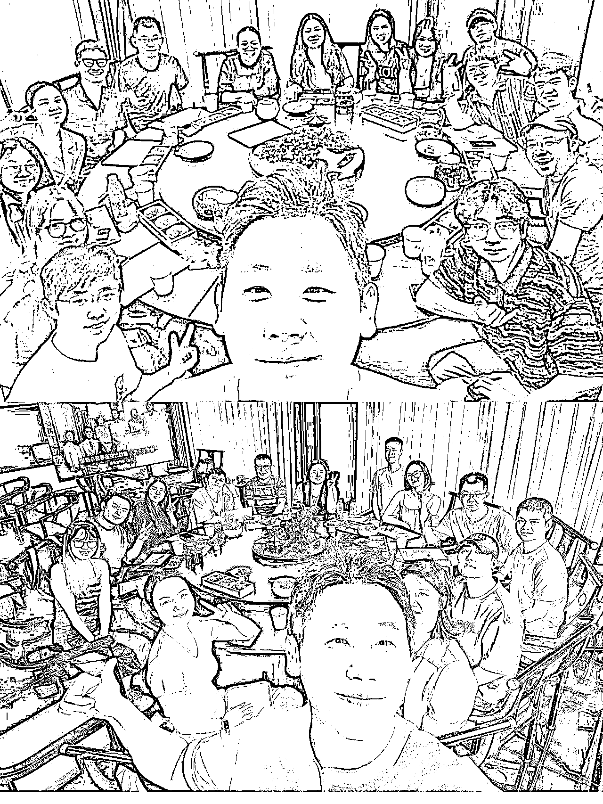
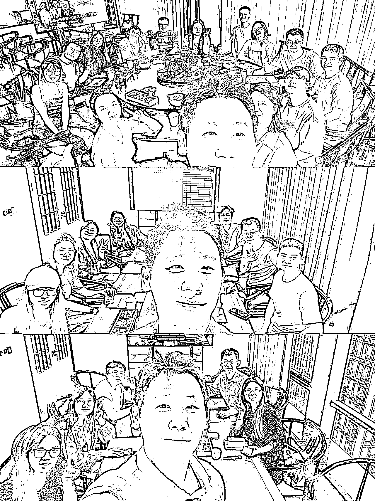
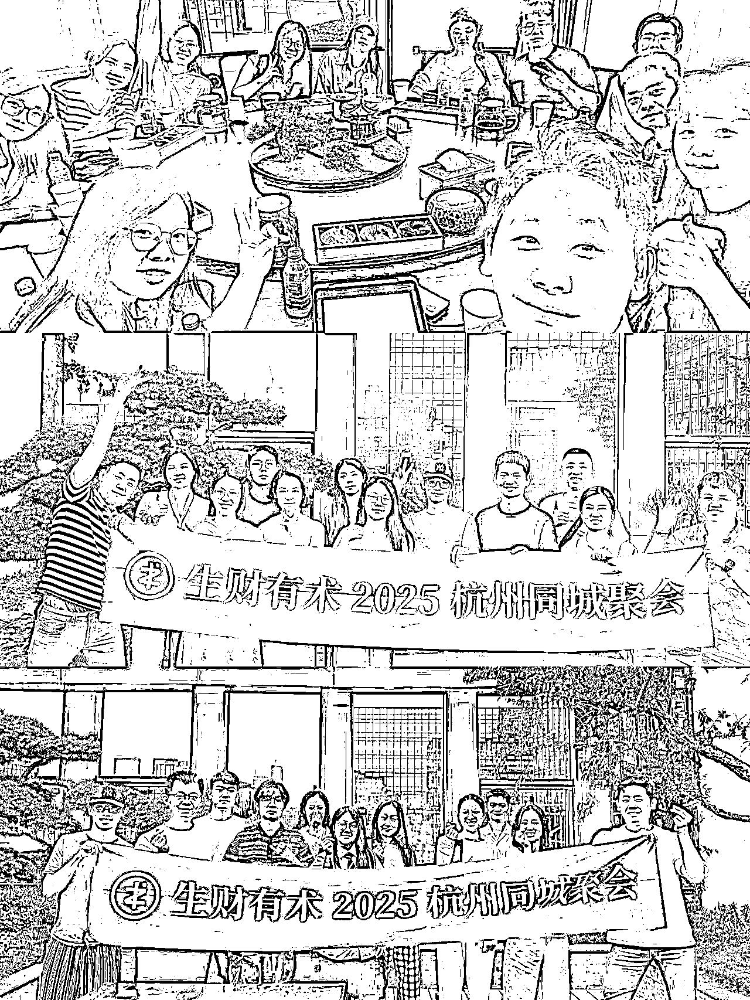
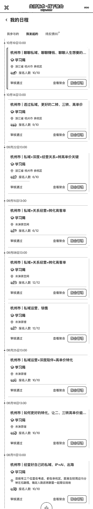
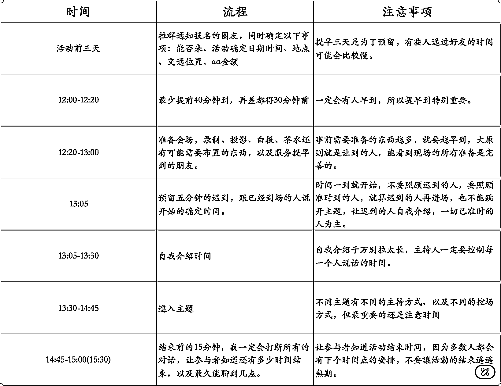
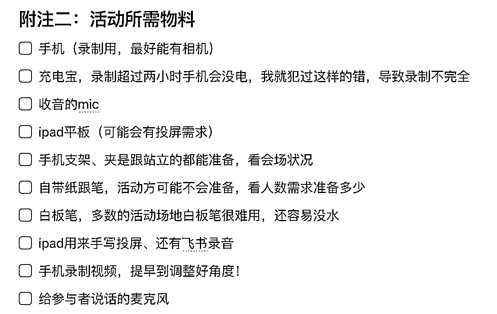

# 小型线下活动全流程拆解：从定主题到控场细节的实操笔记

## 小型线下活动全流程拆解：从定主题到控场细节的实操笔记

作者： 根源

日期：2025-10-24

各位赚钱的朋友大家好，我是根源。

这两年赚钱上线了专门的线下组局板块，让圈内人面对面连接变得更轻松，也让大家的互动方式变得更多样、更紧密。能成为赚钱的一员，每年都能享受到社区不断升级带来的环境红利，我真的很荣幸。

我从 2018 年就开始摸索线下活动了，为了认识更多新朋友，累计参加过近百场。规模从只聊两三人的小圈子，到上千人的大型聚会；身份也从参与者一步步成长为主办方。

今年 8 月起，我给自己定下了一个小目标：每周至少组织一场线下局。算到现在已经连续办了 9 场，整体反馈都不错，报名情况基本都保持满员。

如果你也想试着自己牵头做一场线下活动，这篇文章是我这段时间的总结，希望能给你一些借鉴和启发。完整飞书好读版在这里： [`oee5lr7gsk.feishu.cn/wiki/UWAVwU9K2izhMKkpo3HcxHcxGNonIh?from=from_copylink`](https://oee5lr7gsk.feishu.cn/wiki/UWAVwU9K2izhMKkpo3HcxGNonIh?from=from_copylink)

* * *

评论区：

暂无评论